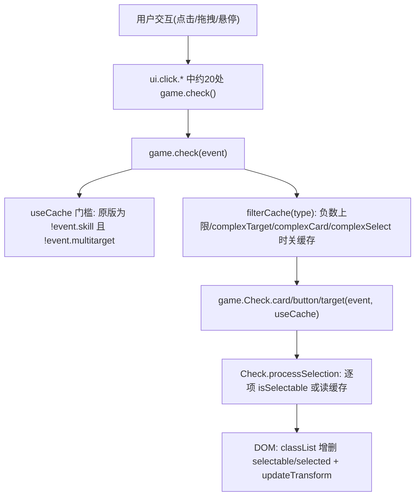

# 知识库.md — 项目技术知识沉淀

本文件沉淀对无名杀本体与自用ai扩展的代码追踪结论、性能问题档案与修复方案。所有结论均基于对当前仓库源码的逐行核对，行号为编写时位置，可能随本体更新漂移。

## 一、game.check 选牌系统架构

### 调用链



要点：

- `game.check` 在每次交互都会执行（点击、拖拽开始/结束、确认按钮更新等），单次成本直接决定手感。
- `Check.processSelection`（`apps/core/noname/game/check.js`）对 button/card/target 三类通用处理；`isSelectable` 最终走到 `event.filterCard`，常规事件下即 `lib.filter.filterCard`（`apps/core/noname/library/index.js` 约 11597 行），内部为 `cardEnabled + cardUsable`，两者都通过 `game.checkMod` 遍历玩家全部技能 mod，并调用 `player.countUsed`——每张牌、每次 check 都要付一遍。

### 选择缓存机制（原版设计）

- 缓存挂在事件对象上：`event._cardChoice` / `_buttonChoice` / `_targetChoice`，键 `cacheId` 为已选对象 id 的 XOR。
- id 来源：`get.id()`（`apps/core/noname/get/index.js` 约 2076 行）返回纯数字字符串，`cardid`/`playerid`/`buttonid` 均出自此处；数字字符串经 ToNumber 后 XOR 有效，超 int32 会回绕（原版即接受此碰撞风险）。
- **原版键值只含"当前类型之前"的选择状态**（button → card → target 顺序内，遇到当前类型即 break）：card 类型的键恒为 0（无前置类型时），target 类型含按钮与牌、不含已选目标。设计假设：非技能事件的 filterCard 与同类型选择无关；依赖选择状态的过滤器必须声明 `complexCard`/`complexSelect`/`complexTarget`（`filterCache` 检测后关缓存）。
- `useCache` 在原版 `game.check` 中是全局一票否决：任一类型的 `filterCache` 失败，三类全关。
- `game.uncheck` 清 UI 选中状态，但清缓存；缓存随事件对象存活整个事件周期。

## 二、性能问题档案

### 问题 1：updateTransform 的 O(N²) 布局抖动（已修复）

- 位置：`apps/core/noname/library/element/card.js` `updateTransform`（约 728 行）。
- 根因：每张手牌的 `updateTransform` 都同步调用 `ui.updatehl()`（`apps/core/noname/ui/index.js` 约 434 行）；`updatehl` 是全量手牌重排，内部每张牌执行 `ui.refresh`（即 `window.getComputedStyle` 强制 style recalc）与 `node.info.offsetWidth`（强制 layout）。`game.check` 处理弃牌类事件（`selectX` 上限为负，走 `range[1] <= -1` 分支）时对每张牌调用一次 `updateTransform`，N 张手牌触发 N 次全量重排——每次交互 O(N²) 次强制布局。
- 修复：`updateTransform` 改调去抖版 `ui.updatehlSoon()`（setTimeout 合并，一轮 check 只重排一次）；`Button.updateTransform` 是 getter、动态读 Card 原型，patch Card 原型即可同时覆盖。

### 问题 2：技能事件过滤缓存整体禁用（已修复）

- 位置：`apps/core/noname/game/index.js` `check()` 内 `let useCache = !event.skill && !event.multitarget;`。
- 根因：技能事件（viewAs 使用、响应 prompt 等）下每张牌每次 check 全量重算 `filterCard`；技能选牌场景牌多（手牌 + 装备 + 判定区）、技能 mod 多（扩展注册大量技能），是"牌多卡顿"的主要来源。
- 修复与正确性保障：
  1. `useCache` 仅由 `multitarget` 与各类型 `filterCache` 条件决定，技能事件也允许缓存；
  2. 技能事件的缓存键纳入全部三类选择状态（选择变化必然换键），解决"依赖已选牌的技能过滤器读到陈旧缓存"；
  3. filter 函数引用变化（`custom.replace.card` 等替换场景）时整体失效（缓存对象带 `_filter` 引用比对）；
  4. 非技能事件键值语义与原版逐场景一致（经 16 项独立断言验证，含 XOR 顺序无关性与大数回绕）。
- 残余风险（与原版同类、已接受）：filterCard 闭包读取"两次 check 之间被外部改动且选择状态不变"的可变状态时会读到陈旧结果；原版约定此类过滤器应声明 `complex*`，`filterCache` 会为其关缓存。

### 实现位置

以上修复全部位于 `apps/core/extension/自用ai/extension.js` 的"优化 8"，本体代码保持原版；开关 `lib.config.extension_自用ai_checkopt`（选牌检查优化），关闭即运行时回退原函数。

## 三、自用ai 扩展 patch 清单

| 编号 | 目标 | 内容 |
|------|------|------|
| 1 | `CacheContext._wrapParameterToCacheKey` | 函数参数 key 用 WeakMap 记忆化，避免重复 MD5 序列化 |
| 2 | `get.selectableCards` | 按 (player, event) 闭包缓存 `getCards("hes")`，事件切换即刷新 |
| 3 | `get.selectableButtons` | 按 dialog 缓存按钮列表 |
| 4 | `get.selectableTargets` | 按 (event, deadTarget) 缓存玩家列表，死亡玩家加入受 deadTarget 控制 |
| 5 | `ai.basic.chooseButton` | 变量外提 + 复用 check 结果 |
| 6 | `ai.basic.chooseCard` | 技能列表外提 + 免 concat 复用数组 |
| 7 | `ai.basic.chooseTarget` | 变量外提 + 复用 check 结果 |
| 8 | `Card.updateTransform` + `game.Check.*` | 手牌重排去抖 + 技能事件过滤缓存（见上节） |

开关：`自用ai_onai`（优化 1-7，替换底层 ai），`自用ai_checkopt`（优化 8）。

### CacheContext 使用纪律

- 生命周期等于单次 AI 决策：`storageMap`/`sourceMap` 只在决策内有效；每次决策必须 `new CacheContext()` 并通过 `setCacheContext` / `setInCacheEnvironment(true)` 包裹，`finally` 中复位（扩展内优化 5-7 的写法）。
- `cacheOrder`/`cacheEffectUse` 走 CacheContext 实例 proxy 层缓存；`cacheEffectUse` 仅用于 chooseToUse 的 ai2（选目标阶段已选牌静态，安全）。
- Player/Card/VCard 均实现 `getCacheKey()`，可用 `CacheContext._wrapParameterToCacheKey` 作缓存键。
- AI 决策热点链：`get.order`（ai1）、`get.effect`/`effect_use`（选目标）、`get.unuseful2` → `get.useful`（弃牌类，原版 O(N²) 来源）。

## 四、模式与技能 API 速查

破阵模式预研结论（任务搁置，结论保留备用）：

- 注册模式：扩展默认导出内 `game.addMode(name, { name, start, ... })`；模式对象的 `get: { rawAttitude }` 由 `loadMode` 合并（`apps/core/noname/init/loading.ts` 约 415 行）。
- 扩展包内 `skill.skill` + `skill.translate` 会被自动合并进 lib（`init/loading.ts` 约 382-396 行）。
- 禁用非锁定技：`skillBlocker` 声明 + `addSkillBlocker` 模式（参考 `apps/core/noname/library/skill.js` 约 1680 行 baiban 示例）。
- 不可响应：`trigger.directHit.add(target)`（useCardToPlayered 时机）。
- 无视防具：`target.addTempSkill("qinggang2")`。
- 自定义判定：`player.judge(fn)`。
- 步骤编译：技能 steps 支持 await（StepCompiler）。

## 五、已知边界与注意事项

- `get.card()` 对技能事件会调用 `get.info(event.skill).viewAs` 并分配 VCard（`apps/core/noname/get/index.js` 约 3826 行）；`game.check` 的 `filterCache` 每 check 每类型都会调它，本体原版即如此，patch 时保持同频率即可。
- `range[1] <= -1`（不限量选择，如弃牌）事件：`filterCache` 对负数上限返回 false，缓存关闭，`processSelection` 走自动全选分支——该分支与 DOM 热点（问题 1）叠加，是弃牌场景卡顿的直接来源。
- XOR 键的碰撞：数字字符串 id 超过 int32 会回绕，多 id 异或存在理论碰撞可能；原版已接受该风险级别，扩展实现保持一致。
- `game.check` 的 `filterCache` 无副作用，可在 patch 中安全复刻或前置调用。
- 修改本体文件的冲动一律转入扩展实现（见 `agent.md` 协作规范）。

## 六、mod 系统与过滤函数档案

### game.checkMod（game/index.js 约 9002 行）— mod 管道分发

- 签名：`game.checkMod(...arg, name, player)`，`name` 为 mod 类型，返回值取自 `arg` 末位元素的链式传递结果（末位为 object 时 mod 返回值被丢弃，靠 object 可变性传递）。
- 技能集解析：优先 `player.getModableSkills()`，否则 `getSkills().concat(lib.skill.global)` → `game.expandSkills` → 过滤带 `info.mod[name]` 的技能 → 按 `get.priority` 排序。
- **成本核心**：`getModableSkills`（player.js 约 5613 行）每次调用都全量重建：`getSkills` 读取 skills/additionalSkills/tempSkills/hiddenSkills/invisibleSkills + `getVCards("e")` + `get.skillsFromEquips`，再 expandSkills + filter + sort。任何频繁调用 checkMod 的路径都在反复付这笔账。
- 常用 mod 类型：`cardEnabled`/`cardEnabled2`/`cardUsable`/`cardUsableTarget`/`cardRespondable`/`cardDiscardable`/`cardname`/`cardsuit`（双管道）/`cardnumber`/`playerEnabled`/`targetEnabled`/`selectTarget`/`aiOrder`/`aiUseful`。

### lib.filter 过滤链（library/index.js 约 11348-11530 行）

- `cardEnabled(card, player, event)`：实卡先走 `cardEnabled2` mod 短路 → `get.autoViewAs(card)` **新分配 VCard** → `info.enable` 判定 → `cardEnabled` mod 管道。每张牌每次 check 两次 checkMod + 一次 VCard 分配。
- `cardUsable(card, player, event)`：autoViewAs → `info.usable`（函数或数字）→ `cardUsable` mod → `player.countUsed(card2)` 查表（便宜，见下）；次数用尽时兜底 `game.hasPlayer2` + 逐目标 `cardUsableTarget` mod（贵）。副作用：向 event 写 `addCount_extra = true`（供 targetEnabledx 的 cardUsableTarget 分支使用）。
- `cardUsable2`：与 cardUsable 类似但无 addCount_extra 副作用、无 hasPlayer2 兜底，供 targetEnabledx 的 addCount_extra 分支用。
- `cardRespondable`：仅 `chooseToRespond` 事件生效（其余直接 true）：来源方 `norespond` 技能标签检查 → 实卡 `cardEnabled2` mod → autoViewAs 后 `cardRespondable` mod。
- `cardDiscardable`：event 取 `getParent().name` 后走 `cardDiscardable` mod。
- `filterCard`（约 11597 行）：`cardEnabled && cardUsable` → notarget 直通 → selectTarget 解析（数字/数组/函数 + selectTarget mod）→ 上限为 -1 时 `game.hasPlayer2` 遍历 filterTarget。

### 成本模型小结

一次 `filterCard` = 2 次 checkMod 管道（cardEnabled、cardUsable）+ 2 次 VCard 分配 + countUsed 查表 + 可选 hasPlayer2；而每次 checkMod 管道 = getSkills 全量重建 + expandSkills + 排序。技能多、扩展多时单次 checkMod 即数百微秒级，乘以牌数 × 每交互 check 次数即"牌多卡顿"的量化来源——这正是扩展优化 8 缓存命中路径绕开的部分。

## 七、AI 决策函数档案（get/index.js）

### 姿态与基础分

- `get.attitude(from, to)`（6548）：`rawAttitude` 经 CacheContext proxy 缓存（决策内静态）→ `from.isMad()` 取反、`to.isMad()` 削减（主公 1 其余 0）→ `ai.modAttitudeFrom/To` 修正（`_status.tempnofake` 防递归）。`get.sgnAttitude` 取符号。
- `get.rawAttitude`：模式相关，由 loadMode 合并模式自定义实现。
- `get.order(item, player)`（6795）：`info.ai.order`（或 `info.ai.basic.order`）→ 函数则调用 → `checkMod "aiOrder"` 管道 → 无 order 返回 -1。chooseToUse 的 ai1 默认 `get.cacheOrder`（走 proxy 缓存）。
- `get.useful/useful_raw`（6580/6634）：判定区 -1、装备区 `get.equipValue`、手牌按同名序数 i 取 `ai.useful`（数组取末位兜底、函数则调用、数字直取）→ `checkMod "aiUseful"`。`_status.event.useCache` 时走 `game.callFuncUseStepCache` step 缓存。派生：`unuseful = -useful`，`unuseful2 = 10 - useful`（弃牌 ai 默认），`unuseful3` 毒额外 +20。
- `get.value`（6652）：数组牌除以 `sqrt(length)`；`card._modValue` 优先；`ai.value`（函数/数组同 useful 模式）。

### 效果评估 effect / effect_use（6861 / 7137）

两者结构一致，读法差异仅在基础分：`effect_use` 取 `ai.result.player_use/target_use`（缺省回落 player/target），`effect` 取 `ai.result.player/target`。

计算流程（相同部分）：

1. card 解析：object → `get.autoViewAs` 分配；无名对象 → `event.skill` 或 `get.card()`（viewAs 命中时记录 eventskill 并入 get.result）。
2. `info.changeTarget` 存在时（仅 effect_use）展开目标逐个 `cache.get.effect` 求和。
3. `get.result(card, eventskill)` 取基础 result1/result2（函数则调用）。
4. **player 侧**：`getSkills().concat(global)` + expandSkills 重建数组，逐技能 `ai.effect.player`（effect_use 优先 `player_use`）修正——返回数组 `[系数, 加值]` 或 `[系数, 加值, 系数2, 加值2]`，或字符串 `"zeroplayer"/"zerotarget"/"zeroplayertarget"`。effect_use 中该调用经 `cache.delegate(...)` 走 CacheContext；effect 的 player 侧直接调用。
5. **target 侧**：同上遍历目标技能，`ai.effect.target`（effect_use 优先 `target_use`）+ `ai.threaten` 累乘（player 的 `hasSkillTag("ignoreSkill")` 可跳过目标技能修正）。
6. 状态修正（`result.ignoreStatus` 可关）：敌对目标 `sqrt(threaten)`、友方 `sqrt(sqrt(threaten))`；hp 1/2 时 ×2.5/×1.8（effect 为 ×3）；手牌数 0/1/2/≥3 档 ×1.5-2.1/1.3/1.1/0.5；hp 4/5/>5 ×0.9/0.8/0.6。
7. `zeroplayer/zerotarget` 归零；最终 `result1 × attitude(立场, player) + result2 × attitude(立场, target)`（player2 指定时按其立场）。
8. 连环传导：`get.tag(card, "natureDamage")` 且目标横置时，对其余横置玩家递归 `cache.get.effect(..., linking 上下文)`（`ai.canLink` 可控制）。

派生封装：

- `get.damageEffect(target, player, viewer, nature)`（7362）：复合 nature 取均值；按 nature 映射虚拟牌名 damage/firedamage/thunderdamage/icedamage 调 `get.effect`；`eff > 0 且有护甲` 时 ÷1.3。
- `get.recoverEffect`（7408）：满血返回 0，其余走 effect。
- `get.cacheEffect` / `get.cacheEffectUse`（7119/6843）：effect/effect_use 的 proxy 直通版，chooseToUse 的 ai1/ai2 默认分别接 `get.cacheOrder` 与 `get.cacheEffectUse`。

### 集合与遍历（game/index.js 约 10166-10240 行）

- `game.expandSkills(skills, subSkill)`：原地去重追加 `info.group`（数组化 + lib.skill 存在性过滤）；subSkill 仅显式开启时展开（`name_sub` 键）。
- `game.hasPlayer(func, includeOut)`：存活玩家 some 短路；`hasPlayer2` 额外拼接 `game.dead`；`countPlayer/2` 求和（func 返回数字累加数值、布尔累加 1）。

## 八、元信息与工具函数

- `get.info(item, player)`（get/index.js 3790）：字符串/symbol → `lib.skill[item]`（缺失警告并返回空对象）；object → `lib.card[get.name(item, player)]`。注意 `player !== false` 时 card 会先走 `get.name` —— **有主的手牌会触发一次 cardname mod 管道**，即 get.info 本身可能不便宜。
- `get.name(card, player)`（3421）：有 owner（或指定 player）时 `checkMod(card, owner, card.name, "cardname", owner)`，否则直读 `card.name`。
- `get.suit`（3436）：有主时双管道 `cardsuit`（先 `suit` 再 `cardsuit`）；`unsure` 或合法花色直读，其余 "none"。数组单元素递归、多元素 "none"。
- `get.autoViewAs(card, cards, owner)`（1142）：VCard 入参直接返回（防嵌套），否则 **new lib.element.VCard(card, cards, ...)** —— 每次调用一次对象分配，effect/cardUsable/cardEnabled 内高频出现。
- `get.select(select)`（3812）：函数递归求值、数字 → `[n, n]`、合法 select 原样、缺省 `[1, 1]`。
- `player.countUsed(card, type)`（player.js 5062）：默认查 `getStat("card")` 名字计数表（便宜）；`type === true` 时遍历整局 `useCard` 历史。
- `get.itemtype`：本文件多处用于类型分派（"card"/"cards"/"player"/"players"/"select"/"position"/"natures" 等），object 上以 `_itemtype` 类标记实现。

## 九、Player 类核心函数档案（player.js，16586 行）

### 牌区数据模型（重要）

**牌的存储 = DOM 节点**。手牌区 `node.handcards1/2`、装备区 `node.equips`、判定区 `node.judges`、特殊区手牌带 `glows` class。所有读牌函数本质是 DOM 遍历 + classList 过滤：

- `iterableGetCards(position, filter)`（5266，核心生成器）：跳过 `removing`（手牌）/`removing,feichu,emptyequip`（装备）/`removing,feichu`（判定）；判定区牌名读 `card.viewAs`，其余走 `get.name`（有主牌触发 cardname mod 管道）；filter 为对象时预解析 entries（避免每张牌重复类型判断）；position 含 h 与 s 之一时按 `glows` class 区分普通/特殊手牌；同区重复 position 已去重。
- `getCards`/`countCards`/`countDiscardableCards` 等全部 = `Array.from` 或计数循环包一层生成器；`getDiscardableCards`/`getGainableCards` 额外过 `lib.filter.canBeDiscarded/canBeGained`。
- `getVCards(arg1, arg2)`（5243）= `Array.from(iterableGetVCards)`，是 lib.filter 全链与 hasJudge/getVEquip 的牌源。
- `hasCard(pattern, position)`（14107）/`hasVCard`（14113）：生成器首个元素短路，等价 count>0 但避免完整遍历。
- `getEquip(name)`/`getVEquip(name)`（14125/14155）：name 可为牌对象（取 subtype 序号）或 "equip5" 字符串；比对 `get.info(es[i]).subtype` 或 name/source 列表。

### 技能查询（AI 链热点）

- `hasSkill(skill, arg2, arg3, arg4)`（13672）：`game.expandSkills(this.getSkills(...)).includes(skill)` —— **每次调用重建技能数组并全量 expand**；特例 `skill === "counttrigger"` 恒真。`isMad` = `hasSkill("mad")`。
- `hasStockSkill`：同模式走 `getStockSkills`。
- `hasSkillTag(tag, hidden, arg, globalskill)`（13771）：getSkills + 默认拼 `lib.skill.global` + expandSkills，遍历每个技能的 `info.ai[tag]`；`skillTagFilter` 返回 false 跳过；`ai[tag] === true` 时若 arg 为对象且无 skillTagFilter 会 console.log 警告；非 true 值用 `==` 与 arg 比较（字符串 tag 值支持匹配 arg）。`hasGlobalTag`（13745）同构但遍历全局技能表。
- `hasJudge(name, hasJudgeSlots=true)`（13810）：getVCards("j") 后按牌名或 `get.judgeSlots` 交集判断（后者考虑牌占用槽位）。
- `addTempSkill(skill, expire, checkConflict)`（11946）：先 addSkill（addToSkills=true 即不进 permanentSkills），expire 默认 `{global:["phaseAfter","phaseBeforeStart"]}`；会把 expire 里的触发名（含 relatedTrigger 前缀展开）注册进 `lib.hookmap`，并 game.broadcast 同步 tempSkills。`tempBanSkill`（11993）走 storage `temp_ban_${skill}` + when 触发器解除。
- `markSkill(name, info, card, nobroadcast)`（10489）：写 `player.storage[name]` + `player.marks[name]` DOM 标记 + `game.addVideo` + 默认 game.broadcast —— 纯 UI/同步副作用。

### 状态判断（几乎全是 classList 查询，便宜）

- `isDead`（13046）= classList "dead"；`isOut`（13264）= "out"；`isLinked`（13247）= "linked"/"linked2"（按 `get.is.linked2` 分支）；`isTurnedOver`（13257）= "turnedover"；`isIn`（13276）= 非 dead 且非 out 且非 removed；`isUnseen(num)`（13279）= "unseen"/"unseen2"。
- `isDying`（13056）= `_status.dying.includes(this) && hp <= 0 && isAlive()`；`isDamaged`/`isHealthy` 按 hp/maxHp 与 `storage.nohp`。
- `isMaxMaxHp/isMinMaxHp/isMaxHandcard` 等：`game.filterPlayer` 全量比较（O(N)）。

### 统计与历史

- `getStat(key)`（12576）：直读 `this.stat[this.stat.length - 1]`，无遍历（最便宜）；`getLastStat` 反向找 `isMe` 段。
- `getHistory(key, filter, last)`（12261）：无 filter 时直读 `actionHistory` 末段[key]；有 filter 走 `iterHistory` 生成器（当前回合内遍历，last 为截止事件）。配套 `countHistory`/`hasHistory`（首个短路）/`checkHistory`（回调遍历）。
- `getCardUsable(card, pure)`（12635）：`get.autoViewAs`（一次 VCard 分配）→ `get.info(card).usable`（可函数）→ `game.checkMod(cardUsable)` → 非 pure 且当前回合玩家时减 `countUsed`。

### 事件构造入口（签名均为单参数或位置参数流式解析）

- `damage(params)`（8894）：`game.createEvent("damage")`；两种签名——对象参数 Object.assign（nosource/nocard/notrigger 删除后置 flag），或位置参数流式识别（cards/card/number/player/nature/"nocard"/"nosource"/"notrigger"/"unreal"/"nohujia"）；nature 经 lib.natureSeparator 组合、stab 被剔除；缺省 card 继承 `_status.event.card`。
- `chooseToUse`（5815）/`chooseToRespond`（5880）/`chooseToDiscard`（6043）/`chooseCard`（6547）：详见第二章事件档案，均为 createEvent + 参数分派 + ai 闭包。
- `equip(card, draw)`（9534）：不接受裸 VCard 入参（isViewAsCard 时取 `card[cardSymbol]` 拆解）。

### AI 相关杂项

- `player.ai.shown`（0~1，身份暴露度）：`addExpose(num)`（9525）上浮至 0.95 封顶，仅未亮身份时生效；`hasUnknown(num)` 遍历场上 `ai.shown == 0` 的他人计数；`hasFriend()` 遍历全场 `get.attitude(other, this) > 0`。
- `hasSkill("counttrigger")` 恒真是 counttrigger 触发器计数的协议约定。

### 性能小结（对 AI 扩展的含义）

1. 读牌函数（getCards/countCards）是 DOM 遍历 + get.name mod 管道，高频调用应批量化或缓存（chooseToUse 的 ai1 闭包缓存正是为此）。
2. hasSkill/hasSkillTag 每次重建 expandSkills 数组——技能多的武将在 effect 链中是隐藏热点；expandSkills 本体有去重但仍是 O(技能数)。
3. 状态判断（isDead/isLinked/isTurnedOver/isOut）全是 classList.contains，极便宜，可放心高频调用。
4. getStat/getHistory(无 filter) 是数组末元素直读，便宜；带 filter 的 getHistory 是生成器遍历。

### VCard 视图层（iterableGetVCards，5182）

- 牌源是 `player.vcardsMap = { handcards, equips, judges }` 数组（构造器中初始化代码被注释掉，实际由 `library/index.js` 的 addVirtualEquip/addVirtualJudge 等维护，`?? []` 兜底）——**VCard 层是独立于 DOM 的数组，读取代价低于 getCards 的 DOM 遍历**。
- 牌名一律 `get.name(card, false)`（player=false 跳过 cardname mod 管道）；filter 对象形式逐 key 现场判断（没有 iterableGetCards 的 entries 预计算优化）。
- `getCacheKey` 协议三实现：`AI.getCacheKey(obj, similar)`（ai/index.js 14，原始值 String / 数组递归拼接 / 有 getCacheKey 方法则委托 / 兜底 JSON.stringify 或 translation）；`player.getCacheKey(similar)`（5102）有 playerid 时 `[player:id]`（伪 equals），否则 name+sex+group+hp+maxHp+hujia+skills 拼接；`VCard.getCacheKey`（vcard.js 171）有 cardid 时 `[card:cardid]`，无 cards 时 name+suit+number 拼接，单 card 时委托 ai.getCacheKey。
- 事件级临时缓存：`_status.event.getTempCache(funcName, key)` / `putTempCache`；`ai.guessTargetPoints`（ai/index.js 56）是标准用法——access "11" = 存+读，按 viewer/target/cards 组合键缓存点数估算（max/min 按 unknown 数量做概率收缩）。自用ai 扩展的缓存可复用此协议。

### storage 系统（10381-10440）

- `setStorage(name, value, mark)` 直写 `this.storage[name]`，mark=true 时 markAuto（UI 标记）；`getStorage(name, defaultValue=[])` 是 `storage[name] || defaultValue`（假值返回默认数组）。
- `hasStorage(name, value?)`：`in` 检查 + `===` 或数组 includes；`hasStorageAny/All` 值列表变体；`initStorage` 无则设；`updateStorage(name, operation)` 函数式更新。全部 O(1) 或 O(数组长度)，便宜。
- `countSkill(skill)`（5122）：先查 `getStat("skill")` + `getStat("triggerSkill")` 计数表（两表都有则相加，便宜），任一有数字即返回；否则回退 `getHistory("useSkill", filter).length` 遍历。

### 距离与攻击范围（checkTarget/inRange 的底层）

- `inRange(to)`（3143）：任一方有 "undist" 或不在场上/死亡列表 → false；双 mod 检查 `inRange`（from 技能）/`inRangeOf`（to 技能），返回 "unchanged" 以外的值直接作为结果；`getAttackRange()` < 1 → false；普通模式沿 nextSeat 走位计数 n（存活、在场、无 undist、非 isMin 才计数），`length - n` 为逆时针距离，`hasSkillTag("left_hand"/"right_hand")` 决定取哪侧（left==right 取 min）。chess 模式用曼哈顿距离。
- `getAttackRange(raw)`（12659）：raw=true 走 globalFrom/attackFrom mod + 装备 globalFrom 求和再 subtract；默认路径 `attackRangeBase` mod（"unchanged" 则取 getEquipRange）→ `attackRange` mod → `attackRangeFinal` mod，共 3 次管道。
- `getEquipRange(cards)`（12693）：遍历装备 VCard（排除 ui.selected.cards 中实体的牌），distance.attackRange 函数式取值或 1-attackFrom；多件装备取 max，无有效值返回 1。
- 坐下结论：inRange 单次调用 = 2 mod 管道 + getAttackRange（3 mod 管道 + getVCards("e") 遍历）+ hasSkillTag×3 + nextSeat 环走 O(N)——**这是 selectTarget/checkTarget 热点链的主体成本**。

### 体力事件族（均为 createEvent 构造，dual-signature）

- `recover(params)`（9011）：对象参数 Object.assign 或位置参数流式识别；缺省 card/cards 继承当前事件、source 继承 `event.customSource || event.player`、num 继承 `baseDamage + extraDamage`；`filterStop` 内联——num<=0 或 isHealthy 时直接 finish 并置 `_triggered = null`（恢复事件在目标满血时根本入队）。
- `recoverTo(num, args)`（9079）：换算差值转调 recover。`loseHp(num)`（9107）同样带 filterStop（num<=0 时 finish）。`loseMaxHp`/`gainMaxHp`（9128/9154）解析 number/boolean（forced）。
- `changeHp(num, popup)`（9180）：`originalHp` 记录，setContent("changeHp")；`changeHujia(num, type, limit)`（9198）limit=true 视为 5，type 缺省按 num 符号取 gain/lose/null。
- `getHp(raw)`（3263）：raw 时返回 this.hp（可为 Infinity），否则 max(0, hp)；`getDamagedHp` = maxHp - getHp。

### 视角与知情（信息不对称）

- `getKnownCards(other, filter)`（1414）：手牌上过滤 `card.isKnownBy(other)`（other 缺省取 `get.player()`，传 null/假值有 console.trace 警告）；`isAllCardsKnown` 首个未知短路。AI 的 guessTargetPoints 基于此做明牌/暗牌拆分估算。
- `vcardsMap`（构造器 4130 注释掉的字面量，运行时由 addVirtual* 函数维护；`$uninit`（4142）负责重置可见性 class 与 UI 节点）。

## 十、UI 系统档案（ui/index.js 814 行 + create 4042 行 + click 4885 行 + 元素类）

### 架构总览

三个单例类各司其职：`UI`（布局计算与全局状态）、`Create`（DOM 工厂）、`Click`（交互处理器）。`ui` 对象同时挂载大量运行时注入的 DOM 容器（arena/window/me/control/dialog/handcards1Container 等，均无类型保证的 `HTMLDivElement` 字段，构造时才赋值）。游戏逻辑通过 `ui.xxx` 直接读写这些节点——**UI 层是全局状态的一部分**（ui.selected.buttons/cards/targets 被 game.check 直接消费）。

### UI 类核心（ui/index.js）

- `ui.selected = { buttons: [], cards: [], targets: [] }`（16）：玩家当前选中的元素，check.js 的 processSelection 与 click.button/card/target 均直接读写；multitarget/complexSelect 时重新走 game.uncheck + game.check。
- `updatehl()`（434）：手牌横排布局核心，读 `ui.handcards1Container.firstChild` 的 childNodes 过滤 removing，逐牌计算 translateX 偏移（fold_card 配置时 offset = min(112, (宽-128)/(n-1))，下限 32），selected 牌加 translateY(-20px)，同时处理 info 标签与长牌名缩放；最后写容器 width。game/index.js 中约 10 处调用（手牌变化后），Card.updateTransform 也触发它。**每张手牌每次都要重排全部兄弟节点**。
- `updateh(compute)`（552）：low_performance 时直接跳过实时计算（compute 时调 updatehl 并 1s 后再调一次）；否则按容器宽度给手牌容器加 fold0~fold3 class（CSS 折叠）。
- `updatec()`（237）：控制条（confirm/skills 按钮）水平居中排布，逐个读 offsetWidth 累加，transform 定位；`_status.noupdatec` 可挂起。
- `updatex/updatexr`（366/378）：全量布局刷新（update + updatehl + lib.onresize 回调 + 缩放），updatexr 是 500ms 防抖版。
- `refresh(node)`（220）：读 computedStyle opacity 强制浏览器 flush 样式（transform 动画的前置技巧）。
- `updatez/updated`（601/594）：document.body 整体 scale 缩放（game.documentZoom）。
- `updatejm/updatem/updatej`（384/412/425）：标记区/判定区牌的堆叠排布，每张偏移 28px。
- `update()`（615）：按 ui.updates 注册表执行 + dialog 高度自适应（slim/scroll1/scroll2/scroll3 class 切换）。
- `recycle(node, key)`（691）：`ui._recycle` 对象缓存 DOM 节点供复用。
- `updatePlayerPositions(numberOfPlayers)`（759）：>8 人场动态生成 CSS 规则（game.dynamicStyle.add 按选择器注入 left/top/scale），<=8 人走传统布局；`updateConnectPlayerPositions`（705）是联机版。
- `updateRoundNumber`（797）：写 ui.cardPileNumber.innerHTML。

### Create 工厂（ui/create/index.js）

- `div()`（578）与 `node()`（660）：核心工厂，参数流式识别（className/id 字符串语法 ".config #id"、position 容器、number 插入位、style 对象、listen 函数、innerHTML）；`ui.create.div(".player.connect", ui.window)` 是全项目最常见调用形态。node() 额外支持任意标签名（"input.fileinput"）。
- `card(position, info, noclick)`（3830）= `new lib.element.Card(position).build(info, noclick)`；`cards(ordered)`（3846）按 lib.card.list 洗牌建全牌堆（跳过 bannedcards，写入 lib.inpile/inpile_nature，牌实体全挂在 ui.cardPile 下）。
- `button(item, type, ...)`（3261 附近调用）：走 `ui.create.buttonPresets[type]`（character/vcard/skill/card 等 preset 在 3261-3587 注册），Button 构造器（button.js 21）用 preset 产出 DOM 后 setPrototype 成 Button 实例并绑 ui.click.button 监听、分配 buttonid。
- `dialog()`（1945）= `new lib.element.Dialog(...)`，非 "hidden" 参数时立即 open()；Dialog.add（dialog.js 280）是万能内容填充器：字符串（### 分隔标题/文本）、div/cards（生成 card buttons）/players（player buttons）/`[items, type]` 元组（skill/textbutton/addNewRow/handle 回调）；每次 add 尾部都调 ui.update()。
- `control()`（2022）= `new lib.element.Control(...)`（control.js：open/close/add/replace）；`confirm(str, func)`（2025）：str "o"/"c"/"oc" 映射 ok/cancel 按钮组合，同 str 幂等返回，ui.confirm 全局单例；`skills(skills)`（2060）三组技能条 skills/skills2/skills3 同构（相同技能集合幂等、非本人回合 display:none），绑定 ui.click.skill。
- `arena()`（2289）：初始化 ui.window/system/arena 三层容器 + 按 layout/配置打 class（mobile/long/slim_player/oblongcard 等）+ 挂 ui.click.window 全局点击。
- `me(hasme)`（3798）：创建 ui.mebg/ui.me/ui.handcards1Container/ui.handcards2Container，把 game.me.node.handcards1/2 挂入容器并绑滚轮/触摸滚动。
- `players(numberOfPlayers)`（3758）：批量 create.player 并构建环形链表（previous/previousSeat/next/nextSeat，首尾互连）——**座位链表在这里建立**。
- `pagination`（3912）/`handcardsContainer`（3921）：新版分页与手牌容器组件。
- `toast(message)`（314）+ `showNextToast`（338）：toastQueue 队列逐个显示。

### Click 交互（ui/click/index.js）

- `button()`（2617）/`card()`（2673）/`target(e)`（2839）：统一的选中切换处理器。前置防抖链：dragged/clicked/tempNoButton/draggingtouchdialog/noclick/justdragged；`_status.event.custom.replace.button/card/target` 优先接管；`isMine()` 门槛；selected class 切换 + ui.selected 增删；multitarget/complexSelect 时 uncheck+check 全量重算；card() 额外处理判定区/标记区点击转 intro 弹窗、chess 模式 range shadow。
- `control()`（2982）：parentNode._doubleclick 500ms 防抖，hidden/removing/disabled 拦截；`link == "ok"/"cancel"` 分流到 ui.click.ok/cancel，否则把 ui.selected 打包成 `_status.event.result = { buttons, cards, targets, control: link, links: get.links(...) }` 并 uncheck + close + resume。
- `ok(node)`（3090）：打包 result（confirm:"ok", bool:true），skill 存在时处理 viewAs：viewAs 函数/常量经 `get.autoViewAs` 生成 result.card，单牌时补 suit/number。
- `skill(skill)`（3047）：event.backup(skill) 切换技能上下文，filterCard 存在时先对 position 牌跑 cardDiscardable 过滤 uncheck，然后 uncheck + check 重算可选项，最后按 prompt/longprompt/dynamicTranslate 生成技能说明 dialog（event.skillDialog）。
- `window()`（2445）：全局空点处理（取消选中、关闭 intro、restore editing），chooseToUse 中点空白 = cancel。
- check.js 的 `Check.card/target/button`（113/130/99）与 processSelection（4）：isSelectable 闭包（cardRespondable/event.filterCard / distance+includeOut+filterTarget / buttonIncluded+filterButton）；useCache 时按 ui.selected 已选类型的 id 异或生成 cacheId，缓存 event._cardChoice/_targetChoice/_buttonChoice 数组；`Check.skill`（148）构建技能按钮三分组（global/equip/owned），_skillChoice 缓存 expandSkills 后的可发动技能。
- `Check.confirm`（194）：ui.arena 加 selecting/tempnoe class（提示装备区不可选），`_status.noconfirm` 时隐藏确认条。

### Card 元素（library/element/card.js，994 行）

- 构造（8）：`build(info, noclick)` → buildEventListener/buildProperty/buildNode/buildIntro 分步；init(card)（264）填充牌数据，**非联机模式每张牌分配唯一 cardid = get.id()**（321-326）——VCard/ai.getCacheKey 的快路径键源。
- `updateTransform(bool, delay)`（728）：仅 `_status.event.player == game.me` 时生效；手牌区内读 _transform 基础偏移叠 translateY(-20px) 选中态；Button.prototype.updateTransform 是 getter 借用 Card 的实现（button.js 60）。
- `isKnownBy(player, checkKnowers=true)`（791）：装备/判定区牌必知情；牌主本人、有 viewHandcard 标签者、被操控者（isUnderControl）、明置牌（get.is.shownCard）、_knowers 列表（含 "everyone"）——知情权模型五层判定。
- `aiexclude()`（750）：把牌加入 `_status.event._aiexclude`，AI 提示时不推荐该牌。
- moveDelete/moveTo（825/837）：带动画的牌移动（先 clone 视觉体再删原节点）。
- copy()（868）：完整复制牌节点与数据。

### Dialog/Control/Button 元素

- Dialog（dialog.js）：open/close/addPagination/addNewRow；add 的多态分发见上；`buttons` 数组是 UI 层选牌的主要数据源（chooseButton 事件）。
- Control（control.js）：open/close/add/replace；close 后节点进 removing 态，updatec 跳过。
- Button（button.js，63 行）：本质是 preset 生成的 DOM + Button 原型方法（exclude 把 button 加入 event.excludeButton）；`_args` 保存构造参数支持克隆。

### 与自用ai 扩展相关的要点

1. ui.selected.cards/buttons/targets 是 check 缓存的失效依据（cacheId 由已选项 id 异或生成）——patch filterCard/filterTarget 时须保持纯函数性，否则缓存结果错误。
2. updatehl 全量重排：手牌变化频繁时（AI 挂机发牌）是 DOM 热点；low_performance 开关直接绕过。
3. 按钮的 selectable/selected class 是纯视觉态，AI 决策读取的是 event._cardChoice 等缓存数组与 lib.filter，两者并行。
4. game.check 的 useCache 门槛（第一章）正是 Check.processSelection 的 useCache 参数，来自 game.check 入口的条件判断。

## 十一、GameEvent 与触发系统档案（gameEvent.ts 1220 行 + GameEvent/ + content.ts arrangeTrigger 段）

### 事件管理器（GameEventManager.ts，52 行）

- `_status.event` 的真身是 `GameEventManager#get event` → `getStatusEvent()`：`tempEvent || eventStack.at(-1) || rootEvent`。`setStatusEvent(event, internal)` 校验 instanceof，不在栈中的赋值直接 throw（外部直接写 `_status.event = xxx` 会崩，必须经 manager 或历史兼容层）；tempEvent 用于临时切换（waitNext 内检测并恢复）；每次事件切换发布 `lib.announce` 的 `Noname.Game.Event.Changed`。

### GameEvent 类（gameEvent.ts）

- **PromiseLike**：`then()` = 有 parent 时挂到 `parent.waitNext()` 后，否则立即 `start()`——`player.chooseXxx().forResult()` 的异步链由此驱动；`forResult()` await 自身后读 this.result。
- `start()`（226）：push 入 parent.childEvents、game 全局 history、`manager.setStatusEvent(this, true)` 入栈；loop 完成后 popStatusEvent。`#start` 私有字段防重入。
- **loop 状态机**（247）：`_triggered` 从 0 递增：0 → 触发 `name+"Before"` → 1；1 → `name+"Begin"` → 2；2 → 执行 content（`#inContent` 置位，出错按 ignore_error 打印或抛出）→ finished 后按状态触发 `Omitted(1)`/`End(2→3)`/`After(3→4)`；after 队列（insertAfter 事件）耗尽后 return。type=="card" 的事件额外触发 `useCardTo*` 前缀组。
- `waitNext()`（306）：串行 await 执行 `next[]` 队列（子事件），把子事件 result 逐层向上冒泡；每轮循环前 `pauseManager.waitPause()` 等待暂停恢复，检测 tempEvent 被抢占时 `cancel(true, null, "notrigger")` 自身。
- `checkSkipped()`（293）：player.skipList 含事件名时跳过整个事件（phase 类记入 skipped 历史）。
- `getParent(level, forced, includeSelf)`（152）：支持数字深度/事件名/谓词三种查找，parent 链带环检测（historys includes 短路），失败默认返回 `{}`（forced=true 返回 undefined）——调用方大量依赖 `getParent().name` 的空对象安全语义。
- `next` 数组是 Proxy（177）：push 子事件时自动设置 parent、继承 onNext* handler、父事件已 finished 且在 content 中时立即 resolve 子事件。
- `backup(skill)`（763）：把 filterButton/filterTarget/filterCard/selectX/position/forced/ai1/ai2/四个 _xxxChoice 缓存等 19 个键存入 `_backup`，再按技能 info 覆盖（ui.click.skill 调用）；**viewAs 分支的 filterCard 包裹了一层 `cardEnabled2` mod 检查**（ignoreMod 可跳过）——选牌过滤每张牌都要过一次 mod 管道；`filterOk` 同样叠加原 filterCard 验证。`restore()`（905）反向恢复。
- handler 体系：`on${EventName}`/`onNext${EventName}` 类型键存回调数组，callHandler 分发；`getRand(name)`（1037）事件级确定性随机（同名键复用同一随机值）。
- 三套缓存：`_stepCache`（putStepCache/getStepCache + `callFuncUseStepCache(prefix, func, params)` 自动以 `get.paramToCacheKey(params)` 组键；`_status.closeStepCache` 可全局关闭）；`_tempCache`（两段键 getTempCache/putTempCache，ai.guessTargetPoints 用的就是这套）；`resume()`（1212）删四个 choice 缓存（uncheck 后重算）。

### 触发器调度（trigger → arrangeTrigger → createTrigger）

- `trigger(name)`（462）：五道闸门——video 回放、发牌期屏蔽 lose/gain 系、`lib.hookmap[name]` 无监听直接返回、无存活玩家返回、`filterStop()` 返回真返回。起点玩家按 `[currentPhase, source, player, game.me, players[0]]` 顺序取。然后按座位环形构建 `doingList`：
  - 每个玩家一个 doing 桶；`firstDo`/`lastDo` 是特殊字符串桶（info.firstDo/lastDo 技能进桶）。
  - **tempSkills 到期清理内嵌在此**：expire 为对象时按 `relatedTrigger` 前缀展开匹配当前 triggername，匹配即 `removeSkill`（addTempSkill 注册 hookmap 的反向配对）。
  - 技能来源是 `lib.hook.globalskill[role_name]` 与 `lib.hook[playerid_role_name]` 预索引表（role ∈ player/source/target/global），**按 playerid 预先建桶，避免每次触发全量扫描技能**。
  - `getIndex` 函数返回数字（重复 N 条）或可迭代（每项一条 indexedData），为多实例触发提供数据。
  - 有待触发技能时创建 `arrangeTrigger` 子事件（不 trigger，直接 then 挂接），doingList/_trigger/triggername/playerMap 全部传入。
- `arrangeTrigger` content（content.ts 3948）：逐桶循环，`lib.filter.filterTrigger` 过滤出当前可发技能；同优先级并发时——silent 技能或无翻译的技能直接自动执行；多候选则 chooseControl 让玩家/AI 选下一个触发技能；执行经 `game.createTrigger(...).forResult()`；返回 "cancelled" 时把同 skill 的 todo 全部移入 doneList。
- `filterTrigger`（lib/index.js 11071）：hookTrigger.block 拦截 → 双重 expandSkills 存在性检查（invisible 组 + 可见组，国战 hidden 特例）→ forceDie/forceOut 门槛 → trigger 键匹配（role 对应 event.player/source/target/global + relatedTrigger 前缀展开）→ `info.filter(event, player, triggername, indexedData)` → `event._notrigger` 检查 → usable（getStat("triggerSkill") 计数）→ round（storage[skill_roundcount]）→ temp_ban_storage 扫描。**每次触发判断 = 2 次 expandSkills + filter + 统计查询**。
- `createTrigger` content（content.ts 4010）：再次校验技能归属（hidden/invisible/additionalSkills 三路），然后三路径取 result——`info.direct` 直接 bool:true；`info.cost` 函数时创建 `${skill}_cost` 子事件执行；否则 `player.chooseBool`（prompt 按 logTarget/prompt/dynamicTranslate 生成，`next.ai = () => !check || check(...)` ——**AI 的触发决策入口就是 info.check**）。frequent 布尔/函数/"check" 三型由 checkFrequent 归一。

### content 编译器（GameEvent/compilers/）

- `ContentCompiler.compile`（ContentCompiler.ts 67）：`#compiledContent` WeakMap 缓存编译结果（同一 content 函数只编译一次）；字符串名 → `lib.element.content[name]` 分发；责任链过滤：ArrayCompiler（函数数组）→ AsyncCompiler（AsyncFunction）→ StepCompiler（普通函数）。
- **StepCompiler**（StepCompiler.ts）：把 `step 0` / `step 1`… 注释式字符串切分函数体，每个 step 生成独立函数，参数注入解构（`{ step, source, target, targets, card, cards, skill, forced, num, _result: result } = event` + topVars 五件套）；函数源码经 `security.getIsolatedsFrom` 沙盒域构造；**"step N" 写法的实质是运行时字符串 reparse**，这是 switch/step 类技能的底层。
- **ArrayCompiler**（ArrayCompiler.ts）：step 数组逐项执行（event.step 计数、finish 判断、isPrevented 检查、result 向 `_result` 归并、waitNext 串行化）。
- 编译产物带 `compiled/original/originals` 标记。

### 对自用ai 扩展的含义

1. patch 触发决策只需覆盖 `createTrigger` 里 chooseBool 的 `next.ai`（即 skillInfo.check 的调用处），或在 filterTrigger 层拦截。
2. `_stepCache` 的 `callFuncUseStepCache` 是官方提供的"函数结果缓存"原语，自用ai 的高频 AI 决策可挂到当前事件的 stepCache 生命周期（事件结束自动失效，语义安全）。
3. tempSkills 到期清理、hook 预索引都在 trigger() 里完成；若 hookmap 没注册触发名，整个 trigger 流程被第一道闸门短路——**addTempSkill 注册 lib.hookmap 是触发器的激活成本**。
4. `getParent()` 返回 `{}` 的安全语义意味着 `event.getParent().name` 永远可读，patch 时保持该约定。

## 十二、核心动作 content 档案（content.ts 13364 行）

Content 表（`lib.element.content`，content.ts 10 起）是所有 game.createEvent(name).setContent(name) 的实现体。函数式 content 签名 `async (event, trigger, player)`，step 数组式由 ArrayCompiler 执行（见第十一章）。

### useCard（9687-10416，17 steps，goto 循环嵌套）

- step 0：无 card 直接 finish；forceDie 默认 true；把 `_playCardAnimation`/`_playThrowAnimation`/`_playTargetAnimation` 三个动画闭包挂到 event（popup/throw/目标指示线），由配置 card_animation_info 控制。
- step 1：game.log（对目标使用）+ logv 历史卡 → `await event.trigger("useCard1")`。
- step 2-4：`yingbian`（应变）→ `useCard2` → `useCard` 三个触发点；step 4 挂 `_oncancel` 清理 ui.tempnowuxie。
- step 5：`event.sortTarget`（非 multitarget 且未 fixedSeat 时按 currentPhase 座位排序）+ `_triggerTo(name, key, first, last)` 闭包——为每个目标创建独立触发子事件（useCardToPlayer/Target），`getTriggerTarget` 用 Map 计数处理重复目标，isFirstTarget 首目标标记，末目标重排；**每个子事件发出后 event.redo() 重入循环**。
- step 6-7：`useCardToPlayer`/`useCardToTarget`；step 8：nodelay 判定与 delayx；step 9-10：`useCardToPlayered`/`useCardToTargeted`（末目标时 sortTarget(true)）。
- step 11-15 **逐目标效果循环**：step 11（contentBefore / reverseOrder / addExtraTarget 三分支）；step 12 核心——dead/out/removed/ignoreTarget/excluded 五道跳过检查后 `game.createEvent(event.card.name)` + `setContent(info.content)`，注入 type="card"、multitarget、preResult、baseDamage、addedTargets、customArgs（default 键 + 按目标 playerid 键两段）、directHit（event.directHit.includes(target)）；step 13 非 multitarget 且未遍历完时 num++ + goto(12)；step 14 contentAfter；step 15 effectCount 循环（多段效果 goto(11)）+ useCardEffectEnd 触发。
- step 16：postAi 时 `player.logAi(targets, card)`（AI 出牌后记录）+ result 归并；step 17：_oncancel 清理。

### useSkill（10417-10755，7 steps）

- step 0：info.discard!=false 且无 viewAs → `player.discard(cards)`（低性能时 discardTransition）；否则 lose 到 ui.special（losetrigger=false 时 `_triggered=null` 屏蔽 lose 触发；visible/loseTo/insert/toStorage 传递）；prepare 缺省时 $throw 动画。line 颜色（fire/thunder/green/multiline）；log + 音效 + trySkillAnimate；**stat 计数：`stat.skill[skill]++`、sourceSkill 同步计数、allSkills++**（countSkill 的数据源）；prepare 四型（give/give2/throw/throw2/自定义函数）；round 计数写 storage[skill_roundcount]；sourceSkill 归属解析（global/player/equip 三型，含对玩家每个技能 expandSkills 反查）；getHistory("useSkill").push(logInfo) → `useSkill` 触发。
- step 1：contentBefore；step 2：逐目标 content（同 useCard step 12 结构：dead/out/removed 跳过、multitarget 座位排序、createEvent(skill) + setContent(info.content)、delay 控制、num++ + redo）；step 3：contentAfter；step 4：**allSkills>200 时置 `player._noSkill=true`（防 AI 死循环发技能）**；step 5：ui.clear()。

### damage（11969-12158，6 steps）

- step 0-3：forceDie/includeOut 默认开；unreal 跳 step 4；四个前置触发 `damageBegin1-4`（game.callHook checkDamage1-4 同步挂点）。
- step 4 主逻辑：护甲/普通伤害音效；日志；**stat 计数（damaged/source 的 damage/source 的 getHistory("sourceDamage")）**；`player.changeHp(-num)`（notrigger 时置 `_triggered=null`）；$damage/$fire/$thunder 动画 + $damagepop（护甲抵扣后的显示数）；num==0 → `damageZero` 触发 + `_triggered=null`；否则 `damage` 触发。
- step 5：hp<=0 → `player.dying(event)`（_dyinged 标记）；source 边框升级动画（bronze/silver/gold 按 stat 累计伤害）。step 6：`damageSource` 触发。

### changeHp（12253-12301）与 changeHujia（12303）

- **护甲抵扣发生在 changeHp 内**：num<0 && hujia>0 && 父事件是 damage → `event.hujia=min(-num, hujia)`、`event.num += hujia`（伤害事件的实际扣血量在 changeHp 中被削减）、创建 changeHujia(-hujia)。
- hp 直接加减 + clamp 到 [0, maxHp] + update；`event.changedHp` 记录实际变化；popup 默认 $damagepop(num,"water")；**濒死恢复检测**：player 在 _status.dying 中且 hp>0 时移出并 finish 其 `_save`/`dying` 父事件；`changeHp` 触发。changeHujia：负数时 clamp 到 0，type 分支日志（damage/lose）。
- 由此得出 **伤害数值链**：damage 事件的 num 在 changeHp 里可能被护甲削减（event.num 变化），get.effect 的护甲 ÷1.3 与之呼应。

### gain（11172-11396，5 steps）

- step 0：cards 须为纯实体牌数组（VCard 会警告并 finish）；按 owner 构建 `event.losing_map`（[全部,手牌区,装备区]三元组），对每个原主人创建 `lose` 事件（type="gain"，forceDie，getlx=false）→ relatedLose；visible 时 addKnower("everyone")。
- step 1：cards 平铺（i.cards 拆解）；`willBeDestroyed` 过滤自毁牌；原主人仍持有则从列表剔除，否则 `addKnower(source)`（来源知情）；getHistory("gain").push(event)。
- step 2：`stat.gain` 累加。step 3：lib.commonArea 区域处理（处理牌来自处理区/特殊公共区）。step 4：DOM 挂载——hs 去重、sort_card 排序（singleHandcard 或 sort>1 进 frag1）、明牌加 Knower、fix()、**gaintag 恢复、vanishtag 非下划线项清空、me 的 drawinghidden**；动画分发 draw(500)/gain(700)/gain2(300-500)/give/giveAuto；postAnimate → player.update + ui.updatehl + addVideo；updatePile 时刷新牌堆数。

### lose（11583-11968+，6+ steps）

- step 0：仅 discard/loseToDiscardpile 场景有 $throw 动画（discardid + ui.todiscard 注册，sync_speed 时 listenTransition 恢复）。
- step 1 核心：构建 `event.vcards = {cards, es, js}` 与 `vcard_map`（实体牌→VEquip/VJudge 映射）；按 parentNode class 分流 equips/judges/expansions/handcards（glows class 分特殊手牌）；`original` 标记；**虚拟装备解体**：isViewAsCard 时实体牌拆散（delete destiny、逐张进 vcard_map），普通牌整张进；insert_card 且入牌堆时 reverse。
- step 2-3：逐张循环（num/redo/goto）——es 类 `removeVirtualEquip(VEquip)` + onLose 处理（创建 `lose_${牌名}` 事件，filterLose 检查，loseDelay 弹名），js 类 removeVirtualJudge；循环完 loseEquip 时 `addEquipTrigger()` 重挂装备触发器。
- step 4：cards 平铺 + commonArea。后续：按 position 挂入对应 UI 区（discardPile/cardPile/ordering/special），触发 lose 相关事件组。

### discard / loseToDiscardpile / respond（10833-10907+）

- discard content：log + `player.lose(cards, event.position, "visible")`，type="discard"，discarder 传递，await 后 `discard` 触发。
- loseToDiscardpile：同理 type="loseToDiscardpile"，blank 时不可见。
- respond：技能时 logSkill + checkShow + stat.skill 计数 + onrespond 回调；否则牌 popup；getParent(3) 是 useCard 时播音效。

### 对自用ai 扩展的含义

1. useCard 的 customArgs 双段注入（default + target.playerid）是 get.effect 计算伤害加成（如裸衣/狂骨类按目标加成）的实体机制——patch 伤害 AI 时应读 event.customArgs。
2. 护甲抵扣在 changeHp 而非 damage 事件里，damage 事件的 num 在 changeHp 前保持原值；damageEffect 的护甲 ÷1.3 系数是对该机制的 AI 侧预估。
3. countSkill/countUsed 的底层数据（stat.skill/stat.card）在 useSkill/useCard 的 content 里维护——patch 时同步维护 stat 可避免 AI 统计失真。
4. _noSkill（allSkills>200）是官方的死循环保险丝；自用ai 的自动出牌逻辑应尊重该标记。
5. lose 的 vcard_map/装备解体意味着"失去虚拟牌"事件中的 cards 是实体牌集合，技能里拿到的 card 是 VCard——AI 过滤时须用 get.name(card) 而非 node.name。

---

## 十三章：AI 启发式层（ai/basic.js）与缓存上下文 CacheContext

`ai/basic.js` 全文仅 243 行，含三个贪心选择器。它们是 AI 决策的"手"：把 get.* 评估函数的分数转成真实 UI 选择。配套的 `library/cache/cacheContext.js`（239 行）提供打分期间的临时缓存。

### 13.1 三个贪心选择器的共同骨架

chooseButton（ai/basic.js:10）、chooseCard（78）、chooseTarget（172）共享同一模式：

- `while (iwhile--)`，iwhile 初值 100——最多迭代 100 轮的保险丝。
- 每轮 `range = get.select(event.selectXxx)`；已选数 >= range[0] 时置 ok=true。
- 候选列表全部来自 DOM：get.selectableButtons（get/index.js:4304）、selectableCards（4325）、selectableTargets（4484）都以 `classList.contains("selectable") && !"selected"` 过滤；selectable class 由 game.check() 设置。selectableTargets 额外 `randomSort()` 打破平局，deadTarget 时并入 game.dead。
- 打分回调 `check(item, candidates)`（由事件方提供，即 event.ai/ai1/ai2），线性扫描取最高分者；`check(best) <= 0` 且（非 forced 或 ok）→ 提前返回 ok。
- 选中即 `classList.add("selected")` + `ui.selected.xxx.add(...)` + `game.check()`——AI 完全复用玩家操作通道，每次贪心迭代走一遍第十章的 check 缓存全链。

### 13.2 各自的特殊分支

- filterXxx == undefined → 直接 `check() > 0`（chooseCard:80、chooseTarget:174）。
- range[1] <= -1（无限选）：chooseButton 对已选项 check 求和 > 0（25-30）；chooseCard/chooseTarget 用 sqrt 归一化——正分 `j += Math.sqrt(effect)`、负分 `j -= Math.sqrt(-effect)`（99-109、190-200），压平大分权重，倾向"多选小正分"的平衡策略。
- chooseCard 候选 = selectableCards + get.skills()（get/index.js:4344，读 ui.skills/skills2/skills3，除非 player._noSkill）；选中项是技能字符串时走 `ui.click.skill(skill)`，若该技能有 filterCard 则以 `info.check || get.unuseful2` 递归 this.chooseCard（144-152）。
- chooseTarget 的 range[1]==0 → 直接 `check() > 0`（201-203）。

### 13.3 CacheContext：打分包裹与类方法注入

chooseXxx 每轮打分都有一段固定仪式（chooseCard:125-143 等）：`CacheContext.setCacheContext(new CacheContext(...))` → `setInCacheEnvironment(true)` → 调 check → `setInCacheEnvironment(false)` + `removeCacheContext()`。要点：

- 缓存上下文存活期仅为单轮打分——每轮迭代选择状态已变化，countCards 等结果必须重算，所以缓存是"轮内去重"而非"跨轮复用"。
- inject 机制（cacheContext.js:104-124）：`CacheContext.inject(Player.prototype, [...18 个方法])`（player.js:16594）把 hasCard/hasCards/hasDiscardableCards/hasGainableCards/hasConnectedCards/hasShownCards/hasKnownCards/isAllCardsKnown/hasValueTarget/getModableSkills/getCardIndex/countCards/countDiscardableCards/countGainableCards/countConnectedCards/countShownCards/countKnownCards/getUseValue/canUse 包装：cacheEnvironment 为 true 时按（对象, 方法, 参数串）查 storageMap，未命中才调原函数；cacheEnvironment 为 false 时零开销直通。
- 缓存 key 协议（_wrapParameterToCacheKey，207-238）：字面量带类型前缀；对象优先调 `param.getCacheKey()`——与 ai.getCacheKey/VCard.getCacheKey/playerid 协议（九章）直接打通；函数用 MD5(源码)；数组/对象递归展开。
- 语义契约（源码注释原文）："假设所缓存的函数在参数相同时，绝对不会返回不同的返回值"。这是对被注入方法的硬约束。
- 全程 try/catch 兜底：任何异常回退原函数，缓存层自身不会抛错中断决策。
- 细节：CacheContext 构造函数的参数 `{lib, game, get}` 实际被忽略（constructor 只对 proxyed 注册表建代理，init/index.ts:60 注册），属历史遗留；proxy 上的方法若以 "cache" 开头则跳过缓存；对象可提供 cacheSupportFunction() 白名单限定可缓存方法。

### 13.4 调用方：content.ts 的 choose 类事件

chooseToUse（content.ts:5129）、chooseToRespond（5399）、chooseToDiscard（5840）、chooseButton（7430）、chooseCard（7709）、chooseTarget（7830）共用三步式 content：

- 第一步：技能钩子（onChooseToUse/onChooseToRespond，跑在 expandSkills 展开后的全技能集上）+ "结束回合"控制钮 + mine/auto/online 分流；非玩家操控置 `event.result = "ai"`。chooseToRespond 另有 `skip_shan && event.autochoose()` 短路（5417）。
- 第二步（AI 决策，5178-5228）：`game.check()` → ok 则 `ui.click.ok()`；否则 `ai.basic.chooseCard(event.ai1) || forced` → `ai.basic.chooseTarget(event.ai2) || forced` 且 filterOk() 通过 → `ui.click.ok()` + `event._aiexcludeclear = true`。
- 第三步：endButton 收尾 + resume。

失败恢复路径：技能选择被拒 → `event._aiexclude.add(skill)`（连带 info.sourceSkill）+ `event.redo()` + `game.resume()`；无技能可拒 → `get.card(true).aiexclude()` + `game.uncheck()` + redo。_aiexclude 是"AI 排除集"：redo 重新 check 时排除这些技能，避免同一坏选择被反复尝试。

### 对自用ai 扩展的含义

1. AI 与玩家共用 ui.selected/classList/game.check() 通道——第十章的 check 缓存优化对 AI 贪心循环同样生效；AI 一次 chooseCard 的成本 = 迭代数 × (候选数 × check 打分 + game.check() 全链)。
2. CacheContext 的纯函数契约是硬约束：patch Player.prototype 被 inject 的 18 个方法时，参数相同必须返回相同结果，否则 AI 打分会读到脏缓存且无任何报错。
3. event.ai/ai1/ai2 打分回调运行在缓存环境下，其中的 countCards/hasCard 等调用被单轮缓存——回调必须纯读，副作用会被缓存掩盖或放大。
4. 自定义技能的 ai.check 写得差会被 _aiexclude/redo 反复尝试再排除，每次重试重走 chooseToUse 整个事件链——技能 AI 回调应尽早给出稳定判断。

---

## 十四章：AI 打分回调的装配链（事件工厂 → cacheOrder/cacheEffectUse → proxy 缓存）

十三章讲了打分回调怎么被消费（ai.basic.chooseXxx 贪心），本章讲回调从哪来：Player 的九个 choose 事件工厂在创建事件时注入默认打分函数，chooseToUse 的 ai1/ai2 走 CacheContext proxy 层缓存。

### 14.1 九个事件工厂的默认 AI 回调（player.js）

| 工厂（行号） | 事件 | 默认打分回调 |
|---|---|---|
| chooseToUse（5815） | chooseToUse | ai1 = get.cacheOrder（5868）、ai2 = get.cacheEffectUse（5871） |
| chooseToRespond（5880） | chooseToRespond | ai = get.unuseful2（5935）、ai2 = `() => 1`（5962，响应不选目标） |
| chooseToDiscard（6043） | chooseToDiscard | ai = get.unuseful（约 6105） |
| chooseButton（6419） | chooseButton | ai = `() => 1`（约 6479，均匀分→贪心扫描取首个候选） |
| chooseCard（6547） | chooseCard | ai = get.unuseful3（约 6598） |
| chooseTarget（6708） | chooseTarget | ai = get.attitude2（约 6728） |
| chooseCardTarget（6765） | chooseCardTarget | ai1 = get.unuseful2、ai2 = get.attitude2（6788-6792） |
| chooseButtonTarget（6802） | chooseButtonTarget | ai1 = `() => 1`、ai2 = get.attitude2（6824-6830） |
| chooseBool（6927） | chooseBool | 工厂无默认，由调用方传入（触发技场景 = skillInfo.check，见九章） |

工厂同时把 filterCard/filterTarget 的对象条件经 get.filter 标准化为函数（5846-5851），未提供时落到 lib.filter.filterCard/filterTarget/selectTarget 默认。

### 14.2 ai1 链：cacheOrder → get.order

get.cacheOrder（get/index.js:6790）只有两行：`CacheContext.requireCacheContext().get.order(item)`——通过 CacheContext 给 get 对象建的 Proxy 调 order，命中则免算。真正逻辑在 get.order（6795-6819）：

1. `info = get.info(item)`，取 `info.ai.order`，缺省回退 `info.ai.basic.order`；都没有 → 返回 -1。
2. order 为函数则 `order(item, player)`；player 缺省 `get.player() || game.me`。
3. 结果过 `game.checkMod(player, item, num, "aiOrder", player)` 的 aiOrder mod 管道。

即：牌的出手顺序分 = 技能/牌 AI 声明值 + aiOrder mod 修正，proxy 缓存键仅含 [item]（VCard 走 cardid）。

### 14.3 ai2 链：cacheEffectUse → 单参数 effect_use

get.cacheEffectUse（6843）同样只有一行：`cache.get.effect_use(target, ...)`——**只传 target，card/player/player2/linking 全部缺省**。get.effect_use（6861 起）内部补齐：

- player 缺省 = `_status.event.player`；
- card 无 name 属性时：event.skill 无 viewAs → 取 event.skill（技能出牌），否则 `get.card()`（已选的牌）。

因此 ai2 的缓存键只含 target（playerid 快路径）。其正确性前提是"选目标阶段 ui.selected.cards 已静态"——chooseToUse 第二步先跑 chooseCard(ai1) 再跑 chooseTarget(ai2)，进入目标选择时牌已定（十三章步骤二），每轮迭代内 effect_use 按目标各算一次。effect_use 的技能修正段经 `cache.delegate(info.ai.effect).player_use(card, player, target, result1, linking)`（6925-6927）走 CacheContext 实例级缓存，键含 card/player/target 的 getCacheKey。

### 14.4 requireCacheContext 的兜底语义

CacheContext.requireCacheContext（cacheContext.js:67-73）：有公有上下文（chooseXxx 贪心循环里 setCacheContext 的那个）直接复用；没有则 new 一个临时实例返回且**不**设为公有——临时实例的缓存没有任何存活意义（用完即弃），仅保证 cacheOrder/cacheEffectUse 在非贪心上下文（如直接调用）也行为一致。推论：ai1/ai2 的 proxy 缓存收益完全依赖 ai.basic.chooseXxx 的打分包裹；脱离该包裹调用 cacheOrder 每次都是冷缓存。

### 14.5 unuseful 家族与 _stepCache

get/index.js:6642-6653 的三个弃牌倾向回调：

- get.unuseful(card) = -get.useful(card)——越有用越该弃为负分。
- get.unuseful2(card) = 10 - get.useful(card)——平移到正区间（chooseCard 的贪心要求最高分者优先，负分会被 `check <= 0` 提前拒绝）。
- get.unuseful3(card) = card.name=="du" ? 20 : 10 - get.useful(card)——毒牌在"选一张牌"场景拿最高分（主动交给对手/被弃时的最优解）。

get.useful（6634-6639）是缓存分流点：`_status.event.useCache` 时走 `game.callFuncUseStepCache("get.useful_raw", get.useful_raw, [card, player])`（第十一章的 _stepCache 原语，事件生命周期内复用），否则直调 useful_raw；useful_raw 的结果同样过 aiUseful mod 管道（6631）。

### 对自用ai 扩展的含义

1. ai1/ai2 是静态函数引用（get.cacheOrder/get.cacheEffectUse），所有 chooseToUse 事件共享——patch 这两个入口即可全局接管出牌顺序分与目标效果分，无需逐事件改。
2. cacheEffectUse 单参数调用的键只含 target：若给 effect_use 加额外上下文（如读 ui.selected.cards），必须同步改缓存键，否则不同选牌组合会互相污染。
3. 贪心框架要求 check 返回"可比较正分"：unuseful2 的 +10 平移说明负分会被提前拒绝路径截断——自定义 ai1 回调返回负数时行为是"永不选"而非"排在后面"。
4. get.order/get.effect_use 各自的 mod 管道（aiOrder/aiUseful）与 ai.effect delegate 缓存是扩展注入 AI 修正的三条正规通道，patch 回调前先确认 mod 通道已覆盖需求。

---

## 十五章：UI 类全景（ui/index.js）

第十章从交互链角度讲了 UI 系统；本章把 `ui` 单例本体（`ui/index.js`，814 行）逐方法过一遍，补全布局函数族与性能相关细节。

### 15.1 单例与状态字段

`export let ui = new UI()`（804）+ `setUI`（809）可整体替换实例（回放模式），dev 配置下挂 `window.ui`。字段分四类：

- 选择状态：`selected = { buttons, cards, targets }`（16-29）——被 game.check 消费、ai.basic 直接写入的三数组（九/十三章的主角）。
- 布局句柄：`arena`、`window`、`handcards1Container/2Container`、`cardPile/discardPile`、`controls/control/confirm/skills1-3`、`dialogs/dialog`、`system`、`pause`、`auto`、`wuxie/tempnowuxie`（chooseToUse content 5111 消费的无懈按钮）、`ordering`、`chess`、`special`、`fakeme`、`mebg`。
- 钩子数组：`updates`（update() 首段遍历执行）、`updateCharacterPackMenu/updateCardPackMenu`（菜单注入）、`lib.onresize` 配套。
- 杂项：`thrown/touchlines/todiscard`、`css`（样式表引用表）、`playerPositions`（动态座位样式表记录）、`_handcardHover`（PC 悬浮手牌展开标记）、`timer`（技能双击计时条）、`toastQueue`、`_recycle`（recycle(key) 的节点复用字典）。

### 15.2 布局函数族

- updatec（237-365）：控制钮横排。遍历 ui.control.childNode 收集宽度（style.width 优先，否则 offsetWidth——后者强制 layout）；`offset = -length/2` 居中起步逐个 `translateX`；每个 control 用 `_offset` 记忆上次偏移，变化才写 style 并 addTempClass("controlpressdownx", 500) 播过渡；`stayleft` 类（无懈钮）在 wuxie_right 配置下脱离居中流固定左侧，先算它的占位再给后续钮设 minoffset 下限。调用点：Click 的 control 增删（click/index.js:2476）。
- updatejm（384-411）：标记/判定牌横排通用函数——每节点间距 28px 写 `node._transform` + style.transform，removing 节点跳过且顺延计数；mobileMe/default 布局/linked 用 translateX，其余 translateY。updatem（412）重排 marks（可单玩家可全体），updatej（425）重排 judges。每节点都调 ui.refresh()。
- updatex（366-377）：全量重排入口 = `ui.update()`（含 updates 钩子）+ `updatehl()` + lib.onresize 全跑 + updated()（重算 deviceZoom）+ updatez()。updatexr（378-383）是其 500ms 去抖版（resize 事件用，`ui._updatexr` 存定时器）。
- updateRoundNumber（797）：轮数/牌堆 innerHTML。

### 15.3 手牌布局双路径

- updatehl（434-551）：精确排布路径（第十章热点）。双容器（handcards1Container 自方视角、handcards2Container）各自：收集非 removing 手牌 → `offset = min(112, (width-128)/(n-1))`，offset < 32 时加 scrollh 类改滚动模式 → getSpreadOffset 算展开偏移 → 逐牌写 transform（selected 上浮 20px）→ `ui.refresh(node)` 强制 recalc → name/info 子节点微调（offset12 > 40 时隐藏 span、长牌名缩放）→ 容器 style.width 收尾。每张牌成本 ≈ 2 次 transform 写 + 1 次 getComputedStyle 读 + 3-4 次 name/info style 写。
- updateh（552-572）+ updatehx（573-593）：折叠路径。low_performance 时仅 compute 参数为真才调一次 updatehl 并 1000ms 后补一次；正常路径把容器宽度缓存到 `_handcardsWidth`，updatehx 按牌数×间距与宽度比较挂 fold0-3 类——纯 class 切换，CSS 层折叠，零逐牌 style 写。这是性能敏感场景的现成降级方案。
- getSpreadOffset（187-219）：spread_card 配置下算展开偏移；触屏按 selected class、PC 按 `_handcardHover` 判定展开对象；两张以上待展开互相冲突时返回 -1（不展开）；spreadLeft = 20% 偏移、spreadRight = 100%。

### 15.4 refresh：强制重排原语

refresh（220-222）就一行：`void window.getComputedStyle(node, null).getPropertyValue("opacity")`——读 opacity 强制 recalc，让随后/先前的 transform 写入产生过渡动画。它是 updatehl/updatejm/updatec 中每节点调用的"读布局"原语，也是第十章描述的布局抖动链的源头：写 transform → refresh 读 → 写 style.width → 下一节点又读。批量优化时的合并点就在"写后读"配对上。

### 15.5 全局缩放、对话框自适应与动态座位

- updated（594-600）：窗口 < 900x500 时 deviceZoom = min(宽/98, 高/50) 取整到 0.1，否则 1。
- updatez（601-614）：把 documentZoom 应用为 body 的宽高（width/zoom）+ transform scale。
- update（615-690）：updates 钩子之后全部在做对话框自适应——slim/nobutton/scroll1-3 类切换与高度回写（`_heightset` 记忆原高度），chess 模式单独分支。调用点：click/index.js:3079 等。
- updateConnectPlayerPositions（705-753）与 updatePlayerPositions（759-796）：联机与 >8 人场座位。共同模式：创建临时 player 节点 → getComputedStyle 量宽高 → 删除 → 按 selector 批量写 `game.dynamicStyle.add(selector, css)`（动态样式表），并用 `ui.playerPositions` 记录以便下次先 remove。拱桥效果的 top 偏移按人数/5 计算。这是"批量样式优化"的官方范例——修改 N 个节点位置走样式表而非逐节点 style。

### 对自用ai 扩展的含义

1. refresh() 是全 UI 层唯一的强制 recalc 原语——扩展里合并/去抖布局时，只需保证"成批写完 transform 再统一读"即可消除抖动；自用ai 的 updatehlSoon 去抖（定义在扩展内，本体无此函数）正是这个思路。
2. updatehl 与 updatehx 两条手牌路径性能差一个数量级；触发 low_performance 或直接让容器挂 fold 类可获得免费降级。
3. ui.selected 三数组是 UI 与 AI 的共享可变状态（引用相等被依赖），patch 涉及选择状态时保持数组引用、只改内容。
4. game.dynamicStyle + selector 的批量样式模式适合扩展做自定义 UI（比逐节点 style 更符合渲染管线）。

---

## 十六章：回合与阶段系统（game.loop、phaseLoop、phase content）

### 16.1 启动链与外层循环

- game.loop（game/index.js:7266）只是一行 `event.start()`——真正的状态机在 GameEvent（十一章）。核心内不含 mode 目录，各模式代码在运行时加载，由模式调用 game.phaseLoop(player)（8041-8045，创建 "phaseLoop" 事件）启动大循环。
- ContentCompilerBase.isPrevented（39）对 `event.name === "phaseLoop"` 直接返回 false——大循环绕过"玩家死亡即 finish"的通用拦截，死亡玩家的回合也走完流程。
- phaseLoop content（content.ts:3836-3888）：先给无 seat 的玩家按链序补 setSeatNum；然后无限循环：lib.onphase 钩子 → `event.player.phase()` 创建回合事件（3800 从 event.next 摘出再放回，确保 await 的同时不阻塞 trigger 调度）→ 回合结束检测（lib.onround 全过 → isRound 判定：_status.roundSkipped / _status.isRoundFilter(phase, player) / seatNumSettled 时 `seatNum < _status.lastPhasedPlayer.getSeatNum()`（座位号回卷即一轮结束）/ 旧版 `player == _status.roundStart`）→ isRound 且本局有 globalHistory 时触发 roundEnd → await phase → phaseOver 触发 → findNext 按 `dataset.position` 排序找下家（含 game.dead），找不到回首座。玩家被移除时（game/index.js:10784）若其是 loop.player 则回退 previousSeat。

### 16.2 player.phase() 与 phase content 的 12 步

player.phase（player.js:5764）创建 "phase" 事件：forceDie、includeOut 置真，_status.roundStart 未设时记录首回合玩家。phase content（content.ts:4663-4925）步骤：

1. phaseBefore 触发（"游戏开始时"时机，提前到 phaseBefore 解决与"一轮开始时"的先后）。
2. phaseNumber++；初始化 `event.phaseList ??= ["phaseZhunbei","phaseJudge","phaseDraw","phaseUse","phaseDiscard","phaseJieshu"]`；轮次判定（与 phaseLoop 同一套规则，seatNum 回卷或 roundStart 命中 → roundNumber++、roundStart 触发、outCount-- 复活逻辑）；**push 新的 _status.globalHistory 条目 + 给全体玩家（含死者）push 新 actionHistory 条目与 stat 条目**——第九章 getStat/getHistory 的数据模型每回合在此扩容，isRound 时给条目打标记。
3-4. phaseBeforeStart（1v1 登场）、phaseBeforeEnd（纵傀类时机）触发。
5. 翻面检测：isTurnedOver → turnOver + phaseSkipped + 全员 history/stat 打 isSkipped 标记 + event.cancel()；否则打 isMe 标记。
6. 关闭所有对话框、phaseNumber++、glow_phase 广播、`_status.currentPhase = player`、`_status.discarded = []`、syncState、录像、身份自动展示判定、`player.ai.tempIgnore = []`。
7-8. phaseBeginStart（国战明置）、phaseBegin（当先/化身）触发。
9-10. 阶段执行循环：phaseChange 触发后按 `event.num` 取 phaseList 项，格式 `phaseXxx|额外阶段原因` 或 `skipXxx`（跳过语义）；`player[event.currentPhase]()` 创建子阶段事件（phaseIndex、_extraPhaseReason 记录）；draw/discard 阶段前 delay；forResult 等待。
11. num++ 后回 goto(8) 循环下个阶段；列表耗尽且未触发过 phaseEnd 时 redo + phaseEnd 触发（_phaseEndTriggered 防重复）。
12. phaseAfter 触发；清 glow_phase 与 _status.currentPhase。

phaseZhunbei/phaseJieshu 是单函数 content：log + trigger(event.name)。

### 16.3 四个实质阶段

- phaseJudge（4862-4928）：收集 j 区牌循环处理：noEffect 或已离区 → redo；否则 lose(card, "visible", ui.ordering) + $phaseJudge + trigger("phaseJudge") + popup；card.effect 缺失直接 redo，无 judge 字段则跳过判定；判定 `player.judge(card).set("type","phase")`；被 cancel 时走 `lib.card[name].cancel` 内容，正常走 effect 内容（`next._result = event.result` 传判定结果，card 用 VJudge）；`ui.clear()` 清 thrown 节点后 goto(1) 循环。
- phaseDraw（4929-4963）：phaseDrawBegin1/2 触发；`game.modPhaseDraw` 存在时完全接管摸牌数（全局钩子）；attachDraw 数组插到牌堆顶并加进 num；`player.draw(num)`。首回合少摸在事件创建处处理（player.js:5794：first_less 配置且 game.phaseNumber==1 且 _status.first_less → num--；phaseDraw 默认 num=2）。
- phaseUse（4965-5031）：第一步扫 `player.getStat()`：enable 含 "phaseUse" 的技能 stat.skill 清零、updateUsable=="phaseUse" 的牌 stat.card 清零——**每出牌阶段的使用次数限制由此重置**（第十二章 stat 计数的另一半）；phaseUseBefore/Begin 触发后循环 `player.chooseToUse({type:"phase"})`，result.bool 时 goto(3) 再问（chooseToUse 的"结束回合"按钮会结束该循环）；phaseUseEnd/After 触发。
- phaseDiscard（5032-5055）：`needsToDiscard()` 算需弃数，<=0 直接 finish；`player.chooseToDiscard(num, true).set("useCache", true).set("allowChooseAll", true)`——**useCache 在此设置，弃牌阶段的 get.useful 走 _stepCache（十四/十一章缓存协议的消费点）**。

### 16.4 延时函数族（game/index.js:7305-7355）

delaye/delayex 创建 "delay" 事件走事件循环；delay/delayx 直接 `_status.pauseManager.setDelay(promise)`；delayx 按 game_speed 配置乘系数（vvfast 0.2）。AI 相关场景（phaseUse 的 chooseToUse 循环、aidelay）走 delayx。

### 对自用ai 扩展的含义

1. phaseUse 第一步的 stat 清零是"每阶段限用 N 次"类技能的实体机制——AI 预估可用次数时应直接读 stat（清零后），而非自己维护计数。
2. phaseDiscard 是官方给的 useCache=true 消费范例：自定义弃牌类事件 set("useCache", true) 可让 get.useful 全程事件级缓存，弃牌 AI 成本骤降。
3. phaseList 的字符串协议（"phaseXxx|reason"、"skipXxx"）是插入额外阶段/跳过阶段的正规入口，patch 阶段流程优先改 phaseList 而非包 content。
4. 轮次判定有三套并存机制（roundSkipped/isRoundFilter/seatNum 回卷），自定义"一轮结束时"逻辑应挂 _status.isRoundFilter 或 lib.onround，别改 content。

---

## 十七章：触发注册体系（lib.hook 桶、lib.hookmap、lib.relatedTrigger）

第十一章讲了 trigger 的调度与 arrangeTrigger；本章补全"技能怎么进桶、hookmap 怎么点亮、filterTrigger 全链检查"的注册端故事。

### 17.1 三个注册表（library/index.js）

- `lib.hook = { globalskill: {} }`（384）：触发桶容器。玩家桶键 `playerid_role_触发名`（addSkill 写入），全局桶键 `role_触发名`（addGlobalSkill 写入），值是技能名数组。
- `lib.hookmap = {}`（466）：触发名 → true 的"存在性表"。trigger() 的第 487 行以它做短路门控——未注册的触发名整条收集流程零成本跳过。条目**只增不删**，一次点亮永久生效。
- `lib.#relatedTrigger`（468-476）：共联时机 map，键是前缀，值是完整触发名列表。现役条目 `phaseAny → lib.phaseName`（所有阶段名）；注释里的示例 `loseAsync: ["lose","gain","addToExpansion","addJudge","eqiup"]`（官方注释即有拼写错误）。展开语义：`trigger.startsWith(前缀)` 时生成 `rawTrigger + trigger.slice(前缀.length)`——如 "phaseAnyBefore" 展开为 phaseZhunbeiBefore/phaseJudgeBefore/…。

### 17.2 注册端三入口

- **addSkill 尾段**（player.js:11098-11139）：`info.trigger && playerid` 时对每个 role/evt 调 setTrigger：桶 `lib.hook[playerid_role_evt].add(skill)` + `lib.hookmap[evt] = true`；relatedTrigger 前缀展开的每个派生名同样注册（另加原名）；`info.hookTrigger` 技能进 `player._hookTrigger` 列表（filterTrigger 的 block 检查源）；`_status.event.addTrigger` 委托给事件级动态追加；最后 `clearStepCache()`——**加技能会清空事件级 _stepCache**。
- **game.addGlobalSkill**（game/index.js:6290-6361）：`lib.skill.global.add(skill)` + globalmap[skill] 记录授予玩家；trigger 注册进 `lib.hook.globalskill[role_evt]`，同样 relatedTrigger 展开。removeGlobalSkill（6366）遍历全部桶移除。
- **player.addTempSkill**（11946-11992）：tempSkills[skill] = expire（缺省 `{global:["phaseAfter","phaseBeforeStart"]}`）；expire 的每个 role/trigger 点亮 hookmap 并做 relatedTrigger 展开——保证临时技能的到期时机也能被 trigger() 收集到。

### 17.3 消费端：trigger() 的门控与收集（gameEvent.ts:462-648）

第十一章的 dispatch 故事前置有一条门控链，按序：

1. `_status.video` 直接 return。
2. 游戏未发牌（!_status.gameDrawed）时压制 lose/gain/loseAsync/equip/addJudge/addToExpansion 触发；gameDrawEnd 触发时置 gameDrawed。
3. gameStart 的副作用：announce.publish（Noname.Game.Event.GameStart）、brawl 钩子、牌堆按钮、gameStarted。
4. **`!lib.hookmap[name]` → return（487）**——未点亮即跳过全部收集。
5. 无玩家、`event.filterStop()`（九章：recover 满血/loseHp num<=0 内联短路）。
6. start 玩家解析：`[currentPhase, source, player, game.me, players[0]]` 依序取首个 player 型，不在场则 findNext。

收集：从 start 按座位环走（sortBySeat），每个玩家一个 doing 节点：

- **tempSkills 到期检查**（585-621）：expire 为函数则调用；为对象则 role 匹配 + checkTrigger（触发名直配或 relatedTrigger 展开配）——命中即 `delete player.tempSkills[skill]` + removeSkill。**临时技能的到期移除就发生在 trigger() 里，依赖相关触发名已点亮 hookmap**。
- 读桶（623-626）：`doing.addList(lib.hook.globalskill[role + "_" + name])` 与 `lib.hook[player.playerid + "_" + role + "_" + name]`，roles = [player, source, target, global]。**桶里没有的技能根本不会进 todoList——这就是"必须注册才触发"的实体机制**。
- addList：firstDo/lastDo 技能分别进全局首/尾桶，其余进该玩家 todoList；priority = get.priority(skill)；`info.getIndex` 返回数字则 push N 条、返回可迭代则每项带 indexedData（后传给 filterTrigger）；listAdded 去重；todoList 按 priority 降序（firstDo/lastDo 桶再按座位序）。

有任何感兴趣技能（allbool）时创建 arrangeTrigger 事件（带 doingList/_trigger/triggername/playerMap，event._triggering 挂接），否则返回 null——**调用方 await null 的成本近乎为零**。

### 17.4 filterTrigger 的 11 层检查（library/index.js:11070-11166）

arrangeTrigger content 对每个候选技能跑：① _hookTrigger 的 hookTrigger.block 拦截；② info 存在；③ expandSkills(invisible+global) 包含该技能（明置可见）；④ 国战 hiddenSkills 检查（getSkills(false) 展开，noHidden 例外，其他模式直接 false）；⑤ forceDie/死亡与 forceOut/isOut/removed；⑥ info.trigger 存在且 role 匹配（player == event[role]，global 免检）、触发名直配或 relatedTrigger 展开配；⑦ info.filter(event, player, triggerName, indexedData)；⑧ _notrigger（global 技能豁免）；⑨ usable 限次（getStat("triggerSkill")[skill] 计数，函数形式支持）；⑩ round 冷却（storage[skill+"_roundcount"] 距 game.roundNumber）；⑪ temp_ban_xxx storage（tempBanSkill 写入，11993 起）。

filterEnable（11176）是主动技版精简链（国战明置语义），供 hasUseInfo/chooseToUse 侧调用。

### 对自用ai 扩展的含义

1. 想让自定义触发技被 AI 高频检查不卡：注册端已把成本压到"桶查找"级——扩展新增技能务必走 addSkill/addGlobalSkill 正规通道（自动点亮 hookmap），手工改 lib.hook 桶会漏 hookmap 点亮导致永不触发。
2. tempSkills 到期发生在 trigger() 收集段，依赖 hookmap 提前点亮——用 addAdditionalSkills/when() 生成的临时技能到期检查随每条触发事件执行，expire 越泛（global: phaseAfter）检查面越大。
3. getIndex 返回大数字会让 todoList 膨胀 N 倍（每条都过 filterTrigger），自定义技能的 getIndex 应返回紧凑的可迭代对象（带 indexedData 一次一条）。
4. addSkill 的 clearStepCache() 意味着频繁加/删临时技能会反复打空 _stepCache——热路径上避免无条件 addTempSkill。

---

## 十八章：判定系统（player.judge、judge content、judge mod 管道）

### 18.1 player.judge 事件工厂（player.js:9792-9841）

参数流式识别：牌对象（next.card）、技能名（next.skill）、judge 函数、clearArena 布尔、position 节点。默认注入：

- card 有而 judge 未给 → `next.judge = get.judge(card)`、`judge2 ??= get.judge2(card)`；judge 仍缺失 → `() => 0`。
- position 缺省 ui.discardPile；cardname = `card.viewAs || card.name`；judgestr 取对应翻译串。

get.judge/get.judge2（get/index.js:3658-3664）：从 `lib.card[viewAs || name]` 取牌包声明的 judge/judge2 回调。判定数值语义由牌包定义（本仓库 core 不含牌包资源，运行时按需加载）。

### 18.2 judge content 两步（content.ts:12976-13107）

**第一步（亮牌）**：directresult 优先（固定结果注入点）；否则 `player.getTopCards()[0]`（duck-typing，模式/技能可注入该方法）或 `get.cards()[0]`；无牌 finish。归属处理：牌有 owner 走 owner.lose(visible, ui.ordering)，否则 cardsGotoOrdering（position 非 discardPile 时 noOrdering）。`player.judging.unshift(card)` 入判定区数组，录像 + broadcastAll 抛牌动画（thrownhighlight 类 + 判定 dialog）+ delay(2)。noJudgeTrigger 未设时 `trigger("judge")`——判定牌亮出后的修改时机。

**第二步（结算）**：

1. `event.result = { card, name, number, suit, color, node }`；fixedResult 对象字段覆盖。
2. `result.judge = event.judge(result)`：>0 → bool=true，<0 → false，=0 → null。
3. **`game.checkMod(player, event.result, "judge", player)`（12996）——judge mod 管道**。checkMod（game/index.js:9002-9029）对尾参是 object 的调用忽略返回值（9024 的类型判断），因此 judge mod 必须**原地修改 result 对象**（改 result.bool / result.judge），与数值型 mod（aiOrder/aiUseful 等回写返回值）语义不同。mod 来源仍是 getModableSkills（priority 升序逐个执行）。
4. judge2 回调返回布尔时 tryJudgeAnimate 播判定动画（player.js:2937）。
5. clearArena != false 时 broadcastAll(ui.clear) 清 thrown；关判定 dialog；log；`trigger("judgeFixing")`——判定结果落定后的改判时机。
6. event.callback 存在 → 创建 judgeCallback 事件（setContent(event.callback)，携带 card 与 judgeResult 副本），judgeFixing 完成后 await；否则无主牌按 position 归位。

### 18.3 判定的控制入口汇总

- directresult：完全固定判定牌（亮牌前）。
- fixedResult：覆盖 result 任意字段（name/number/suit/color/judge/bool）。
- noJudgeTrigger：跳过 "judge" 时机。
- 时机链：judge（亮牌后）→ 结算计算 → judge mod 原地改 → judgeFixing（改判）→ judgeCallback。
- player.judging 数组是判定中牌的规范读取点；phaseJudge content（十六章）把 VJudge 传给 effect 时同样走这套。

### 对自用ai 扩展的含义

1. judge mod 是原地修改型——patch/新增改判技能时直接改 result，写 return 无效（与数值 mod 相反）。
2. AI 预判判定结果的标准姿势：以假 result 调 `get.judge(card)` 取基础值，再模拟 getModableSkills 里 mod.judge 的原地修改；漏掉 mod 模拟会系统性误判改判技（鬼道/天命类）。
3. 给自定义技能固定判定用 directresult/fixedResult，别 patch content。
4. judgeFixing 是"结果已算出"后的最后改判窗口；在 judge 时机改的是判定牌本身。

---

## 十九章：牌堆与摸弃牌系统（get.cards、player.draw、cardsGoto 家族、washCard）

牌堆的实体是 DOM：`ui.cardPile`（摸牌堆）/ `ui.discardPile`（弃牌堆）/ `ui.ordering`（处理区）/ `ui.special`（特殊区），**牌堆顶 = firstChild**。

### 19.1 摸牌取牌：get.cards 与 get.bottomCards（get/index.js:3626-3657、1036）

get.cards(num, putBack)：循环 num 次——牌堆空先 `game.washCard()`；洗完仍空则 `game.over("平局")` 返回 []；每次取牌 = `ui.cardPile.removeChild(ui.cardPile.firstChild)`，并置 `card.original = "c"`；putBack 时逆序插回堆顶；每次调 `game.updateRoundNumber()` 刷牌堆计数。get.bottomCards(num) 从堆底（尾部）取。

### 19.2 洗牌：game.washCard（game/index.js:755-787）

双堆皆空直接 return false。_status.maxShuffle 限次（减到 0 → game.over，文案由 maxShuffleCheck 决定）。流程：shuffleNumber++ → cards = 牌堆现存 + 弃牌堆全部 → 回收时每张弃牌**清 vanishtag、clearKnowers()**（第九章知情模型的重置点——洗牌后所有 AI 的"谁知道这张牌"记忆失效）→ vanish 牌直接 remove（永久离场，AI 统计牌堆需排除）→ randomSort → `cardsGotoPile(cards, "triggeronly", "washCard", ["shuffleNumber", n])`。

### 19.3 cardsGoto 家族（game/index.js:1463-1638、content.ts:3000-3153）

四个移动事件共享 willBeDestroyed/selfDestroy 检查与 commonArea（仁库等公共区）联动：

- cardsDiscard（1463）：虚拟牌先解体（`i.cards ? i.cards : [i]`）；content 记录 cardMove + card.discard() + from_xxx 事件；附 getd(player, key, position) 辅助——按 globalHistory 的 cardMove 回查该事件实际弃掉的牌（ordering 区按 relatedEvent 匹配）。
- cardsGotoOrdering（1520）：进处理区 ui.ordering；`relatedEvent.orderingCards` 收集，**relatedEvent.after 队列自动追加 orderingDiscard 事件**（cardsOrdered 防重、noOrdering 跳过）——处理区牌在父事件结束后自动弃置。
- cardsGotoSpecial（1548）：进 ui.special；第二参 "toRenku" 进仁库、false 则 notrigger。
- cardsGotoPile（1576）：参数流式（cards/insert_index 函数/"insert" 顶插/"washCard"/"triggeronly"/[key, val] set）；content：washCard 标记时 trigger("washCard") + lib.onwash 钩子（返回 "remove" 自摘除）；实体移动在 game.$cardsGotoPile（1618）：insert_index 函数逐张定位、insert_card 顶插、默认 appendChild 底入。

### 19.4 player.draw（player.js:7868-7924）与 draw content（content.ts:10825-10899）

工厂：number→num（缺省 1，<=0 直接出队 resolve）、player→source（缺省 event.player）、boolean→animate、"nodelay"（animate=false + $draw）、"visible"、"bottom"、{drawDeck}；result=[]、gaintag 初始化；stone 模式 deck 特判。

content 的取牌链（优先级）：`event.otherGetCards(num)`（自定义专属牌堆函数）→ bottom（get.bottomCards）→ `player.getTopCards(num)`（duck-typing，判定阶段也用它）→ `get.cards(num)`；drawDeck 部分走 player.getDeckCards。落袋统一 gain：visible → gain("gain2")、animate false → gain + $draw 动画；gaintag 随 gain 传递；result = {bool, cards}。phaseDraw（十六章）的 attachDraw 插堆顶机制在 draw content 之前完成。

### 19.5 randomDiscard（player.js:7931-7977）

random 参数 → getCards(position).randomGets(num)；否则优先 getDiscardableCards(discarder, position) 随机取，不足时用普通区域牌补齐；经 modedDiscard 包装（过 discard mod 管道）。

### 对自用ai 扩展的含义

1. 牌堆 = DOM firstChild：get.cards 每张都是真实 removeChild，且可能触发 washCard/game.over——AI 模拟"如果摸这张"应复制数据后模拟，绝不能真调 get.cards。
2. clearKnowers() 在洗牌时统一重置知情者——AI 侧的 knownCards/记忆缓存要以 shuffleNumber 为版本号失效。
3. vanish 牌在洗牌时永久移除；AI 统计"还剩什么牌"时需排除 vanishtag 过的牌。
4. 判断处理区牌去向看 relatedEvent.orderingCards 与 after 队列的 orderingDiscard；自定义延迟结算直接往 evt.after push 事件即可复用该机制。

---

## 二十章：when() 一次性技能工厂与动态技能注册（player.js:817-1118）

### 20.1 入参与技能骨架

`player.when(triggerName, instantlyAdd = true)`：string/array 解析为 `{player: triggerName}`，对象直接作为 SkillTrigger（{player: xxx}、{global: [xxx]} 等）。技能名随机生成 `player_when_xxxxxxxx`（do-while 避冲突）。sourceSkill 自动推断：当前事件名剥离 pre_ / _backup / ContentBefore / ContentAfter / _cost 后缀后过 get.sourceSkillFor——**when 技能的发动会自动记到外层技能名下**（stat/排除集联动）。

骨架：`{ trigger, forced: true, charlotte: true, popup: false, triggered: false, sourceSkill, filterFuns: [一次性检查], contentFuns: [], filter getter }`。filter getter = `filterFuns.every(...)`，首项固定 `!lib.skill[skillName].triggered`。

### 20.2 注册方式与枚举隔离

`Object.defineProperty(lib.skill, skillName, { enumerable: false, ... })`（967-973）——**when 技能对 for-in / Object.keys 不可见**，所有扫描 lib.skill 的逻辑（扩展统计、翻译表生成）都看不到它们；触发链走 lib.hook 桶照常工作。broadcast 只同步骨架（forced/charlotte/popup/vars）。instantlyAdd 默认 true 立即 addSkill（点亮 hookmap）；`firstDo`/`lastDo` 技能须传 false 并手动 .finish()。`_status.postReconnect.player_when` 记录技能名，断线重连时客户端重建骨架与翻译名。

### 20.3 链式 API 与内容编译

返回 When 对象：filter(fun) 追加过滤、then(fun)/step(fun) 追加内容步、popup/translation/assign 装饰、vars(obj)（deprecated，外部变量注入）、finish() 手动 addSkill。每次追加后 createContent() 重建：

- step(fun) 是闭包用法（AsyncFunction 直接 push，闭包可访问外部变量如 `get.attitude` 结果）。
- then 的字符串形态（或非 AsyncFunction）：取函数源码 → dedent → 与模板拼体：`var { step, source, target, targets, card, cards, skill, forced, num, _result: result } = event;` + topVars（_status/lib/game/ui/get/ai）+ vars 外部变量逐个 `var` 声明 → `new Function` 或沙盒 `security.eval`（security.isSandboxRequired()）——十一章 StepCompiler 的同族 reparse 机制；get.isFunctionBody 防注入。
- 最终 `ContentCompiler.compile(contents)`（十一章编译器汇合点）产出 skill.content。

### 20.4 一次性保证的置位点

`player_when_` 技能的 `triggered` 标志在 createTrigger content 统一置位（content.ts:4120-4122）：事件通过 cancelled 检查后 `lib.skill[event.skill].triggered = true`——filterFuns 首项随之失效，技能终身只发动一次。

### 20.5 addAdditionalSkills 的内部实现

addAdditionalSkills（11890-11937）= changeSkills 添加 + `player.when(expire, false).assign({ firstDo: true, priority: Infinity }).step(移除临时技能).finish()`——**临时技能的到期移除本身就是一个 firstDo 的 when 技能**（priority Infinity 保证最先执行）。

### 对自用ai 扩展的含义

1. when 技能 enumerable: false——遍历 lib.skill 的统计代码看不到它们，但 filterTrigger 经 hook 桶照常命中；AI 侧"统计玩家技能"时若需要覆盖临时逻辑须读 expandSkills 结果而非枚举 lib.skill。
2. 一次性检查 `!triggered` 在 filter 链首位，每次相关触发事件都执行一遍 filterFuns——when 技能的 filter 回调保持轻量（纯读、无 expandSkills）。
3. 扩展内的临时逻辑用 when() 是正规通道：自动 hookmap 点亮、sourceSkill 归属、断线重连同步。
4. 字符串 then 每次追加都 reparse + 重编译；热路径用 AsyncFunction 闭包形态（step），或在扩展加载期一次性构建完毕。

---

## 二十一章：game.over 与胜负结算链（game/index.js:6547-7262、forceOver 6531、content.forceOver 3934）

### 21.1 入口与防重入（6547-6582）

`over(result, bool)` 首行 `_status.over` 闸门：已结算则直接 return，**全局只有一次终局**。`game.me._trueMe` 存在时先 `game.swapPlayer` 换回真身（金币/战绩记给真实控制器）。随后 hsMap = Map 收集手牌快照：`[...game.players, ...game.dead]` 每人 `getCards("h")`（纯读，供结算面板展示）。置 `_status.over = true` 后拆除 UI：ui.control.show、ui.clear()、game.stopCountChoose()、ui.time3 计时器 clearInterval；layout long2/nova 且非 chess 时 ui.arena 加 choose-character 类并隐藏 ui.me/ui.mebg/ui.autonode。

### 21.2 双语义签名：在线客户端路径 vs 本地结算路径（6583-6679）

over 的参数是双语义的——本地调用 result = bool/string；联机客户端收到的 result 是**房主渲染好的 dialog HTML 字符串**，`arguments[1]` 才是本端胜负、`arguments[2]` 是 poptipData Map：

- online 分支（6583-6654）：直接把 HTML 塞进 dialog.content，按 result2 换"战斗胜利/失败"文案，重建 poptip（playerid 键），放 win/lose/tie 音效，补 ui.exit（servermode 10 秒后改"退出房间"并清 reconnect_info），清理 giveup/tempnowuxie/auto/wuxie，getIdentityList 存在时全体 setIdentity，然后 return——**在线客户端不做金币/战绩/录像**。
- 本地路径（6655-6679）：background_audio 播对应音效；resultbool 规范化（非 boolean → null）；result 映射 true→"战斗胜利"、false→"战斗失败"、undefined→"战斗结束"，创建结算 dialog。

### 21.3 金币结算（6683-6756）

仅 `typeof _status.coin == "number" && !_status.connectMode`。胜利：基础 +20，_status.betWin 下注赢另 +10，_status.additionalReward() 追加；模式加成——identity 主/忠/明忠 20（enhance_zhu 时 10）、反 8（enhance_zhu 16）、内 40，再 ×（存活+阵亡人数）/8；guozhan 野 8、其余 5/总人口 ×人数；versus 5×（人数+友军）；缺省 10。失败 +10（chess combat additional_player 时 2）。总加成 × 随机系数 0.8~1.2，再乘 _status.coinCoeff，Math.ceil 后 game.changeCoin 入账并追加 dialog 文案。

### 21.4 天梯 MMR（6757-6798）

versus _status.ladder 专属。基础 mmr = _status.ladder_mmr + 10 − get.rank(主将名,true)×2；胜：20+mmr 夹 [10,40]；负：−30+mmr/2 夹 [−35,−20]，按 lib.storage.ladder.current 分段衰减（<900 ÷4、<1400 ÷2、<2000 ÷1.5、>2500 ×1.5）；_status.ladder_tmp 定级保护 +40 后自删；current/top 更新并 game.save("ladder")，ui.ladder 经 game.getLadderName 刷新。

### 21.5 结算统计表（6799-7063）

三张表：game.players / game.dead / game.additionaldead（阵亡表 opacity 0.5；无存活玩家时阵亡表自带表头）。列：伤害/受伤/摸牌/出牌/杀敌/手牌。前五列对 `player.stat[]`（十六章 phaseUse 清零的那个逐回合记录数组）求和：damage、damaged、gain、card{}（useCard 出牌计数）、kill。手牌列用 poptip 悬浮：get.id() 生成 id → poptipData.set(playerid, [id, hsMap.get(target)]) → broadcastAll lib.poptip.add({id, name, dialog}) → 单元格 innerHTML = get.poptip(id)；stratagem_camouflage 玩家标记"(被伪装)"。

### 21.6 在线广播、录像与收尾（7067-7262）

- 在线发送（7067-7072）：players+dead+additionaldead 中 isOnline2() 者，`send(game.over, dialog.content.innerHTML, game.checkOnlineResult(client), poptipData)`——**每个客户端的胜负由 checkOnlineResult 按其视角单独判定**。
- 录像（7076-7145）：条件 `!_status.video && lib.config.video(数量上限) && window.indexedDB && _status.videoInited`。先按上限淘汰未收藏录像（store.delete(time)）；newvid = {name, mode, video: lib.video, win, name1, name2, time}；guozhan 名字切片（gz_ 前缀剥离，gz_shibing 保留 8 位）、模式角色包名加 "mode::" 前缀、subplayer_ 前缀剥离（7138 行上游笔误：name2 分支切片结果赋给了 name1）；**`newvid.video = structuredClone(newvid.video)` 注释"清洗代理对象"——Proxy 无法过 indexedDB put，结构化克隆剥离代理变纯对象**；lib.videos.unshift + store.put + ui.create.videoNode。
- 控件清理（7146-7252）：ui.auto/ui.wuxie 隐藏、ui.giveup 移除；test_game 配置按 identity→guozhan→versus→boss→chess→stone 循环切换模式后 500ms game.reload；game.controlOver 存在则 early return；"再战"按钮——boss（nextSeat 遍历存活方存 continue_name_boss）、versus standard/three（friendBackup/enemyBackup/color）、通用 continue_game 配置（game.reloadCurrent）；ui.restart（联机房间先 broadcastAll 把 exit 改"返回房间"、存 tmp_owner_roomId，100ms 后 reload）；ui.tempnowuxie/ui.revive/ui.swap 关闭。
- 终局钩子（7253-7261）：`lib.onover[i](resultbool)` 逐个执行——**扩展可挂的终局回调数组**；game.addRecord(resultbool) 记胜负战绩；connectMode 房主 15 秒后自动 game.reload。

### 21.7 谁会触发 game.over（调用方全景）

1. game.forceOver（6531-6541）：**紧急制动**——`_status.event.next.length = 0` 清空当前事件队列，创建 finish_game 事件 setContent("forceOver")，_status.paused 时 uncheck+resume。chess（371-375）、boss（2562）使用。
2. content.forceOver（content.ts:4003-4016）：while 关闭全部 ui.controls 与 ui.dialogs → `event.bool != "noover"` 时 game.over(event.bool) → event.callback()。"noover" = 只拆场不结算。
3. game.washCard（game/index.js:759-766）：_status.maxShuffle 减到 0 → `game.over(_status.maxShuffleCheck() 结果或 "平局")` 并 return []（maxShuffleCheck 是模式挂的胜负判定钩子）。
4. get.cards（get/index.js:3643）/ get.bottomCards（1053）：洗牌后牌堆仍空 → over("平局") 返回 []。
5. player.out（player.js:9867-9884）：outCount/outSkills 计数 + classList "out"，全员离开（game.countPlayer() 为 0）→ over()。
6. 模式层：identity.checkResult（mode/identity.js:820，brawl/purple/常规身份分支）→ game.showIdentity + game.over(true/false/"游戏平局")。调用链 = die content 第二步 `await player.dieAfter(source)`（content.ts:12537）→ 模式侧以 Player 方法形态提供的 dieAfter（identity.js:3159，@this Player）→ 3187 行 game.checkResult()。

### 成本模型

game.over 是一次性终局函数：约 715 行，全部是 DOM 构建（三张表逐格 createElement）、localStorage/IndexedDB 写入、网络广播；金币 Math.random 系数使其天然不可复现，AI 优化无须介入。player.stat[] 是伤害/摸牌/出牌/杀敌统计的唯一数据源——十六章 stat 清零语义直接决定结算面板数字。

### 对自用ai 扩展的含义

1. `_status.over` 为 true 后让路：AI 侧排队的延时任务（去抖回调、异步模拟）开工前先检查 _status.over，结算后的计算全是浪费。
2. lib.onover(resultbool) 是终局钩子：AI 扩展做"对局统计导出/缓存清理"挂这里，与 _status.over 闸门天然同步。
3. forceOver 会 `_status.event.next.length = 0`：挂在事件队列后面的后续事件整队丢弃——扩展不能假设自己 create 的事件一定会跑完。
4. structuredClone 清代理（7142）印证全工程约定：进持久化的数据必须是纯对象——AI 缓存落盘同样要先 structuredClone。
5. result 双语义（HTML 字符串 / bool / "noover"）：解析录像或联机协议时按 arguments 位置判断，别只看第一参。

---

## 二十二章：虚拟牌层与出牌组装（VCard、get.autoViewAs/get.card、vcardsMap、useCard 工厂）

### 22.1 VCard 构造器四形态（vcard.js:11-134）

`new lib.element.VCard(suitOrCard, numberOrCards, name, nature, owner)` 按首参类型分派：

- **数组形态**（12-29）：`[suit, number, name, nature]` 逐位解包。
- **实体牌形态**（31-62，itemtype=="card"）：name/suit/color/number/nature 全走 `get.xxx(card, owner)`——**owner 参与即过 mod 管道**；isCard=true、cardid/wunature 透传、storage 走 get.copy 深拷、skills 浅拷；cards = numberOrCards.slice() 或 [自身]。
- **普通对象形态**（63-115）：逐 key 取描述符拷贝（数组防御性 slice、其余 defineProperty **保留 getter**）；numberOrCards 为数组且原对象缺字段时补 suit/color/number/nature（对 VCard 自身跑 get.xxx，85-95）；numberOrCards === "unsure" 时未提供字段置 "unsure" 占位（97-107，配合 filterEnable 预检）。
- **位置参数形态**（116-127）：string/number 直接赋 suit/number/name/nature。

两个形态共用尾部逻辑：`get.info(this, false).autoViewAs` 为字符串时改写 this.name（56-62、108-114）——**autoViewAs 是 lib.card 条目上的"实体牌类自动视为"静态字段，在 VCard 构造瞬间生效**；末尾兜底 storage={}、cards=[]（128-133）。注意 get.info 第二参为 false 时按 item.name 直查 lib.card（跳过 cardname mod；get/index.js:3790-3807）。

### 22.2 getCacheKey 与 initID（vcard.js:171-206）

getCacheKey(similar) 分层：有 cardid → `[card:cardid]`/`[vcard:cardid]` 快路径；无 cards → `name+suit(或 color/none)+number(或 none)+nature` 复合键——**无实体的裸 VCard（如 {name:"sha"}）产生同名同键，属故意的 similar 语义**；单实体牌且 similar!==undefined → 委托 `ai.getCacheKey(cards[0])`（[card:cardid]）；多实体牌 → `[array:[k1-k2-...]]]` 嵌套键。initID()：vcardID = get.id() 并注册 lib.vcardOL 全局表（联机同步用）。sameSuitAs/sameNumberAs/sameNameAs 帮手（135-152）内部同样走 get.suit/number/name 管道；hasNature（156-165）经 get.natureList，"linked" 对 lib.linked 检查。

### 22.3 get.autoViewAs 薄壳与 get.card 选择态解析（get/index.js:1142-1147、3826-3851）

get.autoViewAs(card, cards, owner)：单参传 VCard 原样返回（防无限嵌套），否则一律 `new VCard(card, cards, void 0, void 0, owner)`——旧逻辑在 @deprecated 的 _autoViewAs（1151-1201）。get.card(original)（"当前选择态的牌"解析器）：event.skill 存在 → info.viewAs（函数则 (ui.selected.cards, player) 调用）→ autoViewAs 包装（无已选牌用 card.cards，有则 ui.selected.cards）；event._get_card 直读；否则 ui.selected.cards[0] 包装。**技能出牌的牌面是选择态实时组装的 VCard，viewAs 函数每轮 check 都可能重算**。

### 22.4 vcardsMap 三槽与 addVirtualEquip/addVirtualJudge（player.js:180、15663-15697、15793-15823）

Player 构造时 vcardsMap = { handcards: [], equips: [], judges: [] }（180-184；reinit 处同名代码被注释，4130-4135）。iterableGetVCards（5182-5240，第九章）按 h/e/j 读三槽。

- addVirtualJudge（15663-15697）：入参若为 isViewAsCard 实体壳则先 `card[card.cardSymbol]` 解包出 VCard → initID → game.broadcast + addVideo（get.vcardInfo 序列化）→ `vcardsMap.judges.push` → 实体牌从 _status.discarded 摘除 → storage.equipEnable 且实体含装备时 get.skillsFromEquips 加技能 + addGlobalSkill("equipEnableSkill")。$addVirtualJudge（15698+）：非单实体同名时 game.createCard 造实体壳，Symbol cardSymbol 绑 VCard、isViewAsCard 标记，实体牌 goto(ui.special) 且 destiny=player.node.judges。
- addVirtualEquip（15793-15823）：同构解包/广播/录像，push 后**按 get.equipNum 排序**（装备槽序），尾调 player.addEquipTrigger(card) 注册装备触发。
- **vcardsMap.handcards 在 core 无官方写入点**（只有读，5218）——槽位保留，扩展直 push。

### 22.5 useCard 工厂：VCard 化与 modSkill 固化（player.js:7631-7774）

参数流式解析（cards/players/player/card/{name}/string：noai/nowuxie/技能名/boolean：addCount；单对象直接 Object.assign，7630-7656），cards 与 card 互补缺省（7658-7668）。核心两步：

1. **modSkill 固化**（7672-7716）：next.modSkill = {cardname/cardnature/cardsuit/cardnumber: null}；当外层事件是 chooseToUse 且无 skill 名时，跑 getModableSkills 对四类 mod 逐个模拟（get[key.slice(4)](card, false) 取基础值、preResult 链式传递、cardsuit 有 mod/mod2 双段特判），**记录"哪个技能改了牌面"到 next.modSkill[key] = skill**——出牌时刻的牌面 = mod 结果固化版，后续读者可回查改动者。
2. **VCard 化**（7721-7722）：`next.card = get.autoViewAs(next.card, next.cards)`——出牌事件统一持有 VCard；随后 info.changeTarget 改目标（7724-7726）、info.singleCard 拆 _targets/target/addedTargets（7727-7734）。

AI 侧细节：目标态度落在 (-1, 0) 区间时进 this.ai.tempIgnore（7736-7743）；logAi 走 hasSkillTag("noai") 检查 + info.postAi 旁路（7744-7764）；stocktargets 快照后 setContent("useCard")。useSkill（7775-7821）为无牌简化版（changeTarget/tempIgnore/logAi 同构）。

### 22.6 filterEnable 的 unsure 预检（library/index.js:11214-11219）

filterEnable（第一章 filter 链入口）对带静态 viewAs 的技能：viewAsFilter(player) 检查后，`event.filterCard(get.autoViewAs(info.viewAs, "unsure"), player, event)`——**用 "unsure" 占位花色/点数的伪 VCard 跑 filterCard，不消耗真实牌**；VCard 构造器的 "unsure" 分支（22.1）即为此服务。cardSavable（11050）等 filter 同样先 autoViewAs 化再进 mod。

### 22.7 lib.card 条目结构速览（card/standard.js sha 99-183）

牌包（/workspace/apps/core/card/，运行时加载）条目字段：audio/fullskin/nature（变体数组）/type/enable/usable/updateUsable("phaseUse"，十六章限用重置点)/global(附生全局技能)/range(card,player,target)/selectTarget/cardPrompt/defaultYingbianEffect/filterTarget/content。content 内可直接 `new lib.element.VCard({name:"shan"})` 做响应检查（146），响应 chooseToUse 的 ai1 注入 get.order（178-183，十四章链）。get.vcardInfo（get/index.js:2384）为录像/联机序列化口。

### 成本模型

- VCard 实体牌形态构造 = 5 次 get.xxx（带 owner 即 5 条 mod 管道）+ get.copy(storage) + get.info——第六章"filterCard 一次 2 次 VCard 分配"的来源；裸对象形态（{name}）便宜一个数量级（描述符拷贝 + 1 次 lib.card 查表）。
- get.card 在技能出牌的每轮 check 重建 VCard（viewAs 函数形态无缓存）；getCacheKey 的 cardid 快路径是跨层缓存正确对齐的关键。
- 虚拟装备进 vcardsMap.equips 后参与 getModableSkills（第六章 getVCards("e")）——虚拟牌是 mod 管道的一等公民。

### 对自用ai 扩展的含义

1. AI 模拟"如果用这张牌"应复用裸对象形态 {name, nature, isCard} 或缓存已建 VCard，避免在 check 热路径反复走实体牌形态的 5 管道构造。
2. 给模拟牌造 getCacheKey 时：无实体牌的裸 VCard 天然同名同键（similar 语义），适合按"牌名+属性"聚合缓存；需要区分实例时先 initID()。
3. 读出牌事件牌面时记住 modSkill 已固化——AI 回溯"这张牌实际是什么"应读 event.card（VCard）与 event.modSkill，别重跑 mod 管道。
4. 扩展做虚拟手牌（转化技手牌视图）可直接 push vcardsMap.handcards，iterableGetVCards("h") 自动可见；虚拟装备须走 addVirtualEquip 保证排序/触发/录像同步。
5. filterEnable 的 unsure 预检意味着技能 viewAs 的 filterCard 会被"无实体牌"调用——viewAsFilter/filterCard 实现须兼容 unsure 字段，AI 复刻该逻辑时同样传 "unsure"。

---

## 二十三章：装备系统（equip content、replaceEquip、vcardsMap.equips 生命周期、槽位容量）

### 23.1 槽位模型（equip1-5、get.equipNum、countEquipableSlot）

装备 subtype 为 "equip1"~"equip5"（武器/防具/+1 坐骑/-1 坐骑/宝物）；equip6 类在播放音效时归并入 equip3（content.ts:1089-1091）；坐骑合并模式（get.is.mountCombined()）下 equip3+equip4 合并为组合槽 "equip3_4"，且 countEquipableSlot 对 equip4 直接返 0（player.js:1777-1778）。

- get.equipNum（get/index.js:3284-3291）= `parseInt(subtypes[0].slice(5))`，无 subtype 返 0——**addVirtualEquip 的排序依据（装备槽序）**。
- getEquips（player.js:1849-1856）= getVEquips 展开的实体牌数组；getVEquips（1864-1895）参数兼容 number（"equip"+n）/string（"equip3_4" 组合、其余牌名按 name 过滤）/card，最终统一 `getVCards("e") + get.subtypes(card,false).includes(subtype)` 过滤——**虚拟装备即带 subtype 的 VCard，VEquip/VJudge 是类型别名而非独立类**。
- countEquipableSlot（1769-1791）= max(0, countEnabledSlot(废除后容量) − 装备区中 canBeReplaced 为 false 的牌数)——金箍棒/六龙类"不可被替换"装备占死槽位；hasEquipableSlot 为其 >0 封装。

### 23.2 equip content 流程（content.ts:1017-1241）

1. 入口校验（949-955）：多实体牌中混有 isViewAsCard 假牌 → untrigger() 终止事件。
2. 第一轮 lose（956-1009）：loseCards = event.card.isViewAsCard ? [假牌] : event.cards；按 owner 分组 map[id]=[cards, 手牌部分, 其余]（get.owner(i,"judge")），owner.lose(ui.special, type "equip")；visible 时 addKnower("everyone")（第九章知情模型）；commonArea（仁库）联动 from_xxx 移除事件；牌来自牌堆时置 updatePile。
3. willBeDestroyed 检查（1067-1085）：销毁牌 selfDestroy，剩余实体牌弃置后 return。
4. VCard 化（1087-1099）：实体牌 cardSymbol 解包或 `get.autoViewAs(card, void 0, false)`（owner=false 跳过 mod）→ event.vcards[0]。
5. prepareEquip 钩子（1100-1108）：event "prepare_牌名"（filterEquip 通过时）。
6. 动画（1109-1134）：event.draw 时 $draw + delay，否则 clone.moveDelete + 录像 gain2。
7. **replaceEquip 子事件**（1135-1141 → content.ts:935-1015）：customSwap 装备走专属替换；普通装备按 subtype 分槽——countEquipableSlot 算余量 lose、候选 = getVEquips(slot) 过滤 canBeReplaced、候选超出可留位时 `source.chooseButton`（source 失效则 player）选替换牌；result.cards 走 lose（swapEquip 标记、loseThrow 抛牌动画）。**多张装备的替换合并为一个 replaceEquip 事件**。
8. handleEquip（1011-1066）：player.isMin() 或 canEquip 不合法直接 cardsDiscard；game.broadcastAll 播装备音效；**player.addVirtualEquip(card, cards) 入 vcardsMap**；game.log（假牌带实体牌括注）；onEquip（数组支持多钩子，event "equip_牌名"，next.card = event.vcards[0]）+ equipDelay 延时。
9. 尾声（1159-1171）：event.card 若为实体牌改写为解包后的 VCard；updatePile 时 game.updateRoundNumber()。

### 23.3 装备生命周期：addVirtualEquip ↔ removeVirtualEquip（player.js:15801-15831、11638-11758）

- addVirtualEquip（22.4 已述）：解包 → initID → broadcast/addVideo → push → equipNum 排序 → $addVirtualEquip（DOM/假牌壳）→ addEquipTrigger(card)。
- addEquipTrigger（11638-11658）：get.skillsFromEquips([card]) → 逐个 addSkillTrigger（点亮 lib.hook 桶，十七章）→ clearStepCache()；无参调用重刷全部装备的触发。
- skillsFromEquips（get/index.js:450-464）：card.skills 数组直取（VCard 构造时从实体牌拷贝，vcard.js:48-50）否则 get.info(card,false).skills——**lib.card 装备条目的 skills 字段是装备技能的唯一静态来源**。
- removeVirtualEquip（11688-11707）：addVideo/broadcast → removeEquipTrigger(card, true) → vcardsMap.equips 移除 → $handleEquipChange（UI 刷新）。
- removeEquipTrigger（11708-11758）：_status.video 短路；重算"剩余装备技能并集"（getSkills + 其余 VEquips 的 skillsFromEquips），被移除装备独有的技能 removeSkillTrigger（**diff 式移除，共享技能不受影响**）；info.clearLose && onLose 为函数时建 "lose_牌名" 事件执行 onLose。removeVirtualJudge（11659-11687）同构，额外处理 equipEnable 虚拟判定牌的装备技能回收。

### 23.4 合法性：canEquip 与 canBeReplaced（player.js:2153-2185、library/index.js:11008-11014）

canBeReplaced = canBeReplaced mod 管道（"unchanged" 哨兵）+ 默认 true。canEquip(name, replace)：subtype 解析（坐骑合并归 equip3_4）→ 实体牌先过 lib.filter.canBeGained（防止装备他人不可获得的牌）→ 逐槽比较 countEquipableSlot（replace=false 时再扣除可替换装备数——"必须留出替换位"语义）与本次同槽装备数。

### 成本模型

装备区读取的正确层级是 getVCards("e")/getVEquips（VCard 数组 + subtypes 过滤），每次调用重新过滤（无缓存）；get.subtypes 对实体牌走 lib.card 查表。addEquipTrigger/removeEquipTrigger 尾部均 clearStepCache——频繁换装会反复打空 _stepCache（与十七章 addSkill 尾部行为一致）。

### 对自用ai 扩展的含义

1. AI 读装备用 getVCards("e")/getVEquips（VCard 层），subtypes 已含虚拟装备；别数 node.equips DOM 子节点。
2. 判断"能否装备"必须用 canEquip/countEquipableSlot——"不可被替换"装备占死槽位，只数装备张数会高估容量。
3. onEquip/onLose 是装备的立即效果钩子：AI 估算装备价值时 onEquip 效果（如明光铠摸牌）常被漏算。
4. replaceEquip 的 chooseButton 是换装备时的 source 决策点：AI 替换他人装备时走 attitude2 姿态打分（十三章 chooseButton 骨架）。
5. 装备技能经 addSkillTrigger 进 hook 桶——扩展模拟"装备后技能可见"时，AI 统计须同时覆盖 additionalSkills 与装备技能（getModableSkills 的 getVCards("e") 路径已覆盖虚拟装备，第六章）。

---

## 二十四章：AI 姿态矩阵（get.attitude 全链、rawAttitude 模式覆写、realAttitude 身份矩阵、situation 局势）

### 24.1 get.attitude 外层（get/index.js:6550-6578，第六章回顾 + 深化）

空参守卫返 0；`from = from._trueMe || from`（控制权代理解包，**arguments[0] 同步改写**——缓存键随之用真身）。姿态链四步：

1. `CacheContext.requireCacheContext().get.rawAttitude.apply(this, arguments)`——经 get 的缓存 proxy；决策内 (from,to) 相同直接吃缓存。**无缓存环境时 requireCacheContext 现建临时 CacheContext（构造即 3 个 proxy）**，脱离决策上下文的裸调 get.attitude 每次都付这笔对象分配。
2. from.isMad()（player.js:9508 = hasSkill("mad")）→ att 取反；to.isMad() 且 att>0 → 主公 1 其余 0。
3. modAttitudeFrom/To（from.ai/to.ai 上的可选函数，**core 无默认实现**——技能/扩展直接赋值挂载，如 character/offline 技能 offline_changan.js:1950），`_status.tempnofake` 防递归。
4. get.sgnAttitude = sgn(get.attitude)。

### 24.2 rawAttitude：模式层覆写（core 无定义）

get.rawAttitude 的调用点唯一（get/index.js:6556），**定义全部在模式文件**：identity.js:3717、guozhan patch get.js:284、versus 9016、boss 11474、stone 3073、chess 6200、doudizhu 2364、brawl 984、tafang 36（直挂 get.rawAttitude）。模式未提供时 get.attitude 直接抛 TypeError——姿态语义 = 模式语义。

identity 版四段结构：

1. `_status.ai.customAttitude` 聚合（3720-3731）：扩展钩子函数数组，返回 undefined 跳过、有值取均值——**扩展注入姿态的官方通道**（core 无写入点，纯扩展面）。
2. purple 双阵营分支（3732-3738）：暗身份按 (ai.shown+0.1)×real + 同色 ±3×(1−shown) 概率混合；已知身份 real×1.1。
3. stratagem 谋攻分支（3739-3849）：洞察(zhibi)/暴露(stratagem_expose)/伪装(stratagemCamouflage) 的递归关系网（3844 行递归调 get.rawAttitude）。
4. 正常身份（3852-3881）核心公式：**realAttitude(from,to) × aishown + difficulty×1.5**——
   - difficulty 修正只作用于 to === game.me：difficulty = 2 − get.difficulty()（难度越低 AI 对玩家越友好）；
   - 已知身份（自己/identityShown/洞察 dongcha/zhibi）→ real + difficulty×1.5；
   - zhong 对全暗场微负 -0.1（且 tempIgnore 排除者豁免，3859-3865）；
   - aishown 修正：nei/commoner 带 ai.identity_mark 时取 0.5；非反非主且反贼全部未亮时取 0.3。

### 24.3 realAttitude：身份矩阵（identity.js:3890+）

zhu/zhong/nei/fan 对四身份的完整矩阵 + 局势微调（identity_mark 引用：nei/commoner 被标记时按标记身份算）：

- zhu：→zhu 10、→zhong 6、→fan −4、→nei 动态（反贼尽时 −1~0；3 人局按 hp/手牌比较 −3/0；局势恶化 (situation−8)/3 下限 −2、否则 min(3, 反贼数)）。
- zhong：→zhu 10、→zhong 3~5（自 5）、→fan −8、→nei 随局势 min(3,−situation)。
- nei：由 get.aiStrategy()（配置 ai_strategy_1~6，get/index.js:4942-4959）切换——策略 4 = 自我 10 其余 0；策略 5/6 对 zhu 特判 ±；zhu.hp<=0 → 10；反贼仅 1 且 zhu 状态更好时 −3/0；3 人局 −8/−10 特判。
- purple/stratagem 各有独立矩阵（purple 按红蓝阵营 8/7/−7）。

### 24.4 局势函数 get.situation（identity.js:4524-4568）

全场战力分 = 手牌数 + 装备数×1.5 + hp×2（hp 上限 6、benghuai 技能时 4）；主公 ×1.2+5、忠/明忠 ×0.8+3 累进 zhuzhong，反贼 +4 累进 total；result = 10×|zhuzhong/total| 带符号（−10~10 主忠优势度）；无官方忠臣（game.zhong 为空）时按主公弱/反贼强连减 3 档。absolute 参返回原始主忠分。**每次调用 O(玩家数) 全场扫描**——realAttitude 的 nei/fan 分支会调它，即部分姿态计算自带全场扫描成本。

### 24.5 ai.shown 与姿态联动（第九章深化）

ai.shown 0~1（addExpose 上浮 0.95 封顶，仅未亮身份生效）；identityShown 直通已知分支；ai.identity_mark 是 nei/commoner 的伪装标记；ai.tempIgnore（22.5 出牌 (-1,0) 态度目标）在 zhong 分支被消费。ai.friend/enemy/neutral 三数组（Player 初始化为空，player.js:4134）core 无写入点——遗留扩展面，姿态计算本体走矩阵而非这两组表。

### 成本模型

get.attitude 是 AI 打分的最底层：CacheContext 缓存键 = [player getCacheKey]−[player getCacheKey]（_trueMe 解包后 playerid），单决策内稳定命中；脱管裸调每次付 3 proxy 构造 + hasSkill("mad")（getSkills 重建）+ rawAttitude（矩阵分支 + 可能的 situation 全场扫描）。难度项 ×1.5 只作用于 game.me 相关节点。

### 对自用ai 扩展的含义

1. 注入姿态修正走官方预留面：`_status.ai.customAttitude.push(fn)`（undefined 跳过、多函数均值）或挂 player.ai.modAttitudeFrom/To——覆盖 get.attitude 会连带破坏模式特化与决策内缓存。
2. 扩展自建姿态缓存键用 (from.playerid, to.playerid)，且必须先做 _trueMe 解包对齐语义。
3. 数值域：realAttitude ±10、rawAttitude 混合 shown 后收窄、modAttitude 再修正——阈值判断用 get.sgnAttitude 或分档比较，别假设整数。
4. 姿态预测带 game.me 特判（难度项）与 aishown 项；AI 复刻"他对 X 的态度"时按 rawAttitude × shown 结构组合。

---

## 二十五章：响应链（chooseToRespond 六步、respond content、respondMap/canRespond、无懈响应面）

### 25.1 chooseToRespond 工厂（player.js:5886-5973）

参数流式：number→selectCard [n,n]、select、boolean→forced、position、function→filterCard（已有 filterCard 时则为 ai）、object→get.filter 包装、"nosource"、string→prompt。单对象形态 Object.assign，且 **params.card 被转写为 filterCard = get.filter(params.card) 并删除**——响应事件只持有过滤条件，不持有牌实体。缺省：filterCard = lib.filter.all、selectCard = [1,1]、source = _status.event.player（nosource 抑制）、**ai = get.unuseful2、ai2 = () => 1**（十四章默认链）、position = "hs"、prompt 自动生成（"请打出 X 张[牌名]响应[宿主牌名]"，getParent().name=="useCard" 时拼接宿主）。setContent("chooseToRespond")，_args 存档（联机 send 重放用）。

### 25.2 chooseToRespond content 五步（content.ts:5468-5709）

1. 前置（5400-5454）：event.responded 已响应短路；**onChooseToRespond 技能钩子遍历**（getSkills("invisible")+global+expandSkills）；_status.noclearcountdown；**skip_shan 配置 + event.autochoose() 成立时直接 result = {bool:false}——自动响应闪的官方快捷路径，跳过全部 AI 决策**；isMine → game.check() + auto_confirm/manualConfirm 判定后 game.pause；isOnline → event.send()；AI 托管 → result = "ai"。
2. AI 决策（5455-5505）：check() 通过 → ui.click.ok()；否则 `ai.basic.chooseCard(event.ai1 || event.ai)`（十三章贪心骨架）→ chooseTarget(event.ai2) → filterOk → ok。失败处理：有 skill 时 `_aiexclude.add(skill + sourceSkill)` + redo()；无 skill 时 `get.card(true).aiexclude()` + uncheck + redo（十四章 _aiexclude/redo 重试机制）；norestore 时直接 cancel。
3. 二级选择（5506-5573）：result.skill 且 info.chooseButton → chooseControl（ai = check）或 chooseButton（ai = check、filterButton、selectButton、filterOk、complexSelect 与 allowChooseAll 协商）；info.precontent → pre_技能 事件。
4. backup 注册（5574-5607）：chooseButton 结果 → `info.backup(links, player)` 生成 **`${skill}_backup` 动态技能**（sourceSkill 关联原技能；联机经 _sendskill 同步）→ event.backup() 切换过滤条件 → **event.goto(0) 重跑全流程**；取消 → _aiexclude.add(buttoned)。
5. 收尾（5608+）：noclearcountdown 清理、skillDialog 关闭、onresult 回调、logSkill 执行。

### 25.3 respond content（content.ts:10933-11151，十二章深化）

- 技能响应：logSkill（自带 audio 时禁牌音效）、checkShow、onrespond 钩子、**stat.skill 双计数（技能名 + sourceSkill 各计一次）**；牌响应：tryCardAnimate 弹牌名。
- getParent(3).name == "useCard" 时 playCardAudio（响应宿主是出牌事件）。
- `actionHistory[player.actionHistory.length-1].respond.push(event)`——响应进入历史记录。
- **lose_map 构建（10915-10939）**：按 owner 分组响应实体牌；装备解体细节——owner 的 ej 区牌经 cardSymbol 找到 VCard，其 cards 包含本次实体牌时，event.cards 中实体牌替换为该装备 VCard（打出"装备提供的响应"如八卦阵时，响应实体的归属从手牌转移到装备虚拟牌）。
- 实体移动（11069-11082）：有主 `owner.lose(cards, "visible", ui.ordering).set("type","use")`、无主 cardsGotoOrdering——**打出的牌进处理区，由 relatedEvent.after 队列自动弃置（十九章 cardsGotoOrdering 机制）**。

### 25.4 响应映射与询问判定（library/index.js:950-964、get/index.js:3584-3602、player.js:651-700）

- lib.respondMap：sha→["shan"]、wanjian→shan、qizhengxiangsheng→[sha,shan]、juedou/nanman/jiedao→["sha"]、**trick→["wuxie"]（一切锦囊）**、damage→["caochuan"]、all→[]，值支持函数（khquanjiu: "jiu" + 点数 9 过滤）。
- get.canRespond(card, player)：查表返回响应牌名数组。
- player.canRespond(event, card, type)：事件级判定——限 useCard 系事件；trick 类型补 wuxie、damage tag 补 caochuan、all 补充；带 card 时判定该牌能否响应；无 card 时扫描 hs 手牌判定"是否有任何可响应牌"（UI 询问与自动响应的依据）。

### 25.5 无懈响应面

- 询问时机：useCard content 的逐目标 _triggerTo 事件（useCardToPlayer/Target → useCardToPlayered/Targeted，content.ts:10216-10243，重复目标按座位轮转 getTriggerTarget）；useCard factory 的 nowuxie 参数压制；_oncancel 清理 ui.tempnowuxie（10055-10062）。
- UI 面：ui.wuxie 常驻按钮（show_wuxie/wuxie_right/wuxie_self 配置项，library/index.js:4952/4965/1145）、ui.tempnowuxie 临时按钮。
- 牌包侧：lib.card.wuxie.ai.wuxie() 评级函数（standard.js:1235-1239，50% 返 0 的随机态度）、ai.result.target 按距离与 hasUnknown 计算 wuxie 价值（1245-1257）。

### 成本模型

chooseToRespond 的 AI 路径 = chooseCard(unuseful2) 全手牌扫描 + 失败重试（aiexclude + redo 全流程重跑）——万箭/南蛮类全场响应是 O(玩家数×手牌数) 的决策热点。skip_shan + autochoose 快捷路径以 O(filter) 成本跳过整个决策。respond content 的 lose_map 是 O(牌数×ej 区牌数) 扫描。

### 对自用ai 扩展的含义

1. AI 响应优化先走 autochoose 短路：扩展可在前置段（onChooseToRespond 钩子或事件级 autochoose）对"必然不响应"场景直接置 result = {bool:false}，跳过 chooseCard 全扫描——这是官方预留的合法短路点。
2. 响应失败的技能/牌会被 _aiexclude 排除重试——响应型技能的 ai 回调返回值必须 >0 才会被选中，否则反复 redo 重跑五步。
3. 装备解体（10926-10933）：响应牌的实体可能是装备 VCard——AI 统计"谁打出了什么"应读替换后的 event.cards。
4. stat.skill 双计数按 sourceSkill 聚合：响应次数统计（如达成类技能）应读 sourceSkill 键，when() 工厂的 sourceSkill 推断（二十章）在此消费。

---

## 二十六章：目标选择链与距离系统（chooseTarget 三步、chooseCardTarget/chooseButtonTarget、selectTarget 协议、get.distance/inRange/getAttackRange）

### 26.1 chooseTarget 工厂（player.js:6714-6766）

流式参数：number→selectTarget [n,n]、select 项、dialog→prompt=false、boolean→forced、function→**第一个赋 filterTarget、第二个赋 ai**、string→get.evtprompt。单对象形态 Object.assign（selectTarget 数字转 [n,n]、prompt 走 evtprompt）。缺省：filterTarget=lib.filter.all、selectTarget=[1,1]、**ai=get.attitude2**（与 chooseToRespond 的 unuseful2 不同——目标选择的默认 AI 是裸姿态函数）；forceDie=true。

### 26.2 chooseTarget content 三步（content.ts:7899-7987）

1. 前置：**onChooseTarget 技能钩子遍历**（invisible+global+expandSkills）；isMine → hsskill 预隐藏（prehidden_skills 时直接 cancel）→ game.check()+pause → createDialog 数组展开或 prompt 自动拼接（"请选择X个目标"，范围文案由 get.select 现算）+ promptbar `0/N` 计数（custom.add.target 实时刷新）；isOnline → send；AI → result="ai"。
2. AI 决策：**processAI() 自定义优先**；否则 game.check() + `ai.basic.chooseTarget(event.ai)`（十三章贪心：attitudes 排序逐个尝试）+ filterOk + forced 兜底（chooseTarget 失败无 _aiexclude/redo 循环，直接 cancel）。结果 targets 逐个 addTempClass("target") 动画。
3. onresult 回调 + autodelay 延时。

### 26.3 复合选择事件（player.js:6771-6798、content.ts:7989-8046、7980+）

- chooseCardTarget：filterCard/filterTarget 均经 get.filter 包装（filterTarget 传 index=2，检查第三个参数 target）；缺省 ai1=unuseful2、ai2=attitude2；content AI 分支串联 `ai.basic.chooseCard(ai1) → chooseTarget(ai2)`，**成功后清空 _status.event._aiexclude**（防污染后续事件）。
- chooseButtonTarget：async contents 复合事件（先按钮后目标，canHidden 可隐藏弹窗），技能写"选展示/按钮项+选目标"类效果的官方快捷通道。

### 26.4 selectTarget 协议（get/index.js:3812-3825、4512-4541、check.js:130-147）

- get.select(select)：function→无参调用后递归归一化（闭包读 ui.selected/_status.event——AI 复刻选择范围须先模拟 ui.selected 状态）；number→[n,n]；itemtype "select"→原样；其余 [1,1]。
- get.filter(filter, index)：函数原样透传；对象→生成谓词闭包，**index 指定检查 args 的第几个参数**（filterCard 缺省 0=检查 card、filterTarget 传 2=检查 target）；匹配时键优先走 get[key](item)（#cardProperFunctions 注册的卡牌属性函数），否则 item[key]；filter 传 null 兼容为恒 true。
- game.Check.target（check.js:130-147）：候选 = game.players（deadTarget/card.info.deadTarget 时并入 game.dead）；isSelectable 三重过滤——chess 模式 pure 距离>7（除非 chessForceAll）、isOut 且无 includeOut、event.filterTarget(card, player, target)；归一化与上限控制在 processSelection（十章）。

### 26.5 距离系统

**get.distance(from, to, method)（get/index.js:3665-3778）七段管线**：

1. 身份校验：from==to→0；任一方不在 players∪dead→Infinity。
2. chess 模式：曼哈顿距离（method raw/pure/absolute 直接返回）；任一方 isMin(true)→距离恒 1。
3. nextSeat 环走计数 n=1：alive/out/undist/isMin(true) 的座位不计步；length = players 总数减去 out/undist/isMin(true)（from/to 已死各 +1 补偿）。
4. **left_hand/right_hand 技能标签（hasSkillTag）**：left===right→n=min(n, length−n)（环形双向取最短）；仅 left→n=length−n。
5. method=="absolute"（环走后）/=="raw"|"pure"（左右手后）提前返回。
6. **globalFrom/globalTo checkMod 管线** → 装备扫描（getVCards("e")，排除 ui.selected.cards 中实体）：info.distance.globalFrom/globalTo 累加进 n。
7. method=="attack"→m=n 经 attackFrom/attackTo mod 返回（无 max 下限）；"unchecked"→返回含装备的 n；**默认 Math.max(1, n)**。

**Dormant TDZ 隐患（3755-3757）**：equips2 循环内 `m += info.attackTo` 在 method 非 attack/unchecked 时引用未初始化的 m（3760 才 let）——当前核心卡包无装备定义 distance.attackTo（全库仅 get/player 两处消费），一旦模式/扩展装备定义 attackTo 且以默认 method 调用即 ReferenceError。inRange 内联版（player.js:3248）无此问题（m 先声明）。

**player.inRange(to)（player.js:3149-3253）**：undist/身份短路 → **4 条 boolean mod 管线（inRange/inRangeOf 返回 true/false 直接短路，优先于一切数值计算）** → getAttackRange → 内联复刻 get.distance 的座位环走+左右手+globalFrom/To+attackFrom/To（m 与 n 双轨并行）→ `m <= range` 判定。

**getAttackRange(raw)（player.js:12665-12693）**：raw 版 = getEquipRange − (globalFrom mod + 装备 globalFrom 累加)（反推实际余量）；标准版 = **attackRangeBase mod（默认 unchanged→getEquipRange）→ attackRange mod → attackRangeFinal mod**。

**getEquipRange(cards)（player.js:12699-12732）**：装备归约取 max——distance.attackRange 函数动态求值优先；否则 attackFrom 数字（newRange = 1 − attackFrom：武器 attackFrom 为负=加攻击范围，如 −2→3；马的正数 attackFrom 只参与 attack 方法距离修正，进 range 后仍是 1 基线）；无数字装备返回 1。

**getGlobalFrom/getGlobalTo（player.js:12733+）**：globalFrom/To mod + 装备累加，返回 −range（负值偏移量，供 AI 距离估计与"算上我后别人到我的距离"场景）。

### 26.6 成本模型与 AI 扩展含义

- 九章已记 inRange 热点链；本章补：inRange 与 get.distance 结构重复（环走+左右手+双 mod+装备扫描各一遍）——同一对玩家"能否杀"若先 inRange 再 get.distance("attack") 是两遍全管线；AI 批量估距离应一次算 get.distance 后自行比较 range。
- chooseTarget 默认 ai=attitude2（裸姿态值）：扩展高阶目标选择（期望伤害/救援价值）应显式传自定义 ai 或 processAI。
- "无视距离"技能的官方位置是 inRange/inRangeOf 两条 boolean mod 管线，与数值距离（globalFrom/To）正交——攻击距离问题走 attackFrom/attackTo/attackRange 系 mod。
- 扩展装备写 distance.attackTo 前须确认消费方式：get.distance 默认 method 下该字段会触发 TDZ ReferenceError，安全写法是 game.checkMod "attackTo" mod。
- left_hand/right_hand 是环形最短路径折算开关（hasSkillTag 缓存层），每对玩家每次距离计算各查两遍。

---

## 二十七章：濒死/阵亡/求桃链（dying 三步、_save 求桃轮转、die 六步、changeHp 汇聚点、canSave、revive/rest）

### 27.1 dying 事件（player.js:9355-9373、content.ts:12398-12454）

工厂短路与 filterStop：nodying/hp>0/已濒死时直接返回；**filterStop 动态检查 hp>0||nodying（脱险即整事件跳过执行，delete filterStop 由 content step2 负责）**。content 三步：

1. forceDie 置位、二次校验后 **_status.dying.unshift(player) + broadcast 全端同步** → `event.trigger("dying")`（濒死时机）→ "濒死"日志。
2. delete filterStop；已脱险 → 移出 dying 列表 finish；**未 skipTao → _save 求桃事件**：起点取 [currentPhase, source, player, game.me, players[0]] 中首个在场者，sortBySeat(start).find(!isOut) 后创建 _save 事件（triggername="_save"、forceDie）await。
3. 移出 dying 列表；hp<=0 且无 nodying → **await player.die(event.reason)**（dying 步骤内联触发死亡事件）。

### 27.2 _save 求桃轮转（content.ts:14-114）

单函数 content，外环 `while (!dying.isDead())`，acted Set 记录已询问者：

- **tao_enemy 配置**：敌对方不问（side!==player.side，identity/guozhan 模式排除，revertsave 技能标签强制允许救人）。
- `player.canSave(dying) && isIn()` → chooseToUse：filterCard = `lib.filter.cardSavable(card, player, dying)`、filterTarget 限定 dying 本身（playerEnabled/targetEnabled 双 mod 管线）、targetRequired、type="dying"、prompt 带当前体力。
- **AI 决策（救人价值的官方实现）**：ai1 = 牌的 `info.ai.order`（number 直接用/function 调用，缺省 1）——求桃时多张救人牌按 order 排序；ai2 = `get.effect_use(target) <= 0 ? effect_use : get.effect(target)`——对"救敌"返回负值效果、对"救友"最大化 get.effect。
- 救成功（result.bool）且已脱险（hp>0||nodying||死了||out||removed）→ trigger.untrigger + break。
- 未救 → player.next 轮转（cacheNext 防环、跳过 isOut）；全员问完 → break outer。
- **桃被使用后 hp>0 时由 changeHp content（12287-12300）反向 finish _save 与 dying 事件**——救人成功的结算信号从 changeHp 发出。

### 27.3 changeHp 汇聚点（content.ts:12322-12371）

一切体力变化的最终通道：

1. **护甲吸收**：num<0 && hujia>0 && 父事件名=="damage" && 无 nohujia 技能标签 → event.hujia=min(−num, hujia) 回写削弱 num、changeHujia(−hujia).type="damage"。
2. hp += num（NaN→0、上限夹取 maxHp）→ update；changedHp = getHp − max(0, originalHp)。
3. $damagepop 弹字（popup!==false）。
4. **脱险钩子**：dying 列表含 player 且 hp>0 → 移出列表 + broadcast + `getParent("_save").finish()` + `getParent("dying").finish()`。
5. trigger("changeHp")；事件入 game.getGlobalHistory().changeHp（chapter 十一 globalHistory）。

关联：loseHp content（12190）= 无来源流失，changeHp(−num) 后 hp<=0 → `_dyinged` 标记 + player.dying(event)；loseMaxHp（12220）= maxHp−num 后 **maxHp<=0 直接 die**；changeHujia（12303）= 护甲增减（负数 clamp 至 0，log 按事件 type 分支）。

### 27.4 die 事件六步（player.js:9379-9390、content.ts:12455-12703）

1. （12387）roundStart 迁移（reserveOut 预留出局除外）、ui.land 销毁、unseen 玩家短暂展示后复原、logv 记录（event.logvid）、"被X杀害"/"阵亡"日志、**source.stat[末].kill++（击杀者统计）**、broadcastAll 转入 dead（环链摘除 previous/next、game.players.remove→dead.push、dying 列表清理、node 归零隐藏）、阵亡语音、diex 动画、**changeHp(−hp) 补到 0**。
2. （12465）**player.dieAfter(source)**——模式覆写钩子（亮身份/胜负判断），见 27.6。
3. （12472）`game.callHook("checkDie")` + **event.trigger("die")**（死亡时机——遗计/断肠/武魂类技能挂此）。
4. (12476）标记清除（excludeMark 白名单排除，如十常侍）、removeTip、**临时技能移除（tempSkills + lib.skill[skill].temp 全清）**、武将牌回 _status.characterlist（gz 兵/军不回收）、**死亡弃牌 = getCards("hejsx")（含 s/x 区域）discard**。
5. （12543）**player.dieAfter2(source)**——击杀奖惩钩子，见 27.6。
6. （12550）死者 UI（再战/restart/revive 控件、auto/wuxie 隐藏）、击杀金币 +10（非托管）、击杀边框计数（kill 数或累计伤害→bronze/silver/gold 边框）。

### 27.5 canSave/canSaveCard（player.js:2570-2606）

canSave(target)：**hasSkillTag("save", true, target, true)（救人技能如急救直接放行）**→ true；否则扫 lib.card（inpile + 手牌已有名）找 `card.savable && cardSavable && hasUsableCard`。canSaveCard(card, target)：cardEnabled2 mod → cardSavable mod → info.savable（可函数化）。_save 轮转用 canSave 做"跳过无救人的玩家"，用 cardSavable 做逐牌过滤。

### 27.6 模式覆写钩子（apps/core/mode/identity.js:3103-3265）

dieAfter（identity:3159）：亮身份（identityShown + broadcastAll setIdentity）、特殊身份标记清理、**game.checkResult()（胜负判断入口，identity:820）**、purple 分色展示、主公阵亡时 game.zhong 继位（zhong→zhu 迁移 + zhuSkill 加载 + 传奇动画）、最后反贼/内奸 giveup 提示。dieAfter2（identity:3103，stratagem 跳过）：**杀反贼摸3、杀平民摸2、主公杀忠臣弃全部 he、非主公杀明忠摸3、purple 按色别奖惩**。core 的 Player 原型无 dieAfter/dieAfter2 定义，die content 直接调用——每个模式必须覆写，否则阵亡即 TypeError。

### 27.7 复活与休整（player.js:9396-9507、content.ts:12705-12824）

- revive（9421）：非事件直接执行——maxHp 修复（<1→1）、hp 置值、dead class 移除、node 恢复、**previousSeat/nextSeat 环链重连（while isDead 跳过死者）**、game.players.add/dead.remove、game.me 专属 UI 恢复（auto/wuxie 显示、revive/exit/swap/restart 控件销毁）。
- reviveEvent（9489）+ content "revive"（content.ts:12775）：同逻辑事件化（hp 缺省 1、forceDie、log 开关），restEnd 内部调用。
- rest/restEnd（9390/9405 + content 12636/12677）：休整状态（restMap type round/phase、count 负数永久可自主脱离）——从 dead 复入 players、加 undist 技能、markSkill("_rest_return")、_status._rest_return 记账；restEnd 清记账、移 undist、**reviveEvent 复活**、trigger("rest"/"restEnd")。

### 27.8 成本模型与 AI 扩展含义

- _save 轮转成本：每名在场玩家 canSave（全手牌名扫描 + cardSavable 判定）× 命中后 chooseToUse 全流程（二十五章）——多人濒死场景（万箭+南蛮连发）是求桃链的放大点；canSave 的 lib.card 全表扫描（`for in lib.card` + inpile）每次濒死都跑。
- 救人 AI 的官方排序：ai1 按牌 order、ai2 按 get.effect/effect_use 正负区分敌友——复刻"AI 会不会救你"时读这两个值；tao_enemy 与 revertsave 是全局开关。
- die 时机（trigger("die")）先于死亡弃牌（step4 在 step3 之后）——遗计类"死亡时摸牌再被弃走"的顺序由步骤序决定；挂 die 时机的技能摸牌不受本次弃牌影响。
- stat.kill 按行动段计数（source.stat[末]）——击杀统计读 stat 而非事件历史。
- 复活后座位链重连的细节：**previousSeat/nextSeat 是含死者的固定座位链（复活时用它 while isDead 跳过死者定位存活邻居），next/previous 是动态存活环（die 步骤 1 摘除 previous.next/next.previous，revive 重连）**——AI 遍历 next 环天然跳过死者，遍历 nextSeat 链会经过死者。

---

## 二十八章：事件泵与托管循环（loop 状态机、_triggered 生命周期、PauseManager、AI 托管、game.check 补全）

### 28.1 事件泵核心（gameEvent.ts:226-334）

- **start()（226）**：parent.childEvents.push(this) → 全局历史 push（getGlobalHistory("everything")）→ manager.setStatusEvent(this, true)（入 _status.event 栈）→ loop()。#start 缓存幂等。
- **loop()（247）**：`while(true) { await waitNext(); ... }` 状态机，见 28.2。
- **waitNext()（306）**：**await _status.pauseManager.waitPause()（每拍点等全部暂停信号）** → manager.tempEvent 检查（tempEvent 顶替其他事件时该事件 cancel(true, null, "notrigger)") → next 队列逐个 start 收集 result → 队列空 return。
- **checkSkipped()（293）**：player.skipList 含事件名（或 isSkipped）→ 移除记录 + phaseName 类事件入 getHistory("skipped") + finish + trigger("XSkipped")。
- game.loop(event)（game/index.js:7266）= event.start()——一切事件入口。

### 28.2 _triggered 状态机生命周期（gameEvent.ts:32/247-292/650-688）

| _triggered | 含义 | 推进 |
|-----------|------|------|
| 0 | 初始 | 触发 name+"Before" → 1 |
| 1 | Before 完成 | 触发 name+"Begin" → 2 |
| 2 | Begin 完成 | **执行 content**（#inContent 置位；异常按 ignore_error/debug 决定打印或抛出）→ 3 |
| 3 | content 完成 | 触发 name+"End" → 4 |
| 4 | End 完成 | 触发 name+"After" → 4（after 队列 shift 回 next）→ 队列空 return |
| 5 | untrigger 早退 | finished 分支落入 after/return（跳过剩余时机） |

- finished 分支（278-290）的时机转换：_triggered==1 → "Omitted"（被跳过未执行）、==2 → "End"、==3 → "After"。
- finish()（673）仅置 finished=true（推进由 loop 完成）；untrigger(all)（650）置 _triggered=5 + finish _triggering 触发器事件；cancel()（677）= untrigger + XCancelled 时机 + finish（phaseName 类事件记入 skipped 历史）。
- 二十一章的 content 编译产物（数组/async/step 三编译器）在此状态机的 "2" 档执行——编译产物内部自己顺序展开，对状态机是单次 await。

### 28.3 PauseManager 暂停泵（game/PauseManager.ts、status/index.js:113-153）

- **5 个 Deferred**：pause（game.pause UI 等待）、pause2（pause2 非联机）、pause3、over（game.over）、delay（游戏延时聚合）。
- **setDelay(promise)（11）**：game.delay/delayx 产出的 promise 注册进 #delayList；最后一个完成时 resolve delay——Promise.all 语义下"有 delay 未完成就等"。
- waitPause()（28）：Promise.all 已启动的 deferred；dateDelaying/dateDelayed 记录暂停耗时（性能统计）。
- status/index.js 的 _status.paused/paused2/paused3/over 四组 getter/setter 全部代理到对应 Deferred 的 start()/resolve()——**game.pause() 即 pause.start()，game.resume() 即 pause.resolve()，game.over(bool) 同理**。
- 驱动闭环：UI 路径 content → game.pause()（pause.start）→ loop 卡在 waitNext 的 waitPause → 玩家点击 ui.click.ok → event.result + game.resume()（pause.resolve）→ loop 继续。AI 路径与托管路径从不 pause，直接算 result 继续。

### 28.4 AI 托管（player.js:13346、ui/click/index.js:4430-4486、content.ts 各 UI content 的 switchToAuto）

- **isMine() = this==game.me && !_status.auto && !isMad() && !game.notMe**——托管开关、混乱状态（mad 技能）、观战顶替（notMe）三种情况让 game.me 的事件自动走 AI 分支。**没有独立的"AI 主循环"——托管就是 isMine() 为假后各 chooseXxx content 的 `else { result="ai" }` 接管**。
- ui.click.auto 切换（4430）：开启时若正在 UI 等待（_status.imchoosing && _status.paused）→ 关 confirm、hide control、**event.switchToAuto() 存在则调用，否则 game.uncheck() + event.redo()（重跑事件走 AI 分支）+ skill restore** → game.resume()。
- **switchToAuto**：chooseNumbers 等 UI 等待型 content 在 isMine 分支挂的闭包（content.ts:149 等 8 处）——把当前 UI 等待转成 "ai" 结果（filterOk 失败时按 forced 决定 bool:false 或 "ai"）并 resolve + resume，实现"半路托管接管"。

### 28.5 game.check 补全（game/index.js:7359-7487，十章深化）

- **useCache 判定**：`!event.skill && !event.multitarget`；filterCache 再排除——select 上限<0（负数=无限选）、cardinfo.complexTarget、event.complexX。缓存失效时 Check[type](event, false) 全量重扫。
- 三类 filter（button/card/target）顺序遍历：ok=false → game.uncheck(该类)（清选中与高亮）；否则 Check[type](event, useCache)（十章 processSelection）。
- **multitarget 判定（7407-7421）**：event.multitarget、skillinfo.multitarget&&!multiline、viewAs 牌的 multitarget/complexSelect&&!multiline → _status.multitarget（影响 UI 目标连线与缓存）。
- manualConfirm（7423）：技能或牌声明 manualConfirm → auto_confirm 关闭（需手动确认）。
- confirm 字符串（7454-7461）：ok → "o"（可确定）、`!forced && !fakeforce && noSelected()` → "c"（可取消）；isMine 时 Check.confirm 创建按钮。
- callHook 挂点：checkBegin/checkEnd（含 {ok, auto, auto_confirm} 状态对象）/uncheckBegin/uncheckButton/uncheckCard——UI 扩展的官方注入点。
- chess 模式距离标签（7432-7452）：show_distance 时 node.action 显示 `距离：修正值/pure 值`，>7 标红。

### 28.6 成本模型与 AI 扩展含义

- 事件泵的每拍（waitNext）都过一遍 waitPause 的 Promise.all——正常 AI 对局 pause deferred 未启动时是 O(已启动数) 的 if 判断，成本可忽略；UI 对局暂停期间整个 loop 挂起在 waitPause，AI 不受影响。
- game.check 每次点击/状态变化都跑（十章）——useCache 命中时三类 filter 走缓存；**扩展写 complexTarget/complexSelect 会导致缓存永远失效**，每拍全量重扫（O(牌数+人数)），慎用。
- 扩展注入"托管下自动决策"的正规位置是 content 的 AI 分支（ai1/ai2/processAI），而非 hack isMine——isMad（混乱）与 notMe 也走同一分支，hack 会破坏这两个语义。
- switchToAuto 是 UI 等待型自定义事件必须实现的钩子（漏写则托管切换时走 uncheck+redo 全量重跑）。
- _triggered=5（untrigger）是"事件中途夭折"的标准通道（_save 救人成功、无懈抵消）；扩展中途终止事件应优先 cancel/untrigger，直接 finish 会跳过 End/After 时机的清理回调。

---

## 二十九章：回合系统全景（phaseLoop、phase 十四步状态机、四阶段 content、回合计数与轮次判定、insertPhase）

### 29.1 phaseLoop 主循环（game/index.js:8041、content.ts:3836-3888）

1. 座位号分配：getSeatNum()==0 的玩家沿 next 环序 setSeatNum(1..n)。
2. `while(true)`：onphase 全局回调数组遍历 → `player.phase()` 创建回合事件（**先 event.next.remove(phase) 再 push 回——回合事件排到当前队列尾部**）→ onround 回调数组全通过时判定 isRoundEnd（**_status.roundSkipped / _status.isRoundFilter / _status.seatNumSettled 时按座位号回绕（seatNum < lastPhasedPlayer）/ 默认 roundStart 归位**）→ 成立且有 isRound 全局历史时 game.log + roundEnd 时机 → await phase。
3. phaseOver 时机 → **findNext：players∪dead 按 dataset.position 排序找 position 更大者，否则回 players[0]（含死者的固定物理座位序）**。

### 29.2 phase 事件十四步（player.js:5764-5777、content.ts:4663-4926）

phase 事件 = 一个完整回合。player.phase(skill)（forceDie、includeOut；首个 phase 设 _status.roundStart）；player.insertPhase(skill, insert)（player.js:5740）在父事件 next 队列插入额外出手回合。

| 步 | 时机/动作 |
|----|----------|
| 0 | **phaseBefore**（"游戏开始时"挂点，先于轮次判定） |
| 1 | game.phaseNumber++；**phaseList 初始化**（默认六阶段）；isRound 判定（同 29.1 的四种模式）→ roundNumber++、_roundStart 标记、outCount-- 复入；**globalHistory.push 新条目 + 全员 actionHistory.push + stat.push（每回合统计栈重置，isRound 标记）**；**roundStart 时机** |
| 2/3 | phaseBeforeStart（1v1 登场）、phaseBeforeEnd（卑弥呼纵傀） |
| 4 | **翻面检测：isTurnedOver 且未 _noTurnOver → turnOver() + phaseSkipped=true + 全员 isSkipped 标记 + event.cancel()（整回合跳过）**；否则 phaseSkipped=false、isMe 标记 |
| 5 | 清全部 dialogs；phaseNumber++；broadcast glow_phase + **_status.currentPhase=player** + "回合开始" popup；**_status.discarded=[]（当前回合弃牌堆清空）**；syncState；回合日志；auto_identity 自动亮身份；player.ai.tempIgnore=[] |
| 6/7 | phaseBeginStart（国战明置武将牌）、phaseBegin（当先/化身） |
| 8 | num<phaseList.length 时 **phaseChange 时机（插入额外阶段的钩子）**，否则 goto(11) |
| 9 | **phaseList 逐项解析执行**：`"phaseDraw"`/`"phaseDraw-原因"`/`"skipphaseZhunbei"`——`|` 分隔额外阶段原因、`skip` 前缀 → isSkipped + "跳过了X" 日志；`player[currentPhase]()` 创建阶段事件 await；phaseDraw/phaseDiscard 前按延时配置 delay |
| 10 | phaseUse 后清 ui.tempnowuxie + player._noSkill；num++ |
| 11 | 越界后首次触发 **phaseEnd**（_phaseEndTriggered + redo 防重） |
| 12 | **phaseAfter** 时机 |
| 13 | 清 currentPhase 与 glow_phase（"不属于任何角色的回合"） |

### 29.3 四阶段 content（content.ts:4998-5128）

- **phaseDraw**：phaseDrawBegin1/Begin2 时机 → 摸牌数 = game.modPhaseDraw(player, num) 覆盖 or event.num>0 时 draw(num)；attachDraw（强运类置顶插牌）把牌 unshift 进牌堆顶并加数。
- **phaseUse**：**step0 计数归零——stat.skill 中 enable 含 "phaseUse" 的技能清 0、stat.card 中 updateUsable=="phaseUse" 的牌清 0（出牌阶段限一次的判定基线）** → phaseUseBefore/Begin 时机 → **出牌循环：chooseToUse(type="phase")（prompt 按 show_phaseuse_prompt）→ result.bool && !skipped → goto(3) 重跑，bool=false 退出** → 清 tempnowuxie → phaseUseEnd/After。
- **phaseDiscard**：needsToDiscard()（手牌上限差）≤0 直接 finish → phaseDiscard 时机 → chooseToDiscard(num, forced)（useCache=true + allowChooseAll）。
- **phaseJieshu**：log + phaseJieshu 时机。
- **phaseJudge**（4862-4928）：判定区逐张——getCards("j") 队列 shift → noEffect/不在判定区则 redo → lose(ui.ordering) 摘入处理区 + $phaseJudge 动画 + phaseJudge 时机 → judge(type="phase") → **cancelled（无懈系）→ XCancel 事件（lib.card[name].cancel）；正常 → X effect 事件（_result 传判定结果）** → goto(1) 循环。

### 29.4 时机与轮次机制要点

- lib.phaseName（library/index.js:14956）= 六阶段名数组（getPhaseName 等判定用）。
- **每回合限一次的实现链**：技能使用后 stat.skill++（二十一章）→ get.usableSkill 比较 stat.skill 与 usable → phaseUse step0 对 enable phaseUse 技能清零（保证"出牌阶段限一次"从本阶段干净起算，其他阶段的计数不干扰）。
- 轮次判定三模式：默认 _status.roundStart 归位；国战等 seatNumSettled 模式按座位号回绕（更抗死亡/复活插队）；roundSkipped/isRoundFilter 是全局豁免/覆写口。
- die 步骤 1 的 roundStart 迁移（二十七章）保证首个玩家死亡后轮次边界不断裂。
- lib.onphase/onround 全局回调数组是模式层注入回合钩子的入口。

### 29.5 成本模型与 AI 扩展含义

- 出牌阶段循环 = 重复 chooseToUse 全流程（二十二章六步 + AI 决策）直到 bool=false——AI 出牌阶段的每张牌决策都过一遍 get.filter + usable + effect 链；phaseUse 的 stat 归零只发生一次（step0），循环体内不重复。
- AI 复刻"回合结构"时注意：phase 事件是单一事件（十四步），插入阶段走 phaseList 字符串（`"phaseX-来源"`），插入额外出手回合走 insertPhase（next 队列头插）。
- phaseChange（step 8）是"给某玩家追加一个阶段"的官方时机；phaseEnd 前的 redo 技巧保证 phaseEnd 只触发一次且仍走状态机。
- 判定阶段循环体里 lose(ui.ordering) 先摘牌再判定——AI 统计"本次判定改判了什么"应读 judge 事件的 result 而非手牌变化。

---

## 三十章：判定链（judge 工厂与两步 content、判定函数协议、改判机制与 rejudge 标签）

### 30.1 judge 工厂（player.js:9792-9841）

流式参数：card/object→next.card、string→skill、function→judge（判定函数）、boolean→clearArena、div/fragment→position。缺省：**有 card 时 judge = get.judge(card)、judge2 = get.judge2(card)**（无 card 且无 judge → 恒 0）、position = ui.discardPile（判定牌归宿）。cardname = card.viewAs || card.name；judgestr = 判定展示文案（card/skill/宿主事件名翻译）。单对象形态 Object.assign。

### 30.2 judge content 两步（content.ts:12976-13107）

**step 1（亮牌与改判窗口）**：

1. 判定牌来源：**event.directresult 预置（观星类改判的预置通道）** or getTopCards()[0] / get.cards()[0]。
2. 进入处理区：有主 → owner.lose(cardj, "visible", ui.ordering)；无主 → game.cardsGotoOrdering（position 非 discardPile 时 noOrdering）。
3. **player.judging.unshift(cardj)（判定牌栈）** + 视频与 broadcast 展示（thrownhighlight 高亮）+ "进行X判定"日志 + delay(2)。
4. **event.trigger("judge")（核心改判时机——判定牌已亮、结果未算；鬼才/鬼道类技能挂 global:"judge" 在此替换 judging[0]）**。noJudgeTrigger 抑制。
5. return waiting.forResult()（处理区移动完成）。

**step 2（结果计算与收尾）**：

1. **event.result = { card: judging[0]（可能已改判）、name/number/suit/color 现取、node }**；fixedResult 属性覆盖。
2. **result.judge = event.judge(result)**：>0 → bool=true、<0 → false、==0 → null。
3. judging.shift()；**game.checkMod(player, event.result, "judge", player)（judge mod 管线——最终结果对象的官方改写钩子）**。
4. judge2(result) 返回 boolean 时 tryJudgeAnimate（判定特效）。
5. clearArena → ui.clear、关 dialog、"判定结果为"日志。
6. **trigger("judgeFixing")（判定结束后、牌归宿前的时机）**；event.callback 存在 → judgeCallback 事件（如雷击的"判定后追加"）；否则无主判定牌 appendChild 到 position（默认弃牌堆）。

### 30.3 判定函数协议（get/index.js:3658-3664、card/standard.js 乐不思蜀 3163）

- get.judge(card) = 牌的 `info.judge`（viewAs 优先）缺省 () => 0；get.judge2 = info.judge2。
- **延迟锦囊的 judge 语义**：judge>0 → bool=true → effect 执行（乐不思蜀 heart→1/其他→-2，effect 内 `if (result.bool === false) player.skip("phaseUse")`——红桃 bool=true 恰是"豁免"，effect 按 false 分支跳过出牌）。judge2(result.bool===false) → true 表示"判定失效"特效。
- **AI 改判估值标签**：延迟锦囊 result.target 扫描场上技能的 **get.tag(skill, "rejudge", current)**（改判技能声明 ai.tag.rejudge），双正向姿态取 +rejudge、否则 −rejudge——改判技能的 AI 价值协议。

### 30.4 改判技能的标准实现（character/standard/skill.js:391-472 鬼才）

- trigger `{ global: "judge" }` + filter（hasCards "hs"/国战 "hes"）。
- cost：chooseCard 选牌，**AI 公式：result = trigger.judge(card) − trigger.judge(judging[0])（判定函数差值）× get.attitude(player, trigger.player) 的正负 − 牌值折价（equip2 /2、其他 /4）**；态度 0 或差值 0 → 0（不选）。
- content：respond(cards, skill, highlight, noOrdering)（打出响应不直接进弃牌堆）→ **game.cardsDiscard(judging[0]) 弃原判定牌 → trigger.player.judging[0] = cards[0] 直接替换 → trigger.orderingCards.addArray(cards)（处理区记录）** → 日志 + delay(2)。
- ai: `{ rejudge: true, tag: { rejudge: 1 } }`——声明改判标签供延迟锦囊 AI 估值。

### 30.5 成本模型与 AI 扩展含义

- judge content 成本主要在动画与 delay(2)×2（亮牌后与改判后）——AI 对局同样承担（delay 按 game_speed 折算）；观星类"预置判定"走 directresult 跳过改判窗口。
- 复刻"某次判定最终是什么"应读 judge 事件 result（改判后现算），读 judging[0] 需在 trigger("judge") 之后、checkMod 之前——checkMod "judge" 是最后的官方改写点。
- 扩展写改判技能的模板：global:"judge" 触发 + cost 选牌（判定差值 AI）+ content 替换 judging[0] + tag.rejudge 声明；判定后生效类（雷击）走 event.callback 或 judgeFixing 时机。
- 判定牌归宿：position 参数（默认弃牌堆）；无懈可击对判定锦囊的抵消在 phaseJudge content 的 cancelled 分支（XCancel 事件），与改判时机（judge）相互独立。

---

## 三十一章：摸弃牌堆与洗牌链（draw、discard/modedDiscard、washCard、_status.discarded 生命周期）

### 31.1 draw 工厂与 content（player.js:7868-7924、content.ts:10825-10901）

工厂流式参数：player→source、number→num、boolean→animate、"nodelay"（animate=false+$draw）、"visible"、"bottom"、object 含 drawDeck；单对象形态 nodelay 转写。缺省 num=1；**num<=0 时直接从 _status.event.next 摘除并 resolve（空摸零成本）**；source 缺省为宿主事件 player；stone 模式 deck 模式自动 drawDeck=1。

content 流程：

1. num 上限钳到 minnum；drawDeck 拆分（num -= drawDeck）。
2. **摸牌来源四级**：otherGetCards(num)（专属牌堆）→ bottomCards(num)（堆底）→ **player.getTopCards(num)（有顶牌控制（观星类）时）** → get.cards(num)（默认牌堆顶）。
3. gain 动画分支：visible → gain("gain2") + 日志带牌、"draw"（背面动画）、animate=false → gain + $draw。
4. gaintag 透传；result = {bool:true, cards}。

### 31.2 discard 系（player.js:8058-8137+、content.ts:10902-10932）

- discard 工厂：cards/card、discarder（非本人置 **notBySelf**）、position；cards 非法时摘除 resolve。
- **modedDiscard**（8094）："弃置区域内能被弃置的牌"变体——next.skills/protected_cards 初始化（装备技能声明不可弃保护的场景），log 缺省 "popup"。
- discard content（10833）：log "弃置了" → **player.lose(cards, position, "visible") 且 done.type="discard" + discarder 记录** → trigger("discard")。牌实体进弃牌堆由 lose 链（十九章）完成。
- loseToDiscardpile（10844）：type="loseToDiscardpile"（"置入了弃牌堆"，语义上非"弃置"——不触发 discard 时机、无 discarder）。

### 31.3 washCard 洗牌（game/index.js:755-787）

1. 牌堆与弃牌堆均空 → false（无事可洗）。
2. **_status.maxShuffle 计数**：0 → game.over("平局"/maxShuffleCheck())；否则递减（限定洗牌次数的模式开关）。
3. game.shuffleNumber++。
4. 弃牌堆逐张清理：**vanishtag.length=0（印记清除）、clearKnowers()（知晓者清除）**、info.vanish 或 storage.vanish → remove（永久移出游戏）、其余并入。
5. randomSort 洗牌 → **cardsGotoPile(cards, "triggeronly", "washCard", ["shuffleNumber", shuffleNumber])**——"triggeronly" 模式回牌堆（十九章 cardsGotoPile 模式参数）。

**空堆兜底链**（get/index.js:3638-3644 get.cards）：牌堆空 → game.washCard() → 仍空 → **game.over("平局")**。

### 31.4 _status.discarded 生命周期（card.js:978、content.ts:11360/6383、phase step5:4719）

- **添加**：牌 node 的 discard 方法（card.js:978）——实体牌移入弃牌堆时 add。
- **移除**：gain content（11291）、player.get/gain 各处（2125/15620）、useCard 相关（6383）——牌被任何人获得时 remove。
- **清空**：phase step5（每回合开始）、washCard（洗牌时）。
- **语义**："本回合内被弃置过且仍在弃牌堆的牌"——"拾起本回合弃牌"类技能与 AI 的数据源。

### 31.5 成本模型与 AI 扩展含义

- draw 的摸牌来源链是 O(顶牌控制) 分级：AI 复刻"摸到的牌"时应按同一优先级（otherGetCards → bottom → getTopCards → get.cards）取牌；观星类顶牌控制改变 getTopCards 结果——AI 预测牌堆顶需考虑已知的顶牌操纵者。
- washCard 是 O(弃牌堆) 全扫（vanishtag/knowers 清理）——高频洗牌模式（快节奏）成本集中在弃牌堆尺寸；vanish 牌永久移除，AI 统计牌堆构成时应排除 vanish。
- 弃置语义判据：type="discard"（弃置时机）vs "loseToDiscardpile"（置入弃牌堆，无弃置时机）——技能写"弃置时"触发应挂 discard 时机，"牌进入弃牌堆时"挂 discardPile 系（十九章）。
- notBySelf 标记（discarder 非本人）供"被弃置"类技能区分；modedDiscard 的 protected_cards 是"不可弃置"声明的执行层。
- _status.discarded 每回合清空——跨回合拾起类技能应自己记录，勿依赖该数组。

---

## 三十二章：装备系统（equip content 全链、装备栏数据结构、replaceEquip、canEquip、装备技能挂载）

### 32.1 equip 工厂（player.js:9540-9614+）

cards 从实体牌收集（isViewAsCard 时取 card[cardSymbol].cards）；多实体含虚拟牌或无 name → 摘除 resolve；draw 参数（先摸后装）。工厂附带两个查询闭包：**getd(player, key, position)（查本装备事件中从某区域失去的牌）与 getl(player)（聚合本事件全部 lose 的 hs/es/js/ss/xs/cards/gaintag_map——"装备时丢失了什么"的官方查询口）**。

### 32.2 equip content 主链（content.ts:1017-1241）

1. **先行失去（955-1008）**：装备牌原主（含判定区，get.owner(i, "judge")）按 owner 分组 lose(type="equip"、getlx=false、forceDie、visible)；来自公共区（"c" 位置）置 updatePile；losing_map 记录；visible 时 addKnower("everyone")；公共区移除走 lib.commonArea 的 from_X removeHandeler。
2. player.equiping = true；handleEquip：**isMin 或 !canEquip(card) → game.cardsDiscard(cards)（不可装备直接弃置收场）**；装备音效（equip6 映射 equip3）；**player.addVirtualEquip(card, cards)（VCard 入装备栏）**；视作牌日志带括号实体；**cardInfo.onEquip（单/数组）→ equip_X 子事件（card=vcards[0]）+ equipDelay !== false 时 delayx**。
3. 实体销毁检查：willBeDestroyed("equip") → selfDestroy；实体牌在牌堆/弃牌堆（"hejx" 之外）→ 弃置剩余。
4. **VCard 化（1087-1099）**：实体牌 → card[cardSymbol]（或 get.autoViewAs）；此后 event.card 一直是 VCard。
5. **prepareEquip → prepare_X 事件**（上装备前置钩子）；draw 参数 → $draw 动画，否则 clone.moveDelete。
6. **replaceEquip 事件（1136）——顶替旧装备**（见 32.4）：result.cards → player.lose(type="equip", getlx=false) + swapEquip=true（旧装备进弃牌堆）+ loseThrow 动画 + willBeDestroyed 处理。
7. handleEquip(event.card)（onEquip 在 replace 之后）；event.card 转 VCard 引用；updatePile → game.updateRoundNumber()。

### 32.3 装备栏数据结构（player.js:15801-15831、get/index.js:450-464）

- **player.vcardsMap.equips = VCard[]**（虚拟装备列表；实体牌经 cardSymbol 反查），addVirtualEquip 时 push 并按 get.equipNum 排序（装备栏顺序）+ $addVirtualEquip UI + **addEquipTrigger(card)**（11638：skillsFromEquips → addSkillTrigger 注册触发器）+ **_status.event.clearStepCache()（二十章 step 缓存失效——装备变化立即使 skillTrigger 缓存过期）**。
- removeVirtualEquip（11688）：vcardsMap.equips.remove + removeEquipTrigger（11608：重算剩余装备技能，info.skills 声明的技能 removeSkill）。
- **get.skillsFromEquips(cards)（get/index.js:450）**：VCard.skills 数组 or info.skills → 技能名列表。
- **player.getSkills（5635）**：includeEquipSkills !== false 时 getVCards("e") → skillsFromEquips 并入；skillMode==="e" 直接返回装备技能。装备技能随装备上下场自动进出技能列表——通过 getSkills 动态读取，持久 addSkill。

### 32.4 replaceEquip 与 canEquip（content.ts:935-1015、player.js:2153-2185）

- replaceEquip content：**customSwap 声明的装备走专属替换（info.customSwap(card) 匹配旧装备直接进 replacedCards）**；普通装备按 subtype 槽位：countEquipableSlot(slot)（空位）不足时 **source.chooseButton 交互选择替换哪几张**（filterOk 按槽位数校验、mountCombined 时 equip3/4 合并 equip3_4 槽）；result = {vcards, cards}。可替换性由 **lib.filter.canBeReplaced** 把关。
- canEquip(name, replace)（2147）：subtype 槽位计数（mountCombined 合并 3/4）；实体牌带 owner 时 canBeGained 检查；**countEquipableSlot − 现有可替换装备数（replace=false 时）** 与需求比较。

### 32.5 装备技能声明（card/standard.js:816、3358）

- 装备牌声明 `skills: ["bagua_skill"]`（skills 数组或 VCard.skills）；对应技能在卡包 skill 段声明 **equipSkill: true**（trigger 系）或挂在 lib.card.pack.skill。
- 技能生效链：装备入场 addVirtualEquip → addEquipTrigger → addSkillTrigger（触发器注册）；技能可见性由 getSkills 动态并入；离场 removeVirtualEquip → removeEquipTrigger → removeSkill。
- onEquip（装备时机回调）与 skills（常驻被动）是两条独立通道：onEquip 是一次性事件，skills 是常驻触发器。

### 32.6 成本模型与 AI 扩展含义

- equip content 成本集中在 lose（先行失去）+ replaceEquip（槽位计算+可能的选择交互）+ onEquip 子事件——AI 挂载装备时应预期 3-4 个子事件。
- 装备变化（addVirtualEquip/removeVirtualEquip）触发 clearStepCache——二十章的 step 缓存对"装备频繁变化"的对局失效频繁，AI 触发器遍历回到全量扫描。
- AI 评估"装上某装备的收益"应读 get.skillsFromEquips（附带技能数）+ info.distance（距离影响，二十六章）+ equipValue（装备基础价值 AI 值，八卦 7.5）三源。
- customSwap 与 canBeReplaced 是扩展装备（多槽位/特殊替换）的官方声明点；直接操作 vcardsMap.equips 会绕过触发器注册——扩展一律走 addVirtualEquip/removeVirtualEquip。
- getl/getd 闭包是"装备时失去的牌"查询口（如枭姬）——扩展技能取失牌应走 evt.getl(player) 而非自己扫全局历史。

---

## 三十三章：标记系统（storage 双层模型、addMark/removeMark 触发事件载体、markSkill/unmarkSkill、intro 协议、updateMark 五级计数源）

### 33.1 双层模型（player.js:4756-4934）

标记 = **数据层 player.storage[markName]（数字=计数、数组=牌列表、对象=任意值）+ 显示层 player.marks[markName]（DOM 节点）**，两层经 markSkill/unmarkSkill 联动。基础读写：
- **addMark(i, num, log)（4790）**：storage[i]+=num（未初始化先置 0）→ log（intro.name2/name 或 lib.translate[i]）→ **syncStorage(i)（5678：storage 写入 addVideo 回放记录；cards 走 get.cardsInfo、其余 JSON.parse(JSON.stringify())——storage 含函数/循环引用会被 catch 吞掉仅 console.log，回放侧丢数据）** → markSkill(i) → createEvent("addMark", false) + setContent("emptyEvent")。
- **removeMark(i, num, log)（4750）**：钳位减法（storage 为非数字直接 return；num 超 storage 取 storage）→ 同上；**4774 行自动显隐转换：this[this.storage[i] || skill.mark ? "markSkill" : "unmarkSkill"](i)——计数归零且有 skill.mark 声明时自动摘除 mark DOM**。
- setMark（4827）= countMark 差值 add/remove（diff 语义）；countMark（4840）= 数字直读/数组 length/否则 0（O(1) 无 mod 管道）；hasMark = countMark > 0。

### 33.2 addMark/removeMark 是触发事件载体

事件本体 content 是 **emptyEvent（content.ts:11，空函数）**——标记增减逻辑全在方法体，事件仅用于事件泵触发 "addMark"/"removeMark" 时机（Before/End/After 同理）。消费样例：xianding 包 tianren 的 maxHp 子技能 `trigger:{player:"addMark"}`，filter 读 **event.markName**（xianding/skill.js:5995）+ countMark 判阈值。event 携带 player/num/markName/log。

### 33.3 markSkill/unmarkSkill（player.js:10495、10530）

- markSkill(name, info, card, nobroadcast)：**info 缺省取 lib.skill[name].intro——无 intro 则整个 mark 不显示**（func 内 10509 return）；marks[name] 已存在 → updateMarks；否则 **player.mark(name, info) 建 DOM**；card 参数（实体牌）走牌面 mark；broadcast + addVideo 同步。
- unmarkSkill(name)：DOM delete + scale(0.2) 缩退动画 + ui.updatem 重排；**intro.onunmark 协议："throw"（storage 牌弃置+清空）/ function(storage, player, name) / 缺省 delete storage[name]**。
- markCharacter（10610）与 markSkillCharacter（10569）：武将头像作 mark（insertBefore node.marks.childNodes[1] 紧跟血条区），info.content 缺省 get.skillintro（武将技能介绍），node.name = name+"_charactermark"。

### 33.4 mark() DOM 构造（player.js:10654-10742）

三形态：cards 数组循环逐个建；实体牌 name.copy("mark")（fullborder 卡加 fakejudge/fakemark 类，背景字 translate[name+"_bg"]）；技能 mark div——**markimage 整图背景 / markimage2 叠层小图 / 缺省 .background.skillmark 单字（lib.translate[name+"_bg"]，"+"/"−" 开头或缺失时取牌名首字）**；☯ 转化技（zhuanhuanji）按 countMark % zhuanhuanItemNum 旋转（10700-10712）。node.name=名、node.skill=悬浮技能、node.info=intro（点击出介绍）。尾部 this.updateMarks() + ui.updatem。

### 33.5 updateMark 五级计数源（player.js:4866-4918）

mark DOM 存在后按 storage 刷新角标 **markcount**（overflowmark class + marks[i].markcount 元素）。计数 num 来源优先级：
1. **lib.skill[i].intro.markcount 为 function**（storage, player, i 现算）
2. **intro.markcount == "expansion"**：countCards("x", card => card.hasGaintag(i))——**以 gaintag 记牌当标记计数（mark↔gaintag 官方桥接，接三十一章）**
3. **storage[i + "_markcount"] 为 number**（旁路计数位）
4. i == "ghujia" → this.hujia（护甲）
5. storage[i] 数字直读 / 数组 length

num=Infinity 显示 "∞"；num=0 删 markcount。**mark=="auto" 技能计数归零时 unmarkSkill 自动摘除（4907）**；updateMarks（4913）遍历 marks 全量刷新 + 联机广播单键。

### 33.6 蓄力值（addCharge，player.js:4940）

蓄力 = 名为 "charge" 的计数标记：getMaxCharge() 有限时钳位（num = min(num, max − count)）→ addMark("charge")；无限直接加。**蓄力值是标记系统特例，charge 技能读 countMark("charge")**。

### 33.7 技能声明协议（lib.skill[i]）

- **mark: true（常驻显示）/ "auto"（计数归零自动摘除）/ 图片路径**；markimage/markimage2 定制外观。
- **intro: { name, name2, content, markcount, onunmark, nocount }**——无 intro 则 markSkill 静默不显示；intro.content 支持 `$Mark` 等占位符渲染 storage。
- 计数型标记的标准做法：storage 存数字，intro.markcount 定制显示，trigger 消费 addMark/removeMark 时机。

### 33.8 成本模型与 AI 扩展含义

- add/removeMark 事件本体 emptyEvent——**扩展通知"标记变化"应发 addMark/removeMark 触发事件（近零成本）而非自建轮询**；批量调整走 setMark 一次到位（内部才拆 add/remove）。
- countMark/hasMark 无 mod 管道、O(1) 直读——AI 热路径可直接高频调用；需要"逻辑计数 ≠ storage 数值"时用 intro.markcount 函数，但注意 updateMark 的 UI 调用频率（每次 storage 变更）。
- **syncStorage 的 JSON 序列化限制**：计数标记的 storage 必须是纯数据（数字/数组/可 JSON 对象），函数/循环引用会导致回放丢失（静默 catch）。牌列表标记存实体牌引用没问题（cards 分支走 get.cardsInfo）。
- mark↔gaintag 桥接（intro.markcount=="expansion"）是"以手牌上方标签当标记"的官方实现——扩展印卡类技能用 gaintag + expansion 声明即可获得完整计数 UI，零自绘。
- AI 估"目标带某标记"的收益：读 countMark + lib.skill[markName] 的 trigger 声明（自扫 storage 会漏数组型标记的语义）。

---

## 三十四章：获得链与 gaintag（gain 工厂/content 五步/动画协议/gaintag 生命周期/addToExpansion 对照）

### 34.1 gain 工厂（player.js:8548-8664）

签名自由（args 解析）：player→source、cards/card→cards、"log"→log、**公共区名（lib.commonArea fromName）→fromStorage+next[arg]=true（从公共区获得）**、"bySelf"、字符串→animate（动画协议）、boolean→delay；对象参数直接 Object.assign + areaNames 反查公共区。**animate 为 gain2/draw2 时默认 log=true（8585）**。工厂附带三闭包：**getd（本事件相关 lose 按位置过滤的牌，checkGlobalHistory("cardMove")）、getl（本事件全部 lose 明细 hs/es/js/ss/xs/cards/cards2/gaintag_map/vcard_map——与 equip 工厂同名闭包同构）、getg（getlx!==false 时返回本次获得牌副本）**；**next.gaintag ??= []（获得时附带 gaintag 的官方入口，与 8533 行计牌类事件默认 [] 同协议）**。

### 34.2 gain content 五步（content.ts:11241-11465）

1. **先行失去（11173-11214）**：animate give/gain2/draw2 → visible=true；逐牌 get.owner(i,"judge") 分组 losing_map（[全牌, 手牌, 其他] 三数组）；公共区 "c" 位置置 updatePile；visible 时 addKnower("everyone")；**各原主 lose(map[i][0], ui.special).set("type","gain")——获得事件的失去 side-effect type 为 "gain"（不是 "lose"）**。cards 非全实体牌 → console.warn（技能写法检查）+ finish。
2. **牌净化（11216-11243）**：cards 扁平化（VCard 拆 cardSymbol 实体 .cards）；willBeDestroyed("handcard") → selfDestroy 剔除；losing_map 中已被原主持有（hs 包含）的剔除（防双持）否则 addKnower(原主)；cards.length==0 → finish；**player.getHistory("gain").push(event)——本回合获得历史登记点**。
3. **stat 登记（11244）**：player.getStat().gain += cards.length（getStat().gain 每回合计数源）。
4. **公共区摘除（11252）**：lib.commonArea 遍历，from_xxx 或 _status[areaStatusName] 含牌 → from_X 子事件（removeHandeler，type=事件名）。
5. **入手 + 动画（11266-11395）**：已在 hs 的剔除（防重复入）；排序键 lib.config.sort_card（reverse_sort 反转）；"o"/"d" 位置（牌堆/弃牌堆来的明牌）addKnower("everyone")；card.fix()；**event.gaintag.forEach(tag => card.addGaintag(tag))——gaintag 注入点**；event.knowers 知情者；**_status.discarded.remove(card)——从弃牌堆获得即脱离"本回合弃牌"名单（接三十一章）**；非 _ 开头 vanishtag 清除；game.me 的牌加 drawinghidden；**handcards1/2 按 sort>1 分两 fragment 插入（手牌区 DOM 分桶规则）**。动画 switch：draw→$draw(数量)+500ms；gain→$gain(牌)+700ms；gain2/draw2→$gain2（返回 true 时 500ms 否则 300ms）；give/giveAuto→按 losing_map 分手牌/其他区 $give/$giveAuto+500ms；函数 animate→返回值（数字 ms 或 Promise）。**animateTime 存在时 delay→postAnimate（fragment 插入+update+updatehl+broadcast），期间 game.pause()/resume() 挂事件泵**；updatePile → game.updateRoundNumber()。

### 34.3 $gain/$gain2 动画族（player.js:15975-16068+）

- $gain(card, log)：broadcast+addVideo（数字/牌/cards 三态）；log 默认 game.log("获得了"+牌)；**player.$gainmod 钩子（自定义获得动画，存在则接管全部分支）**；单牌 thrown copy + 随机 ±100px 位置 + scale(0)→"" 显现 + 700ms moveDelete；cardsetion（获得区域角标，lib.config.card_animation_info 控制）。
- $gain2(cards, log)：真牌飞行动画；**返回 boolean——有牌飞行 true、无牌 undefined**（content 据此定延迟）。
- $draw（14221）：从牌堆飞入动画（draw 类事件的视觉壳）。

### 34.4 gaintag 生命周期（card.js:219-255、content.ts:518、11750）

- **addGaintag（219）**：数组参数整体覆盖、单个参数 add；渲染 node.gaintag innerHTML（翻译连接，空格分隔）；**"eternal_" 前缀=永久标记（翻译缺失时回退取 eternal_ 后子串）**；翻译为 "invisible" 的 tag 渲染跳过（隐形标记，仅数据存在）。
- removeGaintag(true) 全清 / hasGaintag = gaintag.includes。
- **失去时（lose content 11750/11812）**：gaintag_map[card.cardid] 记录副本 → **非 eternal_ 标记全部移除——eternal 标记跟随牌终身（洗回牌堆再摸走仍在），非 eternal 标记（如技能授予的"不可响应"）失去即失效**。
- **手气卡（content.ts:3800）**：换牌弃置时 removeGaintag(true) 全清（规则级清场）。
- "visible_" 前缀 tag：明置协议（hidden content 518：eternal_ 且非 visible_ 的继续跳过——暗置牌的 gaintag 不参与明置移除流程）。

### 34.5 addToExpansion 对照（content.ts:11466+）

武将牌上置牌事件：结构同 gain（先行失去 type="loseToExpansion"/净化/公共区摘除/入区动画），弃 "handcard" → "expansion"（willBeDestroyed 位置名）。**"x" 区获得是独立事件族，AI 扩展操作武将牌上牌应走 addToExpansion 工厂而非手改 DOM**。

### 34.6 成本模型与 AI 扩展含义

- gain 五步成本集中在：lose side-effect（多原主时多次）、公共区摘除子事件、动画延迟（500-700ms 真延迟挂事件泵——**AI 批量模拟获得必须复制数据模拟，真调 gain 会引入延迟与 DOM 操作**，接第十九章摸牌结论）。
- **AI 读"本回合获得了什么"三口：getHistory("gain")（事件数组）、getStat().gain（数量）、evt.getg()/getl()（事件闭包）**——层级不同：history 全回合、getg 仅本事件。
- 扩展印卡/加工手牌：**gaintag 是官方"牌上标签"协议**——addGaintag("xxx") + intro.markcount=="expansion"（三十三章）+ 翻译表 xxx 即得完整 UI；需要牌被弃置/洗牌后仍保留语义的用 eternal_ 前缀；隐形数据处理用翻译 "invisible"。
- gain 工厂 animate 参数可传函数（返回 ms 或 Promise）——扩展自定义获得动画的官方口，不必 patch content。
- 判断"牌从哪来"：losing_map（有原主）/ updatePile（牌堆）/ "o"/"d" 位置 + addKnower——扩展技能区分"获得来源"应读 event.losing_map 而非事后扫历史。

---

## 三十五章：lib.skill 技能声明协议全景（finishSkill 注册总闸/enable 系/trigger 系/limited·subSkill 展开/AI 块字段汇总）

### 35.1 finishSkill 注册总闸（game/index.js:8677-8790）

lib.skill[name] 写入后的标准化管线（扩展注册技能同样经过）：
- **info.translate 四级降级**：`skill_info_mode_子模式` → `skill_info_mode` → `skill_info_zhu`（identity/国战 four）→ `skill_info_combat`（versus）。
- **inherit 字段级继承**：info[value]==null 时从 lib.skill[info.inherit] 浅拷贝（对象 get.copy 深拷）；audio 特殊（继承的是技能名字符串）；translate 两个键同理回退。
- **模式过滤（8717）**：`forbid:[模式]` / `mode:[模式]` / `available(mode)===false` → **deleteSkill：技能体清空只留 audio/audioname/audioname2/skillID，翻译改"此模式下不可用"**。
- **viewAs 规范化（8721）**：字符串→{name}；目标牌不存在 → deleteSkill；**info.ai 缺失时从 lib.card[viewAs.name].ai 全量拷贝（字段级）——转化技自动继承转化目标的 AI 估值**。
- **limited 自动补全（8754）**：mark ??= true、intro.content ??= "limited"、skillAnimation ??= true、**init ??= (player, skill) => storage[skill]=false——limited 消耗判定即 storage[skill]===true（觉醒技 filter 手写判断）**。
- **subSkill 展开（8761）**：`skillId_子名` 键入 lib.skill + sub:true + sourceSkill 自动标注 + translate 三键（name→translate、description→info、marktext→bg）。
- skill_id ??= skillId（快照标识）。

### 35.2 enable 系（出牌类）字段协议（library/index.js:11175 filterEnable）

- **enable 四形态**：function(event) / 数组（some）/ **"phaseUse"（event.type=="phase" 特判）** / 字符串（event.name 全等，如 "chooseToRespond"/"chooseCard"）。缺 enable 的技能是纯触发技。
- 主链字段：**filter(event, player)** 总闸、**usable**（数字/函数→get.usableSkill 计数限次，与 stat.card/stat.skill 计数配套，见二十九章）、**position**（选牌区域）、filterCard/filterTarget、selectCard/selectTarget（get.select 协议，二十六章）、complexCard/complexTarget（**使 game.check useCache 永久失效，二十八八章警告**）、prompt/promptfunc、precontent（content 前置）、filterOk。
- **转化技**：viewAs（函数动态或对象/字符串）、viewAsFilter(player)、**hiddenCard(player, card)（声明"手牌隐匿可当"——对手视角的判断协议）**、filterMod、ignoreMod。
- 装备技（三十二章）：equipSkill:true；标记技（三十三章）：mark/"auto"/intro。

### 35.3 trigger 系字段协议

- trigger 对象键：**player/global/source/target/undist**（值=时机字符串或数组；global=任意玩家时机）；技能侧 filter(event, player) + **check(event, player)**（chooseBool 决策返回值，响应技须 >0 否则 _aiexclude，二十六章）。
- forced:true（强制触发）、**direct:true + directContentMode（跳过 chooseBool 直跑 content）**、silent:true（无 popup 提示）、**popup:true|false|字符串（技能名冒出 UI，默认 true；priority 控制多技能冒出排序）**。
- logSkill 类：**logTarget（弹出目标名）**、firstDo/lastDo（触发顺序，二十章 when 工厂）、priority（get.priority 排序，影响 getModableSkills/触发顺序）。
- **限次协议现状：core 无 frequency 字段（老版遗留已废弃）**——现行四种：usable（出牌限次）、limited+storage（一次觉醒）、filter 手写 stat.skill 计数（每回合限一次）、tempSkill/temp_ban（临时）。

### 35.4 AI 块字段汇总（get/index.js:6732-6852、ai/basic.js）

- **ai.order**（牌序打分，get.order 消费）、**ai.result/resultTarget/resultPlayer**（get.effect 基础分）、**ai.useful**（get.useful 保牌估值）、**ai.value**（计牌价值）、**ai.equipValue**（装备估值，**顶层 ai.equipValue 或 ai.basic.equipValue 双位置，number/函数(card, player, null, "raw2") 双形态**，6730）、**ai.tag**（AI 标签：rejudge 三十章等，get/index.js:4673 消费）、**ai.basic[name]**（ai.basic.js 回调表：useful/value/order/wuxie/threaten/save/attitude 等，ai.basic[name].xxx 兜底协议）、**ai.expose**（0-1 向主公暴露度）。
- 技能侧 AI 修正通道：**aiOrder/aiUseful mod**（mod 管道，十四章）、ai.check（chooseCard 打分，ai.basic.chooseCard 消费 info.check）。
- mod 块：skill.mod = { 键名(target, player, ...) } ——getModableSkills（player.js:5619）按 **info.mod 存在性过滤 + get.priority 排序**；mod 键全景见第六章（cardEnabled/cardSavable/cardRespondable/cardDiscardable/unchained/inRange/attackFrom/attackTo/attackRange*、cardname/cardnature/cardsuit/cardnumber/handcard/judge/phaseDraw/phaseUse/equipLimit 等）。

### 35.5 生命周期与身份类字段

- **charlotte:true（身份/阵亡清理：removeSkill 级，包含在 expandSkills 排除表 5160）**、**unique:true（不可重复获得，5160）**、temp:true（临时技，5160）、sub:true（finishSkill 标注）。
- zhuSkill:true（主公技，identity 层 addZhuSkill）、hiddenSkill:true（国战暗将技，enable 系 filterEnable 的 guozhan 分支放行 11187）、noHidden:true（禁止暗将形态可用）。
- global 技能：addGlobalSkill（game/index.js:6290）入 lib.skill.global 数组——**getSkills/getModableSkills 都 concat(lib.skill.global)，全局技能天然参与所有管道**。
- skillAnimation:true（觉醒动画）；**enable:false 的技能（纯触发技标记）**。

### 35.6 扩展含义

- 扩展注册技能的正规姿势：写完 lib.skill[name] 后走 finishSkill（内部经 addSkill 系或手动 game.finishSkill）获得 translate 降级/limited 补全/subSkill 展开——**手动塞 lib.skill 不经 finishSkill 会缺 skill_id/limited init/subSkill 展开**。
- 转化技 AI 白嫖：viewAs 指向已有牌名即可继承其 ai 块；自定义估值只在有差距时覆写。
- 新 mod 通道命名前先查第六章 mod 键表防冲突；checkMod 消费端按 get.priority 排序——扩展 mod 与本体 mod 冲突时用 priority 抢序。
- 限次需求对照表：出牌类→usable；一次技→limited（自动 init）；每回合/阶段→filter 读 getStat().skill[skill]；临时技→addTempSkill（第十七章，到期自动清）。

---

## 三十六章：chooseToUse content 深化（六步状态机/onChooseToUse·chooseButton·backup 三级协议/useResult 分流——出牌决策主线收尾）

### 36.1 六步结构（content.ts:5129-5467）

1. **Step0 前置与控制权（5061-5177）**：responded 短路；modeSwapPlayer（联机换人控制）；**onChooseToUse 钩子遍历（invisible 技能 + lib.skill.global 的 info.onChooseToUse(event)——出牌事件定型的官方修正口，AI 扩展注入临时 filterCard/ai 的正规通道之一）**；_status.noclearcountdown=true；type=="phase" 时 isMine 创建"结束回合"按钮（stayleft）+ **fakeforce=true（fakeforce 下 enable 系 filter 放行——AI 托管回合的假强制标记）**；isUnderControl→result={bool:false}；**isMine→game.check()，ok && auto_confirm && 无 manualConfirm 则自动确认，否则 game.pause() 挂 UI（prompt/prompt2/openskilldialog/dialog UI 层协议）**；isOnline→send()；**托管/AI→event.result="ai"**（二十八章 isMine 四条件的 else 分支落点）。
2. **Step1 AI 决策（5178-5228）**：result!="ai" 直接 return；**AI 与玩家共用 game.check()（缓存生效）→ ok 则 ui.click.ok()**；失败 → ai.basic.chooseCard(event.ai1)||forced → ai.basic.chooseTarget(event.ai2)||forced && filterOk → ok + **_aiexcludeclear=true（成功决策清 _aiexclude 排除表）**；再失败：**skill 存在 → cancel + _aiexclude.add(skill 与 sourceSkill) + event.redo()+game.resume()（重跑整个 chooseToUse，被排除技能下一轮不可见）**；非 skill → get.card().aiexclude() + game.uncheck() + redo；norestore 时不 redo 只 cancel；aidelay。
3. **Step2 二级选择（5229-5313）**：endButton 清理 + resume + _sendskill 恢复（联机动态技能）；result.skill 有 **info.chooseButton 协议（dialog/chooseControl 二选一 + check（ai）/filter/select/filterOk/complexSelect/allowChooseAll/direct/forceDirect）**→ chooseButton 或 chooseControl 子事件（type="chooseToUse_button"，_parent_id 挂链）forResult；**info.precontent → pre_<skill> 子事件（先跑 precontent 再收结果）**；buttoned=event.result.skill。
4. **Step3 backup 注册（5315-5348）**：buttoned 确认 → **lib.skill[skill+"​_backup"] = info.backup(result/links, player)（动态技能生成）+ sourceSkill 标注 + 联机 audio 广播 + event.backup(backup 名)（二十五章 backup 机制同构）+ openskilldialog**；取消 → _aiexclude.add(buttoned)；**event.goto(0)（带 backup 重跑 Step0，prompt 换 openskilldialog）**。
5. **Step4 执行转交（5350-5391）**：_aiexcludeclear 清表；skillDialog 关；**result.bool && !chooseonly → player.useResult(event.result, event)（决策→执行的唯一转交口）**；**chooseonly → event.result.cost_data={result, logSkill}（只选择不执行——代价支付类"使用"的官方形态）**；direct&&!clearTime → noclearcountdown="direct"（direct 技能不清倒计时）；dialog 关 + stopCountChoose。
6. **Step5 结果合并（5393-5397）**：chooseButton 子事件结果挂 event.result.result（_result）。

### 36.2 useResult 分流（player.js:7578-7624）

- _sendskill 恢复 → **event.onresult(result) 回调** → **info.onuse(result, this)（技能声明级"发动时"回调——onChooseToUse（Step0 修正）→onuse（结果定型）→precontent（子事件）三口时机序）** → event.logSkill 冒名。
- **分流协议：result.card 存在或无 skill → player.useCard(result.used=result.card||cards[0], cards, targets, skill)——skill 作第四参传入 useCard（技能使用牌形态：转化技/主动技带牌），oncard/respondTo/addCount=false/_apply_args 透传**；否则 → **player.useSkill(result.skill, cards, targets)（纯技能形态）+ addSkillCount=false 透传**。used 字段在两形态下统一记录"用的是什么"（牌或技能名）。

### 36.3 关键协议细节

- **_aiexclude 排除表是事件级 Set**：Step1 失败追加（skill+sourceSkill/牌 aiexclude）、Step3 取消追加、_aiexcludeclear 在成功决策后清空；**norestore:true 声明取消即终局（无 redo）**。
- **fakeforce（Step0）：phase 类 chooseToUse isMine 时置 true**——enable 系 filter 看到 force 放行是"结束回合按钮存在时全技能可选"的实现；AI 托管时 fakeforce=false，filter 真实判定。
- **wuxie 特判（Step0）**：type=="wuxie" 时 ui.tempnowuxie（"本回合不再询问"按钮）+ **lib.filter.wuxieSwap（换人控制的防御性短路）**。
- **manualConfirm（牌/技能 info 声明）：禁用 auto_confirm 自动确认**——需要玩家二次确认的牌（如身份局关键牌）。
- **prehidden_skills：hsskill 手牌技能 + prehidden 玩家勾选"隐藏该技能" → Step0 直接 cancel**。
- 复用三级协议链：**onChooseToUse（事件修正）→ filter/filterCard（可出性）→ check/ai1/ai2（打分）→ chooseButton（二级）→ backup（固化）→ onuse（发动）→ useCard/useSkill（执行）**——扩展技能按需挂任意环节。

### 36.4 成本模型与 AI 扩展含义

- AI 决策路径全走 game.check() + ai.basic（缓存协议全覆盖，十四章）——**扩展在 onChooseToUse 里改 filterCard/ai 会打穿缓存（复杂 X 与函数引用失效规则同二十八章）**；改 ai 块字段（order/result）则走 mod 或直接改 info.ai 引用后 clearStepCache。
- **_aiexclude+redo 循环是 AI 找"可出技能"的机制：坏技能逐个排除后重跑**——扩展技能 check 必须健壮（抛错会被反复尝试直到 _aiexclude 收敛，代价 O(坏技能数²)）；norestore 用于"取消即放弃"的语义。
- chooseonly + cost_data 是"弃牌作代价"类（如比牌/拼点）的官方形态——**扩展拼点/比牌类机制应复用 chooseToUse(chooseonly) 而非自建 chooseCard**。
- AI 判"玩家将出什么"读 Step4 转交点（useResult）之后的 useCard 事件——在此之前 result 未定型；**读 event.result.skill/result.card 的时机须在 Step2 之后**。
- useResult 的 skill 第四参（useCard(skill)）意味着"技能形态的出牌"在 useCard 事件里 info.skill 非空——**扩展统计"技能杀"与"普通杀"区分读 event.skill 而非 event.card**。

---

## 三十七章：useCard content 十七步（出牌结算主线全表/四个目标级时机/逐目标+多段效果双循环/yingbian 窗口/动画协议）

### 37.1 Step0-4 结算前窗口（content.ts:9756-10132）

- **Step0（9688）前置**：无 card 摘除（console.log err）；noForceDie 缺省 forceDie=true；**三个动画闭包挂 event：_playCardAnimation（音效 playCardAudio+tryCardAnimate，popname/_pop 翻译键）、_playThrowAnimation（消耗牌 thrown 飞出；无实体消耗牌时造虚拟牌+cardTempName+"虚拟"标注；waitingForTransition 挂 transitionend 协议）、_playTargetAnimation（指向线条；wuxie/jiedao/youdishenru 特判 line 绿线；multitarget 且 !multiline 用 line2 多线）**——`event._playUseCardAnimation()` 一键重播。skill 且 log!==false → logSkill；**event.id=get.id()**；excluded/directHit 数组化、**customArgs={default:{}} 规范化、baseDamage/effectCount 从 info 取（默认 1）、effectedCount=0**；oncard 回调；**actionHistory.useCard.push + game.getGlobalHistory().useCard.push；stat.card[card.name]++（addCount!==false）；skill 双计数 stat.skill[skill]与[sourceSkill]**；**lose_map 构建：owner 分组消耗牌 + ej 区虚拟牌解体（牌在装备栏时 event.cards 内实体牌替换为装备 VCard，十二章结论落点）；$throw**；**消耗牌失去：ownerCards→owner.lose("visible", ui.ordering).set("type","use")（多 owner 经 loseAsync 分组），无主牌 cardsGotoOrdering**；trigger("useCard0")。
- **Step1（10001）**：目标动画；game.log 四形态（isCard/addedTarget/单多目标）；**game.logv 录像日志（wuxie 关联 trigger 牌特判）**；trigger("useCard1")。
- **Step2（10042）**：**trigger("yingbian")——应变/发明牌窗口（响应类修改本次出牌效果的官方时机）**。
- **Step3（10047）**：trigger("useCard2")。
- **Step4（10052）**：**trigger("useCard")——主改判/取消窗口（无懈、五谷车等在目标结算前的最后干预点）**；_oncancel 闭包（tempnowuxie 联动清理，Step17 收尾调用——cancel 路径也会走到）。

### 37.2 Step5-10 逐目标时机发生器（content.ts:10133-10244）

- **event.sortTarget(animate, sort)（10067）**：num==0 且多目标时 **sortBySeat(_status.currentPhase || player)**（multitarget/fixedSeat/已排序豁免）。
- **event._triggerTo(name, key, first, last)（10084）**：**逐目标触发事件生成器——getTriggerTarget 用 remainingTargets Map 按座位序取"下一个未触发目标"（targets 数组支持重复目标计数）；createEvent(name, false)+emptyEvent+isFirstTarget（仅首个目标 true）**；事件携带 targets/target/card/cards/player/skill/**excluded/directHit/customArgs 透传**/forceDie；**事件 await 完成后 event.redo()（useCard 自身从当前步重跑——四个目标级时机即四次"子事件+redo"循环）**；last=true 时尾目标后 sortTarget。
- **四个目标级时机表：Step6 useCardToPlayer（triggeredTargets1）→ Step7 useCardToTarget（2）→ Step9 useCardToPlayered（3）→ Step10 useCardToTargeted（4, last）**——Before/Target/ed 三态对称：ed 系在效果结算前、Target 系在 delay 前。Step8（10154）：**!nodelay && delayx!==false → waitingForTransition 时 game.pause() 等飞行 transitionend，否则 game.delayx()**。

### 37.3 Step11-15 双循环结算主体（content.ts:10245-10461）

- **Step11（10177）**：all_excluded 摘除；**effectedCount++、event.num=0（内层目标游标归零——外层效果计数的实现方式）**；**contentBefore → <牌名>ContentBefore 子事件（type="precard"）；versus 下 info.reverseOrder → reverseOrder（逆序结算）；singleCard+filterAddedTarget → addExtraTarget（指新增目标）**。
- **Step12（10230）逐目标结算**：num==0 多目标 sortTarget(true,true)；**四连摘除：isDead&&!deadTarget / isOut&&!includeOut / removed / info.ignoreTarget(card,player,target)（useCardToIgnored 空事件）/ excluded.includes（useCardToExcluded 空事件）——被跳过目标也发空事件供统计触发**；**核心：createEvent(card.name).setContent(info.content)（牌的 content 子事件，type="card"， multitarget/preResult/baseDamage/addedTargets/target 透传）；customArgs.default + customArgs[target.playerid] 双段注入（十二章）**；directHit.includes(target) → next.directHit=true；addTempClass("target") 高亮；num>0 且 targetDelay!==false → **game.delayx(0.5)（目标间节奏延迟）**；**event._result = await next.forResult()**。
- **Step13（10327）内层循环驱动**：**!multitarget && num<targets.length-1 && !cancelled → num++ + goto(12)**（multitarget 牌一次结算全目标）。
- **Step14（10338）**：contentAfter → <牌名>ContentAfter（type="postcard"）。
- **Step15（10360）外层循环驱动**：**effectedCount < effectCount → goto(11)（多段效果：effectCount>1 的牌重走 contentBefore+全部目标）**；完成 → **trigger("useCardEffectEnd")**；仍超限（触发器改变了 effectCount）→ 重播 _playUseCardAnimation + goto(11)。

### 37.4 Step16-17 收尾（content.ts:10462-10485）

- **Step16**：**postAi → player.logAi(targets, card)（AI 行为记录进 _aiexclude 相关表）**；event._result → event.result（牌 content 结果即 useCard 结果）；thrown 元素存在 → finalDelay!==false 时 delayx，否则 finish。
- **Step17**：_oncancel（tempnowuxie 清理——**cancel/untrigger 路径也会执行**，二十八章"直接 finish 跳过 End/After 清理"警告的例外面）。

### 37.5 时机全景表与 AI 扩展含义

- useCard 时机链：useCard0（消耗牌失去后）→ useCard1（日志后）→ **yingbian（应变）** → useCard2 → **useCard（主窗口）** → useCardToPlayer/Target → delay → useCardToPlayered/Targeted → 效果循环（contentBefore→content 子事件→contentAfter×effectCount 轮）→ **useCardEffectEnd**。
- **四对空摘除事件（useCardToIgnored/Excluded）与 emptyEvent 目标时机一样是触发事件载体——扩展"目标被跳过"类统计挂这些时机即可**。
- AI 读出牌结果：event.result = 牌 content 子事件的 result（Step16）；**读"实际命中目标数"读 effectedCount vs effectCount 差值**。
- 扩展多段效果牌（effectCount）与 multitarget 组合时注意双重循环顺序：外层 effectCount、内层逐目标——contentBefore 每轮重跑。
- customArgs 双段注入是"对该目标伤害+N"类增益的官方通道（十二章）；directHit 数组是"不可响应"通道（per-target）。
- 动画协议：animate==false/throw==false/line==false/hideTargets/nodelay/targetDelay/finalDelay 逐级关闭各段——**扩展静默出牌（无 UI 停顿）至少置 animate:false+delayx:false**，批量模拟则完全绕开 useCard。

---

## 三十八章：扩展开发速查总表（"我要做 X 应该挂哪里"——六至三十七章挂载点汇总）

> 本章为索引章：所有结论均出自对应章节，行号以该章为准。禁区别碰，缺口优先官方通道。

### 38.1 AI 决策与姿态（挂载类）

| 目标 | 官方挂载点 | 出处 |
|------|-----------|------|
| 修改 AI 对某玩家的态度 | `_status.ai.customAttitude.push(fn)`（均值聚合）或 `player.ai.modAttitudeFrom/To`（tempnofake 防递归） | 二十四章 |
| 给技能注入出牌 AI 修正 | `aiOrder`/`aiUseful` mod 管道（skill.mod 块） | 十四、三十五章 |
| 覆盖某技能的 check/估值 | `info.check`（chooseCard）、`ai.order`/`ai.result`/`ai.equipValue`（finishSkill 的 viewAs 自动继承） | 十四、三十五章 |
| 给牌打 AI 标签 | `ai.tag`（如 rejudge，get/index.js:4673 消费） | 三十、三十五章 |
| 响应技 AI 决策 | `info.check` 须 >0（否则 _aiexclude+redo 循环），或走 autochoose 短路 | 二十五、三十六章 |
| 拼点/比牌类决策 | chooseToUse(chooseonly)+cost_data，勿自建 chooseCard | 三十六章 |

### 38.2 缓存与性能（数据类）

| 目标 | 官方挂载点 | 出处 |
|------|-----------|------|
| 决策内缓存 | CacheContext（单决策生命周期，inject 18 方法须纯函数） | 十三章 |
| 事件级缓存 | `_status.event.getTempCache/putTempCache` + getCacheKey（cardid/playerid 快路径） | 九、十一章 |
| 官方 step 缓存 | `_stepCache.callFuncUseStepCache`（useCache 条件见二十八章；complexX/函数引用变化即失效） | 十九、二十八章 |
| 触发器缓存失效 | addSkill/装备变化尾部 clearStepCache 自动做；改 skill info 后须手动 | 十七、三十二章 |
| 批量模拟摸牌/获得 | 复制数据模拟，禁真调 get.cards/gain（DOM+真延迟） | 十九、三十四章 |
| 姿态缓存 | get.attitude 内建 CacheContext proxy（键=_trueMe 的 playerid），勿覆盖函数 | 二十四章 |

### 38.3 新机制声明（机制类）

| 目标 | 官方通道 | 出处 |
|------|---------|------|
| 新技能注册 | lib.skill[name] 后经 finishSkill（translate 降级/limited 补全/subSkill 展开/viewAs AI 继承） | 三十五章 |
| 一次性技能 | when() 工厂（随机名+enumerable:false+triggered 置位协议） | 二十章 |
| 全局技/触发技 | addSkill/addGlobalSkill 正规通道（自动点亮 hookmap） | 十七章 |
| 新装备 | skills 声明+卡包 skill 段 equipSkill:true；onEquip 一次性/skills 常驻双通道；customSwap 特殊替换 | 三十二章 |
| 新标记 | storage+markSkill+intro 协议（markcount 五级计数源） | 三十三章 |
| 印卡/加工手牌 | gaintag（eternal_ 永久/invisible 隐形）+intro.markcount=="expansion" 桥接 | 三十三、三十四章 |
| 限次 | usable（出牌）/limited+storage（一次）/filter 读 getStat().skill（每回合）/addTempSkill（临时） | 三十五章 |
| 改判技能 | global:"judge"+judging[0] 替换+tag.rejudge+judgeFixing | 十八、三十章 |
| 距离/范围修正 | inRange/inRangeOf boolean mod、attackFrom/attackTo/attackRange* 数值 mod | 二十六章 |
| 出牌事件修正 | onChooseToUse（invisible+global 技能钩子）；对目标增益用 customArgs 双段注入 | 三十六、三十七章 |
| "无视目标"效果 | info.ignoreTarget(card,player,target)（useCardToIgnored 空事件也发） | 三十七章 |
| 击杀/濒死钩子 | trigger("die")（先于死亡弃牌）/trigger("changeHp")（唯一体力汇聚点）/dying filterStop | 二十七章 |
| 通知标记/牌变化 | 发 addMark/removeMark/gain 触发事件（emptyEvent 近零成本），勿自建轮询 | 三十三、三十四章 |

### 38.4 UI 与动画（表现类）

| 目标 | 官方通道 | 出处 |
|------|---------|------|
| 自定义获得动画 | `player.$gainmod` 钩子；gain animate 传函数（返回 ms/Promise） | 三十四章 |
| 静默出牌 | animate:false+delayx:false+nodelay/targetDelay/finalDelay 逐级关 | 三十七章 |
| 手牌重排去抖 | ui.updatehlSoon（扩展内已有）；refresh() 是唯一强制 recalc 原语 | 十五章 |
| 牌上文字标签 | addGaintag（node.gaintag innerHTML 渲染，翻译表驱动） | 三十四章 |
| 技能冒泡控制 | popup/silent/logTarget/priority | 三十五章 |

### 38.5 禁区清单（勿碰）

| 禁区 | 原因 | 出处 |
|------|------|------|
| 覆盖 get.attitude/realAttitude | 破坏模式特化（core 无 rawAttitude，模式文件提供）与姿态缓存 | 二十四章 |
| 直改 lib.hook 触发桶 | 漏点亮 hookmap → 永不触发；走 addSkill 系 | 十七章 |
| 直改 player.vcardsMap.equips | 绕过触发器注册；走 addVirtualEquip/removeVirtualEquip | 三十二章 |
| 直改 marks 后不 updateMarks | 计数源协议（五级）与 markcount 失同步；走 addMark/setMark | 三十三章 |
| 在 inject 的 18 方法里做非纯操作 | CacheContext 语义契约（参数相同必须结果相同） | 十三章 |
| storage 放函数/循环引用 | syncStorage JSON 序列化静默丢失（回放缺数据） | 三十三章 |
| countUsed 类计数自扫 history | stat.card/skill 是官方数据源（useCard/useSkill content 维护） | 十二、三十七章 |
| 直接 finish 跳清理 | 跳过 End/After；用 cancel/untrigger（Step17 _oncancel 例外面见三十七章） | 二十八、三十七章 |
| 对非 attack method 装备写 distance.attackTo | get.distance:3755 dormant TDZ（ReferenceError） | 二十六章 |
| 模式依赖 dieAfter/dieAfter2 | core Player 原型无此二者，每模式必须覆写；扩展 trigger("die") 挂载即可 | 二十七章 |

### 38.6 决策路径总图（文字版）

```text
托管/AI 出牌：phaseUse 循环 → chooseToUse(Step0 onChooseToUse → result="ai")
  → Step1 game.check()（缓存）→ ok → ui.click.ok
  → 失败 → ai.basic.chooseCard(ai1) → chooseTarget(ai2) → ok+_aiexcludeclear
  → 再失败 → _aiexclude.add(skill)+redo（重跑）
  → Step2 chooseButton/precontent → Step3 backup → Step4 useResult
  → useCard：Step0 动画+lose_map+stat → useCard0/1 → yingbian → useCard2 → useCard(主窗口)
  → _triggerTo×4（ToPlayer/Target/Playered/Targeted）
  → Step11-15：（contentBefore → 逐目标[四连摘除→content 子事件] × effectCount）→ useCardEffectEnd
  → Step16 result = 牌 content 结果
```

扩展在图上每个节点都有官方挂载口（见 38.1-38.4 表）；性能优化集中在 check（缓存）与 ai.basic（CacheContext）两条线——其余节点挂逻辑，勿挂缓存。

## 三十九章：仓库结构与三端平台

### 39.1 三层目录与唯一运行时
```text
/workspace/apps
├── core/      全部运行时代码（引擎 + 前端 + 扩展）name="noname" v1.11.6, GPL-3.0-only
├── electron/  桌面壳 @noname/electron，仅 BrowserWindow + 加载 core 资源
└── mobile/    移动端壳 @noname/mobile（Capacitor 8），套 core 的 dist 产物
```
core 是唯一源码，electron/mobile 不含业务代码。core 的 exports（apps/core/package.json:12-21）：`development → ./noname.js`（12 行 re-export 文件），`default → ./dist/noname.js`——import 别名 `"noname"` 在开发期与生产期指向不同产物。

### 39.2 core 脚本与构建插件
| 脚本 | 命令 |
|---|---|
| dev | pnpm vite dev（客户端 8081 + 文件服务 8089） |
| build | tsx scripts/build.ts |
| lint | pnpm eslint noname/** |
| build:types | tsc -p tsconfig.types.json |
| generateAsset | tsx scripts/generateAsset.ts |

`scripts/` 仅 4 个文件：build.ts、directory.js、generateAsset.ts、vite-plugin-importmap.ts。

### 39.3 vite-plugin-importmap：扩展即时代码
`scripts/vite-plugin-importmap.ts` 在构建期写 `dist/game/game.js`，注入 importmap 并创建 serviceWorker 做 JIT 扩展编译——扩展代码可在运行时被编译加载（这也是 import 时 `.js` 失败回退 `.ts` 的前提，见四十章）。

### 39.4 `ext:` 资源前缀
引擎把 `ext:` 映射到 `extension/`（noname/game/index.js:2491-2492 `path.replace(/^ext:/, "extension/")`）；同类前缀还处理 background（:994）、audio（:2799）、aozhan（:2830）。
→ 扩展资源引用一律写 `ext:<extname>/...`，不要写相对路径。

### 39.5 预览访问
开发服务器 `host: true` + `allowedHosts: [".monkeycode-ai.online"]`（apps/core/vite.config.ts:20-23），必须经 `*.monkeycode-ai.online` 域名访问；`127.0.0.1:8081` 直连仅用于 headless 压测。

## 四十章：扩展生命周期全景（发现 → 装配 → 开关）

### 40.1 发现：getExtensionList（noname/init/index.ts:614-672）
四个来源合并：
1. `lib.config.plays` ∩ `lib.config.all.plays`（预置玩法包）
2. `lib.config.extensions`（已登记扩展）
3. `?importExtensionName=<name>` URL 参数（init/index.ts:624）——单扩展调试入口，probe 系列脚本即用此参数
4. `extension_auto_import` 且引擎具备 `game.getFileList` + `game.checkFile` 时，扫描 `extension/` 下含 `extension.js`/`extension.ts` 的文件夹自动登记

逃生口：`localStorage[noname_0.9_disable_extension]` 为真直接返回空列表；`window.resetExtension()`（init/index.ts:626）批量关闭所有扩展（`extension_<ext>_enable` 全置 false）。

### 40.2 导入：importExtension（noname/init/import.ts:20-40）
- 先查 `game.hasExtension(name)` 与 `lib.config.all.stockextension`；未安装则注入 `createEmptyExtension()`（读 `extension/<name>/info.json`，import.ts:88-126）
- `importFunction("extension", "/extension/<name>/extension")`：先 `import(path + ".js")`，安全上下文失败回退 `.ts`（import.ts:55-65）
- 校验 `modeContent.type === "extension"` 后交给 `game.import`（game/index.js:2942-2956），promise 挂入 `_status.extensionLoading` / `_status.extensionLoaded`
- 启动阶段 `await Promise.all(_status.extensionLoading)`（init/index.ts:295-305）

### 40.3 扩展包对象字段（loadExtension, game/index.js:2988-3170）
| 字段 | 时机 | 说明 |
|---|---|---|
| precontent(config) | 导入时立即执行 | 此时 `_status.extension = name`（:3143-3151）——patch 安装的最佳位置 |
| content(config, pack) | 加载阶段统一 await | 入队 `lib.extensions.push([name, content, config, evaluatingExtension, package, connect, arenaReady])`（:3163） |
| config | UI 开关项 | 键名 `extension_<name>_<cfgkey>` |
| filter / editable / help | 启用条件 / 标记 / 帮助页 | — |
| package{author,intro,translation,nopack,version,files} | 元信息 | info.json 合并入口 |
| files | 资源清单 | 官方写死 `{character:[],card:[],skill:[],audio:[]}` |
| connect | 联机白名单 | `mode==="connect"` 且 `extension[5]` 为 false 时跳过（init/loading.ts:231-263） |
| arenaReady / onremove | 就绪 / 移除回调 | — |

执行总闸：`init/index.ts:588-589` `Promise.allSettled(lib.extensions.map(loadExtension))`。

### 40.4 开关与查询
- UI：`ui/create/menu/pages/exetensionMenu.js:121-152` 遍历 `lib.extensionMenu`（game/index.js:3093 注册）；`enable` 项绑定 `togglePack`（同时写 `plays` 与 `extension_<name>_enable`），其余项走 `game.saveConfig(cfg._name, result)`
- 查询：`game.hasExtension(name)`（game/index.js:6396-6410）——扩展内判断自身/他扩展是否启用的唯一入口
- zip 导入：game/index.js:3316-3347

→ **对自用ai 扩展的含义**：所有 patch 必须在 `precontent` 里安装（选择器/content 尚未装配完成）；`content` 阶段做数据注册。配置项自动命名为 `extension_自用ai_<key>`，开关关闭时 `patch` 的 `enabled()` 为 false 即透传原函数。

## 四十一章：官方扩展范本与入库规则

### 41.1 extension.js 骨架（extension/英雄杀/extension.js:1-23）
```js
import { lib, game, ui, get, ai, _status } from "noname";
import { content } from "./main/content.js";
import { precontent } from "./main/precontent.js";

const extensionInfo = await lib.init.promises.json(`${lib.assetURL}extension/英雄杀/info.json`);
let extensionPackage = {
	name: "英雄杀", config: {}, content, help: {}, package: {}, precontent,
	files: { character: [], card: [], skill: [], audio: [] },
};
Object.keys(extensionInfo).filter(key => key !== "name")
	.forEach(key => { extensionPackage.package[key] = extensionInfo[key]; });

export let type = "extension";
export default extensionPackage;
```
要点：`info.json` 必须与目录同名读取；`package` 字段全部来自 info.json（除 name）；`type` 用 `export let` 导出。

### 41.2 三种 precontent 风格
| 扩展 | 写法 | 适用 |
|---|---|---|
| 玩点论杀 | `Promise.all([import("../card/index.js"), import("../character/index.js")])` + `.catch(alert)` | 多模块并行，任一失败整体失败 |
| 3D精选 | 直接 `import "../character/index.js"` | 简单、无依赖、非异步 |
| 英雄杀 | 静态 import 模块，副作用放 `content` | 有版本化副作用与评级注册 |

### 41.3 版本化一次性副作用（英雄杀 content.js）
`lib.config.extension_英雄杀_forbidconfigs !== lib.extensionPack["英雄杀"].version` 判定版本变化，向 `lib.config.forbidstone` 追加禁将后 `game.saveConfig` + `game.saveExtensionConfig`。适用于"扩展升级后需一次性迁移配置"的场景。

### 41.4 注册与归属
- 角色/卡牌走 `game.import("character"/"card", () => ({ name, character, skill, translate, ... }))`
- 翻译归属：`lib.translate.wandian_card_config = "玩点论杀"`（玩点论杀/main/precontent.js:7-8）——把导入资源在 UI 上归到本扩展名下
- 评级：`lib.rank[i].addArray(...)`、`lib.rank.rarity`（英雄杀）
- 官方扩展只写数据与评级，不使用函数替换式改法

### 41.5 入库白名单（apps/core/.gitignore）
```text
extension/**              # 全忽略
!extension/{boss,cardpile,coin,3D精选,杀海拾遗,欢乐卡牌,玩点论杀,英雄杀}/**
```
- `game/config.json` 的 `all.stockextension = ["boss","cardpile","coin"]` → 三者是内置玩法包，走 `all.plays` 开关，不在扩展菜单展示（exetensionMenu.js:164 过滤）
- 其余 5 个是官方随包分发扩展（均带 `LICENSE` + `info.json`）
- `自用ai`、`太虚幻境` 不在白名单 → 不进版本库

→ **对自用ai 扩展的含义**：自研扩展改动无法通过 git 提交（被 .gitignore 排除），需入库须先加白名单。

## 四十二章：配置与持久化系统

### 42.1 三层介质
| 介质 | 键规则 | 用途 |
|---|---|---|
| IndexedDB `noname_0.9_data` v4 | `save(storeKey,"config",value)` | 配置主体（init/index.ts:786-797；无 indexedDB 直接抛错） |
| localStorage | `noname_0.9_<mode>` | `lib.storage`（模式会话数据） |
| localStorage | `noname_0.9_config` | 全量配置快照 |

前缀常量：`lib.configprefix = "noname_0.9_"`（noname/library/index.js:32）。

### 42.2 三个保存 API（noname/game/index.js）
| API | 行为 |
|---|---|
| `saveConfig(key, value, local)` | `value` 为 undefined 即 `delete base[key]`；`local` 为真写 `lib.config.mode_config[<mode>]` 且 storeKey 追加 `_mode_config_<mode>`（:9841-9858） |
| `saveConfigValue(key)` | `saveConfig(key, lib.config[key])` 语法糖（:9862-9865） |
| `saveExtensionConfig(ext, key, value)` | 拼 `extension_<ext>_<key>`（:9870-9877） |

清理：`clearModeConfig` 按 `_mode_config` 后缀批量清理（:9879-9919）。

### 42.3 test_game 三态（noname/library/index.js:9943-9961）
| 当前 test_game | 入参 | 结果 |
|---|---|---|
| 有值 | 任意 | `saveConfig("test_game")` → 删除键（关闭） |
| 无值 | 字符串 | 写入该字符串（自定义测试参数） |
| 无值 | true | 写入 `"_"`（最快自动测试，官方默认） |
| 无值 | false/其他 | 写入 `true` |

所有分支末尾 `game.reload()`。
→ **对自用ai 扩展的含义**：probe 脚本直接写 `lib.config.test_game = true` + `saveConfigValue` 等价于 `lib.cheat.a(false)` 分支；改用 `"_"` 会进入"游戏记录界面"极速模式，按钮点击流程（对决→启）失效。

## 四十三章：内容编译链与运行沙盒

### 43.1 字符串 content → 事件
1. `lib.element.content[name]` 注册（`get/is.js` 676 行用于判定函数形态 `content(){}` / `async *content(){}`）
2. `ContentCompiler.compile(content)`（GameEvent.setContent, gameEvent.ts:70-76）
3. 字符串 content 经 `regularize`（compilers/ContentCompiler.ts:49-57）查表转对象
4. 编译器链注册在 `compilers/ContentCompiler.ts:102-104`（ArrayCompiler / AsyncCompiler / StepCompiler）

### 43.2 step 语法编译（noname/library/element/GameEvent/compilers/StepCompiler.ts）
```ts
class StepParser {
	static deconstructs = ["step","source","target","targets","card","cards","skill","forced","num","_result: result"]; // :33
	static topVars = ["_status","lib","game","ui","get","ai"]; // :34
	static params = ["topVars","event","trigger","player"];    // :35
}
```
- **topVars 是 step 代码里可直接使用的 6 个名字**；超出此名单需通过 `game/lib` 显式取值
- `parseStep` 按 `step N` 切段，`packStep` 用沙盒 `functionConstructor`（:40）编译
- 编译产物由 gameEvent.ts:725-753 的 `#step/#nextStep/updateStep/goto/redo` 驱动

→ **对自用ai 扩展的含义**：分析某 content 的"第 N 步"成本，对应 parseStep 分段后的 packStep 闭包；`redo` 会重跑同一 step（chooseToUse 失败重试即此路径，见三十六章）。

### 43.3 沙盒（noname/util/sandbox/）
| 文件 | 行数 | 职责 |
|---|---|---|
| sandbox.js | 4434 | 函数构造与代理（functionConstructor） |
| security.js | 1093 | 安全策略 |
| error.ts | 326 | 错误包装 |

`functionConstructor` 是 step/trigger/content 的统一编译出口。

## 四十五章：模式系统与切换机制

### 45.1 模式文件清单
| 文件 | 行数 | type | default 形式 |
|---|---|---|---|
| boss.js | 11480 | 2 | `() => {}` |
| brawl.js | 6150 | 2 | `() => {}` |
| chess.js | 6574 | 2 | `() => {}` |
| connect.js | 218 | 2 | `() => {}` |
| doudizhu.js | 4053 | 4 | 对象字面量 |
| guozhan/ | 目录 | 13 | 对象字面量 |
| identity.js | 5218 | 4 | 对象字面量 |
| realtime.js | 12 | 2 | `() => {}` |
| single.js | 2761 | 2 | `() => {}` |
| stone.js | 11757 | 2 | `() => {}` |
| tafang.js | 1205 | 2 | `() => {}` |
| versus.js | 9147 | 2 | `() => {}` |

加载：`game.loadModeAsync` 依次尝试 `../../mode/<name>/index.js` → `../../mode/<name>.js` → `lib.init.promises.js`（game/index.js:7777-7808），经 `game.import("mode", ...)` 落入 `lib.imported.mode[name]`。启动期由 init/index.ts:334-336、:503 触发。

### 45.2 识别与切换
- `lib.mode` 静态表：library/index.js:5764 起（identity :5764、guozhan :6668、versus :7062、connect :7521、boss :7671、doudizhu :7726、single :8162、chess :8341、tafang :8523、brawl :8578、stone :8648）
- `config.json`：`all.sgscharacters`/`all.sgscards`/`all.sgsmodes`(7 项)/`all.stockmode`(11 项，多出 boss/chess/stone/tafang)
- 判定入口：`get.mode()` 返回 `lib[_status.connectMode ? "configOL" : "config"].mode`（get/index.js:2023-2025）——**联机与单机走两套 config**
- 切换：`game.switchMode`（game/index.js:7832-8015）：写 `lib.config.mode`(:7845) → 合并 element/ai/ui/game/get(:7847-7891) → 取 `<mode>_banned`/`_bannedcards`(:7900-7901) → 挂 start(:7986)
- 扩展模式标记：仅由 `game.addMode` 写入 `fromextension: true`（:6290-6295）并注册 `lib.init["setMode_"+name]`，读取点 init/index.ts:599、game/index.js:7987

### 45.3 mode_config 隔离
`game.saveConfig(key, value, local, callback)`（game/index.js:9832-9858）：`local` 为真时 `localmode = typeof local === "string" ? local : lib.config.mode`，目标对象换为 `lib.config.mode_config[localmode]`，存储键拼 `${key}_mode_config_${localmode}`。
启动合并：init/index.ts:851-856 建 `mode_config[mode]` 并从 `.global` 复制；:865-873 把 DB 中 `_mode_config` 后缀键回填。清理：`clearModeConfig`（:9890-9920）。
读取点：`get.config`（get/index.js:2141-2147）、`get.identityList`、startMenu/cardPackMenu、ui/click。

→ **对自用ai 扩展的含义**：模式专属开关用 `saveConfig(key, value, lib.config.mode)` 写入才能按模式隔离；不要写 `lib.config` 顶层键（会被所有模式共享）。

## 四十六章：双将协议与国战继承

### 46.1 字段来源
基类 `chooseCharacterDouble` 写入：`this.name1 = character`（player.js:3507）、`this.name2 = character2`（:3536）、`this.skin = {name, name2}`（:3503-3506）。

### 46.2 double 判定
`get.is.double` 实际在 **get/is.js:311-317**（不在 get/index.js）：读 `get.character(name).doubleGroup`，第二参为真返回副本，否则返回 true。
`doubleGroup` 声明于 element/character.js:77，标签解析 `doublegroup:a:b` 在 :287-288，序列化回 trash :429。

### 46.3 convertedCharacter
`get/index.js:470-475`：非 `lib.element.Character` 实例则 `new lib.element.Character(data)`。注入点：library/index.js:12308-12315（`lib.character` Proxy set）、:73-82（`characterPack` Proxy set）、:12093-12094（双势力排序 base=9）。
→ 往 `lib.character` 塞对象字面量即可，Proxy 自动转换；直接 `new` 一次也安全。

### 46.4 guozhan 继承链
`src/patch/index.js`（36 行）的 `_generateExtraFunctions(prototype)`（:18-36）：`Object.getOwnPropertyNames` 取原型属性名、剥离 `constructor`、逐个拷贝成普通对象，产出 gamePatch/getPatch/playerPatch。
`PlayerGuozhan extends lib.element.Player`（patch/player.js:3），关键字段 `trueIdentity`(:7)，重写方法：dieAfter2(:267)、dieAfter(:317)、changeVice(:525)、transCharacter(:547)、hasMainCharacter(:565)、hasViceCharacter(:573)、logAi(:941)、perfectPair(:790)、siege(:852)。
`patch/game.js`（621 行）：checkResult(:442)、chooseCharacter(:468)、chooseCharacterOL(:574)、getRoomInfo(:180)。

### 46.5 国战将牌
无 `apps/core/character/guozhan` 目录；将牌在 `mode/guozhan/src/character/`，index.js 聚合 normal/zhen/shi/bian/quan/yingbian/wushuang/rest 与 `gz_shibing*` 士兵牌（`isUnseen: true`），normal.js:4-30 用 `gz_` 前缀构造。主副将判别：`hasMainCharacter`/`hasViceCharacter` 用 `name1.indexOf("gz_shibing")`（player.js:565-575）。

→ **对自用ai 扩展的含义**：给国战角色写逻辑时，`player.name` 是主将、`player.name2` 是副将，`lib.character[player.name]` 与 `lib.character[player.name2]` 都要查；士兵牌以 `gz_shibing` 前缀开头。

## 四十七章：身份判定与 AI 姿态矩阵

### 47.1 身份字段
代码中无 `get.identity` 函数，身份直接是 `player.identity` 字段。
`getIdentityList`（identity.js:586，`identityShown` 与本家短路 :587-591，purple :593-610，zhong :611 起）、`showIdentity`(:791)、`isZhu` 置位(:801-803)。

### 47.2 身份牌来源
`lib.config.mode_config.identity.identity` 十档表（config.json:241-252）由 `get.identityList(numberOfPlayers)` 索引 `identityLists[numberOfPlayers-2]`（get/index.js:515-528），无配置时按 3/9 忠、2/9 内公式生成（:529-532）。开启 `enable_commoner`/`double_nei` 时改写列表（identity.js:241-254）。

### 47.3 胜负判定
`checkResult`（identity.js:820）：brawl 委托(:822-824) → purple 冷暖+野心家(:825-912) → 无主公(:914-930) → 忠臣/平民计数(:930-948) → `game.zhu.isAlive() && fan+nei>0`(:948) → 本家属主/忠/明忠(:955-971) → 联机结算 `checkOnlineResult`(:983)。

### 47.4 get 层模式分支点
- `get.zhu` 模式分支：get/index.js:2079-2138（identity/purple :2084-2107、versus four/guandu :2107+；**全库无 `get.lord` 方法**，lord 相关只有 character.js 的 `lordSkill` 与 chess 的 `_status.lord`）
- 模式武将包：`lib.characterPack["mode_"+get.mode()]`（:5595、:6122）
- 牌过滤：`lib.card[i].mode.includes(...)`（:1845、:1877、:6455），`forbid`(:6458)
- `modeorder` 排序（:5771-5790、:6025-6040）
- `attitude`（:6548-6576）：`rawAttitude` 经 CacheContext(:6554)，`ai.modAttitudeFrom/To` 钩子(:6567-6572)

### 47.5 AI 层无模式分支
`noname/ai/`（index.js 118 行 + basic.js 243 行）**全文无 `lib.config.mode` 命中**——模式差异化靠 switchMode 里 `ai[i] = exports.ai[i]` 注入（game/index.js:7862-7873）。
身份/势力矩阵不在核心 get：国战 `rawAttitude` 覆写在 `mode/guozhan/src/patch/get.js:284`，`realAttitude` 在 :189-354（同势力 `4+difficulty` :200-202，孤立 `return -3` :241-242）。

→ **对自用ai 扩展的含义**：给 AI 加模式感知只能改 `get.attitude`/`rawAttitude` 或注入 `ai.modAttitude*` 钩子；在 `ai/basic.js` 加 `lib.config.mode` 分支是无效的，因为核心 AI 本身从不读模式。

## 四十八章：沙盒与扩展运行边界

### 48.1 六大引擎对象
扩展代码可见的引擎对象只有六个（util/sandbox/security.js:60-69 `topVariables`）：`lib / game / ui / get / ai / _status`。`createSandbox`（:692-713）置 `freeAccess=true`、`domAccess=true`、`initBuiltins()`、`box.document = document`、`Object.assign(box.scope, topVariables)`、`setupPolyfills(box)`、`pushScope()`。

### 48.2 沙盒构造
- `Sandbox` 类（sandbox.js:3333 起），构造 :3405-3421 每实例新建一个 `Domain`，`#domainDocument = null`
- `functionConstructor`（`#initDomainFunctions` :3444-3513）：取 `argArray.slice(-1)[0]` 为代码、其余为参数名，调 `#compileCore`
- 作用域壳（`#compileCore` :3849-3969，:3874 生成）：`with(_){with(window){with(contextName){return Reflect.apply(function(params){"use strict";…code…}, …)}}}`
- `intercepter` Proxy（:3882-3918）：`has` 恒真、`Symbol.unscopables` 拦截、未定义标识符抛 `domainWindow.ReferenceError`、`eval` 替换为 `wrappedEval`
- 内建注入 `initBuiltins`（:3688-3807）：核心类 + 定时器 + RAF + `parseInt/parseFloat/localStorage/Domain`；NaN/Infinity/undefined 定义为只读不可配置
- 域隔离基础：`initRealms.js:47-80` 用隐藏 iframe 建独立变量域

### 48.3 禁止清单（initSecurity :508-578）
- `ioFuncs` 16 项（:509，download/readFile/fetch 等）+ `game.promises` 全体 + `window.eval` + `localStorage.setItem` + `require` + `define` 套 `callRule`
- `bannedRule`（全禁 7 类访问）用于 `lib.cheat/lib.node/lib.message/lib.fs/window.process/window.module/window.exports/window.cordova/window`（:564-578）
- 所有 `*Event` 类套 `exposedClassRule`（禁 NEW/WRITE/DELETE 等，:534-550）
- Monitor 三道：禁改 `game` 的 ioFuncs 及 `ws`/`sandbox` 属性(:590-603)、禁访问 `lib.fs`(:605-616)、禁改 `Symbol.toStringTag`(:619-631)

→ **对自用ai 扩展的含义**：`lib.fs`、`lib.node`、`window.process`、`localStorage.setItem` 在沙盒内不可用——扩展要做持久化必须走 `game.saveConfig` / `game.saveExtensionConfig`，不要直接操作 localStorage 或 lib.fs。

### 48.4 运行域区分
`security.getIsolatedsFrom(item)`（:754-773）：`canSkipSandbox(item)`（:341-354，仅放行 `lib.init.start` 首次）或沙盒未启用时返回 4 个原生构造函数；否则取 `Marshal.getMarshalledDomain(item) || Domain.caller`，非顶级域则 `Sandbox.from(domain)` → `getIsolateds(box)`（:723-744）；顶级封装 `ModFunction`（:838-907）。
`StepParser.constructor`（StepCompiler.ts:53）取 `getIsolatedsFrom(func)[2]` 作为 `functionConstructor`。

### 48.5 错误呈现
`error.ts`（326 行）：`CodeSnippet`（:1-95，`viewCode` :32-55 输出 ±5 行）；`ErrorReporter`（:97-179，5 条行号正则 :99，`report(title)` :162-169 用 `window.alert` 呈现 message+片段+堆栈）；`ErrorManager`（:181-326，`#codeSnippets` 为 `WeakMap<Function, CodeSnippet>`）。
接入点：`#compileCore` :3875 建 snippet、:3933 pushSnippet、:3955 注入 reporter。
→ 扩展抛错时弹出的 alert 内容即来自此路径，`CodeSnippet` 的 `erroff` 可修正行号偏移。

## 四十九章：联机同步与录像系统

### 49.1 连接对象
- `lib.node.clients = []` 定义于 game/index.js:2423，同处初始化 `banned/observing/torespond/waitForResult`、`lib.playerOL/cardOL/vcardOL/wsOL`
- `Client` 类（element/client.js:21-48）：非 temp 时 `security.createSandbox(this.id)`，并用 defineProperty 双向绑定 `sandbox.client`/`client.sandbox` 不可写；`send()`（:52-69）首参为函数时前插 `"exec"`
- `nodeWS.js`（仅 19 行）：`send/on/close` 全转发为 `game.send("server", ..., wsid, message)`，无本地状态
- `game.sendTo(id, message)`（:2419-2421）：`new Client(new NodeWS(id), true).send(message)`，temp 模式不建沙盒

### 49.2 沙盒进出边界
- 服务器侧：`lib.init.connection(ws)`（library/init/index.js:127-160）→ `new Client(ws)` → `lib.node.clients.push`，消息处理时 `security.enterSandbox(client.sandbox)` → `get.parsedResult` → `finally exitSandbox`
- 客户端侧：`lib.message.client.onmessage`（library/index.js:10709-10737）用 `game.sandbox` 做同样进出；`game.connect` 内 :2185 `game.sandbox = security.createSandbox(ip)`；`game.ws.onclose`（:10769-10771）置 `game.online=false`、`game.ws=null`、`game.sandbox=null`
- `connect.js`（218 行）：:65 `game.requireSandboxOn(ip)` → :67 `game.connect(ip, cb)` → :70-74 恢复 `reconnect_info` → :207-213 生成或读取 `game.onlineKey`

### 49.3 isOnline / isOnline2 语义差
```js
isOnline()  { return this.ws && lib.node && !this.ws.closed && this.ws.inited && !this.isAuto; }  // :13341
isOnline2() { return this.ws && lib.node && !this.ws.closed; }                                    // :13347
isOffline() { return this.ws && lib.node && this.ws.closed; }                                     // :13353
```
**isOnline2 不校验 `ws.inited`、不排除自动玩家**——这就是 game.over 下发时 clients 列表可能混入非 Player 对象后 `clients[i].isOnline2 is not a function` 报错的来源（见 MEMORY 记录的 game.over 报错，game/index.js:7067-7072 `clients = game.players.concat(game.dead, game.additionaldead || [])`）。

→ **对自用ai 扩展的含义**：本机单机/离线跑 test_game 时不需要沙盒；扩展里判定"是否有真人在线"用 `isOnline()`，不要用 `isOnline2()`。

### 49.4 暂停与同步
`PauseManager`（game/PauseManager.ts 71 行）：5 个 Deferred 字段 `pause/pause2/pause3/over/delay`；`setDelay(promise)`（:11-26）惰性 start 并维护 `#delayList`；`waitPause()`（:28-39）在 `_status.paused2 || _status.imchoosing` 时记录 `lib.status.dateDelaying`，`await Promise.all([...].filter(i => i.isStarted))`，结束时累加进 `lib.status.dateDelayed`。
事件循环调用点：`gameEvent.ts waitNext()`（:305-334），:313 `await _status.pauseManager.waitPause()`，随后检查 `manager.tempEvent` 决定是否 `cancel(true, null, "notrigger")`。
→ 挂机/暂停期间的挂起时长会计入 `lib.status.dateDelayed`，统计决策耗时时应扣除该值。

### 49.5 录像链
- 写入：`game.addVideo(type, player, content)`（game/index.js:5009-5046），`_status.video || game.online` 时直接 return；push `{type, player, content, delay: time - _status.lastVideoLog}` 到 `lib.video`
- 导出：`lib.saveVideo()`（library/index.js:9145-9152）→ `game.export(lib.init.encode(JSON.stringify(_status.videoToSave)), "无名杀 - 录像 - …")`
- 落库：game/index.js:7076-7140，读 indexedDB `"video"` store，按 `lib.config.video` 上限裁剪，组装 `{name, mode, video: lib.video, win, name1, name2, time}` 并 `lib.videos.unshift(newvid)`
- 重开：`game.reload`（:4928-4944，`_status.reloading` 防重入）、`reload2`(:4945-4960)、`reloadCurrent`(:4962-4972)

→ **对自用ai 扩展的含义**：录像在联机模式下不写（`game.online` 时 addVideo 直接 return）；本机会把每回合事件压进 `lib.video`，统计"决策次数"可改用录像回放而非实时 hook。

## 五十章：第四批新增章节索引

原第四十四章（首批索引）内容已并入本章，故无四十四章。
| 章 | 主题 | 关键入口 |
|---|---|---|
| 39 | 仓库与三端平台 | apps/core/package.json:12-21、game/index.js:2491 |
| 40 | 扩展生命周期 | init/index.ts:614、init/import.ts:20、game/index.js:2988 |
| 41 | 官方扩展范本与入库 | extension/英雄杀/extension.js:1、apps/core/.gitignore |
| 42 | 配置与持久化 | game/index.js:9832、library/index.js:9943 |
| 43 | 内容编译与沙盒概览 | compilers/StepCompiler.ts:30、util/sandbox/sandbox.js:3333 |
| 45 | 模式系统与切换 | game/index.js:7832、get/index.js:2023 |
| 46 | 双将协议与国战继承 | get/is.js:311、mode/guozhan/src/patch/player.js:3 |
| 47 | 身份判定与姿态矩阵 | identity.js:820、get/index.js:6550 |
| 48 | 沙盒与扩展运行边界 | util/sandbox/security.js:60、sandbox.js:3849 |
| 49 | 联机同步与录像 | player.js:13349、game/index.js:4928 |

### 50.1 阅读路径
- 只做单机 AI 优化：一章 → 十三章 → 三十八章 → 四十七章（姿态矩阵）
- 要写跨模式扩展：四十五章 → 四十六章 → 四十七章
- 扩展做持久化/资源读写：四十二章 → 四十八章
- 排查联机相关报错：第四十九章 + MEMORY 的 isOnline2 条目

## 五十一章：UI 层与 check 交互判定系统

### 51.1 文件清单
| 路径 | 行数 | 职责 |
|---|---|---|
| noname/ui/index.js | 814 | `UI` 单例：DOM 引用持有 + 手牌/标记/控制条布局 + 缩放 |
| noname/ui/click/index.js | 4885 | `Click` 类：全部点击/触摸交互，check 调用点集中地 |
| noname/ui/create/index.js | 4042 | `Create` 类：DOM 元素工厂 |
| noname/game/check.js | 204 | `Check` 类：交互判定核心，产出 `{ok, auto}` |
| noname/game/dynamic-style/index.js | 224 | `DynamicStyle`：运行时 CSSOM 规则注入 |
| noname/library/poptip.js | 323 | `PoptipManager` + `<noname-poptip>` 自定义元素 |

`game.check()` 定义在 game/index.js:7359，`game.uncheck(...args)` 在 :7489，`Check = new Check()` 在 :7488（实例属性，非静态方法）。

### 51.2 game.check 执行链
1. `game.callHook("checkBegin", [event])`（:7360）
2. 置 `event._checked = true`，取 `auto_confirm = lib.config.auto_confirm`（:7362-7364）
3. 短路：三类 filter 全空且无 `event._backup` 时 `return false`（:7369-7373）
4. `useCache = !event.skill && !event.multitarget`（:7376）
5. 逐类型分发：`({ ok, auto = auto } = game.Check[type](event, useCache))`（:7401）
6. 汇总：`ok = ok && (!event.filterOk || event.filterOk())`（:7454）
7. `confirm` 串拼装：ok → `"o"`；非强制且空选 → 追加 `"c"`（:7456-7462）
8. `event.isMine()` 时 `game.Check.confirm(event, confirm)`（:7463）

### 51.3 ok 的判定条件
`processSelection` 在 check.js:87-91 置假，仅两个来源：
- `event[type + "Required"] && uiSelected.length === 0`
- `uiSelected.length < range[0] && (!event.forced || selectableItems || event.complexSelect)`

`auto` 只决定是否自动提交（`ui.click.ok()`），不改变 `ok`。返回 `{ ok, auto }`（check.js:97）。

### 51.4 两类区间的分叉
- `range[1] <= -1`：先 `classList.add("selected")` 再 `uiSelected.add(item)`，随后调 `item.updateTransform(selectable)`（check.js:59-69）
- `range[1] > -1`：只切 `selectable` 类，不提交选择、不动 transform（check.js:70-76）

### 51.5 check 内部缓存键
`cacheId` 按 buttonid / cardid / targetid 异或生成（check.js:25-34）；`useCache=true` 时复用 `event._<type>Choice`，仅 `firstCheck` 真调 `isSelectable`（check.js:49-56）。`filterCache` 在 `select[type][1] < 0`、`cardinfo.complexTarget`、`event.complex<Type>` 时关闭缓存（game/index.js:7377-7389）。

### 51.6 技能面板的显示条件
check.js:148-157：先关 `ui.skills/skills2/skills3`，再 `if (event.skill || !get.noSelected() || _status.noconfirm) return;`。即面板只在选择为空时出现；选中任一项后整块关闭。

### 51.7 check 调用点分布
`game.check()` 20 处、`game.uncheck()` 16 处，全部在 ui/click/index.js。形态可分三类：
- 拖拽回位后重刷：`uncheck(); check();`（:1581-1582、:1811-1812、:1966-1967、:2294-2295、:2314-2315、:2427-2428）
- 判定后自动提交：`if (game.check())` → `ui.click.ok()`（:1800、:2305）
- 取消/提交前清理：`game.uncheck()`（:3031、:3160、:3209、:4451）

仓内另外两个入口：ai/basic.js:62、156、234（三选择器在 `selected.add` 之后调用）；content.ts:5193、5185、5428、5462（结算内 `const ok = game.check()`）。

### 51.8 钩子挂载点
`game.callHook("check" + uppercaseType(type), [item, event])` 对每个候选项逐一调用（check.js:84）。注册表在 library/hooks/index.ts：
| 钩子 | 行号 | 现状 |
|---|---|---|
| checkBegin | 154 | 空数组 |
| checkCard | 156 | `[updateTempname]` |
| checkTarget | 171 | `[updateInstance, addTargetPrompt]` |
| checkButton | 211 | 空数组 |
| checkEnd | 213 | `[autoConfirm, createChooseAll]` |
| uncheckBegin | 261 | `[destroyChooseAll]` |
| uncheckCard | 279 | `[removeTempname]` |
| uncheckTarget | 292 | `[removeInstance, removeTargetPrompt]` |
| uncheckButton | 311 | 空数组 |
| uncheckEnd | 313 | 空数组 |

`get.selectableCards()` 在 get/index.js:4325，`get.selectableButtons()` 在 :4304，判定条件都是 `classList.contains("selectable") && !classList.contains("selected")`（:4311、:4332）。

→ **对自用ai 扩展的含义**：`checkButton` / `uncheckButton` / `uncheckEnd` 是三个空数组，挂 UI 提示零冲突；技能枚举提示应挂 `checkBegin`，因为选中后技能面板已被关闭。

## 五十二章：DOM 工厂与动态样式

### 52.1 Create 关键工厂
| 工厂 | 行号 | 说明 |
|---|---|---|
| `arena()` | ui/create/index.js:2289 | 搭建整个竞技场框架（`ui.window`:2291、`ui.system`:2329、`ui.arena`:2330） |
| `dialog()` | :1945 | `new lib.element.Dialog(...)`，非 hidden 自动 `open()` |
| `control()` / `confirm()` | :2022 / :2025 | 选项条；确认条三种形态 `"o"/"oc"/"c"` |
| `skills` / `skills2` / `skills3` | :2060 / :2097 / :2134 | 三档技能面板 |
| `cardChooseAll()` / `buttonChooseAll()` | :2175 / :2229 | 全选按钮，内部两次 `game.check()` |
| `system()` / `pause()` | :3188 / :3215 | 顶部系统条、暂停面板 |
| `prebutton()` / `buttonPresets` | :3256 / :3267 | 惰性按钮 + 预设构造器集（`tdnodes`:3271、`blank`:3285、`card`:3298、`vcard`:3334、`character`:3347） |
| `button()` / `buttons()` / `textbuttons()` | :3593 / :3596 / :3625 | 按钮工厂 |
| `player()` / `connectPlayers()` / `players()` / `me()` | :3647 / :3650 / :3758 / :3798 | 角色创建 |
| `card()` / `cards()` / `cardsAsync()` | :3830 / :3846 / :3833 | 牌工厂与铺牌堆 |
| `handcardsContainer()` | :3921 | 新布局手牌容器（滚轮 :3924、移动端点选 :3933） |
| `toast()` / `showNextToast()` | :314 / :338 | toast 排队 |
| `cardTempName()` | :350 | 临时牌名（checkCard 钩子用） |
| `line()` / `switcher()` / `caption()` | :1957 / :1980 / :2017 | 配置行/开关/标题（自定义配置面板用） |

### 52.2 UI 布局核心方法
| 方法 | 行号 | 作用 |
|---|---|---|
| `updatehl()` | ui/index.js:434 | 手牌布局核心，算 `offset1`（`min(112, (width-128)/(n-1))`，:462）、写 `_transform` 与 `translateX` |
| `updateh()` / `updatehx()` | :552 / :573 | 手牌容器尺寸与折叠档位 `fold0..fold3` |
| `updatejm()` | :384 | 判定/标记区堆叠，`node._transform = str + (i - start) * 28 + "px)"`（:407） |
| `updatec()` | :237 | 控制条横向重排，`translateX`（:349、:361） |
| `updatezx()` / `updatez()` | :594 / :601 | `document.body.style.transform = scale(...)`（:608） |
| `getSpreadOffset()` | :187 | 手牌展开偏移（`lib.config.spread_card`:189、`touchscreen`:195） |
| `recycle(node, key)` | :691 | 元素回收缓存 |
| `updatePlayerPositions()` | :759 | 8 人以上拱桥布局注入 dynamicStyle |
| `selected` | :16-29 | 三数组 `buttons / cards / targets`，**只有这三个键** |
| `toastQueue` | :143 | toast 排队队列 |

### 52.3 DynamicStyle
单 `<style id="game.dynamicStyle">` + 规则数组镜像（dynamic-style/index.js:30、:36-48）。
- `add(name, style)` :152 —— 与已有规则 `Object.assign` 合并后 `update`
- `update(name, style)` :206 —— 已存在则原位 `deleteRule` + `insertRule`
- `remove(name)` :168 / `removeStyles(name, styles)` :188
- 查询：`has`:82、`get`:93、`find`:116、`size`:126、`indexOf`:137
- 生成：`translate(style)` :57（camelCase → kebab）、`generate(name, style)` :71

→ **对自用ai 扩展的含义**：需要运行时注入 CSS 用 `game.dynamicStyle.add()`，不要自建 `<style>` 标签；`line/switcher/caption` 三件套是自定义配置面板的标准部件。

## 五十三章：动画与 transform 驱动链

### 53.1 三层结构
1. `game.check()` 切 `selectable` / `selected` 类（check.js:59-82）
2. JS 写 `element.style.transform` 与基准 `element._transform`
3. CSS transition 执行位移（动画实际发生地）

### 53.2 Card.updateTransform（library/element/card.js:728-749）
- `_status.event.player != game.me` 时直接 return（:735）——**只处理自己**
- 自己在手牌区时先 `ui.updatehl()` 回写全局布局（:738-740）
- 选中态：`this.style.transform = this._transform + " translateY(-20px)"`（:743）
- 未选态：`this.style.transform = this._transform || ""`（:745）

Button 借用同一实现：`get updateTransform() { return lib.element.Card.prototype.updateTransform; }`（button.js:60-62）。

### 53.3 基准 transform 来源
`ui.updatehl()`（ui/index.js:434-551）：`hs1[i]._transform = baseTransform1`（:481），`style.transform = selected ? baseTransform1 + " translateY(-20px)" : baseTransform1`（:482）。第二排同构于 :530。

### 53.4 牌移动
- `moveTo(player)` card.js:837-867：算 `dx/dy` 后 `style.transform += " translate(" + dx + "px," + dy + "px)"`（:862）或整体赋值（:864）
- `moveDelete(player)` card.js:825-836：`fixed = true` → `moveTo` → 200ms `delete()`；`_transitionEnded` 未置位时挂起为 `_onEndMoveDelete`（:833-835）
- `copy()` :868 起：`node.style.transform = ""`（:873）重置
- 交互写点：`ui.click.card()`（ui/click/index.js:2710、:2718）、`windowmousemove` 的 `updateTransform(true, 100)`（:1976）、`game.uncheck()` 内 `card.updateTransform(false)`（game/index.js:7519）

### 53.5 CSS transition
- layout/default/layout.css:1309-1314：`.background, .button, .avatar, .avatar2 { transition-property: top, box-shadow, opacity, transform; transition-duration: 0.5s; }`
- layout/newlayout/global.css:368-372：`.handcards-container > .card { transition: transform 0.5s cubic-bezier(0.23,1,0.32,1), margin-right 0.4s ...; will-change: transform, margin-right; }`
- layout/default/layout.css:1652-1654：`#window.low_performance` 下装备与名字 `transition: all 0s`
- 强制 reflow 配合：`ui.refresh(node)`（ui/index.js:220-222）读 `getPropertyValue("opacity")`

### 53.6 速度相关配置
| 配置键 | 定义位置 | 默认值 | 作用 |
|---|---|---|---|
| `duration` | init/index.ts:880 `config.set("duration", 500)` | 500 | `game.delay()` :7326 乘数 |
| `game_speed` | library/index.js:1074-1086 | `"mid"` | `game.delayx()` :7337-7352 乘数 2.5/1.5/—/0.7/0.4/0.2 |
| `sync_speed` | :1086-1090 | true | 限制结算速度 |
| `auto_confirm` | :1127-1132 | true | check 后自动提交 |
| `choose_timeout` | get 侧读取 | — | `game.countChoose()` :2032，超时 `ui.click.auto()`（:2035） |
| `low_performance` | :1034-1046 | false | 流畅模式，跳过手牌重排（ui/index.js:559-565） |
| `fold_card` | :3781-3785 | true | `updatehl` 的 `offset` 是否固定 112（:458） |
| `spread_card` | :3849-3854 | true | 手牌展开偏移 |
| `animation` | :3843-3848 | false | 属性伤害动画 |
| `animation_choose_to_move` | :3861-3866 | true | 观星动画 |
| `popequip` | :4669 | — | 装备弹窗（check :7427、card 点击 :2736） |
| `choose_all_button` | :1384 | — | 全选按钮（hooks checkEnd :238、uncheckBegin :264） |
| `hoveration` | :1365 | — | 鼠标悬浮优先（ui/click/index.js:2037-2040） |

仓内不存在 `cardSpeed` / `card_speed` / `animationSpeed` 键。牌位移时长唯一来源是 CSS 硬编码 0.5s。

→ **对自用ai 扩展的含义**：`lib.config.duration` 只控事件间隔，控不了 CSS transition；要做"落位后再决策"应锚定 `card._transitionEnded`（card.js:827）或 `moveDelete` 的挂起路径（:833-835）。

## 五十四章：poptip 与 toast 的两种提示语义

### 54.1 poptip 是单槽互斥，不是队列
- 注册：`PoptipManager` 构造期建四组 `idList`（poptip.js:62-79）——`rule`（静态 `_poptipMap` 键）、`card`（getter 返回 `Object.keys(lib.card)`）、`skill`、`character`
- 入队入口：`lib.poptip.add(poptip)`（:218-244）。有 `id` 写入 `lib.translate[id]` / `lib.translate[id + "_info"]`；无 `id` 随机生成 8 位 id 存入 `#customPoptip`
- 渲染：`getElement()`（:152-161）返回 `<noname-poptip poptip = ${id}>`，`get.poptip()` 是薄封装（get/index.js:7508）
- 触发互斥：`HTMLPoptipElement.connectedCallback()`（:266-278）
  ```js
  this.addEventListener(lib.config.touchscreen ? "touchstart" : "click", e => {
      game.closePoptipDialog();          // :275
      return get.poptipIntro(this.dialog, this.getAttribute("poptip") || "", e);
  });
  ```
- 槽位：`get.poptipIntro()`（get/index.js:6294-6348）建 dialog、加 `popped` + `static` 类（:6301-6302）、`_status.poptip = [uiintro, layer]`（:6311）
- 关闭：`game.closePoptipDialog()`（game/index.js:10473-10479）删 `_status.poptip[0]` 与移除 `_status.poptip[1]`
- 自适应：`adjust()`（get/index.js:6350-6382）用 `MutationObserver` + `resize` 监听，撑出视口时 `translateY(-lift)` 并设 `maxHeight`（:6371-6379）

### 54.2 poptip 与 check 无直接关系
`_status.poptip` 全仓仅 4 处命中：game/index.js:10474-10477、ui/click/index.js:4376、get/index.js:6313、:6315。`game/check.js` 全文无 poptip 字样。
两条独立关闭路径：
- `ui.click.window()`（ui/click/index.js:2526-2530）→ `game.closePopped()`（game/index.js:1883-1891）删 `ui.currentpopped._uiintro`
- `windowmousedown`（:2097-2100）遍历 `#window>.dialog.popped:not(.static)` 删除；poptip 带 `static` 类（get/index.js:6304）而豁免，只走 `closePoptipDialog`
- `ui.click.intro` 的 `clickintro`（:4374-4379）用 `e.target?.matches("noname-poptip") || poptip === _status.poptip?.[0]` 判断后直接 `return`，避免 info 弹窗与 poptip 互相销毁

### 54.3 toast 才有队列
`ui.toastQueue = []`（ui/index.js:143）+ `showNextToast()`（ui/create/index.js:338-349，`animationend` 后 `shift` 下一个）。

→ **对自用ai 扩展的含义**：想做"提示排队"不能复用 poptip 的槽位语义；需要连续提示就用 toast 队列，或自己维护数组。

## 五十五章：卡牌与角色数据装载层

### 55.1 card/*.js（行数为 `wc -l` 实测）
| 文件 | 行数 | lib.card 条目 | 命名前缀分布 | 是否带 `mode` 字段 |
|---|---|---|---|---|
| extra.js | 1539 | 10 | 无前缀 | 否 |
| guozhan.js | 2475 | 26 | 无前缀 22、`gz_` 4 | 是（15 处 `mode: ["guozhan"]`） |
| huodong.js | 2549 | 31 | 无前缀 29、`mb_` 2 | 否 |
| sp.js | 752 | 10 | 无前缀 | 否 |
| standard.js | 5266 | 45 | 无前缀 41、`shunshou` 2、`guohe` 2 | 否 |
| xianxia.js | 1017 | 13 | 无前缀 9、`zj_` 2、`lx_` 1、`ty_` 1 | 否 |
| yingbian.js | 1099 | 11 | 无前缀 | 否 |
| yongjian.js | 999 | 12 | 无前缀 | 否 |
| zhulu.js | 1072 | 12 | 无前缀 11、`zhulu_` 1 | 否 |

每个文件除 `card: {...}` 外还有 `skill: {...}` 与 `translate: {...}`；`yingbian.js` 额外有 `help: {...}`。`card:` → `skill:` 行区间：extra 9-750、guozhan 9-1510、huodong 9-1735、sp 9-472、standard 10-3356、xianxia 9-594、yingbian 9-406、yongjian 9-425、zhulu 9-771。

### 55.2 character/ 目录
每个子目录都有 33 行的 `index.js`，结构统一：`game.import("character", () => ({ name, connect: true, character, card, skill, translate, pinyins, characterSort, characterFilter, characterTitle, dynamicTranslate, characterIntro, perfectPair }))`。因此 **`lib.characterPack` 的键即目录名**。

规模较大的包：offline（381）、mobile（203）、xianding（217）、sp（214）、tw（163）、refresh（128）、huicui（118）、sixiang（100）、collab（88）、key（88）、jsrg（76）、yijiang（72）、old（78）、sb（54）、clan（41）、newjiang（42）、bingshi（34）、standard（33）、shenhua（48）、shiji（48）、sxrm（27）、yingbian（23）、extra（12）、sp2（111）。

### 55.3 顶层特殊文件
| 文件 | 行数 | 全局键 | 消费点 |
|---|---|---|---|
| character/rank.js | 4910 | `window.noname_character_rank`（:1） | loading.ts:544 → `lib.rank` |
| character/replace.js | 480 | `window.noname_character_replace`（:1） | loading.ts:548 → `lib.characterReplace` |
| character/perfectPairs.js | 119 | `window.noname_character_perfectPairs`（:1） | loading.ts:552 → `lib.perfectPair` |

`replace.js` 键为"标准名"，值为 `[标准名, 各包别名…]` 数组，用于跨包同名归并；文件头注释约定顺序为「OL、新杀、手杀、外服、线下、DIY、怀旧」。

### 55.4 加载并发与顺序
1. 分发：`importCardPack` / `importCharacterPack`（init/import.ts:4-18）——`moderned_characters` 列表中的包从 `/character/<name>` 直加载，否则走 `/character/<name>/index`；`import.meta.env.DEV` 时强制 index 版
2. 并发：init/index.ts:339-347 把所有 card pack 与 character pack push 进 `toLoad`，再 `Promise.allSettled`（:349）；随后 `lib.init.promises.js(assetURL + "character", "rank"|"replace"|"perfectPairs")`
3. 汇聚：`game.import`（game/index.js:2942-2987）把每个包结果存入 `lib.imported[type][result.name]`
4. 顺序：init/index.ts:517-544 —— **mode → 所有 character packs（:523-525）→ card piles（:527）→ 所有 card packs（:529-531）**；随后过滤 `lib.cardPack.mode_derivation`（:533-544）

`Object.values()` 按插入顺序遍历，因此**后加载的包覆盖先加载的**。

→ **对自用ai 扩展的含义**：扩展是最后参与加载的，所以对同名牌张具有最高覆盖优先级；但若要在标准包之前生效，只能靠 `mode_derivation` 的过滤机制，不能靠改加载顺序。

## 五十六章：lib Proxy 体系与覆盖规则

### 56.1 四个 Proxy
| 对象 | 位置 | set 时的转换 |
|---|---|---|
| `lib.characterPack` | library/index.js:52-92 | 内层 Proxy 的 set 走 `get.convertedCharacter(newValue)`（:76） |
| `lib.cardPack` | :122-151 | **不做值转换**，仅剥除键前缀 |
| `lib.skill` | :12300-12307 | set 时自动打 `skill_id` 字段（:12303） |
| `lib.character` | :12309-12316 | set 走 `get.convertedCharacter(newValue)`（:12313） |

### 56.2 characterPack 双层结构
外层 Proxy 把每个包名映射到一个内层 Proxy；`Object.assign(newPack, newValue)`（:80）触发内层 set 完成批量转换（:72-81）。
`get` 与 `set` 都拦截 `mode_extension_` 前缀，把扩展武将包自动映射到原键（:55-57、:68-70）。
新增包（非 `mode_favourite` / `mode_banned`）时异步触发 `ui.updateCharacterPackMenu.forEach(fun => fun(prop))`（:63-67）。

### 56.3 convertedCharacter
get/index.js:470-475：
```js
convertedCharacter(data) {
    if (!(data instanceof lib.element.Character)) {
        return new lib.element.Character(data);
    }
    return data;
}
```
原始数据可以是 `Array`（`[sex, group, hp, [skills], [options]]`）、`Object` 或已是 `Character` 实例。

### 56.4 loadCharacter 覆盖规则（init/loading.ts:118-228）
- `lib.characterPack[pack][charName]`：`Object.assign`（:124）——**后包覆盖前包**
- `lib.character[key]`：只有前一个包**未定义**该 key 时才写（`lib[key][key2] == null`，:197）；若已存在且两边都是数组则 `addArray` 合并（:218-219）；其它重复情况只打印 `duplicated` 警告，**不覆盖**
- 以 `_` 开头的 skill 名在包未启用时跳过（:190-192）——这类"内部技能"只对被启用的包注入
- `translate` 中键等于包名的项改写为 `<pack>_character_config`（:194-195）
- 带 `derivation` 的 card 自动收集进 `lib.cardPack.mode_derivation`（:209-217）

### 56.5 loadCard 覆盖规则（init/loading.ts:11-94）
- `lib.cardPack[cardConfigName] ??= []` 后只 `add(cardPackName)` 累加卡名（:14-21）
- `list` 分支：联机模式写 `lib.cardPackList`（:34-40），单机模式写 `lib.cardPile[cardConfigName]` 并 `lib.card.list.addArray(pile)`（:41-58）
- 其余类型与 loadCharacter 相同：已存在则只告警不覆盖（:79-81），数组才合并
- `Object.defineProperty(lib[configName], itemName, Object.getOwnPropertyDescriptor(configItem, itemName))`（:77）——保留原始描述符（含 getter）

### 56.6 rank / replace / perfectPairs 注入（loading.ts:543-553）
```js
lib.rank = window.noname_character_rank;
Object.keys(window.noname_character_replace).forEach(i => (lib.characterReplace[i] = window.noname_character_replace[i]));
Object.keys(window.noname_character_perfectPairs).forEach(i => (lib.perfectPair[i] = window.noname_character_perfectPairs[i]));
```
这三段在 `loadMode` 调用 `mixinLibrary` 时执行，即所有 pack 加载之后。

→ **对自用ai 扩展的含义**：往 `lib.character` 塞数据是"先到先得"，塞之前必须确认 `lib.character[name] == null`，否则只会有 `duplicated` 告警而逻辑不生效；想要覆盖标准包同名牌张，走 `mode_derivation` 或在 `lib.characterPack[扩展包名]` 层做，不要在 `lib.character` 直接覆盖。

## 五十七章：library 支撑模块

### 57.1 cache
`library/cache/cacheContext.js`（239 行）——**不是 LRU，是参数指纹式 memo**：
- `_wrapParametersToCacheKey(params)`（:200-205）把参数串成 key：字符串 `[str:xxx]`、数字 `[d:N]`、数组 `[arr:[...]]`、函数 `MD5(func.toString())`、对象按 key 排序展开
- `cacheKey` 计算点 :179
- `CacheContext.setProxy / setInCacheEnvironment / setCacheContext / getCacheContext / removeCacheContext / requireCacheContext`（:27-73）
- `delegate(source)`（:82-96）、静态 `inject(source, methods)`（:104-124）、`_createCacheProxy(delegateObject)`（:140-174）
- 无容量、无清理时机：缓存随 `CacheContext` 实例生命周期存在，实例被 `removeCacheContext()`（:59-61）后由 GC 回收
- `cacheSupportFunction()`（:152-156）可白名单化可缓存的方法

`library/cache/childNodesWatcher.js`（27 行）：构造函数起 `MutationObserver` 监听 `childList`（:8-16），`onChildNodesChanged(addedNodes, removedNodes)`（:19-22）用 `addArray / removeArray` 增量维护快照。

### 57.2 hooks
`library/hooks/index.ts`（415 行）：`export const defaultHooks`（:2）是一个键值为函数数组的容器，含 `addGroup / addNature / checkBegin / checkCard / checkTarget / checkButton / checkEnd / uncheckBegin / uncheckCard / uncheckTarget / uncheckButton / uncheckEnd / checkOverflow / checkTipBottom / checkDamage1..4 / checkDie / checkUpdate / checkSkillAnimate / addSkillCheck / removeSkillCheck / refreshSkin`。
`addGroup` 内的 `addColor / addImage`（:5-54）负责给 `lib.card` 注入 `group_<id>`、给 `lib.translate` 写 `group_<id>`、给 `game.dynamicStyle` 注 CSS（:25-35）。

### 57.3 announce
`library/announce/index.js`（184 行）：基于浏览器 `EventTarget` 的发布/订阅。
- `Announce.publish(name, values)`（:67-74）派发 `CustomEvent`
- `subscribe(name, method)`（:88-101）、`unsubscribe(name, method)`（:113-125）
- `AnnounceSubscriber`（:138）内部 `addEventListener`（:170-174）/ `removeEventListener`（:179-183）
- `WeakMap<AnnounceSubscriber, EventTarget>`（:6）+ `WeakMap<method, AnnounceSubscriber>`（构造函数 :53）；同一 callback 反复订阅时通过 `records` 复用同一 Subscriber（:89-95）

### 57.4 zhanfa
`library/zhanfa.js`（3480 行）：`class ZhanfaManager`（:3094）。
- 构造器（:3109-3127）：初始化 `lib.cardPack["zhanfa"] = []`、给 `lib.translate` 写 `zhanfa_card_config`；把 `lib.skill` 中所有 `zf_*` 模板技能 `priority` 补成 `0.99`（:3118），并把 `subSkill` 展开成 `lib.skill[<id>_<sub>]`；逐个 `_zhanfa[id]` 调 `this.add(...)`（:3123-3125）
- `add(zhanfa, pack)`（:3144-3212）：`skill` 非字符串时归一化——补 `nopop: true`、`inherit` 存在则从 `lib.skill[inherit]` 展开覆盖、补 `charlotte: true` / `priority: 0.99` / 默认 `silent:true; popup:true`（:3162-3170）；写入 `lib.skill[id]`；`card.type = "zhanfa"`、`card.subtype = "zf_<rarity>"`（:3196-3198）、默认 `card.image = "image/zhanfa/<id>.png"`（:3194）；按 pack 或 `zhanfa` 桶 push 进 `lib.cardPack`（:3200-3209）
- 查询：`getList(includeBan, player)` :3220、`get(id)` :3233、`set(id, zhanfa)` :3246、`getSkill/getRarity/setRarity` :3262-3288、`getPack(id)` :3295、`danqiList` :3309-3469

### 57.5 fs
`library/fs/index.ts`（64 行）：`class FileSystem`（:4），方法 `open / read / readText / write / writeText / exists / stat / isFile / isDirectory / list / createDir / remove`（:7-54）；导出 `DefaultFileSystemAdapter`（:58）与 `FileSystemAdapter` 类型。
这就是沙盒里被 `bannedRule` 全禁的 `lib.fs`（见四十八章）——扩展内不可用，需要持久化只能走 `game.saveConfig` / `saveExtensionConfig`。

→ **对自用ai 扩展的含义**：`CacheContext` 的 key 里含 `MD5(func.toString())`，把函数当参数传入即视为独立指纹，注意别把大函数当缓存参数；扩展内做订阅用 `lib.announce` 而不是全局事件，避免与其它扩展撞名。

## 五十八章：本批新增章节索引

| 章 | 主题 | 关键入口 |
|---|---|---|
| 51 | UI 与 check 交互判定 | game/index.js:7359、game/check.js:87、hooks/index.ts:154 |
| 52 | DOM 工厂与动态样式 | ui/create/index.js:2289、dynamic-style/index.js:152 |
| 53 | 动画与 transform 驱动链 | card.js:728、ui/index.js:434、init/index.ts:880 |
| 54 | poptip 与 toast 两种提示语义 | poptip.js:266、get/index.js:6294、ui/create/index.js:338 |
| 55 | 卡牌与角色数据装载 | card/guozhan.js、init/index.ts:339、init/loading.ts:543 |
| 56 | lib Proxy 体系与覆盖规则 | library/index.js:52、init/loading.ts:118 |
| 57 | library 支撑模块 | cache/cacheContext.js:200、hooks/index.ts:2、announce/index.js:29 |

### 58.1 阅读路径
- 写 AI 提示/枚举：五十一章（check 链 + hooks）→ 五十三章（动画锚点）
- 写自定义配置面板或视觉：五十二章（工厂 + dynamicStyle）
- 新做提示类功能：五十四章（poptip 单槽 vs toast 队列）
- 做新武将/卡牌/技能数据：五十五章 → 五十六章
- 扩展里做订阅或缓存：五十七章

## 五十九章：布局与主题系统

### 59.1 layout/ 目录
| 目录 | 主要文件与行数 | 职责 |
|---|---|---|
| default | layout.css 5736、menu.css 2179、phone.css 120、pagination.css 100、toast.css 42、newmenu.css **0（空）** | 基础骨架与主菜单，**常驻加载** |
| newlayout | global.css 1039、equip.css 146、layout.css 2（纯 @import 入口） | 新布局公共基座 |
| long2 | layout.css 630 | `@import ../newlayout/layout.css` + 尺寸覆写 |
| nova | layout.css 448 | 同上 |
| long | layout.css 410 | `@import ../mobile/layout.css` + 侧栏微调 |
| mobile | layout.css 368、equip.css 225 | `@import ../newlayout/global.css` + equip.css |
| mode | stone.css 513、chess.css 346、tafang.css 247、story.css 230、boss.css 184 | 模式专属布局，运行时按需注入 |
| others | dialog.css 298、skill.css 48 | 全局对话框与技能面板，常驻 |

@import 链：`newlayout/layout.css:1-2` → global + equip；`mobile/layout.css:1-2` → newlayout/global + equip；`long/layout.css:1` → mobile/layout；`long2/layout.css:1`、`nova/layout.css:1` → newlayout/layout。

### 59.2 布局选择与加载
- 配置定义：library/index.js:1812 `layout:`，:1813 `init: "mobile"`，:1814-1821 `item`（newlayout/移动/long/long2/nova，`default` 已注释）；:1955-1961 `onclick` 在 `lib.layoutfixed` 命中时仅 `game.saveConfig`，否则 `lib.init.layout(layout)`
- 固定布局白名单：library/index.js:482 `layoutfixed = ["chess", "tafang", "stone"]`
- 实际默认值：game/config.json:116 `"layout": "long2"`（覆盖 configMenu 的 init）
- 启动解析：init/index.ts:92-101（`default`/固定模式强制改 `mobile`，`phone` 归一为 `mobile` 并置 `phonelayout`，写 `game.layout`）；`game.layout` 声明在 game/index.js:55
- CSS 加载：`loadCss()` init/index.ts:887-903 共 11 项（menu、newmenu、default、layout、theme、card_style、cardback_style、hp_style、phone、dialog、skill）
- 运行时切换：`lib.init.layout` library/init/index.js:389-509——替换 `ui.css.layout.href`（:405-409）、`#arena` 类增删（:410-449）、`handcards1/2` 迁移（:415-421）、`oblongcard`（:427-436）、`textequip`（:438-442）、`phone`（:443-449）、`linked` 互转（:450-462）、`long`（:463-467）、slim 系（:468-487）、五连重排 `updatej→updatem→updatex/updatePlayerPositions→updatec`（:488-508）
- 模式切换还原：game/index.js:7834-7835 `if (lib.config.layout != game.layout) lib.init.layout(lib.config.layout)`

### 59.3 布局类的挂载点
**全库不存在任何 `#window.<layout>` 选择器**（实测 0 命中）。布局状态挂在 `#arena` 上。
- `#arena` 布局类密度：`.mobile` 60、`.oldlayout` 54、`.chess` 49、`.oblongcard` 25、`.phone` 25、`.slim_player` 24、`.ipad` 23、`.long` 18、`.lslim_player` 19、`.uslim_player` 28、`.stone` 26、`.textequip`
- `#window` 只承载 UI 态类：`.leftbar` 27、`.rightbar` 24、`.blur_ui` 9、`.server` 7、`.more_room` 6、`.low_performance` 6、`.shortcutpaused` 4、`.oblongcard` 3、`.dicepaused` 3、`.menupaused` 2、`.connecting` 等
- theme 反向消费 layout 类：theme 内 `#arena.mobile` 39 处、`#arena.long` 12 处、`#arena.oldlayout` 39 处
- `theme/style/player/*.png` 被 `layout/default/layout.css:2621-2646` 与 `:4269-4314` 硬引用——玩家边框图属 layout 层

### 59.4 theme/
104 个文件 = 28 CSS + 76 图片。
| 路径 | 文件数 | 内容 |
|---|---|---|
| theme/simple/ | 7 | style.css 248 + 6 图 |
| theme/music/ | 4 | style.css 150 + 3 图 |
| theme/woodden/ | 6 | style.css 285 + 5 图 |
| theme/style/card/ | 14 | 7 CSS + 7 图 |
| theme/style/cardback/ | 19 | 9 CSS + 10 图 |
| theme/style/hp/ | 39 | 9 CSS + 30 图 |
| theme/style/player/ | 15 | **仅图片、无 CSS** |

七类"皮肤式"配置项（library/index.js）：
| 配置键 | 定义行 | 加载方式 |
|---|---|---|
| card_style | :2388 | **CSS 文件** theme/style/card/<name>.css（:2501） |
| cardback_style | :2527 | **CSS 文件**（:2661） |
| hp_style | :2737 | **CSS 文件**（:2857） |
| player_style | :2946 | 内联 sheet（:3061/3080） |
| border_style | :3117 | 内联 sheet + 直接引 `border_*.jpg`（:3231-3264） |
| menu_style | :3333 | 内联 sheet（:3447/3468） |
| control_style | :3475 | 内联 sheet（:3586-3614） |

只有 card/cardback/hp 三类走真正的 CSS 文件；其余四类都是运行时拼内联 `<style>`。
主题配置项定义在 :1777-1810（`init:"woodden"`，`item:{}` 空对象由 package.js 运行时填充），实际值 game/config.json:115 `"theme":"simple"`；加载点 init/index.ts:894 与 library/index.js:1803。

### 59.5 布局判定助手
get/is.js:556-558 `mobileMe()` = `(layout=="mobile"||layout=="long") && !game.chess && pos=="0"`；:559-561 `newLayout()` = `game.layout != "default"`；:562-567 `phoneLayout()` = `config.phonelayout && layout∈{mobile,long,long2,nova}`；:568-570 `singleHandcard()`。

→ **对自用ai 扩展的含义**：写布局相关样式必须用 `#arena.mobile` 之类，`#window.mobile` 永远匹配不到；切换布局只走 `lib.init.layout()`，否则不会触发五连重排。

## 六十章：资源层与 assetURL 拼装

### 60.1 资源统计
| 目录 | 文件数 |
|---|---|
| audio/ 合计 | 9543（skill 7601、die 1663、card 159、effect 60、background 14、voice 46） |
| image/ 合计 | 4100（character 2659、mode 475、card 343、emotion 316、pointer 131、zhanfa 111、background 27、splash 24、flappybird 14） |
| font/ | 8 个 woff2（huangcao、motoyamaru、shousha、suits、xiaozhuan、xingkai、xinwei、yuanli） |

`image/zhanfa/`（111 个文件）未在 game/ 目录清单中列出但实际存在，消费点在 library/zhanfa.js:49、:3194（默认 `image/zhanfa/<id>.png`）。

### 60.2 assetURL 恒为空
- 定义：noname/util/index.js:4 `export const assetURL = "";`
- 赋值给 lib：library/index.js:19 导入、:37 `assetURL = assetURL;`
- 全库无第二处赋值（`grep "assetURL\s*=\s*[^=]"` 仅 2 行命中）
- game/config.json 中**没有** `assetURL` 键，`lib.config.assetURL` 也不存在
- 引用规模：noname/ 内 121 处；Top 消费：init/index.ts 27、library/index.js 18、game/index.js 17、ui/click/index.js 14

四类拼装模式：
1. CSS：`lib.init.css(lib.assetURL + "layout/" + x, "layout")`，library/init/index.js:177-182 补 `.css`
2. 图片：`setBackgroundImage` polyfill.ts:250-262（数组→多 `url()` 叠加；`URL.canParse` 为真→原样；否则拼 `lib.assetURL`）
3. 字体：init/index.ts:187-196
4. 音频：game/index.js:2545-2553（`db:`→objectURL / 有扩展名→原样 / `URL.canParse`→原样 / 否则补 `.mp3`）

`db:` 协议旁路：polyfill.ts:212 与 library/init/index.js:183 → `game.getDB("image", key)` + `get.objectURL`。

### 60.3 @font-face 全部运行时注入
init/index.ts:176-199：:177 建 `ui.css.fontsheet`；:181-191 遍历 `pack.font` 生成 `@font-face`；:193 `'Suits'`、:195 `'NonameSuits'`、:196 `'MotoyaLMaru'` 硬编码；数据源 game/package.js:131-138 仅 6 项。
CSS 文件内**没有任何** `@font-face`。
配置矛盾：game/config.json:68 `card_font` 含 `caoshu`、`xingshu`，但 font/ 目录与 package.js 都没有这两个 woff2。

### 60.4 game/ 目录
| 文件 | 行数 | 作用 |
|---|---|---|
| config.json | 315 | `lib.config` 初始值（init/index.ts:788 加载） |
| asset.json | 13277 | 资源清单 13276 项，**无运行时消费者** |
| package.js | 144 | `window.noname_package` 包体中文名表（init/index.ts:106） |
| update.js | 10 | `window.noname_update`，`version:"1.11.6"`（init/index.ts:218-220） |
| keyWords.js | 1 | `window.bannedKeyWords`，消费点 get/index.js:415 |
| dedent.js | 1 | 废弃垫片：`export * from "dedent"` |
| vue.esm-browser.js | 1 | 废弃垫片：`export * from "vue"` |
| config.js / asset.js / importmap.js | **0** | 空文件 |

config.json 关键键：`all` 块 :35-71（sgscharacters :36-61、sgscards :62、sgsmodes :63、stockmode :64、stockextension :65、layout :66、theme :67、card_font :68）；`:114 max_loadtime`、`:115 theme`、`:116 layout`、`:100 skin`；`:117-127` 七项默认皮肤值；`:164 cards`、`:165-189 characters`、`:190-216 moderned_characters`、`:228 mode`、`:229-268 mode_config`。

**两套并存**：`all.sgscharacters`/`sgscards`/`sgsmodes` 是白名单；`all.characters`/`cards`/`mode`/`plays` 是**运行时创建**的（init/index.ts:875-878 置空数组，随后由 package.js 的 :110-133 填充）。
**死键**（全库引用数为 0）：`all.layout`、`all.theme`、`asset_image`、`asset_font`、`image_character`、`only_fullskin`。
`asset.json` 只由 scripts/generateAsset.ts:119 写出；`game.checkForAssetUpdate` 在 game/index.js:3252 只声明从未赋值。

### 60.5 资源生成
scripts/generateAsset.ts（143 行，`pnpm generateAsset`）：
- :70 `folders = ["audio","font","image","theme"]`——不扫 layout/game/extension
- :71 `excludeDirs = ["audio/effect","image/flappybird","image/pointer"]`
- :81 排除所有 `.css`
- :6-41 `naturalCompare`（数字感知排序）、:43-63 `walkFiles`（栈式遍历）、:65-67 `toPosixRelative`
- :121-128 版本写入**整段被注释**

输出：audio 9297 + image 3895 + theme 76 + font 8 = 13276 项。
**当前 asset.json 已过期**：磁盘有清单缺 251 个音频 + 206 张图片；清单有磁盘无 6 个陈旧条目。

### 60.6 构建产物
scripts/build.ts（257 行，`pnpm build`）：
- :25 `target = ["chrome91","safari16.4"]`
- :30-36 `importMap = { noname:"/noname.js", vue:"vue/dist/vue.esm-browser.js", "pinyin-pro","dedent" }`
- :41-52 `staticModules`：复制 layout、font、theme、game、noname→src、typings→src、noname.js→src——**audio/ 与 image/ 不在复制清单内**
- :68-79 读 `moderned_characters` 生成 `character/<name>/index.{ts,js}` 入口
- :133-166 `buildSelf`：`preserveModules:true`、`minify:false`、`entryFileNames:"[name].js"`（**去 hash**）、`external:["vue"]`
- :219-240 `writeBuildInfo`：`NONAME_BUILD_CHANNEL` + git commit → `dist/game/build-info.json`

→ **对自用ai 扩展的含义**：资源路径直接写相对页面根的 `image/...`、`audio/...` 即可（`lib.assetURL` 是空串）；只有 `db:`/`ext:`/完整 URL 三种前缀走不同分支；新增资源后跑 `pnpm generateAsset` 才有意义于清单，但清单目前无消费者，运行时按路径直接加载。

## 六十一章：图片皮肤优先级链

### 61.1 setBackground 的完整优先级
`setBackground(name, type, ext, subfolder)` polyfill.ts:140-234：
1. :146-151 `ext === "noskin"` → `noskin = true` 且 `ext = ".jpg"`；默认 `ext=".jpg"`、`subfolder="default"`
2. :159-179 character 分支处理模式包 / `::` 语法 / 国战 `gz_`
3. :180-204 `imgPrefixUrl` 来自 `nameinfo.img` 或 trashBin 前缀
4. **:205-207 皮肤优先级最高**：`if (type === "character" && lib.config.skin[name] && !noskin) src = lib.config.skin[name][1]`
5. :207-220 依次兜底：`imgPrefixUrl` → `extimage`（`ext:`→`extension/`）→ `dbimage` → `modeimage`（`image/mode/${m}/character/${name}${ext}`）→ character（`image/character/${gz?'gz_':''}${name}${ext}`）→ 默认（`image/${type}/${subfolder}/${name}${ext}`）
6. :226-232 character 双层叠加 `[src, "image/character/default_silhouette_{sex}${ext}"]`——性别取自 `nameinfo[0]`，非法值归 `male`；`characterDefaultPicturePath` 定义在 util/index.js:16

### 61.2 两套"皮肤"机制
**机制一：换肤文件夹扫描**（半废弃）
- 开关：library/index.js:2356-2369 `change_skin`（关闭时 :2363 `lib.config.skin = {}`）
- 数据：library/index.js:173 `skin = {}`；game/config.json:100 `"skin":{}`
- 值结构 `[皮肤文件名, 完整相对路径]`：ui/click/index.js:540
- 目录发现：`skinPath(name)` get/index.js:7516-7590
  - :7526-7531 显式 `nameinfo.skinPath`（`skinPath:` trashBin 项，character.js:304-306）
  - :7532-7545 模式包 / 国战 `gz_`
  - :7546-7551 `name::mode` 语法
  - :7552-7576 `img`/trashBin 前缀解析（`img:`/`ext:`/`db:`/`mode:`/`character:`）
  - :7577-7587 兜底 `image/character/${name}.jpg`
  - **:7588 `return \`${src.split("/").slice(0,-2).join("/")}/skin/${name}/\`;`** —— 砍末两段再拼 `/skin/${name}/`，即 `image/character/foo.jpg` → `image/skin/foo/`
- **实测 `image/` 下没有任何 `skin` 目录**（`find image -type d -name skin` = 0），本体不附带换肤素材
- 交互：`ui.click.skin()` ui/click/index.js:492-563（:518-520 目录为空直接失效）
- 自动换肤：library/index.js:2370-2387 `change_skin_auto`；ui/click/index.js:440-491 `autoskin()`

**机制二：changeSkin 多原画**（运行时）
- 替身表：library/index.js:118 `characterSubstitute = {}`
- 实现：player.js:3709 `changeSkin(map, character)`；:3722-3740 map 匹配规则（`skill`/`characterName`/`characterSkinName`/`source`）；:3742-3766 应用；:3754-3755 判断 `!lib.config.skin[character] && lib.character[character]?.img`
- 事件广播：library/index.js:449-462 `lib.announce.publish("skinChange", { player, playerName, originSkin, currentSkin })`
- 遗留接口：library/index.js:9565-9590 `p(name, i, skin)`，:9589 `lib.config.skin[name] = skin - 1`——**写入数字，与机制一的 `[name, path]` 数组结构不一致**

### 61.3 卡牌图片规则
优先级 `cardimage > image > modeimage`（typings/Card.d.ts:1980-2018）。消费点 card.js:378-463（:417 模式图 `image/mode/${modeimage}/card/${bg}.png`、:434 默认 `image/card/${bg}.png`），兜底 game/index.js:6149-6162（`fullskin`→`ext:${extname}/${name}.png`，`fullimage`→`.jpg`）。

→ **对自用ai 扩展的含义**：`lib.config.skin[name]` 一旦存在就压倒一切（含 `img:` trashBin），需要显示原图必须传第三个参数 `"noskin"`；给角色配换肤目录要按"砍末两段再拼 `/skin/<name>/`"的规则，或直接用 `skinPath:` trashBin 项（以 `/` 结尾）完全自定义。

## 六十二章：构建系统与启动入口

### 62.1 vite.config.ts（39 行）
- `appType: "mpa"`、`root: "."`、`base: "./"`
- alias：`@` → `/noname`、`noname` → `/noname.js`
- 插件仅 `vue()`
- server：`host: true`、`allowedHosts: [".monkeycode-ai.online"]`、`port: 8081`（客户端）、`fs.allow: ["../.."]`
- proxy 9 条全部转 `127.0.0.1:8089`（文件服务器）：`/checkFile`、`/checkDir`、`/readFile`、`/readFileAsText`、`/writeFile`、`/removeFile`、`/getFileList`、`/createDir`、`/removeDir`

### 62.2 package.json
`name: noname`、`version: 1.11.6`。scripts：
| 命令 | 内容 |
|---|---|
| dev | `pnpm vite dev` |
| build | `tsx scripts/build.ts` |
| build:types | `tsc -p tsconfig.types.json` |
| generateAsset | `tsx scripts/generateAsset.ts` |
| lint | `pnpm eslint noname/**` |

### 62.3 typings/
16 个文件：ArrayEx、Card、DateEx、HTMLDivElementEx、HTMLTableElementEx、NonameAndroidBridge、NonameAnnounceType、NonnameHookType、Pagination、Result、Skill、client、cordova-plugin-device、global、type、windowEx。
`typings/Card.d.ts:1980-2018` 是卡牌图片优先级规则的唯一文档化位置；`NonameAnnounceType.d.ts` / `NonameHookType.d.ts` 是 announce 与 hooks 的类型清单。

### 62.4 启动入口链
index.html（111 行）：:12-109 内联脚本块（`window.onerror` 捕获并 `alert` 错误、`STACK_REGEXP` 与 `extractLocation` 做堆栈归并）；:110 `<script type="module" src="./noname/entry.ts"></script>` 是唯一模块入口。
noname.js（12 行）：先算 `rootURL = new URL("./", import.meta.url)`（末尾补 `/`），再统一再导出六大命名空间：
```js
export { AI, ai, setAI } from "./noname/ai/index.js";
export { Game, game, setGame } from "./noname/game/index.js";
export { Get, get, setGet } from "./noname/get/index.js";
export { Library, lib, setLibrary } from "./noname/library/index.js";
export { status, _status, setStatus } from "./noname/status/index.js";
export { UI, ui, setUI } from "./noname/ui/index.js";
```
每个模块都是「类 + 单例 + setter」三件套，setter 用于测试注入替身。
旁支：scripts/directory.js（202 行，文件头注释"年久失修"，旧版生成器，用 `git diff` 产出 `window.noname_asset_list` / `window.noname_skin_list` / `window.noname_update`）；scripts/vite-plugin-importmap.ts（150 行，构建期 importMap 注入）。

## 六十三章：脚本式加载与全局注入协议

### 63.1 lib.init.js
library/init/index.js:200-260+，要点：
- :200 签名 `js(path, file, onLoad, onError)`
- :201-203 去尾部 `/`
- :204-207 模式扩展分支：`path == lib.assetURL + "mode"` 且 `file` 不在 `all.stockmode` 时，改走 `lib.init["setMode_" + file]()` 并立即 resolve
- :210-212 数组 file 逐项递归
- :214 `scriptSource` 拼装；`db:extension-*` 用 `:` 分隔，其余用 `/`
- :215-228 反加壳检测：`lib.config.fuck_sojson` 且非联机且路径含 `extension` 时读文件，命中 `sojson`/`jsjiami`/`var _0x` 就 `alert` 警告
- :229-260 建 `<script>` 标签注入，`db:` 前缀先转 objectURL

### 63.2 Promise 版
library/init/promises.js（96 行）：`js`（:9）、`css`（:24-30，第四参 `noerror=true` 时 error 也 resolve）、`req`（:38）、`json`（:46）、`sheet`（:54 起）。

### 63.3 全局注入协议
脚本式 JS 不返回值，靠挂 window 全局 + 后续显式取用。已核实的四组：
| window 全局键 | 来源文件 | 消费点 |
|---|---|---|
| `noname_package` | game/package.js | init/index.ts:106 |
| `noname_update` | game/update.js | init/index.ts:218-220 → `lib.version` |
| `bannedKeyWords` | game/keyWords.js | get/index.js:415 |
| `noname_character_rank` | character/rank.js | init/loading.ts:544 → `lib.rank` |
| `noname_character_replace` | character/replace.js | init/loading.ts:548 → `lib.characterReplace` |
| `noname_character_perfectPairs` | character/perfectPairs.js | init/loading.ts:552 → `lib.perfectPair` |

所有全局键在用完即 `delete`，避免污染。

## 六十四章：状态容器与元素基类

### 64.1 _status（noname/status/index.js，186 行）
`class status` 字段（含行号）：
| 字段 | 作用 |
|---|---|
| `imchoosing` | 是否在选择中 |
| `auto` | 托管 |
| `eventManager` | `new GameEventManager()` |
| `event`（get/set） | 代理 `eventManager.getStatusEvent()` / `setStatusEvent()` |
| `ai = {}` | AI 状态缓存 |
| `lastdragchange` | 最近拖拽变化 |
| `skillaudio` | 技能音频队列 |
| `dieClose` | 死亡弹窗关闭列表 |
| `dragline` / `dying` | 拖拽线 / 死亡中 |
| `globalHistory` | 初始一项含 `cardMove/custom/useCard/changeHp/everything` 五数组 |
| `cardtag` | yingbian 五类标记 |
| `renku` / `sxrmConnectCards` | 人偶 / 双雄连线牌 |
| `prehidden_skills` | 提前隐藏的技能 |
| `postReconnect` | 重连后回调 |
| `extension` / `importingExtension` / `extensionLoading` / `extensionLoaded` | 扩展加载状态 |
| `importing` | `{ [包名]: Promise[] }` 待完成任务 |
| `clicked` / `dragged` / `touchconfirmed` | 交互标记 |
| `connectMode` | 联机模式 |
| `video` | 录像数据 |
| `new_tutorial` | 新教程 |
| `roundStart` / `roundSkipped` | 回合起始角色 / 是否跳过 |
| `mode` / `brawl` / `playback` / `coinCoeff` | 模式相关 |
| `pauseManager` | `new PauseManager()` |
| `paused` / `paused2` / `paused3` / `over`（get/set） | 四个 Deferred 的 start/resolve |
| `currentPhase` | 当前回合角色 |
| `discarded` | 当前回合弃牌堆（中央区） |
| `characterlist` | 当前武将牌堆 |
| `countDialogs` | count 节点对话框 |

`_status = new status()` 与 `setStatus(instance)`（`lib.config.dev` 时挂 `window._status`）。

### 64.2 GameEvent 基类
noname/library/element/gameEvent.ts（1220 行）：:19 `export class GameEvent implements PromiseLike<void>`；:36 `static initialGameEvent()`。

GameEvent/GameEventManager.ts（52 行）：:6 `class GameEventManager`；:14 默认返回 statusEvent；:19 `getStatusEvent()`；:22 `setStatusEvent(event, internal = false)`，:27 取旧事件做移交；:47 再取一次当前事件。

GameEvent/compilers/ 6 个文件：ArrayCompiler、AsyncCompiler、ContentCompilerBase、IContentCompiler、StepCompiler、ContentCompiler。

### 64.3 其它元素类
| 文件 | 行数 | 关键行 |
|---|---|---|
| element/character.js | 473 | :42 `groupInGuozhan`、:47 `skills = []`、:52 `isZhugong`、:57 `isUnseen`、:62 `hasHiddenSkill`、:67 `trashBin = []`、:72 `dualSideCharacter`、:77 `doubleGroup = []`、:82 `isMinskin`、:87 `isBoss`、:177 `skinPath` |
| element/vcard.js | 207 | `class VCard`（:3），构造器 :7-25：`suitOrCard` 为数组时解构 `suit/number/name` |
| element/Player/ | — | **仅 `type.d.ts` 一个文件**，Player 实现全在 element/player.js |

→ **对自用ai 扩展的含义**：`_status.importing` 是等待扩展任务完成的官方位置；`_status.cardtag` 只预置了 yingbian 五类，新增标记类需要自己建字段；`_status.discarded` 是当前回合弃牌堆而非全局弃牌堆，做历史统计要区分。

## 六十五章：本批新增章节索引

| 章 | 主题 | 关键入口 |
|---|---|---|
| 59 | 布局与主题系统 | library/index.js:1812、init/index.ts:887、library/init/index.js:389 |
| 60 | 资源层与 assetURL 拼装 | util/index.js:4、init/index.ts:176、scripts/generateAsset.ts:70 |
| 61 | 图片皮肤优先级链 | init/polyfill.ts:140、get/index.js:7516、player.js:3709 |
| 62 | 构建系统与启动入口 | vite.config.ts、package.json、index.html:110 |
| 63 | 脚本式加载与全局注入协议 | library/init/index.js:200、init/loading.ts:544 |
| 64 | 状态容器与元素基类 | status/index.js、element/gameEvent.ts:19、GameEvent/GameEventManager.ts:6 |

### 65.1 阅读路径
- 改布局或做视觉扩展：五十九章 → 六十二章
- 加图片/音频/字体资源：六十章 → 六十一章
- 给角色做多原画或换肤：六十一章
- 打包发布或排查构建问题：六十二章 → 六十三章
- 排查"资源加载了但没生效"：六十章（assetURL 与 db: 旁路）→ 六十三章

## 六十六章：game 主体与事件循环

### 66.1 game 类概况
`export class Game` 在 game/index.js:24；`export let game = new Game()` 在 :10937。
**game 是普通类实例，没有 Proxy**，所以模式脚本里 `game.X = ...` 的覆盖就是简单的属性赋值。
类内共 **211 个顶层方法**。

### 66.2 方法分块索引
| 区块 | 行号范围 | 代表方法 |
|---|---|---|
| 势力/自然属性与牌堆 | 665-828 | `setStratagemBuffCost`:665、`washCard`:755、`addGroup`:791、`callHook`:829 |
| 影变 | 845-866 | `yingbianEffect`:845、`setYingbianEffect`:863 |
| 背景与 BGM | 919-1019 | `addBackgroundMusic`:919、`playBackgroundMusic`:2808 |
| 连线/人偶 | 1026-1103 | `addConnectedCards`:1042、`updateRenku`:1077、`addCardKnower`:1092 |
| 缓存与异步 | 1116-1209 | `loseAsync`:1116、`callFuncUseStepCache`:1192 |
| 历史记录 | 1233-1462 | `hasGlobalHistory`:1233、`getRoundHistory`:1417 |
| 牌转移 | 1463-1655 | `cardsGotoPile`:1576、`showHistory`:1642 |
| 座位与地图 | 1656-1790 | `createBackground`:1656、`replaceHandcards`:1769 |
| 菜单与网络 | 1810-2238 | `randomMapOL`:1810、`connect`:2124、`send`:2192 |
| 联机技能同步 | 2239-2418 | `syncSkillData`:2239、`requestSkillData`:2302 |
| 音频解析 | 2462-2807 | `trySkillAudio`:2664、`playCardAudio`:2766 |
| 模块装配与导入 | 2942-3389 | `import`:2942、`addCharacterPack`:6051、`addCardPack`:6189 |
| 下载 | 3390-3500 | `multiDownload2`:3390、`fetch`:3477 |
| 录像 | 3501-3512 | `playVideo`:3501、`playVideoContent`:3512 |
| 重载与开关 | 4928-4991 | `reload`:4928、`reloadCurrent`:4962、`stop`:4989、`run`:4992 |
| 录像写入 | 5009 | `addVideo`:5009 |
| 连线动画 | 5165-5988 | `log`:9122、`zsPlayLineAnimation`:5534、`_linexy`:5916 |
| 事件创建 | 5989-6030 | `createTrigger`:5989、`createEvent`:6017 |
| 扩展 API | 6031-6449 | `addCharacter`:6031、`addCard`:6144、`addSkill`:6257、`addMode`:6276、`addGlobalSkill`:6317、`hasExtension`:6398 |
| 创建与结算 | 6471-6546 | `createCard`:6471、`forceOver`:6531 |
| **game.over** | **6547-7265** | `over`:6547（约 720 行，最大单方法） |
| **事件循环** | **7266-7558** | `loop`:7266、`pause`:7272、`delay`:7325、`check`:7359、`uncheck`:7489 |
| 换人 | 7559-7760 | `swapSeat`:7559、`swapPlayer`:7627、`swapControl`:7710 |
| 模式加载 | 7761-8040 | `loadModeAsync`:7777、`switchMode`:7832、`loadMode`:8020 |
| 回合驱动 | 8041-8060 | `phaseLoop`:8041、`gameDraw`:8053 |
| 选将与装配 | 8061-8630 | `chooseCharacterDouble`:8061、`updateRoundNumber`:8609 |
| 异步摸牌与内容 | 8631-8995 | `asyncDraw`:8631、`finishSkill`:8677、`finishCard`:8864 |
| 准备与日志 | 8996-9390 | `checkMod`:9002、`prepareArena`:9033、`logv`:9210 |
| IndexedDB | 9391-9632 | `putDB`:9391、`getDB`:9452、`deleteDB`:9550 |
| 配置持久化 | 9633-9928 | `save`:9633、`saveConfig`:9832、`clearModeConfig`:9890 |
| 玩家增删 | 9929-10082 | `addPlayer`:9929、`removePlayer`:10010、`replacePlayer`:10050 |
| 技能过滤与查询 | 10083-10523 | `arrangePlayers`:10083、`filterPlayer`:10264、`findSkill`:10489 |
| 收尾 | 10524 | `syncHandcard`:10524 |

### 66.3 事件循环的核心只有 5 行
```js
// game/index.js:7266-7271
loop(event = _status.event) {
    if (!event) {
        throw new Error("There is no _status.event when game.loop.");
    }
    return event.start();
}
```
`game.loop()` 不做任何调度决策，只把控制权交给当前事件的 `event.start()`。
- 初始事件由 `game.switchMode` 最后一步设置：`_status.event = lib.element.GameEvent.initialGameEvent()`，随后 `game.createEvent("game", false).setContent(exports.start)` 把模式的 start 步骤数组作为内容，再 `game.loop()`
- 暂停：`game.pause()` :7272 置 `_status.paused = true` 返回 `_status.pauseManager.pause`；`pause2()` :7276 在联机模式下不生效；`resume()` :7282 会先 `game.stopCountChoose()` 再清 `waitingForTransition`
- 定时器四件套：`delaye`:7305、`delayex`:7315、`delay`:7325、`delayx`:7336。`delaye`/`delayex` 只是造事件壳子（`createEvent("delay")` / `createEvent("delayx")` 后 `setContent("delay")`）；`delay` 做 `time = time * lib.config.duration + time2`，`vvfast` 时再 `/= 3`，最后交 `_status.pauseManager.setDelay`；`delayx` 按 `game_speed` 乘系数（vslow ×2.5 / slow ×1.5 / fast ×0.7 / vfast ×0.4 / vvfast ×0.2）后转 `game.delay`

### 66.4 game.over 的前置动作（:6547 起）
1. `_status.over` 为真直接 return（幂等）
2. `game.me._trueMe` 存在时先 `swapPlayer` 还原真身
3. 遍历 `[...game.players, ...game.dead]` 把每人 `getCards("h")` 存进 `hsMap`
4. `_status.over = true`、`ui.control.show()`、`ui.clear()`、`game.stopCountChoose()`

`forceOver(bool, callback)` 在 :6531，是 `over` 的强制入口。

### 66.5 回合与超时
- `phaseLoop(player)` :8041、`gameDraw(player, num = 4, targets)` :8053——两者都是可被模式覆写的方法
- 计时：`countDown(time, onEnd)` :1990、`countChoose(clear)` :2014、`stopCountChoose()` :2093
- 等待：`updateWaiting()` :1954、`waitForPlayer(func)` :1980

### 66.6 事件创建三入口
`createTrigger(name, skill, player, event, indexedData)` :5989、`createEvent(name, trigger, triggerEvent)` :6017、`createFakeCards(cards, isBlank, tempname)` :10385。

→ **对自用ai 扩展的含义**：`game.loop` 只转发 `event.start()`，所以不能靠改 `game.loop` 拦截所有事件；要观察或改写推进逻辑，应挂在 `lib.element.GameEvent` 原型或 `PauseManager.waitPause`（见四十九章）。`game.over` 是唯一带幂等锁的结算入口，重复调用会被静默吞掉。

## 六十七章：Player 生命周期与方法清单

### 67.1 规模
`noname/library/element/player.js` 是仓内最大的单个类，**486 个方法**，文件共 16586 行，首个方法定义在 :15。
`noname/library/element/Player/` 目录里**只有一个 `type.d.ts`**，实现全在 player.js 单文件内。

### 67.2 方法分块索引（按行号）
| 区块 | 行号范围 | 代表方法 |
|---|---|---|
| 身份与合作 | 2204-2340 | `chooseToDebate`:2204、`getClans`:2313、`hasClan`:2334 |
| 座位与属性 | 2407-2503 | `setSeatNum`:2407、`hasSex`:2431、`addSkillBlocker`:2473 |
| 牌源标记 | 2520-2622 | `addGaintag`:2520、`canSave`:2564、`reinitCharacter`:2606 |
| 换将 | 2623-2678 | `changeCharacter`:2623、`showCharacter`:2646 |
| 观星与选歌 | 2797-2879 | `chooseToPlayBeatmap`:2797、`chooseToMove`:2809、`chooseToGuanxing`:2868 |
| 动画尝试 | 2880-3023 | `tryJudgeAnimate`:2931、`trySkillAnimate`:2950、`tryCardAnimate`:2989 |
| 距离与属性 | 3024-3298 | `hasUsableCard`:3024、`inRange`:3143、`getHp`:3263 |
| 回合阶段 | 5722-5805 | `phase`:5758、`phaseDraw`:5784、`phaseUse`:5794、`phaseDiscard`:5800 |
| 选择器 | 5815-7774 | `chooseToUse`:5815、`chooseCard`:6547、`chooseTarget`:6708、`chooseButton`:6419、`useResult`:7572、`useCard`:7625、`useSkill`:7775 |
| 摸牌与弃牌 | 7828-8252 | `drawTo`:7828、`draw`:7862、`discard`:8052、`modedDiscard`:8094、`loseToDiscardpile`:8211 |
| 响应与交换 | 8253-8377 | `respond`:8253、`swapHandcards`:8347 |
| 增删牌 | 8378-8893 | `directgain`:8406、`gain`:8542、`give`:8783、`lose`:8795 |
| 血量与死亡 | 8894-9488 | `damage`:8894、`recover`:9011、`changeHp`:9180、`dying`:9349、`die`:9373、`revive`:9421 |
| 武将牌与装备 | 9522-9630 | `equip`:9534 |
| 判定 | 9631-9840 | `addJudge`:9631、`judge`:9786、`turnOver`:9841 |
| 离场与链接 | 9841-10002 | `turnOver`:9841、`out`:9861、`in`:9880、`link`:9909、`skip`:9928 |
| 提示与存储 | 10003-10755 | `logSkill`:10022、`unprompt`:10173、`prompt`:10179、`popup`:10222、`showTimer`:10271、`setStorage`:10381、`updateStorage`:10439 |
| 标记系统 | 4750-4934 | `removeMark`:4750、`addMark`:4790、`addCharge`:4934 |
| 技能管理 | 10489-12052 | `markSkill`:10489、`addSkill`:11249、`removeSkill`:11814、`awakenSkill`:11534、`disableSkill`:11569 |
| 技能触发器 | 11067-11744 | `addSkillTrigger`:11067、`addEquipTrigger`:11638、`removeSkillTrigger`:11745 |
| 阵营与敌友 | 12034-13039 | `attitudeTo`:12034、`getAttackRange`:12659、`getEnemies`:12776、`isEnemyOf`:13010 |
| 状态查询 | 13043-13518 | `isAlive`:13043、`isTurnedOver`:13257、`isMine`:13338、`isOnline`:13341、`isMajor`:13359 |
| 攻城与展示 | 13519-13726 | `siege`:13519、`checkShow`:13590、`distanceTo`:13659、`isZhu2`:13688、`hasZhuSkill`:13726 |

### 67.3 死亡与血量链
- `dying()` :9349 → `die()` :9373 → `rest()` :9390 → `restEnd()` :9405 → `revive()` :9421（复活）
- 血量四通道：`damage()` :8894、`recover()` :9011、`recoverTo()` :9079、`loseHp()` :9107、`changeHp()` :9180、`changeHujia()` :9198
- 上下限：`loseMaxHp()` :9128、`gainMaxHp()` :9154、`getDamagedHp()` :3274

### 67.4 回合阶段机（Player 侧）
`phase()` :5758 是分发器，五个阶段方法：`phaseDraw`:5784、`phaseUse`:5794、`phaseDiscard`:5800、`phaseJieshu`:5806、`phaseZhunbei`:5772、`phaseJudge`:5778、`insertPhase`:5734。
对应的 game 侧驱动在 `phaseLoop(player)` :8041。

### 67.5 选择器家族（AI 与玩家共用）
单机/联机双套：`chooseButton`:6419 / `chooseButtonOL`:6495、`chooseCard`:6547 / `chooseCardOL`:6509。
核心六个：`chooseCardTarget`:6765、`chooseTarget`:6708、`chooseControl`:6886、`chooseBool`:6927、`chooseDrawRecover`:6962、`chooseNumbers`:7006。

### 67.6 历史与状态查询
历史四类：`getRoundHistory`:12165、`getHistory`:12261、`getAllHistory`:12520、`getLastHistory`:12414；各有 `count*` / `has*` / `check*` 变体。
统计：`getStat`:12576、`countUsed`:5062、`getCacheKey`:5102。

→ **对自用ai 扩展的含义**：Player 的 486 个方法里，与 AI 决策直接相关的只有 `choose*` 家族（5815-7774）与 `attitudeTo`:12034；做 memo 时优先缓存 `getSkills`:5635、`getCards`:5432、`getAttackRange`:12659 这三个高频且纯查询的方法。

## 六十八章：模式脚本内部结构对照

### 68.1 lib.mode 表
定义于 noname/library/index.js:5764（`mode = {`），结束于 :8795，共 **11 个条目**：
`identity`:5764、`guozhan`:6668、`versus`:7062、`connect`:7521、`boss`:7671、`doudizhu`:7726、`single`:8162、`chess`:8341、`tafang`:8523、`brawl`:8578、`stone`:8648。

**只有 5 个模式带 `connect`**：identity:5766、guozhan:6670、versus:7064、doudizhu:7728、single:8164。其余 6 个（connect/chess/tafang/brawl/stone/boss）为纯单机。

每个条目只有 **3 个键**：`name`（中文显示名，如 `"身份"`）、`connect`（联机房间菜单映射，含 `update(config, map)` 函数和联机配置项）、`config`（配置项定义）。
**规则本体（element/game/skill/get）不在这张表里**，而是在 mode/ 下对应的 .js 文件里，由 `switchMode` 加载后动态合并（见 68.2）。

### 68.2 switchMode 的 12 步合并（game/index.js:7832）
| 步 | 来源键 | 目标 | 方式 |
|---|---|---|---|
| 1 | `element` | `lib.element[i][j]` | `init` 特殊处理：push 进 `lib.element[i].inits` |
| 2 | `ai` | `ai[i]` | 对象深合并 |
| 3 | `ui` | `ui[i]` | 对象深合并 |
| 4 | `game` | `game[i]` | **浅覆盖，同名整体替换** |
| 5 | `get` | `get[i]` | 浅覆盖 |
| 6 | `game.onwash` / `game.onover` | `lib.onwash` / `lib.onover` | push 后 delete |
| 7 | — | `lib.config.banned` | `lib.config[mode + "_banned"] || []` |
| 8 | 其余键 | `lib[i][j]` | 跳过 `element/game/ai/ui/get/config/start/startBefore` |
| 9 | — | `_status.event` | `GameEvent.initialGameEvent()` |
| 10 | `startBefore` | **同步调用** | 早于 start 事件 |
| 11 | `start` | `game.createEvent("game", false).setContent(exports.start)` | 成为初始事件内容 |
| 12 | — | `game.loop()` | 启动循环 |

两个坑：`game` 块是**浅覆盖**，同名方法整体替换，没有 patch 机制；`start` / `startBefore` 不进 `lib`，写错位置就彻底失效且无报错。

### 68.3 十个模式的顶层键
| 文件 | 行数 | export 形式 | 顶层键（@行号） |
|---|---|---|---|
| versus.js | 9148 | `() => ({})` | name@8、init@9、start@44、**game@587**、jiangeboss@4636、cardsFour@4914、cardsThree@5080、choiceThree@5243、choiceFour@5331、translate@5440、skill@5650、card@7832、element@8244、**get@9015**、help@9131 |
| chess.js | 6575 | `() => ({})` | name@8、canvasUpdates2@9、hiddenCharacters@10、start@11、element@485、**game@1414**、skill@4463、translate@5919、ui@6075、**get@6194**、card@6204、characterSort@6447、chess_cardlist@6562、rank@6568、posmap@6569 |
| single.js | 2762 | `() => ({})` | name@8、changbanCharacter@9、singlePile@10、characterSingle@153、**startBefore@494**、**onreinit@495**、start@507、**game@659**、element@1789、get@1869、skill@1889 |
| brawl.js | 6151 | `() => ({})` | name@8、game@9（仅 `syncMenu: true`）、start@12、**brawl@408** |
| doudizhu.js | 4054 | `export default {}` | name@7、start@8、**game@195**、translate@2151、element@2216、get@2356、skill@2368、card@3550、characterOnline@3904 |
| tafang.js | 1206 | `() => ({})` | name@8、canvasUpdates2@9、start@10、element@275、tafang@329、**game@346**、skill@976、characterPack@1187、posmap@1200 |
| identity.js | 5219 | `export default {}` | name@8、start@9、**game@473**、translate@2954、element@3009、**get@3709**、skill@4595 |
| boss.js | 11481 | `() => ({})` | name@8、start@9、element@457、characterSubstitute@1675、**game@1678**、**boss@2129**、characterIntro@2680、skill@2845、get@11473 |
| connect.js | 219 | `() => ({})` | name@8、start@9 |
| realtime.js | 13 | `() => ({})` | name@8、start@9、game@10 |

两种 export 形式：identity.js / doudizhu.js 是 `export default {`（对象字面量，顶层键 1 个 tab）；其余 8 个是 `export default () => { return {`（箭头函数，顶层键 2 个 tab）。
**guozhan 是目录模式**（`apps/core/mode/guozhan/`，index.js 65 行 + `meta.js` + `res/` + `src/`），也是 `export default {`，`src/` 下按类型拆 8 个子目录（card/character/help/info/main.js/patch/skill/translate/voices），其中 `patch/` 有 5 个文件：`content.js`、`game.js`、`get.js`、`index.js`、`player.js`。

### 68.4 注入手法对照
| 模式 | 手法 |
|---|---|
| versus | 标准块 export + 顶层数据（jiangeboss/cardsFour/cardsThree/choiceThree/choiceFour）；`get.rawAttitude` 重写态度 |
| chess | 标准块 + 特有顶层（canvasUpdates2/hiddenCharacters/characterSort/chess_cardlist/rank/posmap/ui）；`game.chess/treasures/obstacles` 直接赋值 |
| single | **`startBefore` + `onreinit` 双钩子**注入配置；自定义 checkResult |
| doudizhu | 标准块；`online_cardPile` 直接改 `lib.card.list` |
| brawl | 运行时动态建方法 + status 派发 + 二次 `switchMode` + `game.addScene` 扩展出口 |
| identity | 标准块；checkResult 委托 brawl |
| tafang | **显式手动拷贝** chess 的 game/skill/translate 后 switchMode |
| connect | 无注入，纯入口 |
| realtime | 无注入（空壳，`start() {}` + `game: {}`） |
| boss | 标准块 + boss/characterIntro/characterTitle/characterSubstitute 顶层数据 + `get.isBossAllowed` |
| guozhan | 唯一 patch 目录模式：`class GameGuozhan extends Game` 继承 + `_generateExtraFunctions(prototype)` 反射把原型方法拍平成对象（patch/index.js:6-9），回合循环仍调框架 `game.phaseLoop`（src/main.js:313） |

生命周期扩展点按触发时机：`startBefore`（仅 single 用）→ `init()`（push 进 `lib.element[i].inits`）→ `onreinit`（仅 single 用）→ `start`（`"step N"` 字符串分步）→ `game.onwash` / `game.onover`（push 后删除）。

→ **对自用ai 扩展的含义**：`game` 块是浅覆盖，扩展要改模式方法必须用"先取原方法再包一层"的手法（见 `character/offline/skill/extra_offline.js:1121-1128` 对 `game.checkResult` 的包装范式），不能像 guozhan 那样自建 patch 目录。

## 六十九章：胜利判定体系

### 69.1 关键事实：框架没有 checkResult
`noname/game/index.js` 里**既没有 `checkResult` 定义，也没有任何通用胜利检查入口**。
全仓 `checkResult` 定义共 **7 处**，全部在扩展层：
| 位置 | 说明 |
|---|---|
| mode/identity.js:820 | `checkResult()`，主忠反内平 + purple |
| mode/doudizhu.js:381 | `checkResult()` |
| mode/single.js:726 | `checkResult()`（内部） |
| mode/boss.js:1724 | `checkResult()` |
| mode/guozhan/src/patch/game.js:442 | `checkResult()` |
| character/offline/skill/extra_offline.js:1121-1128 | 运行时包装 `game.checkResult` |
| character/offline/skill/offline_changan.js:1868 | 同上 |

**调用点**（不是定义，是 `game.checkResult()` 的实际触发位置）：identity.js:3187、doudizhu.js:2292（`dieAfter`）、boss.js:472（`dieAfter`）、single.js:1793、guozhan/src/patch/game.js:366/:410/:434、guozhan/src/patch/content.js:981/:1115。

### 69.2 框架只有两处自动 game.over
1. `washCard()` game/index.js:760-766——`_status.maxShuffle == 0` 时 `game.over(_status.maxShuffleCheck())` 或 `game.over("平局")`
2. `player.out(skill)` player.js:9867——方法体 :9874-9876 处 `!game.countPlayer()` 时 `game.over()`

### 69.3 各模式胜利判定对照
| 模式 | 机制 |
|---|---|
| versus | **无 checkResult**。靠武将技能直接 `game.over()`（character/old/skill.js:2042、character/sp/skill.js:28232） |
| identity | 注册 `game.checkResult`（:820），死亡钩子调用；内部先委托 `_status.brawl.checkResult`（:822） |
| doudizhu | 注册 `game.checkResult`（:381），由 `player.dieAfter` 调用（element@2216 → player.dieAfter:2287 调 `game.checkResult()`:2292） |
| single | 自定义 `game.checkResult = () => game.over(true)`（:823），`isDying` 走 `endCounting` |
| boss | `player.dieAfter` 优先走 `game.bossinfo.checkResult`（element@457 → :463），否则 `game.bossinfo.boss` vs `isFalse()`（:472） |
| chess | 7 处显式 `game.over(...)`：tafang 落点判定 :571、将/帅阵亡 :859/:869、无替将收尾 :929/:945/:952、招降成功 :4944（无参） |
| tafang | 无（继承 chess） |
| brawl | 委托子模式（identity 的 checkResult 先调 `_status.brawl.checkResult`） |
| guozhan | 在 `GameGuozhan.checkResult`（patch/game.js:442）里判定；patch/game.js 在 :366/:410/:434 三处调 `game.checkResult()`，patch/content.js 在 :981/:1115 两处调 |
| connect / realtime | 无 |

两条路：
- **显式 `game.over(bool)`**——versus / chess / tafang 走这条，最省代码
- **注册 `game.checkResult` 并在 `element.player.dieAfter` 里调用**——identity / doudizhu / boss / single 走这条

### 69.4 versus 的 get 块只有一个方法
versus.js `get@9015` **只有** `rawAttitude`（9016-9129）：同 side 6（4v4 / guandu 的 zhu 7）；异 side -6（对 zhu -10）；siguo 用 `_status.siguoai[]` 矩阵 + `longchuanzhibao` 加权。全文 0 处 checkResult。

### 69.5 _status.lord 不存在于框架，只属 chess 模式
全库无 `lord(` / `lord:` 方法定义。`_status.lord` 只在 chess 相关代码里出现：

| 位置 | 作用 |
|---|---|
| chess.js:2935 | 写入：`_status.lord = selected.lord[0].link`（选将时确定统帅） |
| chess.js:160 | 写入：回放恢复时从 `videocontent[i].lord` 还原 |
| chess.js:427-434 | 消费：`_status.lord` 存在则锁定该玩家，`addSkill("tongshuai")` + `addSkill("leader_zhaoxiang")` |
| chess.js:454 | 记录：`lord: players[i].name == _status.lord` 写入 `info` |
| chess.js:2942/:3132/:4983 | 读取：按有无 lord 调整随机数 / 奖励难度 / 替将判定 |
| get/index.js:2192 | `get.rank(name, num)` 内 `name === _status.lord` 时返回 `Math.round((7*(num-1))/8+1)`（无 num 时返回 `"ap"`） |

该语义是"棋局里的统帅/领主"，与"魏蜀吴群主势力"无关，也不改变胜负判定。
真正做模式分支的是 `get.zhu`（get/index.js:2079）。

→ **对自用ai 扩展的含义**：想让扩展改变胜负判定，只能走 `dieAfter` 钩子或包装 `game.checkResult`（用 `typeof game.checkResult === "function"` 先判空，因为 versus/chess 下它根本不存在）。

## 七十章：乱斗（brawl）扩展点全景

### 70.1 brawl 是元模式，零规则
`brawl.js` 顶层只有 4 键：`name@8`、`game@9`（仅 `syncMenu: true`）、`start@12`、`brawl@408`。
`start@12` 是纯 UI 选择器：
- :239 `info = lib.brawl[active.link]`
- **:270 `_status.brawl = info.content`**
- **:271 `game.switchMode(info.mode)`**——brawl 本身零规则，二次 switchMode 到子模式
- :272-274 `info.init?.()`

场景模式 :228-234：`lib.brawl.scene.template` 克隆 → `info.content.scene = scene`；无 `gameDraw` 时 `info.content.noGameDraw = true`。
:295 `game.addScene = function(name, clear)` 是运行时扩展出口。
`brawl@408`：12 个具名条目 + `scene` + `stage`。

### 70.2 _status.brawl 的钩子表
定义：noname/status/index.js:104 `brawl = undefined`；赋值：brawl.js:270。

**框架级钩子**（noname/ 读取）：
| 键 | 位置 | 作用 |
|---|---|---|
| `cardPile` | noname/ui/create/index.js:3849 | `lib.card.list = _status.brawl.cardPile(lib.card.list)` |
| `orderedPile` | ui/create/index.js:3851 | 定序牌堆 |
| `playerNumber` | noname/get/index.js:1561-1562 | 覆盖人数 |
| `gameStart` | noname/library/element/gameEvent.ts:475-476 | gameStart 钩子 |
| `noGameDraw` | noname/library/element/content.ts:3690 | 禁止摸牌 |
| `noAddSetting` | noname/library/index.js:6380、6956、7357、7996 | 禁止加配置项 |

**模式级钩子**（mode/ 读取）：
| 键 | 消费位置 |
|---|---|
| `submode` | versus.js:50、identity.js:16、guozhan/main.js |
| `chooseCharacterBefore` | versus / identity / single / guozhan |
| `chooseCharacter` | versus / identity / guozhan patch/content.js |
| `chooseCharacterFixed` | identity / doudizhu / brawl / guozhan |
| `chooseCharacterFilter` | identity / versus / guozhan |
| `chooseCharacterStr` | identity / brawl / doudizhu |
| `chooseCharacterAi` | identity / guozhan patch/game.js |
| `identityShown` / `doubleCharacter` | identity / brawl |
| `checkResult` | identity.js:822（唯一读取点） |
| `mylist` / `enemylist` / `list` / `map` / `map3` / `scene` | brawl.js 内部 |

接入方式：在 `lib.brawl` 加 `{ name, intro, mode, content, init }`，`content` 按上表钩子键名挂行为即可，无需写规则。

### 70.3 tafang 的 loadMode + 白名单拷贝范式
`tafang.js` 用 `game.loadMode("chess")` 取 chess 的导出结果 `result`，然后四步显式拷贝：
```js
// tafang.js:15
game.loadMode("chess");
```
1. **:17-26** 遍历 `result.element` 写入 `lib.element[i][j]`，**跳过 `dieAfter`**；`result.ui` 全量写 `ui[i][j]`；`get.chessDistance = result.get.chessDistance`、`get.rawAttitude = result.get.rawAttitude`
2. **:36-39** 白名单拷贝 **9 个 game 方法**：`addChessPlayer`、`addObstacle`、`removeObstacle`、`isChessNeighbour`、`draw2`、`updateCanvas2`、`setChessInfo`、`modeSwapPlayer`、`initChess`
3. **:41-43** 白名单拷贝 **5 个 skill**：`_attackmove`、`_phasequeue`、`_chessmove`、`_chesscenter`、`_tempobstacle`
4. **:43-45** 挂 `ui.placeChess = result.ui.placeChess`、`ui.click.moveContainer = result.ui.click.moveContainer`；随后 **:46-52** 把所有 `lib.skill[i].seatRelated === true` 的技能置 `{}` 并把其 `_info` 文案改成"此模式下不可用"

这是"跨模式复用"的唯一现成样例：先用 `loadMode` 拿对象，再用白名单挑方法，比整块合并可控。

### 70.4 极简模式对照
- `connect.js`（219 行）：顶层仅 `name@8` + `start@9`。start 内 :10 读 `lib.config.directstartmode`；:17-27 若 `directstartmode && lib.node` 则建"退出房间"按钮并在 :26 `game.switchMode(directstartmode); return`；:29-41 若 `lib.node && window.require` 则建"启动服务器"按钮；:65 `game.requireSandboxOn(ip)`、:67 `game.connect(ip, callback)`
- `realtime.js`（13 行）：`export default () => ({ name: "realtime", start() {}, game: {} })`，空壳

### 70.5 chess 的启动骨架
`chess.js` start@11：
- :12 `_status.gameDrawed = true`；:13 `_status.mode = get.config("chess_mode")`
- :20-24 `lib.config.test_game` 时强制 `combat` 并关掉 `additional_player`
- :30-36 禁用所有 `lib.skill[i].seatRelated === true` 的技能（同 tafang :46-52）
- :37-40 加载 `layout/mode/chess` 样式，创建 `ui.chesssheet` 空 style 节点挂 `document.head`
- :42-53 从 `lib.characterPack.mode_chess` 装配角色：`treasure_` 前缀进 `lib.treasurelist`，`leader_` 前缀仅在 `_status.mode == "leader"` 或回放时装
- :54-56 `get.config("chess_card")` 时 `lib.card.list.addArray(lib.chess_cardlist)`
- :57-59 `ui.create.cardsAsync()`、`game.finishCards()`、`game.addGlobalSkill("autoswap")`
- :60-61 `ui.chessContainer = ui.create.div("#chess-container", ui.arena)`、`ui.chessContainer.move = ui.click.moveContainer`

注意 `hiddenCharacters: []` 在 :10 是**空数组**，chess 并不隐藏任何武将。

→ **对自用ai 扩展的含义**：`_status.brawl` 是扩展做"局部改写一局规则"最省力的挂载点——只需写 `cardPile` 函数返回过滤后的牌堆，就能在不改任何模式脚本的前提下换牌堆。

## 七十一章：本批新增章节索引

| 章 | 主题 | 关键入口 |
|---|---|---|
| 66 | game 主体与事件循环 | game/index.js:7266、:6547、:8041 |
| 67 | Player 生命周期与方法清单 | player.js:9379、:5758、:5815 |
| 68 | 模式脚本内部结构对照 | library/index.js:5764、game/index.js:7832 |
| 69 | 胜利判定体系 | game/index.js:760、player.js:9867、mode/identity.js:820 |
| 70 | 乱斗扩展点全景 | mode/brawl.js:270、get/index.js:1561 |

### 71.1 阅读路径
- 排查"一局没结束 / 结算异常"：六十九章 → 六十六章
- 要做回合逻辑扩展：六十六章（phaseLoop/gameDraw）→ 六十七章（phase 家族）
- AI 加速选卡选人：六十七章（choose 家族行号表）→ 七十章
- 写新模式或接入乱斗：六十八章（12 步合并 + 骨架样例）→ 七十章
- 给扩展改胜负条件：六十九章（包装范式 extra_offline.js:1121）

## 七十二章：AI 决策入口与单例

`apps/core/noname/ai/` 只有两个文件：`index.js`（118 行，`wc -l` 无尾换行）与 `basic.js`（243 行）。

### 72.1 AI 类只有两个方法

`ai/index.js`：

| 位置 | 内容 |
|---|---|
| :1-2 | `import { _status, get, lib } from "noname";` + `import { Basic } from "./basic.js";` |
| :4 | `export class AI` |
| :5 | `basic = new Basic();` 类字段，构造即持有 |
| :6-8 | `get get(){ return get; }` 把全局 `get` 再暴露一层 |
| :14-45 | `getCacheKey(obj, similar)` |
| :56-103 | `guessTargetPoints(target, viewer, cards, access="11", r=13, l=1)` |
| :106 | `export let ai = new AI();` 模块级单例 |
| :111-116 | `export let setAI = instance => { ai = instance \|\| new AI(); if (lib.config.dev) { window.nonameAI = ai; } };` |
| :118 | `export { Basic };` 转出供替换用 |

关键点：`ai` 是 `let` 绑定的模块级变量，`setAI` 通过**重新赋值绑定**来替换单例；`lib.config.dev` 为真时才把实例挂到 `window.nonameAI`（:114）便于调试。`AI` 类内部没有 Proxy、没有继承、没有实例状态（除 `basic` 与只读 getter）。

### 72.2 getCacheKey 的对象键格式

:14-45 的生成规则，按顺序：
1. `str = "[" + typeof obj + ":"`
2. 非对象或 `null` → 直接 `str + String(obj) + "]"`
3. `Array.isArray` → `"[array:[" + 逐项递归用 "-" 连接 + "]]"`
4. `typeof obj.getCacheKey === "function"` → 委托 `obj.getCacheKey(similar)`
5. `similar !== false` 时若 `get.itemtype(obj)` 有值，把前缀换成 `"[<itemtype>:"`；`similar === false` 且无 itemtype 时用 `"[undefined:"`
6. `try { str + JSON.stringify(obj) + "]" } catch { str + get.translation(obj) + "]" }` —— 兜底用翻译文案，避免环状引用抛错

### 72.3 guessTargetPoints：手牌点数猜测

:56-103 供 AI 在未知手牌下估点：
- :57-59 `viewer === true` 时视为透视，`viewer = target`
- :60-63 `cards` 为函数则当作筛选条件，从 `target.getCards("h", filter)` 取；空则返回 `{nums:[], max:l, min:r}`（注意 :67-68 max/min 是**交换**的，取反语义留给调用方判断）
- :73-78 `access[1] === "1"` 时读 `_status.event?.getTempCache("guessTargetPoints", key)` 命中即返回
- :81-82 `known = target.getKnownCards(viewer, filter)`，`unknown = cards.length - known.length`
- :87-91 有未知牌时用 `(r+l)/2 ± ((r-l)/2)·(1 - 1/unknown)` 收拢上下界；:93-97 全已知时取实际 min/max
- :99-101 `access[0] === "1"` 时 `putTempCache` 写回

### 72.4 ai.getCacheKey 的真实使用面

全仓 `ai.getCacheKey` 只被两处调用，都在 `library/element/vcard.js:183` 与 `:190`，即 `VCard.getCacheKey`（vcard.js:171 方法体）内部：单牌虚拟牌委托给底层牌的键，多牌虚拟牌按 `"[array:[...-...]]"` 拼装。

需要注意：`get.selectableButtons`（get/index.js:4304）、`selectableCards`（:4325）、`selectableTargets`（:4484）**没有任何缓存**，它们直接扫 `_status.event.dialog.buttons` / `player.getCards("hes")` 并逐张判断 `classList.contains("selectable")` 与 `contains("selected") == false`。这是 `ai.basic.chooseX` 每轮迭代都要付的固定成本。

- 联机/AI 归属判断不在这两个文件里，`AI` 类不参与身份判定；`isMine`/`isOnline` 在 player.js:13346 / :13341

→ **对自用ai 扩展的含义**：替换 AI 行为的正式入口是 `setAI(new MyAI())`，但类上只有 `basic` 一个成员，直接派生重写 `basic` 字段最省事；扩展目前走的是 patch `ai.basic.chooseX` 原函数，而不是 `setAI`。选牌成本的大头不在 `ai.getCacheKey`，而在 `selectableX` 的 DOM 扫描，扩展 `perf.js` 的 `installSelectableCache` 针对的正是这一层。

## 七十三章：Basic 打分工厂与 get 的 AI 钩子

### 73.1 Basic 类只有三个方法

`ai/basic.js`：:3 `export class Basic`；:10 `chooseButton(check)`（到 :77）、:78 `chooseCard(check)`（到 :171）、:172 `chooseTarget(check)`（到 :243）。三个方法结构高度雷同：

| 位置 | chooseButton | chooseCard | chooseTarget |
|---|---|---|---|
| 入口 | :10 | :78 | :172 |
| `const event = _status.event` | :11 | :79 | :173 |
| `forced = event.forced` | :14 | :85 | :179 |
| `let iwhile = 100` | :15 | :86 | :180 |
| `while (iwhile--)` | 是 | 是 | 是 |
| `get.select(...)` | :17 `selectButton` | :88 `selectCard` | :182 `selectTarget` |
| 缓存环境开启 | :21-22 | :97-98 | :188-189 |
| 缓存环境关闭（4/3/3 处） | :28-29、:34-35、:53-54、:58-59 | :107-108、:137-138、:142-143 | :198-199、:225-226、:230-231 |

`iwhile = 100` 是死循环保险：每轮迭代从候选里挑一个最优项并立即执行 `ui.click.x()`，直到 `range[1]` 上限或无可选项。

### 73.2 chooseButton 的选点逻辑（:10-77）

1. :16 `while (iwhile--)`，:17 `range = get.select(event.selectButton)`（**在循环内**），:18-20 已达 `range[0]` 时置 `ok = true`
2. :21-22 `CacheContext.setCacheContext(new CacheContext({lib, game, get}))` + `setInCacheEnvironment(true)`
3. :23-31 `range[1] <= -1`（"至少选一个"负值上限）时改为给已选按钮累加分，:30 `return j > 0`
4. :32 `buttons = get.selectableButtons()`；:33-37 空则关掉缓存 `return ok`
5. :38-39 `buttons2 = buttons.slice(0)`、`let ix = 0`；:40 `checkix = check(buttons[0], buttons2)`；:41-47 严格 `>` 遍历，同分保留先出现的下标
6. :51-57 `check(buttons[ix]) <= 0` 且 `!forced || ok` 时关掉缓存 **直接 `return ok`**——这一步不点 ok/cancel
7. :58-59 关掉缓存；:60-62 `buttons[ix]` 加 `selected`、`ui.selected.buttons.add`、`game.check()`；:63-65 达 `range[0]` 置 `ok = true`；:66-68 达 `range[1]` 则 `return true`

两点值得注意：`:48-50` 有一段被注释掉的 `buttons2.sort`，说明"按分数排序再取头"的写法被主动放弃，当前是稳定选择；`while` 循环靠 `iwhile--` 到 0 自然退出，此时方法返回 `undefined`（falsy）。真正的 `ui.click.ok()` / `ui.click.cancel()` 不在 `basic.js` 里，而在 `content.ts` 的第二段回调（见 74.2）——`chooseX` 只返回布尔值。

`:48-50` 有一段被注释掉的 `buttons2.sort`，说明"按分数排序再取头"的写法被主动放弃，当前实现是稳定选择。

### 73.3 打分回调的实际来源

`basic.js` 只做调度，分数来自技能/卡牌声明里的 `ai` 字段，由 `get` 层统一解析：

| 位置 | 方法 | 说明 |
|---|---|---|
| get/index.js:6582 | `useful_raw(card, player)` | :6581-6582 锦囊位直接 `-1`；:6584-6585 装备位返回 `get.equipValue(card)`；:6587-6589 `card._modUseful` 直接返回；:6594-6607 用 `player.getCards("h", card.name).indexOf(card)` 取手牌序号 `i`（`useCache` 时走 stepCache）；:6612-6618 读 `info.ai.useful` 或 `info.ai.basic.useful`，支持 function/number/数组三态，**都没声明时 `result = -1`**；:6631 `game.checkMod(player, card, result, "aiUseful", player)` |
| get/index.js:6636 | `useful(card, player)` | `_status.event.useCache` 为真时走 `game.callFuncUseStepCache("get.useful_raw", get.useful_raw, [card, player])`，否则直调 |
| get/index.js:6642 | `unuseful(card)` | `-get.useful(card)` |
| get/index.js:6645 | `unuseful2(card)` | `10 - get.useful(card)` |
| get/index.js:6648 | `unuseful3(card)` | 渡 (`du`) 固定 20，其余 `10 - get.useful(card)` |
| get/index.js:6790 | `cacheOrder(item)` | `CacheContext.requireCacheContext().get.order(item)` |
| get/index.js:6797 | `order(item, player)` | 读 `info.ai.order` 或 `info.ai.basic.order`，`function` 则求值；再 `game.checkMod(player, item, num, "aiOrder", player)` |
| get/index.js:6845 | `cacheEffectUse(target, card, player, player2, isLink)` | `return cache.get.effect_use(...)`，走 CacheContext 代理 |
| get/index.js:6863 | `effect_use(target, card, player, player2, linking)` | 5 个参数；优先读 `player_use`/`target_use` 作为使用阶段基础收益，再叠加发动者与目标的技能修正、威胁度、血量、手牌数，以及自然伤害的连环传导收益 |
| get/index.js:7445 | `attitude2(to)` | 只有两行，`return get.attitude(_status.event.player, to)`，把"当前事件玩家的立场"固化成回调 |

`useful_raw` 内部在 `player` 存在且 `useCache` 为真时，还会用 `callFuncUseStepCache("player.getCardsInUseful", ...)` 缓存 `player.getCards("h", card.name).indexOf(card)` 这一步——这是同一张牌被反复打分时的主要开销来源。

### 73.4 优先级是触发器用的，不是 AI 打分

`get/index.js:621-647` `priority(skill)`：`info.priority * 100` 为基数，`silent` +1、`equipSkill` -25、`cardSkill` -50、`ruleSkill` -75，结果写回 `info._priority` 永久缓存。这个值只用于触发器调度（见七十五章），与 AI 选卡无关。

→ **对自用ai 扩展的含义**：扩展改 AI 行为的两个杠杆——一是替换 `ai.basic.chooseX` 的调度策略（现用方式），二是替换 `get.useful/order/effect_use` 的分数来源（`checkMod` 已经留了 `aiUseful`/`aiOrder` 两个扩展点）。分数层的改动粒度更细，调度层的改动影响面更大。

## 七十四章：选择器 content 与 AI 分支

### 74.1 content.ts 里的六个选择器

`apps/core/noname/library/element/content.ts`（13364 行）：

| 选择器 | 定义行 | 结构 |
|---|---|---|
| `chooseToUse` | :5060 | 使用卡，先过 `chooseToRespond` 类前置 |
| `chooseToRespond` | :5399 | 响应（闪/桃等） |
| `chooseToDiscard` | :5840 | 弃牌 |
| `chooseButton` | :7430 | 按钮选择 |
| `chooseCard` | :7709 | 选卡 |
| `chooseTarget` | :7830 | 选目标 |

每个都是**两段的 `async (event, trigger, player) =>` 数组**：第一段挂 UI 或标记 `event.result = "ai"`，第二段处理结果。

### 74.2 AI 分支统一形态

第一段末尾的三分支（`event.isMine()` / `event.isOnline()` / 其它）：

```js
} else if (event.isOnline()) {
    event.send();
} else {
    event.result = "ai";
}
```

第二段：

```js
if (event.result == "ai") {
    if (event.processAI) {
        event.result = event.processAI();
    } else {
        game.check();
        if ((ai.basic.chooseX(event.ai) || forced) && (!event.filterOk || event.filterOk())) {
            ui.click.ok();
        } else {
            ui.click.cancel();
        }
    }
}
```

三处 `ai.basic.chooseX(event.ai)` 的精确行号：

| 选择器 | 第二段起点 | `ai.basic.chooseX` | `processAI` 判断 |
|---|---|---|---|
| chooseButton | :7498 | :7505 | :7501 |
| chooseCard | :7793 | :7802 | :7798 |
| chooseTarget | :7884 | :7891 | :7887 |

`chooseCard` 的第二段比其他两个多一段：选不中且 `event.skill` 存在时，把该技能加入 `event._aiexclude`（:7807）然后 `event.redo()`（:7808）重试，避免某个技能反复选不出牌导致死循环。

### 74.3 event.ai 的默认值在 Player 侧注入

`player.js` 里 `next.ai == undefined` 出现 **9 处**，各属不同的方法：

| 行号 | 所属方法 | 默认 ai 函数 |
|---|---|---|
| :5934 | `chooseToUse`（:5815） | — |
| :6032 | `chooseToGive`（:5971） | `get.unuseful` |
| :6104 | `chooseToDiscard`（:6043） | — |
| :6477 | `chooseButton`（:6419） | `() => 1` 恒 1 |
| :6597 | `chooseCard`（:6547） | — |
| :6753 | `chooseTarget`（:6708） | — |
| :7128 | `choosePlayerCard`（:7066） | — |
| :7214 | `discardPlayerCard`（:7152） | — |
| :7302 | `gainPlayerCard`（:7238） | `button` → `get.buttonValue` 按 `get.attitude` 正负取反 |

典型写法（:6477-6481，chooseButton 内）：

```js
if (next.ai == undefined) {
    next.ai = function () {
        return 1;
    };
}
```

即**未声明 AI 分数的选择器一律恒返回 1（选下）**。`next.ai1 == undefined` 另有 3 处：:5867（`chooseToUse`）、:6788 与 :6824（`chooseCardTarget`），用于选择器的第二组回调（技能牌换选路径）。

### 74.4 Player 的 choose 方法清单

`player.js`（16586 行）的选择器定义行：

| 方法 | 行号 | 说明 |
|---|---|---|
| `chooseToUse` | :5815 | 使用卡 |
| `chooseToRespond` | :5880 | 响应 |
| `chooseToDiscard` | :6043 | 弃牌 |
| `chooseButton` | :6419 | 按钮 |
| `chooseCard` | :6547 | 选卡 |
| `chooseTarget` | :6708 | 选目标 |
| `chooseCardTarget` | :6765 | 卡+目标复合 |
| `chooseControl` | :6886 | 受控 |
| `chooseBool` | :6927 | 布尔 |
| `chooseDrawRecover` | :6962 | 桃/摸 |
| `chooseNumbers` | :7006 | 数字 |

它们都是构造 `game.createEvent("chooseX", this)` 后 `set(...)` 再返回事件；真正的分支在第七十四章 74.1 列出的 content.ts 定义里。

### 74.5 扩展如何介入

`content.ts:7570`、:7798、:7887 的 `event.processAI` 是**优先级最高的自定义入口**：只要选择器对象上挂了这个函数，`ai.basic.chooseX` 完全不会被调用（content.ts:7571 / :7799 / :7888 直接 `event.result = event.processAI()`）。扩展目前用的是 patch `ai.basic.chooseX`，等价于走 else 分支。

顺带一提，`chooseButtonTarget` / `chooseCardTarget`（:7584 起的 `chooseRemote`）在联机路径上把 `processAI` 透传出去（:7588、:7596、:7603），所以这个入口在本地与联机两侧都有效。

→ **对自用ai 扩展的含义**：`event.ai` 的默认值是恒 1，意味着任何没有声明 `ai` 的选择器都会"无脑选第一个"——扩展做加速时不能只假设调用方有分数逻辑；同时 `processAI` 是框架预留的正式接管点，patch 原函数属于绕过。

## 七十五章：触发器注册与调度体系

### 75.1 三个桶的分工（library/index.js）

| 位置 | 定义 | 内容 |
|---|---|---|
| :384 | `hook = { globalskill: {} };` | 触发器桶，值恒为数组 |
| :436 | `hooks = { ...defaultHooks };` | **另一套**，`callHook` 用的函数钩子 |
| :466 | `hookmap = {};` | 时机名存在性索引，值恒 `true` |
| :468-473 | `#relatedTrigger = { get phaseAny(){ return lib.phaseName; } }` | 前缀别名表 |
| :474-476 | `get relatedTrigger()` | 只读 getter，返回私有字段引用 |
| :14957 | `phaseName = ["phaseZhunbei","phaseJudge","phaseDraw","phaseUse","phaseDiscard","phaseJieshu"]` | 六个回合阶段 |

⚠️ `lib.hook`（触发器桶）与 `lib.hooks`（callHook 桶）是**两个不同对象**，前者无 s。`lib.hook` 的键格式：个人触发器 `"<playerid>_<role>_<evt>"`，全局触发器 `"globalskill.<role>_<evt>"`，`role ∈ ["player","source","target","global"]`。

### 75.2 写入方与读取方

| 写入 | 位置 |
|---|---|
| `player.addSkillTrigger` → `lib.hook[name] = []` / `.add(skill)` | element/player.js:11103-11106 |
| `player.removeSkillTrigger` → `.remove(skill)`，空则 `delete` | element/player.js:11779-11784 |
| `game.addGlobalSkill` → `lib.hook.globalskill[name]` | game/index.js:6332-6335 |
| `game.removeGlobalSkill` → 遍历 `.remove(skill)` | game/index.js:6376-6377 |

`lib.hook` 的读取方**只有一处**：`element/gameEvent.ts:623-626`

```ts
roles.forEach(role => {
    doing.addList(lib.hook.globalskill[role + "_" + name]);
    doing.addList(lib.hook[player.playerid + "_" + role + "_" + name]);
});
```

`lib.hookmap`：写入 4 处（game/index.js:6336、player.js:11107、player.js:11979、player.js:11983），读取 1 处（gameEvent.ts:487），**仓库内 0 处 delete** —— 单调递增，技能移除后索引仍为 `true`。

`lib.relatedTrigger`：仓库内 0 处新增键的调用点，唯一有效条目是 `phaseAny`，`:472` 有一行注释掉的 `loseAsync` 映射。

### 75.3 注册链路

`player.addSkill`（player.js:11255-11325）签名 `(skill, checkConflict, nobroadcast, addToSkills)`：
- :11250-11255 `skill` 为数组时逐条递归，**入口先 `_status.event.clearStepCache()`**（:11251）
- :11256-11258 `skill === "counttrigger"` 或已在 `this.skills` 中直接 return
- :11259 再次 `clearStepCache()`
- :11260 `var info = lib.skill[skill]`，:11261-11263 缺失则 return
- :11264-11275 `if (!addToSkills)` 才 `this.skills.add(skill)`（:11265）并在 `!nobroadcast` 时 `game.broadcast`（:11267-11273）
- **:11276 `this.addSkillTrigger(skill)`——无论 `addToSkills` 如何都会挂载触发器，这是唯一挂载入口**
- :11277-11279 觉醒技能提前 `awakenSkill` 并 return
- :11313 `game.callHook("addSkillCheck", [skill, this])`

`player.addSkillTrigger`（:11067-11135）关键段：

```js
// player.js:11100-11108
if (info.trigger && this.playerid) {
    const setTrigger = (role, evt) => {
        const name = this.playerid + "_" + role + "_" + evt;
        if (!lib.hook[name]) { lib.hook[name] = []; }
        lib.hook[name].add(skill);
        lib.hookmap[evt] = true;
    };
```

后续 :11103-11104 取 `relatedTrigger` 的 map 与 names，:11105-11121 遍历 role → evts → 前缀展开 → `setTrigger`；:11123-11128 收集 `info.hookTrigger` 到 `this._hookTrigger`；:11129-11132 通知 `_status.event.addTrigger` 并 `clearStepCache()`。

`removeSkillTrigger`（:11745-11813）镜像删除，由 `removeSkill` 在 :11877 调用，**不触碰 hookmap**。

`addTempSkill`（:11946-11993）：:11955 `this.addSkill(skill, checkConflict, false, true)`——第 4 参 `addToSkills = true` 使 `this.skills` **不**写入，但 `addSkillTrigger` 照常挂载；:11957-11961 expire 归一化（缺省 `{ global: ["phaseAfter","phaseBeforeStart"] }`，字符串/数组补成 `{ global: expire }`）；:11962 `this.tempSkills[skill] = expire`；:11965-11983 若 expire 是 object 则**补点 hookmap**（:11973 `lib.hookmap[trigger] = true`，:11974-11978 按 `relatedTrigger` 前缀展开补写展开后的时机名）；:11984-11990 broadcast `tempSkills` 同步到各端。

注意：临时技能的 hookmap 点亮靠这里补，而普通技能靠 `addSkillTrigger` 内部点亮——两处逻辑各写一份，`addTempSkill` 走 `addToSkills = true` 分支并不会因此漏点。

`tempBanSkill`（:11993-12025）：:12002 `this.setStorage('temp_ban_'+skill, true)`；:12008-12021 非 forever 时 `.when(expire).assign({firstDo:true}).step(...)` 自动删 storage。生效点在 filterTrigger/filterEnable 末尾的 `temp_ban_` 前缀扫描。

### 75.4 调度：GameEvent.trigger（gameEvent.ts:462-648）

| 位置 | 内容 |
|---|---|
| :463-465 | `_status.video` 早退 |
| :466-468 | 结算未出完且时机属 `lose/gain/loseAsync/equip/addJudge/addToExpansion` 早退 |
| :469-486 | `gameDrawEnd` / `gameStart` 特殊处理 |
| **:487-489** | **`if (!lib.hookmap[name]) return;` —— 唯一 O(1) 早退** |
| :490-492 | 无玩家早退 |
| :494-496 | `event.filterStop()` 早退 |
| :497-503 | 起点取 `[_status.currentPhase, event.source, event.player, game.me, game.players[0]].find(...)` |
| :504-513 | `firstDo` / `lastDo` 两个虚拟桶 |
| :515-517 | `roles = ["player","source","target","global"]`，`map = lib.relatedTrigger` |
| :518 | `playerMap = game.players.concat(game.dead).sortBySeat(start)` |
| :521-631 | `do...while` 按回合遍历全体玩家；:539-541 分桶并取 `priority = get.priority(skill)`；:542-562 `info.getIndex` 展开多份；:570-574 排序 |
| :579-584 | `notemp` = 固有 skills + 非 `hidden:` 前缀 additionalSkills |
| :585-621 | 临时技能到期清理（:591-593 函数式、:594-615 对象式） |
| :623-626 | 从 `lib.hook` 两个桶收集 |
| :632-633 | `unshift(firstDo)` / `push(lastDo)` |
| :636-646 | `allbool` 时 `game.createEvent("arrangeTrigger")` |
| :647 | `return null` |

`_triggered` 状态机（`loop()` :247-291）：0→`trigger("Before")` 置 1；1→`"Begin"` 置 2；2→执行 `this.content`；finished 后 1→`"Omitted"` 置 4、2→`"End"` 置 3、3→`"After"` 置 4；`untrigger` 置 5 阻断后续全部。

### 75.5 过滤与执行

`content.ts:4017-4078` `arrangeTrigger(event, trigger, player)`：
- :3949 拷贝 doingList；:3952 `shift` 出 `event.doing`
- :3954-3956 `filterStop`
- **:3957 `lib.filter.filterTrigger(trigger, info.player, event.triggername, info.skill, info.indexedData)`（全仓唯一调用点）**
- :3958-3960 可用为空则 `break`
- :3961 `todoList.filter(i => i.priority <= usableSkills[0].priority)` 截断同优先级以下
- :3975-3994 同优先度多技能 → `chooseControl` 手动选
- :3996-3998 入 doneList、`game.createTrigger(...)`
- :3999-4005 cancelled 时把同技能从 todoList 挪回 doneList

`filterTrigger`（library/index.js:11070-11166），**按行号顺序实测 13 层闸门**（12 个 `if` + 1 个 `for`），15 个 `return false`，:11166 兜底 `return true`：

> 与第十七章 17.4 的"11 层"口径差异：17.4 把本表的第 5+6 层（forceDie / forceOut）合成一项、第 7+8 层（`info.trigger` 存在 / 触发名匹配）合成一项，13 − 2 = 11。两处描述的是同一个函数，本表粒度更细。

| 层 | 行号 | 判断 |
|---|---|---|
| 1 | :11072-11080 | `player._hookTrigger.some(i => lib.skill[i].hookTrigger.block(...))` |
| 2 | :11082-11085 | `!get.info(skill)` → `console.error` 后 false |
| 3 | :11086-11088 | 不在 `game.expandSkills(player.getSkills("invisible").concat(lib.skill.global))` |
| 4 | :11089-11097 | 不在 `game.expandSkills(player.getSkills(false).concat(lib.skill.global))`；:11091 非国战 false；:11094 `info.noHidden` false |
| 5 | :11098-11100 | `!info.forceDie && player.isDead()` |
| 6 | :11101-11103 | `!info.forceOut && (player.isOut() \|\| player.removed)` |
| 7 | :11104-11106 | `!info.trigger` |
| 8 | :11107-11134 | 触发器名匹配：:11109 role 归属、:11112-11117 构造 list、:11118 直接命中、:11121-11129 relatedTrigger 前缀展开、:11130 复判 |
| 9 | :11135-11137 | `info.filter(event, player, triggerName, indexedData)` |
| 10 | :11138-11140 | `event._notrigger.includes(player) && !lib.skill.global.includes(skill)` |
| 11 | :11141-11149 | `info.usable`（:11143-11145 function 求值）+ `player.getStat("triggerSkill")[skill] >= num` |
| 12 | :11150-11152 | `info.round - (game.roundNumber - player.storage[skill+"_roundcount"]) > 0` |
| 13 | :11153-11165 | `for (const item in player.storage)`：`temp_ban_` 前缀且值为 true 且 `game.expandSkills([skillName]).includes(skill)` |

`filterEnable`（:11176-11255），内联 `checkEnable`（:11194-11208）判定 `info.enable` 的四种形态：

| 行号 | 形态 | 判定 |
|---|---|---|
| :11195-11197 | function | `enable(event)` |
| :11198-11200 | Array | `enable.some(i => checkEnable(i))` 递归 |
| :11201-11203 | 字面量 `"phaseUse"` | `event.type === "phase"` |
| :11204-11206 | 其他 string | `enable === event.name` |
| :11207 | 其余 | `return false` |

后续闸门：:11182-11193 技能归属、:11212-11214 `info.filter`、:11215-11222 `viewAs`+`viewAsFilter`+`event.filterCard`、:11223-11231 `info.usable`、:11232-11234 `chooseButton`+`_status.event.noButton`、:11235-11237 `info.round`、:11238-11253 `temp_ban_`。

### 75.6 补充：lib.hooks 与 callHook

`library/hooks/index.ts`（415 行）:4 `export const defaultHooks`，共 **24 个键**，其中 **11 个空数组**、**13 个非空**：

- 空数组（预留扩展点）：`checkBegin:154`、`checkButton:211`、`uncheckButton:311`、`uncheckEnd:313`、`checkDamage2:386`、`checkDamage4:396`、`checkDie:398`、`checkUpdate:400`、`checkSkillAnimate:402`、`addSkillCheck:404`、`refreshSkin:414`
- 非空：`addGroup:5`、`addNature:56`、`checkCard:156`、`checkTarget:171`、`checkEnd:213`、`uncheckBegin:261`、`uncheckCard:279`、`uncheckTarget:292`、`checkOverflow:315`、`checkTipBottom:338`、`checkDamage1:366`、`checkDamage3:388`、`removeSkillCheck:406`

消费方只有一个：`game/index.js:829-844`

```js
callHook(name, args) {
    const callHook = () => {
        for (const hook of lib.hooks[name]) {
            if (typeof hook == "function") { hook(...args); }
```

注意 :838-842 的包装：若 `"onload" in lib` 就把 `callHook` 注册进 `lib.onload` 队列（延迟到本体装载完再执行），否则立即执行。

`lib.hooks` 挂的是**无条件执行的函数钩子**（如 `addNature`/`checkCard`/`checkDamage1`），与 `lib.hook` 的触发器桶完全独立。扩展的 `precontent` 生命周期钩子（game/index.js:3143 判断、:3146 `await precontent.call(object, config)`，:3138 与 `prepare`/`content` 一起被解构）也不走这两套。

→ **对自用ai 扩展的含义**：
- 性能热点明确：`filterTrigger` 第 3、4 层每次都跑 `getSkills` + `concat` + `game.expandSkills` + `includes`（4 次数组展开），第 13 层遍历整个 `player.storage`。
- `lib.hookmap` 只写不删，所以 `trigger()` 的早退**只在时机从未被注册时生效**，对运行中移除技能的场景无效。
- 扩展若想跳过整套过滤，唯一干净入口是 `event.processAI` / `lib.hooks` 的函数钩子；直接改 `lib.hook` 桶会破坏 `arrangeTrigger` 的去重逻辑。

## 七十六章：三层缓存体系

### 76.1 CacheContext（library/cache/cacheContext.js，239 行）

| 位置 | 内容 |
|---|---|
| :4 | `let cacheEnvironment = false;` 模块级开关 |
| :6 | `let proxyed = {};` 代理对象注册表 |
| :11 | `export class CacheContext` |
| :13-19 | 构造器：遍历 `proxyed` 调 `_createCacheProxy`；建 `sourceMap` / `storageMap` 两个 `Map` |
| :27 | `static setProxy(proxy)` |
| :35-37 | `static setInCacheEnvironment(cache)` |
| :44 | `static setCacheContext(context)` |
| :52 | `static getCacheContext()` |
| :59 | `static removeCacheContext()` |
| :67-71 | `static requireCacheContext()` 没有就 `new CacheContext()`（**不设为公有**） |
| :82-96 | `delegate(source)` 单例代理，记在 `sourceMap` |
| :104-124 | `static inject(source, methods)` |
| :126-133 | `_requireStorage(obj)` 惰性建 `{}` |
| :140-174 | `_createCacheProxy(delegateObject)` |
| :176-189 | `static _getCacheValueFromObject(storage, key, params, source, func)` |
| :191-198 | `static _ensureMember(obj, key)` |
| :200-205 | `static _wrapParametersToCacheKey(params)` 复数版，`filter` + `map` + `join("-")` |
| :207-238 | `static _wrapParameterToCacheKey(param)` |

两个注册点（全仓仅此两处）：

```ts
// init/index.ts:60
CacheContext.setProxy({ lib, game, get });

// library/element/player.js:16594
CacheContext.inject(Player.prototype, ["hasCard","hasCards","hasDiscardableCards","hasGainableCards","hasConnectedCards","hasShownCards","hasKnownCards","isAllCardsKnown","hasValueTarget","getModableSkills","getCardIndex","countCards","countDiscardableCards","countGainableCards","countConnectedCards","countShownCards","countKnownCards","getSkills","getUseValue","canUse"]);
```

**`inject` 的包装语义**（:104-123）：把类原型方法替换为 `function ()`，先判 `if (!cacheEnvironment) return func.call(this, ...arguments);`，缓存环境下走 `_getCacheValueFromObject(requireCacheContext()._requireStorage(this), method, arguments, this, func)`，异常一律降级回原函数。

**`_createCacheProxy` 的跳过规则**（:140-173）：
1. `key == "_cacheDelegateSource"` 返回原始对象
2. `key.indexOf("cache") == 0` 直接返回原值（`cacheXxx` 方法保持直调）
3. 目标有 `cacheSupportFunction` 且 `key` 不在其返回列表 → 原值
4. 值是 `function` 才包一层，包好的 `wrapFunc` 存进 `cacheFuncObj[key]` 复用
5. 其余属性原样返回

**`_wrapParameterToCacheKey` 的类型分派**（:207-238）：`null`→`"null"`、`undefined`→`"undefined"`、string→`[str:X]`、number→`[d:X]`、boolean→`[bl:X]`、有 `getCacheKey` 方法→委托（:223-225）、Array→`[arr:[...-...]]`、function→`[f:MD5]`、对象→按键名排序后 `[obj:{k:v,...}]`。参数数组会先 `filter(p => !(p instanceof CacheContext))` 去掉自身，避免自引用。

两个代价：
- 对象分支走 `Object.entries(param)` 全量枚举 + `sort`，对 `Player` / `GameEvent` 这类自有属性多的对象，每次都是线性开销且键字符串拼接成本高。
- `_getCacheValueFromObject` 的命中判定是 `if (ret === undefined)`（:181），**只判 undefined**；`null` / `false` / `0` 都会被视为命中值返回。这与 stepCache 的 `ret === undefined || ret === null` 不一致，扩展写缓存时要注意两条路径语义不同。

### 76.2 stepCache：事件级函数缓存

`gameEvent.ts` 每个事件自带：

| 位置 | 方法 |
|---|---|
| :1153-1159 | `putStepCache(key, value)` |
| :1160-1165 | `getStepCache(key)` |
| :1166-1172 | `clearStepCache(key)` —— 传 key 只删一条；随后无条件 `delete this._stepCache`，**整个 `_stepCache` 被清空** |
| :1173-1187 | `callFuncUseStepCache(prefix, func, params)` |

`game/index.js:1192-1205` 还有一份实例方法版本 `callFuncUseStepCache`，逻辑相同但多判 `!_status.event`。缓存键格式 `"[<prefix>]" + get.paramToCacheKey.apply(null, params)`（注意是 `apply(null, params)` 展开调用，不是传数组），命中判空用 `ret === undefined || ret === null`（即 `false`/`0` 也会被当命中值缓存）。

两个实现上的坑：`clearStepCache(key)` 在 `_stepCache` 未初始化时会抛错（:1167-1168 直接索引）；且传 key 时依然会整体删除，"只删一条"的语义实际不成立。

开关：`_status.closeStepCache` 为真时全部直调（:1177-1179）。失效时机在 player.js 有大量 `clearStepCache()` 无参调用（:11132、:11176、:11184、:11251、:11259、:11366、:11398、:11462、:11543、:11554、:11566、:11615、:11625、:11656、:11742、:11810 …），集中在"技能增删、手牌变化、状态重置"类方法末尾。

### 76.3 事件内 tempCache

同文件 :1188 `putTempCache(key1, key2, value)`、:1198 `getTempCache(key1, key2)`，二级结构 `_tempCache[key1][key2]`，供 `ai.guessTargetPoints`（ai/index.js:75 读、:100 写）这类需要按 viewer×target 分桶的场景使用，作用域同样是单个事件。

### 76.4 get 自身的 `_priority` 式缓存

`get.priority`（get/index.js:621-647）与 `get.useful_raw` 之外的 `info._modUseful`（:6587）都是**直接写回 info 对象的永久缓存**，跨事件存活，直到 `lib` 重新加载。这类缓存没有失效路径，改技能声明后必须刷新页面。

### 76.5 三层关系

| 层 | 作用域 | 失效方式 | 使用者 |
|---|---|---|---|
| `CacheContext` | 显式 `setCacheContext` 期间 | `removeCacheContext` + `setInCacheEnvironment(false)` | `ai.basic.chooseX`、`get.cacheOrder/cacheEffectUse` |
| `stepCache` | 单个 GameEvent | `clearStepCache()` | `get.useful`（useCache 时）、`get.useful_raw` 内的 `player.getCardsInUseful` |
| `tempCache` | 单个 GameEvent | 事件销毁 | `ai.guessTargetPoints` |

`ai/basic.js` 里 `CacheContext.setCacheContext` 出现在 5 处：:21、:97、:125、:188、:213，每次 `chooseX` 都新建一个 `new CacheContext({lib, game, get})` 并成对 `removeCacheContext()`——即**缓存上下文的生命周期被限定在一次选择器决策内**。

→ **对自用ai 扩展的含义**：
- 扩展 `perf.js` 里 patch `CacheContext._wrapParameterToCacheKey` 是全局生效的（静态方法），会同时影响 `delegate` 代理路径与 `inject` 路径。
- `stepCache` 的命中判空用 `=== undefined || === null`，所以扩展写缓存时要保证函数不返回这两个值，否则会被当作未命中反复重算。
- `_status.event.useCache` 是走 stepCache 的唯一开关，全仓只有一处显式设置：`content.ts:5119` 的 `player.chooseToDiscard(num, true).set("useCache", true)`。读取点只有两个：get/index.js:6597（`useful_raw` 内的 `player.getCardsInUseful`）与 :6635（`useful` 自身）。注意 `game/index.js:7376` 的 `let useCache = !event.skill && !event.multitarget` 是 `game.check` 里给 `game.Check[type]` 用的**局部变量**，与 `event.useCache` 无关。

## 七十七章：本批新增章节索引

| 章 | 主题 | 关键入口 |
|---|---|---|
| 72 | AI 决策入口与单例 | ai/index.js:4、:106、:111 |
| 73 | Basic 打分工厂与 get 钩子 | ai/basic.js:10、get/index.js:6582 |
| 74 | 选择器 content 与 AI 分支 | content.ts:7499、player.js:6425 |
| 75 | 触发器注册与调度体系 | library/index.js:385、gameEvent.ts:487 |
| 76 | 三层缓存体系 | cacheContext.js:104、:207、gameEvent.ts:1153、:1173 |

### 77.1 阅读路径
- 改 AI 选牌策略：七十二章 → 七十三章 → 七十四章
- 排查触发器没生效：七十五章（75.3 注册链路 → 75.4 :487 早退 → 75.5 十三层过滤）
- 优化选卡性能：七十六章（三层缓存作用域）→ 七十三章（useful/order 钩子）
- 新增技能声明：七十五章（75.2 写入方 → 75.5 enable 四形态）
- 扩展选型：`precontent`（第四十章）→ 七十五章 75.6（`lib.hooks`）→ 七十四章 74.5（`processAI`）

---

## 七十八章：选牌判定管线（game.check 与 game.Check）

选牌是每回合最高频的交互路径。整条管线分两层：**调度层 `game.check`** 决定"这轮要不要选、要不要开缓存、按什么顺序选"，**执行层 `game.Check`** 负责把候选项逐个标成 `selectable` / `selected`。

### 78.1 挂载方式

`Check` 是普通 ES 类，从 `game/check.js` 具名导出（check.js:3 `export class Check`，:204 类闭合，全文件 204 行）。挂载只在 `game/index.js` 两处：

- :18 `import { Check } from "./check.js";`
- :7488 `Check = new Check();`（`Game` 类字段，位于 `check()` 方法闭合 :7487 之后、`uncheck()` 方法 :7489 之前）

check.js 内**没有**任何 `game.xxx =` 赋值，也**没有** `Object.assign(game, ...)`，对 `game.Check` 的全部访问都是类内自引用（:111、:128、:146 调 `game.Check.processSelection`）。

### 78.2 调度层 game.check（game/index.js:7359-7487）

`check(event = _status.event)`，主流程：

| 行号 | 内容 |
|---|---|
| :7360 | `game.callHook("checkBegin", [event])` |
| :7362-7366 | `event._checked = true`；初始化 `ok = true, auto = true, auto_confirm = lib.config.auto_confirm` |
| :7368 | 局部 `const uppercaseType = type => type[0].toUpperCase() + type.slice(1);` |
| :7370-7374 | 无 `filterButton/filterCard/filterTarget` 且无 `event.skill` 或 `!event._backup` → 置 `_status.imchoosing` 并 return false |
| **:7376** | **`let useCache = !event.skill && !event.multitarget;`** |
| :7377-7390 | 局部 `filterCache(type)`：`get.select(event[select+类型])[1] < 0` 则关缓存；`cardinfo.complexTarget` 则关缓存；`type === "button"` 时改成查 `event.complexSelect` |
| :7392-7403 | `["button","card","target"].forEach`：无对应 `filterX` 跳过；`!filterCache(type)` 则 `useCache = false`；`!ok` 时 `game.uncheck(type)`，否则解构 `{ ok, auto = auto } = game.Check[type](event, useCache)` |
| :7405 | `game.Check.skill(event)` |
| :7407-7422 | 计算 `_status.multitarget`：初始 false；`_status.event.multitarget` 为真则置真；否则 `chooseToUse` 时看 `skillinfo.multitarget && !skillinfo.multiline` 与 viewAs 牌的 `multitarget \|\| complexSelect` |
| :7424-7427 | `manualConfirm === true`（技能或牌）→ `auto_confirm = false` |
| :7429-7432 | 手机端 `popequip`：`lib.config.popequip && !_status.nopopequip && get.is.phoneLayout()` 且 `position` 含 `"e"` 且有 `.card.selectable` |
| :7434-7449 | 五子棋距离提示：`get.distance(game.me, player, "pure") > 7` 加 `thunder` 类 |
| :7451 | `ok = ok && (!event.filterOk || event.filterOk())` |
| :7452-7460 | 组 `confirm` 串：`ok` → `"o"`；`!event.forced && !event.fakeforce && get.noSelected()` → 追加 `"c"` |
| :7462-7473 | `event.isMine()` 时调 `game.Check.confirm(event, confirm)`，并把 `cardChooseAll` / `buttonChooseAll` 按钮文案在"反选"/"全选"间切换 |
| :7475 | `game.callHook("checkEnd", [event, { ok, auto, auto_confirm, autoConfirm: auto_confirm }])` |
| :7477-7484 | 8 行被注释掉的 confirm 按钮文案逻辑 |
| :7485 | `return ok` |

**关键事实**：:7376 的 `useCache` 是 `check()` 的**局部变量**，与 `event.useCache`（`_status.event.useCache`）是**两个不同的东西**。前者控制 check.js 内 `processSelection` 的 `isSelectable` 计算是否走 `event[_type+Choice]` 缓存，后者控制 `get.useful` 家族是否走 stepCache（get/index.js:6597、:6635）。开关互不牵连。

### 78.3 Check.processSelection（check.js:4-98）

签名 `processSelection({ type, items, event, useCache, isSelectable })`，单一对象解构参数。返回 `:97 return { ok, auto };`。

| 行号 | 内容 |
|---|---|
| :8 | 局部 `const uppercaseType = type => type[0].toUpperCase() + type.slice(1);` |
| :10 | `let range = get.select(event[\`select${uppercaseType(type)}\`]);`（在 while 循环之外） |
| :11-16 | `auto` 初始化：`event.forceAuto && uiSelected.length === range[1]` → true；`range[0] !== range[1] \|\| range[0] > 1` → false |
| :18-19 | `let cache;` 与 `let firstCheck = false;` |
| :21-40 | `if (useCache)` 块：:22-23 惰性建 `event[\`${type}Choice\`] = {}`；:27-34 `for (let Type of ["button","card","target"])` 累加 `cacheId`（`^= i[\`${Type}id\`]` 异或累加已选项 id），`type === Type` 时 break；:35-39 本类型缓存槽 `event[\`${type}Choice\`][cacheId]`，首次为 `[]` 并置 `firstCheck = true`；:40 `cache = event[\`${type}Choice\`][cacheId]` |
| :42-85 | `items.forEach(item => ...)` 主循环 |
| :44 | `if (!lib.filter.cardAiIncluded(item))` → `selectable = false`（**三项类型共用这一道前置门**） |
| :46-47 | `!useCache` → `selectable = isSelectable(item, event)` |
| :48-55 | `useCache` 分支：`!firstCheck` 时 `selectable = cache.includes(item)`；否则算一次并 `cache.push(item)` |
| :59-68 | `range[1] <= -1`（多选上限）：selectable 且 `uiSelected.length < range[1]` → 加 `selected` 类并入 `uiSelected`；否则移除 `selected` 类并出 `uiSelected`；`item.updateTransform` 存在时调用 |
| :70-75 | 否则：selectable 加 `selectable` 类，否则移除 `selectable` 类 |
| :78-82 | `item.classList.contains("selectable")` → `selectableItems = true`；否则若含 `selected` 类则补加 `selectable` 类 |
| :84 | `game.callHook(\`check${uppercaseType(type)}\`, [item, event])`（**在 forEach 循环内，每项一次**） |
| :87-91 | `event[\`${type}Required\`] && uiSelected.length === 0` → `ok = false`；或 `uiSelected.length < range[0]` 且 `(!event.forced \|\| selectableItems \|\| event.complexSelect)` → `ok = false` |
| :93-95 | `typeof event.custom?.add?.[type] == "function"` 时调用 |
| :97 | `return { ok, auto };` |

三个 `isSelectable` 闭包全部定义在调用方，check.js 只负责调度，**判定逻辑不在此文件**。

### 78.4 三个入口：button / card / target（:99-147）

| 方法 | 行号 | items 来源 | isSelectable 判定链 |
|---|---|---|---|
| `button` | :99-112 | `event.dialog.buttons`（:101） | :103 `!lib.filter.buttonIncluded(button)` → false；:106 `button.classList.contains("unselectable")` → false；:109 `return event.filterButton(button, player)` |
| `card` | :113-129 | `player.getCards(event.position)`（:115） | :117 `card.classList.contains("uncheck")` → false；:120 `player.isOut()` → false；:123 `!lib.filter.cardRespondable(card, player)` → false；:126 `return event.filterCard(card, player)` |
| `target` | :130-147 | `game.players.slice()`（:133），`event.deadTarget \|\| (card && get.info(card)?.deadTarget)` 时 `targets.addArray(game.dead)`（:134-135） | :138 五子棋距离 `> 7` 且非 `chessForceAll` → false；:141 `target.isOut()` 且非 `includeOut`（事件/技能/牌三层判断）→ false；:144 `return event.filterTarget(card, player, target)` |

三者最后都 `return game.Check.processSelection({ type, items, event, useCache, isSelectable })`（:111 / :128 / :146）。

### 78.5 Check.skill 与 Check.confirm（:148-203）

**`skill(event)`（:148-193）** 负责弹出技能面板，无返回值：

- :149-156 依次关闭 `ui.skills` / `ui.skills2` / `ui.skills3`
- :158-159 `event.skill \|\| !get.noSelected() \|\| _status.noconfirm` → 直接 return
- :162 `const player = event.player;`
- :163-165 惰性建 `event._skillChoice`：:164 单行 `event._skillChoice = game.expandSkills(player.getSkills("invisible").concat(lib.skill.global)).filter(skill => lib.filter.filterEnable(event, player, skill));`
- :167 `const skills = event._skillChoice.filter(i => event.isMine() || !event._aiexclude.includes(i));`（**`isMine()` 为真时短路，不评估 `_aiexclude`；为假时 `_aiexclude` 必须已存在，否则抛错**）
- :168 `const globallist = game.expandSkills(lib.skill.global.slice());`
- :169 `const ownedlist = game.expandSkills(player.getSkills("invisible", false));`
- :171-173 建三个空数组 `ownedSkills` / `globalSkills` / `equipSkills`
- :174-182 `skills.forEach`：`globallist.includes(skill)` → `globalSkills`；`!ownedlist.includes(skill)` → `equipSkills`；否则 → `ownedSkills`
- :184-191 分别 `ui.create.skills(ownedSkills)` / `ui.create.skills2(globalSkills)` / `ui.create.skills3(equipSkills)`

**`confirm(event, confirm)`（:194-203）** 负责确认按钮：

- :195 `ui.arena.classList.add("selecting")`
- :196-197 只有 `filterTarget` 且无 `filterCard`、或 `position` 非字符串或不含 `"e"` 时，加 `tempnoe` 类
- :199 `game.countChoose()`
- :200-201 `!_status.noconfirm && !_status.event.noconfirm && (_status.mouseleft \|\| !_status.mousedown)` 时 `ui.create.confirm(confirm)`

### 78.6 lib.filter 三道前置门

check.js 用到三个 `lib.filter` 成员（library/index.js）：

| 成员 | 定义行 |
|---|---|
| `buttonIncluded(button)` | :11022 |
| `cardRespondable(card, player, event)` | :11392 |
| `cardAiIncluded(card)` | :11582 |

其中 `cardAiIncluded` 位于 `processSelection` 主循环首行（check.js:44），是**唯一一道三种类型共用的门**，也是 `button` / `card` / `target` 三个闭包里判不掉的。

### 对自用ai 扩展的含义

| 诉求 | 切入点 |
|---|---|
| 改某个技能的可选范围 | 改技能 info 的 `filterCard` / `filterTarget` / `filterButton`（content.ts 层），不要在 check.js 里加判定——check.js 只调度 |
| 让整个事件跳过选牌缓存 | 在事件的 content 里设 `event.useCache = false`（影响 get 层），或让 `event.skill` / `event.multitarget` 为真（影响 check 层 :7376）。两者互不牵连，需要两个都关 |
| 避免 `complexTarget` 反复重算 | game/index.js:7380-7381 已经关缓存，不要再另开开关 |
| 加临时技能到技能面板 | 走 `addTempSkill`（七十五章），`game.Check.skill` 的 `event._skillChoice` 是 `getSkills("invisible")` 展开，临时技能只要挂上就会出现在面板 |
| 关掉确认按钮 | 置 `event.noconfirm` 或 `_status.noconfirm`；两者是"或"关系，:200 只要有一个为真就不弹 |

---

## 七十九章：get 选牌与打分内核

`get` 是一个类（get/index.js:19 `export class Get`），实例在 :7844 `export let get = new Get();`，:9165（library/index.js）挂到 `window.get`。选牌与打分相关的方法集中在 :745、:621、:3790-:4500、:621-:6576、:6580-:7118 四个区间。

### 79.1 get.info（get/index.js:3790-3806）

签名 `info(item, player)`：

- :3791 `typeof item == "string" \|\| typeof item == "symbol"` → `Reflect.get(lib.skill, item)`；未命中时 `console.warn(\`孩子，你的技能${str}是不是忘写了什么？！\`)` 并返回 `{}`
- :3799 `typeof item == "object"` → `name = item.name`；:3800 `player !== false` 时改用 `get.name(item, player)`（即按观察者视角解析 viewAs）；返回 `lib.card[name]`
- 其余情况隐式 `undefined`

`Reflect.get(lib.skill, item)` 走的是 80.2 节那个 Proxy（只覆写了 `set`，`get` 未覆写，等价于普通属性读取）。

### 79.2 get.select（:3812-3825）

签名 `select(select)`，把技能声明里的 `select` 字段归一化成 `[min, max]` 数组：

- :3813-3818 函数：递归 `get.select(select())`，结果若是 number 则 `[result, result]`，否则原样返回
- :3819-3820 number → `[select, select]`
- :3821-3822 `select && get.itemtype(select) == "select"` → 原样返回
- :3824 兜底 `[1, 1]`

调用方：check.js:10 与 :7377（`get.select(event[select+类型])[1]`）。

### 79.3 三个 selectableX（DOM 扫描，无缓存）

| 方法 | 行号 | items 来源 | 排序 |
|---|---|---|---|
| `selectableButtons(sort)` | :4304-4319 | :4308 `_status.event.dialog.buttons` | :4315-4317 `sort` 存在时 `selectable.sort(sort)` |
| `selectableCards(sort)` | :4325-4340 | :4329 `_status.event.player.getCards("hes")` | :4336-4338 同上 |
| `selectableTargets(sort)` | :4484-4500 | :4486 `game.players.slice(0)`，deadTarget 时 `:4488 players.addArray(game.dead)` | :4495 **无条件先 `randomSort()`**，:4496-4498 再按 `sort` 覆盖 |

三者共同点：都以 `_status.event.player` 缺失为首道短路（:4305、:4326）；都用 `classList.contains("selectable") && classList.contains("selected") == false` 双重条件筛候选（:4311、:4332、:4491）。

`selectableTargets` 的 `randomSort()` 是全仓唯一的候选随机化点，作用是让多人平分时不产生座位偏置；后续传入的 `sort` 比较器完全覆盖随机序。

**三者全文件内没有任何 `stepCache` / `tempCache` / `setCacheContext` / `useCache` 读写**，纯 DOM class 扫描。选牌面板重算成本随候选数线性增长，扩展要减候选数，不要指望缓存。

### 79.4 useful 家族（:6580-:6642）

**`useful_raw(card, player)`（:6580-6633）**：

- :6581-6582 `get.position(card) == "j"` → `-1`
- :6584-6585 `get.position(card) == "e"` → `get.equipValue(card)`
- :6587-6588 `card._modUseful` 存在 → 直接调用（永久缓存字段）
- :6591-6592 `player` 缺省取 `_status.event.player`
- :6595 **`_status.event.useCache` 为真时走 stepCache**：`game.callFuncUseStepCache("player.getCardsInUseful", function(player, position, cardname) { return player.getCards(position, cardname); }, [player, "h", card.name]).indexOf(card)`
- :6605-6607 否则 `i = player.getCards("h", card.name).indexOf(card)`
- :6608-6610 `i < 0` 归零
- :6612-6617 取 `get.info(card).ai`，优先 `aii.useful`，其次 `aii.basic.useful`
- :6620-6630 分派：`useful == undefined` → `result = -1`；函数 → `useful(card, i)`；number → 直接用；数组 → `i < useful.length` 取 `useful[i]` 否则取末位
- :6631 `result = game.checkMod(player, card, result, "aiUseful", player)`
- :6632 `return result`

**`useful(card, player)`（:6634-6639）**：`:6635 if (_status.event.useCache)` → `game.callFuncUseStepCache("get.useful_raw", get.useful_raw, [card, player])`，否则直调 `useful_raw`。

**`unuseful(card)`（:6640-6642）**：单行 `return -get.useful(card);`。

注意 `useful_raw` 内**自己又有一层 `useCache` 判断**（:6595），用于 `getCards("h", cardname)` 这一步；`useful` 外层那层用于整个函数结果。两层缓存键不同，作用域不同。

### 79.5 order 家族（:6788-:6819）

**`cacheOrder(item)`（:6788-6791）**：`CacheContext.requireCacheContext().get.order(item)`。

**`order(item, player = get.player() || game.me)`（:6795-6819）**：

- :6796 `let cache = CacheContext.requireCacheContext();`（**本函数体内未使用**，仅占位）
- :6797-6799 `get.info(item)` 为空 → `-1`
- :6801-6806 优先 `info.ai.order`，其次 `info.ai.basic.order`
- :6808-6809 `order == undefined` → `-1`
- :6811-6813 函数 → `order(item, player)`，否则 `num = order`
- :6815-6816 `typeof item == "object" && player` 时 `num = game.checkMod(player, item, num, "aiOrder", player)`
- :6818 `return num`

`get.order` 是"返回分数"的比较器，外部按 `arr.sort((a, b) => get.order(b) - get.order(a))` 使用。函数体内**没有** `.sort()` 调用。

`game.checkMod` 在 get/index.js 内共 11 处，AI 相关 3 处：:6631 `aiUseful`、:6697 `aiValue`、:6816 `aiOrder`。

### 79.6 effect_use 家族（:6843-:7118）

**`cacheEffectUse(target, card, player, player2, isLink)`（:6843-6846）**：`CacheContext.requireCacheContext().get.effect_use(target, card, player, player2, isLink)`。

**全仓唯一调用点**：library/element/player.js:5877 `next.ai2 = get.cacheEffectUse;`（把打分函数挂到事件对象上供 content.ts 的第二段 AI 分支取用）。

**`effect_use(target, card, player, player2, linking)`（:6861-7118，258 行）**，是本仓最长的 AI 打分函数：

- :6862-6866 局部 `cache = CacheContext.requireCacheContext()`、`event = _status.event`、`player` 缺省取 `_status.event.player`
- :6868-6869 对象且有 `name` 属性 → `get.autoViewAs(card)`
- :6871-6880 非字符串且非带 `name` 的对象时，从 `event.skill` / `get.card()` 反推：`skillinfo.viewAs === undefined` 直接取 `event.skill`；否则取 `get.card()` 且 `card.name === skillinfo.viewAs.name` 时记 `eventskill = event.skill`
- :6882-6890 `cardInfo.changeTarget` 存在时，把 `[target]` 复制给 `targets` 调 `changeTarget(player, targets)`，再逐个 `eff += cache.get.effect(currentTarget, card, player, player2, linking)` 求和返回
- :6892-6907 `get.result(card, eventskill)` → `result1 = result.player_use || result.player`、`result2 = result.target_use || result.target`；函数则调用；非 number 归 0
- :6913-6915 `skills1 = player.getSkills().concat(lib.skill.global)` + `game.expandSkills(skills1)`
- :6918-6950 遍历 `skills1`，读 `info.ai.effect.player_use` / `.player` / `.target_use` 等，累计 `result1` / `result2` / `temp01` / `temp02`，处理 `zeroplayer` / `zerotarget` / `zeroplayertarget` 标志
- :6951-7037 若有 `target`，同样展开 `target.getSkills()` 遍历，读 `info.ai.effect.target_use` / `.effect.target`，并检查 `player.hasSkillTag("ignoreSkill", ...)`
- :6925、:6927、:6974、:6987、:7000 五处 `cache.delegate(...)` 用于在缓存环境下访问技能 info 字段
- :7038-7071 按 `attitude(player, target)` 与 `target.hp`、`target.countCards("h")` 修正 `result2`：`attitude < 0` 乘 `sqrt(threaten)`，否则乘 `sqrt(sqrt(threaten))`；`hp === 1` 乘 2.5、`hp === 2` 乘 1.8；手牌 0/1/2/≥3 与血量 4/5/>5 各有修正
- :7073-7078 无 attitude 修正时 `result2 += temp02`，且 `get.info(card)?.notarget` 缺失时 `console.warn` 提示
- :7080-7085 `zeroplayer` / `zerotarget` 归零
- :7086-7091 合成 `final`：有 `player2` 用 `result1 * attitude(player2, player) + result2 * attitude(player2, target)`，否则用 `player` 自身视角
- :7092-7115 连环判定：`!linking && target && !zerotarget && get.tag(card, "natureDamage")` 时，无 `info.ai.canLink` 走 `target.isLinked()` 分支，有则调 `canLink(player, target, card)`；两分支都遍历 `game.players` 递归 `cache.get.effect(current, card, player, player2, { source: target })`
- :7117 `return final`

### 79.7 attitude 家族（:6548-:6576、:7443-:7445）

**`attitude(from, to)`（:6548-6576）**：

- :6549-6550 `!from || !to` → `0`
- :6552-6553 `from = from._trueMe || from;` 并同步写回 `arguments[0]`（保证 `apply` 时参数一致）
- :6554 `att = CacheContext.requireCacheContext().get.rawAttitude.apply(this, arguments)`（**`rawAttitude` 在 get/index.js 内零定义**，它是模式层挂载的钩子，见下方说明）
- :6555-6556 `from.isMad()` → `att = -att`
- :6558-6563 `to.isMad() && att > 0` → `to.identity == "zhu"` 时 `att = 1`，否则 `att = 0`
- :6565-6573 `!_status.tempnofake` 时置 `_status.tempnofake = true`，依次调 `from.ai.modAttitudeFrom(from, to, att)` 与 `to.ai.modAttitudeTo(from, to, att)`，最后 `delete _status.tempnofake`（**重入保护**：嵌套调用时不再重复走 mod 链）

**`rawAttitude` 在 core 内零定义，是模式层钩子**：`apps/core/` 下 `grep -rn rawAttitude` 共 18 处命中，`noname/` 内唯一命中是 get/index.js:6556 的调用点。定义方（下列 `mode/` 与 `character/` 均指 `apps/core/` 下与 `noname/` 并列的目录）：

| 类型 | 位置 |
|---|---|
| 模式定义 | `mode/identity.js:3717`、`mode/doudizhu.js:2364`、`mode/chess.js:6200`、`mode/stone.js:3073`、`mode/boss.js:11474`、`mode/versus.js:9016`、`mode/brawl.js:984`、`mode/guozhan/src/patch/get.js:284` |
| 模式转交 | `mode/tafang.js:36` `get.rawAttitude = result.get.rawAttitude;` |
| 角色覆写 | `character/offline/skill/offline_changan.js:1899`（:1897-:1898 先判 `typeof === "function"` 再存原函数，:1903 `origin_rawAttitude.apply`） |
| 扩展覆写 | `extension/太虚幻境/js/extension_framework.js:9843` |
| 防御式使用 | `character/xianding/skill.js:27505`、`character/sb/skill.js:8833`（均用 `!get.rawAttitude \|\| ...` 兜底）、`character/offline/skill/offline_changan.js:1897` |

**扩展在 `mode.init` 阶段必须确保 `get.rawAttitude` 已定义**，否则 `get.attitude` 会在 get/index.js:6556 抛 `TypeError: ... is undefined`。这也是身份/国战/斗地主/斗兽/五子棋等主模式必须自带这份实现的原因。

**`attitude2(to)`（:7443-7445）**：两行，`return get.attitude(_status.event.player, to);`

### 79.8 judge 家族（:3658-:3664）

- `judge(card)`（:3658-3661）：`cardInfo = card.viewAs ? lib.card[card.viewAs] : get.info(card)`；返回 `cardInfo.judge || (() => 0)`
- `judge2(card)`（:3662-3664）：`card.viewAs ? lib.card[card.viewAs].judge2 : get.info(card).judge2`

两者**无缓存**，每次重算。

### 79.9 paramToCacheKey（:745-:764）

签名 `paramToCacheKey()`（无显式参数，用 `arguments`）：

- :746 `var str = "";`
- :747-762 `for (var arg of arguments)`：`null`/`undefined` → `str += arg + "-"` 并 continue；有 `playerid` → `"p:"+playerid`；有 `cardid` → `"c:"+cardid`；有 `name` → `"n:"+name`；否则 `"s:"+String(arg)`
- :763 `return str;`

**全仓仅两个调用点**：

| 位置 | 上下文 |
|---|---|
| game/index.js:1199 | `callFuncUseStepCache` 实例方法内 `get.paramToCacheKey.apply(null, params)` |
| library/element/gameEvent.ts:1180 | `callFuncUseStepCache` 事件方法内同样的 `apply(null, params)` |

两处都是 `apply(null, params)` 展开调用，不是传数组。缓存键前缀 `[<prefix>]` 由调用方拼接。

### 79.10 原型冻结（:7827-:7840）

文件末尾的 `freezeSlot(obj, key)`（:7827-7834）把指定原型槽的 `writable` 与 `configurable` 都置 false 后 `Reflect.defineProperty` 写回，无 descriptor 时静默返回。被冻结的 4 个槽：

| 行号 | 槽 | 定义位置 |
|---|---|---|
| :7837 | `isFunctionBody` | :2544 |
| :7838 | `pureFunctionStr` | :2585 |
| :7839 | `funcInfoOL` | :2721 |
| :7840 | `infoFuncOL` | :2738 |

这四个都是"函数体字符串解析 + 防注入清洗"相关，属于安全关键路径，禁止被扩展或技能覆盖。

### 对自用ai 扩展的含义

| 诉求 | 切入点 |
|---|---|
| 改某牌的 AI 估值 | 在技能 info 里写 `ai.useful`（function / number / 数组三形态），或写 `card._modUseful` 走永久缓存。别改 `useful_raw` |
| 改选牌优先级 | 写 `info.ai.order`，被 `:6815` 的 `aiOrder` checkMod 追加调整。同分时依赖 selectableX 的原始遍历顺序 |
| 减少候选数 | `get.selectableCards` 走 `player.getCards("hes")`（手牌+装备+判定三处），要少就少给这些位置上的牌挂 `selectable` 类，即在前一阶段的 content.ts 里控制 |
| 打开 `useCache` 提速 | 置 `_status.event.useCache = true`（content.ts:5119 是唯一显式设置点）。注意它同时影响 `useful` 外层与 `useful_raw` 内层两条缓存，缓存键前缀分别是 `get.useful_raw` 与 `player.getCardsInUseful` |
| 让某个技能面板不显示 | 让 `lib.filter.filterEnable` 返回 false（七十五章 75.5 的 enable 四形态），或把技能加进 `event._aiexclude` |
| 需要 attitude 不递归 mod | `get.attitude` 自带 `_status.tempnofake` 重入保护，扩展自己的 mod 链里再调 `get.attitude` 会自动跳过 mod 阶段，无需另写开关 |
| 不能覆盖的 4 个 get 方法 | `isFunctionBody` / `pureFunctionStr` / `funcInfoOL` / `infoFuncOL`，原型槽已冻结，赋值会静默失败 |

---

## 八十章：技能数据装载与元素层汇聚

### 80.1 library/skill.js 的实际形态

`library/skill.js` **2375 行**，模块顶层只有一行导出：:4 `export default {`，:2375 `};` 闭合。

**全文件不定义任何 class，不定义任何 function declaration，不定义任何工厂函数。** 4 处 `class` 命中全部是 DOM API `classList`（:236、:259、:749 注释内、:2182）。

技能以**对象字面量属性**形式声明，简写方法 `filter(event, player) { ... }` 是语法糖。顶层键的规模分布：

| 键 | 行号 | 备注 |
|---|---|---|
| `_equipEnable` | :5-:82 | |
| `stratagem_fury` | :83-:93 | |
| `_stratagem_add_buff` | :94-:310 | |
| `expandedSlots` | :311-:352 | |
| `nocount` | :354-:372 | |
| `zf_anyDamage` … `zf_extraEff` | :375-:736 | 战法系列 |
| `zhanfa` | :737-:752 | |
| `cooperation` | :771-:1089 | 319 行，最大块 |
| `zhengsu` | :1090-:1389 | 299 行 |
| `renku` | :1390-:1409 | |
| `aozhan` | :1478-:1535 | |
| `global` | :1536 | `global: []`，顶层空数组 |
| `globalmap` / `storage` / `undist` / `others` / `zhu` / `zhuSkill` / `land_used` | :1537-:1543 | 元数据表 |
| `subplayer` | :1545-:1576 | |
| `autoswap` | :1577-:1601 | |
| `dualside` | :1602-:1677 | |
| `fengyin` / `baiban` / `qianxing` / `mianyi` / `mad` / `ghujia` | :1678-:1789 | |
| `_usecard` / `_discard` / `_ismin` / `_recasting` / `_lianhuan` / `_lianhuan4` / `_rest_return` | :1882-:2053 | 下划线前缀为内部技能 |
| `_chongzhu` | :2105-:2130 | 带 `@deprecated` 但仍是活代码，全部通过 getter/setter 委托给 `lib.skill._recasting` |
| `dongcha` / `sheshen` / `identity_mingcha` | :2131-:2276 | |
| `_sxrm_connect` | :2277-:2374 | 结尾块 |

`subSkill` 键共 5 处：:696、:810、:1107、:1604、:2163。

### 80.2 装载链路：object literal → import → Proxy

三步，全在模块顶层执行，无遍历、无 `__assign`（`library/` 下 `__assign` 零命中）、无独立 init 文件：

1. `library/skill.js:4-2397` 对象字面量在 import 时一次性求值
2. `library/index.js:25` `import skills from "./skill.js";`
3. `library/index.js:12299-12307` `Library` 类的字段以 Proxy 包裹：

```js
skill = new Proxy(skills, {
    set(target, prop, newValue) {
        if (typeof prop === "string" && typeof newValue === "object") {
            newValue.skill_id ??= prop;
        }
        return Reflect.set(target, prop, newValue);
    },
});
```

**Proxy 只覆写 `set`，没有 `get` 陷阱**。作用是给运行期动态注册的技能补 `skill_id` 字段（`??=` 保证已有值不覆盖）。`get.info` 内部用 `Reflect.get(lib.skill, item)`，走的就是这个默认 `get`。

**扩展要动态注册技能，直接 `lib.skill[xxx] = {...}` 即可**，Proxy 会自动补 `skill_id`。

### 80.3 lib.skill.global 顶层数组

:1536 `global: []` 是一个空数组，作为"全局技能清单"供外部拼接。全仓 4 处 `concat(lib.skill.global)`：

| 位置 | 上下文 |
|---|---|
| library/index.js:11085 | `filterTrigger` 第 3 层：`player.getSkills("invisible").concat(lib.skill.global)` |
| library/index.js:11088 | 第 4 层：`player.getSkills(false).concat(lib.skill.global)` |
| library/index.js:11137 | 第 9 层 `_notrigger`：`event._notrigger.includes(player) && !lib.skill.global.includes(skill)` |
| library/index.js:11181 | `filterEnable` 国战明置：`player.getSkills(false).concat(lib.skill.global)` |
| check.js:164 | `game.Check.skill` 里 `player.getSkills("invisible").concat(lib.skill.global)` |
| check.js:168 | `globallist = lib.skill.global.slice().concat(game.expandSkills(...))` |
| get/index.js:6916、:6952 | `effect_use` 里 `player.getSkills().concat(lib.skill.global)` |

**注册全局技能的正规通道**：`game.addGlobalSkill`（七十五章 75.2，game/index.js:6317），它会把技能加进 `lib.skill.global` 并点亮 hookmap。手工 `lib.skill.global.push(x)` 只增数组，不点亮 hookmap，会永不触发。

### 80.4 info.sub 的剔除逻辑

`info.sub`（子技能）不参与可见性判定，在两处被剔除：

- **library/index.js:11336-11337**（`filterTrigger` 内）：`return Boolean(!info || info.unique || info.temp || info.sub || info.fixed || info.vanish);`
- **player.js:5163-5166**：`for` 循环里 `if (!info || info.unique || info.temp || info.sub || info.charlotte) list.splice(i--, 1);`

两处条件**不完全一致**：前者剔除 `unique/temp/sub/fixed/vanish`，后者剔除 `unique/temp/sub/charlotte`。`charlotte`（夏洛特类附属技能）只在 player.js 侧剔除，`fixed` / `vanish` 只在 library 侧剔除。扩展写附属技能时注意两个入口的口径差异。

### 80.5 library/element/index.js：11 行汇聚层

全文件 11 行，全部是具名再导出：

```js
export { Button } from "./button.js";
export { Card } from "./card.js";
export { Client } from "./client.js";
export { Content } from "./content.ts";
export { Control } from "./control.js";
export { Dialog } from "./dialog.js";
export { GameEvent } from "./gameEvent.js";
export { NodeWS } from "./nodeWS.js";
export { Player } from "./player.js";
export { VCard } from "./vcard.js";
export { Character } from "./character.js";
```

**存在 ESM 循环依赖**：`index.js` re-export `GameEvent` 自 `./gameEvent.js`（编译产物），而 `gameEvent.ts:2` 又 `import { Player } from "./index.js";`。ESM 具名导出可承受这种循环，但扩展不要依赖 import 顺序。

`element/index.js` 全仓仅 2 处消费者：

- library/index.js:15 `import * as Element from "./element/index.js";`
- ui/create/menu/pages/exetensionMenu.js:5 `import { Character } from "@/library/element/index.js";`

`gameEvent.ts` / `content.ts` / `player.js` 三者**都不 import** `element/index.js`，彼此用同级相对路径引用（`content.ts:3` 引 `./gameEvent.js`、`content.ts:4` 引 `./player.js`、`player.js:5` 引 `./gameEvent.js`）。

`VCard` 的实际使用**不经 index.js**，而是 `new lib.element.VCard(...)`（如 skill.js:122、:203、:219；content.ts:1481）。

### 80.6 VCard.getCacheKey（library/element/vcard.js:171-:195）

`vcard.js` 207 行，`VCard` 是普通 class（不 `extends`），与真实牌 `Card`（`library/element/card.js`，`extends HTMLDivElement`）并列。

`getCacheKey(similar)` 前缀规则：`similar === false` → `"[object:"`；`similar` 真值 → `"[card:"`；`similar === undefined` → `"[vcard:"`。

| 行号 | 分支 |
|---|---|
| :176-178 | `this.cardid` 存在 → `prefix + cardid + "]"` |
| :179-181 | `this.cards.length === 0` → 拼 `name + suit/color + number + nature` |
| :182-184 | `similar !== undefined && this.cards.length === 1` → **`ai.getCacheKey(this.cards[0], similar)`** |
| :185-194 | 多牌 → `"[array:[" + this.cards.map(i => ai.getCacheKey(i, similar)).join("-") + "]]]"` |

**:183 与 :190 是全仓仅有的两处 `ai.getCacheKey` 调用**（七十二章）。`vcard.js` 内 `lib.card` 零命中，构造器四条路径都不读牌表。

### 80.7 ChildNodesWatcher（library/cache/childNodesWatcher.js，27 行）

注意路径在 `library/cache/` 下，`library/element/` 内无此文件。

```js
export class ChildNodesWatcher {
    constructor(dom) {
        this.dom = dom;
        this.childNodes = [];
        this.observer = new MutationObserver(mutationsList => {
            for (let mutation of mutationsList) {
                if (mutation.type === "childList") {
                    this.onChildNodesChanged(mutation.addedNodes, mutation.removedNodes);
                }
            }
        });
        this.observer.observe(dom, { childList: true });
    }
    onChildNodesChanged(addedNodes, removedNodes) {
        this.childNodes.addArray(Array.from(addedNodes).filter(node => node.parentNode == this.dom));
        this.childNodes.removeArray(Array.from(removedNodes));
    }
    toJSON() { return null; }
}
```

**全仓唯一引入点**：player.js:3 `import { ChildNodesWatcher } from "../cache/childNodesWatcher.js";`，实例化在 :61-:62 的 `handcards1` / `handcards2` 两个 DOM 上。

**一个实现细节**：`this.childNodes` 初始值是普通 `[]`（:7），但 :20-:21 调用了 `addArray` / `removeArray`，这两个方法在文件内未定义，依赖调用方后续把 `childNodes` 替换为带这两个方法的数组类型。构造时**不会**替换，首次触发观察回调前如果读 `childNodes` 会拿到裸数组。

`toJSON() => null` 使该实例不参与 `_status` 序列化。

### 80.8 skill.js 的死代码

**块注释死代码 2 处**：

| 行号区间 | 内容 |
|---|---|
| :1793-:1806 | `/*_recovercheck: { trigger: { player: 'recoverBefore' }, ... },*/`（14 行） |
| :1810-:1881 | `/*_turnover: { trigger: {player:'phaseBefore'}, ... },*/`（72 行） |

**行注释死代码 4 处**：:638 `//await player.gain(cards, "draw");`、:749 `//dialog.buttons.forEach(...)`、:1426 `//forced:true,`、:2006 `//priority:-5,`

其余 17 处行注释（:353、:373、:374、:389、:440、:451、:459、:472、:499、:556、:590、:642、:659、:665、:669、:724、:2054）是中文说明性注释。

`_chongzhu`（:2105-:2130）带 `/** @deprecated */` 但**仍是活代码**，通过 getter/setter 把 `filter` / `filterCard` / `content` / `ai` 四个字段全部委托给 `lib.skill._recasting`（:2107-:2128）。

### 对自用ai 扩展的含义

| 诉求 | 切入点 |
|---|---|
| 动态注册新技能 | `lib.skill[xxx] = {...}`，Proxy 自动补 `skill_id`；再用 `player.addSkill` 挂到玩家 |
| 注册全局技能 | 走 `game.addGlobalSkill`（game/index.js:6317），不要手工 `lib.skill.global.push`——后者不点亮 hookmap |
| 写附属技能 | 声明 `sub: true`，会被 library/index.js:11337 与 player.js:5165 两处剔除；`charlotte: true` 只在 player.js 侧剔除 |
| 需要缓存 VCard 的 AI 决策 | 直接用 `vcard.getCacheKey(similar)`，它已委托给 `ai.getCacheKey` |
| 手牌 DOM 增删同步 | `ChildNodesWatcher` 已挂在 `handcards1` / `handcards2`，读 `player.node.handcards1._childNodesWatcher.childNodes` 避免重扫；注意首次回调前是裸数组 |
| 不要覆盖的 get 方法 | 见 79.10，四个原型槽已冻结 |
| 想复活被注释的技能 | :1793-:1806 `_recovercheck` 与 :1810-:1881 `_turnover` 是完整可用的历史实现，取消注释即可用 |

---

## 八十一章：本批新增章节索引

| 章 | 主题 | 关键入口 |
|---|---|---|
| 78 | 选牌判定管线 | game/index.js:7359、game/check.js:4 |
| 79 | get 选牌与打分内核 | get/index.js:3790、:6580、:6861 |
| 80 | 技能数据装载与元素层汇聚 | library/skill.js:4、library/index.js:12299 |

### 81.1 阅读路径

- 排查"为什么这张牌选不上"：七十八章（78.2 调度 → 78.3 主循环 → 78.4 三道闭包）→ 八十章（80.3 全局技能、80.4 子技能剔除）
- 改 AI 选牌估值：七十九章（79.4 useful → 79.5 order → 79.6 effect_use）→ 七十三章（AI 打分工厂）
- 排查"技能面板不显示"：七十八章（78.5 `Check.skill`）→ 七十五章（`filterEnable` 四形态）
- 写新技能声明：八十章（80.1 键位、80.2 Proxy、80.3 全局注册）→ 七十五章（75.3 注册链路）
- 优化选牌性能：七十九章（79.3 selectableX 无缓存 → 减候选数）→ 七十六章（三层缓存作用域）
- 排查触发器不生效：七十五章（75.4 hookmap 早退）→ 八十章（80.3 `addGlobalSkill` 点亮 hookmap）

### 81.2 本批新发现的实现细节

- `game.check` 的 `useCache`（game/index.js:7376）与 `_status.event.useCache`（get/index.js:6597/:6635）**是两个独立开关**，前者控制 check.js 内 `event[_type+Choice]` 缓存，后者控制 get 层 stepCache
- `check.js` 全文件 204 行、**0 行注释**、**0 处 `ai.` 访问**——它是纯调度层，不含任何 AI 逻辑
- `lib.skill` 是 Proxy 但**只覆写 `set`**（library/index.js:12299），唯一作用是补 `skill_id`；动态注册技能不用另写装载代码
- `info.sub` 的剔除条件在 library/index.js:11337 与 player.js:5165 **两端口径不一致**（前者含 `fixed/vanish`，后者含 `charlotte`）
- `get.selectableTargets` 是唯一带 `randomSort()` 的候选生成器（get/index.js:4495），后续 `sort` 完全覆盖随机序
- `get.order` 体内**没有** `.sort()`，它是"返回分数"的比较器，外部按 `arr.sort((a,b) => get.order(b) - get.order(a))` 使用
- `get.cacheEffectUse` 全仓唯一调用点在 player.js:5877 `next.ai2 = get.cacheEffectUse;`
- `ChildNodesWatcher` 在 `library/cache/` 下（不是 `library/element/`），全仓仅 player.js:61-62 两处实例化
- `element/index.js` 与 `gameEvent.ts` 之间存在 ESM 循环依赖（`index.js → gameEvent.ts → index.js`），扩展不要依赖 import 顺序
- get 原型有 4 个被 `freezeSlot` 冻结的槽（get/index.js:7839-7842）：`isFunctionBody` / `pureFunctionStr` / `funcInfoOL` / `infoFuncOL`，属于函数体解析的安全关键路径
- **`get.rawAttitude` 在 core 内零定义**（`noname/` 内唯一命中是 get/index.js:6556 的调用点），它是模式层钩子，8 个模式各带一份实现（详见 79.7 的表格）。扩展不挂载它会让 `get.attitude` 在 :6554 抛 `TypeError`
- 路径口径：`mode/xxx.js` 与 `character/xxx/skill.js` 均指 `apps/core/` 下与 `noname/` 并列的目录，`extension/xxx/` 指 `apps/core/extension/`
- `check.js:84` 的 `game.callHook(\`check${uppercaseType(type)}\`, [item, event])` **在 forEach 循环内、每项一次**，不是循环后一次
- `check.js:167` 的 `_aiexclude` 过滤是 `event.isMine() || !event._aiexclude.includes(i)`：`isMine()` 为真短路，为假时 `_aiexclude` 必须已存在
- `check.js:168` 是 `game.expandSkills(lib.skill.global.slice())`，**没有** `.concat(game.expandSkills(...))`

---

## 八十二章：点击交互层（Click 类与事件派发闭环）

### 82.1 Click 类骨架

- 文件 `ui/click/index.js`，共 **4885 行**。
- `export class Click` 在第 **2** 行，类闭合 `}` 在第 **4885** 行。
- **无 `constructor`**，整个类不含任何构造逻辑；状态全部靠 `_status` 单例传递。
- 全仓唯一实例化点：`ui/index.js:15` 的 `click = new Click();`。
- 类内约 100 个单 tab 缩进顶级方法，按职责可分五组：事件入口（windowmouse*/windowtouch*/window 系列）、元素选择（button/card/target/identity/count/avatar）、提交回滚（ok/cancel/choice/control）、长按与右键（longpress*/right*/intro*）、功能面板（skills*/config/swap/wuxie/pause/resume/roundmenu/chat）。

### 82.2 双层事件模型

无名杀的点击系统分两层，**两层缺一不可**：

**第一层：document 级全局监听**，在 `init/index.ts:273-284` 注册，按 `config.get("touchscreen")` 二选一（注意这里用的是 `config.get`，不是 `lib.config`）：

| 行号 | 桌面端监听 | 触屏端监听 |
|---|---|---|
| 274 | `mousewheel` → `windowmousewheel`（`{ passive: true }`） | — |
| 275 | `mousemove` → `windowmousemove` | — |
| 276 | `mousedown` → `windowmousedown` | — |
| 277 | `mouseup` → `windowmouseup` | — |
| 278 | `contextmenu` → `right` | — |
| 280 | — | `touchstart` → `touchconfirm` |
| 281 | — | `touchstart` → `windowtouchstart` |
| 282 | — | `touchend` → `windowtouchend` |
| 283 | — | `touchmove` → `windowtouchmove` |

这一层负责**拖拽追踪、右键菜单、鼠标/触摸的全局移动绘制、以及把 mousedown 记录下来的源元素在 mouseup 时派发到对应 Click 方法**。

**第二层：元素级绑定**，散布在各类构造逻辑里：

| 绑定处 | 监听事件 | Click 方法 |
|---|---|---|
| `library/element/card.js:39` | `touchend` / `click` | `ui.click.card` |
| `library/element/card.js:41-42` | `touchstart` / `touchmove` | `cardtouchstart` / `cardtouchmove` |
| `library/element/card.js:44-45` | `mouseenter` / `mouseleave` | `cardmouseenter` / `cardmouseleave` |
| `library/element/button.js:35` | `touchend` / `click` | `ui.click.button` |
| `library/element/player.js:42-43` | 构造参数传入 | `ui.click.avatar` / `avatar2` |
| `library/element/player.js:194` | `touchend` / `click` | `ui.click.target` |
| `library/element/player.js:195` | `touchend` / `click` | `ui.click.identity` |
| `library/element/player.js:196` | **`pointerdown`** | `ui.click.count` |
| `ui/create/index.js:2328` | `touchend` / `click` | `ui.click.window` |

注意 `player.js:196` 的 `count` 用的是 **`pointerdown`** 而不是 `click`——这是全文件唯一一个不走"click/touchend 二选一"的绑定，因为它需要在指针按下瞬间就打开手牌查看窗，不等抬起。

`card.js:37` 有一个 `info != "noclick"` 总闸：`buildEventListener(info)` 在 `info == "noclick"` 时**不绑定任何监听**（`card.js:39-49` 全部跳过），用于创建"纯展示、不可交互"的牌节点。

### 82.3 动态派发：`ui.click[get.itemtype(el)].call(el)`

两层事件之间靠一个**动态派发表**连接。关键代码在两处：

- `ui/click/index.js:2139`（windowmousedown 内）：`ui.click[itemtype].call(item);`
- `ui/click/index.js:2330`（windowmouseup 内）：`ui.click[get.itemtype(tmpflag)].call(tmpflag);`

`itemtype` 来自 `get.itemtype(el)`（`get/index.js:3213`），返回值是 `"card"` / `"button"` / `"player"` / `"target"` 等字符串，正好对应 Click 类里的同名方法名。**点击方法的绑定不是硬编码的，而是靠"元素类型名 == 方法名"约定动态查表**。

这意味着：想给某类元素加点击行为，只要保证 Click 类里有同名方法、且 `get.itemtype` 能识别该元素类型即可，不需要新增事件绑定代码。

### 82.4 windowmousedown：拖拽选择预备

`windowmousedown` 在 `ui/click/index.js:2086-2249`（164 行）。它**不是**点击处理函数，而是"拖拽选择"的前置记录器：

| 行号 | 逻辑 |
|---|---|
| 2087-2088 | 删除 `_status.force` |
| 2096 | `window.inSplash` 早退 |
| 2097-2123 | `_status.draggingdialog` / `_status.draggingroundmenu` 分支：记录拖拽原点、保存 `dialog_transform` / `roundmenu_transform` 配置 |
| 2143 | `if (!lib.config.enable_drag) return;`——总开关 |
| 2145 | `if (!ui.arena.classList.contains("selecting")) return;`——只在选择态下生效 |
| 2147 | `if (!evt.isMine()) return;`——只处理自己的回合 |
| 2151-2152 | `get.itemtype(item)` 向上遍历找可交互元素 |
| 2153-2154 | **三重门**：`selectable` 且 **非** `selected` 且 **非** `noclick` |
| 2155 | `_status.clicked = false;` |
| 2156 | `ui.click[itemtype].call(item);`——**首次派发**，把元素标为 selected |
| 2157-2162 | 若派发后确实带上 `selected`，记录 `mousedragging` / `mousedragorigin`，置 `multitarget = false`，给 arena 加 `dragging` 类 |

关键：**mousedown 阶段就已经调用了选择方法**（2156），把第一个元素选上；后续的拖拽移动由 `mousemove` / `windowtouchmove` 继续把路径上的元素选上。

### 82.5 windowmouseup：选择收尾与提交

`windowmouseup` 在 `ui/click/index.js:2249-2339`（91 行）：

| 行号 | 逻辑 |
|---|---|
| 2250 | `delete _status.force;` |
| 2255 | `window.inSplash` 早退 |
| 2256-2284 | `draggingdialog` / `draggingroundmenu` 收尾（与 mousedown 对称） |
| 2285-2297 | `e.button == 2` 右键分支：清拖拽态、`game.uncheck(); game.check();`、置 `_status.noright = true` |
| 2298 | `else` 进入左键分支 |
| 2300-2302 | 给已选牌逐个 `updateTransform(true)` |
| 2303 | `_status.mousedown = false;` |
| 2304-2316 | **拖拽命中确认**：`if (_status.mousedragging && _status.mouseleft)` → `game.check()`；若 ok 且存在 `ui.confirm` 则关闭确认框；再过 `event.filterOk` 则 `ui.click.ok()`；否则 `game.uncheck(); game.check();` |
| 2317-2319 | `else if (_status.mousedragging && _status.mousedragorigin)` → `tmpflag = _status.mousedragorigin;` |
| 2321-2326 | 清空拖拽状态、重设 canvas 尺寸 |
| 2329-2332 | `if (tmpflag) { ui.click[get.itemtype(tmpflag)].call(tmpflag); game.check(); }`——**第二次派发** + 复检 |

两条派发路径的区别：`mouseleft == true`（拖拽过程中离开了原元素）走"提交确认"路径；`mouseleft == false`（单纯按下抬起、没移动）走 `tmpflag` 重新派发路径。前者收尾拖拽选择，后者处理普通单击。

### 82.6 四个选择方法

| 方法 | 行号 | 入口门（早退条件） | 选中/反选 | 尾部 |
|---|---|---|---|---|
| `choice()` | 2600-2616 | 2601 `dragged`；2604 `!choosing` | 2607-2608 记录 `link`、更新 innerHTML；2610 删自身节点；2611 显示前兄弟 | 2613-2615 `toggle.additionalCommand` 回调 |
| `button()` | 2617-2664 | 2618 `dragged`；2621 `clicked`；2624 `tempNoButton`；2627 `draggingtouchdialog`；2630 `noclick`；2633 `justdragged` | 2635 置 `clicked = true`；2637-2640 `custom.replace.button` 短路；2642 `isMine()` 早退；2645 `selectable` 早退；2648-2654 反选（`multitarget \|\| complexSelect` 时走 `uncheck→check`）；2656-2658 正选 | 2660-2662 `custom.add.button()` + `game.check()` |
| `card()` | 2673-2744 | 2674 删 `_waitingfordrag`；2675 `dragged`；2678 `clicked`；2681 `ui.intro` | 2683 置 `clicked = true`；2685-2695 `judges`/`marks` 父节点改走 `touchintro`；2697-2700 `custom.replace.card` 短路；2701 `selectable` 早退；2704-2715 反选（`multitarget \|\| complexSelect` 走 `uncheck→check`，否则只移除类）；2717-2722 正选 + `updateTransform(true)` | 2724-2733 五子棋 `show_range` 攻击范围阴影；2735-2737 `custom.add.card()` + `game.check()`；2739-2743 `popequip` 手机布局触摸提示 |
| `target(e)` | 2839-2977 | 2840 `dragged`；2843 `clicked`；2846 `ui.intro` | 2849-2876 `connect` 类走联网房间切换分支；2919-2921 unprompt；2923 `selectable` 早退；2926-2931 反选；2933-2972 正选 + `targetprompt` 提示 | 2974-2976 `custom.add.target()` + `game.check()` |

四个方法共享同一套骨架：**入口门 → 置 `clicked` → `custom.replace.X` 短路 → `selectable` 门 → 反选/正选 → `custom.add.X()` → `game.check()`**。`custom.replace.X` 和 `custom.add.X` 是挂点在 `gameEvent.ts:756-761` 声明的两个扩展接口（详见 84.5）。

三个选择方法（button/card/target）的**反选**行为都受 `_status.multitarget || _status.event.complexSelect` 控制：命中时走 `game.uncheck(); game.check();` 重新计算全部可选态；未命中时只移除自身的 `selected` 类。这是"多选 vs 单选"的核心分支点。

### 82.7 ok 与 cancel：提交与回滚

**`ok(node)` 在 3090-3166**（77 行），是唯一把选择结果写回 `event.result` 并恢复游戏的方法：

| 行号 | 逻辑 |
|---|---|
| 3091-3095 | `custom.replace.confirm` 是函数时短路（扩展接管整个确认流程） |
| 3097-3104 | **写 `result`**：`buttons` / `cards` / `targets` 三个数组切片、`confirm: "ok"`、`bool: true`、`links: get.links(...)` |
| 3106-3108 | `node` 存在时关闭其父节点 |
| 3110-3150 | `event.skill` 分支：写 `result.skill`、`direct && !clearTime` 时置 `_noHidingTimer`、`viewAs` 函数/对象两分支 `get.autoViewAs`、单牌时补 `suit`/`number`、关闭 `skillDialog`、`getCards("hej").forEach(recheck("useSkill"))`、`event.restore()` |
| 3151-3153 | 非 skill 但 `chooseToUse`/`chooseToRespond` 时 `result.card = get.autoViewAs(result.cards[0])` |
| 3155-3161 | 关闭三个 `ui.skills` / `ui.skills2` / `ui.skills3` 面板 |
| 3162 | `game.uncheck();` |
| 3163-3165 | `custom.add.confirm(true)` |
| 3166 | `game.resume();` |

**`cancel(node)` 在 3167-3215**（49 行），有两个截然不同的分支：

| 行号 | 逻辑 |
|---|---|
| 3168-3170 | `custom.replace.confirm(false)` 短路 |
| 3171-3189 | **`event.skill && !event.norestore` 分支**：这是"取消发动技能"路径，不写 result，而是 `event.restore()` 回滚、`recheck("useSkill")`、`game.uncheck(); game.check();` 重新计算可选态、**直接 return**——游戏继续等待，玩家还能重新选 |
| 3191-3194 | 非 skill 分支才写 `result = { confirm: "cancel", bool: false }` |
| 3205-3210 | 关闭三个 skills 面板 + `game.uncheck()` |
| 3211-3213 | `custom.add.confirm(false)` |
| 3214 | `game.resume();` |

**skill 取消 vs 普通取消**是这个方法最关键的分叉：前者是"撤回动作"（不消耗回合，可以继续），后者是"放弃选择"（提交 `bool: false`，进入下一步）。

### 82.8 game.check() 调用点全景普查

全 `apps/core` 内 `game.check()` 共 **131 处**调用点，其中 `noname/` 核心框架内 **55 处**：

| 文件 | 处数 | 调用点行号 |
|---|---|---|
| `noname/library/element/content.ts` | 25 | 5124、5185、5428、5462、5705、5772、5899、5969、7475、7504、7732、7801、7845、7890、7928、7950、8012、8065、8083、8572、8588、8766、8782、8991、9007 |
| `noname/ui/click/index.js` | 20 | 1582、1800、1812、1826、1967、2023、2295、2305、2315、2331、2428、2504、2653、2662、2707、2734、2930、2975、3066、3190 |
| `noname/ui/create/index.js` | 4 | 2198、2220、2258、2278 |
| `noname/ai/basic.js` | 3 | 62、156、234 |
| `noname/library/index.js` | 3 | 10150、10264、10281 |

其余 76 处在模式与角色定义层：`mode/versus.js` 16 处、`mode/chess.js` 6 处、`mode/boss.js` 5 处、`mode/identity.js` 4 处、`mode/single.js` 4 处、`mode/doudizhu.js` 4 处，以及 10 个角色 skill.js 文件各 1-4 处。`extension/自用ai/js/perf.js` 也有 4 处。

content.ts 的 25 处集中在 9 个 `choose*` 方法内，**分布极不均匀**：

| 方法 | 行号区间 | 调用点 | 处数 |
|---|---|---|---|
| `chooseToUse` | 5060-5398 | 5124、5185 | 2 |
| `chooseToRespond` | 5399-5669 | 5428、5462 | 2 |
| `chooseToGive` | 5670-5839 | 5705、5772 | 2 |
| `chooseToDiscard` | 5840-6579 | 5899、5969 | 2 |
| `chooseButton` | 7430-7708 | 7475、7504 | 2 |
| `chooseCard` | 7709-7829 | 7732、7801 | 2 |
| `chooseTarget` | 7830-7919 | 7845、7890 | 2 |
| `chooseCardTarget` | 7920-7979 | 7928、7950 | 2 |
| `chooseButtonTarget` | 7980-8108 | 8012、8065、8083 | **3** |
| `chooseControl` | 8109-8428 | — | **0** |
| `choosePlayerCard` | 8429-8602 | 8572、8588 | 2 |
| `discardPlayerCard` | 8603-8826 | 8766、8782 | 2 |
| `gainPlayerCard` | 8827-9686 | 8991、9007 | 2 |

**两个异常**：`chooseButtonTarget` 有 **3 处**（多一轮二次确认）、`chooseControl` 有 **0 处**（完全不调 `game.check()`，靠 `event.filter` 与回调自管选择逻辑）。

另外 `library/index.js` 的 3 处调用（10150、10264、10281）全在 `lib.cheat` 调试函数里：`gx`（10140，发牌）、`d`（约 10256，摸牌）、`s`（约 10272，加技能）。它们的共同模式是**先清四个 choice 缓存再调 `game.check()`**：

```
delete _status.event._buttonChoice;
delete _status.event._cardChoice;
delete _status.event._targetChoice;
delete _status.event._skillChoice;
game.check();
```

这是排查"改了手牌但 UI 没刷新"时的标准套路——手动清 `_status.event` 上的 choice 缓存后重跑 check 管线。

两种分支的**语义完全不同**：

- **isMine 分支**（人类本地玩家路径）：`game.check()` 的返回值**通常被忽略**，调用后直接跟 `ui.click.ok()` / `ui.click.cancel()` 或 `game.pause()`。它的目的是刷新可选态 UI。
- **ai 分支**（AI 决策路径）：`const ok = game.check();` **消费返回值**，`if (ok) { ui.click.ok(); } else if (ai.basic.chooseCard(...) || forced) { ... }`。ok 为真说明当前选择已经达标，直接提交；否则调 AI 继续选。

### 82.9 全选/反选控件

`ui/create/index.js` 的 4 处 `game.check()` 都在"全选/反选"控件里：

- `cardChooseAll` 在 **2195-2222**：`:2199` 保存已选 → `:2203` 清空 `ui.selected.cards` → `:2204 game.check()` → `:2206 get.selectableCards()` 取候选 → 逐个加 `selected` 类 → `:2220 game.check()` 复检 → `:2221-2222 custom.add.card()`
- `buttonChooseAll` 在 **2256-2280**：同构，操作 `ui.selected.buttons`

两次 `game.check()` 的分工：**第一次**在清空选择后刷新"哪些还能选"，**第二次**在填满选择后刷新"是否达标可提交"。

### 82.10 AI 复用 game.check 的模拟选择环

`ai/basic.js` 的 3 处 `game.check()` 揭示了 AI 与人类选择路径的**共用关系**：

```
buttons[ix].classList.add("selected");       // ai/basic.js:60
ui.selected.buttons.add(buttons[ix]);        // :61
game.check();                                // :62  ← 复检可选态与 ok
if (ui.selected.buttons.length >= range[0])  // :63  ← 达到下限
    ok = true;                               // :64
if (ui.selected.buttons.length == range[1])  // :66  ← 达到上限
    return true;                             // :67  ← 收工
```

三个方法（`chooseButton:62` / `chooseCard:156` / `chooseTarget:234`）结构完全一致，都是"手动加 selected → 调 `game.check()` → 数 `ui.selected.X.length` 对比 `range`"。

**AI 不写自己的选择验证逻辑，而是直接复用 `game.check()` 管线**——这保证了 AI 选择结果与人类点击结果经过同一套 `lib.filter` 校验。

另外注意 `ai/basic.js` 在选择循环里的 **CacheContext 配对调用**——先建缓存环境、循环内逐个退出：

| 方法 | 建环境 | 循环内退出 | 循环后退出 |
|---|---|---|---|
| `chooseButton` | 21-22 | 28-29 | **58-59** |
| `chooseCard` | 97-98 / 125-126 | 137-138 | **142-143** |
| `chooseTarget` | 188-189 / 213-214 | 225-226 | **230-231** |

即循环结束后**无条件再退一次**缓存环境（58-59 / 142-143 / 230-231），避免缓存污染后续步骤。

### 82.11 Card 的逐技能否决机制

`library/element/card.js:917-938`：

```
uncheck(skill) {                 // :917
    if (skill) this._uncheck.add(skill);   // :918-919
    this.classList.add("uncheck");          // :920
}
recheck(skill) {                 // :923
    if (skill) this._uncheck.remove(skill); // :924-925
    else this._uncheck.length = 0;          // :926-927
    if (this._uncheck.length == 0)          // :928
        this.classList.remove("uncheck");   // :929
}
```

`_uncheck` 是一个 Set，**多个技能可以独立否决同一张牌**；只有当所有否决都解除（集合清空）时，`uncheck` 类才被移除。这是 `check.js:46` 的 `!useCache` 分支里 `isSelectable` 闭包读取 `uncheck` 类的底层机制。

调用 `recheck("useSkill")` 的地方有两处：`ui/click/index.js:3149`（ok 后）和 `:3185`（skill 取消后）——都是技能面板变化后需要重新计算手牌可用态的时机。

`card.js:750-751` 还有一个 `aiexclude()` 方法：`_status.event._aiexclude.add(this);`——把当前牌加入事件的 AI 排除列表，使 AI 在选择时跳过这张牌。

### 82.12 对扩展的含义

| 场景 | 挂点 | 注意事项 |
|---|---|---|
| 替换某个选择流程 | `event.custom.replace.button/card/target` | 挂点后 Click 方法**直接 return**，不会执行 `game.check()`，扩展需自行负责后续提交 |
| 选择后追加副作用 | `event.custom.add.button/card/target` | 在 `game.check()` **之前**调用（`button:2660` / `card:2735` / `target:2974`），此时 `selected` 类已更新但 ok 态未复检 |
| 接管确认/取消 | `event.custom.replace.confirm` | `ok:3091` 和 `cancel:3168` 都会在入口短路，扩展必须自己写 `event.result` 并调 `game.resume()` |
| 新增元素类型点击 | Click 类加同名方法 + `get.itemtype` 识别 | 无需新增事件绑定，靠 `ui.click[itemtype].call(el)` 动态查表 |
| 创建不可交互牌 | `card.build("noclick")` | `card.js:37` 的 `info != "noclick"` 闸会跳过全部监听绑定 |
| 排查"点了没反应" | 先看元素是否带 `selectable` / `noclick` / `uncheck` 类 | `button:2645`、`card:2701`、`target:2923` 三处 `selectable` 门会静默早退 |
| AI 路径调试 | `ai/basic.js:63/157/235` 的 `game.check()` 返回值 | AI 消费 ok 返回值，人类路径不消费，两边行为可能不同 |
| 关闭拖拽选择 | `lib.config.enable_drag = false` | `windowmousedown:2143` 是唯一闸口，关闭后只剩普通单击路径 |

---

## 八十三章：过滤器链（lib.filter 完整判定树）

### 83.1 lib.filter 对象边界

`lib.filter` 定义在 `library/index.js:10936-12043`，共 **1108 行**，是 `lib` 对象下的一个成员对象。前后邻居：

- 前一个成员 `character` 在 `:10936` 闭合
- 后一个成员 `sort` 在 `:12045` 开始

对象内共 **38 个成员**（2 tab 缩进的顶级键），完整清单：

| 行号 | 成员 | 类型 |
|---|---|---|
| 10943 | `all: () => true` | 箭头函数 |
| 10949 | `none: () => false` | 箭头函数 |
| 10957 | `ignoredHandcard` | 箭头函数 |
| 10967 | `cardGiftable` | 方法 |
| 10982 | `cardRecastable` | 方法 |
| 11009 | `canBeReplaced` | 方法 |
| 11022 | `buttonIncluded` | 方法 |
| 11031 | `filterButton` | 方法 |
| 11042 | `cardSavable` | 方法 |
| 11071 | `filterTrigger` | 方法 |
| 11176 | `filterEnable` | 方法 |
| 11264 | `characterDisabled` | 方法 |
| 11303 | `characterDisabled2` | 方法 |
| 11333 | `skillDisabled` | 方法 |
| 11348 | `cardEnabled` | 方法 |
| 11392 | `cardRespondable` | 方法 |
| 11428 | `cardUsable2` | 方法 |
| 11475 | `cardUsable` | 方法 |
| 11522 | `cardDiscardable` | 方法 |
| 11542 | `canBeDiscarded` | 方法 |
| 11565 | `canBeGained` | 方法 |
| 11582 | `cardAiIncluded` | 方法 |
| 11597 | `filterCard` | 方法 |
| 11640 | `targetEnabledx` | 方法 |
| 11682 | `targetEnabled` | 方法 |
| 11720 | `targetEnabled2` | 方法 |
| 11761 | `targetEnabled3` | 方法 |
| 11797 | `targetInRange` | 方法 |
| 11867 | `filterTarget` | 方法 |
| 11878 | `filterTarget2` | 方法 |
| 11889 | `notMe` | 方法 |
| 11900 | `isMe` | 方法 |
| 11911 | `attackFrom` | 方法 |
| 11922 | `globalFrom` | 方法 |
| 11930 | `selectCard` | 方法 |
| 11940 | `selectTarget` | 方法 |
| 11982 | `judge` | 方法 |
| 12003 | `autoRespondSha` | 方法 |
| 12012 | `autoRespondShan` | 方法 |
| 12021 | `wuxieSwap` | 方法 |

另有 `lib.respondMap` 是**独立顶层成员**，在 `library/index.js:950-965`（不在 filter 对象内）。

### 83.2 基础成员

**`all: () => true`（10943）**：全仓 36 处直接引用，作为"无条件通过"的占位过滤器。

**`none: () => false`（10949）**：无条件拒绝，用于禁用场景。

**`lib.respondMap`（949-964）**：响应映射表，把"牌名"映射到"可用的响应手段"：

```
respondMap = {                   // :949
    sha: ["shan"],               // :950
    wanjian: ["shan"],           // :951
    qizhengxiangsheng: ["sha", "shan"],  // :952
    juedou: ["sha"],             // :953
    nanman: ["sha"],             // :954
    trick: ["wuxie"],            // :956  所有锦囊可用无懈可击响应
    damage: ["caochuan"],        // :958  所有伤害牌可用草船借箭响应
    all: [],                     // :960  基本牌或普通锦囊都可响应
    khquanjiu: ["jiu", (card, player) => get.number(card, player) == 9],  // :962
};                                // :964
```

支持**混合格式**：字符串表示固定响应，函数表示条件响应（`khquanjiu` 是唯一的函数项，判断 9 点酒）。

### 83.3 "unchanged" 哨兵惯用法

全 `lib.filter` 内 **11 处**使用同一套哨兵模式：

```
const mod = game.checkMod(card, player, "unchanged", "canBeReplaced", player);
if (mod !== "unchanged") {
    return Boolean(mod);
}
return true;                                  // 默认放行
```

- 累加器初值是字符串 `"unchanged"`（哨兵）
- 第二个倒数参数是 modType 名（如 `"canBeReplaced"`）
- 末位参数是技能载体（通常是 `player`）
- mod 想表态就必须返回**非 `"unchanged"`** 的值
- 没有 mod 表态时累加器保持 `"unchanged"`，走默认分支（通常 `return true`）

使用 `"unchanged"` 哨兵的 11 个成员及行号：

| 成员 | 行号 | modType |
|---|---|---|
| `cardGiftable` | 10968 | `cardGiftable` |
| `cardRecastable` | 10988 | `cardRecastable` |
| `canBeReplaced` | 11010 | `canBeReplaced` |
| `cardEnabled` | 11045（`cardEnabled2`）/ 11056（`cardEnabled`）/ 11063（`cardEnabled`） | `cardEnabled2` / `cardEnabled` |
| `cardSavable` | 11051 | `cardSavable` |
| `cardRespondable` | 11398（`cardEnabled2`）/ 11415（`cardRespondable`） | `cardEnabled2` / `cardRespondable` |
| `cardDiscardable` | 11528 | `cardDiscardable` |

注意 `"unchanged"` 是**字符串**，`typeof "unchanged" !== "object"`，所以 checkMod 的累加器更新条件（84.3 节）会被满足——mod 的返回值能替换掉哨兵值。

### 83.4 cardEnabled：卡牌启用判定树

`cardEnabled(card, player, event)` 在 **11348-11390**（43 行），判定顺序：

1. **11349** `player ??= get.player()`；**11350-11352** 无 player 返回 false
2. **11353-11359** `get.itemtype(card) === "card"` 时先跑 `cardEnabled2` mod（VCard 等虚拟牌**不走**这一层）
3. **11360** `card2 = get.autoViewAs(card)` 展开虚拟化
4. **11361-11367** `event === "forceEnable"` 特殊路径：跑 `cardEnabled` mod，未表态则 **返回 true**（强制启用永远放行）
5. **11368-11372** 否则读 `info.enable`，无此字段**返回 false**
6. **11373-11376** 跑 `cardEnabled` mod，表态则返回 `Boolean(mod)`
7. **11377-11380** `info.enable` 是布尔直接返回
8. **11381-11384** `info.enable` 是函数则 `filter(card2, player, event)`
9. **11386** 兜底 `return false`

**关键**：`event === "forceEnable"` 是一条完全独立的短路路径，**不读 `info.enable`**，只问 mod。这用于"技能强制启用某牌"场景（如某些锦囊效果）。

### 83.5 cardRespondable：响应判定树

`cardRespondable(card, player, event)` 在 **11392-11425**（34 行）：

1. **11393** `event ??= _status.event`
2. **11394-11396** `event.name !== "chooseToRespond"` 直接**返回 true**——只在响应事件里做拦截
3. **11397-11399** `player ??= get.player()`，无 player 返回 false
4. **11400-11404** 读 `event.getParent()?.player` 作为 source；source 非自身且带 `norespond` skillTag 时返回 false
5. **11405-11411** 真实牌先跑 `cardEnabled2` mod
6. **11413-11417** 跑 `cardRespondable` mod
7. **11419** 默认 `return true`

**注意与 cardEnabled 的差异**：cardRespondable **不读 `info.enable`**，默认放行；cardEnabled **不读 `info.respondable`**，默认拒绝。两个字段的语义在无名杀里是**分开的**。

### 83.6 cardUsable：数值累加器模式

`cardUsable(card, player, event)` 在 **11475-11519**（45 行），与"unchanged 哨兵"不同，这是**数值累加器**：

```
event.addCount_extra = true;                        // 11491
let num = info.usable;                              // 11492  读技能声明的可用次数
if (typeof num === "function") num = num(card2, player);  // 11493-11495
num = game.checkMod(card2, player, num, "cardUsable", player);  // 11496  累加器=数字
if (typeof num !== "number")                        // 11497
    return typeof num === "boolean" ? num : true;   // 11498  mod 返回布尔则直接采信
if (player.countUsed(card2) < num) return true;     // 11500-11502
return game.hasPlayer2(current =>                    // 11504
    Boolean(game.checkMod(card2, player, current, false, "cardUsableTarget", player)),
    true);
```

**三个关键点**：
1. 累加器初值是**数字**（`info.usable`），不是哨兵字符串——mod 返回新数字即覆盖
2. **11498** 允许 mod 返回**布尔**绕过计数逻辑（返回 `true` = 无限用，返回 `false` = 完全禁用）
3. **11504** 的 `cardUsableTarget` 是"跨玩家共享使用次数"的兜底查询——当本玩家用满了，还要检查是否还有其他玩家用过

前置的 **11478-11490** 处理两个边界：
- `event.type === "chooseToUse_button"` 时向上取父事件（按钮式使用）
- `info.updateUsable === "phaseUse"` 时只在 `phaseUse` 事件内计数，其他事件**直接返回 true**（不计次）

### 83.7 cardDiscardable / canBeDiscarded

- `cardDiscardable(card, player, event)` 在 **11522-11539**：**11523** 取 `get.event()`；**11524-11526** 非字符串事件取父事件名；**11527-11530** 跑 `cardDiscardable` mod（unchanged 哨兵）；**11532** 默认 true
- `canBeDiscarded(card, player, target, event)` 在 **11542-11563**：语义是"target 的牌能否被 player 弃置"，多一个 `target` 参数

两者区分：**自己弃自己的牌**用 `cardDiscardable`，**弃别人的牌**用 `canBeDiscarded`。

### 83.8 cardAiIncluded：三道前置门的第一道

`cardAiIncluded(card)` 在 **11582-11587**（6 行，`lib.filter` 内最短的判定函数）：

```
cardAiIncluded(card) {
    const event = get.event();
    if (event.isMine()) return true;                        // 11584-11585  自己的回合一律放行
    return event._aiexclude.includes(card) === false;       // 11587  别人视角看 _aiexclude
}
```

这是 `check.js:44` 的**第一道前置门**：

```
if (!lib.filter.cardAiIncluded(item)) {          // check.js:44
    selectable = false;                           // check.js:45
} else if (!useCache) { ... } else { ... }        // check.js:46 起
```

**含义**：AI 视角下（`isMine()` 为假），被加入 `_aiexclude` 的项**直接不可选**，连 `isSelectable` 都不会被调用。这是"隐藏手牌内容"的核心机制——把真实牌加入 `_aiexclude`，AI 在选择时看不到它们。

### 83.9 filterCard：选牌总入口

`filterCard(card, player, event)` 在 **11597-11638**（42 行），是"某张牌在当前事件中能否被选"的总判定：

1. **11598-11602** `cardEnabled` **且** `cardUsable` 都不过时返回 false（两道硬门）
2. **11603-11605** `info.notarget` 直接返回 true（无需指定目标的牌）
3. **11607-11619** 解析 `info.selectTarget` 得到 `range`：
   - `select == null` 且 `info.filterTarget == null` → 返回 true（11612-11613）
   - `select == null` 但有 `filterTarget` → `range = [1, 1]`
   - `select` 是数字 → `range = [select, select]`
   - `select` 是 select 对象 → 直接使用
   - `select` 是函数 → 调用后处理
4. **11621** `game.checkMod(card, player, range, "selectTarget", player)` ——**modType 是 `selectTarget`**，这是全仓 mod 调用最多的类型（30 处）
5. **11622-11624** `!range || range[1] !== -1` 返回 true（上限有限即放行）
6. **11626-11627** `range[1] === -1`（无限）时用 `event?.filterTarget || lib.filter.filterTarget` 检查是否真的存在合法目标

**`range[1] === -1` 语义**：上限为 -1 表示"任意多个目标"，此时必须验证至少有一个合法目标，否则这张牌选了也放不出去。

### 83.10 filterButton 是空实现

`filterButton(button)` 在 **11031-11032**：

```
filterButton(button) {
    return true;
},
```

**这是一行空实现**——`lib.filter.filterButton` 永远返回 true，不做任何判断。

真正管按钮合法性的是两个地方：
- `lib.filter.buttonIncluded(button)` 在 **11022-11024**：`return !_status.event.excludeButton?.includes(button);` ——唯一短路是事件的 `excludeButton` 数组
- 事件自身的 `event.filterButton` 回调（在 `check.js` 的 button 闭包里调用）

`filterButton` 存在的意义是**接口占位**——外部代码统一用 `event.filterButton || lib.filter.filterButton` 的写法，无需判空。

### 83.11 filterTrigger：触发器十道门

`filterTrigger(event, player, triggerName, skill, indexedData)` 在 **11071-11173**（103 行），是触发器能否触发的总判定，十道门依次：

| 序号 | 行号 | 门 |
|---|---|---|
| 1 | 11072-11079 | `player._hookTrigger` 中有技能的 `hookTrigger.block` 拦截 |
| 2 | 11080-11084 | `get.info(skill)` 不存在时 `console.error` + 返回 false |
| 3 | 11085-11087 | 技能不在 `expandSkills(getSkills("invisible").concat(global))` 中 |
| 4 | 11088-11095 | 隐藏技能：不在 `getSkills(false)` 中时，非国战模式或 `info.noHidden` 则拒绝 |
| 5 | 11096-11098 | `!info.forceDie && player.isDead()` |
| 6 | 11099-11101 | `!info.forceOut && (player.isOut() \|\| player.removed)` |
| 7 | 11102-11104 | `!info.trigger` ——**没有 trigger 字段的技能不能触发** |
| 8 | 11105-11133 | trigger 时机匹配（含 `lib.relatedTrigger` 前缀展开） |
| 9 | 11134-11136 | `info.filter` 自定义过滤回调 |
| 10 | 11137-11139 | `event._notrigger.includes(player)` 且技能不是全局技能 |
| 11 | 11140-11149 | `info.usable` 次数限制（按 `getStat("triggerSkill")` 计） |
| 12 | 11150-11152 | `info.round` 回合间隔限制 |
| 13 | 11153-11166 | `player.storage` 中 `temp_ban_*` 标记（临时禁用） |

第 8 道门（11105-11133）最复杂：先匹配 `info.trigger[role]` 的字符串/数组，再用 `lib.relatedTrigger` 做**前缀展开**——例如 `trigger` 声明了 `"afterUse"`，会通过 `relatedTrigger` 映射把 `"afterUseDamage"`、`"afterUseHe"` 等同前缀时机一并匹配。

### 83.12 filterEnable：技能发动九道门

`filterEnable(event, player, skill)` 在 **11176-11261**（86 行）：

| 序号 | 行号 | 门 |
|---|---|---|
| 1 | 11177-11181 | `get.info(skill)` 不存在 |
| 2 | 11182-11191 | 隐藏技能（多了 `nomingzhi` skillTag 判断） |
| 3 | 11192-11204 | 内部 `checkEnable` 递归函数：支持函数 / 数组 / `"phaseUse"` / 字符串四种 `info.enable` 形态 |
| 4 | 11205-11207 | `!checkEnable(info.enable)` |
| 5 | 11208-11210 | `info.filter` 回调 |
| 6 | 11211-11217 | `info.viewAs` 非函数时，`viewAsFilter` 为假或 `event.filterCard(autoViewAs(viewAs))` 不过 |
| 7 | 11218-11225 | `info.usable` 次数（用 `get.skillCount` 计，与 filterTrigger 的 `getStat` 口径不同） |
| 8 | 11226-11228 | `info.chooseButton && _status.event.noButton` |
| 9 | 11229-11231 | `info.round` 回合间隔 |
| 10 | 11232-11245 | `temp_ban_*` 临时禁用 |

**filterTrigger 与 filterEnable 的口径差异**：
- 次数计数：trigger 用 `player.getStat("triggerSkill")[skill]`，enable 用 `get.skillCount(skill, player)`
- 隐藏技能：enable 多了 `nomingzhi` skillTag 检查（11183-11185）
- enable 独有 `viewAs` 校验（11211-11217）和 `noButton` 校验（11226-11228）

`check.js:164` 的 `Check.skill` 调用的就是 `filterEnable`，所以技能面板显示的判定完全走这套门。

### 83.13 _aiexclude 的类型标注陷阱

`gameEvent.ts:963` 声明：

```
_aiexclude: string[] = [];
```

但实际用法（`card.js:751`、`content.ts:5266/5215/5344` 等）**通过 `.add()` 往里塞 Card 对象和 Button 对象**：

```
aiexclude() {                    // card.js:750
    _status.event._aiexclude.add(this);   // this 是 Card 实例
}
```

`content.ts:5284` 塞的是技能名字符串，`content.ts:5413` 塞的是 `event.buttoned`（Button）。所以 `_aiexclude` 是**混合类型数组**（Card + Button + string），`string[]` 的类型标注与实际不符。

运行时它是 lib 扩展过的 Array（带 `add`/`addArray`/`remove` 方法），所以 `.add()` 能用；但如果按 TS 类型推断，静态检查会报类型错误。

`_aiexclude` 的生命周期：
- `gameEvent.ts:963` 初始化为空数组
- `:792` 在 `backup()` 前置空
- `:918` 在 `restore()` 时从备份恢复
- `content.ts:5422` / `:5503` 处会 `event._aiexclude.length = 0` 整体清空

### 83.14 对扩展的含义

| 场景 | 挂点 | 注意事项 |
|---|---|---|
| 让某牌在特定事件不可用 | 声明 `mod: { cardEnabled(card, player, event) { ... } }` | 走 83.4 的判定树，未表态时回退到 `info.enable` |
| 让某牌被 AI 隐藏 | `card.aexclude()` 或 `_status.event._aiexclude.add(card)` | 11582 的 `cardAiIncluded` 会直接判定不可选，`isSelectable` 都不执行 |
| 修改可用次数 | `mod: { cardUsable(card, player, num) { return num + N; } }` | 11496 的累加器是数字，返回新数字即覆盖；返回布尔可完全绕过计数 |
| 隐藏可选按钮 | `event.excludeButton = [button]` | 11022 的 `buttonIncluded` 是唯一门，`lib.filter.filterButton` 是空实现 |
| 临时禁用技能 | `player.storage["temp_ban_" + skill] = true` | filterTrigger:11153-11166 和 filterEnable:11232-11245 两处都会检查 |
| 声明触发时机 | `info.trigger = { player: "afterUse", target: "..." }` | 11102-11104 无 trigger 字段直接拒绝；11111-11121 按角色分桶匹配 |
| 拦截触发 | `player._hookTrigger` 数组 + `lib.skill[X].hookTrigger.block` | 11072-11079 是 filterTrigger 第一道门，优先级最高 |
| 自定义技能面板条件 | `info.filter = (event, player) => ...` | filterTrigger:11134-11136 与 filterEnable:11208-11210 两处共用 |
| 强制启用某牌 | `event = "forceEnable"` 传给 `cardEnabled` | 11361-11367 完全跳过 `info.enable`，只问 mod |
| 排查"响应事件选不上" | 11394-11396 的 `event.name !== "chooseToRespond"` 短路 | cardRespondable 只在响应事件生效，其他事件一律放行 |

---

## 八十四章：checkMod 修饰管道路由

### 84.1 checkMod 实现全解

`game.checkMod` 定义在 `game/index.js:9002-9029`（28 行，含闭合花括号）：

```
checkMod() {                                             // 9002
    const argumentArray = Array.from(arguments),        // 9003
        name = argumentArray[argumentArray.length - 2];  // 9004  ← modType
    let skills = argumentArray[argumentArray.length - 1]; // 9005  ← 技能载体
    if (typeof skills.getModableSkills == "function") {  // 9006
        skills = skills.getModableSkills();              // 9007
    } else if (typeof skills.getSkills == "function") {  // 9008
        skills = skills.getSkills().concat(lib.skill.global);  // 9009
        game.expandSkills(skills);                        // 9010
        skills = skills.filter(function (skill) {         // 9011
            var info = get.info(skill);                   // 9012
            return info && info.mod;                      // 9013
        });                                               // 9014
        skills.sort((a, b) => get.priority(a) - get.priority(b));  // 9015
    }                                                     // 9016
    const arg = argumentArray.slice(0, -2);               // 9017  ← 业务参数
    skills.forEach(value => {                             // 9018
        var mod = get.info(value).mod[name];              // 9019
        if (!mod) return;                                 // 9020-9022
        const result = mod.call(this, ...arg);            // 9023
        if (result != undefined && typeof arg[arg.length - 1] != "object") {  // 9024
            arg[arg.length - 1] = result;                 // 9025
        }
    });
    return arg[arg.length - 1];                           // 9026
}
```

### 84.2 元参数解析

`checkMod` 用**约定位置**区分业务参数和元参数：

- **倒数第 2 个参数**（`argumentArray[length-2]`）：modType 名，如 `"cardEnabled"`、`"selectTarget"`
- **最后一个参数**（`argumentArray[length-1]`）：技能载体，通常是 `player`，也可以是任意带 `getModableSkills` 或 `getSkills` 的对象
- **前面所有参数**（`slice(0, -2)`）：业务参数，传给每个 mod 函数

**最后一个业务参数是累加器**：`arg[arg.length - 1]` 既是 mod 的输入也是输出。mod 返回新值时覆盖累加器，调用结束后 `return arg[arg.length - 1]` 返回最终结果。

调用形态：`game.checkMod(card, player, num, "cardUsable", player)` —— `card`/`player`/`num` 是业务参数，`num` 同时是累加器，`"cardUsable"` 是 modType，末位 `player` 是技能载体。

### 84.3 技能集解析双分支

| 分支 | 条件 | 行为 |
|---|---|---|
| 快路径 | `typeof skills.getModableSkills == "function"`（9006） | 直接调 `skills.getModableSkills()`，返回已过滤已排序的技能集 |
| 慢路径兜底 | `typeof skills.getSkills == "function"`（9008） | `getSkills().concat(lib.skill.global)` → `expandSkills` 展开子技能 → 过滤 `info.mod` 存在的 → 按 `get.priority` 升序排序 |
| 无技能 | 两者都不是 | `skills` 保持原值，`forEach` 通常不会迭代（除非原值是数组），直接返回初值 |

**优先级**：`get.priority(a) < get.priority(b)` 时 `a` 在前——**优先级低的先执行**，后执行的 mod 可以覆盖先执行的返回值。这与 `check.js` 的技能面板分桶顺序一致。

### 84.4 累加器语义

更新条件（9024）：`result != undefined && typeof arg[arg.length - 1] != "object"`。

| 情况 | 是否更新 | 说明 |
|---|---|---|
| `result === undefined` | **否** | `undefined` 表示"未表态"，保留旧值 |
| `result === null` | **否** | `null != undefined` 为**假**（松散相等），所以 null 也不更新——与 undefined 等价 |
| 累加器是对象（含数组） | **否** | `typeof object !== "object"` 为假，对象类型累加器永远不被覆盖 |
| 累加器是原始值 + result 有值 | **是** | 数字/字符串/布尔累加器都可被覆盖 |

**两个实践含义**：
1. **想让 mod "不表态"就返回 `undefined` 或 `null`**——两者效果完全一样
2. **数组/对象类型的累加器是只读的**——mod 想修改必须就地改 `arg[arg.length-1]` 的内容（如 `range[1] = 3`），返回新对象无效

这就是为什么 `"unchanged"` 哨兵（83.3）用**字符串**而不是对象：字符串是原始值，mod 返回新字符串就能覆盖。

### 84.5 mod 字段声明形态

技能 info 上的 `mod` 字段是一个**对象**，键名是 modType，值是回调函数。完整样例（`library/zhanfa.js:261-267`）：

```
mod: {                                            // 261
    cardUsable(card, player, num) {               // 262  回调签名 = 业务参数
        if (card.name == "sha") {
            return num + 1;                        // 264  改累加器
        }
    },                                            // 266  ← 未表态时隐式 return undefined
    maxHandcard(player, num) {
        return num - 2;                            // 269
    },
},                                                // 271
```

**回调签名就是 checkMod 传入的 `arg`（`slice(0, -2)` 后的业务参数）**，累加器是最后一个参数。mod 可以选择：
- 只处理特定情况（如只处理 `sha`），其他情况不返回（隐式 `undefined`）
- 返回新值覆盖累加器

全 `apps/core` 内 `mod: {` 声明共 **约 500+ 处**，其中 `noname/library/zhanfa.js` 独占 20 处，`character/tw/skill.js` 84 处、`character/mobile/skill.js` 87 处是重灾区。

### 84.6 gameEvent.custom：另一套扩展挂点

除了 `mod` 修饰管道，`gameEvent` 上还有一套独立的**流程接管挂点** `custom`，在 `gameEvent.ts:756-761` 声明：

```
custom: {                                          // 756
    add: Record<string, () => void>;               // 757
    replace: Record<string, () => void>;           // 758
} = {                                              // 759
    add: {},                                       // 760
    replace: {},                                   // 761
};                                                  // 762
```

两者定位完全不同：

| 维度 | `mod`（checkMod 管道） | `custom`（gameEvent 挂点） |
|---|---|---|
| 定义位置 | 技能 info 上 | gameEvent 实例上 |
| 调用时机 | 属性计算时（`cardEnabled` 等 filter 内） | 流程节点处（Click 方法内） |
| 返回值 | 影响累加器，改变计算结果 | 无返回值（void），只产生副作用 |
| 用途 | 修饰数据/判定 | 替换/追加流程步骤 |
| 键名 | modType（`cardUsable`、`selectTarget` 等 50 类） | 流程名（`button`、`card`、`target`、`confirm`） |

`custom.replace.X` 是**短路式接管**（调用后原流程直接 return），`custom.add.X` 是**追加式挂钩**（原流程继续走）。Click 方法里的调用点见 82.6 表格。

`custom` 还会被 `backup()`/`restore()` 管理：`gameEvent.ts:776` 存 `_aiexclude`，但 `custom` 本身不在备份里——扩展修改 `custom` 的内容不会被事件回滚。

### 84.7 modType 完整清单

全 `apps/core` 内 `checkMod(` 共 **274 处**出现（含 1 处定义，273 处调用），按 modType 分组（提取第二倒数参数字符串）：

| modType | 调用数 | 累加器初值 | 语义 |
|---|---|---|---|
| `unchanged` | 110 | `"unchanged"` 字符串哨兵 | 通用"是否被修改"标记，11 个 filter 成员共用 |
| `selectTarget` | 30 | 数组 `range` | 修改目标数量区间（注意：数组是对象，9024 条件不满足，mod 必须就地改） |
| `cardRespondable` | 29 | `"unchanged"` | 响应合法性 |
| `cardSavable` | 12 | `"unchanged"` | 救助合法性 |
| `targetEnabled` | 6 | `"unchanged"` | 目标启用 |
| `playerEnabled` | 6 | `"unchanged"` | 角色启用 |
| `cardUsableTarget` | 6 | `false` | 跨玩家共享使用次数 |
| `cardUsable` | 6 | 数字 `num` | 可用次数 |
| `cardEnabled` | 6 | `"unchanged"` | 卡牌启用 |
| `globalFrom` | 4 | 数字 | 全局距离起点 |
| `globalTo` | 3 | 数字 | 全局距离终点 |
| `attackFrom` | 3 | 数字 | 攻击距离起点 |
| `chessMove` | 2 | 对象 | 五子棋走法 |
| `attackTo` | 2 | 数字 | 攻击距离终点 |
| `aiValue` | 2 | 数字 | AI 估值 |
| `aiUseful` | 2 | 数字 | AI 有用度 |
| `aiOrder` | 2 | 数字 | AI 排序 |
| 其余 34 类 | 各 1 | 混合 | `wuzhong`/`wuxieRespondable`/`maxHandcard`/`cardnature`/`cardname` 等 |

**Top 3 集中度**：`unchanged`(110) + `selectTarget`(30) + `cardRespondable`(29) = 169，占全部 273 处调用的 **62%**。

**AI 相关 modType 只有 3 类**（`aiValue`/`aiUseful`/`aiOrder`），调用点在 `get/index.js:6633`、`:6697`、`:6816`——这与七十九章的"checkMod 全仓 11 处，AI 相关 3 处"口径一致。

### 84.8 getModableSkills：快路径实现

`player.getModableSkills` 定义在 `library/element/player.js:5619-5627`（9 行）：

```
getModableSkills() {                                    // 5613
    var skills = this.getSkills().concat(lib.skill.global);  // 5614
    game.expandSkills(skills);                          // 5615
    skills = skills.filter(function (skill) {           // 5616
        var info = get.info(skill);                     // 5617
        return info && info.mod;                        // 5618  只留带 mod 的
    });                                                 // 5619
    skills.sort((a, b) => get.priority(a) - get.priority(b));  // 5620
    return skills;                                      // 5621
}
```

**这段代码与 `checkMod` 慢路径兜底（9009-9015）逐字相同**——是有意为之的重复，因为 `checkMod` 不能依赖 Player 类（技能载体可能是其他对象）。

`getModableSkills` 全仓仅 **5 处引用**（1 处定义 + 4 处调用）：

| 位置 | 用途 |
|---|---|
| `game/index.js:9006-9007` | checkMod 快路径 |
| `player.js:7687-7688` | 内部兜底 1（`chooseToUse` 路径） |
| `player.js:8142-8143` | 内部兜底 2 |
| `player.js:8310-8311` | 内部兜底 3（`chooseToRespond` 路径） |
| `player.js:16594` | `CacheContext.inject` 注入清单 |

**关键**：`getModableSkills` 在 `player.js:16594` 的 `CacheContext.inject` 清单里，被 CacheContext Proxy 包裹——意味着**缓存上下文中调用它会自动命中缓存**，这是性能优化的挂点。

### 84.9 调用点分布

`checkMod(` 在 `apps/core` 内的文件分布（Top 10）：

| 目录 | 处数 |
|---|---|
| `noname/library` | 29 |
| `noname/library/element` | 27 |
| `character/xianding` | 24 |
| `mode/guozhan/src/skill/character` | 21 |
| `character/offline/skill` | 21 |
| `character/sp` | 16 |
| `card` | 14 |
| `character/tw` | 12 |
| `noname/get` | 11 |
| `character/refresh` | 11 |

`noname/` 内共 **68 处**（含 1 处定义），占总数的 25%。其余 75% 在角色、模式、卡牌定义里——**checkMod 是内容层的扩展接口，不是框架层的**。

### 84.10 对扩展的含义

| 场景 | 挂点 | 注意事项 |
|---|---|---|
| 修改数值型属性 | `mod: { maxHandcard(player, num) { return num - N; } }` | 累加器是数字，返回新数字即覆盖 |
| 条件性禁用 | `mod: { cardEnabled(card, player, event) { if (...) return false; } }` | 未表态时隐式 `undefined`，累加器保持 `"unchanged"` |
| 修改目标数量 | `mod: { selectTarget(card, player, range) { range[1] = N; } }` | **数组是对象**，9024 条件不满足，必须**就地修改** `range`，返回新数组无效 |
| 让 AI 估值变高 | `mod: { aiValue(card, player, num) { return num + N; } }` | 累加器是数字，`get/index.js:6699` 消费 |
| 让 AI 更倾向选 | `mod: { aiUseful(card, player, num) { return num + N; } }` | `get/index.js:6633` 消费 |
| 让 AI 排序靠前 | `mod: { aiOrder(card, player, num) { return num + N; } }` | `get/index.js:6818` 消费 |
| 调整技能执行顺序 | `get.priority` 值越小越先执行 | 9015 按 priority 升序，后执行的覆盖先执行的 |
| 替换选择流程 | `event.custom.replace.button = () => {...}` | 挂点后 Click 方法直接 return，扩展需自行调 `game.check()` 和 `game.resume()` |
| 追加选择副作用 | `event.custom.add.button = () => {...}` | 在 `game.check()` 之前调用，`selected` 类已更新 |
| 想"不表态" | mod 返回 `undefined` 或 `null` | 两者等价（9024 用松散 `!=`），都保留旧值 |
| 排查"mod 没生效" | 确认累加器类型 | 若累加器是对象/数组，返回新对象无效，必须就地改 |
| 排查"mod 生效了但值不对" | 检查 `get.priority` | 多个 mod 都会表态时，priority 大的后执行并覆盖前者 |

---

## 八十五章：本批新增章节索引

| 章 | 主题 | 关键入口 |
|---|---|---|
| 82 | 点击交互层 | ui/click/index.js:2、:2617、:3090 |
| 83 | 过滤器链 | library/index.js:10936、:11348、:11597 |
| 84 | checkMod 修饰管道 | game/index.js:9002、player.js:5619 |

### 85.1 阅读路径

- 排查"点击没反应"：82.2 双层事件模型 → 82.6 四个选择方法的入口门 → 82.12 排查表
- 排查"牌选不上"：82.6 的 `selectable` 门 → 七十八章 `check.processSelection` → 83.9 `filterCard` 判定树 → 83.5 `cardRespondable` / 83.4 `cardEnabled`
- 排查"AI 看不见某牌"：83.8 `cardAiIncluded` → 83.13 `_aiexclude` 类型陷阱 → 82.11 `card.aexclude()`
- 排查"技能不触发"：83.11 `filterTrigger` 十道门 → 75.4 hookmap 早退 → 84.5 mod 字段形态
- 排查"技能面板不显示"：83.12 `filterEnable` 九道门 → 78.5 `Check.skill`
- 排查"mod 没生效"：84.4 累加器语义 → 84.3 技能集双分支 → 84.10 排查表
- 扩展接管交互流程：84.6 `gameEvent.custom` → 82.7 ok/cancel 短路点
- AI 行为调试：82.10 AI 复用 `game.check` → 七十三章 AI 打分工厂 → 84.7 AI modType 三类

### 85.2 本批新发现的实现细节

- `lib.filter.filterButton`（11031-11032）是**一行空实现** `return true`，真正管按钮合法性的是 `buttonIncluded`（11022）的 `excludeButton` 数组
- `lib.filter` 对象 1108 行 **38 个成员**，与 `lib.respondMap`（949-964，独立顶层成员）是两个不同对象
- `"unchanged"` 哨兵在 `lib.filter` 内被 **11 个成员**共用，全仓 `"unchanged"` 作为 modType 出现 **110 次**，是 Top 1
- `checkMod` 累加器更新条件用**松散相等** `result != undefined`（9024），所以 `null` 和 `undefined` **等价**——都视为"未表态"
- 数组/对象类型的累加器（如 `selectTarget` 的 `range`）**永远不会被覆盖**（`typeof object === "object"`），mod 必须**就地修改**累加器内容
- `getModableSkills`（player.js:5619-5627）与 `checkMod` 慢路径兜底（9009-9015）**逐字相同**，是有意为之的重复——`checkMod` 不能依赖 Player 类
- `getModableSkills` 在 `player.js:16594` 的 `CacheContext.inject` 清单里，被 Proxy 包裹可命中缓存
- `_aiexclude` 的 TS 标注是 `string[]`（gameEvent.ts:963），但实际通过 `.add()` 塞 **Card / Button / string 混合类型**，静态类型与运行时不符
- Click 类的点击方法是**动态派发**的：`ui.click[get.itemtype(el)].call(el)`（windowmousedown:2139、windowmouseup:2330），方法名必须与 `get.itemtype` 返回值一致
- `player.js:196` 的 `count` 绑定用的是 **`pointerdown`**，是全文件唯一不走 `click`/`touchend` 二选一的绑定
- `init/index.ts:273` 用 `config.get("touchscreen")` 而非 `lib.config.touchscreen` 做分支判断
- `game.check()` 全 `apps/core` 共 **131 处**调用，`noname/` 核心框架内 **55 处**：content.ts 25 处、click/index.js 20 处、create/index.js 4 处、ai/basic.js 3 处、library/index.js 3 处；其余 76 处在模式与角色定义层
- **AI 复用 `game.check()` 做选择验证**（ai/basic.js:62/156/234）：手动加 `selected` 类 → 调 `game.check()` → 数 `ui.selected.X.length` 对比 `range`，与人类点击走同一套 `lib.filter` 校验
- AI 选择循环有 **CacheContext 三重配对**：建环境（ai/basic.js:21-22 / 97-98 / 188-189）→ 循环内退出（:28-29 / 137-138 / 225-226）→ 循环后无条件再退一次（:58-59 / 142-143 / 230-231），防止缓存污染
- content.ts 的 25 处 `game.check()` 分布在 **11 个 choose\*/discard\*/gain\* 方法**，其中 `chooseControl` **零处**（完全不调）、`chooseButtonTarget` **3 处**，其余 9 个方法各 2 处
- `cardEnabled` 的 `event === "forceEnable"` 是独立短路路径（11361-11367），**不读 `info.enable`**，只问 mod
- `cardRespondable` **只在 `chooseToRespond` 事件生效**（11394-11396 其他事件直接返回 true）
- `cardUsable` 允许 mod 返回**布尔**绕过计数（11497-11498）：`true` = 无限用，`false` = 完全禁用
- `cardUsable` 的 `info.updateUsable === "phaseUse"` 分支（11484-11490）：只在 `phaseUse` 事件内计数，其他事件直接返回 true
- `filterTrigger` 与 `filterEnable` 的次数计数口径不同：前者用 `player.getStat("triggerSkill")[skill]`，后者用 `get.skillCount(skill, player)`
- `filterEnable` 独有 `nomingzhi` skillTag（11183-11185）、`viewAs` 校验（11211-11217）、`noButton` 校验（11226-11228）三个 filterTrigger 没有的门
- `filterTrigger` 的 trigger 匹配支持 `lib.relatedTrigger` **前缀展开**（11111-11121）：声明 `"afterUse"` 会一并匹配 `"afterUseDamage"` 等同前缀时机
- `Card.uncheck(skill)` / `recheck(skill)`（card.js:917-938）用 Set 做**多技能独立否决**，只有全部解除才移除 `uncheck` 类
- `Card.buildEventListener(info)` 在 `info == "noclick"` 时**跳过全部监听绑定**（card.js:37），用于创建纯展示牌节点
- `checkMod` 全仓 **274 处**出现（273 处调用 + 1 处定义），modType **50 类**；Top 3（`unchanged`/`selectTarget`/`cardRespondable`）占 62%
- `noname/` 内 `checkMod` 仅 **68 处**（占 25%），其余 75% 在角色/模式/卡牌定义里——它是内容层扩展接口
- AI 相关 modType 只有 **3 类**（`aiValue`/`aiUseful`/`aiOrder`），对应 `get/index.js:6633`/`:6697`/`:6816`
- `gameEvent.custom`（756-761）与技能 `mod` 字段是**两套独立扩展接口**：前者接管流程（void 副作用），后者修饰数据（返回值改变累加器）

---

## 八十六章：useSkill 结算链与事件工厂

### 86.1 useSkill content 全貌（content.ts:10486-10824）

useSkill 是 content.ts 中第六长的 content 数组，共 **6 个 step**，总 339 行。它负责技能发动后的核心结算流程。

| Step | 行范围 | 行号 | 功能 |
|------|--------|------|------|
| 0 | 10417-10625 | 209 行 | 初始化：forceDie/includeOut、弃牌/置入/连线、日志/统计/prepare、sourceSkill 解析、trigger("useSkill") |
| 1 | 10626-10644 | 19 行 | contentBefore 子事件 |
| 2 | 10665-10718 | 54 行 | 主 content 子事件（**无 await**） |
| 3 | 10719-10738 | 20 行 | contentAfter 子事件 |
| 4 | 10739-10749 | 11 行 | 动画延迟 |
| 5 | 10750-10755 | 6 行 | UI 清理 |

### 86.2 Step 0：初始化与前置（10417-10625）

Step 0 是 useSkill 的重头戏，承担 7 项任务：

**1. 标志设置（10419-10424）**
- `event.forceDie = true`（除非 `info.noForceDie`）：技能执行过程中允许死亡
- `event.includeOut = true`（除非 `info.noForceOut`）：允许对已出局角色生效
- `event._skill = event.skill`：备份技能名，防止被触发器篡改

**2. 弃牌/置入处理（10426-10465）**

三分支逻辑：
- `info.discard != false && info.lose != false && !info.viewAs`：调 `player.discard(cards)`，设置 `discardTransition`（低性能模式）
- `info.lose != false`：调 `player.lose(cards, ui.special)`，支持 `losetrigger`（false 时跳过触发器）、`visible`、`loseTo`、`insert`、`toStorage`
- `!info.prepare && info.viewAs`：仅动画，调 `player.$throw(cards)`，设置 transition 监听

**3. 连线处理（10466-10484）**

`info.line != false` 时，根据 `info.line` 类型设置连线颜色：`"fire"`→火、`"thunder"`→雷、`undefined`/`"green"`→绿、对象→自定义配置。多目标且 `multitarget && !multiline` 时调 `line2`，否则调 `line`。

**4. 日志与语音（10485-10510）**

- 构造中文日志字符串（含目标名和 skillTranslation）
- `game.trySkillAudio` 播放技能语音
- `game.log` 写日志
- `game.logv` 写录像
- `player.trySkillAnimate` 触发技能动画

**5. 统计计数（10511-10528）**

- `player.stat[...].skill[skill]++`：技能使用次数
- `info.sourceSkill` 存在时也计 sourceSkill
- `allSkills++`：总技能使用次数

**6. prepare 动画（10529-10545）**

`info.prepare` 支持 5 种模式：`"give"`/`"give2"`/`"throw"`/`"throw2"`/自定义函数。

**7. sourceSkill 解析（10546-10606）**

这是 Step 0 最复杂的逻辑，用于确定技能归属：
- 有 `info.sourceSkill` 时：根据 skill 所在集合（global/players/equips）判断 type
- 无 `info.sourceSkill` 时：先查 global，再查 players，再查 equips；都找不到则遍历 players 的 `expandSkills` 展开链，依次尝试 player/equip 归属

**8. 触发器与返回（10607-10625）**

`!info.direct && info.log !== false` 时调 `event.trigger("useSkill")`，最终 `return Promise.all(waitings)` 等待所有异步事件完成。

### 86.3 Step 1：contentBefore（10626-10644）

结构清晰：创建子事件 → 设置 targets/cards/player/skill/forceDie/includeOut → `return next.forResult()`。

关键：`forResult()` 返回 Promise，game loop 会 **await 这个 Promise**，在等待期间处理 `next` 队列中的子事件。所以 contentBefore **一定会执行** 且在主 content 之前。

### 86.4 Step 2：主 content 子事件——无 await 的队列机制（10665-10718）

这是 useSkill 最微妙的 step。与 Step 1 和 Step 3 不同，Step 2 创建 `next` 后 **既没有 `await next` 也没有 `return next.forResult()`**。

Step 2 的完整逻辑：
1. 检查 `event.skill` 是否存在，不存在则 `console.log` 报错并尝试用 `event._skill` 恢复
2. 检查 `targets[num]` 是否死亡/出局/移除，如果是且非死目标/含出局，则 `event.num++; event.redo()` 跳到下一个目标
3. 创建 `next = game.createEvent(event.skill)`，`next.setContent(info.content)`
4. 设置 `next.targets = targets; next.cards = cards; next.player = player; next.num = num`
5. 传递 `forceDie` 和 `includeOut` 到 `next`
6. 如果非多目标且还有后续目标：`event.num++; event.redo()`

**为什么不 await 也能正确执行？**

`game.createEvent` 的实现（game/index.js:6017-6025）：
```javascript
createEvent(name, trigger, triggerEvent) {
    const next = new lib.element.GameEvent(name, trigger, _status.eventManager);
    const parent = triggerEvent || _status.eventManager.getStartedEvent();
    if (parent) { parent.next.push(next); }
    return next;
}
```

子事件被推入 **父事件的 `next` 队列**。当 Step 3 执行 `return next.forResult()` 时，`forResult()` 内部 `await this`（gameEvent.ts:131-134），game loop 在等待 Promise 期间会处理父事件的 `next` 队列。此时队列中已有 Step 2 创建的主 content 事件和 Step 3 创建的 contentAfter 事件，按 FIFO 顺序执行：**主 content 先于 contentAfter**。

**redo 的行为**：`redo()`（gameEvent.ts:749-751）仅调 `this.goto(this.step)`，即重置 step 索引，**不清除 `next` 队列**。所以多目标场景下，每次 redo 都会在 `next` 队列中追加一个新的 content 事件，最终在 Step 3 的 `forResult()` 等待期间按创建顺序依次执行。

### 86.5 Step 3-5：contentAfter、delay、cleanup（10719-10755）

**Step 3**（10719-10738）：与 Step 1 结构相同，创建 `contentAfter` 子事件并 `return next.forResult()`。

**Step 4**（10739-10749）：动画延迟。如果 `player.getStat().allSkills > 200` 设置 `_noSkill = true`；检查 `.thrown` 元素存在且 `info.delay !== false/0` 时 `await game.delayx()`；否则 `event.finish()`。

**Step 5**（10750-10755）：`ui.clear()` 清理 UI。

### 86.6 player.js useSkill 工厂方法（player.js:7781-7833）

`useSkill(params)` 是 `player.useResult()` 的下游调用（player.js:7627），负责创建 "useSkill" 事件并解析参数。

参数解析支持两种模式：
- **对象模式**（单个参数是普通对象）：`Object.assign(next, params)`
- **位置参数模式**：遍历 arguments，按类型判断：`cards`→`next.cards`、`players`→`next.targets`、`card`→`next.card`、`string`→`next.skill`、`boolean`→`next.addCount`

后续逻辑：
- 设置 `next.cards = []` 默认值
- 检查 `info.changeTarget` 并调用
- 对每个 target 检查 `attitude >= -1 && attitude < 0`（即非敌人但非自己），加入 `ai.tempIgnore`
- 调用 `this.logAi(targets, skill)` 记录 AI 日志
- `next.setContent("useSkill")`

### 86.7 player.js useResult 结果路由器（player.js:7578-7630）

`useResult(result, event)` 是 chooseCard/chooseButton 等选择方法的回调，负责根据 result 决定走 `useCard` 还是 `useSkill`。

核心分支：
- `result._sendskill` 存在：先注册到 `lib.skill`
- `event.onresult(result)`：调用事件级回调
- `result.skill` 且 `info.onuse`：调用技能级回调
- `event.logSkill`：记录技能日志（支持字符串或数组形式）
- **`result.card || !result.skill`**：走 `this.useCard(result.used, result.cards, result.targets, result.skill)`，传递 `oncard`、`respondTo`、`addCount`、`_apply_args`
- **`else if result.skill`**：走 `this.useSkill(result.skill, result.cards, result.targets)`

### 86.8 player.js useCard 工厂与 modSkill 修饰（player.js:7631-7780）

`useCard(params)` 比 `useSkill` 复杂得多，多出以下逻辑：

**modSkill 修饰（7663-7710）**：当 `event.name == "chooseToUse"` 且无 `skill` 且 card 是实体卡时，遍历 `getModableSkills()` 中的技能，依次应用 `mod` 字段：
- 支持 4 个 key：`cardname`、`cardnature`、`cardsuit`、`cardnumber`
- `cardsuit` 有双次 mod 调用（先 `suit` 再 `cardsuit`）
- 累加器语义与 `checkMod` 相同：`result !== undefined && typeof arg[arg.length-1] !== "object"` 时更新

**autoViewAs（7728）**：`next.card = get.autoViewAs(next.card, next.cards)` 将卡牌转换为自动响应形态。

**changeTarget（7729-7730）**：调用 `info.changeTarget(player, targets)` 允许卡牌自定义目标。

**singleCard 拆分（7731-7737）**：`info.singleCard` 时，第一个 target 设为 `next.target`，其余放入 `addedTargets`/`addedTarget`。

**AI 日志（7753-7768）**：与 useSkill 相同逻辑，额外支持 `postAi` 回调。

### 86.9 createEvent 与 next 队列机制

`game.createEvent` 的事件树机制是理解整个结算链的关键：

1. **创建**：`new lib.element.GameEvent(name, trigger, _status.eventManager)` 创建事件对象
2. **入队**：`parent.next.push(next)` 将子事件推入父事件的 `next` 数组
3. **处理时机**：当父事件的某个 step `return next.forResult()` 时，`forResult()` 内部 `await this` 导致 game loop 暂停，在等待期间处理 `next` 队列中的所有事件
4. **redo 行为**：`goto(step)` 仅重置 step 索引，`next` 队列保留，redo 后追加的事件会在新 step 执行到 `forResult()` 时一并处理

### 86.10 对扩展的含义

| 场景 | 方法 | 行号 |
|------|------|------|
| 修改技能执行前逻辑 | `info.contentBefore` | 10626-10644 |
| 修改技能执行后逻辑 | `info.contentAfter` | 10719-10738 |
| 修改技能主结算 | `info.content` | 10665-10718 |
| 跳过技能死亡限制 | `info.noForceDie` | 10419 |
| 跳过技能出局限制 | `info.noForceOut` | 10421 |
| 自定义连线 | `info.line` 配置 | 10466-10484 |
| 自定义 prepare 动画 | `info.prepare` 函数/字符串 | 10529-10545 |
| 跳过技能触发器 | `info.log = false` 或 `info.direct` | 10607-10612 |
| 设置卡牌名称/花色/点数修饰 | 技能 `mod.cardname/cardnature/cardsuit/cardnumber` | 7663-7710 |
| 自定义目标解析 | `info.changeTarget` | 7729-7730 |
| 单卡拆分目标 | `info.singleCard` | 7731-7737 |

---

## 八十七章：牌流三剑客（gain / lose / addToExpansion）

### 87.1 gain content 全貌（content.ts:11241-11465）

gain 共 **5 个 step**，225 行。负责将卡牌从牌堆或来源移入玩家手牌。

| Step | 行范围 | 功能 |
|------|--------|------|
| 0 | 11172-11215 | 前置失去（`type=gain` 的 lose 事件） |
| 1 | 11216-11243 | 净化 + `getHistory("gain").push` |
| 2 | 11244-11250 | 统计计数 |
| 3 | 11251-11264 | 区域处理器移除（`lib.commonArea` removeHandler） |
| 4 | 11265-11396 | 卡牌放置、gaintag、动画、广播 |

### 87.2 gain Step 0-1：前置与净化

**Step 0**（11172-11215）：遍历卡牌来源，对非玩家持有的牌调用 `player.lose(cards, "visible", ui.ordering)` 设为 `type=gain`；无主牌走 `game.cardsGotoOrdering`。

**Step 1**（11216-11243）：
- `getHistory("gain").push(event)`：记录到获取历史
- 遍历 `lib.commonArea`，对 `event[value.fromName]` 或区域中存在的牌调用 `removeHandler`

### 87.3 gain Step 2：统计（11244-11250）

简单的 `player.getStat().gain += cards.length`。

### 87.4 gain Step 3-4：区域移除与卡牌放置（11251-11396）

**Step 3**（11251-11264）：与 Step 1 的区域处理逻辑相同（可能因触发器新增了区域内容）。

**Step 4**（11265-11396）是 gain 的核心，执行以下操作：

1. **去重**：已在手牌的牌从 `cards` 中移除
2. **排序**：`lib.config.sort_card(card)` 决定手牌排序，`reverse_sort` 反转
3. **知情者**：`get.position(card) == "o"/"d"` 时 `addKnower("everyone")`
4. **fix 与 gaintag**：`card.fix()`、`card.style.transform = ""`、`event.gaintag.forEach(tag => card.addGaintag(tag))`
5. **_status.discarded 移除**：`_status.discarded.remove(card)`
6. **vanishtag 清理**：移除非 `_` 前缀的 vanishtag
7. **隐藏动画**：`game.me` 时添加 `drawinghidden` 类
8. **分拣**：`singleHandcard()` 或 `sort > 1` 的牌进 `frag1`，其余进 `frag2`

**动画分支（11340-11390）**：支持 `animate` 参数：
- `"draw"`：`player.$draw(cards.length)`，500ms
- `"gain"`：`player.$gain(cards, log)`，700ms
- `"draw2"/"gain2"`：`player.$gain2`，300ms（`game.me` 时 500ms）
- `"give"/"giveAuto"`：遍历 `losing_map` 按来源播放给牌动画
- 自定义函数：直接调用返回 Promise

**最终 postAnimate**：插入 DOM、更新手牌计数、广播、`game.updateRoundNumber`。

### 87.5 addToExpansion content（content.ts:11466-11651）

addToExpansion 共 **4 个 step**，186 行。将卡牌从其他区域移至武将牌区域（x 区域）。

| Step | 行范围 | 功能 |
|------|--------|------|
| 0 | 11397-11437 | 来源解析与 lose 事件创建 |
| 1 | 11438-11466 | 卡牌净化与销毁检查 |
| 2 | 11467-11480 | 区域处理器移除 |
| 3 | 11481-11582 | 卡牌放置与动画 |

**Step 0**：遍历卡牌，按 `get.owner(i, "judge")` 判断来源；非自身且非 x 区域的牌调用 `owner.lose` 设为 `type=loseToExpansion`；无主牌检查 `updatePile`。

**Step 1**：`cards.map(i => (i.cards ? i.cards : [i])).flat()` 展开虚拟卡；`willBeDestroyed("expansion")` 检查销毁；已在 `source.getCards("hejsx")` 中的牌移除。

**Step 3**：与 gain Step 4 结构相似，但使用 `player.$addToExpansion` 动画、`markSkill` 添加标记。

### 87.6 lose content 全貌（content.ts:11652-12037）

lose 是三个中最复杂的，共 **7 个 step**，386 行。负责将卡牌从玩家区域移除并放置到目标位置。

| Step | 行范围 | 行号 | 功能 |
|------|--------|------|------|
| 0 | 11584-11655 | 72 | 动画准备：throw 动画、discardid、sync_speed 过渡监听 |
| 1 | 11656-11841 | 186 | 核心弃置：区域分类、虚拟卡拆解、gaintag 清理、卡牌移动 |
| 2 | 11842-11871 | 30 | 虚拟装备拆除循环入口 |
| 3 | 11872-11906 | 35 | 虚拟装备 onLose 处理 |
| 4 | 11907-11922 | 16 | 区域处理器添加（lib.commonArea.addHandler） |
| 5 | 11923-11939 | 17 | 动画延迟 |
| 6 | — | — | （无第 6 步，数组结束） |

实际是 6 个 step（0-5），但 Step 2 和 Step 3 形成循环。

### 87.7 lose Step 0：动画准备（11584-11655）

- 检查父事件名和 `event.type`，如果不是 `discard`/`loseToDiscardpile` 类型则 `event.delay = false`
- `evt.delay === false` 时跳过动画
- 设置 `evt.discardid = lib.status.videoId++`
- `game.broadcastAll` 执行 throw 动画，构建 `ui.todiscard[id]`
- `lib.config.sync_speed` 时监听 `cards[0].clone.listenTransition` 同步动画

### 87.8 lose Step 1：核心弃置逻辑（11656-11841）

这是 lose 最复杂的 step，执行以下操作：

**1. 初始化虚拟卡容器（11657-11665）**
- `event.vcards = { cards: [], es: [], js: [] }`：虚拟卡容器
- `event.vcard_cards = []`：虚拟卡对应的实体卡
- `event.gaintag_map = {}`：gaintag 映射

**2. 区域分类（11666-11746）**

遍历 `cards`，按 `parentNode.classList` 分类：
- `equips`：装备区 → `es`，处理虚拟装备（`VEquip`）拆解
- `judges`：判定区 → `js`，处理虚拟判定（`VJudge`）拆解
- `expansions`：武将牌区 → `xs`，收集 `gaintag` 到 `unmarks`
- `handcards` + `glows`：手牌区技能牌 → `ss`
- `handcards`：手牌区普通牌 → `hs`
- 其他：`original = null`

虚拟卡拆解逻辑：`card.isViewAsCard` 时，`cardx.addArray(loseCards)` 展开为实体卡，记录到 `vcard_map`。

**3. 卡牌清理（11747-11794）**

- `isViewAsCard`：`card.remove()` 删除转化牌
- 非转化牌：移除 `glow`/`glows` 类、`recheck()`、处理 `_destroy`/`destroyed`/`info.destroy`
- **gaintag 清理**：`card.gaintag.filter(tag => !tag.startsWith("eternal_"))` 仅移除非永久标记，存入 `gaintag_map`
- `card.style.transform += " scale(0.2)"` 缩小
- `_status.discarded` 写入（11783-11785）：`position == ui.discardPile` 时 add，否则 remove
- 卡牌移动：`insert_index`/`insert_card`/`cardPile`/`goto` 四种放置方式

**4. 广播与录像（11795-11822）**

- `ui.updatehl()`、`ui.updatej(player)`
- `game.broadcast` 同步客户端
- `game.addVideo("lose")` 记录录像
- `event.cards2 = hs.concat(es)`：核心牌列表
- `cards.removeArray(event.vcards.cards); cards.addArray(event.vcard_cards)`：替换为实体卡

**5. 历史记录与排序（11823-11840）**

- `player.getHistory("lose").push(event)`
- `game.getGlobalHistory().cardMove.push(event)`
- `player.update()`
- **ordering discard**：`position == ui.ordering` 时创建 `orderingDiscard` 事件
- **unmarks 处理**（11820-11822）：根据 `gaintag` 是否仍有对应卡片决定 `markSkill` 还是 `unmarkSkill`

### 87.9 lose Step 2-3：虚拟装备拆除循环（11842-11906）

**Step 2**（11842-11871）：
- 遍历 `vcards.cards`，按 `num` 索引检查
- 如果是 `es` 中的虚拟装备：调 `player.removeVirtualEquip(VEquip)`，检查 `info.onLose`，有则 `event.goto(3)` 并设置 `currentVEquip`
- 如果是 `js` 中的虚拟判定：调 `player.removeVirtualJudge(VJudge)`
- 否则 `event.num++; event.redo()` 继续循环
- 循环结束后：`event.loseEquip` 时 `player.addEquipTrigger()`，`event.goto(4)`

**Step 3**（11872-11906）：
- 获取 `currentVEquip` 的 `onLose` 配置
- `loseDelay != false` 时弹窗显示装备名
- `onLose` 为数组时创建多个子事件，否则创建单个
- `event.num++; event.goto(2)` 回到 Step 2 继续循环

### 87.10 lose Step 4-5：区域处理与延迟（11907-11939）

**Step 4**：遍历 `lib.commonArea`，对 `event[value.toName]` 为真的区域调用 `addHandler`。

**Step 5**：检查父事件类型，如果不是 `discard`/`loseToDiscardpile` 则跳过；`event.delay != false` 时 `game.pause()` + `game.delayx()`。

### 87.11 gaintag 生命周期

gaintag 是卡牌的获取标记，有完整的生命周期：

1. **添加**：gain Step 4 中 `card.addGaintag(tag)`，支持从 `event.gaintag` 批量添加
2. **保留**：lose Step 1 中 `eternal_` 前缀的 gaintag **不会被移除**（11750-11752）
3. **记录**：lose Step 1 中非 `eternal_` gaintag 存入 `gaintag_map`（11750-11752）
4. **移除**：lose Step 1 中非 `eternal_` gaintag 被 `card.removeGaintag(tag)` 移除
5. **广播移除**：lose Step 1 的 `game.broadcast` 中同步移除（11802-11804）
6. **标记回收**：lose Step 1 末尾根据 `unmarks` 和 `gaintag_map` 决定 `markSkill` 或 `unmarkSkill`（11820-11822）
7. **初始化**：player.js gain/addToExpansion 工厂方法末尾 `next.gaintag ??= []`

### 87.12 _status.discarded 写入机制

`_status.discarded` 是全局弃牌追踪数组，仅在 lose content 中写入：

- **写入点**：lose Step 1（11783-11785）
  - `position == ui.discardPile` 时 `_status.discarded.add(card)`
  - 否则 `_status.discarded.remove(card)`
- **读取点**：gain Step 4（11293-11294）和 addToExpansion Step 3（11506-11507）中 `remove(card)`

### 87.13 player.js 工厂方法对照

| 方法 | 行范围 | 行数 | 关键差异 |
|------|--------|------|----------|
| gain | 8542-8664 | 123 | 支持 `areaNames` 解析、`getd`/`getl`/`getg` 查询函数 |
| addToExpansion | 8665-8782 | 118 | 同 gain，但 `getg` 返回空数组 |
| lose | 8795-8893 | 99 | 支持 `areaNames` 解析、`position`/`visible`/`insert` 参数、`getd`/`getl` 查询 |

三个方法共用 `getd`/`getl` 查询函数，但实现不同：
- **gain/addToExpansion 的 `getd`**：遍历 `cardMove` 历史找 `lose` 事件
- **gain/addToExpansion 的 `getl`**：遍历 `checkAllHistory("lose")` 收集分区数据
- **gain 的 `getg`**：返回 `this.cards.slice(0)`（自身获取的牌）
- **addToExpansion 的 `getg`**：返回空数组（不获取牌）
- **lose 的 `getd`**：直接从 `this[key]` 返回（不查历史）
- **lose 的 `getl`**：直接返回自身或空对象

### 87.14 对扩展的含义

| 场景 | 方法 | 行号 |
|------|------|------|
| 自定义获取动画 | `animate` 参数（`"draw"`/`"gain"`/`"give"`/函数） | 11340-11390 |
| 添加永久 gaintag | `gaintag` 数组加 `eternal_` 前缀 | 11750-11752 |
| 添加非永久 gaintag | `gaintag` 数组不加前缀 | 11297 |
| 跳过获取延迟 | `delay = false` | 11585-11587 |
| 自定义丢弃位置 | `position` 参数（`ui.discardPile`/`ui.ordering`/`ui.special`） | 8833-8834 |
| 跳过虚拟装备触发器 | `losetrigger = false` | 10440-10441 |
| 强制可见弃牌 | `visible = true` | 11429-11430 |
| 跳过装备区丢弃 | `lose` 中 `event.position` 排除 | 11783-11785 |
| 自定义区域存储 | `lib.commonArea` 注册 `fromName`/`toName`/`removeHandler`/`addHandler` | 11251-11264 / 11907-11922 |

---

## 八十八章：伤害-濒死-死亡 生命系统

### 88.1 damage content 全貌（content.ts:12038-12228）

damage 共 **7 个 step**，191 行。是游戏中最核心的事件之一，负责伤害计算、触发器和濒死检查。

| Step | 行范围 | 行号 | 功能 |
|------|--------|------|------|
| 0 | 11970-11979 | 10 | 初始化：forceDie/includeOut、unreal 跳步、checkDamage1 |
| 1 | 11980-11984 | 5 | checkDamage2 + damageBegin2 触发 |
| 2 | 11985-11989 | 5 | checkDamage3 + damageBegin3 触发 |
| 3 | 11990-11994 | 5 | checkDamage4 + damageBegin4 触发（**无 await**） |
| 4 | 11995-12087 | 93 | 核心伤害：音频、日志、统计、HP 修改、动画、触发器 |
| 5 | 12088-12150 | 63 | 濒死检查 + 自动边框装饰 |
| 6 | 12151-12155 | 5 | damageSource 触发 |

### 88.2 Step 0：初始化与 unreal 跳步（11970-11979）

- `event.forceDie = true`、`event.includeOut = true`
- `event.unreal` 时 `goto(4)` 直接跳到 Step 4（跳过 1-3）
- `game.callHook("checkDamage1")`：外部 hook 钩子
- `await event.trigger("damageBegin1")`

### 88.3 Step 1-3：四层伤害检查 hook（11980-11994）

Step 1-3 结构完全相同，仅 checkDamage 编号和 damageBegin 名称不同。

**注意 Step 3 的 `event.trigger("damageBegin4")` 没有 `await`**，这是唯一的异常。Step 0-2 都有 `await`，Step 3 没有。这意味着 damageBegin4 触发器是**异步执行**的，game loop 不会等待其完成。

### 88.4 Step 4：核心伤害处理（11995-12087）

这是 damage 最复杂的 step，执行以下操作：

**1. 伤害音频（11996-12030）**

分护驾模式（`player.hujia > 0 && !nohujia && !nohujia skillTag`）和正常模式：
- 护驾：`lib.natureAudio.hujia_damage[nature]`
- 正常：`lib.natureAudio.damage[nature]`
- 支持 `"normal"`（默认文件名）、`"default"`（属性前缀）、数组（按伤害值取索引）三种格式

**2. 日志（12031-12040）**

构造伤害描述：`"受到了来自[X]的Y点[Z]属性伤害"` 或 `"视为受到了"`（unreal）。

**3. 统计（12041-12053）**

- `player.stat[...].damaged += num`：受伤害总数
- `source.stat[...].damage += num`：造成伤害总数
- `source.getHistory("sourceDamage").push(event)`：伤害历史
- `player.getHistory("damage").push(event)`：受伤历史

**4. HP 修改（12054-12058）**

`!event.unreal` 时：
- `event.notrigger`：`player.changeHp(-num, false)._triggered = null`（跳过触发器）
- 否则：`player.changeHp(-num, false)`

**5. 动画（12059-12077）**

`event.animate !== false` 时：
- `player.$damage(source)`：伤害数字弹出
- `nature.split(lib.natureSeparator)` 拆分属性，依次播放火/雷特效
- `numx = hasSkillTag("nohujia") ? num : Math.max(0, num - hujia)`：护驾减免后的实际伤害
- `player.$damagepop(-numx, natures[0])`：伤害数字

**6. unreal 跳步（12078-12079）**

`event.unreal` 时 `goto(6)` 跳到 Step 6（跳过 Step 5 的濒死检查）。

**7. 触发器（12080-12086）**

`!event.notrigger` 时：
- `num == 0`：`trigger("damageZero")` + `_triggered = null`
- `num > 0`：`trigger("damage")`

### 88.5 Step 5：濒死检查与自动边框（12088-12150）

**濒死检查（12089-12096）**：
- `player.hp <= 0 && player.isAlive() && !event.nodying` 时：
  - `await game.delayx()`
  - `event._dyinged = true`
  - `next = player.dying(event)`：调用 dying 事件
- `event._dyinged` 标记供后续判断

**自动边框（12097-12148）**：

`lib.config.autoborder_count == "damage"` 时按伤害值分级：
- ≥2：bronze
- ≥4：bronze + decoration
- ≥6：silver
- ≥8：silver + decoration
- ≥10：gold
- ≥12：gold + decoration

`autoborder_count == "mix"` 时与 die content 的 kill 模式合并计算。

**返回（12149-12150）**：`next` 存在时 `return next.forResult()`。

### 88.6 Step 6：damageSource 触发（12151-12155）

`!event.notrigger` 时 `await event.trigger("damageSource")`。

### 88.7 dying content 全貌（content.ts:12398-12454）

dying 共 **3 个 step**，57 行。负责濒死状态管理和救援流程。

| Step | 行范围 | 功能 |
|------|--------|------|
| 0 | 12330-12343 | 初始化：forceDie、isDying/hp>0 短路、_status.dying.unshift、trigger("dying")、日志 |
| 1 | 12344-12371 | 救援检查：hp>0/nodying 退出、skipTao 跳过、寻找救援者、创建 _save 事件 |
| 2 | 12372-12383 | 清理：_status.dying.remove、hp<=0 时 player.die |

### 88.8 _save 救援机制（content.ts:14）

`_save` 是 async 函数（不是数组 step），是 dying content Step 1 创建的子事件。

核心逻辑：
1. `event.dying = trigger.player`：记录濒死目标
2. `outer: while (!trigger.player.isDead())`：循环直到濒死者死亡
3. 每次循环取下一个可救援玩家（`event.player` 按座位顺序）
4. `taoEnemyConfig` 检查：`lib.config.tao_enemy` 且不同阵营且非身份/国战且无 `revertsave` skillTag 时跳过
5. `player.canSave(dying) && player.isIn()` 时调 `player.chooseToUse`：
   - `filterCard`：用 `lib.filter.cardSavable` 过滤可救牌
   - `filterTarget`：仅允许濒死者，检查 `playerEnabled` 和 `targetEnabled` mod（**content.ts 内仅有的两处 checkMod 调用**，行 44 和 48）
   - `ai1`/`ai2`：AI 评分函数
   - `type: "dying"`：事件类型
   - `targetRequired: true`：必须选择目标
6. 救援成功后 `player.hp++`（或类似逻辑），回到 while 循环继续下一个救援者
7. 所有玩家都行动后（`acted` 集合包含所有存活玩家），退出循环

### 88.9 die content 全貌（content.ts:12455-12703）

die 共 **7 个 step**，249 行。是 damage/dying 链的终点，负责死亡结算。

| Step | 行范围 | 行号 | 功能 |
|------|--------|------|------|
| 0 | 12387-12453 | 67 | 死亡初始化：roundStart、land、unseen、logvid、日志、UI、动画、HP=0 |
| 1 | 12454-12460 | 7 | dieAfter 回调 |
| 2 | 12461-12464 | 4 | checkDie hook + trigger("die") |
| 3 | 12465-12525 | 61 | 标记清理、临时技能移除、武将牌回收、全牌弃置 |
| 4 | 12526-12532 | 7 | dieAfter2 回调 |
| 5 | 12533-12634 | 102 | UI 按钮、coin、自动边框 |

### 88.10 die Step 0：死亡初始化（12387-12453）

**1. roundStart 更新（12388-12390）**
- `_status.roundStart == player && !event.reserveOut` 时更新为 `player.next || player.getNext() || game.players[0]`

**2. 土地销毁（12391-12394）**
- `ui.land && ui.land.player == player` 时销毁

**3. unseen 处理（12395-12402）**
- 移除 `unseen` 类显示武将牌，记录到 `unseen` 变量，稍后恢复

**4. 日志视频（12403-12406）**
- `game.logv(player, "die", source)`：记录死亡视频

**5. 击杀日志（12407-12420）**
- 有 source：`"被[X]杀害"`，`source.stat[...].kill++`
- 无 source：`"阵亡"`

**6. UI 变更（12422-12435）**
- `game.broadcastAll`：添加 `dead` 类、`removeLink()`、移除 `turnedover`/`out` 类、隐藏 HP/装备/计数、从 `game.players` 移除、加入 `game.dead`、从 `_status.dying` 移除

**7. 死亡动画（12437-12445）**
- `tryDieAudio`：播放阵亡语音（除非 `noDieAudio`）
- `!event.reserveOut`：`game.addVideo("diex")` + `player.$die(source)`

**8. HP 归零（12447-12453）**
- `player.hp != 0` 时 `player.changeHp(0 - player.hp, false).set("forceDie", true)`

### 88.11 die Step 1-2：dieAfter 与 die 触发

**Step 1**（12454-12460）：`player.dieAfter && !reserveOut && !noDieAfter` 时 `await player.dieAfter(source)`。

**Step 2**（12461-12464）：`game.callHook("checkDie")` + `await event.trigger("die")`。

### 88.12 die Step 3：标记清理与武将牌回收（12465-12525）

`player.isDead() && !game.reserveDead` 时执行：

**1. 标记清理（12466-12491）**
- `excludeMark` 参数排除指定标记
- 遍历 `player.marks`，非排除的调 `player.unmarkSkill(mark)`
- `game.broadcast` 同步 DOM 标记移除
- `player.removeTip()` 移除提示

**2. 临时技能移除（12492-12503）**
- 遍历 `player.tempSkills` 调 `removeSkill`
- 遍历 `player.getSkills()`，`lib.skill[skill].temp` 为真的调 `removeSkill`

**3. 武将牌回收（12504-12515）**
- `_status.characterlist` 存在且 `!reserveOut` 时：
  - `lib.character[name]` 存在且非 `gz_shibing`/`gz_jun_` 前缀时加入 characterlist
  - 对 `name1`/`name2` 同样处理

**4. 全牌弃置（12516-12524）**
- `event.cards = player.getCards("hejsx")`：获取所有区域卡牌（h/e/j/x/s）
- 有牌时 `player.discard(cards).set("forceDie", true)`

### 88.13 die Step 4-5：dieAfter2 与 UI 按钮

**Step 4**（12526-12532）：`player.dieAfter2 && !reserveOut && !noDieAfter2` 时 `await player.dieAfter2(source)`。

**Step 5**（12533-12634）：`!reserveOut` 时：

**1. UI 按钮（12534-12561）**
- 在线模式 `game.me`：`dierestart` 配置时创建 `ui.create.exit()`
- 离线模式 `game.me`：
  - `ui.control.show()`：显示控制面板
  - `revive` 配置：`ui.create.control("revive", ui.click.dierevive)`
  - `continue_game` 配置：`ui.create.control("再战", game.reloadCurrent)`
  - `dierestart` 配置：`ui.create.control("restart", game.reload)`
- 隐藏 `ui.auto` 和 `ui.wuxie`

**2. Coin 奖励（12563-12568）**
- `typeof _status.coin == "number" && source && !_status.auto` 时：
  - `source == game.me || source.isUnderControl()` 时 `_status.coin += 10`

**3. 自动边框（12570-12633）**
- `lib.config.autoborder_count == "kill"` 时升级边框等级（bronze→silver→gold）
- `autoborder_count == "mix"` 时与 damage 模式合并计算
- `source.classList.add("topcount")`

### 88.14 player.js 生命方法族

| 方法 | 行范围 | 行数 | 关键逻辑 |
|------|--------|------|----------|
| getDamagedHp | 3274-3286 | 13 | `maxHp - getHp(raw)`，HP 为 Infinity 时返回 0 |
| damage | 8894-9010 | 117 | 创建 damage 事件，解析参数，设置 `hasNature` 和 `filterStop` |
| loseHp | 9107-9127 | 21 | 创建 loseHp 事件，`num <= 0` 时 finish |
| loseMaxHp | 9128-9153 | 26 | 创建 loseMaxHp 事件 |
| gainMaxHp | 9154-9179 | 26 | 创建 gainMaxHp 事件 |
| dying | 9349-9372 | 24 | 创建 dying 事件，检查 nodying/hp>0/isDying 短路 |
| die | 9373-9389 | 17 | 创建 die 事件，设置 reason/source/excludeMark |

### 88.15 getDamagedHp 公式

```javascript
getDamagedHp(raw) {
    if (this.getHp(raw) == Infinity) return 0;
    return this.maxHp - this.getHp(raw);
}
```

`getHp(raw)` 是动态获取当前 HP（考虑触发器修饰），`maxHp` 是体力上限。返回值为正数时表示已受伤量，为 0 时满血。

### 88.16 damage 工厂方法的 filterStop 机制

`player.damage` 工厂方法（8894-9010）末尾设置 `next.filterStop`：

```javascript
next.filterStop = function () {
    if (this.source && this.source.isDead()) delete this.source;
    var num = this.original_num;
    for (var i of this.change_history) num += i;
    if (num != this.num) this.change_history.push(this.num - num);
    if (this.num <= 0) {
        delete this.filterStop;
        this.trigger("damageZero");
        this.finish();
        this._triggered = null;
        return true;
    }
    return false;
};
```

`filterStop` 在伤害事件触发器执行后调用，用于：
- 检查 source 是否死亡（死亡则清除 source）
- 累加 `change_history` 计算实际伤害值
- 伤害值 ≤ 0 时触发 `damageZero` 并结束事件

### 88.17 对扩展的含义

| 场景 | 方法 | 行号 |
|------|------|------|
| 修改伤害计算 | 修改 `event.num` 或 `change_history` | 12054-12058 / 8986-8998 |
| 跳过伤害触发器 | `notrigger` 参数 | 12080-12086 |
| 跳过濒死检查 | `nodying` 参数 | 12089 |
| 视为伤害（不减 HP） | `unreal` 参数 | 11973 / 12054 / 12078 |
| 跳过护驾减免 | `nohujia` 参数 | 11996 |
| 自定义伤害来源 | `event.customSource` | 8947-8950 |
| 死亡后自定义逻辑 | `player.dieAfter(source)` 回调 | 12455-12459 |
| 死亡后二次逻辑 | `player.dieAfter2(source)` 回调 | 12527-12531 |
| 保留死亡标记 | `excludeMark` 数组 | 12466-12491 |
| 保留武将牌 | `reserveOut` 参数 | 12388 / 12447 / 12465 / 12504 / 12533 |
| 跳过死亡 UI | `reserveOut` 参数 | 12533 |
| 跳过死亡动画 | `noDieAudio` / `event.animate = false` | 12437 / 12444 |
| 跳过标记清理 | `game.reserveDead = true` | 12465 |
| 修改救援顺序 | 修改 `event.player` 的座位排序 | 12350-12362 |
| 跳过敌方救援 | `revertsave` skillTag | content.ts:25 |
| 修改体力上限 | `player.loseMaxHp(num)` / `player.gainMaxHp(num)` | 9128 / 9154 |
| 检查已受伤值 | `player.getDamagedHp(raw)` | 3274-3286 |

---

## 八十九章：respond 响应结算

### 89.1 respond content 全貌（content.ts:10933-11157）

respond 是**单 step** content（10864-11088，225 行），负责卡牌响应事件的完整结算。它是 useCard 流程的下游。

### 89.2 Step 0 前半：音频与统计（10865-10905）

**1. 音频控制（10866-10890）**
- `cardaudio = true` 默认开启
- `event.skill` 存在且 `lib.skill[event.skill].audio` 为真时 `cardaudio = false`
- `lib.skill[event.skill].log != false` 时 `player.logSkill`
- `player.checkShow(event.skill, true)`：检查是否显示技能
- `lib.skill[event.skill].onrespond` 存在且非在线模式时调用
- 无 skill 且 `!event.nopopup` 时 `player.tryCardAnimate`

**2. 出牌音频（10891-10897）**
- `cardaudio && event.getParent(3).name == "useCard"` 时 `game.broadcastAll` 播放出牌音频

**3. 技能计数（10898-10905）**
- `event.skill && event.addSkillCount !== false` 时递增 `player.stat[...].skill[event.skill]`
- `info.sourceSkill` 存在时同时递增 sourceSkill 计数

### 89.3 Step 0 中间：lose_map 构建（10906-10938）

**1. 出牌日志（10906-10910）**
- 多牌或首牌非 event.card 时：`"打出了 [card]（[cards]）"`
- 否则：`"打出了 [card]"`

**2. 行动历史（10911）**
- `player.actionHistory[...].respond.push(event)`

**3. lose_map 构建（10912-10938）**
- `event.lose_map = { noowner: [] }`：初始化无主牌容器
- `event.lose_map[player.playerid] = []`：初始化自身牌容器
- 遍历 `cards_ow`（cards 副本）：
  - 有 owner 的牌：按 owner 分组，检查 `owner.getCards("ej")` 中是否有包含该牌的虚拟卡，有则替换为虚拟卡（`event.cards.removeArray(cardsx); event.cards.add(card)`）
  - 无 owner 的牌：加入 `lose_map.noowner`

### 89.4 Step 0 后半：出牌动画与卡牌丢失（10939-11078）

**1. 出牌动画（10939-11045）**

`event.animate != false && event.throw !== false` 时：

- 遍历 `lose_map`，按 owner 播放 `$throw(throws)` 动画
- 对 `game.me` 的牌：
  - `throw_cards` 为空且 `card_animation_info` 开启时创建虚拟卡节点
  - `card_animation_info` 开启时加入 `lose_map.noowner`
- `noowner` 且非 `card_animation_info` 时：逐个 `game.broadcastAll` 播放单个牌的丢弃动画
- `card_animation_info` 开启时：`game.broadcastAll` 批量更新卡片信息（含虚拟卡标记）
- `event.highlight` 时：添加 `thrownhighlight` 类 + `game.addVideo("highlightnode")`

**2. 卡牌丢失（11046-11075）**

- 有 owner 的牌（`ownerCards`）：
  - 多来源时：`game.loseAsync` 遍历来源调用 `owner.lose(cards, "visible", ui.ordering)` 设为 `type=use`，无主牌走 `game.cardsGotoOrdering`
  - 单来源时：`ownerx.lose(ownerCards, "visible", ui.ordering).set("type", "use")`
- 无 owner 的牌（`directDiscard`）：`game.cardsGotoOrdering(directDiscard)`

**3. 触发器与延迟（11076-11078）**
- `await event.trigger("respond")`：触发 respond 时机
- `await game.delayx(0.5)`：延迟 500ms

### 89.5 player.js respond 工厂与 modSkill（player.js:8259-8352）

`respond(params)` 工厂方法结构与 `useCard` 高度相似：

**参数解析**：支持对象模式和位置参数模式，额外支持：
- `highlight` 字符串 → `next.highlight = true`
- `noOrdering` 字符串 → `next.noOrdering = true`
- `boolean` → `next.animate`（而非 addCount）

**modSkill 修饰（8284-8332）**：与 `useCard` 完全相同的逻辑，仅在 `event.name == "chooseToRespond"` 且无 `skill` 且 card 是实体卡时执行。

**autoViewAs（8334-8335）**：`next.card = get.autoViewAs(next.card, next.cards)`。

### 89.6 对扩展的含义

| 场景 | 方法 | 行号 |
|------|------|------|
| 修改响应结算逻辑 | 修改 `event.content` | 10864-11088 |
| 跳过响应触发器 | 不设置 `event.name` 为非 respond | 11076 |
| 自定义响应动画 | `animate` 参数 / `event.animate` | 10939 |
| 跳过出牌动画 | `event.animate = false` 或 `event.throw = false` | 10939 |
| 高亮出牌 | `highlight` 参数 | 11038-11045 |
| 跳过排序弃牌 | `noOrdering` 参数 | 10880 |
| 修改卡牌名称/花色/点数 | 技能 `mod.cardname/cardnature/cardsuit/cardnumber` | 8284-8332 |
| 自定义技能响应逻辑 | `lib.skill[event.skill].onrespond` | 10879-10880 |
| 跳过技能音频 | `lib.skill[event.skill].audio = true` | 10867-10869 |
| 跳过技能日志 | `lib.skill[event.skill].log = false` | 10871 |

---

## 九十章：本批新增章节索引

| 章 | 主题 | 关键入口 |
|---|---|---|
| 86 | useSkill 结算链 | content.ts:10486、player.js:7781、player.js:7578 |
| 87 | 牌流三剑客 | content.ts:11241、:11397、:11583 |
| 88 | 伤害-濒死-死亡 | content.ts:12038、:12329、:12386、:14 |
| 89 | respond 响应结算 | content.ts:10933、player.js:8259 |

### 90.1 阅读路径

- 排查"技能不生效"：86.4 Step 2 无 await 机制 → 86.9 createEvent 与 next 队列 → 86.2 Step 0 sourceSkill 解析
- 排查"技能用了但没触发"：86.2 Step 0 的 `info.log/direct` 短路 → 86.5 Step 4 动画延迟判断
- 排查"卡牌没正确获取"：87.4 gain Step 4 卡牌放置逻辑 → 87.11 gaintag 生命周期
- 排查"卡牌没正确丢失"：87.8 lose Step 1 核心弃置 → 87.9 虚拟装备拆除循环
- 排查"伤害没生效"：88.4 damage Step 4 HP 修改 → 88.16 filterStop 机制
- 排查"该死不死/不该死死"：88.5 Step 5 濒死检查 → 88.8 _save 救援机制 → 88.9 die content
- 排查"响应没结算"：89.4 respond Step 0 卡牌丢失逻辑 → 89.5 player.js respond 工厂
- 扩展接管生命系统：88.17 含义表 → 88.11-88.13 dieStep 回调

### 90.2 本批新发现的实现细节

- useSkill Step 2（10665-10718）**无 await/forResult**，但通过 `next` 队列在 Step 3 的 `forResult()` 等待期间被处理，FIFO 保证主 content 先于 contentAfter 执行
- `redo()`（gameEvent.ts:749-751）仅重置 step 索引，**不清除 `next` 队列**，多目标场景下 content 事件按创建顺序累积
- `game.createEvent`（game/index.js:6017-6025）将子事件推入 `parent.next` 数组，parent 是 `triggerEvent` 或 `getStartedEvent()`
- `forResult()`（gameEvent.ts:131-134）实现是 `await this; return this.result`，game loop 在等待期间处理 `next` 队列
- damage Step 3（11990-11994）的 `event.trigger("damageBegin4")` **没有 await**，是唯一一个不等待触发器完成的步骤
- damage Step 4 的护驾检查（11996）用 `player.hujia > 0 && !hasSkillTag("nohujia") && !event.nohujia` 三重条件
- damage Step 4 的 `numx` 计算（12073）：`hasSkillTag("nohujia") ? num : Math.max(0, num - hujia)`，护驾减免后可能为 0
- damage Step 5 的自动边框阈值：damage 模式 2/4/6/8/10/12 对应 bronze→silver→gold 及 decoration
- die Step 0 的 `excludeMark`（12466）允许指定标记不被清理
- die Step 3 的 `getCards("hejsx")` 是**唯一获取全区域卡牌**的调用，包含手牌/装备/判定/特殊/扩展
- die Step 3 的武将牌回收排除 `gz_shibing` 和 `gz_jun_` 前缀
- die Step 5 的 coin 奖励（12563-12568）：source 是 `game.me` 或受控时 +10 coin
- `_save` content（content.ts:14）是 async 函数而非数组 step，是 content.ts 中**唯一**的 async 函数式 content
- content.ts 内 `checkMod` 仅 **4 处**：`_save` 的 `filterTarget`（行 44/48，playerEnabled/targetEnabled）和 `chooseUseTarget`（行 2575，selectTarget）和 `judge`（行 12996，judge）
- gain/damage/useSkill content 内 **checkMod 零命中**——checkMod 是选择层扩展接口，不介入结算层
- `gaintag` 的 `eternal_` 前缀标记在 lose 时**不会被移除**（11750-11752），其他前缀都会被移除
- lose Step 1 的 `event.vcards` 和 `vcard_cards` 用于虚拟卡拆解：`isViewAsCard` 的装备/判定被展开为实体卡
- lose Step 2-3 形成**循环**：Step 2 发现虚拟装备 → goto(3) 处理 onLose → goto(2) 继续，直到所有 vcards 处理完
- `_status.discarded` 仅在 lose Step 1（11783-11785）写入，gain/addToExpansion Step 4 读取并移除
- `_status.dying` 数组在 dying content 中管理：unshift（12336）加入、remove（12346/12373）移除
- dying Step 1 的救援顺序由 `sortBySeat(current)` 决定：currentPhase → source → player → game.me → players[0]
- `player.damage` 的 `filterStop`（8986-8998）在触发器后检查伤害值，≤0 时触发 `damageZero` 并 finish
- `player.damage` 的 `hasNature` 方法支持 `"linked"` 特殊值（10934-10937），通过 `lib.linked` 数组匹配
- `player.useResult`（7572-7624）是选择方法的统一回调，根据 `result.card`/`result.skill` 决定走 useCard 还是 useSkill
- `player.useCard` 的 modSkill 修饰（7663-7710）支持 `cardsuit` 双次调用（先 `suit` 再 `cardsuit`）
- respond 是**单 step** content（10864-11088），全部 225 行在一个 async 函数中
- respond Step 0 的 `lose_map` 构建（10912-10938）会检查 `owner.getCards("ej")` 中的虚拟卡替换逻辑
- `getDamagedHp`（3274-3286）公式：`maxHp - getHp(raw)`，HP 为 Infinity 时返回 0
- content.ts 的 38 个顶级方法中，**8 个方法已在本批深入分析**：useSkill/respond/gain/addToExpansion/lose/damage/dying/die

---

## 九十一章：阶段系统（phase 全家桶）

### 91.1 phaseLoop 回合循环（content.ts:3836-3888）

`phaseLoop` 是驱动所有玩家轮流行动的核心循环。共 5 个逻辑块。

**1. 座位分配（3768-3774）**：从座位 0 的玩家开始，设置 `_status.roundStart`。

**2. 主循环体（3776-3802）**：对每个玩家执行：
- `lib.onphase.forEach(i => i())`：全局阶段回调
- `phase = event.player.phase()`：获取阶段 Promise
- `lib.onround.every(i => i(phase, event.player))`：判断是否本轮结束
- 本轮结束条件：`_status.roundSkipped` / `_status.isRoundFilter` / `_status.seatNumSettled`（座位号对比 `_status.lastPhasedPlayer`）/ `event.player == _status.roundStart`
- 本轮结束且 `globalHistory.some(i => i.isRound)` 时：`await event.trigger("roundEnd")`
- `await phase`：执行玩家阶段

**3. phaseOver 触发（3803）**：每个玩家阶段结束后触发。

**4. findNext 辅助（3804-3816）**：按 `dataset.position` 排序所有玩家（含死亡），返回下一个玩家。

**5. 推进（3817）**：`event.player = findNext(event.player)`。

### 91.2 gameDraw 游戏摸牌（content.ts:3688-3835）

`gameDraw` 负责为多个玩家摸牌，支持特殊牌堆、gaintag、双摸和手气卡。共 5 个逻辑块。

**1. 早期退出（3621-3623）**：`_status.brawl && _status.brawl.noGameDraw` 时直接返回。

**2. do...while 摸牌循环（3628-3675）**：对每个目标玩家：
- `event.otherPile[playerid].getCards` → `player.getTopCards` → `get.cards` 三级优先级取牌
- 应用 `event.gaintag[playerid]`（支持函数/字符串/数组）
- `player.singleHp === true` 且非国战/非斗地主联机时：`player.doubleDraw()` 入队
- `player._start_cards = player.getCards("h")` 记录起始手牌

**3. changeCard 判断（3677-3680）**：从配置读取，`"once"`/`"twice"`/`"disabled"`/`"enabled"`。联机/单人无武侠合力/斗地主联机/未列模式时禁用。

**4. Promise.all（3682）**：等待所有双摸异步操作。

**5. 手气卡循环（3684-3765）**：`game.me` 且有资格时，循环递减 `changeCard`（`"twice"`→`"once"`→`"disabled"`），每次暂停确认→弃光手牌→重新摸牌→重新应用 gaintag，`game.changeCoin(-3)` 扣费。

### 91.3 phase 主阶段（content.ts:4663-4926，14 步）

`phase` 是单个玩家回合的核心控制器。14 个 step 的完整流程：

| Step | 行范围 | 功能 |
|------|--------|------|
| 0 | 4595-4599 | `trigger("phaseBefore")`：解决"游戏开始时"与"一轮开始时"时机顺序 |
| 1 | 4600-4670 | 轮数检测 + 历史初始化：递增 `phaseNumber`、`event.phaseList ??= [phaseZhunbei/phaseJudge/phaseDraw/phaseUse/phaseDiscard/phaseJieshu]`、检查 `lib.onround` 过滤器、递增 `roundNumber`、递减 `outCount`、push 历史到所有玩家、条件触发 `trigger("roundStart")` |
| 2 | 4671-4674 | `trigger("phaseBeforeStart")`：1v1 武将翻面时机 |
| 3 | 4675-4678 | `trigger("phaseBeforeEnd")`：卑弥呼傀儡时机 |
| 4 | 4679-4696 | 翻面检测：`player.isTurnedOver() && !_noTurnOver` 时翻面+`phaseSkipped=true`+`event.cancel()` |
| 5 | 4697-4764 | 当前阶段设置：关闭旧对话框、递增 `player.phaseNumber`、广播 glow/UI 更新、设置 `_status.currentPhase`/`_status.discarded=[]`、同步状态、添加视频、发送观察配置、日志、身份揭露检查、清除 `ai.tempIgnore`、销毁 land |
| 6 | 4765-4768 | `trigger("phaseBeginStart")`：国战武将翻面时机 |
| 7 | 4769-4773 | `trigger("phaseBegin")`："当先"/"化身"时机 |
| 8 | 4775-4785 | 阶段变更触发：`num < phaseList.length && player.isIn()` 时 `trigger("phaseChange")`，否则 `goto(10)` 跳到 Step 10 |
| 9 | 4786-4825 | 阶段执行：解析 `phaseList[num]`（支持 `"|"` 和 `"-"` 分隔符、`"skip"` 前缀）、`player[event.currentPhase]()` 动态调用、`phaseDraw`/`phaseDiscard` 延迟（`noPhaseDelay` 跳过） |
| 10 | 4826-4837 | 阶段后清理：`currentPhase == "phaseUse"` 时清除 `ui.tempnowuxie`/`_noSkill`、`event.num++` |
| 11 | 4838-4846 | 循环或结束：`num < phaseList.length` 时 `goto(8)`，否则 `trigger("phaseEnd")`（防重复触发） |
| 12 | 4847-4849 | `trigger("phaseAfter")` |
| 13 | 4850-4856 | 清理：移除 `glow_phase` 类、删除 `_status.currentPhase` |

**关键触发器序列**（标准回合）：
```
phaseBefore → [roundStart] → phaseBeforeStart → phaseBeforeEnd
→ phaseChange → [phaseZhunbei → phaseJudge* → phaseDrawBegin1/2 → phaseUseBefore/Begin*(循环) → phaseUseEnd/After → phaseDiscard → phaseJieshu]
→ phaseEnd → phaseAfter → phaseOver → [roundEnd]
```
`*` 表示可循环执行。

### 91.4 phaseZhunbei 准备阶段（content.ts:4927-4930）

最简实现：日志 + `trigger(event.name)`。

### 91.5 phaseJudge 判定阶段（content.ts:4931-4997，4 步）

| Step | 行范围 | 功能 |
|------|--------|------|
| 0 | 4863-4866 | 初始化：日志 + `player.getCards("j")` 入 `event.cards` |
| 1 | 4867-4896 | 处理单张判定牌：shift 牌、`noEffect` 或不在判定区时 `redo`、否则 `owner.lose(card, "visible", ui.ordering)` + `$phaseJudge` + `trigger("phaseJudge")` + 弹窗 |
| 2 | 4897-4901 | 执行判定：`!cancelled && !nojudge` 时 `player.judge(card).set("type","phase").forResult()` |
| 3 | 4902-4927 | 应用结果：`excluded` 删除、`cancelled && !direct` 执行 cancel handler、否则执行 effect handler、清理 UI、`goto(1)` 循环 |

**关键模式**：
- Step 3 的 `goto(1)` 形成循环，逐张处理判定牌直到 `event.cards` 为空
- `noEffect` 检查和 `!getCards("j").includes(card)` 检查都导致 `redo`，静默过滤无效判定牌
- 判定牌丢失到 `ui.ordering`（可见区），不是直接弃牌

### 91.6 phaseDraw 摸牌阶段（content.ts:4998-5033，4 步）

| Step | 行范围 | 功能 |
|------|--------|------|
| 0 | 4930-4933 | 日志 + `trigger("phaseDrawBegin1")` |
| 1 | 4934-4936 | `trigger("phaseDrawBegin2")` |
| 2 | 4937-4958 | 摸牌：`game.modPhaseDraw` 全局覆写、`event.num > 0` 时处理 `attachDraw`（插入牌堆顶）、`player.draw(num)`、`next.minnum` 设置 |
| 3 | 4959-4963 | 收集结果：`result.bool && result.cards` 时 `event.cards = result.cards` |

**关键模式**：两个 "begin" 触发器之间允许 hook 修改 `event.num`。

### 91.7 phaseUse 出牌阶段（content.ts:5034-5100，7 步）

| Step | 行范围 | 功能 |
|------|--------|------|
| 0 | 4966-4995 | 重置统计：`info.enable == "phaseUse"` 或包含 `"phaseUse"` 的技能计数器归零、`info.updateUsable == "phaseUse"` 的卡牌计数器归零 |
| 1 | 4996-4998 | `trigger("phaseUseBefore")` |
| 2 | 4999-5001 | `trigger("phaseUseBegin")` |
| 3 | 5002-5013 | 出牌循环：日志（`event.logged` 防重复）、`player.chooseToUse()`、`next.prompt` 控制、`next.type = "phase"`、`return next.forResult()` |
| 4 | 5014-5024 | 结果处理：`result.bool && !event.skipped` 时 `goto(2)` 循环；清理 `ui.tempnowuxie` |
| 5 | 5025-5027 | `trigger("phaseUseEnd")` |
| 6 | 5028-5030 | `trigger("phaseUseAfter")` |

**关键模式**：Step 4 的 `goto(2)` 形成多轮出牌循环，直到 `result.bool` 为 false 或 `event.skipped` 为 true。

### 91.8 phaseDiscard 弃牌阶段（content.ts:5101-5124，3 步）

| Step | 行范围 | 功能 |
|------|--------|------|
| 0 | 5033-5047 | 初始化：日志、`event.num = player.needsToDiscard()`、`num <= 0` 时 `event.finish()`（整个阶段提前结束）、广播弹窗、`trigger("phaseDiscard")` |
| 1 | 5048-5051 | `player.chooseToDiscard(num, true).set("useCache", true).set("allowChooseAll", true).forResult()` |
| 2 | 5052-5054 | `event.cards = result.cards` |

### 91.9 phaseJieshu 结束阶段（content.ts:5125-5128）

最简实现：日志 + `trigger(event.name)`。

### 91.10 对扩展的含义

| 场景 | 方法 | 行号 |
|------|------|------|
| 替换阶段列表 | `event.phaseList` 赋值（`??=` 语义，仅在未设置时生效） | 4603 |
| 插入额外阶段 | `phaseList` 元素加 `"skip"` 前缀或 `"|"` 分隔符 | 4796-4812 |
| 跳过玩家回合 | `player.isTurnedOver() && !_noTurnOver` → `event.cancel()` | 4679-4696 |
| 全局阶段覆写 | `game.modPhaseDraw` | 4937 |
| 强制插入摸牌 | `event.attachDraw` 数组 | 4945-4947 |
| 跳过出牌延迟 | `player.noPhaseDelay` | 4814-4821 |
| 多轮出牌控制 | `event.skipped = true` 阻止循环 | 5014-5024 |
| 禁止弃牌阶段 | `player.needsToDiscard()` 返回 0 | 5037 |
| 修改摸牌逻辑 | `game.modPhaseDraw` 或修改 `event.num` | 4937 / 4937-4958 |
| 自定义回合结束条件 | `lib.onround` 数组 / `_status.isRoundFilter` | 3777-3799 |

---

## 九十二章：useCard 卡牌使用结算（content.ts:9756-10485，18 步）

### 92.1 useCard 全貌

useCard 是 content.ts 中**最长的 content 数组**，共 **18 个 step**，730 行。它负责卡牌使用事件的完整结算流程。

| Step | 行范围 | 行数 | 功能 |
|------|--------|------|------|
| 0 | 9688-9999 | 312 | 初始化：动画闭包定义、资源记账、lose_map 构建、卡牌丢失、`trigger("useCard0")` |
| 1 | 10000-10040 | 41 | 日志输出 + `trigger("useCard1")` |
| 2 | 10041-10045 | 5 | `trigger("yingbian")` |
| 3 | 10046-10050 | 5 | `trigger("useCard2")` |
| 4 | 10051-10063 | 13 | `trigger("useCard")` + `_oncancel` 定义 |
| 5 | 10064-10144 | 81 | `sortTarget` 和 `_triggerTo` 辅助函数定义 |
| 6 | 10145-10148 | 4 | `trigger("useCardToPlayer")` |
| 7 | 10149-10152 | 4 | `trigger("useCardToTarget")` |
| 8 | 10153-10167 | 15 | 前置延迟 |
| 9 | 10168-10171 | 4 | `trigger("useCardToPlayered")` |
| 10 | 10172-10175 | 4 | `trigger("useCardToTargeted")` |
| 11 | 10176-10228 | 53 | contentBefore |
| 12 | 10229-10325 | 97 | 主卡牌 content |
| 13 | 10326-10336 | 11 | 多目标迭代 |
| 14 | 10337-10358 | 22 | contentAfter |
| 15 | 10359-10392 | 34 | effectCount 循环 + `trigger("useCardEffectEnd")` |
| 16 | 10393-10410 | 18 | 收尾 |
| 17 | 10411-10415 | 5 | 取消处理 |

### 92.2 Step 0：初始化与资源记账（9688-9999）

**1. 守卫（9691-9695）**：`!event.card` 时 `console.log` + `event.finish()`。

**2. 标志设置（9696-9698）**：`event.forceDie = true`（除非 `info.noForceDie`）。

**3. 动画闭包定义（9699-9881）**：定义 4 个闭包挂载到 event 上：
- `_playCardAnimation`（9699-9727）：卡牌名弹窗动画，检查 `lib.skill[skill].audio`/`popname`，播放卡牌音频
- `_playThrowAnimation`（9728-9835）：遍历 `lose_map` 按 owner 播放 `$throw`，处理无主牌、`card_animation_info`、`sync_speed` 过渡监听
- `_playTargetAnimation`（9836-9876）：连线动画，特殊处理 `wuxie`/`youdishenru`
- `_playUseCardAnimation`（9877-9881）：组合三者

**4. 初始化（9883-9903）**：
- `logSkill`（除非禁用）
- 调用 `_playCardAnimation()`
- `event.id = get.id()`（后续用于 `_oncancel` 和过渡同步）
- 默认 `event.excluded = []`、`event.directHit = []`、`event.customArgs = { default: {} }`
- `event.baseDamage`/`event.effectCount` 从 `info` 获取默认值
- `event.effectedCount = 0`
- `event.oncard?.(card, player)` 调用卡牌级回调

**5. 历史记录（9907-9908）**：push 到 `player.actionHistory[last].useCard` 和 `game.getGlobalHistory().useCard`。

**6. 统计计数（9909-9930）**：
- `player.stat[...].card[card.name]++`（除非 `addCount === false`）
- `player.stat[...].skill[skill]++` 和 `sourceSkill` 计数（除非 `addSkillCount === false`）

**7. lose_map 构建（9931-9955）**：按 owner playerid 分组，`card.cardSymbol` 容器牌合并为单张。

**8. 出牌动画（9956）**：调用 `_playThrowAnimation()`。

**9. 卡牌丢失（9957-9996）**：
- 多来源：`game.loseAsync` 嵌套 content，每个 owner 单独 `owner.lose(cards, "visible", ui.ordering).set("type","use").set("getlx",false)`，无主牌走 `game.cardsGotoOrdering`
- 单来源：`ownerx.lose(ownerCards, "visible", ui.ordering).set("type","use")`

**10. 触发器（9998）**：`await event.trigger("useCard0")`。

### 92.3 Step 1-4：日志与核心触发器（10000-10063）

**Step 1**（10000-10040）：
- 调用 `_playTargetAnimation()`
- 构建日志字符串（目标按座位排序，自己标记 `#b自己`）
- 4 种日志分支（多牌/addedTarget 等）
- `game.logv` 特殊处理 `wuxie`
- `trigger("useCard1")`

**Step 2**（10041-10045）：`trigger("yingbian")`——影边反制时机。

**Step 3**（10046-10050）：`trigger("useCard2")`。

**Step 4**（10051-10063）：
- `trigger("useCard")`——主要取消/替换时机
- 定义 `event._oncancel`：按 `event.id` 匹配清理 `ui.tempnowuxie`

### 92.4 Step 5：辅助函数定义（10064-10144）

**sortTarget（10067-10082）**：
- `num !== 0 || targets.length <= 1` 时早退
- 按座位相对 `_status.currentPhase || player` 排序（除非 `info.multitarget`/`fixedSeat`/`sort` 强制）
- `animate` 为真时添加临时 `target` 类

**_triggerTo（10084-10143）**：
- `event.all_excluded` 时早退
- 通过 `getTriggerTarget` 内部函数获取下一个未触发的目标（按座位排序、去重）
- 创建 `game.createEvent(name, false)`，`setContent("emptyEvent")`
- 首个目标设置 `isFirstTarget` 标志
- 复制 targets/target/card/cards/player/skill/excluded/directHit/customArgs/forceDie
- 最后一个目标（`last && targets.length === triggeredTargets.length`）时重新 `sortTarget()`
- `await next; event.redo()`——**redo 重新执行当前 step**，直到所有目标处理完

**关键模式**：`_triggerTo` 不是传统的 `event.trigger(name)`，而是创建命名事件 + `setContent("emptyEvent")`，触发器通过事件 `name` 匹配。

### 92.5 Step 6-10：目标触发器序列（10145-10175）

5 个 `_triggerTo` 调用，形成完整的触发器链：

| Step | 行范围 | 触发器 | 说明 |
|------|--------|--------|------|
| 6 | 10145-10148 | `useCardToPlayer` | 每个目标使用前 |
| 7 | 10149-10152 | `useCardToTarget` | 每个目标使用中对 |
| 8 | 10153-10167 | （延迟） | `!nodelay && animate != false` 时延迟；`waitingForTransition` 时用 `game.pause()` |
| 9 | 10168-10171 | `useCardToPlayered` | 每个目标使用后 |
| 10 | 10172-10175 | `useCardToTargeted` | 每个目标使用中对（`last=true`） |

**关键模式**：Step 8 有两种暂停机制——显式 `game.delayx()` 和过渡同步 `game.pause()`（配合 `sync_speed` 配置的动画同步）。

### 92.6 Step 11：contentBefore（10176-10228）

`event.all_excluded` 时早退。`event.effectedCount++`、`event.num = 0`。

三个互斥分支：
1. `info.contentBefore`：创建 `${card.name}ContentBefore` 事件，`setContent(info.contentBefore)`，`type: "precard"`
2. `info.reverseOrder && get.is.versus() && targets.length > 1`：创建同名事件，`setContent("reverseOrder")`
3. `info.singleCard && info.filterAddedTarget && addedTargets.length < targets.length`：`setContent("addExtraTarget")`

### 92.7 Step 12：主卡牌 content（10229-10325）

`event.all_excluded` 时早退。

**目标有效性守卫（10239-10274）**：
- `targets[num].isDead() && !info.deadTarget`：早退
- `targets[num].isOut() && !info.includeOut`：早退
- `targets[num].removed`：早退
- `info.ignoreTarget(card, player, targets[num])`：创建 `useCardToIgnored` 事件 + 早退
- `targets.length == 0 && !info.notarget`：早退
- `event.excluded.includes(targets[num])`：创建 `useCardToExcluded` 事件 + 早退

**主事件创建（10275-10310）**：
- `game.createEvent(card.name)`，`setContent(info.content)`
- 复制 targets/card/cards/player/num/type="card"/skill/multitarget/preResult/baseDamage
- `forceDie` 传递
- `addedTargets`/`addedTarget`/`_targets` 传递
- `info.targetDelay === false` 时 `event.targetDelay = false`
- `customArgs.default` 合并到 next，`customArgs[playerid]` 按目标覆盖
- `event.directHit.includes(target)` 时 `next.directHit = true`
- `next.target.addTempClass("target")`

**延迟（10319-10323）**：`!nodelay && num > 0` 且 `targetDelay !== false` 时 `await game.delayx(0.5)`。

**执行（10324）**：`event._result = await next.forResult()`。

### 92.8 Step 13：多目标迭代（10326-10336）

`event.all_excluded` 时早退。`!info.multitarget && num < targets.length - 1 && !event.cancelled` 时 `event.num++; event.goto(12)`——非多目标卡牌逐个目标循环。多目标卡牌一次处理所有目标，直接落到 Step 14。

### 92.9 Step 14：contentAfter（10337-10358）

`event.all_excluded` 时早退。`info.contentAfter` 时创建 `${card.name}ContentAfter`，`setContent(info.contentAfter)`，`type: "postcard"`。

### 92.10 Step 15：effectCount 循环（10359-10392）

`event.all_excluded` 时早退。

**多效果循环（10365-10372）**：`effectedCount < effectCount` 时：
- `.thrown` 存在且 `delayx !== false && finalDelay !== false` 时 `game.delayx()`
- `event.goto(11)` 重启效果循环
- `return`

**useCardEffectEnd 触发（10374）**：`await event.trigger("useCardEffectEnd")`。

**效果强制追加（10375-10391）**：`effectedCount >= effectCount` 时 return；否则（触发器强制追加效果）：重新播放动画→延迟→`goto(11)`。

### 92.11 Step 16-17：收尾与取消（10393-10415）

**Step 16**（10393-10410）：
- `event.postAi` 时 `player.logAi(targets, card)`
- `event._result` 时 `event.result = event._result`
- `.thrown` 存在且延迟允许时 `game.delayx()`，否则 `event.finish()`

**Step 17**（10411-10415）：`event._oncancel()` 清理 `ui.tempnowuxie`。

### 92.12 对扩展的含义

| 场景 | 方法 | 行号 |
|------|------|------|
| 修改卡牌使用前逻辑 | `info.contentBefore` | 10185-10198 |
| 修改卡牌使用后逻辑 | `info.contentAfter` | 10343-10357 |
| 替换卡牌主效果 | `info.content` | 10275-10286 |
| 跳过目标有效性检查 | `info.deadTarget`/`info.includeOut`/`info.notarget` | 10239-10262 |
| 自定义目标忽略逻辑 | `info.ignoreTarget(card, player, target)` | 10248-10259 |
| 多目标卡牌标记 | `info.multitarget` | 10332 |
| 多效果卡牌 | `info.effectCount` > 1 | 10365 |
| 反转目标顺序 | `info.reverseOrder` | 10198-10210 |
| 跳过卡牌延迟 | `info.nodelay`/`event.delayx = false` | 10153-10167 / 10319-10323 |
| 跳过目标延迟 | `info.targetDelay = false` | 10295-10297 |
| 传递自定义参数 | `event.customArgs.default` 或 `customArgs[playerid]` | 10299-10307 |
| 直伤标记 | `event.directHit` 数组 | 10308-10310 |
| 跳过技能计数 | `event.addCount = false` / `event.addSkillCount = false` | 9909-9930 |
| 全局取消清理 | `event._oncancel` 按 `event.id` 匹配 | 10055-10062 |

---

## 九十三章：判定系统（judge / addJudge / turnOver / link）

### 93.1 judge content 全貌（content.ts:12976-13107，2 步）

judge 是判定阶段的核心结算方法，共 **2 个 step**，132 行。

| Step | 行范围 | 行数 | 功能 |
|------|--------|------|------|
| 0 | 12908-12972 | 65 | 展示判定牌：来源解析、丢失、广播、弹窗、延迟、`trigger("judge")` |
| 1 | 12973-13037 | 65 | 评估与结算：结果构建、judge 函数、checkMod、judge2 动画、UI 清理、`trigger("judgeFixing")`、callback |

### 93.2 Step 0：展示判定牌（12908-12972）

**1. 初始化（12909-12910）**：`judgestr = "${translation(player)}的${event.judgestr}判定"`、`event.videoId = lib.status.videoId++`。

**2. 牌来源优先级（12911-12918）**：
- `event.directresult`：预指定判定牌
- `player.getTopCards()[0]`：自定义牌堆顶（副将/多牌堆变体）
- `get.cards()[0]`：默认牌堆顶

**3. 空牌检查（12919-12922）**：`!cardj` 时 `event.finish()`。

**4. 卡牌丢失（12923-12933）**：
- 有 owner：`owner.lose(cardj, "visible", ui.ordering)`
- 无 owner：`game.cardsGotoOrdering(cardj)`，`event.position != ui.discardPile` 时 `nextj.noOrdering = true`

**5. 判定牌收集（12934）**：`player.judging.unshift(cardj)`。

**6. 视频记录（12935）**：`game.addVideo("judge1", player, [cardInfo, judgestr, videoId])`。

**7. 广播展示（12936-12964）**：
- 棋类模式：`card.copy("thrown", "center", ui.arena).addTempClass("start")`
- 普通模式：`$throwordered`
- 联机模式注册 `lib.cardOL[cardid]`
- `ui.arena` 添加 `thrownhighlight`
- 创建居中对话框显示 `judgestr` 和 `videoId`

**8. 日志与延迟（12966-12967）**：`game.log` + `await game.delay(2)`（2 秒展示暂停）。

**9. 触发器（12968-12970）**：`!event.noJudgeTrigger` 时 `await event.trigger("judge")`。

**10. 返回（12971）**：`return waiting.forResult()`——等待丢失事件完成。

### 93.3 Step 1：评估与结算（12973-13037）

**1. 结果构建（12974-12981）**：`event.result = { card, name, number, suit, color, node }`。

**2. 固定结果覆写（12982-12986）**：`event.fixedResult` 存在时逐字段覆盖。

**3. judge 函数调用（12987）**：`event.result.judge = event.judge(event.result)`——返回数字：>0 成功、<0 失败、0 无效。

**4. 布尔转换（12988-12994）**：三值转三态（true/false/null）。

**5. 判定牌移除（12995）**：`player.judging.shift()`。

**6. checkMod 修饰（12996）**：`game.checkMod(player, event.result, "judge", player)`——**content.ts 内 4 处 checkMod 之一**。

**7. judge2 动画（12997-13002）**：`event.judge2` 存在时调用，返回布尔时 `player.tryJudgeAnimate`。

**8. UI 清理（13003-13015）**：`clearArena != false` 时 `broadcastAll(ui.clear)`、按 `videoId` 关闭对话框、`addVideo("judge2")`、移除 `thrownhighlight`。

**9. 日志（13016）**：`game.log` 判定结果。

**10. triggerFixing（13017）**：`const triggerFixing = event.trigger("judgeFixing")`——**fire-and-forget**，此时不 await。

**11. callback 创建（13018-13025）**：`event.callback` 存在时创建 `judgeCallback` 事件，复制 `player`/`card`/`judgeResult`（`get.copy`），`setContent(event.callback)`。

**12. 判定牌回收（13027-13031）**：`!get.owner(card)` 且 `event.position != ui.discardPile` 时 `event.position.appendChild(card)`。

**13. 等待触发器（13033）**：`await triggerFixing`——**此时才等待 judgeFixing 完成**。

**14. 等待 callback（13034-13036）**：`event.next.includes(callback)` 时 `await callback`。

**关键模式**：`triggerFixing` 在 13017 触发但在 13033 才 await，中间创建 callback 事件。这意味着 fixer 可以修改 `event.result`，而 callback 能读到修改后的结果。

### 93.4 addJudge 添加判定牌（content.ts:12849-12975）

`addJudge` 是 async 函数（非数组 step），负责将卡牌添加到玩家的判定区。

**1. 卡牌名解析（12783-12806）**：三种输入形式：
- `event.card` 是字符串 → `get.autoViewAs({name}, cards)` 构建 VCard
- `event.card` 有 `cardSymbol` → VCard 容器：`event.cards = card[cardSymbol].cards`，非 `isViewAsCard` 时替换为底层实体卡
- `event.card` 无 cards 但 `event.cards` 有内容 → `get.autoViewAs({name, isCard: true}, cards)`

**2. 局部变量捕获（12807-12811）**：`card`/`cards`/`cardInfo`/`visible = !cardInfo.blankCard`。

**3. loseCards 构建（12813-12818）**：VCard 本身（`isViewAsCard`）或底层实体卡。

**4. 按 owner 分组（12819-12842）**：`map[id] = [all, hand, other]`，使用 `get.owner(i, "judge")` 上下文参数。牌堆中的牌设置 `event.updatePile = true`。`event.visible` 时 `addKnower("everyone")`。

**5. 卡牌丢失（12842-12852）**：每个 owner 调 `owner.lose(map[id][0], ui.special).set("type","addJudge").set("forceDie",true).set("getlx",false)`，`event.relatedLose = next`（每次覆写，仅最后一次保留）。

**6. 后丢失验证（12853-12870）**：遍历 `event.cards`，`willBeDestroyed("judge")` 时 `selfDestroy`，位置在 `"hejx"` 时 `stop = true`。`stop` 时 `game.cardsDiscard(list)` 并**早退**。

**7. 无效果判定牌（12872-12877）**：`!cardInfo.effect && !cardInfo.noEffect` 时弃牌并**早退**（无效果判定牌是空操作）。

**8. 视觉广播（12878-12891）**：过滤克隆已附加到 player/arena 的牌，移动并添加 `gain2` 视频。

**9. 附加判定（12892）**：`player.addVirtualJudge(event.card, event.cards)`。

**10. 日志（12893-12902）**：`isViewAsCard` 时区分 `blankCard`（"被扣置了"）和正常（"被贴上了"）。

**11. 解包（12903-12905）**：`event.card` 是 card 时暴露底层卡。

### 93.5 turnOver 翻面（content.ts:13108-13112）

最简实现（5 行）：
- `game.log(player, "翻面")`
- `game.broadcastAll` 切换 `turnedover` CSS 类
- `game.addVideo("turnOver", player, isTurnedOver)`——记录**切换后**的状态

### 93.6 link 连环（content.ts:13113-13130）

纯 toggle 实现（18 行）：
- `isLinked = player.isLinked()`——在 toggle **前**捕获，true = 正在解除、false = 正在连环
- `game.log`："解除连环" 或 "被连环"
- `game.broadcastAll`：播放 `link`/`link_clear` 音频、清除 `target` 类、切换 `linked2`/`linked` 类、更新判定和体力上限显示
- `game.addVideo("link", player, isLinked())`——记录**切换后**的状态

**关键模式**：`linked2` vs `linked` 的切换键必须与 `player.isLinked()` 的读取键一致（player.js:13255-13260），否则状态会漂移。

### 93.7 对扩展的含义

| 场景 | 方法 | 行号 |
|------|------|------|
| 修改判定结果 | `event.fixedResult` 逐字段覆盖 | 12982-12986 |
| 修改 judge 函数返回值 | `event.judge` 函数 | 12987 |
| 全局修饰判定结果 | `game.checkMod(player, result, "judge", player)` | 12996 |
| 自定义判定动画 | `event.judge2` 函数 | 12997-13002 |
| 修改判定后效果 | `event.callback` 函数 | 13018-13025 |
| 跳过 judge 触发器 | `event.noJudgeTrigger = true` | 12968 |
| 预指定判定牌 | `event.directresult` | 12911-12918 |
| 修改判定牌回收位置 | `event.position` | 13027-13031 |
| 添加判定牌 | `player.addJudge({card, cards, visible})` | 12780-12906 |
| 无效果判定牌跳过 | `cardInfo.effect` 或 `cardInfo.noEffect` | 12872-12877 |
| 翻面/连环 | `player.turnOver()` / `player.link()` | 13039 / 13044 |

---

## 九十四章：本批新增章节索引

| 章 | 主题 | 关键入口 |
|---|---|---|
| 91 | 阶段系统 | content.ts:3836（phaseLoop）、:3619（gameDraw）、:4594（phase）、:4862（phaseJudge）、:4965（phaseUse） |
| 92 | useCard 卡牌使用 | content.ts:9756（useCard，18 步 730 行） |
| 93 | 判定系统 | content.ts:12976（judge）、:12780（addJudge）、:13039（turnOver）、:13044（link） |

### 94.1 阅读路径

- 排查"回合不推进"：91.1 phaseLoop 循环 → 91.3 phase Step 11 循环/结束逻辑
- 排查"阶段没执行"：91.3 phase Step 8 goto(10) 跳过 → 91.3 phase Step 4 翻面 cancel
- 排查"摸牌数不对"：91.6 phaseDraw 两个 begin 触发器 → 91.2 gameDraw changeCard
- 排查"出牌阶段卡住"：91.7 phaseUse Step 4 goto(2) 循环条件
- 排查"判定不生效"：93.2 judge Step 0 空牌检查 → 93.3 judge Step 1 judge 函数返回值
- 排查"卡牌效果不对"：92.7 useCard Step 12 目标有效性守卫 → 92.10 effectCount 循环
- 排查"卡牌被取消"：92.3 useCard Step 4 `trigger("useCard")` → 92.11 Step 17 `_oncancel`
- 扩展接管阶段流程：91.10 含义表 → 91.3 phase Step 1 phaseList 覆写

### 94.2 本批新发现的实现细节

- phase 共 **14 个 step**，是 content.ts 中 step 数第二多的方法（仅次于 useCard 的 18 步）
- phaseLoop（3767-3819）和 gameDraw（3619-3766）是 async 函数而非数组 step，但都在 content.ts 中
- `event.phaseList ??=` 语义（4603）：仅在未设置时赋值，hook 可提前设置覆写
- phase Step 4 翻面检测（4679-4696）调 `event.cancel()` 跳过**整个回合**
- phase Step 9（4775-4785）在 `num >= phaseList.length` 时 `goto(10)` 直接跳到清理，不执行任何阶段
- phase Step 11（4838-4846）用 `event._phaseEndTriggered` 防止 `phaseEnd` 重复触发
- `phaseZhunbei` 和 `phaseJieshu` 都是 4 行的最简实现（日志 + `trigger(event.name)`）
- phaseJudge 的 Step 3（4902-4927）调 `goto(1)` 形成判定牌逐张处理循环
- phaseJudge 的 `noEffect` 和 `!getCards("j").includes(card)` 检查都导致 `redo`，静默过滤
- phaseUse Step 4（5014-5024）的 `goto(2)` 形成多轮出牌循环，`event.skipped` 阻止循环
- phaseUse Step 0（4966-4995）重置统计：`info.enable` 含 `"phaseUse"` 的技能计数器和 `info.updateUsable == "phaseUse"` 的卡牌计数器归零
- phaseDiscard Step 0（5033-5047）的 `event.finish()` 在 `needsToDiscard() <= 0` 时提前结束**整个阶段**
- useCard 是 content.ts 中**最长的 content 数组**（730 行、18 步），比 useSkill（339 行、6 步）长 2.15 倍
- useCard Step 0 定义 4 个动画闭包（`_playCardAnimation`/`_playThrowAnimation`/`_playTargetAnimation`/`_playUseCardAnimation`）挂载到 event 上
- useCard 的 `_triggerTo`（10084-10143）不是传统的 `event.trigger`，而是创建命名事件 + `setContent("emptyEvent")`，通过 `event.redo()` 实现逐目标循环
- useCard 的 `_triggerTo` 调用 `getTriggerTarget` 内部函数按座位排序去重，返回下一个未触发目标
- useCard Step 8（10153-10167）有两种暂停机制：显式 `game.delayx()` 和过渡同步 `game.pause()`（配合 `sync_speed`）
- useCard Step 12 的 `customArgs` 支持两级覆盖：`customArgs.default` 全局默认 + `customArgs[playerid]` 按目标覆盖
- useCard Step 15（10359-10392）的 `effectCount` 循环：`goto(11)` 重启效果，`useCardEffectEnd` 触发器可强制追加效果
- useCard 的 `event._oncancel`（10055-10062）按 `event.id` 匹配清理 `ui.tempnowuxie`（无懈临时 UI）
- judge 的 `triggerFixing`（13017）在触发时**不 await**，在 13033 才 await——中间创建 callback 事件，fixer 可修改 result 后 callback 读到修改值
- judge Step 1 的三值转三态（12988-12994）：judge 函数返回 >0 → true、<0 → false、0 → null
- addJudge 有三种早退路径：后丢失验证 stop（12865-12870）、无效果判定牌（12872-12877）、以及隐含的末尾返回
- addJudge 的 `event.relatedLose` 在循环中被覆写（12851），**仅最后一次丢失事件保留**
- turnOver（13039-13043）和 link（13044-13061）都是纯 toggle 实现，无 `event.trigger` 调用
- link 的音频使用后缀技巧：`link${isLinked ? "_clear" : ""}`——空后缀表示连环、`_clear` 后缀表示解除
- link 的 toggle 键（`linked2`/`linked`）必须与 `player.isLinked()`（player.js:13255-13260）的读取键一致
- content.ts 内 `checkMod` 全仓 **4 处**：`_save`（44/48，playerEnabled/targetEnabled）、`chooseUseTarget`（2575，selectTarget）、`judge`（12996，judge）
- content.ts 的 38 个顶级方法中，**16 个方法已在前两批深入分析**：useSkill/respond/gain/addToExpansion/lose/damage/dying/die/useCard/judge/addJudge/turnOver/link/phase/phaseLoop/gameDraw

---

## 九十五章：交互选择系统（chooseToUse / chooseToRespond / chooseToDiscard）

### 95.1 chooseToUse 出牌选择（content.ts:5129-5467，6 步）

chooseToUse 是玩家选择使用卡牌/技能的核心交互方法，共 **6 个 step**，339 行。

| Step | 行范围 | 行数 | 功能 |
|------|--------|------|------|
| 0 | 5061-5176 | 116 | 初始化：守卫、modeSwap、onChooseToUse hook、阶段 UI、AI 检查、隐藏技能、对话框创建 |
| 1 | 5178-5227 | 50 | AI 决策：`ai.basic.chooseCard(ai1)` + `ai.basic.chooseTarget(ai2)` 双层 AI |
| 2 | 5229-5314 | 86 | 后恢复：chooseButton 流程（chooseControl/chooseButton）+ precontent 流程 |
| 3 | 5315-5349 | 35 | 备份技能处理：`lib.skill["${skill}_backup"]` 创建、`_sendskill` 同步、`goto(0)` 循环 |
| 4 | 5350-5391 | 42 | 最终执行：`player.useResult(result, event)`、direct 倒计时、`stopCountChoose` |
| 5 | 5393-5397 | 5 | 结果传播：`event._result` 复制到 `event.result.result` |

**Step 0 关键逻辑**：
- `event.responded` 早退（5062）
- `game.modeSwapPlayer`（5065-5067）：控制模式下交换玩家
- `info.onChooseToUse(event)` hook（5068-5075）
- `_status.noclearcountdown = true`（5076-5078）
- 阶段事件（`event.type == "phase"`）创建"结束回合"按钮（5081-5097），设置 `event.fakeforce`
- AI 控制（`!_status.auto`）时 `result = { bool: false }` 直接返回（5100-5104）
- 隐藏技能守卫：`event.hsskill` 在 `_status.prehidden_skills` 时取消（5105-5109）
- 无敌检测：`lib.filter.wuxieSwap(event)`（5110-5123）
- 对话框创建三级回退：`event.prompt` 字符串/函数 → `event.filterCard` 自动生成 → 默认"请选择要使用的牌"（5124-5171）

**Step 1 关键逻辑**：
- `event.result == "ai"` 时执行 AI 决策
- `game.check()` 检查是否应操作，OK 时 `ui.click.ok()`
- `ai.basic.chooseCard(ai1) || forced` + `ai.basic.chooseTarget(ai2) || forced` 双层决策
- 失败时 `event.redo()` + `game.resume()` 重试
- `event._aiexcludeclear = true` 标记清除 AI 排除

**Step 2 关键逻辑**：
- chooseButton 流程：`info.chooseButton.chooseControl` 存在时创建 `player.chooseControl()`，否则 `player.chooseButton(dialog)`
- `complexSelect` 逻辑：undefined 但 `allowChooseAll === true` 时默认为 false（5355-5356 注释说明）
- `event.buttoned = event.result.skill` 标记
- precontent 流程：`info.precontent && !game.online && !event.nouse` 时创建 `pre_${skill}` 事件

**Step 3 关键逻辑**：
- 成功时创建备份技能 `lib.skill["${skill}_backup"] = info.backup(...)`
- 联机模式存入 `event._sendskill`，离线模式 `game.broadcast()` 同步音频
- 失败时添加到 `event._aiexclude`
- `event.goto(0)` 循环回 Step 0

### 95.2 chooseToRespond 响应选择（content.ts:5468-5738，5 步）

chooseToRespond 是玩家响应卡牌/技能的核心交互方法，共 **5 个 step**，271 行。

| Step | 行范围 | 行数 | 功能 |
|------|--------|------|------|
| 0 | 5400-5453 | 54 | 初始化：守卫、modeSwap、onChooseToRespond hook、skip_shan 快速跳过、对话框创建 |
| 1 | 5455-5504 | 50 | AI 决策：`ai.basic.chooseCard(ai1 || ai)` 单层 AI |
| 2 | 5506-5572 | 67 | 后恢复：chooseButton 流程 + precontent 流程 |
| 3 | 5574-5607 | 34 | 备份技能处理（同 chooseToUse Step 3） |
| 4 | 5608-5668 | 61 | 最终执行：`player.useSkill()` 或 `player.respond()` 三路分支 |

**与 chooseToUse 的关键差异**：
- `lib.config.skip_shan` 快速跳过逻辑（5486-5487）：`!connectMode && skip_shan && autochoose() && autochoose()` 时直接 `result = { bool: false }`
- AI 决策用 `ai1 || ai` 回退模式（5465），chooseToUse 只用 `ai1`
- AI 延迟用 `game.delayx()` **不 await**（5502-5503），chooseToUse 用 `await game.delayx()`
- Step 2 不设 `next.type`，precontent 检查不含 `!event.nouse`
- Step 4 三路分支：无 card 有 skill → `player.useSkill()`；`result.cancel` → `goto(0)`；默认 → `info.prerespond()` + `player.respond()`
- `event.parent.card && event.parent.type == "card"` 时设置 `next.respondTo = [parent.player, parent.card]` 链式响应追踪

### 95.3 chooseToDiscard 弃牌选择（content.ts:5909-6120，5 步）

chooseToDiscard 是玩家选择弃牌的核心交互方法，共 **5 个 step**，212 行。

| Step | 行范围 | 行数 | 功能 |
|------|--------|------|------|
| 0 | 5841-5962 | 122 | 过滤器包装、autochoose 路径、手动选择路径（含出局检查） |
| 1 | 5964-5988 | 25 | AI 决策 + recheck 恢复 |
| 2 | 5989-6012 | 24 | 后恢复 + precontent（用 `await next` 而非 `forResult()`） |
| 3 | 6013-6021 | 9 | 自动延迟（支持数字延迟） |
| 4 | 6022-6050 | 29 | 最终执行：`player.discard(result.cards)` + discarder 归属 |

**与其他 chooseTo* 的关键差异**：
- **过滤器包装闭包**（5842-5850）：将 `event.filterCard` 包装为额外检查 `lib.filter.cardDiscardable()` 的闭包
- **autochoose 路径**（5860-5871）：`event.autochoose()` 时设置所有牌并过滤不可弃牌
- **出局检查**（5888）：`player.isOut()` 时 `result = { cards: [] }`（无 `bool`，信号"不可能"）
- **card.uncheck/recheck 标签管理**（5881/5985）：用 `"chooseToDiscard"` 唯一标签管理卡片检查状态
- **sendAsync 而非 send**（5957-5958）：联机模式用 `await event.sendAsync()` 等待响应
- **precontent 用 `await next`**（6008）：同步等待而非 `forResult()` 延迟
- **processAI 自定义 AI 回调**（5966-5967）：允许技能自定义 AI 处理

### 95.4 三方法对比

| 特性 | chooseToUse | chooseToRespond | chooseToDiscard |
|------|-------------|-----------------|-----------------|
| Step 数 | 6 | 5 | 5 |
| 行数 | 339 | 271 | 212 |
| AI 决策 | `ai1` + `ai2` 双层 | `ai1 || ai` 单层 | `processAI` 自定义 |
| AI 延迟 | `await delayx()` | `delayx()` 不 await | `await delayx()` |
| 联机通信 | `send()` | `send()` | `sendAsync()` await |
| precontent | `forResult()` | `forResult()` | `await next` |
| 唯一功能 | endButton/fakeforce | skip_shan/autochoose | cardDiscardable/recheck |
| 最终执行 | `player.useResult()` | `useSkill()`/`respond()` | `player.discard()` |

### 95.5 共享模式

1. **`_status.noclearcountdown` 管理**：三者都在开始设 `true`，结束时清理，`"direct"` 覆写 direct 技能
2. **隐藏技能守卫**：三者都检查 `event.hsskill && !event.forced && _status.prehidden_skills`
3. **AI 回退模式**：三者都用 `event.result = "ai"` 标记，下一步处理 AI 决策
4. **`game.stopCountChoose()`**：三者都在结束调用
5. **`_sendskill` 传播**：三者都处理联机技能同步
6. **`event.goto(0)` 循环**：三者都可通过 goto 回 Step 0 重试
7. **`game.modeSwapPlayer`**：三者都处理控制模式交换

### 95.6 对扩展的含义

| 场景 | 方法 | 行号 |
|------|------|------|
| 自定义选择前逻辑 | `info.onChooseToUse(event)` / `info.onChooseToRespond(event)` | 5073 / 5411 |
| 跳过闪响应 | `lib.config.skip_shan = true` + `event.autochoose()` | 5486-5487 |
| 自定义 AI 决策 | `event.ai1`/`event.ai2`（Use）或 `event.ai`（Respond）或 `event.processAI`（Discard） | 5188-5224 / 5465 / 5966-5967 |
| 禁止重试 | `event.norestore = true` | 5193 / 5212 |
| 自定义按钮选择 | `info.chooseButton` 配置（filter/select/check/filterOk） | 5253-5300 |
| 备份技能创建 | `info.backup()` 函数 | 5390-5392 |
| 自定义弃牌过滤器 | `event.filterCard` 闭包包装 | 5842-5850 |
| 自动弃牌 | `event.autochoose()` 函数 | 5860-5871 |
| 自动延迟 | `event.autodelay`（数字或 true） | 6014-6020 |
| 跳过执行 | `event.chooseonly = true` | 6035 / 5370 |
| 链式响应追踪 | `event.parent.card` + `event.parent.type == "card"` | 5647-5649 |

---

## 九十六章：触发器调度系统（arrangeTrigger / createTrigger）

### 96.1 arrangeTrigger 触发器调度（content.ts:4017-4078，62 行）

`arrangeTrigger` 是决定哪些技能触发器火的核心调度方法。

**核心流程**：
1. 遍历 `event.doingList`（预填充的玩家/项目列表）
2. 对每个 `doing`，反复用 `lib.filter.filterTrigger(trigger, info.player, event.triggername, info.skill, info.indexedData)` 过滤 `todoList`
3. 检查 `trigger.filterStop` 回调提前终止
4. **优先级选择**：只保留 `priority <= usableSkills[0].priority` 的项目（最高优先级优先）
5. **静音技能优先**：多个等优先级技能时，优先 `silent` 技能或无翻译技能（`!lib.translate[item.skill]`）
6. **玩家选择**：非玩家项目自动选择；玩家有多个不同等优先级技能时调 `player.chooseControl(skillsToChoose)` 提示"选择下一个触发的技能"
7. 设置 chooseControl 标志：`forceDie = true`、`arrangeSkill = true`、`includeOut = true`
8. 通过 `game.createTrigger(event.triggername, event.current.skill, event.current.player, trigger, event.current.indexedData)` 派发
9. 处理 `cancelled` 结果：将取消的技能重新插入 `doneList`（仅玩家项目）

**关键参数**：`event.doingList`、`event.doing.todoList`、`event.doing.doneList`、`event.current`、`event.choice`、`trigger.filterStop`

### 96.2 createTrigger 触发器执行（content.ts:4079-4329，251 行）

`createTrigger` 是触发器执行引擎，验证、提示、解析 cost/choice、执行技能 content。

**12 步流程**：

| 步骤 | 行范围 | 功能 |
|------|--------|------|
| 1 | 4011-4046 | 技能验证：展开隐藏/隐形技能，检查 `nomingzhi` 标签，触发 `triggerHidden`/`triggerInvisible` |
| 2 | 4048-4050 | 取消检查：`event.cancelled` 时返回 |
| 3 | 4051-4053 | 临时技能标记：`player_when_` 前缀技能设 `triggered = true` |
| 4 | 4055-4162 | 决策流程：`revealed`/`forced` 自动批准、`direct` 自动批准、`cost` 函数创建 cost 事件、否则 `player.chooseBool` |
| 5 | 4164-4175 | 结果处理：`result.control` 解析、`oncancel` 回调、`indexedData === true` 设 `result = "cancelled"` |
| 6 | 4177-4187 | 自动延迟：`info.autodelay`（数字或函数）+ `game.delayx()` |
| 7 | 4189-4201 | 目标解析：从 `result.targets` 或 `info.logTarget` |
| 8 | 4202-4206 | 弹窗/日志：`info.popup != false && !info.direct` 时 `player.logSkill` |
| 9 | 4207-4210 | 统计：`info.usable !== undefined` 时递增 `player.getStat("triggerSkill")[skill]` |
| 10 | 4212-4238 | 主事件创建：`game.createEvent(skill)`，设置 player/_trigger/triggername/content/skillHidden/forceDie/includeOut/targets/cards/cost_data/indexedData |
| 11 | 4240-4247 | 清理：移除 `player_when_` 临时技能，广播 skill/translate 删除 |
| 12 | 4318-4328 | After hook：检查 `player._hookTrigger` 的 `hookTrigger.after` 回调，有返回值时触发 `triggerAfter` |

**关键触发器**：`triggerHidden`、`triggerInvisible`、`triggerAfter`

**关键参数**：`event.cancelled`、`event.skillHidden`、`event.revealed`、`event._direct`、`event.frequentSkill`、`event.indexedData`、`info.forced`、`info.direct`、`info.cost`、`info.check`、`info.prompt`、`info.prompt2`、`info.logTarget`、`info.popup`、`info.autodelay`、`info.oncancel`、`info.forceDie`、`info.forceOut`、`info.usable`、`info.content`、`info.silent`

### 96.3 触发器管道架构

```
event.trigger(name)
    → game.createEvent(name)  // 创建事件
    → arrangeTrigger  // 选择哪些技能触发
        → lib.filter.filterTrigger  // 过滤候选技能
        → priority + silent 排序  // 优先级排序
        → player.chooseControl  // 多技能选择
        → createTrigger  // 执行每个触发器
            → 隐藏/隐形检查  // triggerHidden/triggerInvisible
            → cost/choice 解析  // player.chooseBool 或 cost 事件
            → game.createEvent(skill)  // 创建技能事件
            → hookTrigger.after  // 触发后回调
```

### 96.4 对扩展的含义

| 场景 | 方法 | 行号 |
|------|------|------|
| 自定义触发器过滤 | `lib.filter.filterTrigger` 修改 | 4017-4078 |
| 提前终止触发器链 | `trigger.filterStop` 回调 | 4017-4078 |
| 强制触发技能 | `info.forced = true` | 4055-4057 |
| 跳过玩家选择 | `info.direct = true` | 4058-4063 |
| 自定义触发器 cost | `info.cost` 函数 | 4064-4108 |
| 自定义触发器提示 | `info.prompt`/`info.prompt2` 函数 | 4110-4162 |
| 触发器后回调 | `player._hookTrigger[skill].hookTrigger.after` | 4318-4328 |
| 隐藏技能触发 | `nomingzhi` 标签 + `triggerHidden` 触发器 | 4011-4046 |
| 禁用技能触发 | `info.usable` 控制计数器 | 4207-4210 |

---

## 九十七章：异步基础方法（draw / discard / HP 操作 / 休整复活）

### 97.1 draw 摸牌（content.ts:10825-10901，77 行）

**牌源优先级链**：
1. `event.otherGetCards` 函数回调（特殊牌堆）
2. `event.bottom` → `get.bottomCards(num)`（从牌堆底摸）
3. `player.getTopCards`（玩家自定义摸牌）
4. 默认 → `get.cards(num)`

**特殊处理**：
- `event.drawDeck`：专用牌堆，减少 `num` 并追加 `player.getDeckCards`
- `event.num` 被 `event.minnum` 下限钳制
- 日志构建：根据 `event.bottom` 显示"从牌堆底摸了X张牌"或"摸了X张牌"

**获取执行**：
- `animate != false && visible` → `player.gain(cards, "gain2")`（可见摸牌动画）
- `animate != false && !visible` → `player.gain(cards, "draw")`（隐藏摸牌动画）
- `animate === false` → `player.gain(cards)` + 可选 `player.$draw(cards.length)`

**参数**：`event.num`、`event.minnum`、`event.drawDeck`、`event.log`、`event.bottom`、`event.otherGetCards`、`event.animate`、`event.visible`、`event.$draw`、`event.gaintag`

### 97.2 discard 弃牌（content.ts:10902-10912，11 行）

最简实现：
- `game.log` "弃置了"卡牌
- `player.lose(cards, event.position, "visible")`——第三个参数强制可见
- `event.done.type = "discard"` 标记事件类型
- `event.discarder` 归属追踪
- `await event.done`
- `event.trigger("discard")` 触发弃牌时机

### 97.3 recover 回复体力（content.ts:12229-12257，29 行）

- `num` 上限钳制为 `player.maxHp - player.hp`（不能超上限）
- `num > 0` 时：
  - 删除 `event.filterStop`（允许后续触发）
  - 播放"recover"音频
  - `player.$recover()` 动画
  - `player.$damagepop(num, "wood")` 绿色伤害弹出
  - 日志"回复了X点体力"
  - `await player.changeHp(num, false)`——第二参数 false 表示不弹窗（已显示）
- `num <= 0` 时：`event._triggered = null` 防止重复触发

### 97.4 loseHp 失去体力（content.ts:12258-12282，25 行）

- `num <= 0` 时：`event._triggered = null` 早退
- 播放"loseHp"音频
- 日志"失去了X点体力"
- `await player.changeHp(-num)`——负数表示失去
- **死亡检查**：`player.hp <= 0 && !event.nodying` 时：
  - `await game.delayx()` 短暂暂停
  - `event._dyinged = true` 标记
  - `await player.dying(event)` 进入濒死

### 97.5 doubleDraw 双摸（content.ts:12283-12288，6 行）

- `player.chooseBool` 提示"你的主副将体力上限之和是奇数，是否摸一张牌？"
- `result.bool` 为 true 时 `player.draw()`（默认 1 张）

### 97.6 changeHp 体力变更（content.ts:12322-12371，50 行）

**核心方法**，所有体力变更都经过这里。

**1. 全局历史**（12255）：push 到 `game.getGlobalHistory().changeHp`。

**2. 护甲吸收**（12330-12337）：
- 条件：`num < 0`（伤害）且 `player.hujia > 0` 且父事件名是 `"damage"` 且无 `nohujia` skillTag 且父事件无 `nohujia` 标志
- `event.hujia = Math.min(-num, player.hujia)`（吸收量）
- `event.getParent().hujia = event.hujia`（传递到父事件）
- `event.num += event.hujia`（减少有效伤害）
- `player.changeHujia(-event.hujia).set("type", "damage")`（扣除护甲）

**3. HP 更新**（12271-12279）：`player.hp += num`，钳制到 `[0, maxHp]`，`player.update()`。

**4. 变化追踪**（12282）：`event.changedHp = player.getHp() - Math.max(0, originalHp)`。

**5. 伤害弹出**（12284-12286）：`event.popup !== false` 时 `player.$damagepop(num, "water")`。

**6. 濒死状态解决**（12287-12300）：
- 玩家在 `_status.dying` 且 `hp > 0`（被救回）时：
  - 从 `_status.dying` 移除并广播
  - 如果父 `_save` 事件有 `.finish()` 则调用
  - 如果父 `dying` 事件有 `.finish()` 则调用

**7. 触发器**（12301）：`await event.trigger("changeHp")`。

### 97.7 changeHujia 护甲变更（content.ts:12372-12397，26 行）

- `num > 0`：日志"获得了X点护甲"
- `num < 0`：
  - 钳制：`-num > player.hujia` 时 `num = -player.hujia`（不能低于 0）
  - `event.type == "damage"`：日志"的护甲抵挡了X点伤害"
  - `event.type == "lose"`：日志"失去了X点护甲"
- `player.hujia += num`
- `player.update()`
- **无 `event.trigger` 调用**——终端工具方法，仅被 changeHp 调用

### 97.8 rest 休整（content.ts:12705-12744，40 行）

- `event.restMap = { type = "phase", count = -1 }`
- **幂等守卫**：`_status._rest_return[player.playerid]` 已存在时返回
- 日志"进入了修整状态"
- 移除 `"dead"` 类、从 `game.dead` 移除、加入 `game.players`
- `game.arrangePlayers()` 重排座位链
- 广播设置 `_status._rest_return[playerid] = { type, count }`
- `player.markSkill("_rest_return")` 视觉标记
- 日志"移出了游戏"
- 广播添加 `"out"` CSS 类
- `player.addSkill("undist")` 防止技能干扰
- `event.trigger("rest")`

### 97.9 restEnd 结束休整（content.ts:12746-12773，28 行）

- `event.restEndMap = { hp = player.maxHp }`
- **守卫**：玩家不在 `_status._rest_return` 时返回
- 日志"结束了休整"
- 广播删除 `_status._rest_return[playerid]`
- `player.unmarkSkill("_rest_return")`
- 日志"移回了游戏"
- 广播移除 `"out"` CSS 类
- `player.removeSkill("undist")`
- `await player.reviveEvent(hp, false)`——第二参数 false 表示不执行完整复活仪式
- `event.trigger("restEnd")`

### 97.10 revive 复活（content.ts:12775-12846，72 行）

- 日志"复活"（`event.log !== false` 时）
- **广播同步**（所有客户端）：
  - `player.maxHp >= 1` 确保
  - `player.hp = hp`
  - `game.addVideo("revive", player)` 录像
  - 移除 `"dead"` 类
  - 重置头像 transform
  - 显示隐藏 UI 节点：`hp`、`equips`、`count`
  - `player.update()`
  - **座位链重建**（环形拓扑关键）：
    - 沿 `previousSeat` 回溯到非死亡玩家，链接 `playerx.next = player` + `player.previous = playerx`
    - 沿 `nextSeat` 前向到非死亡玩家，链接 `playerx.previous = player` + `player.next = playerx`
  - 加入 `game.players`、从 `game.dead` 移除
  - **如果是 `game.me`**（本地玩家）：
    - 显示 `ui.auto`、`ui.wuxie`
    - 关闭并删除 `ui.revive`、`ui.exit`、`ui.swap`、`ui.restart`、`ui.continue_game` 对话框
    - 删除 `player.node.dieidentity` 元素

### 97.11 HP 方法族对照

| 方法 | 行范围 | 行数 | 触发器 | 调用链 |
|------|--------|------|--------|--------|
| recover | 12229-12257 | 29 | `changeHp`（间接） | `player.changeHp(num, false)` |
| loseHp | 12258-12282 | 25 | `changeHp` + `dying`（间接） | `player.changeHp(-num)` → `player.dying()` |
| changeHp | 12322-12371 | 50 | `changeHp` | 核心方法，护甲吸收 + 濒死解决 |
| changeHujia | 12372-12397 | 26 | 无 | 终端方法，仅被 changeHp 调用 |
| doubleDraw | 12283-12288 | 6 | 无（间接） | `player.chooseBool` → `player.draw()` |
| rest | 12705-12744 | 40 | `rest` | `player.reviveEvent`（间接） |
| restEnd | 12746-12773 | 28 | `restEnd` | `player.reviveEvent(hp, false)` |
| revive | 12775-12846 | 72 | 无 | 座位链重建 + UI 生命周期 |

### 97.12 对扩展的含义

| 场景 | 方法 | 行号 |
|------|------|------|
| 从牌堆底摸牌 | `event.bottom = true` | 10825-10901 |
| 特殊牌堆摸牌 | `event.otherGetCards` 函数回调 | 10825-10901 |
| 摸牌下限 | `event.minnum` | 10825-10901 |
| 跳过摸牌动画 | `event.animate = false` | 10825-10901 |
| 可见弃牌 | `player.lose(cards, position, "visible")` | 10902-10912 |
| 弃牌归属 | `event.discarder` | 10902-10912 |
| 跳过濒死 | `event.nodying = true` | 12258-12282 |
| 护甲吸收 | `changeHp` 内嵌逻辑，条件：父事件名 `"damage"` + `hujia > 0` + 无 `nohujia` | 12330-12337 |
| 跳过伤害弹出 | `event.popup = false` | 12353-12355 |
| 被救回处理 | `_status.dying` 中 `hp > 0` 时自动解决 | 12356-12369 |
| 护甲类型标记 | `event.type = "damage"` / `"lose"` | 12372-12397 |
| 休整标记 | `_status._rest_return[playerid]` | 12705-12744 |
| 防止休整技能干扰 | `player.addSkill("undist")` | 12705-12744 |
| 座位链重建 | `revive` 中的 previousSeat/nextSeat 回溯 | 12775-12846 |

---

## 九十八章：本批新增章节索引

| 章 | 主题 | 关键入口 |
|---|---|---|
| 95 | 交互选择系统 | content.ts:5129（chooseToUse）、:5468（chooseToRespond）、:5909（chooseToDiscard） |
| 96 | 触发器调度 | content.ts:4017（arrangeTrigger）、:4079（createTrigger） |
| 97 | 异步基础方法 | content.ts:10825（draw）、:10902（discard）、:12229（recover）、:12322（changeHp）、:12705（rest）、:12775（revive） |

### 98.1 阅读路径

- 排查"出牌选择没响应"：95.1 chooseToUse Step 0 守卫 → Step 1 AI 决策 → Step 2 chooseButton
- 排查"响应跳过太快"：95.2 chooseToRespond Step 0 `skip_shan` 逻辑
- 排查"弃牌选不上"：95.3 chooseToDiscard Step 0 `cardDiscardable` 包装 → `card.uncheck` 标签
- 排查"触发器没触发"：96.1 arrangeTrigger `filterTrigger` 过滤 → 96.2 createTrigger 技能验证
- 排查"触发器重复触发"：96.1 arrangeTrigger `doneList` 管理 → 96.2 createTrigger 取消处理
- 排查"护甲没吸收"：97.6 changeHp 护甲吸收四重条件
- 排查"被救回没恢复"：97.6 changeHp 濒死状态解决逻辑
- 排查"复活后座位错乱"：97.10 revive 座位链重建逻辑
- 扩展接管交互流程：95.6 含义表 → `info.onChooseToUse`/`info.onChooseToRespond` hook
- 扩展接管触发器系统：96.4 含义表 → `filterTrigger`/`filterStop`/`hookTrigger.after`

### 98.2 本批新发现的实现细节

- chooseToUse 共 **6 步 339 行**，是三个 chooseTo* 方法中最长的
- chooseToRespond 的 `skip_shan` 逻辑（5486-5487）是**唯一**允许自动跳过响应的配置
- chooseToDiscard 的 `card.uncheck("chooseToDiscard")` / `recheck("chooseToDiscard")` 用唯一标签管理卡片检查状态，是 content.ts 中**唯一**的标签式检查管理
- 三个 chooseTo* 方法的 AI 延迟处理方式不同：chooseToUse 用 `await delayx()`、chooseToRespond 用 `delayx()` 不 await、chooseToDiscard 用 `await delayx()`
- 联机通信方式不同：chooseToUse/chooseToRespond 用 `send()`、chooseToDiscard 用 `sendAsync()` await
- precontent 执行方式不同：chooseToUse/chooseToRespond 用 `forResult()`、chooseToDiscard 用 `await next`
- chooseToUse 的 `complexSelect` 默认逻辑（5355-5356 注释）：undefined 但 `allowChooseAll === true` 时默认为 false，注释说明"调用者需要全选而不是 complexSelect"
- chooseToUse 的备份技能创建（5390-5392）：`lib.skill["${skill}_backup"] = info.backup(...)`，联机模式存入 `event._sendskill`
- arrangeTrigger 的静音技能优先逻辑：多个等优先级技能时优先 `silent` 或无翻译技能（`!lib.translate[item.skill]`）
- createTrigger 的 12 步流程覆盖：技能验证→取消→临时标记→决策→结果→延迟→目标→弹窗→统计→事件创建→清理→After hook
- createTrigger 的 `triggerHidden`/`triggerInvisible` 触发器是**隐藏/隐形技能专属**的时机
- createTrigger 的 `hookTrigger.after` 回调（4318-4328）允许技能在触发后追加逻辑
- draw 的牌源四级优先级：`otherGetCards` → `bottomCards` → `getTopCards` → `get.cards`
- changeHp 的护甲吸收四重条件：`num < 0` + `hujia > 0` + 父事件名 `"damage"` + 无 `nohujia`
- changeHp 的濒死解决逻辑：`_status.dying` 中 `hp > 0` 时自动移除并 `finish()` 父事件
- changeHujia 是**唯一无 `event.trigger`** 的 HP 方法，是终端工具
- loseHp 的死亡检查：`hp <= 0 && !nodying` 时设 `_dyinged = true` 并调 `player.dying()`
- rest/restEnd 用 `_status._rest_return[playerid]` 作为共享状态标记，配对使用
- rest 的 `player.addSkill("undist")` 防止休整期间技能干扰，restEnd 时 `removeSkill("undist")`
- revive 的座位链重建是**环形拓扑关键**：沿 `previousSeat`/`nextSeat` 回溯到非死亡玩家重建链接
- revive 仅对 `game.me` 管理 UI 生命周期（关闭 revive/exit/swap/restart/continue_game 对话框）
- content.ts 共 **128 个顶级方法**（async 函数 + 数组式方法），95-101 章已深分析 46 个（含本批 20 个批量/比较/牌操作方法）：useSkill/respond/gain/addToExpansion/lose/damage/dying/die/useCard/judge/addJudge/turnOver/link/phase/phaseLoop/gameDraw/chooseToUse/chooseToRespond/chooseToDiscard/arrangeTrigger/createTrigger/draw/discard/recover/loseHp/changeHp/changeHujia/rest/restEnd/revive/gaincardMultiple/discardMultiple/addToExpansionMultiple/loseToDiscardpileMultiple/chooseToCompareLose/chooseToCompareMeanwhile/chooseToCompareMultiple/chooseToCompare/chooseToCompareEffect/chooseSkill/discoverCard/chooseBool/chooseDrawRecover/choosePlayerCard/discardPlayerCard/gainPlayerCard/showCards/viewCards/moveCard
---

## 九十九章：批量牌流方法族（gaincardMultiple / discardMultiple / addToExpansionMultiple / loseToDiscardpileMultiple）

本章覆盖 content.ts:6121-6638。四个批量方法共同特点：源头事件由 `game.loseAsync({...})`（game/index.js:1116）创建，携带 `lose_list`（二维数组 `[[player1, cards1], [player2, cards2], ...]`）或 `gain_list`（`[[player, cards], ...]`），content 不直接面对单个玩家的牌，而是对列表整体结算。它们与单个玩家的 gain/lose/addToExpansion/loseToDiscardpile 共用一个语义内核，区别在**批量编排**与**统一动画**。

### 99.1 gaincardMultiple（content.ts:6121-6244，async 单函数）

唯一以 `gain_list` 为源的批量获得方法（其余三个都用 `lose_list`），被 `swapHandcards`（content.ts:11158）在 11177-11178 处以 `loseAsync({gain_list}).setContent("gaincardMultiple")` 复用。流程：

1. **预处理**（6124-6130）：`animate == "give" || "gain2"` 时 `visible = true`；`player && cards` 时 `await player.lose(cards, ui.special).set("type","gain").set("forceDie",true).set("getlx",false)`——若事件自带 player/cards（单源），先走一次真实失去（registered as type=gain），为后续动画铺垫。
2. **动画分派**（6132-6223）：按 `event.animate` 六种模式遍历 `gain_list` 每对 `[获得者, 牌数组]`：
   - `"draw"`（6135-6148）：`pair[0].$draw(pair[1].length)` 摸牌动画；`event._lose` 时先过滤掉仍在原主 `hejsx` 区的牌。
   - `"gain"`（6149-6162）：`$gain(长度)`。
   - `"gain2"/"draw2"`（6163-6177）：`$gain2(牌数组)` 带牌面动画。
   - `"give"/"giveAuto"`（6178-6210）：`$give(shown, 对方)` 亮出 + `$giveAuto(hidden)` 暗给（`giveAuto` 时按 `event.getl(player).hs` 识别原主手牌为隐藏）。
   - **自定义函数**（6211-6222）：`animate(event)` 返回数字 → `delay(delayx(n))`；返回 Promise → `event.pause()` 等其 `.finally(resume)`。
3. **批量 gain 分发**（6224-6243）：每个 `[获得者, 牌]` 对 `next = pair[0].gain(pair[1])`，透传 `visible`/`giver`/`gaintag`，收集到 `nexts`；`await delay`，然后 `Promise.all(nexts)`，最后 `await game.delayx()` 统一收尾。

关键语义：`event._lose` 决定是否"牌经由失去再获得"，且经过失去的牌会从动画列表剔除，避免视觉上既离开原主又进入新手。

### 99.2 discardMultiple（content.ts:6245-6330，async 单函数）

批量弃牌。三阶段：

1. **逐个 lose**（6252-6265）：遍历 `lose_list`，对每个 `[目标, 牌]` `next = target.lose(cards, event.position || ui.discardPile)`，`game.log(target, "弃置了", cards)`，`next.type="discard"`、`animate=false`、`delay=false`、`getlx=false`；`allCards.addArray` 聚合成 `event.cards`；所有 next 入 `events` 并行等待。
2. **统一 throw 动画**（6269-6318）：`animate != false` 时分配 `videoId`，`broadcastAll` 让每对 `[目标, 牌]` 的 UI 节点 `$throw(item[1], null, "nobroadcast")`，并把牌 `clone` 节点注册到 `ui.todiscard[id]`。`sync_speed`（联机速度同步）下用首牌 `clone.listenTransition` 挂"动画完成即 resume"回调，等待直播过渡。
3. **汇合延迟**（6320-6329）：`Promise.all(events)` 后若 `delay != false`：有 `waitingForTransition` 则记 `_status.waitingForTransition` 并 `pause()` 等动画通知；否则 `await game.delayx()`。

与单个 `discard`（content.ts:10902-10912）差异：`discardMultiple` 把「逐个 lose + 统一动画 + 统一延迟」垂直整合，单个 discard 的动画在事件自身内处理。

### 99.3 addToExpansionMultiple（content.ts:6331-6557，4 步数组）

批量"置于武将牌上"。四步：

- **Step 0 失去分组**（6332-6387）：`animate=="give"` → `visible=true`；遍历 `lose_list` 建两张映射表——`losing_map`（按**原主** playerid 分组：`[全部牌, 手牌h, 非手牌]`，手牌单独区分用于 giveAuto 隐藏逻辑）与 `gaining_map`（按**现持有者** playerid 分组，即最终谁获得）。判断每张牌真实持有者（`get.owner(i,"judge")`），若 `get.position(i)=="c"`（中央牌堆）置 `updatePile=true`；对每个原主执行 `owner.lose(牌, ui.special)` 真实失去（`forceDie`/`getlx`/`visible`/`relatedEvent` 透传）。无 `lose_list` 直接 `finish()`。
- **Step 1 自灭过滤**（6388-6420）：对 `cardsx` 迭代，`willBeDestroyed("expansion", player, event)` 的牌 `selfDestroy` 移除；或 `losing_map` 中记录为原主手牌且在 `hejsx` 区仍存在的牌也移除（避免残留双份）。清空则 `finish()`。
- **Step 2 公共区摘除钩子**（6421-6436）：对 `lose_list` 每对源，检查 `lib.commonArea`（公共区定义表），若该区存在属于本次的牌或 `event[fromName]` 为真，创建 `from_${value.fromName}` 子事件并 `await`——让各模式注入"从公共区拿走牌"的专属处理（如国战暗置/明置）。
- **Step 3 动画 + 置顶**（6437-6557）：遍历 `gaining_map` 每对 `[持有者id, 牌]`，先清 `vanishtag`（保留 `_` 开头的内在标签）并从 `_status.discarded` 摘除；按 `animate` 分派动画（`draw`→`$draw(数量)`+log"置于武将牌上"；`gain`→`$gain(cards)`；`gain2/draw2`→`$gain2`；`give/giveAuto`→按 `losing_map` 找原主 `$give`/`$giveAuto` 回放转移+log；默认函数 animate）。动画后 `postAnimate`（6439-6444）执行 `$addToExpansion(cards, null, event.gaintag)` + 对每个 gaintag `markSkill`（标记技能红点）。所有动画 Promise `allSettled` 后 `resume`，若 `updatePile` 则 `game.updateRoundNumber()` 刷新牌堆数字。

### 99.4 loseToDiscardpileMultiple（content.ts:6559-6637，2 步数组）

批量"置入 X"。两步：

- **Step 0 逐个 lose + 统一动画**（6560-6626）：结构与 `discardMultiple` Step 0 几乎相同，差异在 `target.lose(targetCards, event.position || ui.discardPile)` 时 log 为 **`置入了${lib.areaList.get(event.position.id)}`**（X 由 position 决定，如"弃牌堆"），且语义上牌未"弃置"而是"置入指定区域"。动画广播、sync_speed 过渡监听与 discardMultiple 一致。
- **Step 1 延迟汇合**（6628-6637）：`delay != false` 时 `waitingForTransition` → prejudge `_status.waitingForTransition` + `pause()`；否则 `await game.delayx()`。

### 99.5 四者对比与选择

| 方法 | 行范围 | 数据类型 | 最终位置 | 动画模式 | 典型调用方 |
|------|--------|----------|----------|----------|------------|
| gaincardMultiple | 6121-6244 | gain_list | 各获得者 hejsx | draw/gain/gain2/draw2/give/giveAuto/函数 | swapHandcards（11178） |
| discardMultiple | 6245-6330 | lose_list | 弃牌堆 | 统一 $throw | 一键弃牌、弃置类 |
| addToExpansionMultiple | 6331-6557 | lose_list | 武将牌上（expansion） | 6 种 + postAnimate 置顶 | 偷梁换柱、双雄等 |
| loseToDiscardpileMultiple | 6559-6637 | lose_list | position 指定区 | 统一 $throw | 定项处理、暗置区清场 |

共同基建：`game.loseAsync`（game/index.js:1116）提供 `getd`/`getl`（读失去/获得牌），content 通过 `event.getl(player)`（6120 区域、6483）取"该玩家被移走的牌"用于动画。

### 99.6 对扩展的含义

| 场景 | 方法 | 行号 |
|------|------|------|
| 自己写批量获得 | `game.loseAsync({gain_list: [[p, cards],...]})` → `.setContent("gaincardMultiple")` | 6121-6244 |
| 自己写批量弃置 | `game.loseAsync({lose_list: [[p, cards],...]})` → `.setContent("discardMultiple")` | 6245-6330 |
| 武将牌叠加（多个 gaintag） | `event.gaintag` 数组透传到每个 next 与 markSkill | 6235-6237、6441-6443 |
| 覆盖动画 | `animate` 传自定义函数（返回 delay 数字或 Promise） | 6212-6219、6532-6535 |
| 跳过动画只结算 | `event.animate = false` | 6269、6463 分支外 |
| 牌从公共区移除后处理 | `lib.commonArea` 匹配 → `from_${fromName}` 子事件 | 6424-6432 |
| 自定义置入区域 | `position` 传 `event.position`，log 读 `lib.areaList.get(id)` | 6562-6570 |
| 批量中部分牌自灭 | `willBeDestroyed` 在 Step 1 提前摘除 | 6397-6400 |
---

## 一百章：拼点系统全谱（chooseToCompare 家族 + 单点牌的异步互认）

拼点（compare）是三国杀经典机制，content.ts 用五个方法覆盖：单对拼点 `chooseToCompare`（7060-7270）、延时拼点 `chooseToCompareEffect`（7271-7378）、多人各自与同一个人拼 `chooseToCompareMeanwhile`（6649-6865）、多人互拼 `chooseToCompareMultiple`（6866-7059）、公共损失子方法 `chooseToCompareLose`（6639-6648）。

### 100.1 chooseToCompareLose（content.ts:6639-6648）：公共失去子方法

被 Meanwhile/Multiple/chooseToCompare 三方复用的"拼点牌离场"子事件。核心只有一件事：遍历 `lose_list` 逐个 `player.lose(cards, ui.ordering)`，**目标参数是 `ui.ordering`（等待区/处理区）而非弃牌堆**——拼点牌先进入 ordering 过渡区，供揭示与比较，结算完才真正进入弃牌堆。三处复用点（6721-6724、6936-6940、7137-7141）都用 `game.loseAsync({lose_list}).setContent("chooseToCompareLose")`。

### 100.2 chooseToCompareMeanwhile（content.ts:6649-6865，15 步数组）——同一张牌 vs 多目标

"群狼环鼎"式：**一个发起人出 1 张，多个目标各自出 1 张**，全员比大小，唯一胜者。15 步：

1. **Step 0 守卫 + 排序**（6650-6670）：发起人或任一目标无手牌（且无 fixedResult）→ 全体 `cancelled`；`!multitarget` 时 `targets.sort(seat)`；`compareMeanwhile=true`；`filterCard ??= lib.filter.all`。log"对 X 发起了共同拼点"。
2. **Step 1 选择收集**（6671-6688）：`event.list = targets.filter(非 fixedResult)`，发起人无 fixedResult 时 `unshift` 到队首；`chooseCardOL(list, "请选择拼点牌", true)`，`aiCard` 按 `event.ai` 对方手中取最大分牌。
3. **Step 2 结构装配**（6689-6748）：为每个 player：有 `fixedResult` 直接取、轮到 `onCompare` 技能（如无双/武魂改点）则 `logSkill` + 技能改写点数牌，否则入 lose_list。收集 `cardlist`/`card1`（发起人牌）/`num1`；初始化 `result`（winner=null、player=card1、targets=cardlist、num1[]、num2[]）与 `maxNum=-1`、`winner=null`。发起人无牌走固定结果。
4. **Step 3 compareCardShowBefore**（6750-6752）：全局时机钩子，可改写展示牌。
5. **Step 4 揭示**（6753-6765）：`$compareMultiple(event.card1, targets, cards)` 动画 + `showCards(card1)` + `game.doAsyncInOrder` 逐个 showCards；`player.addTempClass("target")`。
6. **Step 5/6/7 逐目标比较**（6766-6804）：`iwhile` 遍历：设定当前 `target`/`card2`/`num2`，`trigger("compare")`（Step 5 已触发时机），结果记入 `result.num1[i]`/`num2[i]`；`maxNum` 与 `winner` 更新规则：**大于则替换 winner，等于且非同一对象则 winner=null（平局无胜者）**。
8. **Step 8/9/10/11 比较修正**（6805-6826）：恢复 `event.player = tempplayer`，`trigger("compareFixing")` 遍历（同 compare 双通道），供技能修正牌序/点数。
12. **Step 12 判定胜负**（6827-6846）：`winner = forceWinner || event.winner`；无 winner → "无人拼点成功"；有 → `get.translation(winner)拼点成功` + popup("胜")；败者全部 popup("负")。
13. **Step 13 结果弹窗**（6847-6858）：`broadcastAll` 中央绿色 dialog（"XXX拼点成功/无人拼点成功"）1 秒后 auto 关闭。
14. **Step 14 清场**（6859-6861）：`broadcastAll(ui.clear)`。
15. **Step 15 收尾**（6862-6864）：`event.cards.add(event.card1)`（发起人牌回到 cards 供后续给牌）。

### 100.3 chooseToCompareMultiple（content.ts:6866-7059，13 步数组）——多人互拼

**每人各出 1 张，与"当前目标"逐一比较**，每次比较有独立胜负。与 Meanwhile 的差异核心在 Step 5-9：

- Step 0 守卫/排序/selection 与 Meanwhile 完全同构（6867-6904）。
- Step 3 结构装配（6905-6961）：同 Meanwhile 的 lose_list/onCompare/fixedResult 处理；`event.result` 不含全局 winner，换为逐轮 `num1[]/num2[]` 与 `player=card1/targets=cardlist`。
- Step 5 逐目标（6969-6984）：`$compare(card1, target, card2)` **一对一动画**；每个目标 `line` + `showCards(card2)`；`num2 = getNum(card2)`。遍历末尾 `goto(12)`。
- Step 6/7（6985-6993）：delay 后 `trigger("compare")`，`iiwhile = iwhile` 存档、删 `iwhile`、`trigger("compareFixing")`（单目标修正，任务双方）。
- Step 8 **当场判定**（6994-7014）：不再是 Meanwhile 的全员比大小，而是 `num1 > num2` → `winner=player` 胜、目标负；`==` → 双"平"；`<` → 目标胜。`forceWinner` 直接指定胜者。
- Step 9 结果弹窗 + Step 10 callback（7015-7048）：若 `event.callback` 存在，创建 `compareMultiple` 子事件传递 card1/card2/num1/num2/winner 给回调（技能结算用）；同时广播 opacity 0.5 淡化两牌。
- Step 11 清场递增（7049-7055）：`ui.clear` + `winner`/`forceWinner` 清除 + `iwhile = iiwhile+1` 回 Step 5 下一目标。
- 末尾（7056-7058）`event.cards.add(card1)`。

### 100.4 chooseToCompare（content.ts:7060-7270，12 步数组）——单对拼点

标准"发起人 vs 单目标"拼点，可对**牌堆**拼（`target==="cardPile"`）。12 步：

1. **Step 0 守卫**（7061-7077）：`target === "cardPile"` → `compareWithCardPile=true`、`compareType ??= "top"`；`position` 字符串确认（默认 `"h"`）；发起人或目标（非牌堆）对应区无牌 → cancelled。
2. **Step 1 选择**（7078-7091）：`list = [player, target]`（按 itemtype=player 且非 fixedResult 过滤）`chooseCardOL`。
3. **Step 2 装配**（7092-7127）：`card1 = 发起人牌`；固定结果或 onCompare 技能处理双方；**牌堆模式**（7116-7121）：`compareType=="top"` → `get.cards()` 顶牌、`"bottom"` → `get.bottomCards()` 底牌，经 `cardsGotoOrdering` 取出；`card2 = lose_list[1][1][0]` 或牌堆牌；记 `lose_list`。
4. **Step 3 addToAI 标记**（7128-7135）：目标为玩家且 `card2` 点数 `>=10 || <=4`（极端大/小）且手牌 >2 → `addToAI=true`（暗示对方可能要刷 AI 感知）。
5. **Step 4 正式失去**（7136-7142）：`loseAsync(...).setContent("chooseToCompareLose")`。
6. **Step 5 延时/展示分岔**（7143-7173）：`isDelay`（延时拼点）→ 三张及更多特殊处理（7145-7168)：取所有 lose 牌 `cardsGotoSpecial` 置入"延时处理区"，并 `when` 监听 `dieAfter/phaseEnd` 时若牌仍在 special 区则 `cardsGotoOrdering + cardsDiscard` 销毁（`isDestroyed=true`）、`untrigger()+finish()`。非延时 → `trigger("compareCardShowBefore")`。
7. **Step 6/7 展示动画**（7174-7201）：`thrownhighlight` 高亮 + `$compare(card1, 对方, card2)`；`showCards` 双方（牌堆模式发起人替牌堆展示）；算 `num1/num2`（`getNum` 按 lose_list 找持有者取点数）；`trigger("compare")`。
8. **Step 8 延迟**（7202-7204）：vvfast 4000 else 1500。
9. **Step 9 结果装配 + compareFixing**（7205-7213）：`result={player:card1,target:card2,num1,num2}` + `trigger("compareFixing")`（修正双牌）。
10. **Step 10 判定**（7214-7243）：`forceWinner===player || (forceWinner!==target && num1>num2)` → 胜；`num1==num2`（且非 forceWinner）→ `tie=true` 双平；否则目标胜。popup 胜/负/平 + `str`。
11. **Step 11 弹窗**（7244-7251）：同前 1 秒中央 dialog。
12. **Step 12 收尾**（7252-7269）：`ai.shown` 秘密信息调整（对极端点数揭示可信度 ±0.1）；移除 highlight；`preserve` 三态缓存（函数 / "win"→bool / "lose"→!bool），供上层判断拼点结果。

### 100.5 chooseToCompareEffect（content.ts:7271-7378，9 步数组）——延时拼点结算

`isDelay` 的拼点结果核验段。特点：

- **Step 0 参数继承**（7272-7283）：从 `event.parentEvent` 拷贝 target/card1/card2/lose_list/forceWinner/clear/preserve；父事件 `isDestroyed` → `finish()+untrigger()`（延时销毁的牌不再拼点）。
- Step 1 揭示（7285-7290）：先 `cardsGotoOrdering` 送达处理区，`game.log("揭示了...延时拼点结果")` + `compareCardShowBefore`。
- Step 2-4 动画/点数/比较（7291-7325）：同单对拼点 Step 6/7/9，但因牌已在 ordering 区，`getNum` 直接按 lose_list 寻主。
- Step 5 判定（7326-7347）：与 chooseToCompare 判定完全一致（胜利/平/负三态 + forceWinner）。
- Step 6 弹窗（7348-7355）。
- Step 7 收尾（7356-7373）：`ai.shown` 调整 + 清 highlight + clear + preserve 三态。
- Step 8 后钩子（7374-7377）：`trigger("chooseToCompareEnd")` + `trigger("chooseToCompareAfter")`——延时拼点为挂后续动作提供的双时机。

### 100.6 拼点触发时机全谱

| 时机 | 触发点 | 语义 |
|------|--------|------|
| `compareCardShowBefore` | 6767、6964、7171、7289 | 展示牌前的全局改写时机（AvailableOnly 等） |
| `compare` | 6768、6987、7200、7312 | 每轮比较核心时机（改牌、算胜负） |
| `compareFixing` | 6807、6818、6992、7212、7324 | 比较修正时机（skill 参与再判定） |
| `chooseToCompareEnd`/`After` | 7375-7376 | 仅延时拼点（Effect）的收尾双钩子 |

### 100.7 对扩展的含义

| 场景 | 方法 | 行号 |
|------|------|------|
| 发起单对拼点 | `player.chooseToCompare(target)`（player.js:6145） | 7060-7270 |
| 发起多人互拼 | `player.chooseToCompare([t1,t2,...])`（player.js:6145） | 6866-7059 |
| 群狼环鼎式共同拼点 | `game.createEvent("chooseToCompareMeanwhile")` + `event.targets` | 6649-6865 |
| 与牌堆顶/底拼 | `target: "cardPile"` + `compareType: "top"/"bottom"` | 7063-7065、7117-7120 |
| 延时拼点 | `event.isDelay = true` → Effect 结算链 | 7143-7168、7271-7378 |
| 强制指定胜者 | `forceWinner`（win/lose/tie 三态判定优先级最高） | 6832、6998、7216、7328 |
| 调用方预设结果 | `fixedResult[playerid] = card` 跳过选牌 | 6652、6872、7095 |
| 技能改写拼点牌 | `skill.onCompare(player)` 在 Step 2/3 装配期调用 | 6697-6710、7098-7110 |
| 拼点后 AI 感知调整 | `ai.shown >= 0.85` 不再上调，抵消极端点数揭示 | 7254、7358 |
| 拼点结果给上层用 | `preserve: "win"/"lose"/函数` 三态缓存 | 7262-7268、7366-7372 |

### 100.8 本批新发现的实现细节

- `ui.ordering` 是拼点牌的**中间站**：`chooseToCompareLose`（6639-6648）统一以它为目标，牌揭示完才进入弃牌堆
- Meanwhile 的胜负判定（6793-6799）：**同分即 winner 置 null**（平局无胜者），与 Multiple 的当场逐对判定完全不同
- Multiple 的 `forceWinner` 在 Step 8 判定（6998-7012）参与 `num1>num2` 短路；对平局给 `tie` 而非互负
- chooseToCompare 的极端点数揭示（7130-7134）：`num <=4 || num >=10` 且手牌 >2 时置 `addToAI`，收尾阶段 `ai.shown += 0.1` 让 AI 对被揭示的极端值更有把握
- **延时拼点的销毁链**（7145-7168）：牌置入 special 区 → 监听 `dieAfter/phaseEnd` → 仍在则 `cardsGotoOrdering + cardsDiscard` 销毁 → `isDestroyed` 阻断 Effect Step 0
- `preserve` 三态（7262-7268）是 content.ts 中**少见的"结果外带"机制**：upstream 用 `event.result.bool` 派生 win/lose 快照供父事件读取
- 五个方法共享的筛选前提 `filterCard ??= lib.filter.all`（6669、6885、7076、6679）语义统一：无显式筛选默认允许任意牌作为拼点牌
---

## 一百零一章：夺牌三连（choosePlayerCard / discardPlayerCard / gainPlayerCard）

三个从**他人**身上选牌的交互方法，构成"移动别人的牌"的三大动作。三者共享「统一 dialog 构筑 + 直选短路 + AI 接管」骨架，差异在最终动作与可交互牌源过滤。本批覆盖 content.ts:8498-9133 与 player.js:7072-7332 工厂。

### 101.1 choosePlayerCard（content.ts:8498-8671，2 步数组）——选别人的牌

Step 0（8499-8653）核心是**回显 target 的牌**。要点：

- `event.position` 支持 `h`（手牌）/`e`（装备）/`j`（判定）组合（默认 "he"，player.js:7129），对每个区生成标题段：「手牌区」「装备区」「判定区」。
- **手牌区隐私分级**（8545-8567）：`event.visible || target.isUnderControl(true, player) || player.hasSkillTag("viewHandcard", null, target, true)`（可见/托管/观手牌技能）→ `dialog.add(hs)` 亮牌；否则有明牌（`get.is.shownCard`）拆成 shown+hidden 两段 `buttons`（明牌 card 样式、暗牌 blank 样式），`forcebutton` 按按钮数 `>3` 决定是否强制按钮展示。
- **判定区 blankCard 过滤**（8586-8611）：`viewAs || name` 查 `lib.card`，`blankCard` 卡（未知牌面）视情况折叠成 blank。
- **直选短路**（8618-8632）：`directFilter`（`forced && !filterOk && !selectButton函数 && filterButton==all`）时：区总数 `select[0] >= cs.length` → 全选；否则 `directh`（精确到张数且非联机、无复杂选择）→ 随机抽 `select[0]` 张直接作为结果。**这是"全选按钮"来源**：`ui.create.buttonChooseAll()`（8640）。
- 兜底走 `isMine()` → `dialog.open()` + `buttonChooseAll` + `game.check()` + `game.pause()`；`isOnline()` → `send()`；否则 `result="ai"`。

Step 1（8654-8670）：`result=="ai"` 时 `game.check()` 后 `ai.basic.chooseButton(event.ai) || forced` 且 `filterOk` 则 `ui.click.ok()` 否则 cancel；`links → cards`；`delay(500)` 移除 `choose-player-card` class。

### 101.2 discardPlayerCard（content.ts:8672-8895，4 步数组）——弃别人的牌

与 101.1 结构相同，关键差异：

- **牌源是 `getDiscardableCards(player, 位置)`**（8731/8763/8773）而非 `getCards`——过滤出当前操作者真正能弃的牌（受青囊等防御技能影响）。
- `event.directresult`（8676-8688）预先塞好直接结果：构造成 `{buttons:[], cards, links, targets:[], confirm:"ok", bool:true}` 并 `goto(2)` 跳过选牌直接到 Step 3。
- Step 2（8860-8878）：`resume()` 后 `logSkill`（字符串或数组形态）记录技能；`links → cards`；`trigger("rewriteDiscardResult")` 允许改写弃牌结果。
- Step 3（8880-8894）：`boolline` → `player.line(target,"green")`；`!chooseonly` 时 `target.discard(event.cards)` 真正弃置，`next.discarder = player`（标识弃置者），`delay===false` 透传无延迟。

### 101.3 gainPlayerCard（content.ts:8896-9136，5 步数组）——获得别人的牌

与 101.2 最大区别在**最终是获得而非弃置** + **give/giveAuto 回的底座**：

- 牌源 `getGainableCards(player, 位置)`（8955/8987/8997）。
- `directresult` 短路（8899-8911）同 101.2。
- Step 2（9085-9091）：online 或非 bool 直接 finish。
- Step 3（9092-9108）：logSkill + `links → cards` + `trigger("rewriteGainResult")`。
- Step 4（9109-9132）`!chooseonly` 时：
  - `event.delay !== false` → `player.gain(event.cards, target, "give", "bySelf")`——`"give"` 显式让 target 亮出给牌，`gaintag` 透传；或 `visibleMove ? "give" : "giveAuto"`（9085 后）。
  - `delay === false` → 先 `player.gain(cards, target, "bySelf")` 无动画结算，再 `target.$give / $giveAuto(cards, player)` 手动播动画，`visibleMove` 时置 visible。
  - `chooseonly`（只选不要）→ 仅 `target.$give/$giveAuto` 播动画不转移。

结论：`gainPlayerCard` 是 `gainMultiple`（content.ts:11218-11236）的原子件——后者按座位循环调用它并对 map 收集结果（`event.cards = Array.from(map.values()).flat()`）。

### 101.4 三连对比

| 方法 | content | 工厂 (player.js) | 牌源 | 终动作 | 特有钩子 |
|------|---------|-----------------|------|--------|----------|
| choosePlayerCard | 8498-8671 | 7072-7154 | `getCards(pos)` | 仅返回 links | dialog 回显、全选按钮 |
| discardPlayerCard | 8672-8895 | 7158-7240 | `getDiscardableCards(pos)` | `target.discard` + discarder | `rewriteDiscardResult` |
| gainPlayerCard | 8896-9136 | 7244-7331 | `getGainableCards(pos)` | `player.gain(target,"give"/"bySelf")` | `rewriteGainResult` |

共同的 factory 解析（player.js:7072-7124 / 7158-7210 / 7244-7331）：单对象参数 `Object.assign`，否则位置参数流式解析——player→target、number→`[n,n]`、select→selectButton、boolean→forced/complexSelect、position→position、"visible"/"complexSelect"/"allowChooseAll" 关键字、function→ai 或（已有 ai）filterButton、object→`get.filter` 包装成 filterButton、string→prompt。默认 `filterButton=all`、`position="he"`、`selectButton=[1,1]`，默认 ai 按 `attitude(player, owner)>0 ? -buttonValue : buttonValue`。

### 101.5 对扩展的含义

| 场景 | 方法 | 行号 |
|------|------|------|
| 获得目标的牌 | `player.gainPlayerCard(target, ...)` | 8896-9136 |
| 弃置目标的牌 | `player.discardPlayerCard(target, ...)` | 8672-8895 |
| 只查看/选择目标牌 | `player.choosePlayerCard(target, ...)` | 8498-8671 |
| 跳过选牌直接结算 | `event.directresult = 牌数组` | 8676、8899 |
| 自定义可弃/可得过滤 | `getDiscardableCards` / `getGainableCards` 覆写 | 8731、8955 |
| 记录"谁弃的" | `event.discarder = player` | 8887 |
| 无动画批量获得某家的牌 | `gainPlayerCard(...).set("delay", false)` | 9120-9128 |
| 多人循环夺牌 | `gainMultiple`（content.ts:11218）按座位调 gainPlayerCard | 11218-11236 |
| 只播动画不实际转移 | `event.chooseonly = true` | 8888-8891、9129-9131 |
---

## 一百零二章：展示·查看·移动·技能挑选（showCards / viewCards / moveCard / chooseSkill / discoverCard / chooseDrawRecover / chooseBool）

七个常用于技能结算的「单发交互」async 方法。除 moveCard（9478-9755）外都是简短的 `await` 型函数；它们与九十章的 chooseCard/chooseTarget/chooseControl 不同，**自带执行语义**（展示牌、移牌、摸/回复、获得技能），而非仅收集选择。

### 102.1 showCards（content.ts:9168-9442）——展示牌给所有人

两步链路，全是"展示"。player.js:7352-7405 工厂：`showCards(cards, str, flashAnimation=false, isFlash)`，`flashAnimation && isFlash==undefined` 时自动置 `isFlash=true`（亮出式动画）。

- **时序核心**（9169-9195）：先后触发 `trigger("showCards")` 与 `trigger("showCardsFixing")` 双时机，`showCards` 允许**改写**展示牌表（cards），`showCardsFixing` 修正 `event.result.cards`。`show_map`（Map）承担"哪张牌现在在哪"的记账。
- **分区域**（9198-9239）：`hejsx`（手/装/判/宝物/X）区 → `ownerLose`（原持有者分组）；`cds`（牌堆/弃牌堆/特殊）或 ordering/无位 → `directLose`（直接置入处理区）。
- **亮出置入**（9247-9258）：`isFlash` 时 `loseAsync({lose_list}).setContent("chooseToCompareLose")` 把牌送 ordering 处理区，`relatedEvent` 决定何时进弃牌堆（多次亮出时防止每段独立进堆）；`cardsGotoOrdering` 处理 directLose。
- **弹窗**（9264-9332）非闪或（9333-9374）闪两分支：正常 `createDialog(str, cards)` 播 videoId + `addVideo("showCards")`；闪的走 `$throwordered` 逐牌中央动画加了 `thrownhighlight` + `ui.arena.classList`。
- **log 与知情者**（9377-9404）：`log:false` 可关；`multipleShow` 时为每个 `ownerLose.keys()` 的持有者分别 `game.log`；`game.addCardKnower(cards, "everyone")` 全员知情。
- **回调**（9434-9441）：`event.callback` 存在 → 建 `showCardsCallback` 子事件（传 player/cards/result）执行。

工厂 getShown（7377-7401）暴露读取接口：`event.getShown(player)` 按玩家取 show_map 分组，无归属时返回 others 表。

### 102.2 viewCards（content.ts:9443-9477）——单向查看牌

旁观式查看（看别人手牌，仅回显不公开）。player.js:7412-7429：`viewCards(str, cards)`；便捷 `viewHandcards(target)` 直接封装"target 的全部手牌"+「XXX的手牌」对话框。

语义：`game.addCardKnower(event.cards, player)` 仅给操作者标记知情；本人 `countChoose` + confirm，他人 online `sendAsync`、非在线直接 return（无等待）。结果恒为 `"viewed"`。

### 102.3 moveCard（content.ts:9478-9755）——移动场上牌

先 `canMoveCard` 守卫（player.js:7431-7462，解析 sourceTargets/aimTargets/filterCard/canReplace），再选双目标，最后选牌移动。过程：

- **目标双选**（9483-9538）：`chooseTarget(2)`；目标过滤器内部枚举源区牌（`nojudge` 时只看装备 e，否则 j+e），判定 `canAddJudge`/`canEquip`/`isMin`（min 座不可加判定）。首个目标限 `sourceTargets`，次目标限 `aimTargets` 且必须与原牌可安置。
- **AI**（9540-9626）：att>0 时对"对恶人有恶效的判定牌"给 8/14 分、坏装备给 9；att<0 时把正价值装备搬给高好感目标 `-att`；普通走 `maxEff`（装备分半加权）。
- **多选参数**（9627-9640）：`multitarget:true`、`targetprompt:["被移走","移动目标"]`、prompt/prompt2/forced 透传。
- **移动对话框**（9665-9725）：双目标时列「装备区」「判定区」vcard；仅一种就直选（`es.length+js.length===1` 短路），否则 `chooseButton`，AI 判分：`position=="j"` 优先（12 分），负面值装备若对目标有效 +10。
- **真正移动**（9730-9754）：在源装备区 → `targets[1].equip(link)`；判定区 → `addJudge(link)`；虚拟牌（`link.cards?.length`）先 `$give`；log `<X>的 <牌> 被移动给了 <Y>`；`event.result.card/position` 记录给上层。

工厂（7516-7577）：单对象参数 `Object.assign` 且 prompt 经 `get.evtprompt` 处理；流式参数解析 sourceTargets/aimTargets/targetprompt/canReplace/filter/forced。

### 102.4 chooseSkill（content.ts:7379-7430）——从技能名列表挑一个

返回 `{bool, skill}`。player.js:6248-6266：`chooseSkill(target, params)`，target 可为玩家对象或**技能名**（`typeof target=="string"` → `get.gainableSkillsName`，否则 `target.getGainableSkills(func)`）。

- 空列表即 `{bool:false}`（7386-7388）。`skillai = list => get.max(list, get.skillRank, "item")`。
- 本人（7393-7423）：`dialog("forcebutton")` + prompt（默认"选择获得一项技能"），每技能弹 card 式 div（翻译名去头字 + `_info` 描述），点击 resolve；`switchToAuto` 供自动选。
- 非本人（7421-7423）：直接 `skillai`。`event.func` 传给 getGainableSkills 做额外过滤。

### 102.5 discoverCard（content.ts:7431-7498）——随机三选一"发明"

摸牌式三选一（发明/五谷卡牌发现）。player.js:6275-6308：`discoverCard(list, params)`，`list` 缺省 `lib.inpile`（牌堆全部牌名）；`num` 默认 3；关键字 `"use"`→选中即用、`"nogain"`→不获得、布尔→forced、函数→ai。

- 选样（7432-7441）：list 为字符串/函数（卡牌名或条件）→ `get.inpile(...).randomGets(num)`；数组→ `randomGets`；`Set`/Map 同样。空则 return（`{bool:false}`）。
- 选择（7456-7470）：元素为字符串 → `chooseVCardButton`（发明式技能——命理/虚实型）；itemtype=="card" → `chooseCardButton`。
- 结算（7472-7497）：链接首个元素：card → `result.card`；数组（vcard 多元组）→ `result.choice = link[2]` 并 `game.createCard` 实体化。`use` → `chooseUseTarget(togain)`；未 `nogain` → `log + player.gain(togain, "draw")`。`event.result = {bool, card, choice}`。

### 102.6 chooseDrawRecover（content.ts:8418-8497）——"摸牌或回复体力"二选一

两选一交互的典型 async。player.js:6968-7004。

- 构造（8420-8427）：恒定 `controls=["draw_card"]`；`target.isDamaged()`（受伤）→ 追加 `recover_hp` 且 `num2 = min(event.num2, getDamagedHp())` 截断最大回复量；非 forced → 追加 `cancel2`。
- controls 只有 1 项（8430）直接取该项；否则 `chooseControl` + AI（8456-8477）：受伤且 `hp==1 || needsToDiscard || maixie_hp || num2>num1` → 回血；`get.effect(draw)*2 > 0` → 摸牌；敌方 cancel。
- 结算（8480-8496）：cancel2 → 不动作；`draw_card` → `target.draw(num1)` 且 gaintag 透传；`recover_hp` → `target.recover(num2)`。`event.logSkill` 支持字符串/数组两种形式。

### 102.7 chooseBool（content.ts:8367-8417）——"是/否"确认行

七/满足条件自动选。player.js:6933-6960。

- **自动分路**（8368-8375）：`frequentSkill` 且不在 `autoskilllist` → 自动 ok；`hsskill` 在 `_status.prehidden_skills` → 自动 cancel（隐藏技能不打草惊蛇）。
- 本人（8376-8398）：`confirm("oc")`（确认/取消），`createDialog` 数组或 dialog/prompt/prompt2 均可自定义弹窗；`game.countChoose()` + `pause()` 等待。
- AI（8405-8409）：`event.ai(getParent(), player)` 返回 bool 作 `event.choice`；无 ai 则 `{bool:event.choice}` 泄漏 undefined（知音/急切系技能需配 ai）。
- 收尾（8411-8416）：关 dialog、`game.resume()`。结果 `event.result = {bool:event.choice}`。

### 102.8 showHandcards（content.ts:9137-9167，@deprecated）

旧式"亮全部手牌"，仅当手牌非空。内部 `player.showCards(cards)` + 自己建「XXX的手牌」dialog + `addVideo("showCards")`，`await next` 后关 dialog。新代码推荐直接 `player.showCards`（102.1）。

### 102.9 本批方法速查

| 方法 | content 行 | player.js 工厂 | 返回 | 典型用途 |
|------|-----------|---------------|------|---------|
| chooseSkill | 7379-7430 | 6248-6266 | `{bool, skill}` | 获得技能（含 getGainableSkillsName 字符串目标） |
| discoverCard | 7431-7498 | 6275-6308 | `{bool, card, choice}` | 三选一发明、五谷 |
| chooseBool | 8367-8417 | 6933-6960 | `{bool}` | 是/否确认（frequentSkill 自动） |
| chooseDrawRecover | 8418-8497 | 6968-7004 | `{control}` | 摸牌或回血二选一 |
| showCards | 9168-9442 | 7352-7405 | `{cards, show_map}` | 展示牌（双时机+每人 log） |
| viewCards | 9443-9477 | 7412-7429 | `"viewed"` | 单向查看手牌 |
| moveCard | 9478-9755 | 7516-7577 | `{bool, card, position}` | 搬运场上装备/判定牌 |
| showHandcards | 9137-9167 | 7335-7341 | - | （deprecated）亮全部手牌 |

### 102.10 对扩展的含义

| 场景 | 方法 | 行号 |
|------|------|------|
| 亮出牌（动画+置入处理区） | `player.showCards(cards, str, true)` | 9168-9442 |
| 只展示不置入处理区 | `event.noOrdering = true` | 9248-9258 |
| 全员展示但终止时不自毁 | `triggeronly` → 仅触发 `showCards` 时机 | 9242-9244 |
| 自定义每按钮形态 | `event.customButton(button, event)` | 9318-9330 |
| 查看 target 手牌 | `me.viewHandcards(target)`（封装 7426-7429） | 9443-9477 |
| 移动他人装备/判定到他人 | `player.moveCard(sourceTargets, aimTargets, filter)` | 9478-9755 |
| 跳过移牌守卫直接移 | `canMoveCard` 前置判断后手动 assemble | 9479 |
| 三选一发明并强制使用 | `player.discoverCard(list, "use", true)` | 7431-7498 |
| 技能获得的条目过滤 | `chooseSkill(target, {func})` | 7381-7385 |
| 摸或回血且记录技能 | `chooseDrawRecover` + `logSkill:"invulnerability"` 字符串/数组 | 8481-8487 |
| 确认类跳过滚键盘 | `frequentSkill`（自动 ok）/hsskill（自动 cancel） | 8369-8374 |

---

## 一百零三章：本批新增章节索引（九十九至一百零二章）

| 章 | 主题 | 关键入口 |
|---|---|---|
| 99 | 批量牌流方法族 | content.ts:6121（gaincardMultiple）、:6245（discardMultiple）、:6331（addToExpansionMultiple）、:6559（loseToDiscardpileMultiple） |
| 100 | 拼点系统全谱 | content.ts:6639（chooseToCompareLose）、:6649（chooseToCompareMeanwhile）、:6866（chooseToCompareMultiple）、:7060（chooseToCompare）、:7271（chooseToCompareEffect） |
| 101 | 夺牌三连 | content.ts:8498（choosePlayerCard）、:8672（discardPlayerCard）、:8896（gainPlayerCard） |
| 102 | 展示·查看·移动·技能挑选 | content.ts:7379（chooseSkill）、:7431（discoverCard）、:9168（showCards）、:9443（viewCards）、:9478（moveCard）、:8418（chooseDrawRecover）、:8367（chooseBool） |

### 103.1 阅读路径

- 排查"批量获得牌只见动画不在手"：99.1 gaincardMultiple Step 2 `event._lose` 过滤 → Step 3 `Promise.all(nexts)`
- 排查"批量弃牌无动画"：99.2 discardMultiple Step 1 逐个 lose（`animate=false`）→ Step 2 统一 `$throw`
- 排查"置于武将牌上的牌重复"：99.3 addToExpansionMultiple Step 1 `willBeDestroyed` 自灭过滤 + losing_map 去重
- 排查"X 区置入牌没进弃牌堆"：99.4 loseToDiscardpileMultiple Step 0 position 映射 → `lib.areaList.get(event.position.id)`
- 排查"共同拼点无胜负"：100.2 Meanwhile Step 5/6/7 `maxNum/winner` 平局置 null 逻辑
- 排查"多人互拼只比了一次"：100.3 Multiple Step 5 → Step 11 `iwhile` 递增回环
- 排查"单对拼点牌留在处理区"：100.4 chooseToCompare Step 5 延时销毁链（dieAfter/phaseEnd）
- 排查"从别人牌中选择无响应"：101.1 choosePlayerCard Step 0 dialog 构建 → 101 章工场 chooseTarget 双选
- 排查"展示牌没 log"：102.1 showCards `log:false` / `multipleShow` 分持有者 log
- 排查"拼点 AI 乱选"：100.4 Step 12 `ai.shown` 极端点数揭示调整
- 扩展写批量弃置：99.6 含义表 → `game.loseAsync({lose_list})` → `.setContent("discardMultiple")`
- 扩展写拼点技能：100.7 含义表 → onCompare / compareFixing / forceWinner
- 扩展写夺牌：101.5 含义表 → gainPlayerCard → gainMultiple → gaincardMultiple 分工

### 103.2 本批新发现的实现细节

- content.ts 共 **128 个顶级方法**（async 函数 + 数组式方法），当前已深分析 46 个（九十五至一百零二章）
- `ui.ordering` 是拼点牌的中间站（100.8）：`chooseToCompareLose`（6639-6648）统一送 ordering，牌揭示完才进弃牌堆
- `showCards` 是 content.ts 中**少数含双时机**的方法：`showCards`（可改写牌表）+ `showCardsFixing`（修正 result）
- `moveCard`（9478-9755）先 `canMoveCard` 守卫再选双目标，是 chooseTarget(2) 的典型使用范例
- `discoverCard` 支持 vcard 多元组选择，`result.choice = link[2]` 后再 `game.createCard` 实体化
- `chooseBool` 的 `frequentSkill`（lazy 跳过确认）与 `hsskill`（隐藏技能自动兜底）双自动分路
- `chooseDrawRecover` 的 `num2 = Math.min(event.num2, target.getDamagedHp())` 截断回复上限，防止超回
- 批量方法的数组式结构差异：gaincardMultiple/discardMultiple 是 async 单函数，addToExpansionMultiple/loseToDiscardpileMultiple 是数组式
- `gainMultiple`（content.ts:11218-11236）按座位循环调用 `gainPlayerCard` 并 `map` 收集结果，是夺牌三连与批量族的桥梁
- `swapHandcards`（content.ts:11158-11179）在 11177-11178 用 `loseAsync({gain_list}).setContent("gaincardMultiple")` 交换手牌，`swapHandcardsx`（11181-11217）是联机变体
