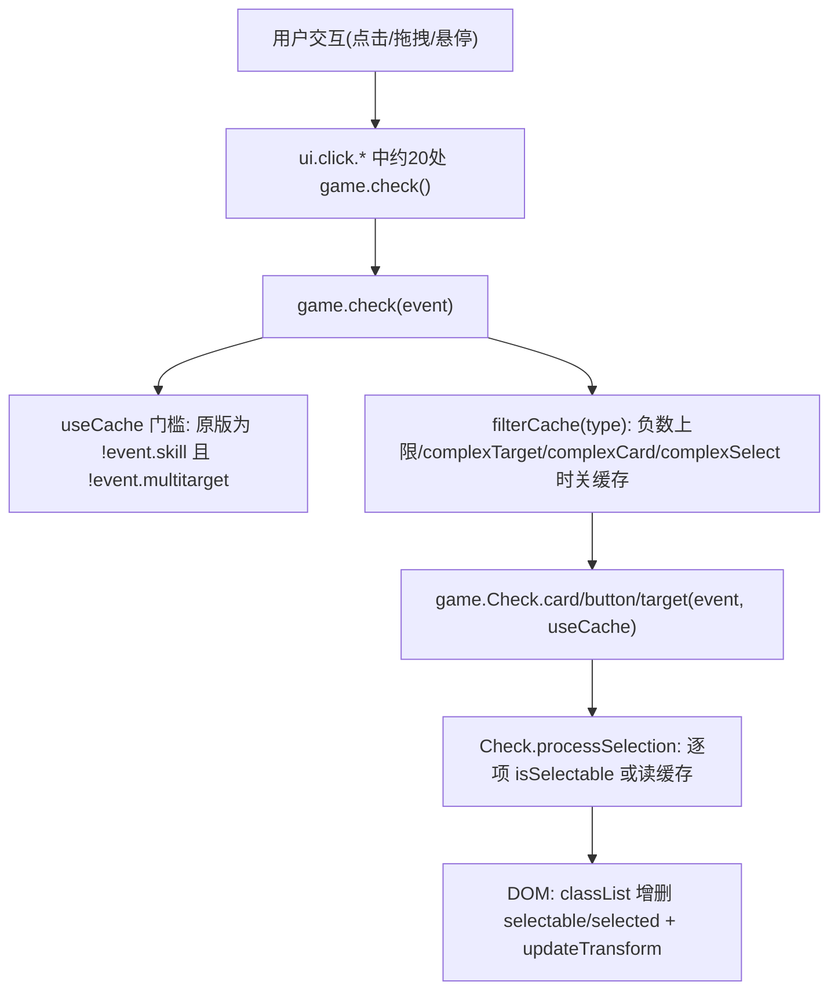

# 知识库.md — 项目技术知识沉淀

本文件沉淀对无名杀本体与自用ai扩展的代码追踪结论、性能问题档案与修复方案。所有结论均基于对当前仓库源码的逐行核对，行号为编写时位置，可能随本体更新漂移。

## 一、game.check 选牌系统架构

### 调用链



要点：

- `game.check` 在每次交互都会执行（点击、拖拽开始/结束、确认按钮更新等），单次成本直接决定手感。
- `Check.processSelection`（`apps/core/noname/game/check.js`）对 button/card/target 三类通用处理；`isSelectable` 最终走到 `event.filterCard`，常规事件下即 `lib.filter.filterCard`（`apps/core/noname/library/index.js` 约 11597 行），内部为 `cardEnabled + cardUsable`，两者都通过 `game.checkMod` 遍历玩家全部技能 mod，并调用 `player.countUsed`——每张牌、每次 check 都要付一遍。

### 选择缓存机制（原版设计）

- 缓存挂在事件对象上：`event._cardChoice` / `_buttonChoice` / `_targetChoice`，键 `cacheId` 为已选对象 id 的 XOR。
- id 来源：`get.id()`（`apps/core/noname/get/index.js` 约 2076 行）返回纯数字字符串，`cardid`/`playerid`/`buttonid` 均出自此处；数字字符串经 ToNumber 后 XOR 有效，超 int32 会回绕（原版即接受此碰撞风险）。
- **原版键值只含"当前类型之前"的选择状态**（button → card → target 顺序内，遇到当前类型即 break）：card 类型的键恒为 0（无前置类型时），target 类型含按钮与牌、不含已选目标。设计假设：非技能事件的 filterCard 与同类型选择无关；依赖选择状态的过滤器必须声明 `complexCard`/`complexSelect`/`complexTarget`（`filterCache` 检测后关缓存）。
- `useCache` 在原版 `game.check` 中是全局一票否决：任一类型的 `filterCache` 失败，三类全关。
- `game.uncheck` 清 UI 选中状态，但清缓存；缓存随事件对象存活整个事件周期。

## 二、性能问题档案

### 问题 1：updateTransform 的 O(N²) 布局抖动（已修复）

- 位置：`apps/core/noname/library/element/card.js` `updateTransform`（约 728 行）。
- 根因：每张手牌的 `updateTransform` 都同步调用 `ui.updatehl()`（`apps/core/noname/ui/index.js` 约 434 行）；`updatehl` 是全量手牌重排，内部每张牌执行 `ui.refresh`（即 `window.getComputedStyle` 强制 style recalc）与 `node.info.offsetWidth`（强制 layout）。`game.check` 处理弃牌类事件（`selectX` 上限为负，走 `range[1] <= -1` 分支）时对每张牌调用一次 `updateTransform`，N 张手牌触发 N 次全量重排——每次交互 O(N²) 次强制布局。
- 修复：`updateTransform` 改调去抖版 `ui.updatehlSoon()`（setTimeout 合并，一轮 check 只重排一次）；`Button.updateTransform` 是 getter、动态读 Card 原型，patch Card 原型即可同时覆盖。

### 问题 2：技能事件过滤缓存整体禁用（已修复）

- 位置：`apps/core/noname/game/index.js` `check()` 内 `let useCache = !event.skill && !event.multitarget;`。
- 根因：技能事件（viewAs 使用、响应 prompt 等）下每张牌每次 check 全量重算 `filterCard`；技能选牌场景牌多（手牌 + 装备 + 判定区）、技能 mod 多（扩展注册大量技能），是"牌多卡顿"的主要来源。
- 修复与正确性保障：
  1. `useCache` 仅由 `multitarget` 与各类型 `filterCache` 条件决定，技能事件也允许缓存；
  2. 技能事件的缓存键纳入全部三类选择状态（选择变化必然换键），解决"依赖已选牌的技能过滤器读到陈旧缓存"；
  3. filter 函数引用变化（`custom.replace.card` 等替换场景）时整体失效（缓存对象带 `_filter` 引用比对）；
  4. 非技能事件键值语义与原版逐场景一致（经 16 项独立断言验证，含 XOR 顺序无关性与大数回绕）。
- 残余风险（与原版同类、已接受）：filterCard 闭包读取"两次 check 之间被外部改动且选择状态不变"的可变状态时会读到陈旧结果；原版约定此类过滤器应声明 `complex*`，`filterCache` 会为其关缓存。

### 实现位置

以上修复全部位于 `apps/core/extension/自用ai/extension.js` 的"优化 8"，本体代码保持原版；开关 `lib.config.extension_自用ai_checkopt`（选牌检查优化），关闭即运行时回退原函数。

## 三、自用ai 扩展 patch 清单

| 编号 | 目标 | 内容 |
|------|------|------|
| 1 | `CacheContext._wrapParameterToCacheKey` | 函数参数 key 用 WeakMap 记忆化，避免重复 MD5 序列化 |
| 2 | `get.selectableCards` | 按 (player, event) 闭包缓存 `getCards("hes")`，事件切换即刷新 |
| 3 | `get.selectableButtons` | 按 dialog 缓存按钮列表 |
| 4 | `get.selectableTargets` | 按 (event, deadTarget) 缓存玩家列表，死亡玩家加入受 deadTarget 控制 |
| 5 | `ai.basic.chooseButton` | 变量外提 + 复用 check 结果 |
| 6 | `ai.basic.chooseCard` | 技能列表外提 + 免 concat 复用数组 |
| 7 | `ai.basic.chooseTarget` | 变量外提 + 复用 check 结果 |
| 8 | `Card.updateTransform` + `game.Check.*` | 手牌重排去抖 + 技能事件过滤缓存（见上节） |

开关：`自用ai_onai`（优化 1-7，替换底层 ai），`自用ai_checkopt`（优化 8）。

### CacheContext 使用纪律

- 生命周期等于单次 AI 决策：`storageMap`/`sourceMap` 只在决策内有效；每次决策必须 `new CacheContext()` 并通过 `setCacheContext` / `setInCacheEnvironment(true)` 包裹，`finally` 中复位（扩展内优化 5-7 的写法）。
- `cacheOrder`/`cacheEffectUse` 走 CacheContext 实例 proxy 层缓存；`cacheEffectUse` 仅用于 chooseToUse 的 ai2（选目标阶段已选牌静态，安全）。
- Player/Card/VCard 均实现 `getCacheKey()`，可用 `CacheContext._wrapParameterToCacheKey` 作缓存键。
- AI 决策热点链：`get.order`（ai1）、`get.effect`/`effect_use`（选目标）、`get.unuseful2` → `get.useful`（弃牌类，原版 O(N²) 来源）。

## 四、模式与技能 API 速查

破阵模式预研结论（任务搁置，结论保留备用）：

- 注册模式：扩展默认导出内 `game.addMode(name, { name, start, ... })`；模式对象的 `get: { rawAttitude }` 由 `loadMode` 合并（`apps/core/noname/init/loading.ts` 约 415 行）。
- 扩展包内 `skill.skill` + `skill.translate` 会被自动合并进 lib（`init/loading.ts` 约 382-396 行）。
- 禁用非锁定技：`skillBlocker` 声明 + `addSkillBlocker` 模式（参考 `apps/core/noname/library/skill.js` 约 1680 行 baiban 示例）。
- 不可响应：`trigger.directHit.add(target)`（useCardToPlayered 时机）。
- 无视防具：`target.addTempSkill("qinggang2")`。
- 自定义判定：`player.judge(fn)`。
- 步骤编译：技能 steps 支持 await（StepCompiler）。

## 五、已知边界与注意事项

- `get.card()` 对技能事件会调用 `get.info(event.skill).viewAs` 并分配 VCard（`apps/core/noname/get/index.js` 约 3826 行）；`game.check` 的 `filterCache` 每 check 每类型都会调它，本体原版即如此，patch 时保持同频率即可。
- `range[1] <= -1`（不限量选择，如弃牌）事件：`filterCache` 对负数上限返回 false，缓存关闭，`processSelection` 走自动全选分支——该分支与 DOM 热点（问题 1）叠加，是弃牌场景卡顿的直接来源。
- XOR 键的碰撞：数字字符串 id 超过 int32 会回绕，多 id 异或存在理论碰撞可能；原版已接受该风险级别，扩展实现保持一致。
- `game.check` 的 `filterCache` 无副作用，可在 patch 中安全复刻或前置调用。
- 修改本体文件的冲动一律转入扩展实现（见 `agent.md` 协作规范）。

## 六、mod 系统与过滤函数档案

### game.checkMod（game/index.js 约 9002 行）— mod 管道分发

- 签名：`game.checkMod(...arg, name, player)`，`name` 为 mod 类型，返回值取自 `arg` 末位元素的链式传递结果（末位为 object 时 mod 返回值被丢弃，靠 object 可变性传递）。
- 技能集解析：优先 `player.getModableSkills()`，否则 `getSkills().concat(lib.skill.global)` → `game.expandSkills` → 过滤带 `info.mod[name]` 的技能 → 按 `get.priority` 排序。
- **成本核心**：`getModableSkills`（player.js 约 5613 行）每次调用都全量重建：`getSkills` 读取 skills/additionalSkills/tempSkills/hiddenSkills/invisibleSkills + `getVCards("e")` + `get.skillsFromEquips`，再 expandSkills + filter + sort。任何频繁调用 checkMod 的路径都在反复付这笔账。
- 常用 mod 类型：`cardEnabled`/`cardEnabled2`/`cardUsable`/`cardUsableTarget`/`cardRespondable`/`cardDiscardable`/`cardname`/`cardsuit`（双管道）/`cardnumber`/`playerEnabled`/`targetEnabled`/`selectTarget`/`aiOrder`/`aiUseful`。

### lib.filter 过滤链（library/index.js 约 11348-11530 行）

- `cardEnabled(card, player, event)`：实卡先走 `cardEnabled2` mod 短路 → `get.autoViewAs(card)` **新分配 VCard** → `info.enable` 判定 → `cardEnabled` mod 管道。每张牌每次 check 两次 checkMod + 一次 VCard 分配。
- `cardUsable(card, player, event)`：autoViewAs → `info.usable`（函数或数字）→ `cardUsable` mod → `player.countUsed(card2)` 查表（便宜，见下）；次数用尽时兜底 `game.hasPlayer2` + 逐目标 `cardUsableTarget` mod（贵）。副作用：向 event 写 `addCount_extra = true`（供 targetEnabledx 的 cardUsableTarget 分支使用）。
- `cardUsable2`：与 cardUsable 类似但无 addCount_extra 副作用、无 hasPlayer2 兜底，供 targetEnabledx 的 addCount_extra 分支用。
- `cardRespondable`：仅 `chooseToRespond` 事件生效（其余直接 true）：来源方 `norespond` 技能标签检查 → 实卡 `cardEnabled2` mod → autoViewAs 后 `cardRespondable` mod。
- `cardDiscardable`：event 取 `getParent().name` 后走 `cardDiscardable` mod。
- `filterCard`（约 11597 行）：`cardEnabled && cardUsable` → notarget 直通 → selectTarget 解析（数字/数组/函数 + selectTarget mod）→ 上限为 -1 时 `game.hasPlayer2` 遍历 filterTarget。

### 成本模型小结

一次 `filterCard` = 2 次 checkMod 管道（cardEnabled、cardUsable）+ 2 次 VCard 分配 + countUsed 查表 + 可选 hasPlayer2；而每次 checkMod 管道 = getSkills 全量重建 + expandSkills + 排序。技能多、扩展多时单次 checkMod 即数百微秒级，乘以牌数 × 每交互 check 次数即"牌多卡顿"的量化来源——这正是扩展优化 8 缓存命中路径绕开的部分。

## 七、AI 决策函数档案（get/index.js）

### 姿态与基础分

- `get.attitude(from, to)`（6548）：`rawAttitude` 经 CacheContext proxy 缓存（决策内静态）→ `from.isMad()` 取反、`to.isMad()` 削减（主公 1 其余 0）→ `ai.modAttitudeFrom/To` 修正（`_status.tempnofake` 防递归）。`get.sgnAttitude` 取符号。
- `get.rawAttitude`：模式相关，由 loadMode 合并模式自定义实现。
- `get.order(item, player)`（6795）：`info.ai.order`（或 `info.ai.basic.order`）→ 函数则调用 → `checkMod "aiOrder"` 管道 → 无 order 返回 -1。chooseToUse 的 ai1 默认 `get.cacheOrder`（走 proxy 缓存）。
- `get.useful/useful_raw`（6580/6634）：判定区 -1、装备区 `get.equipValue`、手牌按同名序数 i 取 `ai.useful`（数组取末位兜底、函数则调用、数字直取）→ `checkMod "aiUseful"`。`_status.event.useCache` 时走 `game.callFuncUseStepCache` step 缓存。派生：`unuseful = -useful`，`unuseful2 = 10 - useful`（弃牌 ai 默认），`unuseful3` 毒额外 +20。
- `get.value`（6652）：数组牌除以 `sqrt(length)`；`card._modValue` 优先；`ai.value`（函数/数组同 useful 模式）。

### 效果评估 effect / effect_use（6861 / 7137）

两者结构一致，读法差异仅在基础分：`effect_use` 取 `ai.result.player_use/target_use`（缺省回落 player/target），`effect` 取 `ai.result.player/target`。

计算流程（相同部分）：

1. card 解析：object → `get.autoViewAs` 分配；无名对象 → `event.skill` 或 `get.card()`（viewAs 命中时记录 eventskill 并入 get.result）。
2. `info.changeTarget` 存在时（仅 effect_use）展开目标逐个 `cache.get.effect` 求和。
3. `get.result(card, eventskill)` 取基础 result1/result2（函数则调用）。
4. **player 侧**：`getSkills().concat(global)` + expandSkills 重建数组，逐技能 `ai.effect.player`（effect_use 优先 `player_use`）修正——返回数组 `[系数, 加值]` 或 `[系数, 加值, 系数2, 加值2]`，或字符串 `"zeroplayer"/"zerotarget"/"zeroplayertarget"`。effect_use 中该调用经 `cache.delegate(...)` 走 CacheContext；effect 的 player 侧直接调用。
5. **target 侧**：同上遍历目标技能，`ai.effect.target`（effect_use 优先 `target_use`）+ `ai.threaten` 累乘（player 的 `hasSkillTag("ignoreSkill")` 可跳过目标技能修正）。
6. 状态修正（`result.ignoreStatus` 可关）：敌对目标 `sqrt(threaten)`、友方 `sqrt(sqrt(threaten))`；hp 1/2 时 ×2.5/×1.8（effect 为 ×3）；手牌数 0/1/2/≥3 档 ×1.5-2.1/1.3/1.1/0.5；hp 4/5/>5 ×0.9/0.8/0.6。
7. `zeroplayer/zerotarget` 归零；最终 `result1 × attitude(立场, player) + result2 × attitude(立场, target)`（player2 指定时按其立场）。
8. 连环传导：`get.tag(card, "natureDamage")` 且目标横置时，对其余横置玩家递归 `cache.get.effect(..., linking 上下文)`（`ai.canLink` 可控制）。

派生封装：

- `get.damageEffect(target, player, viewer, nature)`（7362）：复合 nature 取均值；按 nature 映射虚拟牌名 damage/firedamage/thunderdamage/icedamage 调 `get.effect`；`eff > 0 且有护甲` 时 ÷1.3。
- `get.recoverEffect`（7408）：满血返回 0，其余走 effect。
- `get.cacheEffect` / `get.cacheEffectUse`（7119/6843）：effect/effect_use 的 proxy 直通版，chooseToUse 的 ai1/ai2 默认分别接 `get.cacheOrder` 与 `get.cacheEffectUse`。

### 集合与遍历（game/index.js 约 10166-10240 行）

- `game.expandSkills(skills, subSkill)`：原地去重追加 `info.group`（数组化 + lib.skill 存在性过滤）；subSkill 仅显式开启时展开（`name_sub` 键）。
- `game.hasPlayer(func, includeOut)`：存活玩家 some 短路；`hasPlayer2` 额外拼接 `game.dead`；`countPlayer/2` 求和（func 返回数字累加数值、布尔累加 1）。

## 八、元信息与工具函数

- `get.info(item, player)`（get/index.js 3790）：字符串/symbol → `lib.skill[item]`（缺失警告并返回空对象）；object → `lib.card[get.name(item, player)]`。注意 `player !== false` 时 card 会先走 `get.name` —— **有主的手牌会触发一次 cardname mod 管道**，即 get.info 本身可能不便宜。
- `get.name(card, player)`（3421）：有 owner（或指定 player）时 `checkMod(card, owner, card.name, "cardname", owner)`，否则直读 `card.name`。
- `get.suit`（3436）：有主时双管道 `cardsuit`（先 `suit` 再 `cardsuit`）；`unsure` 或合法花色直读，其余 "none"。数组单元素递归、多元素 "none"。
- `get.autoViewAs(card, cards, owner)`（1142）：VCard 入参直接返回（防嵌套），否则 **new lib.element.VCard(card, cards, ...)** —— 每次调用一次对象分配，effect/cardUsable/cardEnabled 内高频出现。
- `get.select(select)`（3812）：函数递归求值、数字 → `[n, n]`、合法 select 原样、缺省 `[1, 1]`。
- `player.countUsed(card, type)`（player.js 5062）：默认查 `getStat("card")` 名字计数表（便宜）；`type === true` 时遍历整局 `useCard` 历史。
- `get.itemtype`：本文件多处用于类型分派（"card"/"cards"/"player"/"players"/"select"/"position"/"natures" 等），object 上以 `_itemtype` 类标记实现。

## 九、Player 类核心函数档案（player.js，16586 行）

### 牌区数据模型（重要）

**牌的存储 = DOM 节点**。手牌区 `node.handcards1/2`、装备区 `node.equips`、判定区 `node.judges`、特殊区手牌带 `glows` class。所有读牌函数本质是 DOM 遍历 + classList 过滤：

- `iterableGetCards(position, filter)`（5266，核心生成器）：跳过 `removing`（手牌）/`removing,feichu,emptyequip`（装备）/`removing,feichu`（判定）；判定区牌名读 `card.viewAs`，其余走 `get.name`（有主牌触发 cardname mod 管道）；filter 为对象时预解析 entries（避免每张牌重复类型判断）；position 含 h 与 s 之一时按 `glows` class 区分普通/特殊手牌；同区重复 position 已去重。
- `getCards`/`countCards`/`countDiscardableCards` 等全部 = `Array.from` 或计数循环包一层生成器；`getDiscardableCards`/`getGainableCards` 额外过 `lib.filter.canBeDiscarded/canBeGained`。
- `getVCards(arg1, arg2)`（5243）= `Array.from(iterableGetVCards)`，是 lib.filter 全链与 hasJudge/getVEquip 的牌源。
- `hasCard(pattern, position)`（14107）/`hasVCard`（14113）：生成器首个元素短路，等价 count>0 但避免完整遍历。
- `getEquip(name)`/`getVEquip(name)`（14125/14155）：name 可为牌对象（取 subtype 序号）或 "equip5" 字符串；比对 `get.info(es[i]).subtype` 或 name/source 列表。

### 技能查询（AI 链热点）

- `hasSkill(skill, arg2, arg3, arg4)`（13672）：`game.expandSkills(this.getSkills(...)).includes(skill)` —— **每次调用重建技能数组并全量 expand**；特例 `skill === "counttrigger"` 恒真。`isMad` = `hasSkill("mad")`。
- `hasStockSkill`：同模式走 `getStockSkills`。
- `hasSkillTag(tag, hidden, arg, globalskill)`（13771）：getSkills + 默认拼 `lib.skill.global` + expandSkills，遍历每个技能的 `info.ai[tag]`；`skillTagFilter` 返回 false 跳过；`ai[tag] === true` 时若 arg 为对象且无 skillTagFilter 会 console.log 警告；非 true 值用 `==` 与 arg 比较（字符串 tag 值支持匹配 arg）。`hasGlobalTag`（13745）同构但遍历全局技能表。
- `hasJudge(name, hasJudgeSlots=true)`（13810）：getVCards("j") 后按牌名或 `get.judgeSlots` 交集判断（后者考虑牌占用槽位）。
- `addTempSkill(skill, expire, checkConflict)`（11946）：先 addSkill（addToSkills=true 即不进 permanentSkills），expire 默认 `{global:["phaseAfter","phaseBeforeStart"]}`；会把 expire 里的触发名（含 relatedTrigger 前缀展开）注册进 `lib.hookmap`，并 game.broadcast 同步 tempSkills。`tempBanSkill`（11993）走 storage `temp_ban_${skill}` + when 触发器解除。
- `markSkill(name, info, card, nobroadcast)`（10489）：写 `player.storage[name]` + `player.marks[name]` DOM 标记 + `game.addVideo` + 默认 game.broadcast —— 纯 UI/同步副作用。

### 状态判断（几乎全是 classList 查询，便宜）

- `isDead`（13046）= classList "dead"；`isOut`（13264）= "out"；`isLinked`（13247）= "linked"/"linked2"（按 `get.is.linked2` 分支）；`isTurnedOver`（13257）= "turnedover"；`isIn`（13276）= 非 dead 且非 out 且非 removed；`isUnseen(num)`（13279）= "unseen"/"unseen2"。
- `isDying`（13056）= `_status.dying.includes(this) && hp <= 0 && isAlive()`；`isDamaged`/`isHealthy` 按 hp/maxHp 与 `storage.nohp`。
- `isMaxMaxHp/isMinMaxHp/isMaxHandcard` 等：`game.filterPlayer` 全量比较（O(N)）。

### 统计与历史

- `getStat(key)`（12576）：直读 `this.stat[this.stat.length - 1]`，无遍历（最便宜）；`getLastStat` 反向找 `isMe` 段。
- `getHistory(key, filter, last)`（12261）：无 filter 时直读 `actionHistory` 末段[key]；有 filter 走 `iterHistory` 生成器（当前回合内遍历，last 为截止事件）。配套 `countHistory`/`hasHistory`（首个短路）/`checkHistory`（回调遍历）。
- `getCardUsable(card, pure)`（12635）：`get.autoViewAs`（一次 VCard 分配）→ `get.info(card).usable`（可函数）→ `game.checkMod(cardUsable)` → 非 pure 且当前回合玩家时减 `countUsed`。

### 事件构造入口（签名均为单参数或位置参数流式解析）

- `damage(params)`（8894）：`game.createEvent("damage")`；两种签名——对象参数 Object.assign（nosource/nocard/notrigger 删除后置 flag），或位置参数流式识别（cards/card/number/player/nature/"nocard"/"nosource"/"notrigger"/"unreal"/"nohujia"）；nature 经 lib.natureSeparator 组合、stab 被剔除；缺省 card 继承 `_status.event.card`。
- `chooseToUse`（5815）/`chooseToRespond`（5880）/`chooseToDiscard`（6043）/`chooseCard`（6547）：详见第二章事件档案，均为 createEvent + 参数分派 + ai 闭包。
- `equip(card, draw)`（9534）：不接受裸 VCard 入参（isViewAsCard 时取 `card[cardSymbol]` 拆解）。

### AI 相关杂项

- `player.ai.shown`（0~1，身份暴露度）：`addExpose(num)`（9525）上浮至 0.95 封顶，仅未亮身份时生效；`hasUnknown(num)` 遍历场上 `ai.shown == 0` 的他人计数；`hasFriend()` 遍历全场 `get.attitude(other, this) > 0`。
- `hasSkill("counttrigger")` 恒真是 counttrigger 触发器计数的协议约定。

### 性能小结（对 AI 扩展的含义）

1. 读牌函数（getCards/countCards）是 DOM 遍历 + get.name mod 管道，高频调用应批量化或缓存（chooseToUse 的 ai1 闭包缓存正是为此）。
2. hasSkill/hasSkillTag 每次重建 expandSkills 数组——技能多的武将在 effect 链中是隐藏热点；expandSkills 本体有去重但仍是 O(技能数)。
3. 状态判断（isDead/isLinked/isTurnedOver/isOut）全是 classList.contains，极便宜，可放心高频调用。
4. getStat/getHistory(无 filter) 是数组末元素直读，便宜；带 filter 的 getHistory 是生成器遍历。

### VCard 视图层（iterableGetVCards，5182）

- 牌源是 `player.vcardsMap = { handcards, equips, judges }` 数组（构造器中初始化代码被注释掉，实际由 `library/index.js` 的 addVirtualEquip/addVirtualJudge 等维护，`?? []` 兜底）——**VCard 层是独立于 DOM 的数组，读取代价低于 getCards 的 DOM 遍历**。
- 牌名一律 `get.name(card, false)`（player=false 跳过 cardname mod 管道）；filter 对象形式逐 key 现场判断（没有 iterableGetCards 的 entries 预计算优化）。
- `getCacheKey` 协议三实现：`AI.getCacheKey(obj, similar)`（ai/index.js 14，原始值 String / 数组递归拼接 / 有 getCacheKey 方法则委托 / 兜底 JSON.stringify 或 translation）；`player.getCacheKey(similar)`（5102）有 playerid 时 `[player:id]`（伪 equals），否则 name+sex+group+hp+maxHp+hujia+skills 拼接；`VCard.getCacheKey`（vcard.js 171）有 cardid 时 `[card:cardid]`，无 cards 时 name+suit+number 拼接，单 card 时委托 ai.getCacheKey。
- 事件级临时缓存：`_status.event.getTempCache(funcName, key)` / `putTempCache`；`ai.guessTargetPoints`（ai/index.js 56）是标准用法——access "11" = 存+读，按 viewer/target/cards 组合键缓存点数估算（max/min 按 unknown 数量做概率收缩）。自用ai 扩展的缓存可复用此协议。

### storage 系统（10381-10440）

- `setStorage(name, value, mark)` 直写 `this.storage[name]`，mark=true 时 markAuto（UI 标记）；`getStorage(name, defaultValue=[])` 是 `storage[name] || defaultValue`（假值返回默认数组）。
- `hasStorage(name, value?)`：`in` 检查 + `===` 或数组 includes；`hasStorageAny/All` 值列表变体；`initStorage` 无则设；`updateStorage(name, operation)` 函数式更新。全部 O(1) 或 O(数组长度)，便宜。
- `countSkill(skill)`（5122）：先查 `getStat("skill")` + `getStat("triggerSkill")` 计数表（两表都有则相加，便宜），任一有数字即返回；否则回退 `getHistory("useSkill", filter).length` 遍历。

### 距离与攻击范围（checkTarget/inRange 的底层）

- `inRange(to)`（3143）：任一方有 "undist" 或不在场上/死亡列表 → false；双 mod 检查 `inRange`（from 技能）/`inRangeOf`（to 技能），返回 "unchanged" 以外的值直接作为结果；`getAttackRange()` < 1 → false；普通模式沿 nextSeat 走位计数 n（存活、在场、无 undist、非 isMin 才计数），`length - n` 为逆时针距离，`hasSkillTag("left_hand"/"right_hand")` 决定取哪侧（left==right 取 min）。chess 模式用曼哈顿距离。
- `getAttackRange(raw)`（12659）：raw=true 走 globalFrom/attackFrom mod + 装备 globalFrom 求和再 subtract；默认路径 `attackRangeBase` mod（"unchanged" 则取 getEquipRange）→ `attackRange` mod → `attackRangeFinal` mod，共 3 次管道。
- `getEquipRange(cards)`（12693）：遍历装备 VCard（排除 ui.selected.cards 中实体的牌），distance.attackRange 函数式取值或 1-attackFrom；多件装备取 max，无有效值返回 1。
- 坐下结论：inRange 单次调用 = 2 mod 管道 + getAttackRange（3 mod 管道 + getVCards("e") 遍历）+ hasSkillTag×3 + nextSeat 环走 O(N)——**这是 selectTarget/checkTarget 热点链的主体成本**。

### 体力事件族（均为 createEvent 构造，dual-signature）

- `recover(params)`（9011）：对象参数 Object.assign 或位置参数流式识别；缺省 card/cards 继承当前事件、source 继承 `event.customSource || event.player`、num 继承 `baseDamage + extraDamage`；`filterStop` 内联——num<=0 或 isHealthy 时直接 finish 并置 `_triggered = null`（恢复事件在目标满血时根本入队）。
- `recoverTo(num, args)`（9079）：换算差值转调 recover。`loseHp(num)`（9107）同样带 filterStop（num<=0 时 finish）。`loseMaxHp`/`gainMaxHp`（9128/9154）解析 number/boolean（forced）。
- `changeHp(num, popup)`（9180）：`originalHp` 记录，setContent("changeHp")；`changeHujia(num, type, limit)`（9198）limit=true 视为 5，type 缺省按 num 符号取 gain/lose/null。
- `getHp(raw)`（3263）：raw 时返回 this.hp（可为 Infinity），否则 max(0, hp)；`getDamagedHp` = maxHp - getHp。

### 视角与知情（信息不对称）

- `getKnownCards(other, filter)`（1414）：手牌上过滤 `card.isKnownBy(other)`（other 缺省取 `get.player()`，传 null/假值有 console.trace 警告）；`isAllCardsKnown` 首个未知短路。AI 的 guessTargetPoints 基于此做明牌/暗牌拆分估算。
- `vcardsMap`（构造器 4130 注释掉的字面量，运行时由 addVirtual* 函数维护；`$uninit`（4142）负责重置可见性 class 与 UI 节点）。

## 十、UI 系统档案（ui/index.js 814 行 + create 4042 行 + click 4885 行 + 元素类）

### 架构总览

三个单例类各司其职：`UI`（布局计算与全局状态）、`Create`（DOM 工厂）、`Click`（交互处理器）。`ui` 对象同时挂载大量运行时注入的 DOM 容器（arena/window/me/control/dialog/handcards1Container 等，均无类型保证的 `HTMLDivElement` 字段，构造时才赋值）。游戏逻辑通过 `ui.xxx` 直接读写这些节点——**UI 层是全局状态的一部分**（ui.selected.buttons/cards/targets 被 game.check 直接消费）。

### UI 类核心（ui/index.js）

- `ui.selected = { buttons: [], cards: [], targets: [] }`（16）：玩家当前选中的元素，check.js 的 processSelection 与 click.button/card/target 均直接读写；multitarget/complexSelect 时重新走 game.uncheck + game.check。
- `updatehl()`（434）：手牌横排布局核心，读 `ui.handcards1Container.firstChild` 的 childNodes 过滤 removing，逐牌计算 translateX 偏移（fold_card 配置时 offset = min(112, (宽-128)/(n-1))，下限 32），selected 牌加 translateY(-20px)，同时处理 info 标签与长牌名缩放；最后写容器 width。game/index.js 中约 10 处调用（手牌变化后），Card.updateTransform 也触发它。**每张手牌每次都要重排全部兄弟节点**。
- `updateh(compute)`（552）：low_performance 时直接跳过实时计算（compute 时调 updatehl 并 1s 后再调一次）；否则按容器宽度给手牌容器加 fold0~fold3 class（CSS 折叠）。
- `updatec()`（237）：控制条（confirm/skills 按钮）水平居中排布，逐个读 offsetWidth 累加，transform 定位；`_status.noupdatec` 可挂起。
- `updatex/updatexr`（366/378）：全量布局刷新（update + updatehl + lib.onresize 回调 + 缩放），updatexr 是 500ms 防抖版。
- `refresh(node)`（220）：读 computedStyle opacity 强制浏览器 flush 样式（transform 动画的前置技巧）。
- `updatez/updated`（601/594）：document.body 整体 scale 缩放（game.documentZoom）。
- `updatejm/updatem/updatej`（384/412/425）：标记区/判定区牌的堆叠排布，每张偏移 28px。
- `update()`（615）：按 ui.updates 注册表执行 + dialog 高度自适应（slim/scroll1/scroll2/scroll3 class 切换）。
- `recycle(node, key)`（691）：`ui._recycle` 对象缓存 DOM 节点供复用。
- `updatePlayerPositions(numberOfPlayers)`（759）：>8 人场动态生成 CSS 规则（game.dynamicStyle.add 按选择器注入 left/top/scale），<=8 人走传统布局；`updateConnectPlayerPositions`（705）是联机版。
- `updateRoundNumber`（797）：写 ui.cardPileNumber.innerHTML。

### Create 工厂（ui/create/index.js）

- `div()`（578）与 `node()`（660）：核心工厂，参数流式识别（className/id 字符串语法 ".config #id"、position 容器、number 插入位、style 对象、listen 函数、innerHTML）；`ui.create.div(".player.connect", ui.window)` 是全项目最常见调用形态。node() 额外支持任意标签名（"input.fileinput"）。
- `card(position, info, noclick)`（3830）= `new lib.element.Card(position).build(info, noclick)`；`cards(ordered)`（3846）按 lib.card.list 洗牌建全牌堆（跳过 bannedcards，写入 lib.inpile/inpile_nature，牌实体全挂在 ui.cardPile 下）。
- `button(item, type, ...)`（3261 附近调用）：走 `ui.create.buttonPresets[type]`（character/vcard/skill/card 等 preset 在 3261-3587 注册），Button 构造器（button.js 21）用 preset 产出 DOM 后 setPrototype 成 Button 实例并绑 ui.click.button 监听、分配 buttonid。
- `dialog()`（1945）= `new lib.element.Dialog(...)`，非 "hidden" 参数时立即 open()；Dialog.add（dialog.js 280）是万能内容填充器：字符串（### 分隔标题/文本）、div/cards（生成 card buttons）/players（player buttons）/`[items, type]` 元组（skill/textbutton/addNewRow/handle 回调）；每次 add 尾部都调 ui.update()。
- `control()`（2022）= `new lib.element.Control(...)`（control.js：open/close/add/replace）；`confirm(str, func)`（2025）：str "o"/"c"/"oc" 映射 ok/cancel 按钮组合，同 str 幂等返回，ui.confirm 全局单例；`skills(skills)`（2060）三组技能条 skills/skills2/skills3 同构（相同技能集合幂等、非本人回合 display:none），绑定 ui.click.skill。
- `arena()`（2289）：初始化 ui.window/system/arena 三层容器 + 按 layout/配置打 class（mobile/long/slim_player/oblongcard 等）+ 挂 ui.click.window 全局点击。
- `me(hasme)`（3798）：创建 ui.mebg/ui.me/ui.handcards1Container/ui.handcards2Container，把 game.me.node.handcards1/2 挂入容器并绑滚轮/触摸滚动。
- `players(numberOfPlayers)`（3758）：批量 create.player 并构建环形链表（previous/previousSeat/next/nextSeat，首尾互连）——**座位链表在这里建立**。
- `pagination`（3912）/`handcardsContainer`（3921）：新版分页与手牌容器组件。
- `toast(message)`（314）+ `showNextToast`（338）：toastQueue 队列逐个显示。

### Click 交互（ui/click/index.js）

- `button()`（2617）/`card()`（2673）/`target(e)`（2839）：统一的选中切换处理器。前置防抖链：dragged/clicked/tempNoButton/draggingtouchdialog/noclick/justdragged；`_status.event.custom.replace.button/card/target` 优先接管；`isMine()` 门槛；selected class 切换 + ui.selected 增删；multitarget/complexSelect 时 uncheck+check 全量重算；card() 额外处理判定区/标记区点击转 intro 弹窗、chess 模式 range shadow。
- `control()`（2982）：parentNode._doubleclick 500ms 防抖，hidden/removing/disabled 拦截；`link == "ok"/"cancel"` 分流到 ui.click.ok/cancel，否则把 ui.selected 打包成 `_status.event.result = { buttons, cards, targets, control: link, links: get.links(...) }` 并 uncheck + close + resume。
- `ok(node)`（3090）：打包 result（confirm:"ok", bool:true），skill 存在时处理 viewAs：viewAs 函数/常量经 `get.autoViewAs` 生成 result.card，单牌时补 suit/number。
- `skill(skill)`（3047）：event.backup(skill) 切换技能上下文，filterCard 存在时先对 position 牌跑 cardDiscardable 过滤 uncheck，然后 uncheck + check 重算可选项，最后按 prompt/longprompt/dynamicTranslate 生成技能说明 dialog（event.skillDialog）。
- `window()`（2445）：全局空点处理（取消选中、关闭 intro、restore editing），chooseToUse 中点空白 = cancel。
- check.js 的 `Check.card/target/button`（113/130/99）与 processSelection（4）：isSelectable 闭包（cardRespondable/event.filterCard / distance+includeOut+filterTarget / buttonIncluded+filterButton）；useCache 时按 ui.selected 已选类型的 id 异或生成 cacheId，缓存 event._cardChoice/_targetChoice/_buttonChoice 数组；`Check.skill`（148）构建技能按钮三分组（global/equip/owned），_skillChoice 缓存 expandSkills 后的可发动技能。
- `Check.confirm`（194）：ui.arena 加 selecting/tempnoe class（提示装备区不可选），`_status.noconfirm` 时隐藏确认条。

### Card 元素（library/element/card.js，994 行）

- 构造（8）：`build(info, noclick)` → buildEventListener/buildProperty/buildNode/buildIntro 分步；init(card)（264）填充牌数据，**非联机模式每张牌分配唯一 cardid = get.id()**（321-326）——VCard/ai.getCacheKey 的快路径键源。
- `updateTransform(bool, delay)`（728）：仅 `_status.event.player == game.me` 时生效；手牌区内读 _transform 基础偏移叠 translateY(-20px) 选中态；Button.prototype.updateTransform 是 getter 借用 Card 的实现（button.js 60）。
- `isKnownBy(player, checkKnowers=true)`（791）：装备/判定区牌必知情；牌主本人、有 viewHandcard 标签者、被操控者（isUnderControl）、明置牌（get.is.shownCard）、_knowers 列表（含 "everyone"）——知情权模型五层判定。
- `aiexclude()`（750）：把牌加入 `_status.event._aiexclude`，AI 提示时不推荐该牌。
- moveDelete/moveTo（825/837）：带动画的牌移动（先 clone 视觉体再删原节点）。
- copy()（868）：完整复制牌节点与数据。

### Dialog/Control/Button 元素

- Dialog（dialog.js）：open/close/addPagination/addNewRow；add 的多态分发见上；`buttons` 数组是 UI 层选牌的主要数据源（chooseButton 事件）。
- Control（control.js）：open/close/add/replace；close 后节点进 removing 态，updatec 跳过。
- Button（button.js，63 行）：本质是 preset 生成的 DOM + Button 原型方法（exclude 把 button 加入 event.excludeButton）；`_args` 保存构造参数支持克隆。

### 与自用ai 扩展相关的要点

1. ui.selected.cards/buttons/targets 是 check 缓存的失效依据（cacheId 由已选项 id 异或生成）——patch filterCard/filterTarget 时须保持纯函数性，否则缓存结果错误。
2. updatehl 全量重排：手牌变化频繁时（AI 挂机发牌）是 DOM 热点；low_performance 开关直接绕过。
3. 按钮的 selectable/selected class 是纯视觉态，AI 决策读取的是 event._cardChoice 等缓存数组与 lib.filter，两者并行。
4. game.check 的 useCache 门槛（第一章）正是 Check.processSelection 的 useCache 参数，来自 game.check 入口的条件判断。

## 十一、GameEvent 与触发系统档案（gameEvent.ts 1220 行 + GameEvent/ + content.ts arrangeTrigger 段）

### 事件管理器（GameEventManager.ts，52 行）

- `_status.event` 的真身是 `GameEventManager#get event` → `getStatusEvent()`：`tempEvent || eventStack.at(-1) || rootEvent`。`setStatusEvent(event, internal)` 校验 instanceof，不在栈中的赋值直接 throw（外部直接写 `_status.event = xxx` 会崩，必须经 manager 或历史兼容层）；tempEvent 用于临时切换（waitNext 内检测并恢复）；每次事件切换发布 `lib.announce` 的 `Noname.Game.Event.Changed`。

### GameEvent 类（gameEvent.ts）

- **PromiseLike**：`then()` = 有 parent 时挂到 `parent.waitNext()` 后，否则立即 `start()`——`player.chooseXxx().forResult()` 的异步链由此驱动；`forResult()` await 自身后读 this.result。
- `start()`（226）：push 入 parent.childEvents、game 全局 history、`manager.setStatusEvent(this, true)` 入栈；loop 完成后 popStatusEvent。`#start` 私有字段防重入。
- **loop 状态机**（247）：`_triggered` 从 0 递增：0 → 触发 `name+"Before"` → 1；1 → `name+"Begin"` → 2；2 → 执行 content（`#inContent` 置位，出错按 ignore_error 打印或抛出）→ finished 后按状态触发 `Omitted(1)`/`End(2→3)`/`After(3→4)`；after 队列（insertAfter 事件）耗尽后 return。type=="card" 的事件额外触发 `useCardTo*` 前缀组。
- `waitNext()`（306）：串行 await 执行 `next[]` 队列（子事件），把子事件 result 逐层向上冒泡；每轮循环前 `pauseManager.waitPause()` 等待暂停恢复，检测 tempEvent 被抢占时 `cancel(true, null, "notrigger")` 自身。
- `checkSkipped()`（293）：player.skipList 含事件名时跳过整个事件（phase 类记入 skipped 历史）。
- `getParent(level, forced, includeSelf)`（152）：支持数字深度/事件名/谓词三种查找，parent 链带环检测（historys includes 短路），失败默认返回 `{}`（forced=true 返回 undefined）——调用方大量依赖 `getParent().name` 的空对象安全语义。
- `next` 数组是 Proxy（177）：push 子事件时自动设置 parent、继承 onNext* handler、父事件已 finished 且在 content 中时立即 resolve 子事件。
- `backup(skill)`（763）：把 filterButton/filterTarget/filterCard/selectX/position/forced/ai1/ai2/四个 _xxxChoice 缓存等 19 个键存入 `_backup`，再按技能 info 覆盖（ui.click.skill 调用）；**viewAs 分支的 filterCard 包裹了一层 `cardEnabled2` mod 检查**（ignoreMod 可跳过）——选牌过滤每张牌都要过一次 mod 管道；`filterOk` 同样叠加原 filterCard 验证。`restore()`（905）反向恢复。
- handler 体系：`on${EventName}`/`onNext${EventName}` 类型键存回调数组，callHandler 分发；`getRand(name)`（1037）事件级确定性随机（同名键复用同一随机值）。
- 三套缓存：`_stepCache`（putStepCache/getStepCache + `callFuncUseStepCache(prefix, func, params)` 自动以 `get.paramToCacheKey(params)` 组键；`_status.closeStepCache` 可全局关闭）；`_tempCache`（两段键 getTempCache/putTempCache，ai.guessTargetPoints 用的就是这套）；`resume()`（1212）删四个 choice 缓存（uncheck 后重算）。

### 触发器调度（trigger → arrangeTrigger → createTrigger）

- `trigger(name)`（462）：五道闸门——video 回放、发牌期屏蔽 lose/gain 系、`lib.hookmap[name]` 无监听直接返回、无存活玩家返回、`filterStop()` 返回真返回。起点玩家按 `[currentPhase, source, player, game.me, players[0]]` 顺序取。然后按座位环形构建 `doingList`：
  - 每个玩家一个 doing 桶；`firstDo`/`lastDo` 是特殊字符串桶（info.firstDo/lastDo 技能进桶）。
  - **tempSkills 到期清理内嵌在此**：expire 为对象时按 `relatedTrigger` 前缀展开匹配当前 triggername，匹配即 `removeSkill`（addTempSkill 注册 hookmap 的反向配对）。
  - 技能来源是 `lib.hook.globalskill[role_name]` 与 `lib.hook[playerid_role_name]` 预索引表（role ∈ player/source/target/global），**按 playerid 预先建桶，避免每次触发全量扫描技能**。
  - `getIndex` 函数返回数字（重复 N 条）或可迭代（每项一条 indexedData），为多实例触发提供数据。
  - 有待触发技能时创建 `arrangeTrigger` 子事件（不 trigger，直接 then 挂接），doingList/_trigger/triggername/playerMap 全部传入。
- `arrangeTrigger` content（content.ts 3948）：逐桶循环，`lib.filter.filterTrigger` 过滤出当前可发技能；同优先级并发时——silent 技能或无翻译的技能直接自动执行；多候选则 chooseControl 让玩家/AI 选下一个触发技能；执行经 `game.createTrigger(...).forResult()`；返回 "cancelled" 时把同 skill 的 todo 全部移入 doneList。
- `filterTrigger`（lib/index.js 11071）：hookTrigger.block 拦截 → 双重 expandSkills 存在性检查（invisible 组 + 可见组，国战 hidden 特例）→ forceDie/forceOut 门槛 → trigger 键匹配（role 对应 event.player/source/target/global + relatedTrigger 前缀展开）→ `info.filter(event, player, triggername, indexedData)` → `event._notrigger` 检查 → usable（getStat("triggerSkill") 计数）→ round（storage[skill_roundcount]）→ temp_ban_storage 扫描。**每次触发判断 = 2 次 expandSkills + filter + 统计查询**。
- `createTrigger` content（content.ts 4010）：再次校验技能归属（hidden/invisible/additionalSkills 三路），然后三路径取 result——`info.direct` 直接 bool:true；`info.cost` 函数时创建 `${skill}_cost` 子事件执行；否则 `player.chooseBool`（prompt 按 logTarget/prompt/dynamicTranslate 生成，`next.ai = () => !check || check(...)` ——**AI 的触发决策入口就是 info.check**）。frequent 布尔/函数/"check" 三型由 checkFrequent 归一。

### content 编译器（GameEvent/compilers/）

- `ContentCompiler.compile`（ContentCompiler.ts 67）：`#compiledContent` WeakMap 缓存编译结果（同一 content 函数只编译一次）；字符串名 → `lib.element.content[name]` 分发；责任链过滤：ArrayCompiler（函数数组）→ AsyncCompiler（AsyncFunction）→ StepCompiler（普通函数）。
- **StepCompiler**（StepCompiler.ts）：把 `step 0` / `step 1`… 注释式字符串切分函数体，每个 step 生成独立函数，参数注入解构（`{ step, source, target, targets, card, cards, skill, forced, num, _result: result } = event` + topVars 五件套）；函数源码经 `security.getIsolatedsFrom` 沙盒域构造；**"step N" 写法的实质是运行时字符串 reparse**，这是 switch/step 类技能的底层。
- **ArrayCompiler**（ArrayCompiler.ts）：step 数组逐项执行（event.step 计数、finish 判断、isPrevented 检查、result 向 `_result` 归并、waitNext 串行化）。
- 编译产物带 `compiled/original/originals` 标记。

### 对自用ai 扩展的含义

1. patch 触发决策只需覆盖 `createTrigger` 里 chooseBool 的 `next.ai`（即 skillInfo.check 的调用处），或在 filterTrigger 层拦截。
2. `_stepCache` 的 `callFuncUseStepCache` 是官方提供的"函数结果缓存"原语，自用ai 的高频 AI 决策可挂到当前事件的 stepCache 生命周期（事件结束自动失效，语义安全）。
3. tempSkills 到期清理、hook 预索引都在 trigger() 里完成；若 hookmap 没注册触发名，整个 trigger 流程被第一道闸门短路——**addTempSkill 注册 lib.hookmap 是触发器的激活成本**。
4. `getParent()` 返回 `{}` 的安全语义意味着 `event.getParent().name` 永远可读，patch 时保持该约定。

## 十二、核心动作 content 档案（content.ts 13364 行）

Content 表（`lib.element.content`，content.ts 10 起）是所有 game.createEvent(name).setContent(name) 的实现体。函数式 content 签名 `async (event, trigger, player)`，step 数组式由 ArrayCompiler 执行（见第十一章）。

### useCard（9687-10416，17 steps，goto 循环嵌套）

- step 0：无 card 直接 finish；forceDie 默认 true；把 `_playCardAnimation`/`_playThrowAnimation`/`_playTargetAnimation` 三个动画闭包挂到 event（popup/throw/目标指示线），由配置 card_animation_info 控制。
- step 1：game.log（对目标使用）+ logv 历史卡 → `await event.trigger("useCard1")`。
- step 2-4：`yingbian`（应变）→ `useCard2` → `useCard` 三个触发点；step 4 挂 `_oncancel` 清理 ui.tempnowuxie。
- step 5：`event.sortTarget`（非 multitarget 且未 fixedSeat 时按 currentPhase 座位排序）+ `_triggerTo(name, key, first, last)` 闭包——为每个目标创建独立触发子事件（useCardToPlayer/Target），`getTriggerTarget` 用 Map 计数处理重复目标，isFirstTarget 首目标标记，末目标重排；**每个子事件发出后 event.redo() 重入循环**。
- step 6-7：`useCardToPlayer`/`useCardToTarget`；step 8：nodelay 判定与 delayx；step 9-10：`useCardToPlayered`/`useCardToTargeted`（末目标时 sortTarget(true)）。
- step 11-15 **逐目标效果循环**：step 11（contentBefore / reverseOrder / addExtraTarget 三分支）；step 12 核心——dead/out/removed/ignoreTarget/excluded 五道跳过检查后 `game.createEvent(event.card.name)` + `setContent(info.content)`，注入 type="card"、multitarget、preResult、baseDamage、addedTargets、customArgs（default 键 + 按目标 playerid 键两段）、directHit（event.directHit.includes(target)）；step 13 非 multitarget 且未遍历完时 num++ + goto(12)；step 14 contentAfter；step 15 effectCount 循环（多段效果 goto(11)）+ useCardEffectEnd 触发。
- step 16：postAi 时 `player.logAi(targets, card)`（AI 出牌后记录）+ result 归并；step 17：_oncancel 清理。

### useSkill（10417-10755，7 steps）

- step 0：info.discard!=false 且无 viewAs → `player.discard(cards)`（低性能时 discardTransition）；否则 lose 到 ui.special（losetrigger=false 时 `_triggered=null` 屏蔽 lose 触发；visible/loseTo/insert/toStorage 传递）；prepare 缺省时 $throw 动画。line 颜色（fire/thunder/green/multiline）；log + 音效 + trySkillAnimate；**stat 计数：`stat.skill[skill]++`、sourceSkill 同步计数、allSkills++**（countSkill 的数据源）；prepare 四型（give/give2/throw/throw2/自定义函数）；round 计数写 storage[skill_roundcount]；sourceSkill 归属解析（global/player/equip 三型，含对玩家每个技能 expandSkills 反查）；getHistory("useSkill").push(logInfo) → `useSkill` 触发。
- step 1：contentBefore；step 2：逐目标 content（同 useCard step 12 结构：dead/out/removed 跳过、multitarget 座位排序、createEvent(skill) + setContent(info.content)、delay 控制、num++ + redo）；step 3：contentAfter；step 4：**allSkills>200 时置 `player._noSkill=true`（防 AI 死循环发技能）**；step 5：ui.clear()。

### damage（11969-12158，6 steps）

- step 0-3：forceDie/includeOut 默认开；unreal 跳 step 4；四个前置触发 `damageBegin1-4`（game.callHook checkDamage1-4 同步挂点）。
- step 4 主逻辑：护甲/普通伤害音效；日志；**stat 计数（damaged/source 的 damage/source 的 getHistory("sourceDamage")）**；`player.changeHp(-num)`（notrigger 时置 `_triggered=null`）；$damage/$fire/$thunder 动画 + $damagepop（护甲抵扣后的显示数）；num==0 → `damageZero` 触发 + `_triggered=null`；否则 `damage` 触发。
- step 5：hp<=0 → `player.dying(event)`（_dyinged 标记）；source 边框升级动画（bronze/silver/gold 按 stat 累计伤害）。step 6：`damageSource` 触发。

### changeHp（12253-12301）与 changeHujia（12303）

- **护甲抵扣发生在 changeHp 内**：num<0 && hujia>0 && 父事件是 damage → `event.hujia=min(-num, hujia)`、`event.num += hujia`（伤害事件的实际扣血量在 changeHp 中被削减）、创建 changeHujia(-hujia)。
- hp 直接加减 + clamp 到 [0, maxHp] + update；`event.changedHp` 记录实际变化；popup 默认 $damagepop(num,"water")；**濒死恢复检测**：player 在 _status.dying 中且 hp>0 时移出并 finish 其 `_save`/`dying` 父事件；`changeHp` 触发。changeHujia：负数时 clamp 到 0，type 分支日志（damage/lose）。
- 由此得出 **伤害数值链**：damage 事件的 num 在 changeHp 里可能被护甲削减（event.num 变化），get.effect 的护甲 ÷1.3 与之呼应。

### gain（11172-11396，5 steps）

- step 0：cards 须为纯实体牌数组（VCard 会警告并 finish）；按 owner 构建 `event.losing_map`（[全部,手牌区,装备区]三元组），对每个原主人创建 `lose` 事件（type="gain"，forceDie，getlx=false）→ relatedLose；visible 时 addKnower("everyone")。
- step 1：cards 平铺（i.cards 拆解）；`willBeDestroyed` 过滤自毁牌；原主人仍持有则从列表剔除，否则 `addKnower(source)`（来源知情）；getHistory("gain").push(event)。
- step 2：`stat.gain` 累加。step 3：lib.commonArea 区域处理（处理牌来自处理区/特殊公共区）。step 4：DOM 挂载——hs 去重、sort_card 排序（singleHandcard 或 sort>1 进 frag1）、明牌加 Knower、fix()、**gaintag 恢复、vanishtag 非下划线项清空、me 的 drawinghidden**；动画分发 draw(500)/gain(700)/gain2(300-500)/give/giveAuto；postAnimate → player.update + ui.updatehl + addVideo；updatePile 时刷新牌堆数。

### lose（11583-11968+，6+ steps）

- step 0：仅 discard/loseToDiscardpile 场景有 $throw 动画（discardid + ui.todiscard 注册，sync_speed 时 listenTransition 恢复）。
- step 1 核心：构建 `event.vcards = {cards, es, js}` 与 `vcard_map`（实体牌→VEquip/VJudge 映射）；按 parentNode class 分流 equips/judges/expansions/handcards（glows class 分特殊手牌）；`original` 标记；**虚拟装备解体**：isViewAsCard 时实体牌拆散（delete destiny、逐张进 vcard_map），普通牌整张进；insert_card 且入牌堆时 reverse。
- step 2-3：逐张循环（num/redo/goto）——es 类 `removeVirtualEquip(VEquip)` + onLose 处理（创建 `lose_${牌名}` 事件，filterLose 检查，loseDelay 弹名），js 类 removeVirtualJudge；循环完 loseEquip 时 `addEquipTrigger()` 重挂装备触发器。
- step 4：cards 平铺 + commonArea。后续：按 position 挂入对应 UI 区（discardPile/cardPile/ordering/special），触发 lose 相关事件组。

### discard / loseToDiscardpile / respond（10833-10907+）

- discard content：log + `player.lose(cards, event.position, "visible")`，type="discard"，discarder 传递，await 后 `discard` 触发。
- loseToDiscardpile：同理 type="loseToDiscardpile"，blank 时不可见。
- respond：技能时 logSkill + checkShow + stat.skill 计数 + onrespond 回调；否则牌 popup；getParent(3) 是 useCard 时播音效。

### 对自用ai 扩展的含义

1. useCard 的 customArgs 双段注入（default + target.playerid）是 get.effect 计算伤害加成（如裸衣/狂骨类按目标加成）的实体机制——patch 伤害 AI 时应读 event.customArgs。
2. 护甲抵扣在 changeHp 而非 damage 事件里，damage 事件的 num 在 changeHp 前保持原值；damageEffect 的护甲 ÷1.3 系数是对该机制的 AI 侧预估。
3. countSkill/countUsed 的底层数据（stat.skill/stat.card）在 useSkill/useCard 的 content 里维护——patch 时同步维护 stat 可避免 AI 统计失真。
4. _noSkill（allSkills>200）是官方的死循环保险丝；自用ai 的自动出牌逻辑应尊重该标记。
5. lose 的 vcard_map/装备解体意味着"失去虚拟牌"事件中的 cards 是实体牌集合，技能里拿到的 card 是 VCard——AI 过滤时须用 get.name(card) 而非 node.name。

---

## 十三章：AI 启发式层（ai/basic.js）与缓存上下文 CacheContext

`ai/basic.js` 全文仅 243 行，含三个贪心选择器。它们是 AI 决策的"手"：把 get.* 评估函数的分数转成真实 UI 选择。配套的 `library/cache/cacheContext.js`（239 行）提供打分期间的临时缓存。

### 13.1 三个贪心选择器的共同骨架

chooseButton（ai/basic.js:10）、chooseCard（78）、chooseTarget（172）共享同一模式：

- `while (iwhile--)`，iwhile 初值 100——最多迭代 100 轮的保险丝。
- 每轮 `range = get.select(event.selectXxx)`；已选数 >= range[0] 时置 ok=true。
- 候选列表全部来自 DOM：get.selectableButtons（get/index.js:4304）、selectableCards（4325）、selectableTargets（4484）都以 `classList.contains("selectable") && !"selected"` 过滤；selectable class 由 game.check() 设置。selectableTargets 额外 `randomSort()` 打破平局，deadTarget 时并入 game.dead。
- 打分回调 `check(item, candidates)`（由事件方提供，即 event.ai/ai1/ai2），线性扫描取最高分者；`check(best) <= 0` 且（非 forced 或 ok）→ 提前返回 ok。
- 选中即 `classList.add("selected")` + `ui.selected.xxx.add(...)` + `game.check()`——AI 完全复用玩家操作通道，每次贪心迭代走一遍第十章的 check 缓存全链。

### 13.2 各自的特殊分支

- filterXxx == undefined → 直接 `check() > 0`（chooseCard:80、chooseTarget:174）。
- range[1] <= -1（无限选）：chooseButton 对已选项 check 求和 > 0（25-30）；chooseCard/chooseTarget 用 sqrt 归一化——正分 `j += Math.sqrt(effect)`、负分 `j -= Math.sqrt(-effect)`（99-109、190-200），压平大分权重，倾向"多选小正分"的平衡策略。
- chooseCard 候选 = selectableCards + get.skills()（get/index.js:4344，读 ui.skills/skills2/skills3，除非 player._noSkill）；选中项是技能字符串时走 `ui.click.skill(skill)`，若该技能有 filterCard 则以 `info.check || get.unuseful2` 递归 this.chooseCard（144-152）。
- chooseTarget 的 range[1]==0 → 直接 `check() > 0`（201-203）。

### 13.3 CacheContext：打分包裹与类方法注入

chooseXxx 每轮打分都有一段固定仪式（chooseCard:125-143 等）：`CacheContext.setCacheContext(new CacheContext(...))` → `setInCacheEnvironment(true)` → 调 check → `setInCacheEnvironment(false)` + `removeCacheContext()`。要点：

- 缓存上下文存活期仅为单轮打分——每轮迭代选择状态已变化，countCards 等结果必须重算，所以缓存是"轮内去重"而非"跨轮复用"。
- inject 机制（cacheContext.js:104-124）：`CacheContext.inject(Player.prototype, [...18 个方法])`（player.js:16594）把 hasCard/hasCards/hasDiscardableCards/hasGainableCards/hasConnectedCards/hasShownCards/hasKnownCards/isAllCardsKnown/hasValueTarget/getModableSkills/getCardIndex/countCards/countDiscardableCards/countGainableCards/countConnectedCards/countShownCards/countKnownCards/getUseValue/canUse 包装：cacheEnvironment 为 true 时按（对象, 方法, 参数串）查 storageMap，未命中才调原函数；cacheEnvironment 为 false 时零开销直通。
- 缓存 key 协议（_wrapParameterToCacheKey，207-238）：字面量带类型前缀；对象优先调 `param.getCacheKey()`——与 ai.getCacheKey/VCard.getCacheKey/playerid 协议（九章）直接打通；函数用 MD5(源码)；数组/对象递归展开。
- 语义契约（源码注释原文）："假设所缓存的函数在参数相同时，绝对不会返回不同的返回值"。这是对被注入方法的硬约束。
- 全程 try/catch 兜底：任何异常回退原函数，缓存层自身不会抛错中断决策。
- 细节：CacheContext 构造函数的参数 `{lib, game, get}` 实际被忽略（constructor 只对 proxyed 注册表建代理，init/index.ts:60 注册），属历史遗留；proxy 上的方法若以 "cache" 开头则跳过缓存；对象可提供 cacheSupportFunction() 白名单限定可缓存方法。

### 13.4 调用方：content.ts 的 choose 类事件

chooseToUse（content.ts:5129）、chooseToRespond（5399）、chooseToDiscard（5840）、chooseButton（7430）、chooseCard（7709）、chooseTarget（7830）共用三步式 content：

- 第一步：技能钩子（onChooseToUse/onChooseToRespond，跑在 expandSkills 展开后的全技能集上）+ "结束回合"控制钮 + mine/auto/online 分流；非玩家操控置 `event.result = "ai"`。chooseToRespond 另有 `skip_shan && event.autochoose()` 短路（5417）。
- 第二步（AI 决策，5178-5228）：`game.check()` → ok 则 `ui.click.ok()`；否则 `ai.basic.chooseCard(event.ai1) || forced` → `ai.basic.chooseTarget(event.ai2) || forced` 且 filterOk() 通过 → `ui.click.ok()` + `event._aiexcludeclear = true`。
- 第三步：endButton 收尾 + resume。

失败恢复路径：技能选择被拒 → `event._aiexclude.add(skill)`（连带 info.sourceSkill）+ `event.redo()` + `game.resume()`；无技能可拒 → `get.card(true).aiexclude()` + `game.uncheck()` + redo。_aiexclude 是"AI 排除集"：redo 重新 check 时排除这些技能，避免同一坏选择被反复尝试。

### 对自用ai 扩展的含义

1. AI 与玩家共用 ui.selected/classList/game.check() 通道——第十章的 check 缓存优化对 AI 贪心循环同样生效；AI 一次 chooseCard 的成本 = 迭代数 × (候选数 × check 打分 + game.check() 全链)。
2. CacheContext 的纯函数契约是硬约束：patch Player.prototype 被 inject 的 18 个方法时，参数相同必须返回相同结果，否则 AI 打分会读到脏缓存且无任何报错。
3. event.ai/ai1/ai2 打分回调运行在缓存环境下，其中的 countCards/hasCard 等调用被单轮缓存——回调必须纯读，副作用会被缓存掩盖或放大。
4. 自定义技能的 ai.check 写得差会被 _aiexclude/redo 反复尝试再排除，每次重试重走 chooseToUse 整个事件链——技能 AI 回调应尽早给出稳定判断。

---

## 十四章：AI 打分回调的装配链（事件工厂 → cacheOrder/cacheEffectUse → proxy 缓存）

十三章讲了打分回调怎么被消费（ai.basic.chooseXxx 贪心），本章讲回调从哪来：Player 的九个 choose 事件工厂在创建事件时注入默认打分函数，chooseToUse 的 ai1/ai2 走 CacheContext proxy 层缓存。

### 14.1 九个事件工厂的默认 AI 回调（player.js）

| 工厂（行号） | 事件 | 默认打分回调 |
|---|---|---|
| chooseToUse（5815） | chooseToUse | ai1 = get.cacheOrder（5868）、ai2 = get.cacheEffectUse（5871） |
| chooseToRespond（5880） | chooseToRespond | ai = get.unuseful2（5935）、ai2 = `() => 1`（5962，响应不选目标） |
| chooseToDiscard（6043） | chooseToDiscard | ai = get.unuseful（约 6105） |
| chooseButton（6419） | chooseButton | ai = `() => 1`（约 6479，均匀分→贪心扫描取首个候选） |
| chooseCard（6547） | chooseCard | ai = get.unuseful3（约 6598） |
| chooseTarget（6708） | chooseTarget | ai = get.attitude2（约 6728） |
| chooseCardTarget（6765） | chooseCardTarget | ai1 = get.unuseful2、ai2 = get.attitude2（6788-6792） |
| chooseButtonTarget（6802） | chooseButtonTarget | ai1 = `() => 1`、ai2 = get.attitude2（6824-6830） |
| chooseBool（6927） | chooseBool | 工厂无默认，由调用方传入（触发技场景 = skillInfo.check，见九章） |

工厂同时把 filterCard/filterTarget 的对象条件经 get.filter 标准化为函数（5846-5851），未提供时落到 lib.filter.filterCard/filterTarget/selectTarget 默认。

### 14.2 ai1 链：cacheOrder → get.order

get.cacheOrder（get/index.js:6790）只有两行：`CacheContext.requireCacheContext().get.order(item)`——通过 CacheContext 给 get 对象建的 Proxy 调 order，命中则免算。真正逻辑在 get.order（6795-6819）：

1. `info = get.info(item)`，取 `info.ai.order`，缺省回退 `info.ai.basic.order`；都没有 → 返回 -1。
2. order 为函数则 `order(item, player)`；player 缺省 `get.player() || game.me`。
3. 结果过 `game.checkMod(player, item, num, "aiOrder", player)` 的 aiOrder mod 管道。

即：牌的出手顺序分 = 技能/牌 AI 声明值 + aiOrder mod 修正，proxy 缓存键仅含 [item]（VCard 走 cardid）。

### 14.3 ai2 链：cacheEffectUse → 单参数 effect_use

get.cacheEffectUse（6843）同样只有一行：`cache.get.effect_use(target, ...)`——**只传 target，card/player/player2/linking 全部缺省**。get.effect_use（6861 起）内部补齐：

- player 缺省 = `_status.event.player`；
- card 无 name 属性时：event.skill 无 viewAs → 取 event.skill（技能出牌），否则 `get.card()`（已选的牌）。

因此 ai2 的缓存键只含 target（playerid 快路径）。其正确性前提是"选目标阶段 ui.selected.cards 已静态"——chooseToUse 第二步先跑 chooseCard(ai1) 再跑 chooseTarget(ai2)，进入目标选择时牌已定（十三章步骤二），每轮迭代内 effect_use 按目标各算一次。effect_use 的技能修正段经 `cache.delegate(info.ai.effect).player_use(card, player, target, result1, linking)`（6925-6927）走 CacheContext 实例级缓存，键含 card/player/target 的 getCacheKey。

### 14.4 requireCacheContext 的兜底语义

CacheContext.requireCacheContext（cacheContext.js:67-73）：有公有上下文（chooseXxx 贪心循环里 setCacheContext 的那个）直接复用；没有则 new 一个临时实例返回且**不**设为公有——临时实例的缓存没有任何存活意义（用完即弃），仅保证 cacheOrder/cacheEffectUse 在非贪心上下文（如直接调用）也行为一致。推论：ai1/ai2 的 proxy 缓存收益完全依赖 ai.basic.chooseXxx 的打分包裹；脱离该包裹调用 cacheOrder 每次都是冷缓存。

### 14.5 unuseful 家族与 _stepCache

get/index.js:6642-6653 的三个弃牌倾向回调：

- get.unuseful(card) = -get.useful(card)——越有用越该弃为负分。
- get.unuseful2(card) = 10 - get.useful(card)——平移到正区间（chooseCard 的贪心要求最高分者优先，负分会被 `check <= 0` 提前拒绝）。
- get.unuseful3(card) = card.name=="du" ? 20 : 10 - get.useful(card)——毒牌在"选一张牌"场景拿最高分（主动交给对手/被弃时的最优解）。

get.useful（6634-6639）是缓存分流点：`_status.event.useCache` 时走 `game.callFuncUseStepCache("get.useful_raw", get.useful_raw, [card, player])`（第十一章的 _stepCache 原语，事件生命周期内复用），否则直调 useful_raw；useful_raw 的结果同样过 aiUseful mod 管道（6631）。

### 对自用ai 扩展的含义

1. ai1/ai2 是静态函数引用（get.cacheOrder/get.cacheEffectUse），所有 chooseToUse 事件共享——patch 这两个入口即可全局接管出牌顺序分与目标效果分，无需逐事件改。
2. cacheEffectUse 单参数调用的键只含 target：若给 effect_use 加额外上下文（如读 ui.selected.cards），必须同步改缓存键，否则不同选牌组合会互相污染。
3. 贪心框架要求 check 返回"可比较正分"：unuseful2 的 +10 平移说明负分会被提前拒绝路径截断——自定义 ai1 回调返回负数时行为是"永不选"而非"排在后面"。
4. get.order/get.effect_use 各自的 mod 管道（aiOrder/aiUseful）与 ai.effect delegate 缓存是扩展注入 AI 修正的三条正规通道，patch 回调前先确认 mod 通道已覆盖需求。

---

## 十五章：UI 类全景（ui/index.js）

第十章从交互链角度讲了 UI 系统；本章把 `ui` 单例本体（`ui/index.js`，814 行）逐方法过一遍，补全布局函数族与性能相关细节。

### 15.1 单例与状态字段

`export let ui = new UI()`（804）+ `setUI`（809）可整体替换实例（回放模式），dev 配置下挂 `window.ui`。字段分四类：

- 选择状态：`selected = { buttons, cards, targets }`（16-29）——被 game.check 消费、ai.basic 直接写入的三数组（九/十三章的主角）。
- 布局句柄：`arena`、`window`、`handcards1Container/2Container`、`cardPile/discardPile`、`controls/control/confirm/skills1-3`、`dialogs/dialog`、`system`、`pause`、`auto`、`wuxie/tempnowuxie`（chooseToUse content 5111 消费的无懈按钮）、`ordering`、`chess`、`special`、`fakeme`、`mebg`。
- 钩子数组：`updates`（update() 首段遍历执行）、`updateCharacterPackMenu/updateCardPackMenu`（菜单注入）、`lib.onresize` 配套。
- 杂项：`thrown/touchlines/todiscard`、`css`（样式表引用表）、`playerPositions`（动态座位样式表记录）、`_handcardHover`（PC 悬浮手牌展开标记）、`timer`（技能双击计时条）、`toastQueue`、`_recycle`（recycle(key) 的节点复用字典）。

### 15.2 布局函数族

- updatec（237-365）：控制钮横排。遍历 ui.control.childNode 收集宽度（style.width 优先，否则 offsetWidth——后者强制 layout）；`offset = -length/2` 居中起步逐个 `translateX`；每个 control 用 `_offset` 记忆上次偏移，变化才写 style 并 addTempClass("controlpressdownx", 500) 播过渡；`stayleft` 类（无懈钮）在 wuxie_right 配置下脱离居中流固定左侧，先算它的占位再给后续钮设 minoffset 下限。调用点：Click 的 control 增删（click/index.js:2476）。
- updatejm（384-411）：标记/判定牌横排通用函数——每节点间距 28px 写 `node._transform` + style.transform，removing 节点跳过且顺延计数；mobileMe/default 布局/linked 用 translateX，其余 translateY。updatem（412）重排 marks（可单玩家可全体），updatej（425）重排 judges。每节点都调 ui.refresh()。
- updatex（366-377）：全量重排入口 = `ui.update()`（含 updates 钩子）+ `updatehl()` + lib.onresize 全跑 + updated()（重算 deviceZoom）+ updatez()。updatexr（378-383）是其 500ms 去抖版（resize 事件用，`ui._updatexr` 存定时器）。
- updateRoundNumber（797）：轮数/牌堆 innerHTML。

### 15.3 手牌布局双路径

- updatehl（434-551）：精确排布路径（第十章热点）。双容器（handcards1Container 自方视角、handcards2Container）各自：收集非 removing 手牌 → `offset = min(112, (width-128)/(n-1))`，offset < 32 时加 scrollh 类改滚动模式 → getSpreadOffset 算展开偏移 → 逐牌写 transform（selected 上浮 20px）→ `ui.refresh(node)` 强制 recalc → name/info 子节点微调（offset12 > 40 时隐藏 span、长牌名缩放）→ 容器 style.width 收尾。每张牌成本 ≈ 2 次 transform 写 + 1 次 getComputedStyle 读 + 3-4 次 name/info style 写。
- updateh（552-572）+ updatehx（573-593）：折叠路径。low_performance 时仅 compute 参数为真才调一次 updatehl 并 1000ms 后补一次；正常路径把容器宽度缓存到 `_handcardsWidth`，updatehx 按牌数×间距与宽度比较挂 fold0-3 类——纯 class 切换，CSS 层折叠，零逐牌 style 写。这是性能敏感场景的现成降级方案。
- getSpreadOffset（187-219）：spread_card 配置下算展开偏移；触屏按 selected class、PC 按 `_handcardHover` 判定展开对象；两张以上待展开互相冲突时返回 -1（不展开）；spreadLeft = 20% 偏移、spreadRight = 100%。

### 15.4 refresh：强制重排原语

refresh（220-222）就一行：`void window.getComputedStyle(node, null).getPropertyValue("opacity")`——读 opacity 强制 recalc，让随后/先前的 transform 写入产生过渡动画。它是 updatehl/updatejm/updatec 中每节点调用的"读布局"原语，也是第十章描述的布局抖动链的源头：写 transform → refresh 读 → 写 style.width → 下一节点又读。批量优化时的合并点就在"写后读"配对上。

### 15.5 全局缩放、对话框自适应与动态座位

- updated（594-600）：窗口 < 900x500 时 deviceZoom = min(宽/98, 高/50) 取整到 0.1，否则 1。
- updatez（601-614）：把 documentZoom 应用为 body 的宽高（width/zoom）+ transform scale。
- update（615-690）：updates 钩子之后全部在做对话框自适应——slim/nobutton/scroll1-3 类切换与高度回写（`_heightset` 记忆原高度），chess 模式单独分支。调用点：click/index.js:3079 等。
- updateConnectPlayerPositions（705-753）与 updatePlayerPositions（759-796）：联机与 >8 人场座位。共同模式：创建临时 player 节点 → getComputedStyle 量宽高 → 删除 → 按 selector 批量写 `game.dynamicStyle.add(selector, css)`（动态样式表），并用 `ui.playerPositions` 记录以便下次先 remove。拱桥效果的 top 偏移按人数/5 计算。这是"批量样式优化"的官方范例——修改 N 个节点位置走样式表而非逐节点 style。

### 对自用ai 扩展的含义

1. refresh() 是全 UI 层唯一的强制 recalc 原语——扩展里合并/去抖布局时，只需保证"成批写完 transform 再统一读"即可消除抖动；自用ai 的 updatehlSoon 去抖（定义在扩展内，本体无此函数）正是这个思路。
2. updatehl 与 updatehx 两条手牌路径性能差一个数量级；触发 low_performance 或直接让容器挂 fold 类可获得免费降级。
3. ui.selected 三数组是 UI 与 AI 的共享可变状态（引用相等被依赖），patch 涉及选择状态时保持数组引用、只改内容。
4. game.dynamicStyle + selector 的批量样式模式适合扩展做自定义 UI（比逐节点 style 更符合渲染管线）。

---

## 十六章：回合与阶段系统（game.loop、phaseLoop、phase content）

### 16.1 启动链与外层循环

- game.loop（game/index.js:7266）只是一行 `event.start()`——真正的状态机在 GameEvent（十一章）。核心内不含 mode 目录，各模式代码在运行时加载，由模式调用 game.phaseLoop(player)（8041-8045，创建 "phaseLoop" 事件）启动大循环。
- ContentCompilerBase.isPrevented（39）对 `event.name === "phaseLoop"` 直接返回 false——大循环绕过"玩家死亡即 finish"的通用拦截，死亡玩家的回合也走完流程。
- phaseLoop content（content.ts:3836-3888）：先给无 seat 的玩家按链序补 setSeatNum；然后无限循环：lib.onphase 钩子 → `event.player.phase()` 创建回合事件（3800 从 event.next 摘出再放回，确保 await 的同时不阻塞 trigger 调度）→ 回合结束检测（lib.onround 全过 → isRound 判定：_status.roundSkipped / _status.isRoundFilter(phase, player) / seatNumSettled 时 `seatNum < _status.lastPhasedPlayer.getSeatNum()`（座位号回卷即一轮结束）/ 旧版 `player == _status.roundStart`）→ isRound 且本局有 globalHistory 时触发 roundEnd → await phase → phaseOver 触发 → findNext 按 `dataset.position` 排序找下家（含 game.dead），找不到回首座。玩家被移除时（game/index.js:10784）若其是 loop.player 则回退 previousSeat。

### 16.2 player.phase() 与 phase content 的 12 步

player.phase（player.js:5764）创建 "phase" 事件：forceDie、includeOut 置真，_status.roundStart 未设时记录首回合玩家。phase content（content.ts:4663-4925）步骤：

1. phaseBefore 触发（"游戏开始时"时机，提前到 phaseBefore 解决与"一轮开始时"的先后）。
2. phaseNumber++；初始化 `event.phaseList ??= ["phaseZhunbei","phaseJudge","phaseDraw","phaseUse","phaseDiscard","phaseJieshu"]`；轮次判定（与 phaseLoop 同一套规则，seatNum 回卷或 roundStart 命中 → roundNumber++、roundStart 触发、outCount-- 复活逻辑）；**push 新的 _status.globalHistory 条目 + 给全体玩家（含死者）push 新 actionHistory 条目与 stat 条目**——第九章 getStat/getHistory 的数据模型每回合在此扩容，isRound 时给条目打标记。
3-4. phaseBeforeStart（1v1 登场）、phaseBeforeEnd（纵傀类时机）触发。
5. 翻面检测：isTurnedOver → turnOver + phaseSkipped + 全员 history/stat 打 isSkipped 标记 + event.cancel()；否则打 isMe 标记。
6. 关闭所有对话框、phaseNumber++、glow_phase 广播、`_status.currentPhase = player`、`_status.discarded = []`、syncState、录像、身份自动展示判定、`player.ai.tempIgnore = []`。
7-8. phaseBeginStart（国战明置）、phaseBegin（当先/化身）触发。
9-10. 阶段执行循环：phaseChange 触发后按 `event.num` 取 phaseList 项，格式 `phaseXxx|额外阶段原因` 或 `skipXxx`（跳过语义）；`player[event.currentPhase]()` 创建子阶段事件（phaseIndex、_extraPhaseReason 记录）；draw/discard 阶段前 delay；forResult 等待。
11. num++ 后回 goto(8) 循环下个阶段；列表耗尽且未触发过 phaseEnd 时 redo + phaseEnd 触发（_phaseEndTriggered 防重复）。
12. phaseAfter 触发；清 glow_phase 与 _status.currentPhase。

phaseZhunbei/phaseJieshu 是单函数 content：log + trigger(event.name)。

### 16.3 四个实质阶段

- phaseJudge（4862-4928）：收集 j 区牌循环处理：noEffect 或已离区 → redo；否则 lose(card, "visible", ui.ordering) + $phaseJudge + trigger("phaseJudge") + popup；card.effect 缺失直接 redo，无 judge 字段则跳过判定；判定 `player.judge(card).set("type","phase")`；被 cancel 时走 `lib.card[name].cancel` 内容，正常走 effect 内容（`next._result = event.result` 传判定结果，card 用 VJudge）；`ui.clear()` 清 thrown 节点后 goto(1) 循环。
- phaseDraw（4929-4963）：phaseDrawBegin1/2 触发；`game.modPhaseDraw` 存在时完全接管摸牌数（全局钩子）；attachDraw 数组插到牌堆顶并加进 num；`player.draw(num)`。首回合少摸在事件创建处处理（player.js:5794：first_less 配置且 game.phaseNumber==1 且 _status.first_less → num--；phaseDraw 默认 num=2）。
- phaseUse（4965-5031）：第一步扫 `player.getStat()`：enable 含 "phaseUse" 的技能 stat.skill 清零、updateUsable=="phaseUse" 的牌 stat.card 清零——**每出牌阶段的使用次数限制由此重置**（第十二章 stat 计数的另一半）；phaseUseBefore/Begin 触发后循环 `player.chooseToUse({type:"phase"})`，result.bool 时 goto(3) 再问（chooseToUse 的"结束回合"按钮会结束该循环）；phaseUseEnd/After 触发。
- phaseDiscard（5032-5055）：`needsToDiscard()` 算需弃数，<=0 直接 finish；`player.chooseToDiscard(num, true).set("useCache", true).set("allowChooseAll", true)`——**useCache 在此设置，弃牌阶段的 get.useful 走 _stepCache（十四/十一章缓存协议的消费点）**。

### 16.4 延时函数族（game/index.js:7305-7355）

delaye/delayex 创建 "delay" 事件走事件循环；delay/delayx 直接 `_status.pauseManager.setDelay(promise)`；delayx 按 game_speed 配置乘系数（vvfast 0.2）。AI 相关场景（phaseUse 的 chooseToUse 循环、aidelay）走 delayx。

### 对自用ai 扩展的含义

1. phaseUse 第一步的 stat 清零是"每阶段限用 N 次"类技能的实体机制——AI 预估可用次数时应直接读 stat（清零后），而非自己维护计数。
2. phaseDiscard 是官方给的 useCache=true 消费范例：自定义弃牌类事件 set("useCache", true) 可让 get.useful 全程事件级缓存，弃牌 AI 成本骤降。
3. phaseList 的字符串协议（"phaseXxx|reason"、"skipXxx"）是插入额外阶段/跳过阶段的正规入口，patch 阶段流程优先改 phaseList 而非包 content。
4. 轮次判定有三套并存机制（roundSkipped/isRoundFilter/seatNum 回卷），自定义"一轮结束时"逻辑应挂 _status.isRoundFilter 或 lib.onround，别改 content。

---

## 十七章：触发注册体系（lib.hook 桶、lib.hookmap、lib.relatedTrigger）

第十一章讲了 trigger 的调度与 arrangeTrigger；本章补全"技能怎么进桶、hookmap 怎么点亮、filterTrigger 全链检查"的注册端故事。

### 17.1 三个注册表（library/index.js）

- `lib.hook = { globalskill: {} }`（384）：触发桶容器。玩家桶键 `playerid_role_触发名`（addSkill 写入），全局桶键 `role_触发名`（addGlobalSkill 写入），值是技能名数组。
- `lib.hookmap = {}`（466）：触发名 → true 的"存在性表"。trigger() 的第 487 行以它做短路门控——未注册的触发名整条收集流程零成本跳过。条目**只增不删**，一次点亮永久生效。
- `lib.#relatedTrigger`（468-476）：共联时机 map，键是前缀，值是完整触发名列表。现役条目 `phaseAny → lib.phaseName`（所有阶段名）；注释里的示例 `loseAsync: ["lose","gain","addToExpansion","addJudge","eqiup"]`（官方注释即有拼写错误）。展开语义：`trigger.startsWith(前缀)` 时生成 `rawTrigger + trigger.slice(前缀.length)`——如 "phaseAnyBefore" 展开为 phaseZhunbeiBefore/phaseJudgeBefore/…。

### 17.2 注册端三入口

- **addSkill 尾段**（player.js:11098-11139）：`info.trigger && playerid` 时对每个 role/evt 调 setTrigger：桶 `lib.hook[playerid_role_evt].add(skill)` + `lib.hookmap[evt] = true`；relatedTrigger 前缀展开的每个派生名同样注册（另加原名）；`info.hookTrigger` 技能进 `player._hookTrigger` 列表（filterTrigger 的 block 检查源）；`_status.event.addTrigger` 委托给事件级动态追加；最后 `clearStepCache()`——**加技能会清空事件级 _stepCache**。
- **game.addGlobalSkill**（game/index.js:6290-6361）：`lib.skill.global.add(skill)` + globalmap[skill] 记录授予玩家；trigger 注册进 `lib.hook.globalskill[role_evt]`，同样 relatedTrigger 展开。removeGlobalSkill（6366）遍历全部桶移除。
- **player.addTempSkill**（11946-11992）：tempSkills[skill] = expire（缺省 `{global:["phaseAfter","phaseBeforeStart"]}`）；expire 的每个 role/trigger 点亮 hookmap 并做 relatedTrigger 展开——保证临时技能的到期时机也能被 trigger() 收集到。

### 17.3 消费端：trigger() 的门控与收集（gameEvent.ts:462-648）

第十一章的 dispatch 故事前置有一条门控链，按序：

1. `_status.video` 直接 return。
2. 游戏未发牌（!_status.gameDrawed）时压制 lose/gain/loseAsync/equip/addJudge/addToExpansion 触发；gameDrawEnd 触发时置 gameDrawed。
3. gameStart 的副作用：announce.publish（Noname.Game.Event.GameStart）、brawl 钩子、牌堆按钮、gameStarted。
4. **`!lib.hookmap[name]` → return（487）**——未点亮即跳过全部收集。
5. 无玩家、`event.filterStop()`（九章：recover 满血/loseHp num<=0 内联短路）。
6. start 玩家解析：`[currentPhase, source, player, game.me, players[0]]` 依序取首个 player 型，不在场则 findNext。

收集：从 start 按座位环走（sortBySeat），每个玩家一个 doing 节点：

- **tempSkills 到期检查**（585-621）：expire 为函数则调用；为对象则 role 匹配 + checkTrigger（触发名直配或 relatedTrigger 展开配）——命中即 `delete player.tempSkills[skill]` + removeSkill。**临时技能的到期移除就发生在 trigger() 里，依赖相关触发名已点亮 hookmap**。
- 读桶（623-626）：`doing.addList(lib.hook.globalskill[role + "_" + name])` 与 `lib.hook[player.playerid + "_" + role + "_" + name]`，roles = [player, source, target, global]。**桶里没有的技能根本不会进 todoList——这就是"必须注册才触发"的实体机制**。
- addList：firstDo/lastDo 技能分别进全局首/尾桶，其余进该玩家 todoList；priority = get.priority(skill)；`info.getIndex` 返回数字则 push N 条、返回可迭代则每项带 indexedData（后传给 filterTrigger）；listAdded 去重；todoList 按 priority 降序（firstDo/lastDo 桶再按座位序）。

有任何感兴趣技能（allbool）时创建 arrangeTrigger 事件（带 doingList/_trigger/triggername/playerMap，event._triggering 挂接），否则返回 null——**调用方 await null 的成本近乎为零**。

### 17.4 filterTrigger 的 11 层检查（library/index.js:11070-11166）

arrangeTrigger content 对每个候选技能跑：① _hookTrigger 的 hookTrigger.block 拦截；② info 存在；③ expandSkills(invisible+global) 包含该技能（明置可见）；④ 国战 hiddenSkills 检查（getSkills(false) 展开，noHidden 例外，其他模式直接 false）；⑤ forceDie/死亡与 forceOut/isOut/removed；⑥ info.trigger 存在且 role 匹配（player == event[role]，global 免检）、触发名直配或 relatedTrigger 展开配；⑦ info.filter(event, player, triggerName, indexedData)；⑧ _notrigger（global 技能豁免）；⑨ usable 限次（getStat("triggerSkill")[skill] 计数，函数形式支持）；⑩ round 冷却（storage[skill+"_roundcount"] 距 game.roundNumber）；⑪ temp_ban_xxx storage（tempBanSkill 写入，11993 起）。

filterEnable（11176）是主动技版精简链（国战明置语义），供 hasUseInfo/chooseToUse 侧调用。

### 对自用ai 扩展的含义

1. 想让自定义触发技被 AI 高频检查不卡：注册端已把成本压到"桶查找"级——扩展新增技能务必走 addSkill/addGlobalSkill 正规通道（自动点亮 hookmap），手工改 lib.hook 桶会漏 hookmap 点亮导致永不触发。
2. tempSkills 到期发生在 trigger() 收集段，依赖 hookmap 提前点亮——用 addAdditionalSkills/when() 生成的临时技能到期检查随每条触发事件执行，expire 越泛（global: phaseAfter）检查面越大。
3. getIndex 返回大数字会让 todoList 膨胀 N 倍（每条都过 filterTrigger），自定义技能的 getIndex 应返回紧凑的可迭代对象（带 indexedData 一次一条）。
4. addSkill 的 clearStepCache() 意味着频繁加/删临时技能会反复打空 _stepCache——热路径上避免无条件 addTempSkill。

---

## 十八章：判定系统（player.judge、judge content、judge mod 管道）

### 18.1 player.judge 事件工厂（player.js:9792-9841）

参数流式识别：牌对象（next.card）、技能名（next.skill）、judge 函数、clearArena 布尔、position 节点。默认注入：

- card 有而 judge 未给 → `next.judge = get.judge(card)`、`judge2 ??= get.judge2(card)`；judge 仍缺失 → `() => 0`。
- position 缺省 ui.discardPile；cardname = `card.viewAs || card.name`；judgestr 取对应翻译串。

get.judge/get.judge2（get/index.js:3658-3664）：从 `lib.card[viewAs || name]` 取牌包声明的 judge/judge2 回调。判定数值语义由牌包定义（本仓库 core 不含牌包资源，运行时按需加载）。

### 18.2 judge content 两步（content.ts:12976-13107）

**第一步（亮牌）**：directresult 优先（固定结果注入点）；否则 `player.getTopCards()[0]`（duck-typing，模式/技能可注入该方法）或 `get.cards()[0]`；无牌 finish。归属处理：牌有 owner 走 owner.lose(visible, ui.ordering)，否则 cardsGotoOrdering（position 非 discardPile 时 noOrdering）。`player.judging.unshift(card)` 入判定区数组，录像 + broadcastAll 抛牌动画（thrownhighlight 类 + 判定 dialog）+ delay(2)。noJudgeTrigger 未设时 `trigger("judge")`——判定牌亮出后的修改时机。

**第二步（结算）**：

1. `event.result = { card, name, number, suit, color, node }`；fixedResult 对象字段覆盖。
2. `result.judge = event.judge(result)`：>0 → bool=true，<0 → false，=0 → null。
3. **`game.checkMod(player, event.result, "judge", player)`（12996）——judge mod 管道**。checkMod（game/index.js:9002-9029）对尾参是 object 的调用忽略返回值（9024 的类型判断），因此 judge mod 必须**原地修改 result 对象**（改 result.bool / result.judge），与数值型 mod（aiOrder/aiUseful 等回写返回值）语义不同。mod 来源仍是 getModableSkills（priority 升序逐个执行）。
4. judge2 回调返回布尔时 tryJudgeAnimate 播判定动画（player.js:2937）。
5. clearArena != false 时 broadcastAll(ui.clear) 清 thrown；关判定 dialog；log；`trigger("judgeFixing")`——判定结果落定后的改判时机。
6. event.callback 存在 → 创建 judgeCallback 事件（setContent(event.callback)，携带 card 与 judgeResult 副本），judgeFixing 完成后 await；否则无主牌按 position 归位。

### 18.3 判定的控制入口汇总

- directresult：完全固定判定牌（亮牌前）。
- fixedResult：覆盖 result 任意字段（name/number/suit/color/judge/bool）。
- noJudgeTrigger：跳过 "judge" 时机。
- 时机链：judge（亮牌后）→ 结算计算 → judge mod 原地改 → judgeFixing（改判）→ judgeCallback。
- player.judging 数组是判定中牌的规范读取点；phaseJudge content（十六章）把 VJudge 传给 effect 时同样走这套。

### 对自用ai 扩展的含义

1. judge mod 是原地修改型——patch/新增改判技能时直接改 result，写 return 无效（与数值 mod 相反）。
2. AI 预判判定结果的标准姿势：以假 result 调 `get.judge(card)` 取基础值，再模拟 getModableSkills 里 mod.judge 的原地修改；漏掉 mod 模拟会系统性误判改判技（鬼道/天命类）。
3. 给自定义技能固定判定用 directresult/fixedResult，别 patch content。
4. judgeFixing 是"结果已算出"后的最后改判窗口；在 judge 时机改的是判定牌本身。

---

## 十九章：牌堆与摸弃牌系统（get.cards、player.draw、cardsGoto 家族、washCard）

牌堆的实体是 DOM：`ui.cardPile`（摸牌堆）/ `ui.discardPile`（弃牌堆）/ `ui.ordering`（处理区）/ `ui.special`（特殊区），**牌堆顶 = firstChild**。

### 19.1 摸牌取牌：get.cards 与 get.bottomCards（get/index.js:3626-3657、1036）

get.cards(num, putBack)：循环 num 次——牌堆空先 `game.washCard()`；洗完仍空则 `game.over("平局")` 返回 []；每次取牌 = `ui.cardPile.removeChild(ui.cardPile.firstChild)`，并置 `card.original = "c"`；putBack 时逆序插回堆顶；每次调 `game.updateRoundNumber()` 刷牌堆计数。get.bottomCards(num) 从堆底（尾部）取。

### 19.2 洗牌：game.washCard（game/index.js:755-787）

双堆皆空直接 return false。_status.maxShuffle 限次（减到 0 → game.over，文案由 maxShuffleCheck 决定）。流程：shuffleNumber++ → cards = 牌堆现存 + 弃牌堆全部 → 回收时每张弃牌**清 vanishtag、clearKnowers()**（第九章知情模型的重置点——洗牌后所有 AI 的"谁知道这张牌"记忆失效）→ vanish 牌直接 remove（永久离场，AI 统计牌堆需排除）→ randomSort → `cardsGotoPile(cards, "triggeronly", "washCard", ["shuffleNumber", n])`。

### 19.3 cardsGoto 家族（game/index.js:1463-1638、content.ts:3000-3153）

四个移动事件共享 willBeDestroyed/selfDestroy 检查与 commonArea（仁库等公共区）联动：

- cardsDiscard（1463）：虚拟牌先解体（`i.cards ? i.cards : [i]`）；content 记录 cardMove + card.discard() + from_xxx 事件；附 getd(player, key, position) 辅助——按 globalHistory 的 cardMove 回查该事件实际弃掉的牌（ordering 区按 relatedEvent 匹配）。
- cardsGotoOrdering（1520）：进处理区 ui.ordering；`relatedEvent.orderingCards` 收集，**relatedEvent.after 队列自动追加 orderingDiscard 事件**（cardsOrdered 防重、noOrdering 跳过）——处理区牌在父事件结束后自动弃置。
- cardsGotoSpecial（1548）：进 ui.special；第二参 "toRenku" 进仁库、false 则 notrigger。
- cardsGotoPile（1576）：参数流式（cards/insert_index 函数/"insert" 顶插/"washCard"/"triggeronly"/[key, val] set）；content：washCard 标记时 trigger("washCard") + lib.onwash 钩子（返回 "remove" 自摘除）；实体移动在 game.$cardsGotoPile（1618）：insert_index 函数逐张定位、insert_card 顶插、默认 appendChild 底入。

### 19.4 player.draw（player.js:7868-7924）与 draw content（content.ts:10825-10899）

工厂：number→num（缺省 1，<=0 直接出队 resolve）、player→source（缺省 event.player）、boolean→animate、"nodelay"（animate=false + $draw）、"visible"、"bottom"、{drawDeck}；result=[]、gaintag 初始化；stone 模式 deck 特判。

content 的取牌链（优先级）：`event.otherGetCards(num)`（自定义专属牌堆函数）→ bottom（get.bottomCards）→ `player.getTopCards(num)`（duck-typing，判定阶段也用它）→ `get.cards(num)`；drawDeck 部分走 player.getDeckCards。落袋统一 gain：visible → gain("gain2")、animate false → gain + $draw 动画；gaintag 随 gain 传递；result = {bool, cards}。phaseDraw（十六章）的 attachDraw 插堆顶机制在 draw content 之前完成。

### 19.5 randomDiscard（player.js:7931-7977）

random 参数 → getCards(position).randomGets(num)；否则优先 getDiscardableCards(discarder, position) 随机取，不足时用普通区域牌补齐；经 modedDiscard 包装（过 discard mod 管道）。

### 对自用ai 扩展的含义

1. 牌堆 = DOM firstChild：get.cards 每张都是真实 removeChild，且可能触发 washCard/game.over——AI 模拟"如果摸这张"应复制数据后模拟，绝不能真调 get.cards。
2. clearKnowers() 在洗牌时统一重置知情者——AI 侧的 knownCards/记忆缓存要以 shuffleNumber 为版本号失效。
3. vanish 牌在洗牌时永久移除；AI 统计"还剩什么牌"时需排除 vanishtag 过的牌。
4. 判断处理区牌去向看 relatedEvent.orderingCards 与 after 队列的 orderingDiscard；自定义延迟结算直接往 evt.after push 事件即可复用该机制。

---

## 二十章：when() 一次性技能工厂与动态技能注册（player.js:817-1118）

### 20.1 入参与技能骨架

`player.when(triggerName, instantlyAdd = true)`：string/array 解析为 `{player: triggerName}`，对象直接作为 SkillTrigger（{player: xxx}、{global: [xxx]} 等）。技能名随机生成 `player_when_xxxxxxxx`（do-while 避冲突）。sourceSkill 自动推断：当前事件名剥离 pre_ / _backup / ContentBefore / ContentAfter / _cost 后缀后过 get.sourceSkillFor——**when 技能的发动会自动记到外层技能名下**（stat/排除集联动）。

骨架：`{ trigger, forced: true, charlotte: true, popup: false, triggered: false, sourceSkill, filterFuns: [一次性检查], contentFuns: [], filter getter }`。filter getter = `filterFuns.every(...)`，首项固定 `!lib.skill[skillName].triggered`。

### 20.2 注册方式与枚举隔离

`Object.defineProperty(lib.skill, skillName, { enumerable: false, ... })`（967-973）——**when 技能对 for-in / Object.keys 不可见**，所有扫描 lib.skill 的逻辑（扩展统计、翻译表生成）都看不到它们；触发链走 lib.hook 桶照常工作。broadcast 只同步骨架（forced/charlotte/popup/vars）。instantlyAdd 默认 true 立即 addSkill（点亮 hookmap）；`firstDo`/`lastDo` 技能须传 false 并手动 .finish()。`_status.postReconnect.player_when` 记录技能名，断线重连时客户端重建骨架与翻译名。

### 20.3 链式 API 与内容编译

返回 When 对象：filter(fun) 追加过滤、then(fun)/step(fun) 追加内容步、popup/translation/assign 装饰、vars(obj)（deprecated，外部变量注入）、finish() 手动 addSkill。每次追加后 createContent() 重建：

- step(fun) 是闭包用法（AsyncFunction 直接 push，闭包可访问外部变量如 `get.attitude` 结果）。
- then 的字符串形态（或非 AsyncFunction）：取函数源码 → dedent → 与模板拼体：`var { step, source, target, targets, card, cards, skill, forced, num, _result: result } = event;` + topVars（_status/lib/game/ui/get/ai）+ vars 外部变量逐个 `var` 声明 → `new Function` 或沙盒 `security.eval`（security.isSandboxRequired()）——十一章 StepCompiler 的同族 reparse 机制；get.isFunctionBody 防注入。
- 最终 `ContentCompiler.compile(contents)`（十一章编译器汇合点）产出 skill.content。

### 20.4 一次性保证的置位点

`player_when_` 技能的 `triggered` 标志在 createTrigger content 统一置位（content.ts:4120-4122）：事件通过 cancelled 检查后 `lib.skill[event.skill].triggered = true`——filterFuns 首项随之失效，技能终身只发动一次。

### 20.5 addAdditionalSkills 的内部实现

addAdditionalSkills（11890-11937）= changeSkills 添加 + `player.when(expire, false).assign({ firstDo: true, priority: Infinity }).step(移除临时技能).finish()`——**临时技能的到期移除本身就是一个 firstDo 的 when 技能**（priority Infinity 保证最先执行）。

### 对自用ai 扩展的含义

1. when 技能 enumerable: false——遍历 lib.skill 的统计代码看不到它们，但 filterTrigger 经 hook 桶照常命中；AI 侧"统计玩家技能"时若需要覆盖临时逻辑须读 expandSkills 结果而非枚举 lib.skill。
2. 一次性检查 `!triggered` 在 filter 链首位，每次相关触发事件都执行一遍 filterFuns——when 技能的 filter 回调保持轻量（纯读、无 expandSkills）。
3. 扩展内的临时逻辑用 when() 是正规通道：自动 hookmap 点亮、sourceSkill 归属、断线重连同步。
4. 字符串 then 每次追加都 reparse + 重编译；热路径用 AsyncFunction 闭包形态（step），或在扩展加载期一次性构建完毕。

---

## 二十一章：game.over 与胜负结算链（game/index.js:6547-7262、forceOver 6531、content.forceOver 3934）

### 21.1 入口与防重入（6547-6582）

`over(result, bool)` 首行 `_status.over` 闸门：已结算则直接 return，**全局只有一次终局**。`game.me._trueMe` 存在时先 `game.swapPlayer` 换回真身（金币/战绩记给真实控制器）。随后 hsMap = Map 收集手牌快照：`[...game.players, ...game.dead]` 每人 `getCards("h")`（纯读，供结算面板展示）。置 `_status.over = true` 后拆除 UI：ui.control.show、ui.clear()、game.stopCountChoose()、ui.time3 计时器 clearInterval；layout long2/nova 且非 chess 时 ui.arena 加 choose-character 类并隐藏 ui.me/ui.mebg/ui.autonode。

### 21.2 双语义签名：在线客户端路径 vs 本地结算路径（6583-6679）

over 的参数是双语义的——本地调用 result = bool/string；联机客户端收到的 result 是**房主渲染好的 dialog HTML 字符串**，`arguments[1]` 才是本端胜负、`arguments[2]` 是 poptipData Map：

- online 分支（6583-6654）：直接把 HTML 塞进 dialog.content，按 result2 换"战斗胜利/失败"文案，重建 poptip（playerid 键），放 win/lose/tie 音效，补 ui.exit（servermode 10 秒后改"退出房间"并清 reconnect_info），清理 giveup/tempnowuxie/auto/wuxie，getIdentityList 存在时全体 setIdentity，然后 return——**在线客户端不做金币/战绩/录像**。
- 本地路径（6655-6679）：background_audio 播对应音效；resultbool 规范化（非 boolean → null）；result 映射 true→"战斗胜利"、false→"战斗失败"、undefined→"战斗结束"，创建结算 dialog。

### 21.3 金币结算（6683-6756）

仅 `typeof _status.coin == "number" && !_status.connectMode`。胜利：基础 +20，_status.betWin 下注赢另 +10，_status.additionalReward() 追加；模式加成——identity 主/忠/明忠 20（enhance_zhu 时 10）、反 8（enhance_zhu 16）、内 40，再 ×（存活+阵亡人数）/8；guozhan 野 8、其余 5/总人口 ×人数；versus 5×（人数+友军）；缺省 10。失败 +10（chess combat additional_player 时 2）。总加成 × 随机系数 0.8~1.2，再乘 _status.coinCoeff，Math.ceil 后 game.changeCoin 入账并追加 dialog 文案。

### 21.4 天梯 MMR（6757-6798）

versus _status.ladder 专属。基础 mmr = _status.ladder_mmr + 10 − get.rank(主将名,true)×2；胜：20+mmr 夹 [10,40]；负：−30+mmr/2 夹 [−35,−20]，按 lib.storage.ladder.current 分段衰减（<900 ÷4、<1400 ÷2、<2000 ÷1.5、>2500 ×1.5）；_status.ladder_tmp 定级保护 +40 后自删；current/top 更新并 game.save("ladder")，ui.ladder 经 game.getLadderName 刷新。

### 21.5 结算统计表（6799-7063）

三张表：game.players / game.dead / game.additionaldead（阵亡表 opacity 0.5；无存活玩家时阵亡表自带表头）。列：伤害/受伤/摸牌/出牌/杀敌/手牌。前五列对 `player.stat[]`（十六章 phaseUse 清零的那个逐回合记录数组）求和：damage、damaged、gain、card{}（useCard 出牌计数）、kill。手牌列用 poptip 悬浮：get.id() 生成 id → poptipData.set(playerid, [id, hsMap.get(target)]) → broadcastAll lib.poptip.add({id, name, dialog}) → 单元格 innerHTML = get.poptip(id)；stratagem_camouflage 玩家标记"(被伪装)"。

### 21.6 在线广播、录像与收尾（7067-7262）

- 在线发送（7067-7072）：players+dead+additionaldead 中 isOnline2() 者，`send(game.over, dialog.content.innerHTML, game.checkOnlineResult(client), poptipData)`——**每个客户端的胜负由 checkOnlineResult 按其视角单独判定**。
- 录像（7076-7145）：条件 `!_status.video && lib.config.video(数量上限) && window.indexedDB && _status.videoInited`。先按上限淘汰未收藏录像（store.delete(time)）；newvid = {name, mode, video: lib.video, win, name1, name2, time}；guozhan 名字切片（gz_ 前缀剥离，gz_shibing 保留 8 位）、模式角色包名加 "mode::" 前缀、subplayer_ 前缀剥离（7138 行上游笔误：name2 分支切片结果赋给了 name1）；**`newvid.video = structuredClone(newvid.video)` 注释"清洗代理对象"——Proxy 无法过 indexedDB put，结构化克隆剥离代理变纯对象**；lib.videos.unshift + store.put + ui.create.videoNode。
- 控件清理（7146-7252）：ui.auto/ui.wuxie 隐藏、ui.giveup 移除；test_game 配置按 identity→guozhan→versus→boss→chess→stone 循环切换模式后 500ms game.reload；game.controlOver 存在则 early return；"再战"按钮——boss（nextSeat 遍历存活方存 continue_name_boss）、versus standard/three（friendBackup/enemyBackup/color）、通用 continue_game 配置（game.reloadCurrent）；ui.restart（联机房间先 broadcastAll 把 exit 改"返回房间"、存 tmp_owner_roomId，100ms 后 reload）；ui.tempnowuxie/ui.revive/ui.swap 关闭。
- 终局钩子（7253-7261）：`lib.onover[i](resultbool)` 逐个执行——**扩展可挂的终局回调数组**；game.addRecord(resultbool) 记胜负战绩；connectMode 房主 15 秒后自动 game.reload。

### 21.7 谁会触发 game.over（调用方全景）

1. game.forceOver（6531-6541）：**紧急制动**——`_status.event.next.length = 0` 清空当前事件队列，创建 finish_game 事件 setContent("forceOver")，_status.paused 时 uncheck+resume。chess（371-375）、boss（2562）使用。
2. content.forceOver（content.ts:4003-4016）：while 关闭全部 ui.controls 与 ui.dialogs → `event.bool != "noover"` 时 game.over(event.bool) → event.callback()。"noover" = 只拆场不结算。
3. game.washCard（game/index.js:759-766）：_status.maxShuffle 减到 0 → `game.over(_status.maxShuffleCheck() 结果或 "平局")` 并 return []（maxShuffleCheck 是模式挂的胜负判定钩子）。
4. get.cards（get/index.js:3643）/ get.bottomCards（1053）：洗牌后牌堆仍空 → over("平局") 返回 []。
5. player.out（player.js:9867-9884）：outCount/outSkills 计数 + classList "out"，全员离开（game.countPlayer() 为 0）→ over()。
6. 模式层：identity.checkResult（mode/identity.js:820，brawl/purple/常规身份分支）→ game.showIdentity + game.over(true/false/"游戏平局")。调用链 = die content 第二步 `await player.dieAfter(source)`（content.ts:12537）→ 模式侧以 Player 方法形态提供的 dieAfter（identity.js:3159，@this Player）→ 3187 行 game.checkResult()。

### 成本模型

game.over 是一次性终局函数：约 715 行，全部是 DOM 构建（三张表逐格 createElement）、localStorage/IndexedDB 写入、网络广播；金币 Math.random 系数使其天然不可复现，AI 优化无须介入。player.stat[] 是伤害/摸牌/出牌/杀敌统计的唯一数据源——十六章 stat 清零语义直接决定结算面板数字。

### 对自用ai 扩展的含义

1. `_status.over` 为 true 后让路：AI 侧排队的延时任务（去抖回调、异步模拟）开工前先检查 _status.over，结算后的计算全是浪费。
2. lib.onover(resultbool) 是终局钩子：AI 扩展做"对局统计导出/缓存清理"挂这里，与 _status.over 闸门天然同步。
3. forceOver 会 `_status.event.next.length = 0`：挂在事件队列后面的后续事件整队丢弃——扩展不能假设自己 create 的事件一定会跑完。
4. structuredClone 清代理（7142）印证全工程约定：进持久化的数据必须是纯对象——AI 缓存落盘同样要先 structuredClone。
5. result 双语义（HTML 字符串 / bool / "noover"）：解析录像或联机协议时按 arguments 位置判断，别只看第一参。

---

## 二十二章：虚拟牌层与出牌组装（VCard、get.autoViewAs/get.card、vcardsMap、useCard 工厂）

### 22.1 VCard 构造器四形态（vcard.js:11-134）

`new lib.element.VCard(suitOrCard, numberOrCards, name, nature, owner)` 按首参类型分派：

- **数组形态**（12-29）：`[suit, number, name, nature]` 逐位解包。
- **实体牌形态**（31-62，itemtype=="card"）：name/suit/color/number/nature 全走 `get.xxx(card, owner)`——**owner 参与即过 mod 管道**；isCard=true、cardid/wunature 透传、storage 走 get.copy 深拷、skills 浅拷；cards = numberOrCards.slice() 或 [自身]。
- **普通对象形态**（63-115）：逐 key 取描述符拷贝（数组防御性 slice、其余 defineProperty **保留 getter**）；numberOrCards 为数组且原对象缺字段时补 suit/color/number/nature（对 VCard 自身跑 get.xxx，85-95）；numberOrCards === "unsure" 时未提供字段置 "unsure" 占位（97-107，配合 filterEnable 预检）。
- **位置参数形态**（116-127）：string/number 直接赋 suit/number/name/nature。

两个形态共用尾部逻辑：`get.info(this, false).autoViewAs` 为字符串时改写 this.name（56-62、108-114）——**autoViewAs 是 lib.card 条目上的"实体牌类自动视为"静态字段，在 VCard 构造瞬间生效**；末尾兜底 storage={}、cards=[]（128-133）。注意 get.info 第二参为 false 时按 item.name 直查 lib.card（跳过 cardname mod；get/index.js:3790-3807）。

### 22.2 getCacheKey 与 initID（vcard.js:171-206）

getCacheKey(similar) 分层：有 cardid → `[card:cardid]`/`[vcard:cardid]` 快路径；无 cards → `name+suit(或 color/none)+number(或 none)+nature` 复合键——**无实体的裸 VCard（如 {name:"sha"}）产生同名同键，属故意的 similar 语义**；单实体牌且 similar!==undefined → 委托 `ai.getCacheKey(cards[0])`（[card:cardid]）；多实体牌 → `[array:[k1-k2-...]]]` 嵌套键。initID()：vcardID = get.id() 并注册 lib.vcardOL 全局表（联机同步用）。sameSuitAs/sameNumberAs/sameNameAs 帮手（135-152）内部同样走 get.suit/number/name 管道；hasNature（156-165）经 get.natureList，"linked" 对 lib.linked 检查。

### 22.3 get.autoViewAs 薄壳与 get.card 选择态解析（get/index.js:1142-1147、3826-3851）

get.autoViewAs(card, cards, owner)：单参传 VCard 原样返回（防无限嵌套），否则一律 `new VCard(card, cards, void 0, void 0, owner)`——旧逻辑在 @deprecated 的 _autoViewAs（1151-1201）。get.card(original)（"当前选择态的牌"解析器）：event.skill 存在 → info.viewAs（函数则 (ui.selected.cards, player) 调用）→ autoViewAs 包装（无已选牌用 card.cards，有则 ui.selected.cards）；event._get_card 直读；否则 ui.selected.cards[0] 包装。**技能出牌的牌面是选择态实时组装的 VCard，viewAs 函数每轮 check 都可能重算**。

### 22.4 vcardsMap 三槽与 addVirtualEquip/addVirtualJudge（player.js:180、15663-15697、15793-15823）

Player 构造时 vcardsMap = { handcards: [], equips: [], judges: [] }（180-184；reinit 处同名代码被注释，4130-4135）。iterableGetVCards（5182-5240，第九章）按 h/e/j 读三槽。

- addVirtualJudge（15663-15697）：入参若为 isViewAsCard 实体壳则先 `card[card.cardSymbol]` 解包出 VCard → initID → game.broadcast + addVideo（get.vcardInfo 序列化）→ `vcardsMap.judges.push` → 实体牌从 _status.discarded 摘除 → storage.equipEnable 且实体含装备时 get.skillsFromEquips 加技能 + addGlobalSkill("equipEnableSkill")。$addVirtualJudge（15698+）：非单实体同名时 game.createCard 造实体壳，Symbol cardSymbol 绑 VCard、isViewAsCard 标记，实体牌 goto(ui.special) 且 destiny=player.node.judges。
- addVirtualEquip（15793-15823）：同构解包/广播/录像，push 后**按 get.equipNum 排序**（装备槽序），尾调 player.addEquipTrigger(card) 注册装备触发。
- **vcardsMap.handcards 在 core 无官方写入点**（只有读，5218）——槽位保留，扩展直 push。

### 22.5 useCard 工厂：VCard 化与 modSkill 固化（player.js:7631-7774）

参数流式解析（cards/players/player/card/{name}/string：noai/nowuxie/技能名/boolean：addCount；单对象直接 Object.assign，7630-7656），cards 与 card 互补缺省（7658-7668）。核心两步：

1. **modSkill 固化**（7672-7716）：next.modSkill = {cardname/cardnature/cardsuit/cardnumber: null}；当外层事件是 chooseToUse 且无 skill 名时，跑 getModableSkills 对四类 mod 逐个模拟（get[key.slice(4)](card, false) 取基础值、preResult 链式传递、cardsuit 有 mod/mod2 双段特判），**记录"哪个技能改了牌面"到 next.modSkill[key] = skill**——出牌时刻的牌面 = mod 结果固化版，后续读者可回查改动者。
2. **VCard 化**（7721-7722）：`next.card = get.autoViewAs(next.card, next.cards)`——出牌事件统一持有 VCard；随后 info.changeTarget 改目标（7724-7726）、info.singleCard 拆 _targets/target/addedTargets（7727-7734）。

AI 侧细节：目标态度落在 (-1, 0) 区间时进 this.ai.tempIgnore（7736-7743）；logAi 走 hasSkillTag("noai") 检查 + info.postAi 旁路（7744-7764）；stocktargets 快照后 setContent("useCard")。useSkill（7775-7821）为无牌简化版（changeTarget/tempIgnore/logAi 同构）。

### 22.6 filterEnable 的 unsure 预检（library/index.js:11214-11219）

filterEnable（第一章 filter 链入口）对带静态 viewAs 的技能：viewAsFilter(player) 检查后，`event.filterCard(get.autoViewAs(info.viewAs, "unsure"), player, event)`——**用 "unsure" 占位花色/点数的伪 VCard 跑 filterCard，不消耗真实牌**；VCard 构造器的 "unsure" 分支（22.1）即为此服务。cardSavable（11050）等 filter 同样先 autoViewAs 化再进 mod。

### 22.7 lib.card 条目结构速览（card/standard.js sha 99-183）

牌包（/workspace/apps/core/card/，运行时加载）条目字段：audio/fullskin/nature（变体数组）/type/enable/usable/updateUsable("phaseUse"，十六章限用重置点)/global(附生全局技能)/range(card,player,target)/selectTarget/cardPrompt/defaultYingbianEffect/filterTarget/content。content 内可直接 `new lib.element.VCard({name:"shan"})` 做响应检查（146），响应 chooseToUse 的 ai1 注入 get.order（178-183，十四章链）。get.vcardInfo（get/index.js:2384）为录像/联机序列化口。

### 成本模型

- VCard 实体牌形态构造 = 5 次 get.xxx（带 owner 即 5 条 mod 管道）+ get.copy(storage) + get.info——第六章"filterCard 一次 2 次 VCard 分配"的来源；裸对象形态（{name}）便宜一个数量级（描述符拷贝 + 1 次 lib.card 查表）。
- get.card 在技能出牌的每轮 check 重建 VCard（viewAs 函数形态无缓存）；getCacheKey 的 cardid 快路径是跨层缓存正确对齐的关键。
- 虚拟装备进 vcardsMap.equips 后参与 getModableSkills（第六章 getVCards("e")）——虚拟牌是 mod 管道的一等公民。

### 对自用ai 扩展的含义

1. AI 模拟"如果用这张牌"应复用裸对象形态 {name, nature, isCard} 或缓存已建 VCard，避免在 check 热路径反复走实体牌形态的 5 管道构造。
2. 给模拟牌造 getCacheKey 时：无实体牌的裸 VCard 天然同名同键（similar 语义），适合按"牌名+属性"聚合缓存；需要区分实例时先 initID()。
3. 读出牌事件牌面时记住 modSkill 已固化——AI 回溯"这张牌实际是什么"应读 event.card（VCard）与 event.modSkill，别重跑 mod 管道。
4. 扩展做虚拟手牌（转化技手牌视图）可直接 push vcardsMap.handcards，iterableGetVCards("h") 自动可见；虚拟装备须走 addVirtualEquip 保证排序/触发/录像同步。
5. filterEnable 的 unsure 预检意味着技能 viewAs 的 filterCard 会被"无实体牌"调用——viewAsFilter/filterCard 实现须兼容 unsure 字段，AI 复刻该逻辑时同样传 "unsure"。

---

## 二十三章：装备系统（equip content、replaceEquip、vcardsMap.equips 生命周期、槽位容量）

### 23.1 槽位模型（equip1-5、get.equipNum、countEquipableSlot）

装备 subtype 为 "equip1"~"equip5"（武器/防具/+1 坐骑/-1 坐骑/宝物）；equip6 类在播放音效时归并入 equip3（content.ts:1089-1091）；坐骑合并模式（get.is.mountCombined()）下 equip3+equip4 合并为组合槽 "equip3_4"，且 countEquipableSlot 对 equip4 直接返 0（player.js:1777-1778）。

- get.equipNum（get/index.js:3284-3291）= `parseInt(subtypes[0].slice(5))`，无 subtype 返 0——**addVirtualEquip 的排序依据（装备槽序）**。
- getEquips（player.js:1849-1856）= getVEquips 展开的实体牌数组；getVEquips（1864-1895）参数兼容 number（"equip"+n）/string（"equip3_4" 组合、其余牌名按 name 过滤）/card，最终统一 `getVCards("e") + get.subtypes(card,false).includes(subtype)` 过滤——**虚拟装备即带 subtype 的 VCard，VEquip/VJudge 是类型别名而非独立类**。
- countEquipableSlot（1769-1791）= max(0, countEnabledSlot(废除后容量) − 装备区中 canBeReplaced 为 false 的牌数)——金箍棒/六龙类"不可被替换"装备占死槽位；hasEquipableSlot 为其 >0 封装。

### 23.2 equip content 流程（content.ts:1017-1241）

1. 入口校验（949-955）：多实体牌中混有 isViewAsCard 假牌 → untrigger() 终止事件。
2. 第一轮 lose（956-1009）：loseCards = event.card.isViewAsCard ? [假牌] : event.cards；按 owner 分组 map[id]=[cards, 手牌部分, 其余]（get.owner(i,"judge")），owner.lose(ui.special, type "equip")；visible 时 addKnower("everyone")（第九章知情模型）；commonArea（仁库）联动 from_xxx 移除事件；牌来自牌堆时置 updatePile。
3. willBeDestroyed 检查（1067-1085）：销毁牌 selfDestroy，剩余实体牌弃置后 return。
4. VCard 化（1087-1099）：实体牌 cardSymbol 解包或 `get.autoViewAs(card, void 0, false)`（owner=false 跳过 mod）→ event.vcards[0]。
5. prepareEquip 钩子（1100-1108）：event "prepare_牌名"（filterEquip 通过时）。
6. 动画（1109-1134）：event.draw 时 $draw + delay，否则 clone.moveDelete + 录像 gain2。
7. **replaceEquip 子事件**（1135-1141 → content.ts:935-1015）：customSwap 装备走专属替换；普通装备按 subtype 分槽——countEquipableSlot 算余量 lose、候选 = getVEquips(slot) 过滤 canBeReplaced、候选超出可留位时 `source.chooseButton`（source 失效则 player）选替换牌；result.cards 走 lose（swapEquip 标记、loseThrow 抛牌动画）。**多张装备的替换合并为一个 replaceEquip 事件**。
8. handleEquip（1011-1066）：player.isMin() 或 canEquip 不合法直接 cardsDiscard；game.broadcastAll 播装备音效；**player.addVirtualEquip(card, cards) 入 vcardsMap**；game.log（假牌带实体牌括注）；onEquip（数组支持多钩子，event "equip_牌名"，next.card = event.vcards[0]）+ equipDelay 延时。
9. 尾声（1159-1171）：event.card 若为实体牌改写为解包后的 VCard；updatePile 时 game.updateRoundNumber()。

### 23.3 装备生命周期：addVirtualEquip ↔ removeVirtualEquip（player.js:15801-15831、11638-11758）

- addVirtualEquip（22.4 已述）：解包 → initID → broadcast/addVideo → push → equipNum 排序 → $addVirtualEquip（DOM/假牌壳）→ addEquipTrigger(card)。
- addEquipTrigger（11638-11658）：get.skillsFromEquips([card]) → 逐个 addSkillTrigger（点亮 lib.hook 桶，十七章）→ clearStepCache()；无参调用重刷全部装备的触发。
- skillsFromEquips（get/index.js:450-464）：card.skills 数组直取（VCard 构造时从实体牌拷贝，vcard.js:48-50）否则 get.info(card,false).skills——**lib.card 装备条目的 skills 字段是装备技能的唯一静态来源**。
- removeVirtualEquip（11688-11707）：addVideo/broadcast → removeEquipTrigger(card, true) → vcardsMap.equips 移除 → $handleEquipChange（UI 刷新）。
- removeEquipTrigger（11708-11758）：_status.video 短路；重算"剩余装备技能并集"（getSkills + 其余 VEquips 的 skillsFromEquips），被移除装备独有的技能 removeSkillTrigger（**diff 式移除，共享技能不受影响**）；info.clearLose && onLose 为函数时建 "lose_牌名" 事件执行 onLose。removeVirtualJudge（11659-11687）同构，额外处理 equipEnable 虚拟判定牌的装备技能回收。

### 23.4 合法性：canEquip 与 canBeReplaced（player.js:2153-2185、library/index.js:11008-11014）

canBeReplaced = canBeReplaced mod 管道（"unchanged" 哨兵）+ 默认 true。canEquip(name, replace)：subtype 解析（坐骑合并归 equip3_4）→ 实体牌先过 lib.filter.canBeGained（防止装备他人不可获得的牌）→ 逐槽比较 countEquipableSlot（replace=false 时再扣除可替换装备数——"必须留出替换位"语义）与本次同槽装备数。

### 成本模型

装备区读取的正确层级是 getVCards("e")/getVEquips（VCard 数组 + subtypes 过滤），每次调用重新过滤（无缓存）；get.subtypes 对实体牌走 lib.card 查表。addEquipTrigger/removeEquipTrigger 尾部均 clearStepCache——频繁换装会反复打空 _stepCache（与十七章 addSkill 尾部行为一致）。

### 对自用ai 扩展的含义

1. AI 读装备用 getVCards("e")/getVEquips（VCard 层），subtypes 已含虚拟装备；别数 node.equips DOM 子节点。
2. 判断"能否装备"必须用 canEquip/countEquipableSlot——"不可被替换"装备占死槽位，只数装备张数会高估容量。
3. onEquip/onLose 是装备的立即效果钩子：AI 估算装备价值时 onEquip 效果（如明光铠摸牌）常被漏算。
4. replaceEquip 的 chooseButton 是换装备时的 source 决策点：AI 替换他人装备时走 attitude2 姿态打分（十三章 chooseButton 骨架）。
5. 装备技能经 addSkillTrigger 进 hook 桶——扩展模拟"装备后技能可见"时，AI 统计须同时覆盖 additionalSkills 与装备技能（getModableSkills 的 getVCards("e") 路径已覆盖虚拟装备，第六章）。

---

## 二十四章：AI 姿态矩阵（get.attitude 全链、rawAttitude 模式覆写、realAttitude 身份矩阵、situation 局势）

### 24.1 get.attitude 外层（get/index.js:6550-6578，第六章回顾 + 深化）

空参守卫返 0；`from = from._trueMe || from`（控制权代理解包，**arguments[0] 同步改写**——缓存键随之用真身）。姿态链四步：

1. `CacheContext.requireCacheContext().get.rawAttitude.apply(this, arguments)`——经 get 的缓存 proxy；决策内 (from,to) 相同直接吃缓存。**无缓存环境时 requireCacheContext 现建临时 CacheContext（构造即 3 个 proxy）**，脱离决策上下文的裸调 get.attitude 每次都付这笔对象分配。
2. from.isMad()（player.js:9508 = hasSkill("mad")）→ att 取反；to.isMad() 且 att>0 → 主公 1 其余 0。
3. modAttitudeFrom/To（from.ai/to.ai 上的可选函数，**core 无默认实现**——技能/扩展直接赋值挂载，如 character/offline 技能 offline_changan.js:1950），`_status.tempnofake` 防递归。
4. get.sgnAttitude = sgn(get.attitude)。

### 24.2 rawAttitude：模式层覆写（core 无定义）

get.rawAttitude 的调用点唯一（get/index.js:6556），**定义全部在模式文件**：identity.js:3717、guozhan patch get.js:284、versus 9016、boss 11474、stone 3073、chess 6200、doudizhu 2364、brawl 984、tafang 36（直挂 get.rawAttitude）。模式未提供时 get.attitude 直接抛 TypeError——姿态语义 = 模式语义。

identity 版四段结构：

1. `_status.ai.customAttitude` 聚合（3720-3731）：扩展钩子函数数组，返回 undefined 跳过、有值取均值——**扩展注入姿态的官方通道**（core 无写入点，纯扩展面）。
2. purple 双阵营分支（3732-3738）：暗身份按 (ai.shown+0.1)×real + 同色 ±3×(1−shown) 概率混合；已知身份 real×1.1。
3. stratagem 谋攻分支（3739-3849）：洞察(zhibi)/暴露(stratagem_expose)/伪装(stratagemCamouflage) 的递归关系网（3844 行递归调 get.rawAttitude）。
4. 正常身份（3852-3881）核心公式：**realAttitude(from,to) × aishown + difficulty×1.5**——
   - difficulty 修正只作用于 to === game.me：difficulty = 2 − get.difficulty()（难度越低 AI 对玩家越友好）；
   - 已知身份（自己/identityShown/洞察 dongcha/zhibi）→ real + difficulty×1.5；
   - zhong 对全暗场微负 -0.1（且 tempIgnore 排除者豁免，3859-3865）；
   - aishown 修正：nei/commoner 带 ai.identity_mark 时取 0.5；非反非主且反贼全部未亮时取 0.3。

### 24.3 realAttitude：身份矩阵（identity.js:3890+）

zhu/zhong/nei/fan 对四身份的完整矩阵 + 局势微调（identity_mark 引用：nei/commoner 被标记时按标记身份算）：

- zhu：→zhu 10、→zhong 6、→fan −4、→nei 动态（反贼尽时 −1~0；3 人局按 hp/手牌比较 −3/0；局势恶化 (situation−8)/3 下限 −2、否则 min(3, 反贼数)）。
- zhong：→zhu 10、→zhong 3~5（自 5）、→fan −8、→nei 随局势 min(3,−situation)。
- nei：由 get.aiStrategy()（配置 ai_strategy_1~6，get/index.js:4942-4959）切换——策略 4 = 自我 10 其余 0；策略 5/6 对 zhu 特判 ±；zhu.hp<=0 → 10；反贼仅 1 且 zhu 状态更好时 −3/0；3 人局 −8/−10 特判。
- purple/stratagem 各有独立矩阵（purple 按红蓝阵营 8/7/−7）。

### 24.4 局势函数 get.situation（identity.js:4524-4568）

全场战力分 = 手牌数 + 装备数×1.5 + hp×2（hp 上限 6、benghuai 技能时 4）；主公 ×1.2+5、忠/明忠 ×0.8+3 累进 zhuzhong，反贼 +4 累进 total；result = 10×|zhuzhong/total| 带符号（−10~10 主忠优势度）；无官方忠臣（game.zhong 为空）时按主公弱/反贼强连减 3 档。absolute 参返回原始主忠分。**每次调用 O(玩家数) 全场扫描**——realAttitude 的 nei/fan 分支会调它，即部分姿态计算自带全场扫描成本。

### 24.5 ai.shown 与姿态联动（第九章深化）

ai.shown 0~1（addExpose 上浮 0.95 封顶，仅未亮身份生效）；identityShown 直通已知分支；ai.identity_mark 是 nei/commoner 的伪装标记；ai.tempIgnore（22.5 出牌 (-1,0) 态度目标）在 zhong 分支被消费。ai.friend/enemy/neutral 三数组（Player 初始化为空，player.js:4134）core 无写入点——遗留扩展面，姿态计算本体走矩阵而非这两组表。

### 成本模型

get.attitude 是 AI 打分的最底层：CacheContext 缓存键 = [player getCacheKey]−[player getCacheKey]（_trueMe 解包后 playerid），单决策内稳定命中；脱管裸调每次付 3 proxy 构造 + hasSkill("mad")（getSkills 重建）+ rawAttitude（矩阵分支 + 可能的 situation 全场扫描）。难度项 ×1.5 只作用于 game.me 相关节点。

### 对自用ai 扩展的含义

1. 注入姿态修正走官方预留面：`_status.ai.customAttitude.push(fn)`（undefined 跳过、多函数均值）或挂 player.ai.modAttitudeFrom/To——覆盖 get.attitude 会连带破坏模式特化与决策内缓存。
2. 扩展自建姿态缓存键用 (from.playerid, to.playerid)，且必须先做 _trueMe 解包对齐语义。
3. 数值域：realAttitude ±10、rawAttitude 混合 shown 后收窄、modAttitude 再修正——阈值判断用 get.sgnAttitude 或分档比较，别假设整数。
4. 姿态预测带 game.me 特判（难度项）与 aishown 项；AI 复刻"他对 X 的态度"时按 rawAttitude × shown 结构组合。

---

## 二十五章：响应链（chooseToRespond 六步、respond content、respondMap/canRespond、无懈响应面）

### 25.1 chooseToRespond 工厂（player.js:5886-5973）

参数流式：number→selectCard [n,n]、select、boolean→forced、position、function→filterCard（已有 filterCard 时则为 ai）、object→get.filter 包装、"nosource"、string→prompt。单对象形态 Object.assign，且 **params.card 被转写为 filterCard = get.filter(params.card) 并删除**——响应事件只持有过滤条件，不持有牌实体。缺省：filterCard = lib.filter.all、selectCard = [1,1]、source = _status.event.player（nosource 抑制）、**ai = get.unuseful2、ai2 = () => 1**（十四章默认链）、position = "hs"、prompt 自动生成（"请打出 X 张[牌名]响应[宿主牌名]"，getParent().name=="useCard" 时拼接宿主）。setContent("chooseToRespond")，_args 存档（联机 send 重放用）。

### 25.2 chooseToRespond content 五步（content.ts:5468-5709）

1. 前置（5400-5454）：event.responded 已响应短路；**onChooseToRespond 技能钩子遍历**（getSkills("invisible")+global+expandSkills）；_status.noclearcountdown；**skip_shan 配置 + event.autochoose() 成立时直接 result = {bool:false}——自动响应闪的官方快捷路径，跳过全部 AI 决策**；isMine → game.check() + auto_confirm/manualConfirm 判定后 game.pause；isOnline → event.send()；AI 托管 → result = "ai"。
2. AI 决策（5455-5505）：check() 通过 → ui.click.ok()；否则 `ai.basic.chooseCard(event.ai1 || event.ai)`（十三章贪心骨架）→ chooseTarget(event.ai2) → filterOk → ok。失败处理：有 skill 时 `_aiexclude.add(skill + sourceSkill)` + redo()；无 skill 时 `get.card(true).aiexclude()` + uncheck + redo（十四章 _aiexclude/redo 重试机制）；norestore 时直接 cancel。
3. 二级选择（5506-5573）：result.skill 且 info.chooseButton → chooseControl（ai = check）或 chooseButton（ai = check、filterButton、selectButton、filterOk、complexSelect 与 allowChooseAll 协商）；info.precontent → pre_技能 事件。
4. backup 注册（5574-5607）：chooseButton 结果 → `info.backup(links, player)` 生成 **`${skill}_backup` 动态技能**（sourceSkill 关联原技能；联机经 _sendskill 同步）→ event.backup() 切换过滤条件 → **event.goto(0) 重跑全流程**；取消 → _aiexclude.add(buttoned)。
5. 收尾（5608+）：noclearcountdown 清理、skillDialog 关闭、onresult 回调、logSkill 执行。

### 25.3 respond content（content.ts:10933-11151，十二章深化）

- 技能响应：logSkill（自带 audio 时禁牌音效）、checkShow、onrespond 钩子、**stat.skill 双计数（技能名 + sourceSkill 各计一次）**；牌响应：tryCardAnimate 弹牌名。
- getParent(3).name == "useCard" 时 playCardAudio（响应宿主是出牌事件）。
- `actionHistory[player.actionHistory.length-1].respond.push(event)`——响应进入历史记录。
- **lose_map 构建（10915-10939）**：按 owner 分组响应实体牌；装备解体细节——owner 的 ej 区牌经 cardSymbol 找到 VCard，其 cards 包含本次实体牌时，event.cards 中实体牌替换为该装备 VCard（打出"装备提供的响应"如八卦阵时，响应实体的归属从手牌转移到装备虚拟牌）。
- 实体移动（11069-11082）：有主 `owner.lose(cards, "visible", ui.ordering).set("type","use")`、无主 cardsGotoOrdering——**打出的牌进处理区，由 relatedEvent.after 队列自动弃置（十九章 cardsGotoOrdering 机制）**。

### 25.4 响应映射与询问判定（library/index.js:950-964、get/index.js:3584-3602、player.js:651-700）

- lib.respondMap：sha→["shan"]、wanjian→shan、qizhengxiangsheng→[sha,shan]、juedou/nanman/jiedao→["sha"]、**trick→["wuxie"]（一切锦囊）**、damage→["caochuan"]、all→[]，值支持函数（khquanjiu: "jiu" + 点数 9 过滤）。
- get.canRespond(card, player)：查表返回响应牌名数组。
- player.canRespond(event, card, type)：事件级判定——限 useCard 系事件；trick 类型补 wuxie、damage tag 补 caochuan、all 补充；带 card 时判定该牌能否响应；无 card 时扫描 hs 手牌判定"是否有任何可响应牌"（UI 询问与自动响应的依据）。

### 25.5 无懈响应面

- 询问时机：useCard content 的逐目标 _triggerTo 事件（useCardToPlayer/Target → useCardToPlayered/Targeted，content.ts:10216-10243，重复目标按座位轮转 getTriggerTarget）；useCard factory 的 nowuxie 参数压制；_oncancel 清理 ui.tempnowuxie（10055-10062）。
- UI 面：ui.wuxie 常驻按钮（show_wuxie/wuxie_right/wuxie_self 配置项，library/index.js:4952/4965/1145）、ui.tempnowuxie 临时按钮。
- 牌包侧：lib.card.wuxie.ai.wuxie() 评级函数（standard.js:1235-1239，50% 返 0 的随机态度）、ai.result.target 按距离与 hasUnknown 计算 wuxie 价值（1245-1257）。

### 成本模型

chooseToRespond 的 AI 路径 = chooseCard(unuseful2) 全手牌扫描 + 失败重试（aiexclude + redo 全流程重跑）——万箭/南蛮类全场响应是 O(玩家数×手牌数) 的决策热点。skip_shan + autochoose 快捷路径以 O(filter) 成本跳过整个决策。respond content 的 lose_map 是 O(牌数×ej 区牌数) 扫描。

### 对自用ai 扩展的含义

1. AI 响应优化先走 autochoose 短路：扩展可在前置段（onChooseToRespond 钩子或事件级 autochoose）对"必然不响应"场景直接置 result = {bool:false}，跳过 chooseCard 全扫描——这是官方预留的合法短路点。
2. 响应失败的技能/牌会被 _aiexclude 排除重试——响应型技能的 ai 回调返回值必须 >0 才会被选中，否则反复 redo 重跑五步。
3. 装备解体（10926-10933）：响应牌的实体可能是装备 VCard——AI 统计"谁打出了什么"应读替换后的 event.cards。
4. stat.skill 双计数按 sourceSkill 聚合：响应次数统计（如达成类技能）应读 sourceSkill 键，when() 工厂的 sourceSkill 推断（二十章）在此消费。

---

## 二十六章：目标选择链与距离系统（chooseTarget 三步、chooseCardTarget/chooseButtonTarget、selectTarget 协议、get.distance/inRange/getAttackRange）

### 26.1 chooseTarget 工厂（player.js:6714-6766）

流式参数：number→selectTarget [n,n]、select 项、dialog→prompt=false、boolean→forced、function→**第一个赋 filterTarget、第二个赋 ai**、string→get.evtprompt。单对象形态 Object.assign（selectTarget 数字转 [n,n]、prompt 走 evtprompt）。缺省：filterTarget=lib.filter.all、selectTarget=[1,1]、**ai=get.attitude2**（与 chooseToRespond 的 unuseful2 不同——目标选择的默认 AI 是裸姿态函数）；forceDie=true。

### 26.2 chooseTarget content 三步（content.ts:7899-7987）

1. 前置：**onChooseTarget 技能钩子遍历**（invisible+global+expandSkills）；isMine → hsskill 预隐藏（prehidden_skills 时直接 cancel）→ game.check()+pause → createDialog 数组展开或 prompt 自动拼接（"请选择X个目标"，范围文案由 get.select 现算）+ promptbar `0/N` 计数（custom.add.target 实时刷新）；isOnline → send；AI → result="ai"。
2. AI 决策：**processAI() 自定义优先**；否则 game.check() + `ai.basic.chooseTarget(event.ai)`（十三章贪心：attitudes 排序逐个尝试）+ filterOk + forced 兜底（chooseTarget 失败无 _aiexclude/redo 循环，直接 cancel）。结果 targets 逐个 addTempClass("target") 动画。
3. onresult 回调 + autodelay 延时。

### 26.3 复合选择事件（player.js:6771-6798、content.ts:7989-8046、7980+）

- chooseCardTarget：filterCard/filterTarget 均经 get.filter 包装（filterTarget 传 index=2，检查第三个参数 target）；缺省 ai1=unuseful2、ai2=attitude2；content AI 分支串联 `ai.basic.chooseCard(ai1) → chooseTarget(ai2)`，**成功后清空 _status.event._aiexclude**（防污染后续事件）。
- chooseButtonTarget：async contents 复合事件（先按钮后目标，canHidden 可隐藏弹窗），技能写"选展示/按钮项+选目标"类效果的官方快捷通道。

### 26.4 selectTarget 协议（get/index.js:3812-3825、4512-4541、check.js:130-147）

- get.select(select)：function→无参调用后递归归一化（闭包读 ui.selected/_status.event——AI 复刻选择范围须先模拟 ui.selected 状态）；number→[n,n]；itemtype "select"→原样；其余 [1,1]。
- get.filter(filter, index)：函数原样透传；对象→生成谓词闭包，**index 指定检查 args 的第几个参数**（filterCard 缺省 0=检查 card、filterTarget 传 2=检查 target）；匹配时键优先走 get[key](item)（#cardProperFunctions 注册的卡牌属性函数），否则 item[key]；filter 传 null 兼容为恒 true。
- game.Check.target（check.js:130-147）：候选 = game.players（deadTarget/card.info.deadTarget 时并入 game.dead）；isSelectable 三重过滤——chess 模式 pure 距离>7（除非 chessForceAll）、isOut 且无 includeOut、event.filterTarget(card, player, target)；归一化与上限控制在 processSelection（十章）。

### 26.5 距离系统

**get.distance(from, to, method)（get/index.js:3665-3778）七段管线**：

1. 身份校验：from==to→0；任一方不在 players∪dead→Infinity。
2. chess 模式：曼哈顿距离（method raw/pure/absolute 直接返回）；任一方 isMin(true)→距离恒 1。
3. nextSeat 环走计数 n=1：alive/out/undist/isMin(true) 的座位不计步；length = players 总数减去 out/undist/isMin(true)（from/to 已死各 +1 补偿）。
4. **left_hand/right_hand 技能标签（hasSkillTag）**：left===right→n=min(n, length−n)（环形双向取最短）；仅 left→n=length−n。
5. method=="absolute"（环走后）/=="raw"|"pure"（左右手后）提前返回。
6. **globalFrom/globalTo checkMod 管线** → 装备扫描（getVCards("e")，排除 ui.selected.cards 中实体）：info.distance.globalFrom/globalTo 累加进 n。
7. method=="attack"→m=n 经 attackFrom/attackTo mod 返回（无 max 下限）；"unchecked"→返回含装备的 n；**默认 Math.max(1, n)**。

**Dormant TDZ 隐患（3755-3757）**：equips2 循环内 `m += info.attackTo` 在 method 非 attack/unchecked 时引用未初始化的 m（3760 才 let）——当前核心卡包无装备定义 distance.attackTo（全库仅 get/player 两处消费），一旦模式/扩展装备定义 attackTo 且以默认 method 调用即 ReferenceError。inRange 内联版（player.js:3248）无此问题（m 先声明）。

**player.inRange(to)（player.js:3149-3253）**：undist/身份短路 → **4 条 boolean mod 管线（inRange/inRangeOf 返回 true/false 直接短路，优先于一切数值计算）** → getAttackRange → 内联复刻 get.distance 的座位环走+左右手+globalFrom/To+attackFrom/To（m 与 n 双轨并行）→ `m <= range` 判定。

**getAttackRange(raw)（player.js:12665-12693）**：raw 版 = getEquipRange − (globalFrom mod + 装备 globalFrom 累加)（反推实际余量）；标准版 = **attackRangeBase mod（默认 unchanged→getEquipRange）→ attackRange mod → attackRangeFinal mod**。

**getEquipRange(cards)（player.js:12699-12732）**：装备归约取 max——distance.attackRange 函数动态求值优先；否则 attackFrom 数字（newRange = 1 − attackFrom：武器 attackFrom 为负=加攻击范围，如 −2→3；马的正数 attackFrom 只参与 attack 方法距离修正，进 range 后仍是 1 基线）；无数字装备返回 1。

**getGlobalFrom/getGlobalTo（player.js:12733+）**：globalFrom/To mod + 装备累加，返回 −range（负值偏移量，供 AI 距离估计与"算上我后别人到我的距离"场景）。

### 26.6 成本模型与 AI 扩展含义

- 九章已记 inRange 热点链；本章补：inRange 与 get.distance 结构重复（环走+左右手+双 mod+装备扫描各一遍）——同一对玩家"能否杀"若先 inRange 再 get.distance("attack") 是两遍全管线；AI 批量估距离应一次算 get.distance 后自行比较 range。
- chooseTarget 默认 ai=attitude2（裸姿态值）：扩展高阶目标选择（期望伤害/救援价值）应显式传自定义 ai 或 processAI。
- "无视距离"技能的官方位置是 inRange/inRangeOf 两条 boolean mod 管线，与数值距离（globalFrom/To）正交——攻击距离问题走 attackFrom/attackTo/attackRange 系 mod。
- 扩展装备写 distance.attackTo 前须确认消费方式：get.distance 默认 method 下该字段会触发 TDZ ReferenceError，安全写法是 game.checkMod "attackTo" mod。
- left_hand/right_hand 是环形最短路径折算开关（hasSkillTag 缓存层），每对玩家每次距离计算各查两遍。

---

## 二十七章：濒死/阵亡/求桃链（dying 三步、_save 求桃轮转、die 六步、changeHp 汇聚点、canSave、revive/rest）

### 27.1 dying 事件（player.js:9355-9373、content.ts:12398-12454）

工厂短路与 filterStop：nodying/hp>0/已濒死时直接返回；**filterStop 动态检查 hp>0||nodying（脱险即整事件跳过执行，delete filterStop 由 content step2 负责）**。content 三步：

1. forceDie 置位、二次校验后 **_status.dying.unshift(player) + broadcast 全端同步** → `event.trigger("dying")`（濒死时机）→ "濒死"日志。
2. delete filterStop；已脱险 → 移出 dying 列表 finish；**未 skipTao → _save 求桃事件**：起点取 [currentPhase, source, player, game.me, players[0]] 中首个在场者，sortBySeat(start).find(!isOut) 后创建 _save 事件（triggername="_save"、forceDie）await。
3. 移出 dying 列表；hp<=0 且无 nodying → **await player.die(event.reason)**（dying 步骤内联触发死亡事件）。

### 27.2 _save 求桃轮转（content.ts:14-114）

单函数 content，外环 `while (!dying.isDead())`，acted Set 记录已询问者：

- **tao_enemy 配置**：敌对方不问（side!==player.side，identity/guozhan 模式排除，revertsave 技能标签强制允许救人）。
- `player.canSave(dying) && isIn()` → chooseToUse：filterCard = `lib.filter.cardSavable(card, player, dying)`、filterTarget 限定 dying 本身（playerEnabled/targetEnabled 双 mod 管线）、targetRequired、type="dying"、prompt 带当前体力。
- **AI 决策（救人价值的官方实现）**：ai1 = 牌的 `info.ai.order`（number 直接用/function 调用，缺省 1）——求桃时多张救人牌按 order 排序；ai2 = `get.effect_use(target) <= 0 ? effect_use : get.effect(target)`——对"救敌"返回负值效果、对"救友"最大化 get.effect。
- 救成功（result.bool）且已脱险（hp>0||nodying||死了||out||removed）→ trigger.untrigger + break。
- 未救 → player.next 轮转（cacheNext 防环、跳过 isOut）；全员问完 → break outer。
- **桃被使用后 hp>0 时由 changeHp content（12287-12300）反向 finish _save 与 dying 事件**——救人成功的结算信号从 changeHp 发出。

### 27.3 changeHp 汇聚点（content.ts:12322-12371）

一切体力变化的最终通道：

1. **护甲吸收**：num<0 && hujia>0 && 父事件名=="damage" && 无 nohujia 技能标签 → event.hujia=min(−num, hujia) 回写削弱 num、changeHujia(−hujia).type="damage"。
2. hp += num（NaN→0、上限夹取 maxHp）→ update；changedHp = getHp − max(0, originalHp)。
3. $damagepop 弹字（popup!==false）。
4. **脱险钩子**：dying 列表含 player 且 hp>0 → 移出列表 + broadcast + `getParent("_save").finish()` + `getParent("dying").finish()`。
5. trigger("changeHp")；事件入 game.getGlobalHistory().changeHp（chapter 十一 globalHistory）。

关联：loseHp content（12190）= 无来源流失，changeHp(−num) 后 hp<=0 → `_dyinged` 标记 + player.dying(event)；loseMaxHp（12220）= maxHp−num 后 **maxHp<=0 直接 die**；changeHujia（12303）= 护甲增减（负数 clamp 至 0，log 按事件 type 分支）。

### 27.4 die 事件六步（player.js:9379-9390、content.ts:12455-12703）

1. （12387）roundStart 迁移（reserveOut 预留出局除外）、ui.land 销毁、unseen 玩家短暂展示后复原、logv 记录（event.logvid）、"被X杀害"/"阵亡"日志、**source.stat[末].kill++（击杀者统计）**、broadcastAll 转入 dead（环链摘除 previous/next、game.players.remove→dead.push、dying 列表清理、node 归零隐藏）、阵亡语音、diex 动画、**changeHp(−hp) 补到 0**。
2. （12465）**player.dieAfter(source)**——模式覆写钩子（亮身份/胜负判断），见 27.6。
3. （12472）`game.callHook("checkDie")` + **event.trigger("die")**（死亡时机——遗计/断肠/武魂类技能挂此）。
4. (12476）标记清除（excludeMark 白名单排除，如十常侍）、removeTip、**临时技能移除（tempSkills + lib.skill[skill].temp 全清）**、武将牌回 _status.characterlist（gz 兵/军不回收）、**死亡弃牌 = getCards("hejsx")（含 s/x 区域）discard**。
5. （12543）**player.dieAfter2(source)**——击杀奖惩钩子，见 27.6。
6. （12550）死者 UI（再战/restart/revive 控件、auto/wuxie 隐藏）、击杀金币 +10（非托管）、击杀边框计数（kill 数或累计伤害→bronze/silver/gold 边框）。

### 27.5 canSave/canSaveCard（player.js:2570-2606）

canSave(target)：**hasSkillTag("save", true, target, true)（救人技能如急救直接放行）**→ true；否则扫 lib.card（inpile + 手牌已有名）找 `card.savable && cardSavable && hasUsableCard`。canSaveCard(card, target)：cardEnabled2 mod → cardSavable mod → info.savable（可函数化）。_save 轮转用 canSave 做"跳过无救人的玩家"，用 cardSavable 做逐牌过滤。

### 27.6 模式覆写钩子（apps/core/mode/identity.js:3103-3265）

dieAfter（identity:3159）：亮身份（identityShown + broadcastAll setIdentity）、特殊身份标记清理、**game.checkResult()（胜负判断入口，identity:820）**、purple 分色展示、主公阵亡时 game.zhong 继位（zhong→zhu 迁移 + zhuSkill 加载 + 传奇动画）、最后反贼/内奸 giveup 提示。dieAfter2（identity:3103，stratagem 跳过）：**杀反贼摸3、杀平民摸2、主公杀忠臣弃全部 he、非主公杀明忠摸3、purple 按色别奖惩**。core 的 Player 原型无 dieAfter/dieAfter2 定义，die content 直接调用——每个模式必须覆写，否则阵亡即 TypeError。

### 27.7 复活与休整（player.js:9396-9507、content.ts:12705-12824）

- revive（9421）：非事件直接执行——maxHp 修复（<1→1）、hp 置值、dead class 移除、node 恢复、**previousSeat/nextSeat 环链重连（while isDead 跳过死者）**、game.players.add/dead.remove、game.me 专属 UI 恢复（auto/wuxie 显示、revive/exit/swap/restart 控件销毁）。
- reviveEvent（9489）+ content "revive"（content.ts:12775）：同逻辑事件化（hp 缺省 1、forceDie、log 开关），restEnd 内部调用。
- rest/restEnd（9390/9405 + content 12636/12677）：休整状态（restMap type round/phase、count 负数永久可自主脱离）——从 dead 复入 players、加 undist 技能、markSkill("_rest_return")、_status._rest_return 记账；restEnd 清记账、移 undist、**reviveEvent 复活**、trigger("rest"/"restEnd")。

### 27.8 成本模型与 AI 扩展含义

- _save 轮转成本：每名在场玩家 canSave（全手牌名扫描 + cardSavable 判定）× 命中后 chooseToUse 全流程（二十五章）——多人濒死场景（万箭+南蛮连发）是求桃链的放大点；canSave 的 lib.card 全表扫描（`for in lib.card` + inpile）每次濒死都跑。
- 救人 AI 的官方排序：ai1 按牌 order、ai2 按 get.effect/effect_use 正负区分敌友——复刻"AI 会不会救你"时读这两个值；tao_enemy 与 revertsave 是全局开关。
- die 时机（trigger("die")）先于死亡弃牌（step4 在 step3 之后）——遗计类"死亡时摸牌再被弃走"的顺序由步骤序决定；挂 die 时机的技能摸牌不受本次弃牌影响。
- stat.kill 按行动段计数（source.stat[末]）——击杀统计读 stat 而非事件历史。
- 复活后座位链重连的细节：**previousSeat/nextSeat 是含死者的固定座位链（复活时用它 while isDead 跳过死者定位存活邻居），next/previous 是动态存活环（die 步骤 1 摘除 previous.next/next.previous，revive 重连）**——AI 遍历 next 环天然跳过死者，遍历 nextSeat 链会经过死者。

---

## 二十八章：事件泵与托管循环（loop 状态机、_triggered 生命周期、PauseManager、AI 托管、game.check 补全）

### 28.1 事件泵核心（gameEvent.ts:226-334）

- **start()（226）**：parent.childEvents.push(this) → 全局历史 push（getGlobalHistory("everything")）→ manager.setStatusEvent(this, true)（入 _status.event 栈）→ loop()。#start 缓存幂等。
- **loop()（247）**：`while(true) { await waitNext(); ... }` 状态机，见 28.2。
- **waitNext()（306）**：**await _status.pauseManager.waitPause()（每拍点等全部暂停信号）** → manager.tempEvent 检查（tempEvent 顶替其他事件时该事件 cancel(true, null, "notrigger)") → next 队列逐个 start 收集 result → 队列空 return。
- **checkSkipped()（293）**：player.skipList 含事件名（或 isSkipped）→ 移除记录 + phaseName 类事件入 getHistory("skipped") + finish + trigger("XSkipped")。
- game.loop(event)（game/index.js:7266）= event.start()——一切事件入口。

### 28.2 _triggered 状态机生命周期（gameEvent.ts:32/247-292/650-688）

| _triggered | 含义 | 推进 |
|-----------|------|------|
| 0 | 初始 | 触发 name+"Before" → 1 |
| 1 | Before 完成 | 触发 name+"Begin" → 2 |
| 2 | Begin 完成 | **执行 content**（#inContent 置位；异常按 ignore_error/debug 决定打印或抛出）→ 3 |
| 3 | content 完成 | 触发 name+"End" → 4 |
| 4 | End 完成 | 触发 name+"After" → 4（after 队列 shift 回 next）→ 队列空 return |
| 5 | untrigger 早退 | finished 分支落入 after/return（跳过剩余时机） |

- finished 分支（278-290）的时机转换：_triggered==1 → "Omitted"（被跳过未执行）、==2 → "End"、==3 → "After"。
- finish()（673）仅置 finished=true（推进由 loop 完成）；untrigger(all)（650）置 _triggered=5 + finish _triggering 触发器事件；cancel()（677）= untrigger + XCancelled 时机 + finish（phaseName 类事件记入 skipped 历史）。
- 二十一章的 content 编译产物（数组/async/step 三编译器）在此状态机的 "2" 档执行——编译产物内部自己顺序展开，对状态机是单次 await。

### 28.3 PauseManager 暂停泵（game/PauseManager.ts、status/index.js:113-153）

- **5 个 Deferred**：pause（game.pause UI 等待）、pause2（pause2 非联机）、pause3、over（game.over）、delay（游戏延时聚合）。
- **setDelay(promise)（11）**：game.delay/delayx 产出的 promise 注册进 #delayList；最后一个完成时 resolve delay——Promise.all 语义下"有 delay 未完成就等"。
- waitPause()（28）：Promise.all 已启动的 deferred；dateDelaying/dateDelayed 记录暂停耗时（性能统计）。
- status/index.js 的 _status.paused/paused2/paused3/over 四组 getter/setter 全部代理到对应 Deferred 的 start()/resolve()——**game.pause() 即 pause.start()，game.resume() 即 pause.resolve()，game.over(bool) 同理**。
- 驱动闭环：UI 路径 content → game.pause()（pause.start）→ loop 卡在 waitNext 的 waitPause → 玩家点击 ui.click.ok → event.result + game.resume()（pause.resolve）→ loop 继续。AI 路径与托管路径从不 pause，直接算 result 继续。

### 28.4 AI 托管（player.js:13346、ui/click/index.js:4430-4486、content.ts 各 UI content 的 switchToAuto）

- **isMine() = this==game.me && !_status.auto && !isMad() && !game.notMe**——托管开关、混乱状态（mad 技能）、观战顶替（notMe）三种情况让 game.me 的事件自动走 AI 分支。**没有独立的"AI 主循环"——托管就是 isMine() 为假后各 chooseXxx content 的 `else { result="ai" }` 接管**。
- ui.click.auto 切换（4430）：开启时若正在 UI 等待（_status.imchoosing && _status.paused）→ 关 confirm、hide control、**event.switchToAuto() 存在则调用，否则 game.uncheck() + event.redo()（重跑事件走 AI 分支）+ skill restore** → game.resume()。
- **switchToAuto**：chooseNumbers 等 UI 等待型 content 在 isMine 分支挂的闭包（content.ts:149 等 8 处）——把当前 UI 等待转成 "ai" 结果（filterOk 失败时按 forced 决定 bool:false 或 "ai"）并 resolve + resume，实现"半路托管接管"。

### 28.5 game.check 补全（game/index.js:7359-7487，十章深化）

- **useCache 判定**：`!event.skill && !event.multitarget`；filterCache 再排除——select 上限<0（负数=无限选）、cardinfo.complexTarget、event.complexX。缓存失效时 Check[type](event, false) 全量重扫。
- 三类 filter（button/card/target）顺序遍历：ok=false → game.uncheck(该类)（清选中与高亮）；否则 Check[type](event, useCache)（十章 processSelection）。
- **multitarget 判定（7407-7421）**：event.multitarget、skillinfo.multitarget&&!multiline、viewAs 牌的 multitarget/complexSelect&&!multiline → _status.multitarget（影响 UI 目标连线与缓存）。
- manualConfirm（7423）：技能或牌声明 manualConfirm → auto_confirm 关闭（需手动确认）。
- confirm 字符串（7454-7461）：ok → "o"（可确定）、`!forced && !fakeforce && noSelected()` → "c"（可取消）；isMine 时 Check.confirm 创建按钮。
- callHook 挂点：checkBegin/checkEnd（含 {ok, auto, auto_confirm} 状态对象）/uncheckBegin/uncheckButton/uncheckCard——UI 扩展的官方注入点。
- chess 模式距离标签（7432-7452）：show_distance 时 node.action 显示 `距离：修正值/pure 值`，>7 标红。

### 28.6 成本模型与 AI 扩展含义

- 事件泵的每拍（waitNext）都过一遍 waitPause 的 Promise.all——正常 AI 对局 pause deferred 未启动时是 O(已启动数) 的 if 判断，成本可忽略；UI 对局暂停期间整个 loop 挂起在 waitPause，AI 不受影响。
- game.check 每次点击/状态变化都跑（十章）——useCache 命中时三类 filter 走缓存；**扩展写 complexTarget/complexSelect 会导致缓存永远失效**，每拍全量重扫（O(牌数+人数)），慎用。
- 扩展注入"托管下自动决策"的正规位置是 content 的 AI 分支（ai1/ai2/processAI），而非 hack isMine——isMad（混乱）与 notMe 也走同一分支，hack 会破坏这两个语义。
- switchToAuto 是 UI 等待型自定义事件必须实现的钩子（漏写则托管切换时走 uncheck+redo 全量重跑）。
- _triggered=5（untrigger）是"事件中途夭折"的标准通道（_save 救人成功、无懈抵消）；扩展中途终止事件应优先 cancel/untrigger，直接 finish 会跳过 End/After 时机的清理回调。

---

## 二十九章：回合系统全景（phaseLoop、phase 十四步状态机、四阶段 content、回合计数与轮次判定、insertPhase）

### 29.1 phaseLoop 主循环（game/index.js:8041、content.ts:3836-3888）

1. 座位号分配：getSeatNum()==0 的玩家沿 next 环序 setSeatNum(1..n)。
2. `while(true)`：onphase 全局回调数组遍历 → `player.phase()` 创建回合事件（**先 event.next.remove(phase) 再 push 回——回合事件排到当前队列尾部**）→ onround 回调数组全通过时判定 isRoundEnd（**_status.roundSkipped / _status.isRoundFilter / _status.seatNumSettled 时按座位号回绕（seatNum < lastPhasedPlayer）/ 默认 roundStart 归位**）→ 成立且有 isRound 全局历史时 game.log + roundEnd 时机 → await phase。
3. phaseOver 时机 → **findNext：players∪dead 按 dataset.position 排序找 position 更大者，否则回 players[0]（含死者的固定物理座位序）**。

### 29.2 phase 事件十四步（player.js:5764-5777、content.ts:4663-4926）

phase 事件 = 一个完整回合。player.phase(skill)（forceDie、includeOut；首个 phase 设 _status.roundStart）；player.insertPhase(skill, insert)（player.js:5740）在父事件 next 队列插入额外出手回合。

| 步 | 时机/动作 |
|----|----------|
| 0 | **phaseBefore**（"游戏开始时"挂点，先于轮次判定） |
| 1 | game.phaseNumber++；**phaseList 初始化**（默认六阶段）；isRound 判定（同 29.1 的四种模式）→ roundNumber++、_roundStart 标记、outCount-- 复入；**globalHistory.push 新条目 + 全员 actionHistory.push + stat.push（每回合统计栈重置，isRound 标记）**；**roundStart 时机** |
| 2/3 | phaseBeforeStart（1v1 登场）、phaseBeforeEnd（卑弥呼纵傀） |
| 4 | **翻面检测：isTurnedOver 且未 _noTurnOver → turnOver() + phaseSkipped=true + 全员 isSkipped 标记 + event.cancel()（整回合跳过）**；否则 phaseSkipped=false、isMe 标记 |
| 5 | 清全部 dialogs；phaseNumber++；broadcast glow_phase + **_status.currentPhase=player** + "回合开始" popup；**_status.discarded=[]（当前回合弃牌堆清空）**；syncState；回合日志；auto_identity 自动亮身份；player.ai.tempIgnore=[] |
| 6/7 | phaseBeginStart（国战明置武将牌）、phaseBegin（当先/化身） |
| 8 | num<phaseList.length 时 **phaseChange 时机（插入额外阶段的钩子）**，否则 goto(11) |
| 9 | **phaseList 逐项解析执行**：`"phaseDraw"`/`"phaseDraw-原因"`/`"skipphaseZhunbei"`——`|` 分隔额外阶段原因、`skip` 前缀 → isSkipped + "跳过了X" 日志；`player[currentPhase]()` 创建阶段事件 await；phaseDraw/phaseDiscard 前按延时配置 delay |
| 10 | phaseUse 后清 ui.tempnowuxie + player._noSkill；num++ |
| 11 | 越界后首次触发 **phaseEnd**（_phaseEndTriggered + redo 防重） |
| 12 | **phaseAfter** 时机 |
| 13 | 清 currentPhase 与 glow_phase（"不属于任何角色的回合"） |

### 29.3 四阶段 content（content.ts:4998-5128）

- **phaseDraw**：phaseDrawBegin1/Begin2 时机 → 摸牌数 = game.modPhaseDraw(player, num) 覆盖 or event.num>0 时 draw(num)；attachDraw（强运类置顶插牌）把牌 unshift 进牌堆顶并加数。
- **phaseUse**：**step0 计数归零——stat.skill 中 enable 含 "phaseUse" 的技能清 0、stat.card 中 updateUsable=="phaseUse" 的牌清 0（出牌阶段限一次的判定基线）** → phaseUseBefore/Begin 时机 → **出牌循环：chooseToUse(type="phase")（prompt 按 show_phaseuse_prompt）→ result.bool && !skipped → goto(3) 重跑，bool=false 退出** → 清 tempnowuxie → phaseUseEnd/After。
- **phaseDiscard**：needsToDiscard()（手牌上限差）≤0 直接 finish → phaseDiscard 时机 → chooseToDiscard(num, forced)（useCache=true + allowChooseAll）。
- **phaseJieshu**：log + phaseJieshu 时机。
- **phaseJudge**（4862-4928）：判定区逐张——getCards("j") 队列 shift → noEffect/不在判定区则 redo → lose(ui.ordering) 摘入处理区 + $phaseJudge 动画 + phaseJudge 时机 → judge(type="phase") → **cancelled（无懈系）→ XCancel 事件（lib.card[name].cancel）；正常 → X effect 事件（_result 传判定结果）** → goto(1) 循环。

### 29.4 时机与轮次机制要点

- lib.phaseName（library/index.js:14956）= 六阶段名数组（getPhaseName 等判定用）。
- **每回合限一次的实现链**：技能使用后 stat.skill++（二十一章）→ get.usableSkill 比较 stat.skill 与 usable → phaseUse step0 对 enable phaseUse 技能清零（保证"出牌阶段限一次"从本阶段干净起算，其他阶段的计数不干扰）。
- 轮次判定三模式：默认 _status.roundStart 归位；国战等 seatNumSettled 模式按座位号回绕（更抗死亡/复活插队）；roundSkipped/isRoundFilter 是全局豁免/覆写口。
- die 步骤 1 的 roundStart 迁移（二十七章）保证首个玩家死亡后轮次边界不断裂。
- lib.onphase/onround 全局回调数组是模式层注入回合钩子的入口。

### 29.5 成本模型与 AI 扩展含义

- 出牌阶段循环 = 重复 chooseToUse 全流程（二十二章六步 + AI 决策）直到 bool=false——AI 出牌阶段的每张牌决策都过一遍 get.filter + usable + effect 链；phaseUse 的 stat 归零只发生一次（step0），循环体内不重复。
- AI 复刻"回合结构"时注意：phase 事件是单一事件（十四步），插入阶段走 phaseList 字符串（`"phaseX-来源"`），插入额外出手回合走 insertPhase（next 队列头插）。
- phaseChange（step 8）是"给某玩家追加一个阶段"的官方时机；phaseEnd 前的 redo 技巧保证 phaseEnd 只触发一次且仍走状态机。
- 判定阶段循环体里 lose(ui.ordering) 先摘牌再判定——AI 统计"本次判定改判了什么"应读 judge 事件的 result 而非手牌变化。

---

## 三十章：判定链（judge 工厂与两步 content、判定函数协议、改判机制与 rejudge 标签）

### 30.1 judge 工厂（player.js:9792-9841）

流式参数：card/object→next.card、string→skill、function→judge（判定函数）、boolean→clearArena、div/fragment→position。缺省：**有 card 时 judge = get.judge(card)、judge2 = get.judge2(card)**（无 card 且无 judge → 恒 0）、position = ui.discardPile（判定牌归宿）。cardname = card.viewAs || card.name；judgestr = 判定展示文案（card/skill/宿主事件名翻译）。单对象形态 Object.assign。

### 30.2 judge content 两步（content.ts:12976-13107）

**step 1（亮牌与改判窗口）**：

1. 判定牌来源：**event.directresult 预置（观星类改判的预置通道）** or getTopCards()[0] / get.cards()[0]。
2. 进入处理区：有主 → owner.lose(cardj, "visible", ui.ordering)；无主 → game.cardsGotoOrdering（position 非 discardPile 时 noOrdering）。
3. **player.judging.unshift(cardj)（判定牌栈）** + 视频与 broadcast 展示（thrownhighlight 高亮）+ "进行X判定"日志 + delay(2)。
4. **event.trigger("judge")（核心改判时机——判定牌已亮、结果未算；鬼才/鬼道类技能挂 global:"judge" 在此替换 judging[0]）**。noJudgeTrigger 抑制。
5. return waiting.forResult()（处理区移动完成）。

**step 2（结果计算与收尾）**：

1. **event.result = { card: judging[0]（可能已改判）、name/number/suit/color 现取、node }**；fixedResult 属性覆盖。
2. **result.judge = event.judge(result)**：>0 → bool=true、<0 → false、==0 → null。
3. judging.shift()；**game.checkMod(player, event.result, "judge", player)（judge mod 管线——最终结果对象的官方改写钩子）**。
4. judge2(result) 返回 boolean 时 tryJudgeAnimate（判定特效）。
5. clearArena → ui.clear、关 dialog、"判定结果为"日志。
6. **trigger("judgeFixing")（判定结束后、牌归宿前的时机）**；event.callback 存在 → judgeCallback 事件（如雷击的"判定后追加"）；否则无主判定牌 appendChild 到 position（默认弃牌堆）。

### 30.3 判定函数协议（get/index.js:3658-3664、card/standard.js 乐不思蜀 3163）

- get.judge(card) = 牌的 `info.judge`（viewAs 优先）缺省 () => 0；get.judge2 = info.judge2。
- **延迟锦囊的 judge 语义**：judge>0 → bool=true → effect 执行（乐不思蜀 heart→1/其他→-2，effect 内 `if (result.bool === false) player.skip("phaseUse")`——红桃 bool=true 恰是"豁免"，effect 按 false 分支跳过出牌）。judge2(result.bool===false) → true 表示"判定失效"特效。
- **AI 改判估值标签**：延迟锦囊 result.target 扫描场上技能的 **get.tag(skill, "rejudge", current)**（改判技能声明 ai.tag.rejudge），双正向姿态取 +rejudge、否则 −rejudge——改判技能的 AI 价值协议。

### 30.4 改判技能的标准实现（character/standard/skill.js:391-472 鬼才）

- trigger `{ global: "judge" }` + filter（hasCards "hs"/国战 "hes"）。
- cost：chooseCard 选牌，**AI 公式：result = trigger.judge(card) − trigger.judge(judging[0])（判定函数差值）× get.attitude(player, trigger.player) 的正负 − 牌值折价（equip2 /2、其他 /4）**；态度 0 或差值 0 → 0（不选）。
- content：respond(cards, skill, highlight, noOrdering)（打出响应不直接进弃牌堆）→ **game.cardsDiscard(judging[0]) 弃原判定牌 → trigger.player.judging[0] = cards[0] 直接替换 → trigger.orderingCards.addArray(cards)（处理区记录）** → 日志 + delay(2)。
- ai: `{ rejudge: true, tag: { rejudge: 1 } }`——声明改判标签供延迟锦囊 AI 估值。

### 30.5 成本模型与 AI 扩展含义

- judge content 成本主要在动画与 delay(2)×2（亮牌后与改判后）——AI 对局同样承担（delay 按 game_speed 折算）；观星类"预置判定"走 directresult 跳过改判窗口。
- 复刻"某次判定最终是什么"应读 judge 事件 result（改判后现算），读 judging[0] 需在 trigger("judge") 之后、checkMod 之前——checkMod "judge" 是最后的官方改写点。
- 扩展写改判技能的模板：global:"judge" 触发 + cost 选牌（判定差值 AI）+ content 替换 judging[0] + tag.rejudge 声明；判定后生效类（雷击）走 event.callback 或 judgeFixing 时机。
- 判定牌归宿：position 参数（默认弃牌堆）；无懈可击对判定锦囊的抵消在 phaseJudge content 的 cancelled 分支（XCancel 事件），与改判时机（judge）相互独立。

---

## 三十一章：摸弃牌堆与洗牌链（draw、discard/modedDiscard、washCard、_status.discarded 生命周期）

### 31.1 draw 工厂与 content（player.js:7868-7924、content.ts:10825-10901）

工厂流式参数：player→source、number→num、boolean→animate、"nodelay"（animate=false+$draw）、"visible"、"bottom"、object 含 drawDeck；单对象形态 nodelay 转写。缺省 num=1；**num<=0 时直接从 _status.event.next 摘除并 resolve（空摸零成本）**；source 缺省为宿主事件 player；stone 模式 deck 模式自动 drawDeck=1。

content 流程：

1. num 上限钳到 minnum；drawDeck 拆分（num -= drawDeck）。
2. **摸牌来源四级**：otherGetCards(num)（专属牌堆）→ bottomCards(num)（堆底）→ **player.getTopCards(num)（有顶牌控制（观星类）时）** → get.cards(num)（默认牌堆顶）。
3. gain 动画分支：visible → gain("gain2") + 日志带牌、"draw"（背面动画）、animate=false → gain + $draw。
4. gaintag 透传；result = {bool:true, cards}。

### 31.2 discard 系（player.js:8058-8137+、content.ts:10902-10932）

- discard 工厂：cards/card、discarder（非本人置 **notBySelf**）、position；cards 非法时摘除 resolve。
- **modedDiscard**（8094）："弃置区域内能被弃置的牌"变体——next.skills/protected_cards 初始化（装备技能声明不可弃保护的场景），log 缺省 "popup"。
- discard content（10833）：log "弃置了" → **player.lose(cards, position, "visible") 且 done.type="discard" + discarder 记录** → trigger("discard")。牌实体进弃牌堆由 lose 链（十九章）完成。
- loseToDiscardpile（10844）：type="loseToDiscardpile"（"置入了弃牌堆"，语义上非"弃置"——不触发 discard 时机、无 discarder）。

### 31.3 washCard 洗牌（game/index.js:755-787）

1. 牌堆与弃牌堆均空 → false（无事可洗）。
2. **_status.maxShuffle 计数**：0 → game.over("平局"/maxShuffleCheck())；否则递减（限定洗牌次数的模式开关）。
3. game.shuffleNumber++。
4. 弃牌堆逐张清理：**vanishtag.length=0（印记清除）、clearKnowers()（知晓者清除）**、info.vanish 或 storage.vanish → remove（永久移出游戏）、其余并入。
5. randomSort 洗牌 → **cardsGotoPile(cards, "triggeronly", "washCard", ["shuffleNumber", shuffleNumber])**——"triggeronly" 模式回牌堆（十九章 cardsGotoPile 模式参数）。

**空堆兜底链**（get/index.js:3638-3644 get.cards）：牌堆空 → game.washCard() → 仍空 → **game.over("平局")**。

### 31.4 _status.discarded 生命周期（card.js:978、content.ts:11360/6383、phase step5:4719）

- **添加**：牌 node 的 discard 方法（card.js:978）——实体牌移入弃牌堆时 add。
- **移除**：gain content（11291）、player.get/gain 各处（2125/15620）、useCard 相关（6383）——牌被任何人获得时 remove。
- **清空**：phase step5（每回合开始）、washCard（洗牌时）。
- **语义**："本回合内被弃置过且仍在弃牌堆的牌"——"拾起本回合弃牌"类技能与 AI 的数据源。

### 31.5 成本模型与 AI 扩展含义

- draw 的摸牌来源链是 O(顶牌控制) 分级：AI 复刻"摸到的牌"时应按同一优先级（otherGetCards → bottom → getTopCards → get.cards）取牌；观星类顶牌控制改变 getTopCards 结果——AI 预测牌堆顶需考虑已知的顶牌操纵者。
- washCard 是 O(弃牌堆) 全扫（vanishtag/knowers 清理）——高频洗牌模式（快节奏）成本集中在弃牌堆尺寸；vanish 牌永久移除，AI 统计牌堆构成时应排除 vanish。
- 弃置语义判据：type="discard"（弃置时机）vs "loseToDiscardpile"（置入弃牌堆，无弃置时机）——技能写"弃置时"触发应挂 discard 时机，"牌进入弃牌堆时"挂 discardPile 系（十九章）。
- notBySelf 标记（discarder 非本人）供"被弃置"类技能区分；modedDiscard 的 protected_cards 是"不可弃置"声明的执行层。
- _status.discarded 每回合清空——跨回合拾起类技能应自己记录，勿依赖该数组。

---

## 三十二章：装备系统（equip content 全链、装备栏数据结构、replaceEquip、canEquip、装备技能挂载）

### 32.1 equip 工厂（player.js:9540-9614+）

cards 从实体牌收集（isViewAsCard 时取 card[cardSymbol].cards）；多实体含虚拟牌或无 name → 摘除 resolve；draw 参数（先摸后装）。工厂附带两个查询闭包：**getd(player, key, position)（查本装备事件中从某区域失去的牌）与 getl(player)（聚合本事件全部 lose 的 hs/es/js/ss/xs/cards/gaintag_map——"装备时丢失了什么"的官方查询口）**。

### 32.2 equip content 主链（content.ts:1017-1241）

1. **先行失去（955-1008）**：装备牌原主（含判定区，get.owner(i, "judge")）按 owner 分组 lose(type="equip"、getlx=false、forceDie、visible)；来自公共区（"c" 位置）置 updatePile；losing_map 记录；visible 时 addKnower("everyone")；公共区移除走 lib.commonArea 的 from_X removeHandeler。
2. player.equiping = true；handleEquip：**isMin 或 !canEquip(card) → game.cardsDiscard(cards)（不可装备直接弃置收场）**；装备音效（equip6 映射 equip3）；**player.addVirtualEquip(card, cards)（VCard 入装备栏）**；视作牌日志带括号实体；**cardInfo.onEquip（单/数组）→ equip_X 子事件（card=vcards[0]）+ equipDelay !== false 时 delayx**。
3. 实体销毁检查：willBeDestroyed("equip") → selfDestroy；实体牌在牌堆/弃牌堆（"hejx" 之外）→ 弃置剩余。
4. **VCard 化（1087-1099）**：实体牌 → card[cardSymbol]（或 get.autoViewAs）；此后 event.card 一直是 VCard。
5. **prepareEquip → prepare_X 事件**（上装备前置钩子）；draw 参数 → $draw 动画，否则 clone.moveDelete。
6. **replaceEquip 事件（1136）——顶替旧装备**（见 32.4）：result.cards → player.lose(type="equip", getlx=false) + swapEquip=true（旧装备进弃牌堆）+ loseThrow 动画 + willBeDestroyed 处理。
7. handleEquip(event.card)（onEquip 在 replace 之后）；event.card 转 VCard 引用；updatePile → game.updateRoundNumber()。

### 32.3 装备栏数据结构（player.js:15801-15831、get/index.js:450-464）

- **player.vcardsMap.equips = VCard[]**（虚拟装备列表；实体牌经 cardSymbol 反查），addVirtualEquip 时 push 并按 get.equipNum 排序（装备栏顺序）+ $addVirtualEquip UI + **addEquipTrigger(card)**（11638：skillsFromEquips → addSkillTrigger 注册触发器）+ **_status.event.clearStepCache()（二十章 step 缓存失效——装备变化立即使 skillTrigger 缓存过期）**。
- removeVirtualEquip（11688）：vcardsMap.equips.remove + removeEquipTrigger（11608：重算剩余装备技能，info.skills 声明的技能 removeSkill）。
- **get.skillsFromEquips(cards)（get/index.js:450）**：VCard.skills 数组 or info.skills → 技能名列表。
- **player.getSkills（5635）**：includeEquipSkills !== false 时 getVCards("e") → skillsFromEquips 并入；skillMode==="e" 直接返回装备技能。装备技能随装备上下场自动进出技能列表——通过 getSkills 动态读取，持久 addSkill。

### 32.4 replaceEquip 与 canEquip（content.ts:935-1015、player.js:2153-2185）

- replaceEquip content：**customSwap 声明的装备走专属替换（info.customSwap(card) 匹配旧装备直接进 replacedCards）**；普通装备按 subtype 槽位：countEquipableSlot(slot)（空位）不足时 **source.chooseButton 交互选择替换哪几张**（filterOk 按槽位数校验、mountCombined 时 equip3/4 合并 equip3_4 槽）；result = {vcards, cards}。可替换性由 **lib.filter.canBeReplaced** 把关。
- canEquip(name, replace)（2147）：subtype 槽位计数（mountCombined 合并 3/4）；实体牌带 owner 时 canBeGained 检查；**countEquipableSlot − 现有可替换装备数（replace=false 时）** 与需求比较。

### 32.5 装备技能声明（card/standard.js:816、3358）

- 装备牌声明 `skills: ["bagua_skill"]`（skills 数组或 VCard.skills）；对应技能在卡包 skill 段声明 **equipSkill: true**（trigger 系）或挂在 lib.card.pack.skill。
- 技能生效链：装备入场 addVirtualEquip → addEquipTrigger → addSkillTrigger（触发器注册）；技能可见性由 getSkills 动态并入；离场 removeVirtualEquip → removeEquipTrigger → removeSkill。
- onEquip（装备时机回调）与 skills（常驻被动）是两条独立通道：onEquip 是一次性事件，skills 是常驻触发器。

### 32.6 成本模型与 AI 扩展含义

- equip content 成本集中在 lose（先行失去）+ replaceEquip（槽位计算+可能的选择交互）+ onEquip 子事件——AI 挂载装备时应预期 3-4 个子事件。
- 装备变化（addVirtualEquip/removeVirtualEquip）触发 clearStepCache——二十章的 step 缓存对"装备频繁变化"的对局失效频繁，AI 触发器遍历回到全量扫描。
- AI 评估"装上某装备的收益"应读 get.skillsFromEquips（附带技能数）+ info.distance（距离影响，二十六章）+ equipValue（装备基础价值 AI 值，八卦 7.5）三源。
- customSwap 与 canBeReplaced 是扩展装备（多槽位/特殊替换）的官方声明点；直接操作 vcardsMap.equips 会绕过触发器注册——扩展一律走 addVirtualEquip/removeVirtualEquip。
- getl/getd 闭包是"装备时失去的牌"查询口（如枭姬）——扩展技能取失牌应走 evt.getl(player) 而非自己扫全局历史。

---

## 三十三章：标记系统（storage 双层模型、addMark/removeMark 触发事件载体、markSkill/unmarkSkill、intro 协议、updateMark 五级计数源）

### 33.1 双层模型（player.js:4756-4934）

标记 = **数据层 player.storage[markName]（数字=计数、数组=牌列表、对象=任意值）+ 显示层 player.marks[markName]（DOM 节点）**，两层经 markSkill/unmarkSkill 联动。基础读写：
- **addMark(i, num, log)（4790）**：storage[i]+=num（未初始化先置 0）→ log（intro.name2/name 或 lib.translate[i]）→ **syncStorage(i)（5678：storage 写入 addVideo 回放记录；cards 走 get.cardsInfo、其余 JSON.parse(JSON.stringify())——storage 含函数/循环引用会被 catch 吞掉仅 console.log，回放侧丢数据）** → markSkill(i) → createEvent("addMark", false) + setContent("emptyEvent")。
- **removeMark(i, num, log)（4750）**：钳位减法（storage 为非数字直接 return；num 超 storage 取 storage）→ 同上；**4774 行自动显隐转换：this[this.storage[i] || skill.mark ? "markSkill" : "unmarkSkill"](i)——计数归零且有 skill.mark 声明时自动摘除 mark DOM**。
- setMark（4827）= countMark 差值 add/remove（diff 语义）；countMark（4840）= 数字直读/数组 length/否则 0（O(1) 无 mod 管道）；hasMark = countMark > 0。

### 33.2 addMark/removeMark 是触发事件载体

事件本体 content 是 **emptyEvent（content.ts:11，空函数）**——标记增减逻辑全在方法体，事件仅用于事件泵触发 "addMark"/"removeMark" 时机（Before/End/After 同理）。消费样例：xianding 包 tianren 的 maxHp 子技能 `trigger:{player:"addMark"}`，filter 读 **event.markName**（xianding/skill.js:5995）+ countMark 判阈值。event 携带 player/num/markName/log。

### 33.3 markSkill/unmarkSkill（player.js:10495、10530）

- markSkill(name, info, card, nobroadcast)：**info 缺省取 lib.skill[name].intro——无 intro 则整个 mark 不显示**（func 内 10509 return）；marks[name] 已存在 → updateMarks；否则 **player.mark(name, info) 建 DOM**；card 参数（实体牌）走牌面 mark；broadcast + addVideo 同步。
- unmarkSkill(name)：DOM delete + scale(0.2) 缩退动画 + ui.updatem 重排；**intro.onunmark 协议："throw"（storage 牌弃置+清空）/ function(storage, player, name) / 缺省 delete storage[name]**。
- markCharacter（10610）与 markSkillCharacter（10569）：武将头像作 mark（insertBefore node.marks.childNodes[1] 紧跟血条区），info.content 缺省 get.skillintro（武将技能介绍），node.name = name+"_charactermark"。

### 33.4 mark() DOM 构造（player.js:10654-10742）

三形态：cards 数组循环逐个建；实体牌 name.copy("mark")（fullborder 卡加 fakejudge/fakemark 类，背景字 translate[name+"_bg"]）；技能 mark div——**markimage 整图背景 / markimage2 叠层小图 / 缺省 .background.skillmark 单字（lib.translate[name+"_bg"]，"+"/"−" 开头或缺失时取牌名首字）**；☯ 转化技（zhuanhuanji）按 countMark % zhuanhuanItemNum 旋转（10700-10712）。node.name=名、node.skill=悬浮技能、node.info=intro（点击出介绍）。尾部 this.updateMarks() + ui.updatem。

### 33.5 updateMark 五级计数源（player.js:4866-4918）

mark DOM 存在后按 storage 刷新角标 **markcount**（overflowmark class + marks[i].markcount 元素）。计数 num 来源优先级：
1. **lib.skill[i].intro.markcount 为 function**（storage, player, i 现算）
2. **intro.markcount == "expansion"**：countCards("x", card => card.hasGaintag(i))——**以 gaintag 记牌当标记计数（mark↔gaintag 官方桥接，接三十一章）**
3. **storage[i + "_markcount"] 为 number**（旁路计数位）
4. i == "ghujia" → this.hujia（护甲）
5. storage[i] 数字直读 / 数组 length

num=Infinity 显示 "∞"；num=0 删 markcount。**mark=="auto" 技能计数归零时 unmarkSkill 自动摘除（4907）**；updateMarks（4913）遍历 marks 全量刷新 + 联机广播单键。

### 33.6 蓄力值（addCharge，player.js:4940）

蓄力 = 名为 "charge" 的计数标记：getMaxCharge() 有限时钳位（num = min(num, max − count)）→ addMark("charge")；无限直接加。**蓄力值是标记系统特例，charge 技能读 countMark("charge")**。

### 33.7 技能声明协议（lib.skill[i]）

- **mark: true（常驻显示）/ "auto"（计数归零自动摘除）/ 图片路径**；markimage/markimage2 定制外观。
- **intro: { name, name2, content, markcount, onunmark, nocount }**——无 intro 则 markSkill 静默不显示；intro.content 支持 `$Mark` 等占位符渲染 storage。
- 计数型标记的标准做法：storage 存数字，intro.markcount 定制显示，trigger 消费 addMark/removeMark 时机。

### 33.8 成本模型与 AI 扩展含义

- add/removeMark 事件本体 emptyEvent——**扩展通知"标记变化"应发 addMark/removeMark 触发事件（近零成本）而非自建轮询**；批量调整走 setMark 一次到位（内部才拆 add/remove）。
- countMark/hasMark 无 mod 管道、O(1) 直读——AI 热路径可直接高频调用；需要"逻辑计数 ≠ storage 数值"时用 intro.markcount 函数，但注意 updateMark 的 UI 调用频率（每次 storage 变更）。
- **syncStorage 的 JSON 序列化限制**：计数标记的 storage 必须是纯数据（数字/数组/可 JSON 对象），函数/循环引用会导致回放丢失（静默 catch）。牌列表标记存实体牌引用没问题（cards 分支走 get.cardsInfo）。
- mark↔gaintag 桥接（intro.markcount=="expansion"）是"以手牌上方标签当标记"的官方实现——扩展印卡类技能用 gaintag + expansion 声明即可获得完整计数 UI，零自绘。
- AI 估"目标带某标记"的收益：读 countMark + lib.skill[markName] 的 trigger 声明（自扫 storage 会漏数组型标记的语义）。

---

## 三十四章：获得链与 gaintag（gain 工厂/content 五步/动画协议/gaintag 生命周期/addToExpansion 对照）

### 34.1 gain 工厂（player.js:8548-8664）

签名自由（args 解析）：player→source、cards/card→cards、"log"→log、**公共区名（lib.commonArea fromName）→fromStorage+next[arg]=true（从公共区获得）**、"bySelf"、字符串→animate（动画协议）、boolean→delay；对象参数直接 Object.assign + areaNames 反查公共区。**animate 为 gain2/draw2 时默认 log=true（8585）**。工厂附带三闭包：**getd（本事件相关 lose 按位置过滤的牌，checkGlobalHistory("cardMove")）、getl（本事件全部 lose 明细 hs/es/js/ss/xs/cards/cards2/gaintag_map/vcard_map——与 equip 工厂同名闭包同构）、getg（getlx!==false 时返回本次获得牌副本）**；**next.gaintag ??= []（获得时附带 gaintag 的官方入口，与 8533 行计牌类事件默认 [] 同协议）**。

### 34.2 gain content 五步（content.ts:11241-11465）

1. **先行失去（11173-11214）**：animate give/gain2/draw2 → visible=true；逐牌 get.owner(i,"judge") 分组 losing_map（[全牌, 手牌, 其他] 三数组）；公共区 "c" 位置置 updatePile；visible 时 addKnower("everyone")；**各原主 lose(map[i][0], ui.special).set("type","gain")——获得事件的失去 side-effect type 为 "gain"（不是 "lose"）**。cards 非全实体牌 → console.warn（技能写法检查）+ finish。
2. **牌净化（11216-11243）**：cards 扁平化（VCard 拆 cardSymbol 实体 .cards）；willBeDestroyed("handcard") → selfDestroy 剔除；losing_map 中已被原主持有（hs 包含）的剔除（防双持）否则 addKnower(原主)；cards.length==0 → finish；**player.getHistory("gain").push(event)——本回合获得历史登记点**。
3. **stat 登记（11244）**：player.getStat().gain += cards.length（getStat().gain 每回合计数源）。
4. **公共区摘除（11252）**：lib.commonArea 遍历，from_xxx 或 _status[areaStatusName] 含牌 → from_X 子事件（removeHandeler，type=事件名）。
5. **入手 + 动画（11266-11395）**：已在 hs 的剔除（防重复入）；排序键 lib.config.sort_card（reverse_sort 反转）；"o"/"d" 位置（牌堆/弃牌堆来的明牌）addKnower("everyone")；card.fix()；**event.gaintag.forEach(tag => card.addGaintag(tag))——gaintag 注入点**；event.knowers 知情者；**_status.discarded.remove(card)——从弃牌堆获得即脱离"本回合弃牌"名单（接三十一章）**；非 _ 开头 vanishtag 清除；game.me 的牌加 drawinghidden；**handcards1/2 按 sort>1 分两 fragment 插入（手牌区 DOM 分桶规则）**。动画 switch：draw→$draw(数量)+500ms；gain→$gain(牌)+700ms；gain2/draw2→$gain2（返回 true 时 500ms 否则 300ms）；give/giveAuto→按 losing_map 分手牌/其他区 $give/$giveAuto+500ms；函数 animate→返回值（数字 ms 或 Promise）。**animateTime 存在时 delay→postAnimate（fragment 插入+update+updatehl+broadcast），期间 game.pause()/resume() 挂事件泵**；updatePile → game.updateRoundNumber()。

### 34.3 $gain/$gain2 动画族（player.js:15975-16068+）

- $gain(card, log)：broadcast+addVideo（数字/牌/cards 三态）；log 默认 game.log("获得了"+牌)；**player.$gainmod 钩子（自定义获得动画，存在则接管全部分支）**；单牌 thrown copy + 随机 ±100px 位置 + scale(0)→"" 显现 + 700ms moveDelete；cardsetion（获得区域角标，lib.config.card_animation_info 控制）。
- $gain2(cards, log)：真牌飞行动画；**返回 boolean——有牌飞行 true、无牌 undefined**（content 据此定延迟）。
- $draw（14221）：从牌堆飞入动画（draw 类事件的视觉壳）。

### 34.4 gaintag 生命周期（card.js:219-255、content.ts:518、11750）

- **addGaintag（219）**：数组参数整体覆盖、单个参数 add；渲染 node.gaintag innerHTML（翻译连接，空格分隔）；**"eternal_" 前缀=永久标记（翻译缺失时回退取 eternal_ 后子串）**；翻译为 "invisible" 的 tag 渲染跳过（隐形标记，仅数据存在）。
- removeGaintag(true) 全清 / hasGaintag = gaintag.includes。
- **失去时（lose content 11750/11812）**：gaintag_map[card.cardid] 记录副本 → **非 eternal_ 标记全部移除——eternal 标记跟随牌终身（洗回牌堆再摸走仍在），非 eternal 标记（如技能授予的"不可响应"）失去即失效**。
- **手气卡（content.ts:3800）**：换牌弃置时 removeGaintag(true) 全清（规则级清场）。
- "visible_" 前缀 tag：明置协议（hidden content 518：eternal_ 且非 visible_ 的继续跳过——暗置牌的 gaintag 不参与明置移除流程）。

### 34.5 addToExpansion 对照（content.ts:11466+）

武将牌上置牌事件：结构同 gain（先行失去 type="loseToExpansion"/净化/公共区摘除/入区动画），弃 "handcard" → "expansion"（willBeDestroyed 位置名）。**"x" 区获得是独立事件族，AI 扩展操作武将牌上牌应走 addToExpansion 工厂而非手改 DOM**。

### 34.6 成本模型与 AI 扩展含义

- gain 五步成本集中在：lose side-effect（多原主时多次）、公共区摘除子事件、动画延迟（500-700ms 真延迟挂事件泵——**AI 批量模拟获得必须复制数据模拟，真调 gain 会引入延迟与 DOM 操作**，接第十九章摸牌结论）。
- **AI 读"本回合获得了什么"三口：getHistory("gain")（事件数组）、getStat().gain（数量）、evt.getg()/getl()（事件闭包）**——层级不同：history 全回合、getg 仅本事件。
- 扩展印卡/加工手牌：**gaintag 是官方"牌上标签"协议**——addGaintag("xxx") + intro.markcount=="expansion"（三十三章）+ 翻译表 xxx 即得完整 UI；需要牌被弃置/洗牌后仍保留语义的用 eternal_ 前缀；隐形数据处理用翻译 "invisible"。
- gain 工厂 animate 参数可传函数（返回 ms 或 Promise）——扩展自定义获得动画的官方口，不必 patch content。
- 判断"牌从哪来"：losing_map（有原主）/ updatePile（牌堆）/ "o"/"d" 位置 + addKnower——扩展技能区分"获得来源"应读 event.losing_map 而非事后扫历史。

---

## 三十五章：lib.skill 技能声明协议全景（finishSkill 注册总闸/enable 系/trigger 系/limited·subSkill 展开/AI 块字段汇总）

### 35.1 finishSkill 注册总闸（game/index.js:8677-8790）

lib.skill[name] 写入后的标准化管线（扩展注册技能同样经过）：
- **info.translate 四级降级**：`skill_info_mode_子模式` → `skill_info_mode` → `skill_info_zhu`（identity/国战 four）→ `skill_info_combat`（versus）。
- **inherit 字段级继承**：info[value]==null 时从 lib.skill[info.inherit] 浅拷贝（对象 get.copy 深拷）；audio 特殊（继承的是技能名字符串）；translate 两个键同理回退。
- **模式过滤（8717）**：`forbid:[模式]` / `mode:[模式]` / `available(mode)===false` → **deleteSkill：技能体清空只留 audio/audioname/audioname2/skillID，翻译改"此模式下不可用"**。
- **viewAs 规范化（8721）**：字符串→{name}；目标牌不存在 → deleteSkill；**info.ai 缺失时从 lib.card[viewAs.name].ai 全量拷贝（字段级）——转化技自动继承转化目标的 AI 估值**。
- **limited 自动补全（8754）**：mark ??= true、intro.content ??= "limited"、skillAnimation ??= true、**init ??= (player, skill) => storage[skill]=false——limited 消耗判定即 storage[skill]===true（觉醒技 filter 手写判断）**。
- **subSkill 展开（8761）**：`skillId_子名` 键入 lib.skill + sub:true + sourceSkill 自动标注 + translate 三键（name→translate、description→info、marktext→bg）。
- skill_id ??= skillId（快照标识）。

### 35.2 enable 系（出牌类）字段协议（library/index.js:11175 filterEnable）

- **enable 四形态**：function(event) / 数组（some）/ **"phaseUse"（event.type=="phase" 特判）** / 字符串（event.name 全等，如 "chooseToRespond"/"chooseCard"）。缺 enable 的技能是纯触发技。
- 主链字段：**filter(event, player)** 总闸、**usable**（数字/函数→get.usableSkill 计数限次，与 stat.card/stat.skill 计数配套，见二十九章）、**position**（选牌区域）、filterCard/filterTarget、selectCard/selectTarget（get.select 协议，二十六章）、complexCard/complexTarget（**使 game.check useCache 永久失效，二十八八章警告**）、prompt/promptfunc、precontent（content 前置）、filterOk。
- **转化技**：viewAs（函数动态或对象/字符串）、viewAsFilter(player)、**hiddenCard(player, card)（声明"手牌隐匿可当"——对手视角的判断协议）**、filterMod、ignoreMod。
- 装备技（三十二章）：equipSkill:true；标记技（三十三章）：mark/"auto"/intro。

### 35.3 trigger 系字段协议

- trigger 对象键：**player/global/source/target/undist**（值=时机字符串或数组；global=任意玩家时机）；技能侧 filter(event, player) + **check(event, player)**（chooseBool 决策返回值，响应技须 >0 否则 _aiexclude，二十六章）。
- forced:true（强制触发）、**direct:true + directContentMode（跳过 chooseBool 直跑 content）**、silent:true（无 popup 提示）、**popup:true|false|字符串（技能名冒出 UI，默认 true；priority 控制多技能冒出排序）**。
- logSkill 类：**logTarget（弹出目标名）**、firstDo/lastDo（触发顺序，二十章 when 工厂）、priority（get.priority 排序，影响 getModableSkills/触发顺序）。
- **限次协议现状：core 无 frequency 字段（老版遗留已废弃）**——现行四种：usable（出牌限次）、limited+storage（一次觉醒）、filter 手写 stat.skill 计数（每回合限一次）、tempSkill/temp_ban（临时）。

### 35.4 AI 块字段汇总（get/index.js:6732-6852、ai/basic.js）

- **ai.order**（牌序打分，get.order 消费）、**ai.result/resultTarget/resultPlayer**（get.effect 基础分）、**ai.useful**（get.useful 保牌估值）、**ai.value**（计牌价值）、**ai.equipValue**（装备估值，**顶层 ai.equipValue 或 ai.basic.equipValue 双位置，number/函数(card, player, null, "raw2") 双形态**，6730）、**ai.tag**（AI 标签：rejudge 三十章等，get/index.js:4673 消费）、**ai.basic[name]**（ai.basic.js 回调表：useful/value/order/wuxie/threaten/save/attitude 等，ai.basic[name].xxx 兜底协议）、**ai.expose**（0-1 向主公暴露度）。
- 技能侧 AI 修正通道：**aiOrder/aiUseful mod**（mod 管道，十四章）、ai.check（chooseCard 打分，ai.basic.chooseCard 消费 info.check）。
- mod 块：skill.mod = { 键名(target, player, ...) } ——getModableSkills（player.js:5619）按 **info.mod 存在性过滤 + get.priority 排序**；mod 键全景见第六章（cardEnabled/cardSavable/cardRespondable/cardDiscardable/unchained/inRange/attackFrom/attackTo/attackRange*、cardname/cardnature/cardsuit/cardnumber/handcard/judge/phaseDraw/phaseUse/equipLimit 等）。

### 35.5 生命周期与身份类字段

- **charlotte:true（身份/阵亡清理：removeSkill 级，包含在 expandSkills 排除表 5160）**、**unique:true（不可重复获得，5160）**、temp:true（临时技，5160）、sub:true（finishSkill 标注）。
- zhuSkill:true（主公技，identity 层 addZhuSkill）、hiddenSkill:true（国战暗将技，enable 系 filterEnable 的 guozhan 分支放行 11187）、noHidden:true（禁止暗将形态可用）。
- global 技能：addGlobalSkill（game/index.js:6290）入 lib.skill.global 数组——**getSkills/getModableSkills 都 concat(lib.skill.global)，全局技能天然参与所有管道**。
- skillAnimation:true（觉醒动画）；**enable:false 的技能（纯触发技标记）**。

### 35.6 扩展含义

- 扩展注册技能的正规姿势：写完 lib.skill[name] 后走 finishSkill（内部经 addSkill 系或手动 game.finishSkill）获得 translate 降级/limited 补全/subSkill 展开——**手动塞 lib.skill 不经 finishSkill 会缺 skill_id/limited init/subSkill 展开**。
- 转化技 AI 白嫖：viewAs 指向已有牌名即可继承其 ai 块；自定义估值只在有差距时覆写。
- 新 mod 通道命名前先查第六章 mod 键表防冲突；checkMod 消费端按 get.priority 排序——扩展 mod 与本体 mod 冲突时用 priority 抢序。
- 限次需求对照表：出牌类→usable；一次技→limited（自动 init）；每回合/阶段→filter 读 getStat().skill[skill]；临时技→addTempSkill（第十七章，到期自动清）。

---

## 三十六章：chooseToUse content 深化（六步状态机/onChooseToUse·chooseButton·backup 三级协议/useResult 分流——出牌决策主线收尾）

### 36.1 六步结构（content.ts:5129-5467）

1. **Step0 前置与控制权（5061-5177）**：responded 短路；modeSwapPlayer（联机换人控制）；**onChooseToUse 钩子遍历（invisible 技能 + lib.skill.global 的 info.onChooseToUse(event)——出牌事件定型的官方修正口，AI 扩展注入临时 filterCard/ai 的正规通道之一）**；_status.noclearcountdown=true；type=="phase" 时 isMine 创建"结束回合"按钮（stayleft）+ **fakeforce=true（fakeforce 下 enable 系 filter 放行——AI 托管回合的假强制标记）**；isUnderControl→result={bool:false}；**isMine→game.check()，ok && auto_confirm && 无 manualConfirm 则自动确认，否则 game.pause() 挂 UI（prompt/prompt2/openskilldialog/dialog UI 层协议）**；isOnline→send()；**托管/AI→event.result="ai"**（二十八章 isMine 四条件的 else 分支落点）。
2. **Step1 AI 决策（5178-5228）**：result!="ai" 直接 return；**AI 与玩家共用 game.check()（缓存生效）→ ok 则 ui.click.ok()**；失败 → ai.basic.chooseCard(event.ai1)||forced → ai.basic.chooseTarget(event.ai2)||forced && filterOk → ok + **_aiexcludeclear=true（成功决策清 _aiexclude 排除表）**；再失败：**skill 存在 → cancel + _aiexclude.add(skill 与 sourceSkill) + event.redo()+game.resume()（重跑整个 chooseToUse，被排除技能下一轮不可见）**；非 skill → get.card().aiexclude() + game.uncheck() + redo；norestore 时不 redo 只 cancel；aidelay。
3. **Step2 二级选择（5229-5313）**：endButton 清理 + resume + _sendskill 恢复（联机动态技能）；result.skill 有 **info.chooseButton 协议（dialog/chooseControl 二选一 + check（ai）/filter/select/filterOk/complexSelect/allowChooseAll/direct/forceDirect）**→ chooseButton 或 chooseControl 子事件（type="chooseToUse_button"，_parent_id 挂链）forResult；**info.precontent → pre_<skill> 子事件（先跑 precontent 再收结果）**；buttoned=event.result.skill。
4. **Step3 backup 注册（5315-5348）**：buttoned 确认 → **lib.skill[skill+"​_backup"] = info.backup(result/links, player)（动态技能生成）+ sourceSkill 标注 + 联机 audio 广播 + event.backup(backup 名)（二十五章 backup 机制同构）+ openskilldialog**；取消 → _aiexclude.add(buttoned)；**event.goto(0)（带 backup 重跑 Step0，prompt 换 openskilldialog）**。
5. **Step4 执行转交（5350-5391）**：_aiexcludeclear 清表；skillDialog 关；**result.bool && !chooseonly → player.useResult(event.result, event)（决策→执行的唯一转交口）**；**chooseonly → event.result.cost_data={result, logSkill}（只选择不执行——代价支付类"使用"的官方形态）**；direct&&!clearTime → noclearcountdown="direct"（direct 技能不清倒计时）；dialog 关 + stopCountChoose。
6. **Step5 结果合并（5393-5397）**：chooseButton 子事件结果挂 event.result.result（_result）。

### 36.2 useResult 分流（player.js:7578-7624）

- _sendskill 恢复 → **event.onresult(result) 回调** → **info.onuse(result, this)（技能声明级"发动时"回调——onChooseToUse（Step0 修正）→onuse（结果定型）→precontent（子事件）三口时机序）** → event.logSkill 冒名。
- **分流协议：result.card 存在或无 skill → player.useCard(result.used=result.card||cards[0], cards, targets, skill)——skill 作第四参传入 useCard（技能使用牌形态：转化技/主动技带牌），oncard/respondTo/addCount=false/_apply_args 透传**；否则 → **player.useSkill(result.skill, cards, targets)（纯技能形态）+ addSkillCount=false 透传**。used 字段在两形态下统一记录"用的是什么"（牌或技能名）。

### 36.3 关键协议细节

- **_aiexclude 排除表是事件级 Set**：Step1 失败追加（skill+sourceSkill/牌 aiexclude）、Step3 取消追加、_aiexcludeclear 在成功决策后清空；**norestore:true 声明取消即终局（无 redo）**。
- **fakeforce（Step0）：phase 类 chooseToUse isMine 时置 true**——enable 系 filter 看到 force 放行是"结束回合按钮存在时全技能可选"的实现；AI 托管时 fakeforce=false，filter 真实判定。
- **wuxie 特判（Step0）**：type=="wuxie" 时 ui.tempnowuxie（"本回合不再询问"按钮）+ **lib.filter.wuxieSwap（换人控制的防御性短路）**。
- **manualConfirm（牌/技能 info 声明）：禁用 auto_confirm 自动确认**——需要玩家二次确认的牌（如身份局关键牌）。
- **prehidden_skills：hsskill 手牌技能 + prehidden 玩家勾选"隐藏该技能" → Step0 直接 cancel**。
- 复用三级协议链：**onChooseToUse（事件修正）→ filter/filterCard（可出性）→ check/ai1/ai2（打分）→ chooseButton（二级）→ backup（固化）→ onuse（发动）→ useCard/useSkill（执行）**——扩展技能按需挂任意环节。

### 36.4 成本模型与 AI 扩展含义

- AI 决策路径全走 game.check() + ai.basic（缓存协议全覆盖，十四章）——**扩展在 onChooseToUse 里改 filterCard/ai 会打穿缓存（复杂 X 与函数引用失效规则同二十八章）**；改 ai 块字段（order/result）则走 mod 或直接改 info.ai 引用后 clearStepCache。
- **_aiexclude+redo 循环是 AI 找"可出技能"的机制：坏技能逐个排除后重跑**——扩展技能 check 必须健壮（抛错会被反复尝试直到 _aiexclude 收敛，代价 O(坏技能数²)）；norestore 用于"取消即放弃"的语义。
- chooseonly + cost_data 是"弃牌作代价"类（如比牌/拼点）的官方形态——**扩展拼点/比牌类机制应复用 chooseToUse(chooseonly) 而非自建 chooseCard**。
- AI 判"玩家将出什么"读 Step4 转交点（useResult）之后的 useCard 事件——在此之前 result 未定型；**读 event.result.skill/result.card 的时机须在 Step2 之后**。
- useResult 的 skill 第四参（useCard(skill)）意味着"技能形态的出牌"在 useCard 事件里 info.skill 非空——**扩展统计"技能杀"与"普通杀"区分读 event.skill 而非 event.card**。

---

## 三十七章：useCard content 十七步（出牌结算主线全表/四个目标级时机/逐目标+多段效果双循环/yingbian 窗口/动画协议）

### 37.1 Step0-4 结算前窗口（content.ts:9756-10132）

- **Step0（9688）前置**：无 card 摘除（console.log err）；noForceDie 缺省 forceDie=true；**三个动画闭包挂 event：_playCardAnimation（音效 playCardAudio+tryCardAnimate，popname/_pop 翻译键）、_playThrowAnimation（消耗牌 thrown 飞出；无实体消耗牌时造虚拟牌+cardTempName+"虚拟"标注；waitingForTransition 挂 transitionend 协议）、_playTargetAnimation（指向线条；wuxie/jiedao/youdishenru 特判 line 绿线；multitarget 且 !multiline 用 line2 多线）**——`event._playUseCardAnimation()` 一键重播。skill 且 log!==false → logSkill；**event.id=get.id()**；excluded/directHit 数组化、**customArgs={default:{}} 规范化、baseDamage/effectCount 从 info 取（默认 1）、effectedCount=0**；oncard 回调；**actionHistory.useCard.push + game.getGlobalHistory().useCard.push；stat.card[card.name]++（addCount!==false）；skill 双计数 stat.skill[skill]与[sourceSkill]**；**lose_map 构建：owner 分组消耗牌 + ej 区虚拟牌解体（牌在装备栏时 event.cards 内实体牌替换为装备 VCard，十二章结论落点）；$throw**；**消耗牌失去：ownerCards→owner.lose("visible", ui.ordering).set("type","use")（多 owner 经 loseAsync 分组），无主牌 cardsGotoOrdering**；trigger("useCard0")。
- **Step1（10001）**：目标动画；game.log 四形态（isCard/addedTarget/单多目标）；**game.logv 录像日志（wuxie 关联 trigger 牌特判）**；trigger("useCard1")。
- **Step2（10042）**：**trigger("yingbian")——应变/发明牌窗口（响应类修改本次出牌效果的官方时机）**。
- **Step3（10047）**：trigger("useCard2")。
- **Step4（10052）**：**trigger("useCard")——主改判/取消窗口（无懈、五谷车等在目标结算前的最后干预点）**；_oncancel 闭包（tempnowuxie 联动清理，Step17 收尾调用——cancel 路径也会走到）。

### 37.2 Step5-10 逐目标时机发生器（content.ts:10133-10244）

- **event.sortTarget(animate, sort)（10067）**：num==0 且多目标时 **sortBySeat(_status.currentPhase || player)**（multitarget/fixedSeat/已排序豁免）。
- **event._triggerTo(name, key, first, last)（10084）**：**逐目标触发事件生成器——getTriggerTarget 用 remainingTargets Map 按座位序取"下一个未触发目标"（targets 数组支持重复目标计数）；createEvent(name, false)+emptyEvent+isFirstTarget（仅首个目标 true）**；事件携带 targets/target/card/cards/player/skill/**excluded/directHit/customArgs 透传**/forceDie；**事件 await 完成后 event.redo()（useCard 自身从当前步重跑——四个目标级时机即四次"子事件+redo"循环）**；last=true 时尾目标后 sortTarget。
- **四个目标级时机表：Step6 useCardToPlayer（triggeredTargets1）→ Step7 useCardToTarget（2）→ Step9 useCardToPlayered（3）→ Step10 useCardToTargeted（4, last）**——Before/Target/ed 三态对称：ed 系在效果结算前、Target 系在 delay 前。Step8（10154）：**!nodelay && delayx!==false → waitingForTransition 时 game.pause() 等飞行 transitionend，否则 game.delayx()**。

### 37.3 Step11-15 双循环结算主体（content.ts:10245-10461）

- **Step11（10177）**：all_excluded 摘除；**effectedCount++、event.num=0（内层目标游标归零——外层效果计数的实现方式）**；**contentBefore → <牌名>ContentBefore 子事件（type="precard"）；versus 下 info.reverseOrder → reverseOrder（逆序结算）；singleCard+filterAddedTarget → addExtraTarget（指新增目标）**。
- **Step12（10230）逐目标结算**：num==0 多目标 sortTarget(true,true)；**四连摘除：isDead&&!deadTarget / isOut&&!includeOut / removed / info.ignoreTarget(card,player,target)（useCardToIgnored 空事件）/ excluded.includes（useCardToExcluded 空事件）——被跳过目标也发空事件供统计触发**；**核心：createEvent(card.name).setContent(info.content)（牌的 content 子事件，type="card"， multitarget/preResult/baseDamage/addedTargets/target 透传）；customArgs.default + customArgs[target.playerid] 双段注入（十二章）**；directHit.includes(target) → next.directHit=true；addTempClass("target") 高亮；num>0 且 targetDelay!==false → **game.delayx(0.5)（目标间节奏延迟）**；**event._result = await next.forResult()**。
- **Step13（10327）内层循环驱动**：**!multitarget && num<targets.length-1 && !cancelled → num++ + goto(12)**（multitarget 牌一次结算全目标）。
- **Step14（10338）**：contentAfter → <牌名>ContentAfter（type="postcard"）。
- **Step15（10360）外层循环驱动**：**effectedCount < effectCount → goto(11)（多段效果：effectCount>1 的牌重走 contentBefore+全部目标）**；完成 → **trigger("useCardEffectEnd")**；仍超限（触发器改变了 effectCount）→ 重播 _playUseCardAnimation + goto(11)。

### 37.4 Step16-17 收尾（content.ts:10462-10485）

- **Step16**：**postAi → player.logAi(targets, card)（AI 行为记录进 _aiexclude 相关表）**；event._result → event.result（牌 content 结果即 useCard 结果）；thrown 元素存在 → finalDelay!==false 时 delayx，否则 finish。
- **Step17**：_oncancel（tempnowuxie 清理——**cancel/untrigger 路径也会执行**，二十八章"直接 finish 跳过 End/After 清理"警告的例外面）。

### 37.5 时机全景表与 AI 扩展含义

- useCard 时机链：useCard0（消耗牌失去后）→ useCard1（日志后）→ **yingbian（应变）** → useCard2 → **useCard（主窗口）** → useCardToPlayer/Target → delay → useCardToPlayered/Targeted → 效果循环（contentBefore→content 子事件→contentAfter×effectCount 轮）→ **useCardEffectEnd**。
- **四对空摘除事件（useCardToIgnored/Excluded）与 emptyEvent 目标时机一样是触发事件载体——扩展"目标被跳过"类统计挂这些时机即可**。
- AI 读出牌结果：event.result = 牌 content 子事件的 result（Step16）；**读"实际命中目标数"读 effectedCount vs effectCount 差值**。
- 扩展多段效果牌（effectCount）与 multitarget 组合时注意双重循环顺序：外层 effectCount、内层逐目标——contentBefore 每轮重跑。
- customArgs 双段注入是"对该目标伤害+N"类增益的官方通道（十二章）；directHit 数组是"不可响应"通道（per-target）。
- 动画协议：animate==false/throw==false/line==false/hideTargets/nodelay/targetDelay/finalDelay 逐级关闭各段——**扩展静默出牌（无 UI 停顿）至少置 animate:false+delayx:false**，批量模拟则完全绕开 useCard。

---

## 三十八章：扩展开发速查总表（"我要做 X 应该挂哪里"——六至三十七章挂载点汇总）

> 本章为索引章：所有结论均出自对应章节，行号以该章为准。禁区别碰，缺口优先官方通道。

### 38.1 AI 决策与姿态（挂载类）

| 目标 | 官方挂载点 | 出处 |
|------|-----------|------|
| 修改 AI 对某玩家的态度 | `_status.ai.customAttitude.push(fn)`（均值聚合）或 `player.ai.modAttitudeFrom/To`（tempnofake 防递归） | 二十四章 |
| 给技能注入出牌 AI 修正 | `aiOrder`/`aiUseful` mod 管道（skill.mod 块） | 十四、三十五章 |
| 覆盖某技能的 check/估值 | `info.check`（chooseCard）、`ai.order`/`ai.result`/`ai.equipValue`（finishSkill 的 viewAs 自动继承） | 十四、三十五章 |
| 给牌打 AI 标签 | `ai.tag`（如 rejudge，get/index.js:4673 消费） | 三十、三十五章 |
| 响应技 AI 决策 | `info.check` 须 >0（否则 _aiexclude+redo 循环），或走 autochoose 短路 | 二十五、三十六章 |
| 拼点/比牌类决策 | chooseToUse(chooseonly)+cost_data，勿自建 chooseCard | 三十六章 |

### 38.2 缓存与性能（数据类）

| 目标 | 官方挂载点 | 出处 |
|------|-----------|------|
| 决策内缓存 | CacheContext（单决策生命周期，inject 18 方法须纯函数） | 十三章 |
| 事件级缓存 | `_status.event.getTempCache/putTempCache` + getCacheKey（cardid/playerid 快路径） | 九、十一章 |
| 官方 step 缓存 | `_stepCache.callFuncUseStepCache`（useCache 条件见二十八章；complexX/函数引用变化即失效） | 十九、二十八章 |
| 触发器缓存失效 | addSkill/装备变化尾部 clearStepCache 自动做；改 skill info 后须手动 | 十七、三十二章 |
| 批量模拟摸牌/获得 | 复制数据模拟，禁真调 get.cards/gain（DOM+真延迟） | 十九、三十四章 |
| 姿态缓存 | get.attitude 内建 CacheContext proxy（键=_trueMe 的 playerid），勿覆盖函数 | 二十四章 |

### 38.3 新机制声明（机制类）

| 目标 | 官方通道 | 出处 |
|------|---------|------|
| 新技能注册 | lib.skill[name] 后经 finishSkill（translate 降级/limited 补全/subSkill 展开/viewAs AI 继承） | 三十五章 |
| 一次性技能 | when() 工厂（随机名+enumerable:false+triggered 置位协议） | 二十章 |
| 全局技/触发技 | addSkill/addGlobalSkill 正规通道（自动点亮 hookmap） | 十七章 |
| 新装备 | skills 声明+卡包 skill 段 equipSkill:true；onEquip 一次性/skills 常驻双通道；customSwap 特殊替换 | 三十二章 |
| 新标记 | storage+markSkill+intro 协议（markcount 五级计数源） | 三十三章 |
| 印卡/加工手牌 | gaintag（eternal_ 永久/invisible 隐形）+intro.markcount=="expansion" 桥接 | 三十三、三十四章 |
| 限次 | usable（出牌）/limited+storage（一次）/filter 读 getStat().skill（每回合）/addTempSkill（临时） | 三十五章 |
| 改判技能 | global:"judge"+judging[0] 替换+tag.rejudge+judgeFixing | 十八、三十章 |
| 距离/范围修正 | inRange/inRangeOf boolean mod、attackFrom/attackTo/attackRange* 数值 mod | 二十六章 |
| 出牌事件修正 | onChooseToUse（invisible+global 技能钩子）；对目标增益用 customArgs 双段注入 | 三十六、三十七章 |
| "无视目标"效果 | info.ignoreTarget(card,player,target)（useCardToIgnored 空事件也发） | 三十七章 |
| 击杀/濒死钩子 | trigger("die")（先于死亡弃牌）/trigger("changeHp")（唯一体力汇聚点）/dying filterStop | 二十七章 |
| 通知标记/牌变化 | 发 addMark/removeMark/gain 触发事件（emptyEvent 近零成本），勿自建轮询 | 三十三、三十四章 |

### 38.4 UI 与动画（表现类）

| 目标 | 官方通道 | 出处 |
|------|---------|------|
| 自定义获得动画 | `player.$gainmod` 钩子；gain animate 传函数（返回 ms/Promise） | 三十四章 |
| 静默出牌 | animate:false+delayx:false+nodelay/targetDelay/finalDelay 逐级关 | 三十七章 |
| 手牌重排去抖 | ui.updatehlSoon（扩展内已有）；refresh() 是唯一强制 recalc 原语 | 十五章 |
| 牌上文字标签 | addGaintag（node.gaintag innerHTML 渲染，翻译表驱动） | 三十四章 |
| 技能冒泡控制 | popup/silent/logTarget/priority | 三十五章 |

### 38.5 禁区清单（勿碰）

| 禁区 | 原因 | 出处 |
|------|------|------|
| 覆盖 get.attitude/realAttitude | 破坏模式特化（core 无 rawAttitude，模式文件提供）与姿态缓存 | 二十四章 |
| 直改 lib.hook 触发桶 | 漏点亮 hookmap → 永不触发；走 addSkill 系 | 十七章 |
| 直改 player.vcardsMap.equips | 绕过触发器注册；走 addVirtualEquip/removeVirtualEquip | 三十二章 |
| 直改 marks 后不 updateMarks | 计数源协议（五级）与 markcount 失同步；走 addMark/setMark | 三十三章 |
| 在 inject 的 18 方法里做非纯操作 | CacheContext 语义契约（参数相同必须结果相同） | 十三章 |
| storage 放函数/循环引用 | syncStorage JSON 序列化静默丢失（回放缺数据） | 三十三章 |
| countUsed 类计数自扫 history | stat.card/skill 是官方数据源（useCard/useSkill content 维护） | 十二、三十七章 |
| 直接 finish 跳清理 | 跳过 End/After；用 cancel/untrigger（Step17 _oncancel 例外面见三十七章） | 二十八、三十七章 |
| 对非 attack method 装备写 distance.attackTo | get.distance:3755 dormant TDZ（ReferenceError） | 二十六章 |
| 模式依赖 dieAfter/dieAfter2 | core Player 原型无此二者，每模式必须覆写；扩展 trigger("die") 挂载即可 | 二十七章 |

### 38.6 决策路径总图（文字版）

```text
托管/AI 出牌：phaseUse 循环 → chooseToUse(Step0 onChooseToUse → result="ai")
  → Step1 game.check()（缓存）→ ok → ui.click.ok
  → 失败 → ai.basic.chooseCard(ai1) → chooseTarget(ai2) → ok+_aiexcludeclear
  → 再失败 → _aiexclude.add(skill)+redo（重跑）
  → Step2 chooseButton/precontent → Step3 backup → Step4 useResult
  → useCard：Step0 动画+lose_map+stat → useCard0/1 → yingbian → useCard2 → useCard(主窗口)
  → _triggerTo×4（ToPlayer/Target/Playered/Targeted）
  → Step11-15：（contentBefore → 逐目标[四连摘除→content 子事件] × effectCount）→ useCardEffectEnd
  → Step16 result = 牌 content 结果
```

扩展在图上每个节点都有官方挂载口（见 38.1-38.4 表）；性能优化集中在 check（缓存）与 ai.basic（CacheContext）两条线——其余节点挂逻辑，勿挂缓存。

## 三十九章：仓库结构与三端平台

### 39.1 三层目录与唯一运行时
```text
/workspace/apps
├── core/      全部运行时代码（引擎 + 前端 + 扩展）name="noname" v1.11.6, GPL-3.0-only
├── electron/  桌面壳 @noname/electron，仅 BrowserWindow + 加载 core 资源
└── mobile/    移动端壳 @noname/mobile（Capacitor 8），套 core 的 dist 产物
```
core 是唯一源码，electron/mobile 不含业务代码。core 的 exports（apps/core/package.json:12-21）：`development → ./noname.js`（12 行 re-export 文件），`default → ./dist/noname.js`——import 别名 `"noname"` 在开发期与生产期指向不同产物。

### 39.2 core 脚本与构建插件
| 脚本 | 命令 |
|---|---|
| dev | pnpm vite dev（客户端 8081 + 文件服务 8089） |
| build | tsx scripts/build.ts |
| lint | pnpm eslint noname/** |
| build:types | tsc -p tsconfig.types.json |
| generateAsset | tsx scripts/generateAsset.ts |

`scripts/` 仅 4 个文件：build.ts、directory.js、generateAsset.ts、vite-plugin-importmap.ts。

### 39.3 vite-plugin-importmap：扩展即时代码
`scripts/vite-plugin-importmap.ts` 在构建期写 `dist/game/game.js`，注入 importmap 并创建 serviceWorker 做 JIT 扩展编译——扩展代码可在运行时被编译加载（这也是 import 时 `.js` 失败回退 `.ts` 的前提，见四十章）。

### 39.4 `ext:` 资源前缀
引擎把 `ext:` 映射到 `extension/`（noname/game/index.js:2491-2492 `path.replace(/^ext:/, "extension/")`）；同类前缀还处理 background（:994）、audio（:2799）、aozhan（:2830）。
→ 扩展资源引用一律写 `ext:<extname>/...`，不要写相对路径。

### 39.5 预览访问
开发服务器 `host: true` + `allowedHosts: [".monkeycode-ai.online"]`（apps/core/vite.config.ts:20-23），必须经 `*.monkeycode-ai.online` 域名访问；`127.0.0.1:8081` 直连仅用于 headless 压测。

## 四十章：扩展生命周期全景（发现 → 装配 → 开关）

### 40.1 发现：getExtensionList（noname/init/index.ts:614-672）
四个来源合并：
1. `lib.config.plays` ∩ `lib.config.all.plays`（预置玩法包）
2. `lib.config.extensions`（已登记扩展）
3. `?importExtensionName=<name>` URL 参数（init/index.ts:624）——单扩展调试入口，probe 系列脚本即用此参数
4. `extension_auto_import` 且引擎具备 `game.getFileList` + `game.checkFile` 时，扫描 `extension/` 下含 `extension.js`/`extension.ts` 的文件夹自动登记

逃生口：`localStorage[noname_0.9_disable_extension]` 为真直接返回空列表；`window.resetExtension()`（init/index.ts:626）批量关闭所有扩展（`extension_<ext>_enable` 全置 false）。

### 40.2 导入：importExtension（noname/init/import.ts:20-40）
- 先查 `game.hasExtension(name)` 与 `lib.config.all.stockextension`；未安装则注入 `createEmptyExtension()`（读 `extension/<name>/info.json`，import.ts:88-126）
- `importFunction("extension", "/extension/<name>/extension")`：先 `import(path + ".js")`，安全上下文失败回退 `.ts`（import.ts:55-65）
- 校验 `modeContent.type === "extension"` 后交给 `game.import`（game/index.js:2942-2956），promise 挂入 `_status.extensionLoading` / `_status.extensionLoaded`
- 启动阶段 `await Promise.all(_status.extensionLoading)`（init/index.ts:295-305）

### 40.3 扩展包对象字段（loadExtension, game/index.js:2988-3170）
| 字段 | 时机 | 说明 |
|---|---|---|
| precontent(config) | 导入时立即执行 | 此时 `_status.extension = name`（:3143-3151）——patch 安装的最佳位置 |
| content(config, pack) | 加载阶段统一 await | 入队 `lib.extensions.push([name, content, config, evaluatingExtension, package, connect, arenaReady])`（:3163） |
| config | UI 开关项 | 键名 `extension_<name>_<cfgkey>` |
| filter / editable / help | 启用条件 / 标记 / 帮助页 | — |
| package{author,intro,translation,nopack,version,files} | 元信息 | info.json 合并入口 |
| files | 资源清单 | 官方写死 `{character:[],card:[],skill:[],audio:[]}` |
| connect | 联机白名单 | `mode==="connect"` 且 `extension[5]` 为 false 时跳过（init/loading.ts:231-263） |
| arenaReady / onremove | 就绪 / 移除回调 | — |

执行总闸：`init/index.ts:588-589` `Promise.allSettled(lib.extensions.map(loadExtension))`。

### 40.4 开关与查询
- UI：`ui/create/menu/pages/exetensionMenu.js:121-152` 遍历 `lib.extensionMenu`（game/index.js:3093 注册）；`enable` 项绑定 `togglePack`（同时写 `plays` 与 `extension_<name>_enable`），其余项走 `game.saveConfig(cfg._name, result)`
- 查询：`game.hasExtension(name)`（game/index.js:6396-6410）——扩展内判断自身/他扩展是否启用的唯一入口
- zip 导入：game/index.js:3316-3347

→ **对自用ai 扩展的含义**：所有 patch 必须在 `precontent` 里安装（选择器/content 尚未装配完成）；`content` 阶段做数据注册。配置项自动命名为 `extension_自用ai_<key>`，开关关闭时 `patch` 的 `enabled()` 为 false 即透传原函数。

## 四十一章：官方扩展范本与入库规则

### 41.1 extension.js 骨架（extension/英雄杀/extension.js:1-23）
```js
import { lib, game, ui, get, ai, _status } from "noname";
import { content } from "./main/content.js";
import { precontent } from "./main/precontent.js";

const extensionInfo = await lib.init.promises.json(`${lib.assetURL}extension/英雄杀/info.json`);
let extensionPackage = {
	name: "英雄杀", config: {}, content, help: {}, package: {}, precontent,
	files: { character: [], card: [], skill: [], audio: [] },
};
Object.keys(extensionInfo).filter(key => key !== "name")
	.forEach(key => { extensionPackage.package[key] = extensionInfo[key]; });

export let type = "extension";
export default extensionPackage;
```
要点：`info.json` 必须与目录同名读取；`package` 字段全部来自 info.json（除 name）；`type` 用 `export let` 导出。

### 41.2 三种 precontent 风格
| 扩展 | 写法 | 适用 |
|---|---|---|
| 玩点论杀 | `Promise.all([import("../card/index.js"), import("../character/index.js")])` + `.catch(alert)` | 多模块并行，任一失败整体失败 |
| 3D精选 | 直接 `import "../character/index.js"` | 简单、无依赖、非异步 |
| 英雄杀 | 静态 import 模块，副作用放 `content` | 有版本化副作用与评级注册 |

### 41.3 版本化一次性副作用（英雄杀 content.js）
`lib.config.extension_英雄杀_forbidconfigs !== lib.extensionPack["英雄杀"].version` 判定版本变化，向 `lib.config.forbidstone` 追加禁将后 `game.saveConfig` + `game.saveExtensionConfig`。适用于"扩展升级后需一次性迁移配置"的场景。

### 41.4 注册与归属
- 角色/卡牌走 `game.import("character"/"card", () => ({ name, character, skill, translate, ... }))`
- 翻译归属：`lib.translate.wandian_card_config = "玩点论杀"`（玩点论杀/main/precontent.js:7-8）——把导入资源在 UI 上归到本扩展名下
- 评级：`lib.rank[i].addArray(...)`、`lib.rank.rarity`（英雄杀）
- 官方扩展只写数据与评级，不使用函数替换式改法

### 41.5 入库白名单（apps/core/.gitignore）
```text
extension/**              # 全忽略
!extension/{boss,cardpile,coin,3D精选,杀海拾遗,欢乐卡牌,玩点论杀,英雄杀}/**
```
- `game/config.json` 的 `all.stockextension = ["boss","cardpile","coin"]` → 三者是内置玩法包，走 `all.plays` 开关，不在扩展菜单展示（exetensionMenu.js:164 过滤）
- 其余 5 个是官方随包分发扩展（均带 `LICENSE` + `info.json`）
- `自用ai`、`太虚幻境` 不在白名单 → 不进版本库

→ **对自用ai 扩展的含义**：自研扩展改动无法通过 git 提交（被 .gitignore 排除），需入库须先加白名单。

## 四十二章：配置与持久化系统

### 42.1 三层介质
| 介质 | 键规则 | 用途 |
|---|---|---|
| IndexedDB `noname_0.9_data` v4 | `save(storeKey,"config",value)` | 配置主体（init/index.ts:786-797；无 indexedDB 直接抛错） |
| localStorage | `noname_0.9_<mode>` | `lib.storage`（模式会话数据） |
| localStorage | `noname_0.9_config` | 全量配置快照 |

前缀常量：`lib.configprefix = "noname_0.9_"`（noname/library/index.js:32）。

### 42.2 三个保存 API（noname/game/index.js）
| API | 行为 |
|---|---|
| `saveConfig(key, value, local)` | `value` 为 undefined 即 `delete base[key]`；`local` 为真写 `lib.config.mode_config[<mode>]` 且 storeKey 追加 `_mode_config_<mode>`（:9841-9858） |
| `saveConfigValue(key)` | `saveConfig(key, lib.config[key])` 语法糖（:9862-9865） |
| `saveExtensionConfig(ext, key, value)` | 拼 `extension_<ext>_<key>`（:9870-9877） |

清理：`clearModeConfig` 按 `_mode_config` 后缀批量清理（:9879-9919）。

### 42.3 test_game 三态（noname/library/index.js:9943-9961）
| 当前 test_game | 入参 | 结果 |
|---|---|---|
| 有值 | 任意 | `saveConfig("test_game")` → 删除键（关闭） |
| 无值 | 字符串 | 写入该字符串（自定义测试参数） |
| 无值 | true | 写入 `"_"`（最快自动测试，官方默认） |
| 无值 | false/其他 | 写入 `true` |

所有分支末尾 `game.reload()`。
→ **对自用ai 扩展的含义**：probe 脚本直接写 `lib.config.test_game = true` + `saveConfigValue` 等价于 `lib.cheat.a(false)` 分支；改用 `"_"` 会进入"游戏记录界面"极速模式，按钮点击流程（对决→启）失效。

## 四十三章：内容编译链与运行沙盒

### 43.1 字符串 content → 事件
1. `lib.element.content[name]` 注册（`get/is.js` 676 行用于判定函数形态 `content(){}` / `async *content(){}`）
2. `ContentCompiler.compile(content)`（GameEvent.setContent, gameEvent.ts:70-76）
3. 字符串 content 经 `regularize`（compilers/ContentCompiler.ts:49-57）查表转对象
4. 编译器链注册在 `compilers/ContentCompiler.ts:102-104`（ArrayCompiler / AsyncCompiler / StepCompiler）

### 43.2 step 语法编译（noname/library/element/GameEvent/compilers/StepCompiler.ts）
```ts
class StepParser {
	static deconstructs = ["step","source","target","targets","card","cards","skill","forced","num","_result: result"]; // :33
	static topVars = ["_status","lib","game","ui","get","ai"]; // :34
	static params = ["topVars","event","trigger","player"];    // :35
}
```
- **topVars 是 step 代码里可直接使用的 6 个名字**；超出此名单需通过 `game/lib` 显式取值
- `parseStep` 按 `step N` 切段，`packStep` 用沙盒 `functionConstructor`（:40）编译
- 编译产物由 gameEvent.ts:725-753 的 `#step/#nextStep/updateStep/goto/redo` 驱动

→ **对自用ai 扩展的含义**：分析某 content 的"第 N 步"成本，对应 parseStep 分段后的 packStep 闭包；`redo` 会重跑同一 step（chooseToUse 失败重试即此路径，见三十六章）。

### 43.3 沙盒（noname/util/sandbox/）
| 文件 | 行数 | 职责 |
|---|---|---|
| sandbox.js | 4434 | 函数构造与代理（functionConstructor） |
| security.js | 1093 | 安全策略 |
| error.ts | 326 | 错误包装 |

`functionConstructor` 是 step/trigger/content 的统一编译出口。

## 四十五章：模式系统与切换机制

### 45.1 模式文件清单
| 文件 | 行数 | type | default 形式 |
|---|---|---|---|
| boss.js | 11480 | 2 | `() => {}` |
| brawl.js | 6150 | 2 | `() => {}` |
| chess.js | 6574 | 2 | `() => {}` |
| connect.js | 218 | 2 | `() => {}` |
| doudizhu.js | 4053 | 4 | 对象字面量 |
| guozhan/ | 目录 | 13 | 对象字面量 |
| identity.js | 5218 | 4 | 对象字面量 |
| realtime.js | 12 | 2 | `() => {}` |
| single.js | 2761 | 2 | `() => {}` |
| stone.js | 11757 | 2 | `() => {}` |
| tafang.js | 1205 | 2 | `() => {}` |
| versus.js | 9147 | 2 | `() => {}` |

加载：`game.loadModeAsync` 依次尝试 `../../mode/<name>/index.js` → `../../mode/<name>.js` → `lib.init.promises.js`（game/index.js:7777-7808），经 `game.import("mode", ...)` 落入 `lib.imported.mode[name]`。启动期由 init/index.ts:334-336、:503 触发。

### 45.2 识别与切换
- `lib.mode` 静态表：library/index.js:5764 起（identity :5764、guozhan :6668、versus :7062、connect :7521、boss :7671、doudizhu :7726、single :8162、chess :8341、tafang :8523、brawl :8578、stone :8648）
- `config.json`：`all.sgscharacters`/`all.sgscards`/`all.sgsmodes`(7 项)/`all.stockmode`(11 项，多出 boss/chess/stone/tafang)
- 判定入口：`get.mode()` 返回 `lib[_status.connectMode ? "configOL" : "config"].mode`（get/index.js:2023-2025）——**联机与单机走两套 config**
- 切换：`game.switchMode`（game/index.js:7832-8015）：写 `lib.config.mode`(:7845) → 合并 element/ai/ui/game/get(:7847-7891) → 取 `<mode>_banned`/`_bannedcards`(:7900-7901) → 挂 start(:7986)
- 扩展模式标记：仅由 `game.addMode` 写入 `fromextension: true`（:6290-6295）并注册 `lib.init["setMode_"+name]`，读取点 init/index.ts:599、game/index.js:7987

### 45.3 mode_config 隔离
`game.saveConfig(key, value, local, callback)`（game/index.js:9832-9858）：`local` 为真时 `localmode = typeof local === "string" ? local : lib.config.mode`，目标对象换为 `lib.config.mode_config[localmode]`，存储键拼 `${key}_mode_config_${localmode}`。
启动合并：init/index.ts:851-856 建 `mode_config[mode]` 并从 `.global` 复制；:865-873 把 DB 中 `_mode_config` 后缀键回填。清理：`clearModeConfig`（:9890-9920）。
读取点：`get.config`（get/index.js:2141-2147）、`get.identityList`、startMenu/cardPackMenu、ui/click。

→ **对自用ai 扩展的含义**：模式专属开关用 `saveConfig(key, value, lib.config.mode)` 写入才能按模式隔离；不要写 `lib.config` 顶层键（会被所有模式共享）。

## 四十六章：双将协议与国战继承

### 46.1 字段来源
基类 `chooseCharacterDouble` 写入：`this.name1 = character`（player.js:3507）、`this.name2 = character2`（:3536）、`this.skin = {name, name2}`（:3503-3506）。

### 46.2 double 判定
`get.is.double` 实际在 **get/is.js:311-317**（不在 get/index.js）：读 `get.character(name).doubleGroup`，第二参为真返回副本，否则返回 true。
`doubleGroup` 声明于 element/character.js:77，标签解析 `doublegroup:a:b` 在 :287-288，序列化回 trash :429。

### 46.3 convertedCharacter
`get/index.js:470-475`：非 `lib.element.Character` 实例则 `new lib.element.Character(data)`。注入点：library/index.js:12308-12315（`lib.character` Proxy set）、:73-82（`characterPack` Proxy set）、:12093-12094（双势力排序 base=9）。
→ 往 `lib.character` 塞对象字面量即可，Proxy 自动转换；直接 `new` 一次也安全。

### 46.4 guozhan 继承链
`src/patch/index.js`（36 行）的 `_generateExtraFunctions(prototype)`（:18-36）：`Object.getOwnPropertyNames` 取原型属性名、剥离 `constructor`、逐个拷贝成普通对象，产出 gamePatch/getPatch/playerPatch。
`PlayerGuozhan extends lib.element.Player`（patch/player.js:3），关键字段 `trueIdentity`(:7)，重写方法：dieAfter2(:267)、dieAfter(:317)、changeVice(:525)、transCharacter(:547)、hasMainCharacter(:565)、hasViceCharacter(:573)、logAi(:941)、perfectPair(:790)、siege(:852)。
`patch/game.js`（621 行）：checkResult(:442)、chooseCharacter(:468)、chooseCharacterOL(:574)、getRoomInfo(:180)。

### 46.5 国战将牌
无 `apps/core/character/guozhan` 目录；将牌在 `mode/guozhan/src/character/`，index.js 聚合 normal/zhen/shi/bian/quan/yingbian/wushuang/rest 与 `gz_shibing*` 士兵牌（`isUnseen: true`），normal.js:4-30 用 `gz_` 前缀构造。主副将判别：`hasMainCharacter`/`hasViceCharacter` 用 `name1.indexOf("gz_shibing")`（player.js:565-575）。

→ **对自用ai 扩展的含义**：给国战角色写逻辑时，`player.name` 是主将、`player.name2` 是副将，`lib.character[player.name]` 与 `lib.character[player.name2]` 都要查；士兵牌以 `gz_shibing` 前缀开头。

## 四十七章：身份判定与 AI 姿态矩阵

### 47.1 身份字段
代码中无 `get.identity` 函数，身份直接是 `player.identity` 字段。
`getIdentityList`（identity.js:586，`identityShown` 与本家短路 :587-591，purple :593-610，zhong :611 起）、`showIdentity`(:791)、`isZhu` 置位(:801-803)。

### 47.2 身份牌来源
`lib.config.mode_config.identity.identity` 十档表（config.json:241-252）由 `get.identityList(numberOfPlayers)` 索引 `identityLists[numberOfPlayers-2]`（get/index.js:515-528），无配置时按 3/9 忠、2/9 内公式生成（:529-532）。开启 `enable_commoner`/`double_nei` 时改写列表（identity.js:241-254）。

### 47.3 胜负判定
`checkResult`（identity.js:820）：brawl 委托(:822-824) → purple 冷暖+野心家(:825-912) → 无主公(:914-930) → 忠臣/平民计数(:930-948) → `game.zhu.isAlive() && fan+nei>0`(:948) → 本家属主/忠/明忠(:955-971) → 联机结算 `checkOnlineResult`(:983)。

### 47.4 get 层模式分支点
- `get.zhu` 模式分支：get/index.js:2079-2138（identity/purple :2084-2107、versus four/guandu :2107+；**全库无 `get.lord` 方法**，lord 相关只有 character.js 的 `lordSkill` 与 chess 的 `_status.lord`）
- 模式武将包：`lib.characterPack["mode_"+get.mode()]`（:5595、:6122）
- 牌过滤：`lib.card[i].mode.includes(...)`（:1845、:1877、:6455），`forbid`(:6458)
- `modeorder` 排序（:5771-5790、:6025-6040）
- `attitude`（:6548-6576）：`rawAttitude` 经 CacheContext(:6554)，`ai.modAttitudeFrom/To` 钩子(:6567-6572)

### 47.5 AI 层无模式分支
`noname/ai/`（index.js 118 行 + basic.js 243 行）**全文无 `lib.config.mode` 命中**——模式差异化靠 switchMode 里 `ai[i] = exports.ai[i]` 注入（game/index.js:7862-7873）。
身份/势力矩阵不在核心 get：国战 `rawAttitude` 覆写在 `mode/guozhan/src/patch/get.js:284`，`realAttitude` 在 :189-354（同势力 `4+difficulty` :200-202，孤立 `return -3` :241-242）。

→ **对自用ai 扩展的含义**：给 AI 加模式感知只能改 `get.attitude`/`rawAttitude` 或注入 `ai.modAttitude*` 钩子；在 `ai/basic.js` 加 `lib.config.mode` 分支是无效的，因为核心 AI 本身从不读模式。

## 四十八章：沙盒与扩展运行边界

### 48.1 六大引擎对象
扩展代码可见的引擎对象只有六个（util/sandbox/security.js:60-69 `topVariables`）：`lib / game / ui / get / ai / _status`。`createSandbox`（:692-713）置 `freeAccess=true`、`domAccess=true`、`initBuiltins()`、`box.document = document`、`Object.assign(box.scope, topVariables)`、`setupPolyfills(box)`、`pushScope()`。

### 48.2 沙盒构造
- `Sandbox` 类（sandbox.js:3333 起），构造 :3405-3421 每实例新建一个 `Domain`，`#domainDocument = null`
- `functionConstructor`（`#initDomainFunctions` :3444-3513）：取 `argArray.slice(-1)[0]` 为代码、其余为参数名，调 `#compileCore`
- 作用域壳（`#compileCore` :3849-3969，:3874 生成）：`with(_){with(window){with(contextName){return Reflect.apply(function(params){"use strict";…code…}, …)}}}`
- `intercepter` Proxy（:3882-3918）：`has` 恒真、`Symbol.unscopables` 拦截、未定义标识符抛 `domainWindow.ReferenceError`、`eval` 替换为 `wrappedEval`
- 内建注入 `initBuiltins`（:3688-3807）：核心类 + 定时器 + RAF + `parseInt/parseFloat/localStorage/Domain`；NaN/Infinity/undefined 定义为只读不可配置
- 域隔离基础：`initRealms.js:47-80` 用隐藏 iframe 建独立变量域

### 48.3 禁止清单（initSecurity :508-578）
- `ioFuncs` 16 项（:509，download/readFile/fetch 等）+ `game.promises` 全体 + `window.eval` + `localStorage.setItem` + `require` + `define` 套 `callRule`
- `bannedRule`（全禁 7 类访问）用于 `lib.cheat/lib.node/lib.message/lib.fs/window.process/window.module/window.exports/window.cordova/window`（:564-578）
- 所有 `*Event` 类套 `exposedClassRule`（禁 NEW/WRITE/DELETE 等，:534-550）
- Monitor 三道：禁改 `game` 的 ioFuncs 及 `ws`/`sandbox` 属性(:590-603)、禁访问 `lib.fs`(:605-616)、禁改 `Symbol.toStringTag`(:619-631)

→ **对自用ai 扩展的含义**：`lib.fs`、`lib.node`、`window.process`、`localStorage.setItem` 在沙盒内不可用——扩展要做持久化必须走 `game.saveConfig` / `game.saveExtensionConfig`，不要直接操作 localStorage 或 lib.fs。

### 48.4 运行域区分
`security.getIsolatedsFrom(item)`（:754-773）：`canSkipSandbox(item)`（:341-354，仅放行 `lib.init.start` 首次）或沙盒未启用时返回 4 个原生构造函数；否则取 `Marshal.getMarshalledDomain(item) || Domain.caller`，非顶级域则 `Sandbox.from(domain)` → `getIsolateds(box)`（:723-744）；顶级封装 `ModFunction`（:838-907）。
`StepParser.constructor`（StepCompiler.ts:53）取 `getIsolatedsFrom(func)[2]` 作为 `functionConstructor`。

### 48.5 错误呈现
`error.ts`（326 行）：`CodeSnippet`（:1-95，`viewCode` :32-55 输出 ±5 行）；`ErrorReporter`（:97-179，5 条行号正则 :99，`report(title)` :162-169 用 `window.alert` 呈现 message+片段+堆栈）；`ErrorManager`（:181-326，`#codeSnippets` 为 `WeakMap<Function, CodeSnippet>`）。
接入点：`#compileCore` :3875 建 snippet、:3933 pushSnippet、:3955 注入 reporter。
→ 扩展抛错时弹出的 alert 内容即来自此路径，`CodeSnippet` 的 `erroff` 可修正行号偏移。

## 四十九章：联机同步与录像系统

### 49.1 连接对象
- `lib.node.clients = []` 定义于 game/index.js:2423，同处初始化 `banned/observing/torespond/waitForResult`、`lib.playerOL/cardOL/vcardOL/wsOL`
- `Client` 类（element/client.js:21-48）：非 temp 时 `security.createSandbox(this.id)`，并用 defineProperty 双向绑定 `sandbox.client`/`client.sandbox` 不可写；`send()`（:52-69）首参为函数时前插 `"exec"`
- `nodeWS.js`（仅 19 行）：`send/on/close` 全转发为 `game.send("server", ..., wsid, message)`，无本地状态
- `game.sendTo(id, message)`（:2419-2421）：`new Client(new NodeWS(id), true).send(message)`，temp 模式不建沙盒

### 49.2 沙盒进出边界
- 服务器侧：`lib.init.connection(ws)`（library/init/index.js:127-160）→ `new Client(ws)` → `lib.node.clients.push`，消息处理时 `security.enterSandbox(client.sandbox)` → `get.parsedResult` → `finally exitSandbox`
- 客户端侧：`lib.message.client.onmessage`（library/index.js:10709-10737）用 `game.sandbox` 做同样进出；`game.connect` 内 :2185 `game.sandbox = security.createSandbox(ip)`；`game.ws.onclose`（:10769-10771）置 `game.online=false`、`game.ws=null`、`game.sandbox=null`
- `connect.js`（218 行）：:65 `game.requireSandboxOn(ip)` → :67 `game.connect(ip, cb)` → :70-74 恢复 `reconnect_info` → :207-213 生成或读取 `game.onlineKey`

### 49.3 isOnline / isOnline2 语义差
```js
isOnline()  { return this.ws && lib.node && !this.ws.closed && this.ws.inited && !this.isAuto; }  // :13341
isOnline2() { return this.ws && lib.node && !this.ws.closed; }                                    // :13347
isOffline() { return this.ws && lib.node && this.ws.closed; }                                     // :13353
```
**isOnline2 不校验 `ws.inited`、不排除自动玩家**——这就是 game.over 下发时 clients 列表可能混入非 Player 对象后 `clients[i].isOnline2 is not a function` 报错的来源（见 MEMORY 记录的 game.over 报错，game/index.js:7067-7072 `clients = game.players.concat(game.dead, game.additionaldead || [])`）。

→ **对自用ai 扩展的含义**：本机单机/离线跑 test_game 时不需要沙盒；扩展里判定"是否有真人在线"用 `isOnline()`，不要用 `isOnline2()`。

### 49.4 暂停与同步
`PauseManager`（game/PauseManager.ts 71 行）：5 个 Deferred 字段 `pause/pause2/pause3/over/delay`；`setDelay(promise)`（:11-26）惰性 start 并维护 `#delayList`；`waitPause()`（:28-39）在 `_status.paused2 || _status.imchoosing` 时记录 `lib.status.dateDelaying`，`await Promise.all([...].filter(i => i.isStarted))`，结束时累加进 `lib.status.dateDelayed`。
事件循环调用点：`gameEvent.ts waitNext()`（:305-334），:313 `await _status.pauseManager.waitPause()`，随后检查 `manager.tempEvent` 决定是否 `cancel(true, null, "notrigger")`。
→ 挂机/暂停期间的挂起时长会计入 `lib.status.dateDelayed`，统计决策耗时时应扣除该值。

### 49.5 录像链
- 写入：`game.addVideo(type, player, content)`（game/index.js:5009-5046），`_status.video || game.online` 时直接 return；push `{type, player, content, delay: time - _status.lastVideoLog}` 到 `lib.video`
- 导出：`lib.saveVideo()`（library/index.js:9145-9152）→ `game.export(lib.init.encode(JSON.stringify(_status.videoToSave)), "无名杀 - 录像 - …")`
- 落库：game/index.js:7076-7140，读 indexedDB `"video"` store，按 `lib.config.video` 上限裁剪，组装 `{name, mode, video: lib.video, win, name1, name2, time}` 并 `lib.videos.unshift(newvid)`
- 重开：`game.reload`（:4928-4944，`_status.reloading` 防重入）、`reload2`(:4945-4960)、`reloadCurrent`(:4962-4972)

→ **对自用ai 扩展的含义**：录像在联机模式下不写（`game.online` 时 addVideo 直接 return）；本机会把每回合事件压进 `lib.video`，统计"决策次数"可改用录像回放而非实时 hook。

## 五十章：第四批新增章节索引

原第四十四章（首批索引）内容已并入本章，故无四十四章。
| 章 | 主题 | 关键入口 |
|---|---|---|
| 39 | 仓库与三端平台 | apps/core/package.json:12-21、game/index.js:2491 |
| 40 | 扩展生命周期 | init/index.ts:614、init/import.ts:20、game/index.js:2988 |
| 41 | 官方扩展范本与入库 | extension/英雄杀/extension.js:1、apps/core/.gitignore |
| 42 | 配置与持久化 | game/index.js:9832、library/index.js:9943 |
| 43 | 内容编译与沙盒概览 | compilers/StepCompiler.ts:30、util/sandbox/sandbox.js:3333 |
| 45 | 模式系统与切换 | game/index.js:7832、get/index.js:2023 |
| 46 | 双将协议与国战继承 | get/is.js:311、mode/guozhan/src/patch/player.js:3 |
| 47 | 身份判定与姿态矩阵 | identity.js:820、get/index.js:6550 |
| 48 | 沙盒与扩展运行边界 | util/sandbox/security.js:60、sandbox.js:3849 |
| 49 | 联机同步与录像 | player.js:13349、game/index.js:4928 |

### 50.1 阅读路径
- 只做单机 AI 优化：一章 → 十三章 → 三十八章 → 四十七章（姿态矩阵）
- 要写跨模式扩展：四十五章 → 四十六章 → 四十七章
- 扩展做持久化/资源读写：四十二章 → 四十八章
- 排查联机相关报错：第四十九章 + MEMORY 的 isOnline2 条目

## 五十一章：UI 层与 check 交互判定系统

### 51.1 文件清单
| 路径 | 行数 | 职责 |
|---|---|---|
| noname/ui/index.js | 814 | `UI` 单例：DOM 引用持有 + 手牌/标记/控制条布局 + 缩放 |
| noname/ui/click/index.js | 4885 | `Click` 类：全部点击/触摸交互，check 调用点集中地 |
| noname/ui/create/index.js | 4042 | `Create` 类：DOM 元素工厂 |
| noname/game/check.js | 204 | `Check` 类：交互判定核心，产出 `{ok, auto}` |
| noname/game/dynamic-style/index.js | 224 | `DynamicStyle`：运行时 CSSOM 规则注入 |
| noname/library/poptip.js | 323 | `PoptipManager` + `<noname-poptip>` 自定义元素 |

`game.check()` 定义在 game/index.js:7359，`game.uncheck(...args)` 在 :7489，`Check = new Check()` 在 :7488（实例属性，非静态方法）。

### 51.2 game.check 执行链
1. `game.callHook("checkBegin", [event])`（:7360）
2. 置 `event._checked = true`，取 `auto_confirm = lib.config.auto_confirm`（:7362-7364）
3. 短路：三类 filter 全空且无 `event._backup` 时 `return false`（:7369-7373）
4. `useCache = !event.skill && !event.multitarget`（:7376）
5. 逐类型分发：`({ ok, auto = auto } = game.Check[type](event, useCache))`（:7401）
6. 汇总：`ok = ok && (!event.filterOk || event.filterOk())`（:7454）
7. `confirm` 串拼装：ok → `"o"`；非强制且空选 → 追加 `"c"`（:7456-7462）
8. `event.isMine()` 时 `game.Check.confirm(event, confirm)`（:7463）

### 51.3 ok 的判定条件
`processSelection` 在 check.js:87-91 置假，仅两个来源：
- `event[type + "Required"] && uiSelected.length === 0`
- `uiSelected.length < range[0] && (!event.forced || selectableItems || event.complexSelect)`

`auto` 只决定是否自动提交（`ui.click.ok()`），不改变 `ok`。返回 `{ ok, auto }`（check.js:97）。

### 51.4 两类区间的分叉
- `range[1] <= -1`：先 `classList.add("selected")` 再 `uiSelected.add(item)`，随后调 `item.updateTransform(selectable)`（check.js:59-69）
- `range[1] > -1`：只切 `selectable` 类，不提交选择、不动 transform（check.js:70-76）

### 51.5 check 内部缓存键
`cacheId` 按 buttonid / cardid / targetid 异或生成（check.js:25-34）；`useCache=true` 时复用 `event._<type>Choice`，仅 `firstCheck` 真调 `isSelectable`（check.js:49-56）。`filterCache` 在 `select[type][1] < 0`、`cardinfo.complexTarget`、`event.complex<Type>` 时关闭缓存（game/index.js:7377-7389）。

### 51.6 技能面板的显示条件
check.js:148-157：先关 `ui.skills/skills2/skills3`，再 `if (event.skill || !get.noSelected() || _status.noconfirm) return;`。即面板只在选择为空时出现；选中任一项后整块关闭。

### 51.7 check 调用点分布
`game.check()` 20 处、`game.uncheck()` 16 处，全部在 ui/click/index.js。形态可分三类：
- 拖拽回位后重刷：`uncheck(); check();`（:1581-1582、:1811-1812、:1966-1967、:2294-2295、:2314-2315、:2427-2428）
- 判定后自动提交：`if (game.check())` → `ui.click.ok()`（:1800、:2305）
- 取消/提交前清理：`game.uncheck()`（:3031、:3160、:3209、:4451）

仓内另外两个入口：ai/basic.js:62、156、234（三选择器在 `selected.add` 之后调用）；content.ts:5193、5185、5428、5462（结算内 `const ok = game.check()`）。

### 51.8 钩子挂载点
`game.callHook("check" + uppercaseType(type), [item, event])` 对每个候选项逐一调用（check.js:84）。注册表在 library/hooks/index.ts：
| 钩子 | 行号 | 现状 |
|---|---|---|
| checkBegin | 154 | 空数组 |
| checkCard | 156 | `[updateTempname]` |
| checkTarget | 171 | `[updateInstance, addTargetPrompt]` |
| checkButton | 211 | 空数组 |
| checkEnd | 213 | `[autoConfirm, createChooseAll]` |
| uncheckBegin | 261 | `[destroyChooseAll]` |
| uncheckCard | 279 | `[removeTempname]` |
| uncheckTarget | 292 | `[removeInstance, removeTargetPrompt]` |
| uncheckButton | 311 | 空数组 |
| uncheckEnd | 313 | 空数组 |

`get.selectableCards()` 在 get/index.js:4325，`get.selectableButtons()` 在 :4304，判定条件都是 `classList.contains("selectable") && !classList.contains("selected")`（:4311、:4332）。

→ **对自用ai 扩展的含义**：`checkButton` / `uncheckButton` / `uncheckEnd` 是三个空数组，挂 UI 提示零冲突；技能枚举提示应挂 `checkBegin`，因为选中后技能面板已被关闭。

## 五十二章：DOM 工厂与动态样式

### 52.1 Create 关键工厂
| 工厂 | 行号 | 说明 |
|---|---|---|
| `arena()` | ui/create/index.js:2289 | 搭建整个竞技场框架（`ui.window`:2291、`ui.system`:2329、`ui.arena`:2330） |
| `dialog()` | :1945 | `new lib.element.Dialog(...)`，非 hidden 自动 `open()` |
| `control()` / `confirm()` | :2022 / :2025 | 选项条；确认条三种形态 `"o"/"oc"/"c"` |
| `skills` / `skills2` / `skills3` | :2060 / :2097 / :2134 | 三档技能面板 |
| `cardChooseAll()` / `buttonChooseAll()` | :2175 / :2229 | 全选按钮，内部两次 `game.check()` |
| `system()` / `pause()` | :3188 / :3215 | 顶部系统条、暂停面板 |
| `prebutton()` / `buttonPresets` | :3256 / :3267 | 惰性按钮 + 预设构造器集（`tdnodes`:3271、`blank`:3285、`card`:3298、`vcard`:3334、`character`:3347） |
| `button()` / `buttons()` / `textbuttons()` | :3593 / :3596 / :3625 | 按钮工厂 |
| `player()` / `connectPlayers()` / `players()` / `me()` | :3647 / :3650 / :3758 / :3798 | 角色创建 |
| `card()` / `cards()` / `cardsAsync()` | :3830 / :3846 / :3833 | 牌工厂与铺牌堆 |
| `handcardsContainer()` | :3921 | 新布局手牌容器（滚轮 :3924、移动端点选 :3933） |
| `toast()` / `showNextToast()` | :314 / :338 | toast 排队 |
| `cardTempName()` | :350 | 临时牌名（checkCard 钩子用） |
| `line()` / `switcher()` / `caption()` | :1957 / :1980 / :2017 | 配置行/开关/标题（自定义配置面板用） |

### 52.2 UI 布局核心方法
| 方法 | 行号 | 作用 |
|---|---|---|
| `updatehl()` | ui/index.js:434 | 手牌布局核心，算 `offset1`（`min(112, (width-128)/(n-1))`，:462）、写 `_transform` 与 `translateX` |
| `updateh()` / `updatehx()` | :552 / :573 | 手牌容器尺寸与折叠档位 `fold0..fold3` |
| `updatejm()` | :384 | 判定/标记区堆叠，`node._transform = str + (i - start) * 28 + "px)"`（:407） |
| `updatec()` | :237 | 控制条横向重排，`translateX`（:349、:361） |
| `updatezx()` / `updatez()` | :594 / :601 | `document.body.style.transform = scale(...)`（:608） |
| `getSpreadOffset()` | :187 | 手牌展开偏移（`lib.config.spread_card`:189、`touchscreen`:195） |
| `recycle(node, key)` | :691 | 元素回收缓存 |
| `updatePlayerPositions()` | :759 | 8 人以上拱桥布局注入 dynamicStyle |
| `selected` | :16-29 | 三数组 `buttons / cards / targets`，**只有这三个键** |
| `toastQueue` | :143 | toast 排队队列 |

### 52.3 DynamicStyle
单 `<style id="game.dynamicStyle">` + 规则数组镜像（dynamic-style/index.js:30、:36-48）。
- `add(name, style)` :152 —— 与已有规则 `Object.assign` 合并后 `update`
- `update(name, style)` :206 —— 已存在则原位 `deleteRule` + `insertRule`
- `remove(name)` :168 / `removeStyles(name, styles)` :188
- 查询：`has`:82、`get`:93、`find`:116、`size`:126、`indexOf`:137
- 生成：`translate(style)` :57（camelCase → kebab）、`generate(name, style)` :71

→ **对自用ai 扩展的含义**：需要运行时注入 CSS 用 `game.dynamicStyle.add()`，不要自建 `<style>` 标签；`line/switcher/caption` 三件套是自定义配置面板的标准部件。

## 五十三章：动画与 transform 驱动链

### 53.1 三层结构
1. `game.check()` 切 `selectable` / `selected` 类（check.js:59-82）
2. JS 写 `element.style.transform` 与基准 `element._transform`
3. CSS transition 执行位移（动画实际发生地）

### 53.2 Card.updateTransform（library/element/card.js:728-749）
- `_status.event.player != game.me` 时直接 return（:735）——**只处理自己**
- 自己在手牌区时先 `ui.updatehl()` 回写全局布局（:738-740）
- 选中态：`this.style.transform = this._transform + " translateY(-20px)"`（:743）
- 未选态：`this.style.transform = this._transform || ""`（:745）

Button 借用同一实现：`get updateTransform() { return lib.element.Card.prototype.updateTransform; }`（button.js:60-62）。

### 53.3 基准 transform 来源
`ui.updatehl()`（ui/index.js:434-551）：`hs1[i]._transform = baseTransform1`（:481），`style.transform = selected ? baseTransform1 + " translateY(-20px)" : baseTransform1`（:482）。第二排同构于 :530。

### 53.4 牌移动
- `moveTo(player)` card.js:837-867：算 `dx/dy` 后 `style.transform += " translate(" + dx + "px," + dy + "px)"`（:862）或整体赋值（:864）
- `moveDelete(player)` card.js:825-836：`fixed = true` → `moveTo` → 200ms `delete()`；`_transitionEnded` 未置位时挂起为 `_onEndMoveDelete`（:833-835）
- `copy()` :868 起：`node.style.transform = ""`（:873）重置
- 交互写点：`ui.click.card()`（ui/click/index.js:2710、:2718）、`windowmousemove` 的 `updateTransform(true, 100)`（:1976）、`game.uncheck()` 内 `card.updateTransform(false)`（game/index.js:7519）

### 53.5 CSS transition
- layout/default/layout.css:1309-1314：`.background, .button, .avatar, .avatar2 { transition-property: top, box-shadow, opacity, transform; transition-duration: 0.5s; }`
- layout/newlayout/global.css:368-372：`.handcards-container > .card { transition: transform 0.5s cubic-bezier(0.23,1,0.32,1), margin-right 0.4s ...; will-change: transform, margin-right; }`
- layout/default/layout.css:1652-1654：`#window.low_performance` 下装备与名字 `transition: all 0s`
- 强制 reflow 配合：`ui.refresh(node)`（ui/index.js:220-222）读 `getPropertyValue("opacity")`

### 53.6 速度相关配置
| 配置键 | 定义位置 | 默认值 | 作用 |
|---|---|---|---|
| `duration` | init/index.ts:880 `config.set("duration", 500)` | 500 | `game.delay()` :7326 乘数 |
| `game_speed` | library/index.js:1074-1086 | `"mid"` | `game.delayx()` :7337-7352 乘数 2.5/1.5/—/0.7/0.4/0.2 |
| `sync_speed` | :1086-1090 | true | 限制结算速度 |
| `auto_confirm` | :1127-1132 | true | check 后自动提交 |
| `choose_timeout` | get 侧读取 | — | `game.countChoose()` :2032，超时 `ui.click.auto()`（:2035） |
| `low_performance` | :1034-1046 | false | 流畅模式，跳过手牌重排（ui/index.js:559-565） |
| `fold_card` | :3781-3785 | true | `updatehl` 的 `offset` 是否固定 112（:458） |
| `spread_card` | :3849-3854 | true | 手牌展开偏移 |
| `animation` | :3843-3848 | false | 属性伤害动画 |
| `animation_choose_to_move` | :3861-3866 | true | 观星动画 |
| `popequip` | :4669 | — | 装备弹窗（check :7427、card 点击 :2736） |
| `choose_all_button` | :1384 | — | 全选按钮（hooks checkEnd :238、uncheckBegin :264） |
| `hoveration` | :1365 | — | 鼠标悬浮优先（ui/click/index.js:2037-2040） |

仓内不存在 `cardSpeed` / `card_speed` / `animationSpeed` 键。牌位移时长唯一来源是 CSS 硬编码 0.5s。

→ **对自用ai 扩展的含义**：`lib.config.duration` 只控事件间隔，控不了 CSS transition；要做"落位后再决策"应锚定 `card._transitionEnded`（card.js:827）或 `moveDelete` 的挂起路径（:833-835）。

## 五十四章：poptip 与 toast 的两种提示语义

### 54.1 poptip 是单槽互斥，不是队列
- 注册：`PoptipManager` 构造期建四组 `idList`（poptip.js:62-79）——`rule`（静态 `_poptipMap` 键）、`card`（getter 返回 `Object.keys(lib.card)`）、`skill`、`character`
- 入队入口：`lib.poptip.add(poptip)`（:218-244）。有 `id` 写入 `lib.translate[id]` / `lib.translate[id + "_info"]`；无 `id` 随机生成 8 位 id 存入 `#customPoptip`
- 渲染：`getElement()`（:152-161）返回 `<noname-poptip poptip = ${id}>`，`get.poptip()` 是薄封装（get/index.js:7508）
- 触发互斥：`HTMLPoptipElement.connectedCallback()`（:266-278）
  ```js
  this.addEventListener(lib.config.touchscreen ? "touchstart" : "click", e => {
      game.closePoptipDialog();          // :275
      return get.poptipIntro(this.dialog, this.getAttribute("poptip") || "", e);
  });
  ```
- 槽位：`get.poptipIntro()`（get/index.js:6294-6348）建 dialog、加 `popped` + `static` 类（:6301-6302）、`_status.poptip = [uiintro, layer]`（:6311）
- 关闭：`game.closePoptipDialog()`（game/index.js:10473-10479）删 `_status.poptip[0]` 与移除 `_status.poptip[1]`
- 自适应：`adjust()`（get/index.js:6350-6382）用 `MutationObserver` + `resize` 监听，撑出视口时 `translateY(-lift)` 并设 `maxHeight`（:6371-6379）

### 54.2 poptip 与 check 无直接关系
`_status.poptip` 全仓仅 4 处命中：game/index.js:10474-10477、ui/click/index.js:4376、get/index.js:6313、:6315。`game/check.js` 全文无 poptip 字样。
两条独立关闭路径：
- `ui.click.window()`（ui/click/index.js:2526-2530）→ `game.closePopped()`（game/index.js:1883-1891）删 `ui.currentpopped._uiintro`
- `windowmousedown`（:2097-2100）遍历 `#window>.dialog.popped:not(.static)` 删除；poptip 带 `static` 类（get/index.js:6304）而豁免，只走 `closePoptipDialog`
- `ui.click.intro` 的 `clickintro`（:4374-4379）用 `e.target?.matches("noname-poptip") || poptip === _status.poptip?.[0]` 判断后直接 `return`，避免 info 弹窗与 poptip 互相销毁

### 54.3 toast 才有队列
`ui.toastQueue = []`（ui/index.js:143）+ `showNextToast()`（ui/create/index.js:338-349，`animationend` 后 `shift` 下一个）。

→ **对自用ai 扩展的含义**：想做"提示排队"不能复用 poptip 的槽位语义；需要连续提示就用 toast 队列，或自己维护数组。

## 五十五章：卡牌与角色数据装载层

### 55.1 card/*.js（行数为 `wc -l` 实测）
| 文件 | 行数 | lib.card 条目 | 命名前缀分布 | 是否带 `mode` 字段 |
|---|---|---|---|---|
| extra.js | 1539 | 10 | 无前缀 | 否 |
| guozhan.js | 2475 | 26 | 无前缀 22、`gz_` 4 | 是（15 处 `mode: ["guozhan"]`） |
| huodong.js | 2549 | 31 | 无前缀 29、`mb_` 2 | 否 |
| sp.js | 752 | 10 | 无前缀 | 否 |
| standard.js | 5266 | 45 | 无前缀 41、`shunshou` 2、`guohe` 2 | 否 |
| xianxia.js | 1017 | 13 | 无前缀 9、`zj_` 2、`lx_` 1、`ty_` 1 | 否 |
| yingbian.js | 1099 | 11 | 无前缀 | 否 |
| yongjian.js | 999 | 12 | 无前缀 | 否 |
| zhulu.js | 1072 | 12 | 无前缀 11、`zhulu_` 1 | 否 |

每个文件除 `card: {...}` 外还有 `skill: {...}` 与 `translate: {...}`；`yingbian.js` 额外有 `help: {...}`。`card:` → `skill:` 行区间：extra 9-750、guozhan 9-1510、huodong 9-1735、sp 9-472、standard 10-3356、xianxia 9-594、yingbian 9-406、yongjian 9-425、zhulu 9-771。

### 55.2 character/ 目录
每个子目录都有 33 行的 `index.js`，结构统一：`game.import("character", () => ({ name, connect: true, character, card, skill, translate, pinyins, characterSort, characterFilter, characterTitle, dynamicTranslate, characterIntro, perfectPair }))`。因此 **`lib.characterPack` 的键即目录名**。

规模较大的包：offline（381）、mobile（203）、xianding（217）、sp（214）、tw（163）、refresh（128）、huicui（118）、sixiang（100）、collab（88）、key（88）、jsrg（76）、yijiang（72）、old（78）、sb（54）、clan（41）、newjiang（42）、bingshi（34）、standard（33）、shenhua（48）、shiji（48）、sxrm（27）、yingbian（23）、extra（12）、sp2（111）。

### 55.3 顶层特殊文件
| 文件 | 行数 | 全局键 | 消费点 |
|---|---|---|---|
| character/rank.js | 4910 | `window.noname_character_rank`（:1） | loading.ts:544 → `lib.rank` |
| character/replace.js | 480 | `window.noname_character_replace`（:1） | loading.ts:548 → `lib.characterReplace` |
| character/perfectPairs.js | 119 | `window.noname_character_perfectPairs`（:1） | loading.ts:552 → `lib.perfectPair` |

`replace.js` 键为"标准名"，值为 `[标准名, 各包别名…]` 数组，用于跨包同名归并；文件头注释约定顺序为「OL、新杀、手杀、外服、线下、DIY、怀旧」。

### 55.4 加载并发与顺序
1. 分发：`importCardPack` / `importCharacterPack`（init/import.ts:4-18）——`moderned_characters` 列表中的包从 `/character/<name>` 直加载，否则走 `/character/<name>/index`；`import.meta.env.DEV` 时强制 index 版
2. 并发：init/index.ts:339-347 把所有 card pack 与 character pack push 进 `toLoad`，再 `Promise.allSettled`（:349）；随后 `lib.init.promises.js(assetURL + "character", "rank"|"replace"|"perfectPairs")`
3. 汇聚：`game.import`（game/index.js:2942-2987）把每个包结果存入 `lib.imported[type][result.name]`
4. 顺序：init/index.ts:517-544 —— **mode → 所有 character packs（:523-525）→ card piles（:527）→ 所有 card packs（:529-531）**；随后过滤 `lib.cardPack.mode_derivation`（:533-544）

`Object.values()` 按插入顺序遍历，因此**后加载的包覆盖先加载的**。

→ **对自用ai 扩展的含义**：扩展是最后参与加载的，所以对同名牌张具有最高覆盖优先级；但若要在标准包之前生效，只能靠 `mode_derivation` 的过滤机制，不能靠改加载顺序。

## 五十六章：lib Proxy 体系与覆盖规则

### 56.1 四个 Proxy
| 对象 | 位置 | set 时的转换 |
|---|---|---|
| `lib.characterPack` | library/index.js:52-92 | 内层 Proxy 的 set 走 `get.convertedCharacter(newValue)`（:76） |
| `lib.cardPack` | :122-151 | **不做值转换**，仅剥除键前缀 |
| `lib.skill` | :12300-12307 | set 时自动打 `skill_id` 字段（:12303） |
| `lib.character` | :12309-12316 | set 走 `get.convertedCharacter(newValue)`（:12313） |

### 56.2 characterPack 双层结构
外层 Proxy 把每个包名映射到一个内层 Proxy；`Object.assign(newPack, newValue)`（:80）触发内层 set 完成批量转换（:72-81）。
`get` 与 `set` 都拦截 `mode_extension_` 前缀，把扩展武将包自动映射到原键（:55-57、:68-70）。
新增包（非 `mode_favourite` / `mode_banned`）时异步触发 `ui.updateCharacterPackMenu.forEach(fun => fun(prop))`（:63-67）。

### 56.3 convertedCharacter
get/index.js:470-475：
```js
convertedCharacter(data) {
    if (!(data instanceof lib.element.Character)) {
        return new lib.element.Character(data);
    }
    return data;
}
```
原始数据可以是 `Array`（`[sex, group, hp, [skills], [options]]`）、`Object` 或已是 `Character` 实例。

### 56.4 loadCharacter 覆盖规则（init/loading.ts:118-228）
- `lib.characterPack[pack][charName]`：`Object.assign`（:124）——**后包覆盖前包**
- `lib.character[key]`：只有前一个包**未定义**该 key 时才写（`lib[key][key2] == null`，:197）；若已存在且两边都是数组则 `addArray` 合并（:218-219）；其它重复情况只打印 `duplicated` 警告，**不覆盖**
- 以 `_` 开头的 skill 名在包未启用时跳过（:190-192）——这类"内部技能"只对被启用的包注入
- `translate` 中键等于包名的项改写为 `<pack>_character_config`（:194-195）
- 带 `derivation` 的 card 自动收集进 `lib.cardPack.mode_derivation`（:209-217）

### 56.5 loadCard 覆盖规则（init/loading.ts:11-94）
- `lib.cardPack[cardConfigName] ??= []` 后只 `add(cardPackName)` 累加卡名（:14-21）
- `list` 分支：联机模式写 `lib.cardPackList`（:34-40），单机模式写 `lib.cardPile[cardConfigName]` 并 `lib.card.list.addArray(pile)`（:41-58）
- 其余类型与 loadCharacter 相同：已存在则只告警不覆盖（:79-81），数组才合并
- `Object.defineProperty(lib[configName], itemName, Object.getOwnPropertyDescriptor(configItem, itemName))`（:77）——保留原始描述符（含 getter）

### 56.6 rank / replace / perfectPairs 注入（loading.ts:543-553）
```js
lib.rank = window.noname_character_rank;
Object.keys(window.noname_character_replace).forEach(i => (lib.characterReplace[i] = window.noname_character_replace[i]));
Object.keys(window.noname_character_perfectPairs).forEach(i => (lib.perfectPair[i] = window.noname_character_perfectPairs[i]));
```
这三段在 `loadMode` 调用 `mixinLibrary` 时执行，即所有 pack 加载之后。

→ **对自用ai 扩展的含义**：往 `lib.character` 塞数据是"先到先得"，塞之前必须确认 `lib.character[name] == null`，否则只会有 `duplicated` 告警而逻辑不生效；想要覆盖标准包同名牌张，走 `mode_derivation` 或在 `lib.characterPack[扩展包名]` 层做，不要在 `lib.character` 直接覆盖。

## 五十七章：library 支撑模块

### 57.1 cache
`library/cache/cacheContext.js`（239 行）——**不是 LRU，是参数指纹式 memo**：
- `_wrapParametersToCacheKey(params)`（:200-205）把参数串成 key：字符串 `[str:xxx]`、数字 `[d:N]`、数组 `[arr:[...]]`、函数 `MD5(func.toString())`、对象按 key 排序展开
- `cacheKey` 计算点 :179
- `CacheContext.setProxy / setInCacheEnvironment / setCacheContext / getCacheContext / removeCacheContext / requireCacheContext`（:27-73）
- `delegate(source)`（:82-96）、静态 `inject(source, methods)`（:104-124）、`_createCacheProxy(delegateObject)`（:140-174）
- 无容量、无清理时机：缓存随 `CacheContext` 实例生命周期存在，实例被 `removeCacheContext()`（:59-61）后由 GC 回收
- `cacheSupportFunction()`（:152-156）可白名单化可缓存的方法

`library/cache/childNodesWatcher.js`（27 行）：构造函数起 `MutationObserver` 监听 `childList`（:8-16），`onChildNodesChanged(addedNodes, removedNodes)`（:19-22）用 `addArray / removeArray` 增量维护快照。

### 57.2 hooks
`library/hooks/index.ts`（415 行）：`export const defaultHooks`（:2）是一个键值为函数数组的容器，含 `addGroup / addNature / checkBegin / checkCard / checkTarget / checkButton / checkEnd / uncheckBegin / uncheckCard / uncheckTarget / uncheckButton / uncheckEnd / checkOverflow / checkTipBottom / checkDamage1..4 / checkDie / checkUpdate / checkSkillAnimate / addSkillCheck / removeSkillCheck / refreshSkin`。
`addGroup` 内的 `addColor / addImage`（:5-54）负责给 `lib.card` 注入 `group_<id>`、给 `lib.translate` 写 `group_<id>`、给 `game.dynamicStyle` 注 CSS（:25-35）。

### 57.3 announce
`library/announce/index.js`（184 行）：基于浏览器 `EventTarget` 的发布/订阅。
- `Announce.publish(name, values)`（:67-74）派发 `CustomEvent`
- `subscribe(name, method)`（:88-101）、`unsubscribe(name, method)`（:113-125）
- `AnnounceSubscriber`（:138）内部 `addEventListener`（:170-174）/ `removeEventListener`（:179-183）
- `WeakMap<AnnounceSubscriber, EventTarget>`（:6）+ `WeakMap<method, AnnounceSubscriber>`（构造函数 :53）；同一 callback 反复订阅时通过 `records` 复用同一 Subscriber（:89-95）

### 57.4 zhanfa
`library/zhanfa.js`（3480 行）：`class ZhanfaManager`（:3094）。
- 构造器（:3109-3127）：初始化 `lib.cardPack["zhanfa"] = []`、给 `lib.translate` 写 `zhanfa_card_config`；把 `lib.skill` 中所有 `zf_*` 模板技能 `priority` 补成 `0.99`（:3118），并把 `subSkill` 展开成 `lib.skill[<id>_<sub>]`；逐个 `_zhanfa[id]` 调 `this.add(...)`（:3123-3125）
- `add(zhanfa, pack)`（:3144-3212）：`skill` 非字符串时归一化——补 `nopop: true`、`inherit` 存在则从 `lib.skill[inherit]` 展开覆盖、补 `charlotte: true` / `priority: 0.99` / 默认 `silent:true; popup:true`（:3162-3170）；写入 `lib.skill[id]`；`card.type = "zhanfa"`、`card.subtype = "zf_<rarity>"`（:3196-3198）、默认 `card.image = "image/zhanfa/<id>.png"`（:3194）；按 pack 或 `zhanfa` 桶 push 进 `lib.cardPack`（:3200-3209）
- 查询：`getList(includeBan, player)` :3220、`get(id)` :3233、`set(id, zhanfa)` :3246、`getSkill/getRarity/setRarity` :3262-3288、`getPack(id)` :3295、`danqiList` :3309-3469

### 57.5 fs
`library/fs/index.ts`（64 行）：`class FileSystem`（:4），方法 `open / read / readText / write / writeText / exists / stat / isFile / isDirectory / list / createDir / remove`（:7-54）；导出 `DefaultFileSystemAdapter`（:58）与 `FileSystemAdapter` 类型。
这就是沙盒里被 `bannedRule` 全禁的 `lib.fs`（见四十八章）——扩展内不可用，需要持久化只能走 `game.saveConfig` / `saveExtensionConfig`。

→ **对自用ai 扩展的含义**：`CacheContext` 的 key 里含 `MD5(func.toString())`，把函数当参数传入即视为独立指纹，注意别把大函数当缓存参数；扩展内做订阅用 `lib.announce` 而不是全局事件，避免与其它扩展撞名。

## 五十八章：本批新增章节索引

| 章 | 主题 | 关键入口 |
|---|---|---|
| 51 | UI 与 check 交互判定 | game/index.js:7359、game/check.js:87、hooks/index.ts:154 |
| 52 | DOM 工厂与动态样式 | ui/create/index.js:2289、dynamic-style/index.js:152 |
| 53 | 动画与 transform 驱动链 | card.js:728、ui/index.js:434、init/index.ts:880 |
| 54 | poptip 与 toast 两种提示语义 | poptip.js:266、get/index.js:6294、ui/create/index.js:338 |
| 55 | 卡牌与角色数据装载 | card/guozhan.js、init/index.ts:339、init/loading.ts:543 |
| 56 | lib Proxy 体系与覆盖规则 | library/index.js:52、init/loading.ts:118 |
| 57 | library 支撑模块 | cache/cacheContext.js:200、hooks/index.ts:2、announce/index.js:29 |

### 58.1 阅读路径
- 写 AI 提示/枚举：五十一章（check 链 + hooks）→ 五十三章（动画锚点）
- 写自定义配置面板或视觉：五十二章（工厂 + dynamicStyle）
- 新做提示类功能：五十四章（poptip 单槽 vs toast 队列）
- 做新武将/卡牌/技能数据：五十五章 → 五十六章
- 扩展里做订阅或缓存：五十七章

## 五十九章：布局与主题系统

### 59.1 layout/ 目录
| 目录 | 主要文件与行数 | 职责 |
|---|---|---|
| default | layout.css 5736、menu.css 2179、phone.css 120、pagination.css 100、toast.css 42、newmenu.css **0（空）** | 基础骨架与主菜单，**常驻加载** |
| newlayout | global.css 1039、equip.css 146、layout.css 2（纯 @import 入口） | 新布局公共基座 |
| long2 | layout.css 630 | `@import ../newlayout/layout.css` + 尺寸覆写 |
| nova | layout.css 448 | 同上 |
| long | layout.css 410 | `@import ../mobile/layout.css` + 侧栏微调 |
| mobile | layout.css 368、equip.css 225 | `@import ../newlayout/global.css` + equip.css |
| mode | stone.css 513、chess.css 346、tafang.css 247、story.css 230、boss.css 184 | 模式专属布局，运行时按需注入 |
| others | dialog.css 298、skill.css 48 | 全局对话框与技能面板，常驻 |

@import 链：`newlayout/layout.css:1-2` → global + equip；`mobile/layout.css:1-2` → newlayout/global + equip；`long/layout.css:1` → mobile/layout；`long2/layout.css:1`、`nova/layout.css:1` → newlayout/layout。

### 59.2 布局选择与加载
- 配置定义：library/index.js:1812 `layout:`，:1813 `init: "mobile"`，:1814-1821 `item`（newlayout/移动/long/long2/nova，`default` 已注释）；:1955-1961 `onclick` 在 `lib.layoutfixed` 命中时仅 `game.saveConfig`，否则 `lib.init.layout(layout)`
- 固定布局白名单：library/index.js:482 `layoutfixed = ["chess", "tafang", "stone"]`
- 实际默认值：game/config.json:116 `"layout": "long2"`（覆盖 configMenu 的 init）
- 启动解析：init/index.ts:92-101（`default`/固定模式强制改 `mobile`，`phone` 归一为 `mobile` 并置 `phonelayout`，写 `game.layout`）；`game.layout` 声明在 game/index.js:55
- CSS 加载：`loadCss()` init/index.ts:887-903 共 11 项（menu、newmenu、default、layout、theme、card_style、cardback_style、hp_style、phone、dialog、skill）
- 运行时切换：`lib.init.layout` library/init/index.js:389-509——替换 `ui.css.layout.href`（:405-409）、`#arena` 类增删（:410-449）、`handcards1/2` 迁移（:415-421）、`oblongcard`（:427-436）、`textequip`（:438-442）、`phone`（:443-449）、`linked` 互转（:450-462）、`long`（:463-467）、slim 系（:468-487）、五连重排 `updatej→updatem→updatex/updatePlayerPositions→updatec`（:488-508）
- 模式切换还原：game/index.js:7834-7835 `if (lib.config.layout != game.layout) lib.init.layout(lib.config.layout)`

### 59.3 布局类的挂载点
**全库不存在任何 `#window.<layout>` 选择器**（实测 0 命中）。布局状态挂在 `#arena` 上。
- `#arena` 布局类密度：`.mobile` 60、`.oldlayout` 54、`.chess` 49、`.oblongcard` 25、`.phone` 25、`.slim_player` 24、`.ipad` 23、`.long` 18、`.lslim_player` 19、`.uslim_player` 28、`.stone` 26、`.textequip`
- `#window` 只承载 UI 态类：`.leftbar` 27、`.rightbar` 24、`.blur_ui` 9、`.server` 7、`.more_room` 6、`.low_performance` 6、`.shortcutpaused` 4、`.oblongcard` 3、`.dicepaused` 3、`.menupaused` 2、`.connecting` 等
- theme 反向消费 layout 类：theme 内 `#arena.mobile` 39 处、`#arena.long` 12 处、`#arena.oldlayout` 39 处
- `theme/style/player/*.png` 被 `layout/default/layout.css:2621-2646` 与 `:4269-4314` 硬引用——玩家边框图属 layout 层

### 59.4 theme/
104 个文件 = 28 CSS + 76 图片。
| 路径 | 文件数 | 内容 |
|---|---|---|
| theme/simple/ | 7 | style.css 248 + 6 图 |
| theme/music/ | 4 | style.css 150 + 3 图 |
| theme/woodden/ | 6 | style.css 285 + 5 图 |
| theme/style/card/ | 14 | 7 CSS + 7 图 |
| theme/style/cardback/ | 19 | 9 CSS + 10 图 |
| theme/style/hp/ | 39 | 9 CSS + 30 图 |
| theme/style/player/ | 15 | **仅图片、无 CSS** |

七类"皮肤式"配置项（library/index.js）：
| 配置键 | 定义行 | 加载方式 |
|---|---|---|
| card_style | :2388 | **CSS 文件** theme/style/card/<name>.css（:2501） |
| cardback_style | :2527 | **CSS 文件**（:2661） |
| hp_style | :2737 | **CSS 文件**（:2857） |
| player_style | :2946 | 内联 sheet（:3061/3080） |
| border_style | :3117 | 内联 sheet + 直接引 `border_*.jpg`（:3231-3264） |
| menu_style | :3333 | 内联 sheet（:3447/3468） |
| control_style | :3475 | 内联 sheet（:3586-3614） |

只有 card/cardback/hp 三类走真正的 CSS 文件；其余四类都是运行时拼内联 `<style>`。
主题配置项定义在 :1777-1810（`init:"woodden"`，`item:{}` 空对象由 package.js 运行时填充），实际值 game/config.json:115 `"theme":"simple"`；加载点 init/index.ts:894 与 library/index.js:1803。

### 59.5 布局判定助手
get/is.js:556-558 `mobileMe()` = `(layout=="mobile"||layout=="long") && !game.chess && pos=="0"`；:559-561 `newLayout()` = `game.layout != "default"`；:562-567 `phoneLayout()` = `config.phonelayout && layout∈{mobile,long,long2,nova}`；:568-570 `singleHandcard()`。

→ **对自用ai 扩展的含义**：写布局相关样式必须用 `#arena.mobile` 之类，`#window.mobile` 永远匹配不到；切换布局只走 `lib.init.layout()`，否则不会触发五连重排。

## 六十章：资源层与 assetURL 拼装

### 60.1 资源统计
| 目录 | 文件数 |
|---|---|
| audio/ 合计 | 9543（skill 7601、die 1663、card 159、effect 60、background 14、voice 46） |
| image/ 合计 | 4100（character 2659、mode 475、card 343、emotion 316、pointer 131、zhanfa 111、background 27、splash 24、flappybird 14） |
| font/ | 8 个 woff2（huangcao、motoyamaru、shousha、suits、xiaozhuan、xingkai、xinwei、yuanli） |

`image/zhanfa/`（111 个文件）未在 game/ 目录清单中列出但实际存在，消费点在 library/zhanfa.js:49、:3194（默认 `image/zhanfa/<id>.png`）。

### 60.2 assetURL 恒为空
- 定义：noname/util/index.js:4 `export const assetURL = "";`
- 赋值给 lib：library/index.js:19 导入、:37 `assetURL = assetURL;`
- 全库无第二处赋值（`grep "assetURL\s*=\s*[^=]"` 仅 2 行命中）
- game/config.json 中**没有** `assetURL` 键，`lib.config.assetURL` 也不存在
- 引用规模：noname/ 内 121 处；Top 消费：init/index.ts 27、library/index.js 18、game/index.js 17、ui/click/index.js 14

四类拼装模式：
1. CSS：`lib.init.css(lib.assetURL + "layout/" + x, "layout")`，library/init/index.js:177-182 补 `.css`
2. 图片：`setBackgroundImage` polyfill.ts:250-262（数组→多 `url()` 叠加；`URL.canParse` 为真→原样；否则拼 `lib.assetURL`）
3. 字体：init/index.ts:187-196
4. 音频：game/index.js:2545-2553（`db:`→objectURL / 有扩展名→原样 / `URL.canParse`→原样 / 否则补 `.mp3`）

`db:` 协议旁路：polyfill.ts:212 与 library/init/index.js:183 → `game.getDB("image", key)` + `get.objectURL`。

### 60.3 @font-face 全部运行时注入
init/index.ts:176-199：:177 建 `ui.css.fontsheet`；:181-191 遍历 `pack.font` 生成 `@font-face`；:193 `'Suits'`、:195 `'NonameSuits'`、:196 `'MotoyaLMaru'` 硬编码；数据源 game/package.js:131-138 仅 6 项。
CSS 文件内**没有任何** `@font-face`。
配置矛盾：game/config.json:68 `card_font` 含 `caoshu`、`xingshu`，但 font/ 目录与 package.js 都没有这两个 woff2。

### 60.4 game/ 目录
| 文件 | 行数 | 作用 |
|---|---|---|
| config.json | 315 | `lib.config` 初始值（init/index.ts:788 加载） |
| asset.json | 13277 | 资源清单 13276 项，**无运行时消费者** |
| package.js | 144 | `window.noname_package` 包体中文名表（init/index.ts:106） |
| update.js | 10 | `window.noname_update`，`version:"1.11.6"`（init/index.ts:218-220） |
| keyWords.js | 1 | `window.bannedKeyWords`，消费点 get/index.js:415 |
| dedent.js | 1 | 废弃垫片：`export * from "dedent"` |
| vue.esm-browser.js | 1 | 废弃垫片：`export * from "vue"` |
| config.js / asset.js / importmap.js | **0** | 空文件 |

config.json 关键键：`all` 块 :35-71（sgscharacters :36-61、sgscards :62、sgsmodes :63、stockmode :64、stockextension :65、layout :66、theme :67、card_font :68）；`:114 max_loadtime`、`:115 theme`、`:116 layout`、`:100 skin`；`:117-127` 七项默认皮肤值；`:164 cards`、`:165-189 characters`、`:190-216 moderned_characters`、`:228 mode`、`:229-268 mode_config`。

**两套并存**：`all.sgscharacters`/`sgscards`/`sgsmodes` 是白名单；`all.characters`/`cards`/`mode`/`plays` 是**运行时创建**的（init/index.ts:875-878 置空数组，随后由 package.js 的 :110-133 填充）。
**死键**（全库引用数为 0）：`all.layout`、`all.theme`、`asset_image`、`asset_font`、`image_character`、`only_fullskin`。
`asset.json` 只由 scripts/generateAsset.ts:119 写出；`game.checkForAssetUpdate` 在 game/index.js:3252 只声明从未赋值。

### 60.5 资源生成
scripts/generateAsset.ts（143 行，`pnpm generateAsset`）：
- :70 `folders = ["audio","font","image","theme"]`——不扫 layout/game/extension
- :71 `excludeDirs = ["audio/effect","image/flappybird","image/pointer"]`
- :81 排除所有 `.css`
- :6-41 `naturalCompare`（数字感知排序）、:43-63 `walkFiles`（栈式遍历）、:65-67 `toPosixRelative`
- :121-128 版本写入**整段被注释**

输出：audio 9297 + image 3895 + theme 76 + font 8 = 13276 项。
**当前 asset.json 已过期**：磁盘有清单缺 251 个音频 + 206 张图片；清单有磁盘无 6 个陈旧条目。

### 60.6 构建产物
scripts/build.ts（257 行，`pnpm build`）：
- :25 `target = ["chrome91","safari16.4"]`
- :30-36 `importMap = { noname:"/noname.js", vue:"vue/dist/vue.esm-browser.js", "pinyin-pro","dedent" }`
- :41-52 `staticModules`：复制 layout、font、theme、game、noname→src、typings→src、noname.js→src——**audio/ 与 image/ 不在复制清单内**
- :68-79 读 `moderned_characters` 生成 `character/<name>/index.{ts,js}` 入口
- :133-166 `buildSelf`：`preserveModules:true`、`minify:false`、`entryFileNames:"[name].js"`（**去 hash**）、`external:["vue"]`
- :219-240 `writeBuildInfo`：`NONAME_BUILD_CHANNEL` + git commit → `dist/game/build-info.json`

→ **对自用ai 扩展的含义**：资源路径直接写相对页面根的 `image/...`、`audio/...` 即可（`lib.assetURL` 是空串）；只有 `db:`/`ext:`/完整 URL 三种前缀走不同分支；新增资源后跑 `pnpm generateAsset` 才有意义于清单，但清单目前无消费者，运行时按路径直接加载。

## 六十一章：图片皮肤优先级链

### 61.1 setBackground 的完整优先级
`setBackground(name, type, ext, subfolder)` polyfill.ts:140-234：
1. :146-151 `ext === "noskin"` → `noskin = true` 且 `ext = ".jpg"`；默认 `ext=".jpg"`、`subfolder="default"`
2. :159-179 character 分支处理模式包 / `::` 语法 / 国战 `gz_`
3. :180-204 `imgPrefixUrl` 来自 `nameinfo.img` 或 trashBin 前缀
4. **:205-207 皮肤优先级最高**：`if (type === "character" && lib.config.skin[name] && !noskin) src = lib.config.skin[name][1]`
5. :207-220 依次兜底：`imgPrefixUrl` → `extimage`（`ext:`→`extension/`）→ `dbimage` → `modeimage`（`image/mode/${m}/character/${name}${ext}`）→ character（`image/character/${gz?'gz_':''}${name}${ext}`）→ 默认（`image/${type}/${subfolder}/${name}${ext}`）
6. :226-232 character 双层叠加 `[src, "image/character/default_silhouette_{sex}${ext}"]`——性别取自 `nameinfo[0]`，非法值归 `male`；`characterDefaultPicturePath` 定义在 util/index.js:16

### 61.2 两套"皮肤"机制
**机制一：换肤文件夹扫描**（半废弃）
- 开关：library/index.js:2356-2369 `change_skin`（关闭时 :2363 `lib.config.skin = {}`）
- 数据：library/index.js:173 `skin = {}`；game/config.json:100 `"skin":{}`
- 值结构 `[皮肤文件名, 完整相对路径]`：ui/click/index.js:540
- 目录发现：`skinPath(name)` get/index.js:7516-7590
  - :7526-7531 显式 `nameinfo.skinPath`（`skinPath:` trashBin 项，character.js:304-306）
  - :7532-7545 模式包 / 国战 `gz_`
  - :7546-7551 `name::mode` 语法
  - :7552-7576 `img`/trashBin 前缀解析（`img:`/`ext:`/`db:`/`mode:`/`character:`）
  - :7577-7587 兜底 `image/character/${name}.jpg`
  - **:7588 `return \`${src.split("/").slice(0,-2).join("/")}/skin/${name}/\`;`** —— 砍末两段再拼 `/skin/${name}/`，即 `image/character/foo.jpg` → `image/skin/foo/`
- **实测 `image/` 下没有任何 `skin` 目录**（`find image -type d -name skin` = 0），本体不附带换肤素材
- 交互：`ui.click.skin()` ui/click/index.js:492-563（:518-520 目录为空直接失效）
- 自动换肤：library/index.js:2370-2387 `change_skin_auto`；ui/click/index.js:440-491 `autoskin()`

**机制二：changeSkin 多原画**（运行时）
- 替身表：library/index.js:118 `characterSubstitute = {}`
- 实现：player.js:3709 `changeSkin(map, character)`；:3722-3740 map 匹配规则（`skill`/`characterName`/`characterSkinName`/`source`）；:3742-3766 应用；:3754-3755 判断 `!lib.config.skin[character] && lib.character[character]?.img`
- 事件广播：library/index.js:449-462 `lib.announce.publish("skinChange", { player, playerName, originSkin, currentSkin })`
- 遗留接口：library/index.js:9565-9590 `p(name, i, skin)`，:9589 `lib.config.skin[name] = skin - 1`——**写入数字，与机制一的 `[name, path]` 数组结构不一致**

### 61.3 卡牌图片规则
优先级 `cardimage > image > modeimage`（typings/Card.d.ts:1980-2018）。消费点 card.js:378-463（:417 模式图 `image/mode/${modeimage}/card/${bg}.png`、:434 默认 `image/card/${bg}.png`），兜底 game/index.js:6149-6162（`fullskin`→`ext:${extname}/${name}.png`，`fullimage`→`.jpg`）。

→ **对自用ai 扩展的含义**：`lib.config.skin[name]` 一旦存在就压倒一切（含 `img:` trashBin），需要显示原图必须传第三个参数 `"noskin"`；给角色配换肤目录要按"砍末两段再拼 `/skin/<name>/`"的规则，或直接用 `skinPath:` trashBin 项（以 `/` 结尾）完全自定义。

## 六十二章：构建系统与启动入口

### 62.1 vite.config.ts（39 行）
- `appType: "mpa"`、`root: "."`、`base: "./"`
- alias：`@` → `/noname`、`noname` → `/noname.js`
- 插件仅 `vue()`
- server：`host: true`、`allowedHosts: [".monkeycode-ai.online"]`、`port: 8081`（客户端）、`fs.allow: ["../.."]`
- proxy 9 条全部转 `127.0.0.1:8089`（文件服务器）：`/checkFile`、`/checkDir`、`/readFile`、`/readFileAsText`、`/writeFile`、`/removeFile`、`/getFileList`、`/createDir`、`/removeDir`

### 62.2 package.json
`name: noname`、`version: 1.11.6`。scripts：
| 命令 | 内容 |
|---|---|
| dev | `pnpm vite dev` |
| build | `tsx scripts/build.ts` |
| build:types | `tsc -p tsconfig.types.json` |
| generateAsset | `tsx scripts/generateAsset.ts` |
| lint | `pnpm eslint noname/**` |

### 62.3 typings/
16 个文件：ArrayEx、Card、DateEx、HTMLDivElementEx、HTMLTableElementEx、NonameAndroidBridge、NonameAnnounceType、NonnameHookType、Pagination、Result、Skill、client、cordova-plugin-device、global、type、windowEx。
`typings/Card.d.ts:1980-2018` 是卡牌图片优先级规则的唯一文档化位置；`NonameAnnounceType.d.ts` / `NonameHookType.d.ts` 是 announce 与 hooks 的类型清单。

### 62.4 启动入口链
index.html（111 行）：:12-109 内联脚本块（`window.onerror` 捕获并 `alert` 错误、`STACK_REGEXP` 与 `extractLocation` 做堆栈归并）；:110 `<script type="module" src="./noname/entry.ts"></script>` 是唯一模块入口。
noname.js（12 行）：先算 `rootURL = new URL("./", import.meta.url)`（末尾补 `/`），再统一再导出六大命名空间：
```js
export { AI, ai, setAI } from "./noname/ai/index.js";
export { Game, game, setGame } from "./noname/game/index.js";
export { Get, get, setGet } from "./noname/get/index.js";
export { Library, lib, setLibrary } from "./noname/library/index.js";
export { status, _status, setStatus } from "./noname/status/index.js";
export { UI, ui, setUI } from "./noname/ui/index.js";
```
每个模块都是「类 + 单例 + setter」三件套，setter 用于测试注入替身。
旁支：scripts/directory.js（202 行，文件头注释"年久失修"，旧版生成器，用 `git diff` 产出 `window.noname_asset_list` / `window.noname_skin_list` / `window.noname_update`）；scripts/vite-plugin-importmap.ts（150 行，构建期 importMap 注入）。

## 六十三章：脚本式加载与全局注入协议

### 63.1 lib.init.js
library/init/index.js:200-260+，要点：
- :200 签名 `js(path, file, onLoad, onError)`
- :201-203 去尾部 `/`
- :204-207 模式扩展分支：`path == lib.assetURL + "mode"` 且 `file` 不在 `all.stockmode` 时，改走 `lib.init["setMode_" + file]()` 并立即 resolve
- :210-212 数组 file 逐项递归
- :214 `scriptSource` 拼装；`db:extension-*` 用 `:` 分隔，其余用 `/`
- :215-228 反加壳检测：`lib.config.fuck_sojson` 且非联机且路径含 `extension` 时读文件，命中 `sojson`/`jsjiami`/`var _0x` 就 `alert` 警告
- :229-260 建 `<script>` 标签注入，`db:` 前缀先转 objectURL

### 63.2 Promise 版
library/init/promises.js（96 行）：`js`（:9）、`css`（:24-30，第四参 `noerror=true` 时 error 也 resolve）、`req`（:38）、`json`（:46）、`sheet`（:54 起）。

### 63.3 全局注入协议
脚本式 JS 不返回值，靠挂 window 全局 + 后续显式取用。已核实的四组：
| window 全局键 | 来源文件 | 消费点 |
|---|---|---|
| `noname_package` | game/package.js | init/index.ts:106 |
| `noname_update` | game/update.js | init/index.ts:218-220 → `lib.version` |
| `bannedKeyWords` | game/keyWords.js | get/index.js:415 |
| `noname_character_rank` | character/rank.js | init/loading.ts:544 → `lib.rank` |
| `noname_character_replace` | character/replace.js | init/loading.ts:548 → `lib.characterReplace` |
| `noname_character_perfectPairs` | character/perfectPairs.js | init/loading.ts:552 → `lib.perfectPair` |

所有全局键在用完即 `delete`，避免污染。

## 六十四章：状态容器与元素基类

### 64.1 _status（noname/status/index.js，186 行）
`class status` 字段（含行号）：
| 字段 | 作用 |
|---|---|
| `imchoosing` | 是否在选择中 |
| `auto` | 托管 |
| `eventManager` | `new GameEventManager()` |
| `event`（get/set） | 代理 `eventManager.getStatusEvent()` / `setStatusEvent()` |
| `ai = {}` | AI 状态缓存 |
| `lastdragchange` | 最近拖拽变化 |
| `skillaudio` | 技能音频队列 |
| `dieClose` | 死亡弹窗关闭列表 |
| `dragline` / `dying` | 拖拽线 / 死亡中 |
| `globalHistory` | 初始一项含 `cardMove/custom/useCard/changeHp/everything` 五数组 |
| `cardtag` | yingbian 五类标记 |
| `renku` / `sxrmConnectCards` | 人偶 / 双雄连线牌 |
| `prehidden_skills` | 提前隐藏的技能 |
| `postReconnect` | 重连后回调 |
| `extension` / `importingExtension` / `extensionLoading` / `extensionLoaded` | 扩展加载状态 |
| `importing` | `{ [包名]: Promise[] }` 待完成任务 |
| `clicked` / `dragged` / `touchconfirmed` | 交互标记 |
| `connectMode` | 联机模式 |
| `video` | 录像数据 |
| `new_tutorial` | 新教程 |
| `roundStart` / `roundSkipped` | 回合起始角色 / 是否跳过 |
| `mode` / `brawl` / `playback` / `coinCoeff` | 模式相关 |
| `pauseManager` | `new PauseManager()` |
| `paused` / `paused2` / `paused3` / `over`（get/set） | 四个 Deferred 的 start/resolve |
| `currentPhase` | 当前回合角色 |
| `discarded` | 当前回合弃牌堆（中央区） |
| `characterlist` | 当前武将牌堆 |
| `countDialogs` | count 节点对话框 |

`_status = new status()` 与 `setStatus(instance)`（`lib.config.dev` 时挂 `window._status`）。

### 64.2 GameEvent 基类
noname/library/element/gameEvent.ts（1220 行）：:19 `export class GameEvent implements PromiseLike<void>`；:36 `static initialGameEvent()`。

GameEvent/GameEventManager.ts（52 行）：:6 `class GameEventManager`；:14 默认返回 statusEvent；:19 `getStatusEvent()`；:22 `setStatusEvent(event, internal = false)`，:27 取旧事件做移交；:47 再取一次当前事件。

GameEvent/compilers/ 6 个文件：ArrayCompiler、AsyncCompiler、ContentCompilerBase、IContentCompiler、StepCompiler、ContentCompiler。

### 64.3 其它元素类
| 文件 | 行数 | 关键行 |
|---|---|---|
| element/character.js | 473 | :42 `groupInGuozhan`、:47 `skills = []`、:52 `isZhugong`、:57 `isUnseen`、:62 `hasHiddenSkill`、:67 `trashBin = []`、:72 `dualSideCharacter`、:77 `doubleGroup = []`、:82 `isMinskin`、:87 `isBoss`、:177 `skinPath` |
| element/vcard.js | 207 | `class VCard`（:3），构造器 :7-25：`suitOrCard` 为数组时解构 `suit/number/name` |
| element/Player/ | — | **仅 `type.d.ts` 一个文件**，Player 实现全在 element/player.js |

→ **对自用ai 扩展的含义**：`_status.importing` 是等待扩展任务完成的官方位置；`_status.cardtag` 只预置了 yingbian 五类，新增标记类需要自己建字段；`_status.discarded` 是当前回合弃牌堆而非全局弃牌堆，做历史统计要区分。

## 六十五章：本批新增章节索引

| 章 | 主题 | 关键入口 |
|---|---|---|
| 59 | 布局与主题系统 | library/index.js:1812、init/index.ts:887、library/init/index.js:389 |
| 60 | 资源层与 assetURL 拼装 | util/index.js:4、init/index.ts:176、scripts/generateAsset.ts:70 |
| 61 | 图片皮肤优先级链 | init/polyfill.ts:140、get/index.js:7516、player.js:3709 |
| 62 | 构建系统与启动入口 | vite.config.ts、package.json、index.html:110 |
| 63 | 脚本式加载与全局注入协议 | library/init/index.js:200、init/loading.ts:544 |
| 64 | 状态容器与元素基类 | status/index.js、element/gameEvent.ts:19、GameEvent/GameEventManager.ts:6 |

### 65.1 阅读路径
- 改布局或做视觉扩展：五十九章 → 六十二章
- 加图片/音频/字体资源：六十章 → 六十一章
- 给角色做多原画或换肤：六十一章
- 打包发布或排查构建问题：六十二章 → 六十三章
- 排查"资源加载了但没生效"：六十章（assetURL 与 db: 旁路）→ 六十三章

## 六十六章：game 主体与事件循环

### 66.1 game 类概况
`export class Game` 在 game/index.js:24；`export let game = new Game()` 在 :10937。
**game 是普通类实例，没有 Proxy**，所以模式脚本里 `game.X = ...` 的覆盖就是简单的属性赋值。
类内共 **211 个顶层方法**。

### 66.2 方法分块索引
| 区块 | 行号范围 | 代表方法 |
|---|---|---|
| 势力/自然属性与牌堆 | 665-828 | `setStratagemBuffCost`:665、`washCard`:755、`addGroup`:791、`callHook`:829 |
| 影变 | 845-866 | `yingbianEffect`:845、`setYingbianEffect`:863 |
| 背景与 BGM | 919-1019 | `addBackgroundMusic`:919、`playBackgroundMusic`:2808 |
| 连线/人偶 | 1026-1103 | `addConnectedCards`:1042、`updateRenku`:1077、`addCardKnower`:1092 |
| 缓存与异步 | 1116-1209 | `loseAsync`:1116、`callFuncUseStepCache`:1192 |
| 历史记录 | 1233-1462 | `hasGlobalHistory`:1233、`getRoundHistory`:1417 |
| 牌转移 | 1463-1655 | `cardsGotoPile`:1576、`showHistory`:1642 |
| 座位与地图 | 1656-1790 | `createBackground`:1656、`replaceHandcards`:1769 |
| 菜单与网络 | 1810-2238 | `randomMapOL`:1810、`connect`:2124、`send`:2192 |
| 联机技能同步 | 2239-2418 | `syncSkillData`:2239、`requestSkillData`:2302 |
| 音频解析 | 2462-2807 | `trySkillAudio`:2664、`playCardAudio`:2766 |
| 模块装配与导入 | 2942-3389 | `import`:2942、`addCharacterPack`:6051、`addCardPack`:6189 |
| 下载 | 3390-3500 | `multiDownload2`:3390、`fetch`:3477 |
| 录像 | 3501-3512 | `playVideo`:3501、`playVideoContent`:3512 |
| 重载与开关 | 4928-4991 | `reload`:4928、`reloadCurrent`:4962、`stop`:4989、`run`:4992 |
| 录像写入 | 5009 | `addVideo`:5009 |
| 连线动画 | 5165-5988 | `log`:9122、`zsPlayLineAnimation`:5534、`_linexy`:5916 |
| 事件创建 | 5989-6030 | `createTrigger`:5989、`createEvent`:6017 |
| 扩展 API | 6031-6449 | `addCharacter`:6031、`addCard`:6144、`addSkill`:6257、`addMode`:6276、`addGlobalSkill`:6317、`hasExtension`:6398 |
| 创建与结算 | 6471-6546 | `createCard`:6471、`forceOver`:6531 |
| **game.over** | **6547-7265** | `over`:6547（约 720 行，最大单方法） |
| **事件循环** | **7266-7558** | `loop`:7266、`pause`:7272、`delay`:7325、`check`:7359、`uncheck`:7489 |
| 换人 | 7559-7760 | `swapSeat`:7559、`swapPlayer`:7627、`swapControl`:7710 |
| 模式加载 | 7761-8040 | `loadModeAsync`:7777、`switchMode`:7832、`loadMode`:8020 |
| 回合驱动 | 8041-8060 | `phaseLoop`:8041、`gameDraw`:8053 |
| 选将与装配 | 8061-8630 | `chooseCharacterDouble`:8061、`updateRoundNumber`:8609 |
| 异步摸牌与内容 | 8631-8995 | `asyncDraw`:8631、`finishSkill`:8677、`finishCard`:8864 |
| 准备与日志 | 8996-9390 | `checkMod`:9002、`prepareArena`:9033、`logv`:9210 |
| IndexedDB | 9391-9632 | `putDB`:9391、`getDB`:9452、`deleteDB`:9550 |
| 配置持久化 | 9633-9928 | `save`:9633、`saveConfig`:9832、`clearModeConfig`:9890 |
| 玩家增删 | 9929-10082 | `addPlayer`:9929、`removePlayer`:10010、`replacePlayer`:10050 |
| 技能过滤与查询 | 10083-10523 | `arrangePlayers`:10083、`filterPlayer`:10264、`findSkill`:10489 |
| 收尾 | 10524 | `syncHandcard`:10524 |

### 66.3 事件循环的核心只有 5 行
```js
// game/index.js:7266-7271
loop(event = _status.event) {
    if (!event) {
        throw new Error("There is no _status.event when game.loop.");
    }
    return event.start();
}
```
`game.loop()` 不做任何调度决策，只把控制权交给当前事件的 `event.start()`。
- 初始事件由 `game.switchMode` 最后一步设置：`_status.event = lib.element.GameEvent.initialGameEvent()`，随后 `game.createEvent("game", false).setContent(exports.start)` 把模式的 start 步骤数组作为内容，再 `game.loop()`
- 暂停：`game.pause()` :7272 置 `_status.paused = true` 返回 `_status.pauseManager.pause`；`pause2()` :7276 在联机模式下不生效；`resume()` :7282 会先 `game.stopCountChoose()` 再清 `waitingForTransition`
- 定时器四件套：`delaye`:7305、`delayex`:7315、`delay`:7325、`delayx`:7336。`delaye`/`delayex` 只是造事件壳子（`createEvent("delay")` / `createEvent("delayx")` 后 `setContent("delay")`）；`delay` 做 `time = time * lib.config.duration + time2`，`vvfast` 时再 `/= 3`，最后交 `_status.pauseManager.setDelay`；`delayx` 按 `game_speed` 乘系数（vslow ×2.5 / slow ×1.5 / fast ×0.7 / vfast ×0.4 / vvfast ×0.2）后转 `game.delay`

### 66.4 game.over 的前置动作（:6547 起）
1. `_status.over` 为真直接 return（幂等）
2. `game.me._trueMe` 存在时先 `swapPlayer` 还原真身
3. 遍历 `[...game.players, ...game.dead]` 把每人 `getCards("h")` 存进 `hsMap`
4. `_status.over = true`、`ui.control.show()`、`ui.clear()`、`game.stopCountChoose()`

`forceOver(bool, callback)` 在 :6531，是 `over` 的强制入口。

### 66.5 回合与超时
- `phaseLoop(player)` :8041、`gameDraw(player, num = 4, targets)` :8053——两者都是可被模式覆写的方法
- 计时：`countDown(time, onEnd)` :1990、`countChoose(clear)` :2014、`stopCountChoose()` :2093
- 等待：`updateWaiting()` :1954、`waitForPlayer(func)` :1980

### 66.6 事件创建三入口
`createTrigger(name, skill, player, event, indexedData)` :5989、`createEvent(name, trigger, triggerEvent)` :6017、`createFakeCards(cards, isBlank, tempname)` :10385。

→ **对自用ai 扩展的含义**：`game.loop` 只转发 `event.start()`，所以不能靠改 `game.loop` 拦截所有事件；要观察或改写推进逻辑，应挂在 `lib.element.GameEvent` 原型或 `PauseManager.waitPause`（见四十九章）。`game.over` 是唯一带幂等锁的结算入口，重复调用会被静默吞掉。

## 六十七章：Player 生命周期与方法清单

### 67.1 规模
`noname/library/element/player.js` 是仓内最大的单个类，**486 个方法**，文件共 16586 行，首个方法定义在 :15。
`noname/library/element/Player/` 目录里**只有一个 `type.d.ts`**，实现全在 player.js 单文件内。

### 67.2 方法分块索引（按行号）
| 区块 | 行号范围 | 代表方法 |
|---|---|---|
| 身份与合作 | 2204-2340 | `chooseToDebate`:2204、`getClans`:2313、`hasClan`:2334 |
| 座位与属性 | 2407-2503 | `setSeatNum`:2407、`hasSex`:2431、`addSkillBlocker`:2473 |
| 牌源标记 | 2520-2622 | `addGaintag`:2520、`canSave`:2564、`reinitCharacter`:2606 |
| 换将 | 2623-2678 | `changeCharacter`:2623、`showCharacter`:2646 |
| 观星与选歌 | 2797-2879 | `chooseToPlayBeatmap`:2797、`chooseToMove`:2809、`chooseToGuanxing`:2868 |
| 动画尝试 | 2880-3023 | `tryJudgeAnimate`:2931、`trySkillAnimate`:2950、`tryCardAnimate`:2989 |
| 距离与属性 | 3024-3298 | `hasUsableCard`:3024、`inRange`:3143、`getHp`:3263 |
| 回合阶段 | 5722-5805 | `phase`:5758、`phaseDraw`:5784、`phaseUse`:5794、`phaseDiscard`:5800 |
| 选择器 | 5815-7774 | `chooseToUse`:5815、`chooseCard`:6547、`chooseTarget`:6708、`chooseButton`:6419、`useResult`:7572、`useCard`:7625、`useSkill`:7775 |
| 摸牌与弃牌 | 7828-8252 | `drawTo`:7828、`draw`:7862、`discard`:8052、`modedDiscard`:8094、`loseToDiscardpile`:8211 |
| 响应与交换 | 8253-8377 | `respond`:8253、`swapHandcards`:8347 |
| 增删牌 | 8378-8893 | `directgain`:8406、`gain`:8542、`give`:8783、`lose`:8795 |
| 血量与死亡 | 8894-9488 | `damage`:8894、`recover`:9011、`changeHp`:9180、`dying`:9349、`die`:9373、`revive`:9421 |
| 武将牌与装备 | 9522-9630 | `equip`:9534 |
| 判定 | 9631-9840 | `addJudge`:9631、`judge`:9786、`turnOver`:9841 |
| 离场与链接 | 9841-10002 | `turnOver`:9841、`out`:9861、`in`:9880、`link`:9909、`skip`:9928 |
| 提示与存储 | 10003-10755 | `logSkill`:10022、`unprompt`:10173、`prompt`:10179、`popup`:10222、`showTimer`:10271、`setStorage`:10381、`updateStorage`:10439 |
| 标记系统 | 4750-4934 | `removeMark`:4750、`addMark`:4790、`addCharge`:4934 |
| 技能管理 | 10489-12052 | `markSkill`:10489、`addSkill`:11249、`removeSkill`:11814、`awakenSkill`:11534、`disableSkill`:11569 |
| 技能触发器 | 11067-11744 | `addSkillTrigger`:11067、`addEquipTrigger`:11638、`removeSkillTrigger`:11745 |
| 阵营与敌友 | 12034-13039 | `attitudeTo`:12034、`getAttackRange`:12659、`getEnemies`:12776、`isEnemyOf`:13010 |
| 状态查询 | 13043-13518 | `isAlive`:13043、`isTurnedOver`:13257、`isMine`:13338、`isOnline`:13341、`isMajor`:13359 |
| 攻城与展示 | 13519-13726 | `siege`:13519、`checkShow`:13590、`distanceTo`:13659、`isZhu2`:13688、`hasZhuSkill`:13726 |

### 67.3 死亡与血量链
- `dying()` :9349 → `die()` :9373 → `rest()` :9390 → `restEnd()` :9405 → `revive()` :9421（复活）
- 血量四通道：`damage()` :8894、`recover()` :9011、`recoverTo()` :9079、`loseHp()` :9107、`changeHp()` :9180、`changeHujia()` :9198
- 上下限：`loseMaxHp()` :9128、`gainMaxHp()` :9154、`getDamagedHp()` :3274

### 67.4 回合阶段机（Player 侧）
`phase()` :5758 是分发器，五个阶段方法：`phaseDraw`:5784、`phaseUse`:5794、`phaseDiscard`:5800、`phaseJieshu`:5806、`phaseZhunbei`:5772、`phaseJudge`:5778、`insertPhase`:5734。
对应的 game 侧驱动在 `phaseLoop(player)` :8041。

### 67.5 选择器家族（AI 与玩家共用）
单机/联机双套：`chooseButton`:6419 / `chooseButtonOL`:6495、`chooseCard`:6547 / `chooseCardOL`:6509。
核心六个：`chooseCardTarget`:6765、`chooseTarget`:6708、`chooseControl`:6886、`chooseBool`:6927、`chooseDrawRecover`:6962、`chooseNumbers`:7006。

### 67.6 历史与状态查询
历史四类：`getRoundHistory`:12165、`getHistory`:12261、`getAllHistory`:12520、`getLastHistory`:12414；各有 `count*` / `has*` / `check*` 变体。
统计：`getStat`:12576、`countUsed`:5062、`getCacheKey`:5102。

→ **对自用ai 扩展的含义**：Player 的 486 个方法里，与 AI 决策直接相关的只有 `choose*` 家族（5815-7774）与 `attitudeTo`:12034；做 memo 时优先缓存 `getSkills`:5635、`getCards`:5432、`getAttackRange`:12659 这三个高频且纯查询的方法。

## 六十八章：模式脚本内部结构对照

### 68.1 lib.mode 表
定义于 noname/library/index.js:5764（`mode = {`），结束于 :8795，共 **11 个条目**：
`identity`:5764、`guozhan`:6668、`versus`:7062、`connect`:7521、`boss`:7671、`doudizhu`:7726、`single`:8162、`chess`:8341、`tafang`:8523、`brawl`:8578、`stone`:8648。

**只有 5 个模式带 `connect`**：identity:5766、guozhan:6670、versus:7064、doudizhu:7728、single:8164。其余 6 个（connect/chess/tafang/brawl/stone/boss）为纯单机。

每个条目只有 **3 个键**：`name`（中文显示名，如 `"身份"`）、`connect`（联机房间菜单映射，含 `update(config, map)` 函数和联机配置项）、`config`（配置项定义）。
**规则本体（element/game/skill/get）不在这张表里**，而是在 mode/ 下对应的 .js 文件里，由 `switchMode` 加载后动态合并（见 68.2）。

### 68.2 switchMode 的 12 步合并（game/index.js:7832）
| 步 | 来源键 | 目标 | 方式 |
|---|---|---|---|
| 1 | `element` | `lib.element[i][j]` | `init` 特殊处理：push 进 `lib.element[i].inits` |
| 2 | `ai` | `ai[i]` | 对象深合并 |
| 3 | `ui` | `ui[i]` | 对象深合并 |
| 4 | `game` | `game[i]` | **浅覆盖，同名整体替换** |
| 5 | `get` | `get[i]` | 浅覆盖 |
| 6 | `game.onwash` / `game.onover` | `lib.onwash` / `lib.onover` | push 后 delete |
| 7 | — | `lib.config.banned` | `lib.config[mode + "_banned"] || []` |
| 8 | 其余键 | `lib[i][j]` | 跳过 `element/game/ai/ui/get/config/start/startBefore` |
| 9 | — | `_status.event` | `GameEvent.initialGameEvent()` |
| 10 | `startBefore` | **同步调用** | 早于 start 事件 |
| 11 | `start` | `game.createEvent("game", false).setContent(exports.start)` | 成为初始事件内容 |
| 12 | — | `game.loop()` | 启动循环 |

两个坑：`game` 块是**浅覆盖**，同名方法整体替换，没有 patch 机制；`start` / `startBefore` 不进 `lib`，写错位置就彻底失效且无报错。

### 68.3 十个模式的顶层键
| 文件 | 行数 | export 形式 | 顶层键（@行号） |
|---|---|---|---|
| versus.js | 9148 | `() => ({})` | name@8、init@9、start@44、**game@587**、jiangeboss@4636、cardsFour@4914、cardsThree@5080、choiceThree@5243、choiceFour@5331、translate@5440、skill@5650、card@7832、element@8244、**get@9015**、help@9131 |
| chess.js | 6575 | `() => ({})` | name@8、canvasUpdates2@9、hiddenCharacters@10、start@11、element@485、**game@1414**、skill@4463、translate@5919、ui@6075、**get@6194**、card@6204、characterSort@6447、chess_cardlist@6562、rank@6568、posmap@6569 |
| single.js | 2762 | `() => ({})` | name@8、changbanCharacter@9、singlePile@10、characterSingle@153、**startBefore@494**、**onreinit@495**、start@507、**game@659**、element@1789、get@1869、skill@1889 |
| brawl.js | 6151 | `() => ({})` | name@8、game@9（仅 `syncMenu: true`）、start@12、**brawl@408** |
| doudizhu.js | 4054 | `export default {}` | name@7、start@8、**game@195**、translate@2151、element@2216、get@2356、skill@2368、card@3550、characterOnline@3904 |
| tafang.js | 1206 | `() => ({})` | name@8、canvasUpdates2@9、start@10、element@275、tafang@329、**game@346**、skill@976、characterPack@1187、posmap@1200 |
| identity.js | 5219 | `export default {}` | name@8、start@9、**game@473**、translate@2954、element@3009、**get@3709**、skill@4595 |
| boss.js | 11481 | `() => ({})` | name@8、start@9、element@457、characterSubstitute@1675、**game@1678**、**boss@2129**、characterIntro@2680、skill@2845、get@11473 |
| connect.js | 219 | `() => ({})` | name@8、start@9 |
| realtime.js | 13 | `() => ({})` | name@8、start@9、game@10 |

两种 export 形式：identity.js / doudizhu.js 是 `export default {`（对象字面量，顶层键 1 个 tab）；其余 8 个是 `export default () => { return {`（箭头函数，顶层键 2 个 tab）。
**guozhan 是目录模式**（`apps/core/mode/guozhan/`，index.js 65 行 + `meta.js` + `res/` + `src/`），也是 `export default {`，`src/` 下按类型拆 8 个子目录（card/character/help/info/main.js/patch/skill/translate/voices），其中 `patch/` 有 5 个文件：`content.js`、`game.js`、`get.js`、`index.js`、`player.js`。

### 68.4 注入手法对照
| 模式 | 手法 |
|---|---|
| versus | 标准块 export + 顶层数据（jiangeboss/cardsFour/cardsThree/choiceThree/choiceFour）；`get.rawAttitude` 重写态度 |
| chess | 标准块 + 特有顶层（canvasUpdates2/hiddenCharacters/characterSort/chess_cardlist/rank/posmap/ui）；`game.chess/treasures/obstacles` 直接赋值 |
| single | **`startBefore` + `onreinit` 双钩子**注入配置；自定义 checkResult |
| doudizhu | 标准块；`online_cardPile` 直接改 `lib.card.list` |
| brawl | 运行时动态建方法 + status 派发 + 二次 `switchMode` + `game.addScene` 扩展出口 |
| identity | 标准块；checkResult 委托 brawl |
| tafang | **显式手动拷贝** chess 的 game/skill/translate 后 switchMode |
| connect | 无注入，纯入口 |
| realtime | 无注入（空壳，`start() {}` + `game: {}`） |
| boss | 标准块 + boss/characterIntro/characterTitle/characterSubstitute 顶层数据 + `get.isBossAllowed` |
| guozhan | 唯一 patch 目录模式：`class GameGuozhan extends Game` 继承 + `_generateExtraFunctions(prototype)` 反射把原型方法拍平成对象（patch/index.js:6-9），回合循环仍调框架 `game.phaseLoop`（src/main.js:313） |

生命周期扩展点按触发时机：`startBefore`（仅 single 用）→ `init()`（push 进 `lib.element[i].inits`）→ `onreinit`（仅 single 用）→ `start`（`"step N"` 字符串分步）→ `game.onwash` / `game.onover`（push 后删除）。

→ **对自用ai 扩展的含义**：`game` 块是浅覆盖，扩展要改模式方法必须用"先取原方法再包一层"的手法（见 `character/offline/skill/extra_offline.js:1121-1128` 对 `game.checkResult` 的包装范式），不能像 guozhan 那样自建 patch 目录。

## 六十九章：胜利判定体系

### 69.1 关键事实：框架没有 checkResult
`noname/game/index.js` 里**既没有 `checkResult` 定义，也没有任何通用胜利检查入口**。
全仓 `checkResult` 定义共 **7 处**，全部在扩展层：
| 位置 | 说明 |
|---|---|
| mode/identity.js:820 | `checkResult()`，主忠反内平 + purple |
| mode/doudizhu.js:381 | `checkResult()` |
| mode/single.js:726 | `checkResult()`（内部） |
| mode/boss.js:1724 | `checkResult()` |
| mode/guozhan/src/patch/game.js:442 | `checkResult()` |
| character/offline/skill/extra_offline.js:1121-1128 | 运行时包装 `game.checkResult` |
| character/offline/skill/offline_changan.js:1868 | 同上 |

**调用点**（不是定义，是 `game.checkResult()` 的实际触发位置）：identity.js:3187、doudizhu.js:2292（`dieAfter`）、boss.js:472（`dieAfter`）、single.js:1793、guozhan/src/patch/game.js:366/:410/:434、guozhan/src/patch/content.js:981/:1115。

### 69.2 框架只有两处自动 game.over
1. `washCard()` game/index.js:760-766——`_status.maxShuffle == 0` 时 `game.over(_status.maxShuffleCheck())` 或 `game.over("平局")`
2. `player.out(skill)` player.js:9867——方法体 :9874-9876 处 `!game.countPlayer()` 时 `game.over()`

### 69.3 各模式胜利判定对照
| 模式 | 机制 |
|---|---|
| versus | **无 checkResult**。靠武将技能直接 `game.over()`（character/old/skill.js:2042、character/sp/skill.js:28232） |
| identity | 注册 `game.checkResult`（:820），死亡钩子调用；内部先委托 `_status.brawl.checkResult`（:822） |
| doudizhu | 注册 `game.checkResult`（:381），由 `player.dieAfter` 调用（element@2216 → player.dieAfter:2287 调 `game.checkResult()`:2292） |
| single | 自定义 `game.checkResult = () => game.over(true)`（:823），`isDying` 走 `endCounting` |
| boss | `player.dieAfter` 优先走 `game.bossinfo.checkResult`（element@457 → :463），否则 `game.bossinfo.boss` vs `isFalse()`（:472） |
| chess | 7 处显式 `game.over(...)`：tafang 落点判定 :571、将/帅阵亡 :859/:869、无替将收尾 :929/:945/:952、招降成功 :4944（无参） |
| tafang | 无（继承 chess） |
| brawl | 委托子模式（identity 的 checkResult 先调 `_status.brawl.checkResult`） |
| guozhan | 在 `GameGuozhan.checkResult`（patch/game.js:442）里判定；patch/game.js 在 :366/:410/:434 三处调 `game.checkResult()`，patch/content.js 在 :981/:1115 两处调 |
| connect / realtime | 无 |

两条路：
- **显式 `game.over(bool)`**——versus / chess / tafang 走这条，最省代码
- **注册 `game.checkResult` 并在 `element.player.dieAfter` 里调用**——identity / doudizhu / boss / single 走这条

### 69.4 versus 的 get 块只有一个方法
versus.js `get@9015` **只有** `rawAttitude`（9016-9129）：同 side 6（4v4 / guandu 的 zhu 7）；异 side -6（对 zhu -10）；siguo 用 `_status.siguoai[]` 矩阵 + `longchuanzhibao` 加权。全文 0 处 checkResult。

### 69.5 _status.lord 不存在于框架，只属 chess 模式
全库无 `lord(` / `lord:` 方法定义。`_status.lord` 只在 chess 相关代码里出现：

| 位置 | 作用 |
|---|---|
| chess.js:2935 | 写入：`_status.lord = selected.lord[0].link`（选将时确定统帅） |
| chess.js:160 | 写入：回放恢复时从 `videocontent[i].lord` 还原 |
| chess.js:427-434 | 消费：`_status.lord` 存在则锁定该玩家，`addSkill("tongshuai")` + `addSkill("leader_zhaoxiang")` |
| chess.js:454 | 记录：`lord: players[i].name == _status.lord` 写入 `info` |
| chess.js:2942/:3132/:4983 | 读取：按有无 lord 调整随机数 / 奖励难度 / 替将判定 |
| get/index.js:2192 | `get.rank(name, num)` 内 `name === _status.lord` 时返回 `Math.round((7*(num-1))/8+1)`（无 num 时返回 `"ap"`） |

该语义是"棋局里的统帅/领主"，与"魏蜀吴群主势力"无关，也不改变胜负判定。
真正做模式分支的是 `get.zhu`（get/index.js:2079）。

→ **对自用ai 扩展的含义**：想让扩展改变胜负判定，只能走 `dieAfter` 钩子或包装 `game.checkResult`（用 `typeof game.checkResult === "function"` 先判空，因为 versus/chess 下它根本不存在）。

## 七十章：乱斗（brawl）扩展点全景

### 70.1 brawl 是元模式，零规则
`brawl.js` 顶层只有 4 键：`name@8`、`game@9`（仅 `syncMenu: true`）、`start@12`、`brawl@408`。
`start@12` 是纯 UI 选择器：
- :239 `info = lib.brawl[active.link]`
- **:270 `_status.brawl = info.content`**
- **:271 `game.switchMode(info.mode)`**——brawl 本身零规则，二次 switchMode 到子模式
- :272-274 `info.init?.()`

场景模式 :228-234：`lib.brawl.scene.template` 克隆 → `info.content.scene = scene`；无 `gameDraw` 时 `info.content.noGameDraw = true`。
:295 `game.addScene = function(name, clear)` 是运行时扩展出口。
`brawl@408`：12 个具名条目 + `scene` + `stage`。

### 70.2 _status.brawl 的钩子表
定义：noname/status/index.js:104 `brawl = undefined`；赋值：brawl.js:270。

**框架级钩子**（noname/ 读取）：
| 键 | 位置 | 作用 |
|---|---|---|
| `cardPile` | noname/ui/create/index.js:3849 | `lib.card.list = _status.brawl.cardPile(lib.card.list)` |
| `orderedPile` | ui/create/index.js:3851 | 定序牌堆 |
| `playerNumber` | noname/get/index.js:1561-1562 | 覆盖人数 |
| `gameStart` | noname/library/element/gameEvent.ts:475-476 | gameStart 钩子 |
| `noGameDraw` | noname/library/element/content.ts:3690 | 禁止摸牌 |
| `noAddSetting` | noname/library/index.js:6380、6956、7357、7996 | 禁止加配置项 |

**模式级钩子**（mode/ 读取）：
| 键 | 消费位置 |
|---|---|
| `submode` | versus.js:50、identity.js:16、guozhan/main.js |
| `chooseCharacterBefore` | versus / identity / single / guozhan |
| `chooseCharacter` | versus / identity / guozhan patch/content.js |
| `chooseCharacterFixed` | identity / doudizhu / brawl / guozhan |
| `chooseCharacterFilter` | identity / versus / guozhan |
| `chooseCharacterStr` | identity / brawl / doudizhu |
| `chooseCharacterAi` | identity / guozhan patch/game.js |
| `identityShown` / `doubleCharacter` | identity / brawl |
| `checkResult` | identity.js:822（唯一读取点） |
| `mylist` / `enemylist` / `list` / `map` / `map3` / `scene` | brawl.js 内部 |

接入方式：在 `lib.brawl` 加 `{ name, intro, mode, content, init }`，`content` 按上表钩子键名挂行为即可，无需写规则。

### 70.3 tafang 的 loadMode + 白名单拷贝范式
`tafang.js` 用 `game.loadMode("chess")` 取 chess 的导出结果 `result`，然后四步显式拷贝：
```js
// tafang.js:15
game.loadMode("chess");
```
1. **:17-26** 遍历 `result.element` 写入 `lib.element[i][j]`，**跳过 `dieAfter`**；`result.ui` 全量写 `ui[i][j]`；`get.chessDistance = result.get.chessDistance`、`get.rawAttitude = result.get.rawAttitude`
2. **:36-39** 白名单拷贝 **9 个 game 方法**：`addChessPlayer`、`addObstacle`、`removeObstacle`、`isChessNeighbour`、`draw2`、`updateCanvas2`、`setChessInfo`、`modeSwapPlayer`、`initChess`
3. **:41-43** 白名单拷贝 **5 个 skill**：`_attackmove`、`_phasequeue`、`_chessmove`、`_chesscenter`、`_tempobstacle`
4. **:43-45** 挂 `ui.placeChess = result.ui.placeChess`、`ui.click.moveContainer = result.ui.click.moveContainer`；随后 **:46-52** 把所有 `lib.skill[i].seatRelated === true` 的技能置 `{}` 并把其 `_info` 文案改成"此模式下不可用"

这是"跨模式复用"的唯一现成样例：先用 `loadMode` 拿对象，再用白名单挑方法，比整块合并可控。

### 70.4 极简模式对照
- `connect.js`（219 行）：顶层仅 `name@8` + `start@9`。start 内 :10 读 `lib.config.directstartmode`；:17-27 若 `directstartmode && lib.node` 则建"退出房间"按钮并在 :26 `game.switchMode(directstartmode); return`；:29-41 若 `lib.node && window.require` 则建"启动服务器"按钮；:65 `game.requireSandboxOn(ip)`、:67 `game.connect(ip, callback)`
- `realtime.js`（13 行）：`export default () => ({ name: "realtime", start() {}, game: {} })`，空壳

### 70.5 chess 的启动骨架
`chess.js` start@11：
- :12 `_status.gameDrawed = true`；:13 `_status.mode = get.config("chess_mode")`
- :20-24 `lib.config.test_game` 时强制 `combat` 并关掉 `additional_player`
- :30-36 禁用所有 `lib.skill[i].seatRelated === true` 的技能（同 tafang :46-52）
- :37-40 加载 `layout/mode/chess` 样式，创建 `ui.chesssheet` 空 style 节点挂 `document.head`
- :42-53 从 `lib.characterPack.mode_chess` 装配角色：`treasure_` 前缀进 `lib.treasurelist`，`leader_` 前缀仅在 `_status.mode == "leader"` 或回放时装
- :54-56 `get.config("chess_card")` 时 `lib.card.list.addArray(lib.chess_cardlist)`
- :57-59 `ui.create.cardsAsync()`、`game.finishCards()`、`game.addGlobalSkill("autoswap")`
- :60-61 `ui.chessContainer = ui.create.div("#chess-container", ui.arena)`、`ui.chessContainer.move = ui.click.moveContainer`

注意 `hiddenCharacters: []` 在 :10 是**空数组**，chess 并不隐藏任何武将。

→ **对自用ai 扩展的含义**：`_status.brawl` 是扩展做"局部改写一局规则"最省力的挂载点——只需写 `cardPile` 函数返回过滤后的牌堆，就能在不改任何模式脚本的前提下换牌堆。

## 七十一章：本批新增章节索引

| 章 | 主题 | 关键入口 |
|---|---|---|
| 66 | game 主体与事件循环 | game/index.js:7266、:6547、:8041 |
| 67 | Player 生命周期与方法清单 | player.js:9379、:5758、:5815 |
| 68 | 模式脚本内部结构对照 | library/index.js:5764、game/index.js:7832 |
| 69 | 胜利判定体系 | game/index.js:760、player.js:9867、mode/identity.js:820 |
| 70 | 乱斗扩展点全景 | mode/brawl.js:270、get/index.js:1561 |

### 71.1 阅读路径
- 排查"一局没结束 / 结算异常"：六十九章 → 六十六章
- 要做回合逻辑扩展：六十六章（phaseLoop/gameDraw）→ 六十七章（phase 家族）
- AI 加速选卡选人：六十七章（choose 家族行号表）→ 七十章
- 写新模式或接入乱斗：六十八章（12 步合并 + 骨架样例）→ 七十章
- 给扩展改胜负条件：六十九章（包装范式 extra_offline.js:1121）

## 七十二章：AI 决策入口与单例

`apps/core/noname/ai/` 只有两个文件：`index.js`（118 行，`wc -l` 无尾换行）与 `basic.js`（243 行）。

### 72.1 AI 类只有两个方法

`ai/index.js`：

| 位置 | 内容 |
|---|---|
| :1-2 | `import { _status, get, lib } from "noname";` + `import { Basic } from "./basic.js";` |
| :4 | `export class AI` |
| :5 | `basic = new Basic();` 类字段，构造即持有 |
| :6-8 | `get get(){ return get; }` 把全局 `get` 再暴露一层 |
| :14-45 | `getCacheKey(obj, similar)` |
| :56-103 | `guessTargetPoints(target, viewer, cards, access="11", r=13, l=1)` |
| :106 | `export let ai = new AI();` 模块级单例 |
| :111-116 | `export let setAI = instance => { ai = instance \|\| new AI(); if (lib.config.dev) { window.nonameAI = ai; } };` |
| :118 | `export { Basic };` 转出供替换用 |

关键点：`ai` 是 `let` 绑定的模块级变量，`setAI` 通过**重新赋值绑定**来替换单例；`lib.config.dev` 为真时才把实例挂到 `window.nonameAI`（:114）便于调试。`AI` 类内部没有 Proxy、没有继承、没有实例状态（除 `basic` 与只读 getter）。

### 72.2 getCacheKey 的对象键格式

:14-45 的生成规则，按顺序：
1. `str = "[" + typeof obj + ":"`
2. 非对象或 `null` → 直接 `str + String(obj) + "]"`
3. `Array.isArray` → `"[array:[" + 逐项递归用 "-" 连接 + "]]"`
4. `typeof obj.getCacheKey === "function"` → 委托 `obj.getCacheKey(similar)`
5. `similar !== false` 时若 `get.itemtype(obj)` 有值，把前缀换成 `"[<itemtype>:"`；`similar === false` 且无 itemtype 时用 `"[undefined:"`
6. `try { str + JSON.stringify(obj) + "]" } catch { str + get.translation(obj) + "]" }` —— 兜底用翻译文案，避免环状引用抛错

### 72.3 guessTargetPoints：手牌点数猜测

:56-103 供 AI 在未知手牌下估点：
- :57-59 `viewer === true` 时视为透视，`viewer = target`
- :60-63 `cards` 为函数则当作筛选条件，从 `target.getCards("h", filter)` 取；空则返回 `{nums:[], max:l, min:r}`（注意 :67-68 max/min 是**交换**的，取反语义留给调用方判断）
- :73-78 `access[1] === "1"` 时读 `_status.event?.getTempCache("guessTargetPoints", key)` 命中即返回
- :81-82 `known = target.getKnownCards(viewer, filter)`，`unknown = cards.length - known.length`
- :87-91 有未知牌时用 `(r+l)/2 ± ((r-l)/2)·(1 - 1/unknown)` 收拢上下界；:93-97 全已知时取实际 min/max
- :99-101 `access[0] === "1"` 时 `putTempCache` 写回

### 72.4 ai.getCacheKey 的真实使用面

全仓 `ai.getCacheKey` 只被两处调用，都在 `library/element/vcard.js:183` 与 `:190`，即 `VCard.getCacheKey`（vcard.js:171 方法体）内部：单牌虚拟牌委托给底层牌的键，多牌虚拟牌按 `"[array:[...-...]]"` 拼装。

需要注意：`get.selectableButtons`（get/index.js:4304）、`selectableCards`（:4325）、`selectableTargets`（:4484）**没有任何缓存**，它们直接扫 `_status.event.dialog.buttons` / `player.getCards("hes")` 并逐张判断 `classList.contains("selectable")` 与 `contains("selected") == false`。这是 `ai.basic.chooseX` 每轮迭代都要付的固定成本。

- 联机/AI 归属判断不在这两个文件里，`AI` 类不参与身份判定；`isMine`/`isOnline` 在 player.js:13346 / :13341

→ **对自用ai 扩展的含义**：替换 AI 行为的正式入口是 `setAI(new MyAI())`，但类上只有 `basic` 一个成员，直接派生重写 `basic` 字段最省事；扩展目前走的是 patch `ai.basic.chooseX` 原函数，而不是 `setAI`。选牌成本的大头不在 `ai.getCacheKey`，而在 `selectableX` 的 DOM 扫描，扩展 `perf.js` 的 `installSelectableCache` 针对的正是这一层。

## 七十三章：Basic 打分工厂与 get 的 AI 钩子

### 73.1 Basic 类只有三个方法

`ai/basic.js`：:3 `export class Basic`；:10 `chooseButton(check)`（到 :77）、:78 `chooseCard(check)`（到 :171）、:172 `chooseTarget(check)`（到 :243）。三个方法结构高度雷同：

| 位置 | chooseButton | chooseCard | chooseTarget |
|---|---|---|---|
| 入口 | :10 | :78 | :172 |
| `const event = _status.event` | :11 | :79 | :173 |
| `forced = event.forced` | :14 | :85 | :179 |
| `let iwhile = 100` | :15 | :86 | :180 |
| `while (iwhile--)` | 是 | 是 | 是 |
| `get.select(...)` | :17 `selectButton` | :88 `selectCard` | :182 `selectTarget` |
| 缓存环境开启 | :21-22 | :97-98 | :188-189 |
| 缓存环境关闭（4/3/3 处） | :28-29、:34-35、:53-54、:58-59 | :107-108、:137-138、:142-143 | :198-199、:225-226、:230-231 |

`iwhile = 100` 是死循环保险：每轮迭代从候选里挑一个最优项并立即执行 `ui.click.x()`，直到 `range[1]` 上限或无可选项。

### 73.2 chooseButton 的选点逻辑（:10-77）

1. :16 `while (iwhile--)`，:17 `range = get.select(event.selectButton)`（**在循环内**），:18-20 已达 `range[0]` 时置 `ok = true`
2. :21-22 `CacheContext.setCacheContext(new CacheContext({lib, game, get}))` + `setInCacheEnvironment(true)`
3. :23-31 `range[1] <= -1`（"至少选一个"负值上限）时改为给已选按钮累加分，:30 `return j > 0`
4. :32 `buttons = get.selectableButtons()`；:33-37 空则关掉缓存 `return ok`
5. :38-39 `buttons2 = buttons.slice(0)`、`let ix = 0`；:40 `checkix = check(buttons[0], buttons2)`；:41-47 严格 `>` 遍历，同分保留先出现的下标
6. :51-57 `check(buttons[ix]) <= 0` 且 `!forced || ok` 时关掉缓存 **直接 `return ok`**——这一步不点 ok/cancel
7. :58-59 关掉缓存；:60-62 `buttons[ix]` 加 `selected`、`ui.selected.buttons.add`、`game.check()`；:63-65 达 `range[0]` 置 `ok = true`；:66-68 达 `range[1]` 则 `return true`

两点值得注意：`:48-50` 有一段被注释掉的 `buttons2.sort`，说明"按分数排序再取头"的写法被主动放弃，当前是稳定选择；`while` 循环靠 `iwhile--` 到 0 自然退出，此时方法返回 `undefined`（falsy）。真正的 `ui.click.ok()` / `ui.click.cancel()` 不在 `basic.js` 里，而在 `content.ts` 的第二段回调（见 74.2）——`chooseX` 只返回布尔值。

`:48-50` 有一段被注释掉的 `buttons2.sort`，说明"按分数排序再取头"的写法被主动放弃，当前实现是稳定选择。

### 73.3 打分回调的实际来源

`basic.js` 只做调度，分数来自技能/卡牌声明里的 `ai` 字段，由 `get` 层统一解析：

| 位置 | 方法 | 说明 |
|---|---|---|
| get/index.js:6582 | `useful_raw(card, player)` | :6581-6582 锦囊位直接 `-1`；:6584-6585 装备位返回 `get.equipValue(card)`；:6587-6589 `card._modUseful` 直接返回；:6594-6607 用 `player.getCards("h", card.name).indexOf(card)` 取手牌序号 `i`（`useCache` 时走 stepCache）；:6612-6618 读 `info.ai.useful` 或 `info.ai.basic.useful`，支持 function/number/数组三态，**都没声明时 `result = -1`**；:6631 `game.checkMod(player, card, result, "aiUseful", player)` |
| get/index.js:6636 | `useful(card, player)` | `_status.event.useCache` 为真时走 `game.callFuncUseStepCache("get.useful_raw", get.useful_raw, [card, player])`，否则直调 |
| get/index.js:6642 | `unuseful(card)` | `-get.useful(card)` |
| get/index.js:6645 | `unuseful2(card)` | `10 - get.useful(card)` |
| get/index.js:6648 | `unuseful3(card)` | 渡 (`du`) 固定 20，其余 `10 - get.useful(card)` |
| get/index.js:6790 | `cacheOrder(item)` | `CacheContext.requireCacheContext().get.order(item)` |
| get/index.js:6797 | `order(item, player)` | 读 `info.ai.order` 或 `info.ai.basic.order`，`function` 则求值；再 `game.checkMod(player, item, num, "aiOrder", player)` |
| get/index.js:6845 | `cacheEffectUse(target, card, player, player2, isLink)` | `return cache.get.effect_use(...)`，走 CacheContext 代理 |
| get/index.js:6863 | `effect_use(target, card, player, player2, linking)` | 5 个参数；优先读 `player_use`/`target_use` 作为使用阶段基础收益，再叠加发动者与目标的技能修正、威胁度、血量、手牌数，以及自然伤害的连环传导收益 |
| get/index.js:7445 | `attitude2(to)` | 只有两行，`return get.attitude(_status.event.player, to)`，把"当前事件玩家的立场"固化成回调 |

`useful_raw` 内部在 `player` 存在且 `useCache` 为真时，还会用 `callFuncUseStepCache("player.getCardsInUseful", ...)` 缓存 `player.getCards("h", card.name).indexOf(card)` 这一步——这是同一张牌被反复打分时的主要开销来源。

### 73.4 优先级是触发器用的，不是 AI 打分

`get/index.js:621-647` `priority(skill)`：`info.priority * 100` 为基数，`silent` +1、`equipSkill` -25、`cardSkill` -50、`ruleSkill` -75，结果写回 `info._priority` 永久缓存。这个值只用于触发器调度（见七十五章），与 AI 选卡无关。

→ **对自用ai 扩展的含义**：扩展改 AI 行为的两个杠杆——一是替换 `ai.basic.chooseX` 的调度策略（现用方式），二是替换 `get.useful/order/effect_use` 的分数来源（`checkMod` 已经留了 `aiUseful`/`aiOrder` 两个扩展点）。分数层的改动粒度更细，调度层的改动影响面更大。

## 七十四章：选择器 content 与 AI 分支

### 74.1 content.ts 里的六个选择器

`apps/core/noname/library/element/content.ts`（13364 行）：

| 选择器 | 定义行 | 结构 |
|---|---|---|
| `chooseToUse` | :5060 | 使用卡，先过 `chooseToRespond` 类前置 |
| `chooseToRespond` | :5399 | 响应（闪/桃等） |
| `chooseToDiscard` | :5840 | 弃牌 |
| `chooseButton` | :7430 | 按钮选择 |
| `chooseCard` | :7709 | 选卡 |
| `chooseTarget` | :7830 | 选目标 |

每个都是**两段的 `async (event, trigger, player) =>` 数组**：第一段挂 UI 或标记 `event.result = "ai"`，第二段处理结果。

### 74.2 AI 分支统一形态

第一段末尾的三分支（`event.isMine()` / `event.isOnline()` / 其它）：

```js
} else if (event.isOnline()) {
    event.send();
} else {
    event.result = "ai";
}
```

第二段：

```js
if (event.result == "ai") {
    if (event.processAI) {
        event.result = event.processAI();
    } else {
        game.check();
        if ((ai.basic.chooseX(event.ai) || forced) && (!event.filterOk || event.filterOk())) {
            ui.click.ok();
        } else {
            ui.click.cancel();
        }
    }
}
```

三处 `ai.basic.chooseX(event.ai)` 的精确行号：

| 选择器 | 第二段起点 | `ai.basic.chooseX` | `processAI` 判断 |
|---|---|---|---|
| chooseButton | :7498 | :7505 | :7501 |
| chooseCard | :7793 | :7802 | :7798 |
| chooseTarget | :7884 | :7891 | :7887 |

`chooseCard` 的第二段比其他两个多一段：选不中且 `event.skill` 存在时，把该技能加入 `event._aiexclude`（:7807）然后 `event.redo()`（:7808）重试，避免某个技能反复选不出牌导致死循环。

### 74.3 event.ai 的默认值在 Player 侧注入

`player.js` 里 `next.ai == undefined` 出现 **9 处**，各属不同的方法：

| 行号 | 所属方法 | 默认 ai 函数 |
|---|---|---|
| :5934 | `chooseToUse`（:5815） | — |
| :6032 | `chooseToGive`（:5971） | `get.unuseful` |
| :6104 | `chooseToDiscard`（:6043） | — |
| :6477 | `chooseButton`（:6419） | `() => 1` 恒 1 |
| :6597 | `chooseCard`（:6547） | — |
| :6753 | `chooseTarget`（:6708） | — |
| :7128 | `choosePlayerCard`（:7066） | — |
| :7214 | `discardPlayerCard`（:7152） | — |
| :7302 | `gainPlayerCard`（:7238） | `button` → `get.buttonValue` 按 `get.attitude` 正负取反 |

典型写法（:6477-6481，chooseButton 内）：

```js
if (next.ai == undefined) {
    next.ai = function () {
        return 1;
    };
}
```

即**未声明 AI 分数的选择器一律恒返回 1（选下）**。`next.ai1 == undefined` 另有 3 处：:5867（`chooseToUse`）、:6788 与 :6824（`chooseCardTarget`），用于选择器的第二组回调（技能牌换选路径）。

### 74.4 Player 的 choose 方法清单

`player.js`（16586 行）的选择器定义行：

| 方法 | 行号 | 说明 |
|---|---|---|
| `chooseToUse` | :5815 | 使用卡 |
| `chooseToRespond` | :5880 | 响应 |
| `chooseToDiscard` | :6043 | 弃牌 |
| `chooseButton` | :6419 | 按钮 |
| `chooseCard` | :6547 | 选卡 |
| `chooseTarget` | :6708 | 选目标 |
| `chooseCardTarget` | :6765 | 卡+目标复合 |
| `chooseControl` | :6886 | 受控 |
| `chooseBool` | :6927 | 布尔 |
| `chooseDrawRecover` | :6962 | 桃/摸 |
| `chooseNumbers` | :7006 | 数字 |

它们都是构造 `game.createEvent("chooseX", this)` 后 `set(...)` 再返回事件；真正的分支在第七十四章 74.1 列出的 content.ts 定义里。

### 74.5 扩展如何介入

`content.ts:7570`、:7798、:7887 的 `event.processAI` 是**优先级最高的自定义入口**：只要选择器对象上挂了这个函数，`ai.basic.chooseX` 完全不会被调用（content.ts:7571 / :7799 / :7888 直接 `event.result = event.processAI()`）。扩展目前用的是 patch `ai.basic.chooseX`，等价于走 else 分支。

顺带一提，`chooseButtonTarget` / `chooseCardTarget`（:7584 起的 `chooseRemote`）在联机路径上把 `processAI` 透传出去（:7588、:7596、:7603），所以这个入口在本地与联机两侧都有效。

→ **对自用ai 扩展的含义**：`event.ai` 的默认值是恒 1，意味着任何没有声明 `ai` 的选择器都会"无脑选第一个"——扩展做加速时不能只假设调用方有分数逻辑；同时 `processAI` 是框架预留的正式接管点，patch 原函数属于绕过。

## 七十五章：触发器注册与调度体系

### 75.1 三个桶的分工（library/index.js）

| 位置 | 定义 | 内容 |
|---|---|---|
| :384 | `hook = { globalskill: {} };` | 触发器桶，值恒为数组 |
| :436 | `hooks = { ...defaultHooks };` | **另一套**，`callHook` 用的函数钩子 |
| :466 | `hookmap = {};` | 时机名存在性索引，值恒 `true` |
| :468-473 | `#relatedTrigger = { get phaseAny(){ return lib.phaseName; } }` | 前缀别名表 |
| :474-476 | `get relatedTrigger()` | 只读 getter，返回私有字段引用 |
| :14957 | `phaseName = ["phaseZhunbei","phaseJudge","phaseDraw","phaseUse","phaseDiscard","phaseJieshu"]` | 六个回合阶段 |

⚠️ `lib.hook`（触发器桶）与 `lib.hooks`（callHook 桶）是**两个不同对象**，前者无 s。`lib.hook` 的键格式：个人触发器 `"<playerid>_<role>_<evt>"`，全局触发器 `"globalskill.<role>_<evt>"`，`role ∈ ["player","source","target","global"]`。

### 75.2 写入方与读取方

| 写入 | 位置 |
|---|---|
| `player.addSkillTrigger` → `lib.hook[name] = []` / `.add(skill)` | element/player.js:11103-11106 |
| `player.removeSkillTrigger` → `.remove(skill)`，空则 `delete` | element/player.js:11779-11784 |
| `game.addGlobalSkill` → `lib.hook.globalskill[name]` | game/index.js:6332-6335 |
| `game.removeGlobalSkill` → 遍历 `.remove(skill)` | game/index.js:6376-6377 |

`lib.hook` 的读取方**只有一处**：`element/gameEvent.ts:623-626`

```ts
roles.forEach(role => {
    doing.addList(lib.hook.globalskill[role + "_" + name]);
    doing.addList(lib.hook[player.playerid + "_" + role + "_" + name]);
});
```

`lib.hookmap`：写入 4 处（game/index.js:6336、player.js:11107、player.js:11979、player.js:11983），读取 1 处（gameEvent.ts:487），**仓库内 0 处 delete** —— 单调递增，技能移除后索引仍为 `true`。

`lib.relatedTrigger`：仓库内 0 处新增键的调用点，唯一有效条目是 `phaseAny`，`:472` 有一行注释掉的 `loseAsync` 映射。

### 75.3 注册链路

`player.addSkill`（player.js:11255-11325）签名 `(skill, checkConflict, nobroadcast, addToSkills)`：
- :11250-11255 `skill` 为数组时逐条递归，**入口先 `_status.event.clearStepCache()`**（:11251）
- :11256-11258 `skill === "counttrigger"` 或已在 `this.skills` 中直接 return
- :11259 再次 `clearStepCache()`
- :11260 `var info = lib.skill[skill]`，:11261-11263 缺失则 return
- :11264-11275 `if (!addToSkills)` 才 `this.skills.add(skill)`（:11265）并在 `!nobroadcast` 时 `game.broadcast`（:11267-11273）
- **:11276 `this.addSkillTrigger(skill)`——无论 `addToSkills` 如何都会挂载触发器，这是唯一挂载入口**
- :11277-11279 觉醒技能提前 `awakenSkill` 并 return
- :11313 `game.callHook("addSkillCheck", [skill, this])`

`player.addSkillTrigger`（:11067-11135）关键段：

```js
// player.js:11100-11108
if (info.trigger && this.playerid) {
    const setTrigger = (role, evt) => {
        const name = this.playerid + "_" + role + "_" + evt;
        if (!lib.hook[name]) { lib.hook[name] = []; }
        lib.hook[name].add(skill);
        lib.hookmap[evt] = true;
    };
```

后续 :11103-11104 取 `relatedTrigger` 的 map 与 names，:11105-11121 遍历 role → evts → 前缀展开 → `setTrigger`；:11123-11128 收集 `info.hookTrigger` 到 `this._hookTrigger`；:11129-11132 通知 `_status.event.addTrigger` 并 `clearStepCache()`。

`removeSkillTrigger`（:11745-11813）镜像删除，由 `removeSkill` 在 :11877 调用，**不触碰 hookmap**。

`addTempSkill`（:11946-11993）：:11955 `this.addSkill(skill, checkConflict, false, true)`——第 4 参 `addToSkills = true` 使 `this.skills` **不**写入，但 `addSkillTrigger` 照常挂载；:11957-11961 expire 归一化（缺省 `{ global: ["phaseAfter","phaseBeforeStart"] }`，字符串/数组补成 `{ global: expire }`）；:11962 `this.tempSkills[skill] = expire`；:11965-11983 若 expire 是 object 则**补点 hookmap**（:11973 `lib.hookmap[trigger] = true`，:11974-11978 按 `relatedTrigger` 前缀展开补写展开后的时机名）；:11984-11990 broadcast `tempSkills` 同步到各端。

注意：临时技能的 hookmap 点亮靠这里补，而普通技能靠 `addSkillTrigger` 内部点亮——两处逻辑各写一份，`addTempSkill` 走 `addToSkills = true` 分支并不会因此漏点。

`tempBanSkill`（:11993-12025）：:12002 `this.setStorage('temp_ban_'+skill, true)`；:12008-12021 非 forever 时 `.when(expire).assign({firstDo:true}).step(...)` 自动删 storage。生效点在 filterTrigger/filterEnable 末尾的 `temp_ban_` 前缀扫描。

### 75.4 调度：GameEvent.trigger（gameEvent.ts:462-648）

| 位置 | 内容 |
|---|---|
| :463-465 | `_status.video` 早退 |
| :466-468 | 结算未出完且时机属 `lose/gain/loseAsync/equip/addJudge/addToExpansion` 早退 |
| :469-486 | `gameDrawEnd` / `gameStart` 特殊处理 |
| **:487-489** | **`if (!lib.hookmap[name]) return;` —— 唯一 O(1) 早退** |
| :490-492 | 无玩家早退 |
| :494-496 | `event.filterStop()` 早退 |
| :497-503 | 起点取 `[_status.currentPhase, event.source, event.player, game.me, game.players[0]].find(...)` |
| :504-513 | `firstDo` / `lastDo` 两个虚拟桶 |
| :515-517 | `roles = ["player","source","target","global"]`，`map = lib.relatedTrigger` |
| :518 | `playerMap = game.players.concat(game.dead).sortBySeat(start)` |
| :521-631 | `do...while` 按回合遍历全体玩家；:539-541 分桶并取 `priority = get.priority(skill)`；:542-562 `info.getIndex` 展开多份；:570-574 排序 |
| :579-584 | `notemp` = 固有 skills + 非 `hidden:` 前缀 additionalSkills |
| :585-621 | 临时技能到期清理（:591-593 函数式、:594-615 对象式） |
| :623-626 | 从 `lib.hook` 两个桶收集 |
| :632-633 | `unshift(firstDo)` / `push(lastDo)` |
| :636-646 | `allbool` 时 `game.createEvent("arrangeTrigger")` |
| :647 | `return null` |

`_triggered` 状态机（`loop()` :247-291）：0→`trigger("Before")` 置 1；1→`"Begin"` 置 2；2→执行 `this.content`；finished 后 1→`"Omitted"` 置 4、2→`"End"` 置 3、3→`"After"` 置 4；`untrigger` 置 5 阻断后续全部。

### 75.5 过滤与执行

`content.ts:4017-4078` `arrangeTrigger(event, trigger, player)`：
- :3949 拷贝 doingList；:3952 `shift` 出 `event.doing`
- :3954-3956 `filterStop`
- **:3957 `lib.filter.filterTrigger(trigger, info.player, event.triggername, info.skill, info.indexedData)`（全仓唯一调用点）**
- :3958-3960 可用为空则 `break`
- :3961 `todoList.filter(i => i.priority <= usableSkills[0].priority)` 截断同优先级以下
- :3975-3994 同优先度多技能 → `chooseControl` 手动选
- :3996-3998 入 doneList、`game.createTrigger(...)`
- :3999-4005 cancelled 时把同技能从 todoList 挪回 doneList

`filterTrigger`（library/index.js:11070-11166），**按行号顺序实测 13 层闸门**（12 个 `if` + 1 个 `for`），15 个 `return false`，:11166 兜底 `return true`：

> 与第十七章 17.4 的"11 层"口径差异：17.4 把本表的第 5+6 层（forceDie / forceOut）合成一项、第 7+8 层（`info.trigger` 存在 / 触发名匹配）合成一项，13 − 2 = 11。两处描述的是同一个函数，本表粒度更细。

| 层 | 行号 | 判断 |
|---|---|---|
| 1 | :11072-11080 | `player._hookTrigger.some(i => lib.skill[i].hookTrigger.block(...))` |
| 2 | :11082-11085 | `!get.info(skill)` → `console.error` 后 false |
| 3 | :11086-11088 | 不在 `game.expandSkills(player.getSkills("invisible").concat(lib.skill.global))` |
| 4 | :11089-11097 | 不在 `game.expandSkills(player.getSkills(false).concat(lib.skill.global))`；:11091 非国战 false；:11094 `info.noHidden` false |
| 5 | :11098-11100 | `!info.forceDie && player.isDead()` |
| 6 | :11101-11103 | `!info.forceOut && (player.isOut() \|\| player.removed)` |
| 7 | :11104-11106 | `!info.trigger` |
| 8 | :11107-11134 | 触发器名匹配：:11109 role 归属、:11112-11117 构造 list、:11118 直接命中、:11121-11129 relatedTrigger 前缀展开、:11130 复判 |
| 9 | :11135-11137 | `info.filter(event, player, triggerName, indexedData)` |
| 10 | :11138-11140 | `event._notrigger.includes(player) && !lib.skill.global.includes(skill)` |
| 11 | :11141-11149 | `info.usable`（:11143-11145 function 求值）+ `player.getStat("triggerSkill")[skill] >= num` |
| 12 | :11150-11152 | `info.round - (game.roundNumber - player.storage[skill+"_roundcount"]) > 0` |
| 13 | :11153-11165 | `for (const item in player.storage)`：`temp_ban_` 前缀且值为 true 且 `game.expandSkills([skillName]).includes(skill)` |

`filterEnable`（:11176-11255），内联 `checkEnable`（:11194-11208）判定 `info.enable` 的四种形态：

| 行号 | 形态 | 判定 |
|---|---|---|
| :11195-11197 | function | `enable(event)` |
| :11198-11200 | Array | `enable.some(i => checkEnable(i))` 递归 |
| :11201-11203 | 字面量 `"phaseUse"` | `event.type === "phase"` |
| :11204-11206 | 其他 string | `enable === event.name` |
| :11207 | 其余 | `return false` |

后续闸门：:11182-11193 技能归属、:11212-11214 `info.filter`、:11215-11222 `viewAs`+`viewAsFilter`+`event.filterCard`、:11223-11231 `info.usable`、:11232-11234 `chooseButton`+`_status.event.noButton`、:11235-11237 `info.round`、:11238-11253 `temp_ban_`。

### 75.6 补充：lib.hooks 与 callHook

`library/hooks/index.ts`（415 行）:4 `export const defaultHooks`，共 **24 个键**，其中 **11 个空数组**、**13 个非空**：

- 空数组（预留扩展点）：`checkBegin:154`、`checkButton:211`、`uncheckButton:311`、`uncheckEnd:313`、`checkDamage2:386`、`checkDamage4:396`、`checkDie:398`、`checkUpdate:400`、`checkSkillAnimate:402`、`addSkillCheck:404`、`refreshSkin:414`
- 非空：`addGroup:5`、`addNature:56`、`checkCard:156`、`checkTarget:171`、`checkEnd:213`、`uncheckBegin:261`、`uncheckCard:279`、`uncheckTarget:292`、`checkOverflow:315`、`checkTipBottom:338`、`checkDamage1:366`、`checkDamage3:388`、`removeSkillCheck:406`

消费方只有一个：`game/index.js:829-844`

```js
callHook(name, args) {
    const callHook = () => {
        for (const hook of lib.hooks[name]) {
            if (typeof hook == "function") { hook(...args); }
```

注意 :838-842 的包装：若 `"onload" in lib` 就把 `callHook` 注册进 `lib.onload` 队列（延迟到本体装载完再执行），否则立即执行。

`lib.hooks` 挂的是**无条件执行的函数钩子**（如 `addNature`/`checkCard`/`checkDamage1`），与 `lib.hook` 的触发器桶完全独立。扩展的 `precontent` 生命周期钩子（game/index.js:3143 判断、:3146 `await precontent.call(object, config)`，:3138 与 `prepare`/`content` 一起被解构）也不走这两套。

→ **对自用ai 扩展的含义**：
- 性能热点明确：`filterTrigger` 第 3、4 层每次都跑 `getSkills` + `concat` + `game.expandSkills` + `includes`（4 次数组展开），第 13 层遍历整个 `player.storage`。
- `lib.hookmap` 只写不删，所以 `trigger()` 的早退**只在时机从未被注册时生效**，对运行中移除技能的场景无效。
- 扩展若想跳过整套过滤，唯一干净入口是 `event.processAI` / `lib.hooks` 的函数钩子；直接改 `lib.hook` 桶会破坏 `arrangeTrigger` 的去重逻辑。

## 七十六章：三层缓存体系

### 76.1 CacheContext（library/cache/cacheContext.js，239 行）

| 位置 | 内容 |
|---|---|
| :4 | `let cacheEnvironment = false;` 模块级开关 |
| :6 | `let proxyed = {};` 代理对象注册表 |
| :11 | `export class CacheContext` |
| :13-19 | 构造器：遍历 `proxyed` 调 `_createCacheProxy`；建 `sourceMap` / `storageMap` 两个 `Map` |
| :27 | `static setProxy(proxy)` |
| :35-37 | `static setInCacheEnvironment(cache)` |
| :44 | `static setCacheContext(context)` |
| :52 | `static getCacheContext()` |
| :59 | `static removeCacheContext()` |
| :67-71 | `static requireCacheContext()` 没有就 `new CacheContext()`（**不设为公有**） |
| :82-96 | `delegate(source)` 单例代理，记在 `sourceMap` |
| :104-124 | `static inject(source, methods)` |
| :126-133 | `_requireStorage(obj)` 惰性建 `{}` |
| :140-174 | `_createCacheProxy(delegateObject)` |
| :176-189 | `static _getCacheValueFromObject(storage, key, params, source, func)` |
| :191-198 | `static _ensureMember(obj, key)` |
| :200-205 | `static _wrapParametersToCacheKey(params)` 复数版，`filter` + `map` + `join("-")` |
| :207-238 | `static _wrapParameterToCacheKey(param)` |

两个注册点（全仓仅此两处）：

```ts
// init/index.ts:60
CacheContext.setProxy({ lib, game, get });

// library/element/player.js:16594
CacheContext.inject(Player.prototype, ["hasCard","hasCards","hasDiscardableCards","hasGainableCards","hasConnectedCards","hasShownCards","hasKnownCards","isAllCardsKnown","hasValueTarget","getModableSkills","getCardIndex","countCards","countDiscardableCards","countGainableCards","countConnectedCards","countShownCards","countKnownCards","getSkills","getUseValue","canUse"]);
```

**`inject` 的包装语义**（:104-123）：把类原型方法替换为 `function ()`，先判 `if (!cacheEnvironment) return func.call(this, ...arguments);`，缓存环境下走 `_getCacheValueFromObject(requireCacheContext()._requireStorage(this), method, arguments, this, func)`，异常一律降级回原函数。

**`_createCacheProxy` 的跳过规则**（:140-173）：
1. `key == "_cacheDelegateSource"` 返回原始对象
2. `key.indexOf("cache") == 0` 直接返回原值（`cacheXxx` 方法保持直调）
3. 目标有 `cacheSupportFunction` 且 `key` 不在其返回列表 → 原值
4. 值是 `function` 才包一层，包好的 `wrapFunc` 存进 `cacheFuncObj[key]` 复用
5. 其余属性原样返回

**`_wrapParameterToCacheKey` 的类型分派**（:207-238）：`null`→`"null"`、`undefined`→`"undefined"`、string→`[str:X]`、number→`[d:X]`、boolean→`[bl:X]`、有 `getCacheKey` 方法→委托（:223-225）、Array→`[arr:[...-...]]`、function→`[f:MD5]`、对象→按键名排序后 `[obj:{k:v,...}]`。参数数组会先 `filter(p => !(p instanceof CacheContext))` 去掉自身，避免自引用。

两个代价：
- 对象分支走 `Object.entries(param)` 全量枚举 + `sort`，对 `Player` / `GameEvent` 这类自有属性多的对象，每次都是线性开销且键字符串拼接成本高。
- `_getCacheValueFromObject` 的命中判定是 `if (ret === undefined)`（:181），**只判 undefined**；`null` / `false` / `0` 都会被视为命中值返回。这与 stepCache 的 `ret === undefined || ret === null` 不一致，扩展写缓存时要注意两条路径语义不同。

### 76.2 stepCache：事件级函数缓存

`gameEvent.ts` 每个事件自带：

| 位置 | 方法 |
|---|---|
| :1153-1159 | `putStepCache(key, value)` |
| :1160-1165 | `getStepCache(key)` |
| :1166-1172 | `clearStepCache(key)` —— 传 key 只删一条；随后无条件 `delete this._stepCache`，**整个 `_stepCache` 被清空** |
| :1173-1187 | `callFuncUseStepCache(prefix, func, params)` |

`game/index.js:1192-1205` 还有一份实例方法版本 `callFuncUseStepCache`，逻辑相同但多判 `!_status.event`。缓存键格式 `"[<prefix>]" + get.paramToCacheKey.apply(null, params)`（注意是 `apply(null, params)` 展开调用，不是传数组），命中判空用 `ret === undefined || ret === null`（即 `false`/`0` 也会被当命中值缓存）。

两个实现上的坑：`clearStepCache(key)` 在 `_stepCache` 未初始化时会抛错（:1167-1168 直接索引）；且传 key 时依然会整体删除，"只删一条"的语义实际不成立。

开关：`_status.closeStepCache` 为真时全部直调（:1177-1179）。失效时机在 player.js 有大量 `clearStepCache()` 无参调用（:11132、:11176、:11184、:11251、:11259、:11366、:11398、:11462、:11543、:11554、:11566、:11615、:11625、:11656、:11742、:11810 …），集中在"技能增删、手牌变化、状态重置"类方法末尾。

### 76.3 事件内 tempCache

同文件 :1188 `putTempCache(key1, key2, value)`、:1198 `getTempCache(key1, key2)`，二级结构 `_tempCache[key1][key2]`，供 `ai.guessTargetPoints`（ai/index.js:75 读、:100 写）这类需要按 viewer×target 分桶的场景使用，作用域同样是单个事件。

### 76.4 get 自身的 `_priority` 式缓存

`get.priority`（get/index.js:621-647）与 `get.useful_raw` 之外的 `info._modUseful`（:6587）都是**直接写回 info 对象的永久缓存**，跨事件存活，直到 `lib` 重新加载。这类缓存没有失效路径，改技能声明后必须刷新页面。

### 76.5 三层关系

| 层 | 作用域 | 失效方式 | 使用者 |
|---|---|---|---|
| `CacheContext` | 显式 `setCacheContext` 期间 | `removeCacheContext` + `setInCacheEnvironment(false)` | `ai.basic.chooseX`、`get.cacheOrder/cacheEffectUse` |
| `stepCache` | 单个 GameEvent | `clearStepCache()` | `get.useful`（useCache 时）、`get.useful_raw` 内的 `player.getCardsInUseful` |
| `tempCache` | 单个 GameEvent | 事件销毁 | `ai.guessTargetPoints` |

`ai/basic.js` 里 `CacheContext.setCacheContext` 出现在 5 处：:21、:97、:125、:188、:213，每次 `chooseX` 都新建一个 `new CacheContext({lib, game, get})` 并成对 `removeCacheContext()`——即**缓存上下文的生命周期被限定在一次选择器决策内**。

→ **对自用ai 扩展的含义**：
- 扩展 `perf.js` 里 patch `CacheContext._wrapParameterToCacheKey` 是全局生效的（静态方法），会同时影响 `delegate` 代理路径与 `inject` 路径。
- `stepCache` 的命中判空用 `=== undefined || === null`，所以扩展写缓存时要保证函数不返回这两个值，否则会被当作未命中反复重算。
- `_status.event.useCache` 是走 stepCache 的唯一开关，全仓只有一处显式设置：`content.ts:5119` 的 `player.chooseToDiscard(num, true).set("useCache", true)`。读取点只有两个：get/index.js:6597（`useful_raw` 内的 `player.getCardsInUseful`）与 :6635（`useful` 自身）。注意 `game/index.js:7376` 的 `let useCache = !event.skill && !event.multitarget` 是 `game.check` 里给 `game.Check[type]` 用的**局部变量**，与 `event.useCache` 无关。

## 七十七章：本批新增章节索引

| 章 | 主题 | 关键入口 |
|---|---|---|
| 72 | AI 决策入口与单例 | ai/index.js:4、:106、:111 |
| 73 | Basic 打分工厂与 get 钩子 | ai/basic.js:10、get/index.js:6582 |
| 74 | 选择器 content 与 AI 分支 | content.ts:7499、player.js:6425 |
| 75 | 触发器注册与调度体系 | library/index.js:385、gameEvent.ts:487 |
| 76 | 三层缓存体系 | cacheContext.js:104、:207、gameEvent.ts:1153、:1173 |

### 77.1 阅读路径
- 改 AI 选牌策略：七十二章 → 七十三章 → 七十四章
- 排查触发器没生效：七十五章（75.3 注册链路 → 75.4 :487 早退 → 75.5 十三层过滤）
- 优化选卡性能：七十六章（三层缓存作用域）→ 七十三章（useful/order 钩子）
- 新增技能声明：七十五章（75.2 写入方 → 75.5 enable 四形态）
- 扩展选型：`precontent`（第四十章）→ 七十五章 75.6（`lib.hooks`）→ 七十四章 74.5（`processAI`）

---

## 七十八章：选牌判定管线（game.check 与 game.Check）

选牌是每回合最高频的交互路径。整条管线分两层：**调度层 `game.check`** 决定"这轮要不要选、要不要开缓存、按什么顺序选"，**执行层 `game.Check`** 负责把候选项逐个标成 `selectable` / `selected`。

### 78.1 挂载方式

`Check` 是普通 ES 类，从 `game/check.js` 具名导出（check.js:3 `export class Check`，:204 类闭合，全文件 204 行）。挂载只在 `game/index.js` 两处：

- :18 `import { Check } from "./check.js";`
- :7488 `Check = new Check();`（`Game` 类字段，位于 `check()` 方法闭合 :7487 之后、`uncheck()` 方法 :7489 之前）

check.js 内**没有**任何 `game.xxx =` 赋值，也**没有** `Object.assign(game, ...)`，对 `game.Check` 的全部访问都是类内自引用（:111、:128、:146 调 `game.Check.processSelection`）。

### 78.2 调度层 game.check（game/index.js:7359-7487）

`check(event = _status.event)`，主流程：

| 行号 | 内容 |
|---|---|
| :7360 | `game.callHook("checkBegin", [event])` |
| :7362-7366 | `event._checked = true`；初始化 `ok = true, auto = true, auto_confirm = lib.config.auto_confirm` |
| :7368 | 局部 `const uppercaseType = type => type[0].toUpperCase() + type.slice(1);` |
| :7370-7374 | 无 `filterButton/filterCard/filterTarget` 且无 `event.skill` 或 `!event._backup` → 置 `_status.imchoosing` 并 return false |
| **:7376** | **`let useCache = !event.skill && !event.multitarget;`** |
| :7377-7390 | 局部 `filterCache(type)`：`get.select(event[select+类型])[1] < 0` 则关缓存；`cardinfo.complexTarget` 则关缓存；`type === "button"` 时改成查 `event.complexSelect` |
| :7392-7403 | `["button","card","target"].forEach`：无对应 `filterX` 跳过；`!filterCache(type)` 则 `useCache = false`；`!ok` 时 `game.uncheck(type)`，否则解构 `{ ok, auto = auto } = game.Check[type](event, useCache)` |
| :7405 | `game.Check.skill(event)` |
| :7407-7422 | 计算 `_status.multitarget`：初始 false；`_status.event.multitarget` 为真则置真；否则 `chooseToUse` 时看 `skillinfo.multitarget && !skillinfo.multiline` 与 viewAs 牌的 `multitarget \|\| complexSelect` |
| :7424-7427 | `manualConfirm === true`（技能或牌）→ `auto_confirm = false` |
| :7429-7432 | 手机端 `popequip`：`lib.config.popequip && !_status.nopopequip && get.is.phoneLayout()` 且 `position` 含 `"e"` 且有 `.card.selectable` |
| :7434-7449 | 五子棋距离提示：`get.distance(game.me, player, "pure") > 7` 加 `thunder` 类 |
| :7451 | `ok = ok && (!event.filterOk || event.filterOk())` |
| :7452-7460 | 组 `confirm` 串：`ok` → `"o"`；`!event.forced && !event.fakeforce && get.noSelected()` → 追加 `"c"` |
| :7462-7473 | `event.isMine()` 时调 `game.Check.confirm(event, confirm)`，并把 `cardChooseAll` / `buttonChooseAll` 按钮文案在"反选"/"全选"间切换 |
| :7475 | `game.callHook("checkEnd", [event, { ok, auto, auto_confirm, autoConfirm: auto_confirm }])` |
| :7477-7484 | 8 行被注释掉的 confirm 按钮文案逻辑 |
| :7485 | `return ok` |

**关键事实**：:7376 的 `useCache` 是 `check()` 的**局部变量**，与 `event.useCache`（`_status.event.useCache`）是**两个不同的东西**。前者控制 check.js 内 `processSelection` 的 `isSelectable` 计算是否走 `event[_type+Choice]` 缓存，后者控制 `get.useful` 家族是否走 stepCache（get/index.js:6597、:6635）。开关互不牵连。

### 78.3 Check.processSelection（check.js:4-98）

签名 `processSelection({ type, items, event, useCache, isSelectable })`，单一对象解构参数。返回 `:97 return { ok, auto };`。

| 行号 | 内容 |
|---|---|
| :8 | 局部 `const uppercaseType = type => type[0].toUpperCase() + type.slice(1);` |
| :10 | `let range = get.select(event[\`select${uppercaseType(type)}\`]);`（在 while 循环之外） |
| :11-16 | `auto` 初始化：`event.forceAuto && uiSelected.length === range[1]` → true；`range[0] !== range[1] \|\| range[0] > 1` → false |
| :18-19 | `let cache;` 与 `let firstCheck = false;` |
| :21-40 | `if (useCache)` 块：:22-23 惰性建 `event[\`${type}Choice\`] = {}`；:27-34 `for (let Type of ["button","card","target"])` 累加 `cacheId`（`^= i[\`${Type}id\`]` 异或累加已选项 id），`type === Type` 时 break；:35-39 本类型缓存槽 `event[\`${type}Choice\`][cacheId]`，首次为 `[]` 并置 `firstCheck = true`；:40 `cache = event[\`${type}Choice\`][cacheId]` |
| :42-85 | `items.forEach(item => ...)` 主循环 |
| :44 | `if (!lib.filter.cardAiIncluded(item))` → `selectable = false`（**三项类型共用这一道前置门**） |
| :46-47 | `!useCache` → `selectable = isSelectable(item, event)` |
| :48-55 | `useCache` 分支：`!firstCheck` 时 `selectable = cache.includes(item)`；否则算一次并 `cache.push(item)` |
| :59-68 | `range[1] <= -1`（多选上限）：selectable 且 `uiSelected.length < range[1]` → 加 `selected` 类并入 `uiSelected`；否则移除 `selected` 类并出 `uiSelected`；`item.updateTransform` 存在时调用 |
| :70-75 | 否则：selectable 加 `selectable` 类，否则移除 `selectable` 类 |
| :78-82 | `item.classList.contains("selectable")` → `selectableItems = true`；否则若含 `selected` 类则补加 `selectable` 类 |
| :84 | `game.callHook(\`check${uppercaseType(type)}\`, [item, event])`（**在 forEach 循环内，每项一次**） |
| :87-91 | `event[\`${type}Required\`] && uiSelected.length === 0` → `ok = false`；或 `uiSelected.length < range[0]` 且 `(!event.forced \|\| selectableItems \|\| event.complexSelect)` → `ok = false` |
| :93-95 | `typeof event.custom?.add?.[type] == "function"` 时调用 |
| :97 | `return { ok, auto };` |

三个 `isSelectable` 闭包全部定义在调用方，check.js 只负责调度，**判定逻辑不在此文件**。

### 78.4 三个入口：button / card / target（:99-147）

| 方法 | 行号 | items 来源 | isSelectable 判定链 |
|---|---|---|---|
| `button` | :99-112 | `event.dialog.buttons`（:101） | :103 `!lib.filter.buttonIncluded(button)` → false；:106 `button.classList.contains("unselectable")` → false；:109 `return event.filterButton(button, player)` |
| `card` | :113-129 | `player.getCards(event.position)`（:115） | :117 `card.classList.contains("uncheck")` → false；:120 `player.isOut()` → false；:123 `!lib.filter.cardRespondable(card, player)` → false；:126 `return event.filterCard(card, player)` |
| `target` | :130-147 | `game.players.slice()`（:133），`event.deadTarget \|\| (card && get.info(card)?.deadTarget)` 时 `targets.addArray(game.dead)`（:134-135） | :138 五子棋距离 `> 7` 且非 `chessForceAll` → false；:141 `target.isOut()` 且非 `includeOut`（事件/技能/牌三层判断）→ false；:144 `return event.filterTarget(card, player, target)` |

三者最后都 `return game.Check.processSelection({ type, items, event, useCache, isSelectable })`（:111 / :128 / :146）。

### 78.5 Check.skill 与 Check.confirm（:148-203）

**`skill(event)`（:148-193）** 负责弹出技能面板，无返回值：

- :149-156 依次关闭 `ui.skills` / `ui.skills2` / `ui.skills3`
- :158-159 `event.skill \|\| !get.noSelected() \|\| _status.noconfirm` → 直接 return
- :162 `const player = event.player;`
- :163-165 惰性建 `event._skillChoice`：:164 单行 `event._skillChoice = game.expandSkills(player.getSkills("invisible").concat(lib.skill.global)).filter(skill => lib.filter.filterEnable(event, player, skill));`
- :167 `const skills = event._skillChoice.filter(i => event.isMine() || !event._aiexclude.includes(i));`（**`isMine()` 为真时短路，不评估 `_aiexclude`；为假时 `_aiexclude` 必须已存在，否则抛错**）
- :168 `const globallist = game.expandSkills(lib.skill.global.slice());`
- :169 `const ownedlist = game.expandSkills(player.getSkills("invisible", false));`
- :171-173 建三个空数组 `ownedSkills` / `globalSkills` / `equipSkills`
- :174-182 `skills.forEach`：`globallist.includes(skill)` → `globalSkills`；`!ownedlist.includes(skill)` → `equipSkills`；否则 → `ownedSkills`
- :184-191 分别 `ui.create.skills(ownedSkills)` / `ui.create.skills2(globalSkills)` / `ui.create.skills3(equipSkills)`

**`confirm(event, confirm)`（:194-203）** 负责确认按钮：

- :195 `ui.arena.classList.add("selecting")`
- :196-197 只有 `filterTarget` 且无 `filterCard`、或 `position` 非字符串或不含 `"e"` 时，加 `tempnoe` 类
- :199 `game.countChoose()`
- :200-201 `!_status.noconfirm && !_status.event.noconfirm && (_status.mouseleft \|\| !_status.mousedown)` 时 `ui.create.confirm(confirm)`

### 78.6 lib.filter 三道前置门

check.js 用到三个 `lib.filter` 成员（library/index.js）：

| 成员 | 定义行 |
|---|---|
| `buttonIncluded(button)` | :11022 |
| `cardRespondable(card, player, event)` | :11392 |
| `cardAiIncluded(card)` | :11582 |

其中 `cardAiIncluded` 位于 `processSelection` 主循环首行（check.js:44），是**唯一一道三种类型共用的门**，也是 `button` / `card` / `target` 三个闭包里判不掉的。

### 对自用ai 扩展的含义

| 诉求 | 切入点 |
|---|---|
| 改某个技能的可选范围 | 改技能 info 的 `filterCard` / `filterTarget` / `filterButton`（content.ts 层），不要在 check.js 里加判定——check.js 只调度 |
| 让整个事件跳过选牌缓存 | 在事件的 content 里设 `event.useCache = false`（影响 get 层），或让 `event.skill` / `event.multitarget` 为真（影响 check 层 :7376）。两者互不牵连，需要两个都关 |
| 避免 `complexTarget` 反复重算 | game/index.js:7380-7381 已经关缓存，不要再另开开关 |
| 加临时技能到技能面板 | 走 `addTempSkill`（七十五章），`game.Check.skill` 的 `event._skillChoice` 是 `getSkills("invisible")` 展开，临时技能只要挂上就会出现在面板 |
| 关掉确认按钮 | 置 `event.noconfirm` 或 `_status.noconfirm`；两者是"或"关系，:200 只要有一个为真就不弹 |

---

## 七十九章：get 选牌与打分内核

`get` 是一个类（get/index.js:19 `export class Get`），实例在 :7844 `export let get = new Get();`，:9165（library/index.js）挂到 `window.get`。选牌与打分相关的方法集中在 :745、:621、:3790-:4500、:621-:6576、:6580-:7118 四个区间。

### 79.1 get.info（get/index.js:3790-3806）

签名 `info(item, player)`：

- :3791 `typeof item == "string" \|\| typeof item == "symbol"` → `Reflect.get(lib.skill, item)`；未命中时 `console.warn(\`孩子，你的技能${str}是不是忘写了什么？！\`)` 并返回 `{}`
- :3799 `typeof item == "object"` → `name = item.name`；:3800 `player !== false` 时改用 `get.name(item, player)`（即按观察者视角解析 viewAs）；返回 `lib.card[name]`
- 其余情况隐式 `undefined`

`Reflect.get(lib.skill, item)` 走的是 80.2 节那个 Proxy（只覆写了 `set`，`get` 未覆写，等价于普通属性读取）。

### 79.2 get.select（:3812-3825）

签名 `select(select)`，把技能声明里的 `select` 字段归一化成 `[min, max]` 数组：

- :3813-3818 函数：递归 `get.select(select())`，结果若是 number 则 `[result, result]`，否则原样返回
- :3819-3820 number → `[select, select]`
- :3821-3822 `select && get.itemtype(select) == "select"` → 原样返回
- :3824 兜底 `[1, 1]`

调用方：check.js:10 与 :7377（`get.select(event[select+类型])[1]`）。

### 79.3 三个 selectableX（DOM 扫描，无缓存）

| 方法 | 行号 | items 来源 | 排序 |
|---|---|---|---|
| `selectableButtons(sort)` | :4304-4319 | :4308 `_status.event.dialog.buttons` | :4315-4317 `sort` 存在时 `selectable.sort(sort)` |
| `selectableCards(sort)` | :4325-4340 | :4329 `_status.event.player.getCards("hes")` | :4336-4338 同上 |
| `selectableTargets(sort)` | :4484-4500 | :4486 `game.players.slice(0)`，deadTarget 时 `:4488 players.addArray(game.dead)` | :4495 **无条件先 `randomSort()`**，:4496-4498 再按 `sort` 覆盖 |

三者共同点：都以 `_status.event.player` 缺失为首道短路（:4305、:4326）；都用 `classList.contains("selectable") && classList.contains("selected") == false` 双重条件筛候选（:4311、:4332、:4491）。

`selectableTargets` 的 `randomSort()` 是全仓唯一的候选随机化点，作用是让多人平分时不产生座位偏置；后续传入的 `sort` 比较器完全覆盖随机序。

**三者全文件内没有任何 `stepCache` / `tempCache` / `setCacheContext` / `useCache` 读写**，纯 DOM class 扫描。选牌面板重算成本随候选数线性增长，扩展要减候选数，不要指望缓存。

### 79.4 useful 家族（:6580-:6642）

**`useful_raw(card, player)`（:6580-6633）**：

- :6581-6582 `get.position(card) == "j"` → `-1`
- :6584-6585 `get.position(card) == "e"` → `get.equipValue(card)`
- :6587-6588 `card._modUseful` 存在 → 直接调用（永久缓存字段）
- :6591-6592 `player` 缺省取 `_status.event.player`
- :6595 **`_status.event.useCache` 为真时走 stepCache**：`game.callFuncUseStepCache("player.getCardsInUseful", function(player, position, cardname) { return player.getCards(position, cardname); }, [player, "h", card.name]).indexOf(card)`
- :6605-6607 否则 `i = player.getCards("h", card.name).indexOf(card)`
- :6608-6610 `i < 0` 归零
- :6612-6617 取 `get.info(card).ai`，优先 `aii.useful`，其次 `aii.basic.useful`
- :6620-6630 分派：`useful == undefined` → `result = -1`；函数 → `useful(card, i)`；number → 直接用；数组 → `i < useful.length` 取 `useful[i]` 否则取末位
- :6631 `result = game.checkMod(player, card, result, "aiUseful", player)`
- :6632 `return result`

**`useful(card, player)`（:6634-6639）**：`:6635 if (_status.event.useCache)` → `game.callFuncUseStepCache("get.useful_raw", get.useful_raw, [card, player])`，否则直调 `useful_raw`。

**`unuseful(card)`（:6640-6642）**：单行 `return -get.useful(card);`。

注意 `useful_raw` 内**自己又有一层 `useCache` 判断**（:6595），用于 `getCards("h", cardname)` 这一步；`useful` 外层那层用于整个函数结果。两层缓存键不同，作用域不同。

### 79.5 order 家族（:6788-:6819）

**`cacheOrder(item)`（:6788-6791）**：`CacheContext.requireCacheContext().get.order(item)`。

**`order(item, player = get.player() || game.me)`（:6795-6819）**：

- :6796 `let cache = CacheContext.requireCacheContext();`（**本函数体内未使用**，仅占位）
- :6797-6799 `get.info(item)` 为空 → `-1`
- :6801-6806 优先 `info.ai.order`，其次 `info.ai.basic.order`
- :6808-6809 `order == undefined` → `-1`
- :6811-6813 函数 → `order(item, player)`，否则 `num = order`
- :6815-6816 `typeof item == "object" && player` 时 `num = game.checkMod(player, item, num, "aiOrder", player)`
- :6818 `return num`

`get.order` 是"返回分数"的比较器，外部按 `arr.sort((a, b) => get.order(b) - get.order(a))` 使用。函数体内**没有** `.sort()` 调用。

`game.checkMod` 在 get/index.js 内共 11 处，AI 相关 3 处：:6631 `aiUseful`、:6697 `aiValue`、:6816 `aiOrder`。

### 79.6 effect_use 家族（:6843-:7118）

**`cacheEffectUse(target, card, player, player2, isLink)`（:6843-6846）**：`CacheContext.requireCacheContext().get.effect_use(target, card, player, player2, isLink)`。

**全仓唯一调用点**：library/element/player.js:5877 `next.ai2 = get.cacheEffectUse;`（把打分函数挂到事件对象上供 content.ts 的第二段 AI 分支取用）。

**`effect_use(target, card, player, player2, linking)`（:6861-7118，258 行）**，是本仓最长的 AI 打分函数：

- :6862-6866 局部 `cache = CacheContext.requireCacheContext()`、`event = _status.event`、`player` 缺省取 `_status.event.player`
- :6868-6869 对象且有 `name` 属性 → `get.autoViewAs(card)`
- :6871-6880 非字符串且非带 `name` 的对象时，从 `event.skill` / `get.card()` 反推：`skillinfo.viewAs === undefined` 直接取 `event.skill`；否则取 `get.card()` 且 `card.name === skillinfo.viewAs.name` 时记 `eventskill = event.skill`
- :6882-6890 `cardInfo.changeTarget` 存在时，把 `[target]` 复制给 `targets` 调 `changeTarget(player, targets)`，再逐个 `eff += cache.get.effect(currentTarget, card, player, player2, linking)` 求和返回
- :6892-6907 `get.result(card, eventskill)` → `result1 = result.player_use || result.player`、`result2 = result.target_use || result.target`；函数则调用；非 number 归 0
- :6913-6915 `skills1 = player.getSkills().concat(lib.skill.global)` + `game.expandSkills(skills1)`
- :6918-6950 遍历 `skills1`，读 `info.ai.effect.player_use` / `.player` / `.target_use` 等，累计 `result1` / `result2` / `temp01` / `temp02`，处理 `zeroplayer` / `zerotarget` / `zeroplayertarget` 标志
- :6951-7037 若有 `target`，同样展开 `target.getSkills()` 遍历，读 `info.ai.effect.target_use` / `.effect.target`，并检查 `player.hasSkillTag("ignoreSkill", ...)`
- :6925、:6927、:6974、:6987、:7000 五处 `cache.delegate(...)` 用于在缓存环境下访问技能 info 字段
- :7038-7071 按 `attitude(player, target)` 与 `target.hp`、`target.countCards("h")` 修正 `result2`：`attitude < 0` 乘 `sqrt(threaten)`，否则乘 `sqrt(sqrt(threaten))`；`hp === 1` 乘 2.5、`hp === 2` 乘 1.8；手牌 0/1/2/≥3 与血量 4/5/>5 各有修正
- :7073-7078 无 attitude 修正时 `result2 += temp02`，且 `get.info(card)?.notarget` 缺失时 `console.warn` 提示
- :7080-7085 `zeroplayer` / `zerotarget` 归零
- :7086-7091 合成 `final`：有 `player2` 用 `result1 * attitude(player2, player) + result2 * attitude(player2, target)`，否则用 `player` 自身视角
- :7092-7115 连环判定：`!linking && target && !zerotarget && get.tag(card, "natureDamage")` 时，无 `info.ai.canLink` 走 `target.isLinked()` 分支，有则调 `canLink(player, target, card)`；两分支都遍历 `game.players` 递归 `cache.get.effect(current, card, player, player2, { source: target })`
- :7117 `return final`

### 79.7 attitude 家族（:6548-:6576、:7443-:7445）

**`attitude(from, to)`（:6548-6576）**：

- :6549-6550 `!from || !to` → `0`
- :6552-6553 `from = from._trueMe || from;` 并同步写回 `arguments[0]`（保证 `apply` 时参数一致）
- :6554 `att = CacheContext.requireCacheContext().get.rawAttitude.apply(this, arguments)`（**`rawAttitude` 在 get/index.js 内零定义**，它是模式层挂载的钩子，见下方说明）
- :6555-6556 `from.isMad()` → `att = -att`
- :6558-6563 `to.isMad() && att > 0` → `to.identity == "zhu"` 时 `att = 1`，否则 `att = 0`
- :6565-6573 `!_status.tempnofake` 时置 `_status.tempnofake = true`，依次调 `from.ai.modAttitudeFrom(from, to, att)` 与 `to.ai.modAttitudeTo(from, to, att)`，最后 `delete _status.tempnofake`（**重入保护**：嵌套调用时不再重复走 mod 链）

**`rawAttitude` 在 core 内零定义，是模式层钩子**：`apps/core/` 下 `grep -rn rawAttitude` 共 18 处命中，`noname/` 内唯一命中是 get/index.js:6556 的调用点。定义方（下列 `mode/` 与 `character/` 均指 `apps/core/` 下与 `noname/` 并列的目录）：

| 类型 | 位置 |
|---|---|
| 模式定义 | `mode/identity.js:3717`、`mode/doudizhu.js:2364`、`mode/chess.js:6200`、`mode/stone.js:3073`、`mode/boss.js:11474`、`mode/versus.js:9016`、`mode/brawl.js:984`、`mode/guozhan/src/patch/get.js:284` |
| 模式转交 | `mode/tafang.js:36` `get.rawAttitude = result.get.rawAttitude;` |
| 角色覆写 | `character/offline/skill/offline_changan.js:1899`（:1897-:1898 先判 `typeof === "function"` 再存原函数，:1903 `origin_rawAttitude.apply`） |
| 扩展覆写 | `extension/太虚幻境/js/extension_framework.js:9843` |
| 防御式使用 | `character/xianding/skill.js:27505`、`character/sb/skill.js:8833`（均用 `!get.rawAttitude \|\| ...` 兜底）、`character/offline/skill/offline_changan.js:1897` |

**扩展在 `mode.init` 阶段必须确保 `get.rawAttitude` 已定义**，否则 `get.attitude` 会在 get/index.js:6556 抛 `TypeError: ... is undefined`。这也是身份/国战/斗地主/斗兽/五子棋等主模式必须自带这份实现的原因。

**`attitude2(to)`（:7443-7445）**：两行，`return get.attitude(_status.event.player, to);`

### 79.8 judge 家族（:3658-:3664）

- `judge(card)`（:3658-3661）：`cardInfo = card.viewAs ? lib.card[card.viewAs] : get.info(card)`；返回 `cardInfo.judge || (() => 0)`
- `judge2(card)`（:3662-3664）：`card.viewAs ? lib.card[card.viewAs].judge2 : get.info(card).judge2`

两者**无缓存**，每次重算。

### 79.9 paramToCacheKey（:745-:764）

签名 `paramToCacheKey()`（无显式参数，用 `arguments`）：

- :746 `var str = "";`
- :747-762 `for (var arg of arguments)`：`null`/`undefined` → `str += arg + "-"` 并 continue；有 `playerid` → `"p:"+playerid`；有 `cardid` → `"c:"+cardid`；有 `name` → `"n:"+name`；否则 `"s:"+String(arg)`
- :763 `return str;`

**全仓仅两个调用点**：

| 位置 | 上下文 |
|---|---|
| game/index.js:1199 | `callFuncUseStepCache` 实例方法内 `get.paramToCacheKey.apply(null, params)` |
| library/element/gameEvent.ts:1180 | `callFuncUseStepCache` 事件方法内同样的 `apply(null, params)` |

两处都是 `apply(null, params)` 展开调用，不是传数组。缓存键前缀 `[<prefix>]` 由调用方拼接。

### 79.10 原型冻结（:7827-:7840）

文件末尾的 `freezeSlot(obj, key)`（:7827-7834）把指定原型槽的 `writable` 与 `configurable` 都置 false 后 `Reflect.defineProperty` 写回，无 descriptor 时静默返回。被冻结的 4 个槽：

| 行号 | 槽 | 定义位置 |
|---|---|---|
| :7837 | `isFunctionBody` | :2544 |
| :7838 | `pureFunctionStr` | :2585 |
| :7839 | `funcInfoOL` | :2721 |
| :7840 | `infoFuncOL` | :2738 |

这四个都是"函数体字符串解析 + 防注入清洗"相关，属于安全关键路径，禁止被扩展或技能覆盖。

### 对自用ai 扩展的含义

| 诉求 | 切入点 |
|---|---|
| 改某牌的 AI 估值 | 在技能 info 里写 `ai.useful`（function / number / 数组三形态），或写 `card._modUseful` 走永久缓存。别改 `useful_raw` |
| 改选牌优先级 | 写 `info.ai.order`，被 `:6815` 的 `aiOrder` checkMod 追加调整。同分时依赖 selectableX 的原始遍历顺序 |
| 减少候选数 | `get.selectableCards` 走 `player.getCards("hes")`（手牌+装备+判定三处），要少就少给这些位置上的牌挂 `selectable` 类，即在前一阶段的 content.ts 里控制 |
| 打开 `useCache` 提速 | 置 `_status.event.useCache = true`（content.ts:5119 是唯一显式设置点）。注意它同时影响 `useful` 外层与 `useful_raw` 内层两条缓存，缓存键前缀分别是 `get.useful_raw` 与 `player.getCardsInUseful` |
| 让某个技能面板不显示 | 让 `lib.filter.filterEnable` 返回 false（七十五章 75.5 的 enable 四形态），或把技能加进 `event._aiexclude` |
| 需要 attitude 不递归 mod | `get.attitude` 自带 `_status.tempnofake` 重入保护，扩展自己的 mod 链里再调 `get.attitude` 会自动跳过 mod 阶段，无需另写开关 |
| 不能覆盖的 4 个 get 方法 | `isFunctionBody` / `pureFunctionStr` / `funcInfoOL` / `infoFuncOL`，原型槽已冻结，赋值会静默失败 |

---

## 八十章：技能数据装载与元素层汇聚

### 80.1 library/skill.js 的实际形态

`library/skill.js` **2375 行**，模块顶层只有一行导出：:4 `export default {`，:2375 `};` 闭合。

**全文件不定义任何 class，不定义任何 function declaration，不定义任何工厂函数。** 4 处 `class` 命中全部是 DOM API `classList`（:236、:259、:749 注释内、:2182）。

技能以**对象字面量属性**形式声明，简写方法 `filter(event, player) { ... }` 是语法糖。顶层键的规模分布：

| 键 | 行号 | 备注 |
|---|---|---|
| `_equipEnable` | :5-:82 | |
| `stratagem_fury` | :83-:93 | |
| `_stratagem_add_buff` | :94-:310 | |
| `expandedSlots` | :311-:352 | |
| `nocount` | :354-:372 | |
| `zf_anyDamage` … `zf_extraEff` | :375-:736 | 战法系列 |
| `zhanfa` | :737-:752 | |
| `cooperation` | :771-:1089 | 319 行，最大块 |
| `zhengsu` | :1090-:1389 | 299 行 |
| `renku` | :1390-:1409 | |
| `aozhan` | :1478-:1535 | |
| `global` | :1536 | `global: []`，顶层空数组 |
| `globalmap` / `storage` / `undist` / `others` / `zhu` / `zhuSkill` / `land_used` | :1537-:1543 | 元数据表 |
| `subplayer` | :1545-:1576 | |
| `autoswap` | :1577-:1601 | |
| `dualside` | :1602-:1677 | |
| `fengyin` / `baiban` / `qianxing` / `mianyi` / `mad` / `ghujia` | :1678-:1789 | |
| `_usecard` / `_discard` / `_ismin` / `_recasting` / `_lianhuan` / `_lianhuan4` / `_rest_return` | :1882-:2053 | 下划线前缀为内部技能 |
| `_chongzhu` | :2105-:2130 | 带 `@deprecated` 但仍是活代码，全部通过 getter/setter 委托给 `lib.skill._recasting` |
| `dongcha` / `sheshen` / `identity_mingcha` | :2131-:2276 | |
| `_sxrm_connect` | :2277-:2374 | 结尾块 |

`subSkill` 键共 5 处：:696、:810、:1107、:1604、:2163。

### 80.2 装载链路：object literal → import → Proxy

三步，全在模块顶层执行，无遍历、无 `__assign`（`library/` 下 `__assign` 零命中）、无独立 init 文件：

1. `library/skill.js:4-2397` 对象字面量在 import 时一次性求值
2. `library/index.js:25` `import skills from "./skill.js";`
3. `library/index.js:12299-12307` `Library` 类的字段以 Proxy 包裹：

```js
skill = new Proxy(skills, {
    set(target, prop, newValue) {
        if (typeof prop === "string" && typeof newValue === "object") {
            newValue.skill_id ??= prop;
        }
        return Reflect.set(target, prop, newValue);
    },
});
```

**Proxy 只覆写 `set`，没有 `get` 陷阱**。作用是给运行期动态注册的技能补 `skill_id` 字段（`??=` 保证已有值不覆盖）。`get.info` 内部用 `Reflect.get(lib.skill, item)`，走的就是这个默认 `get`。

**扩展要动态注册技能，直接 `lib.skill[xxx] = {...}` 即可**，Proxy 会自动补 `skill_id`。

### 80.3 lib.skill.global 顶层数组

:1536 `global: []` 是一个空数组，作为"全局技能清单"供外部拼接。全仓 4 处 `concat(lib.skill.global)`：

| 位置 | 上下文 |
|---|---|
| library/index.js:11085 | `filterTrigger` 第 3 层：`player.getSkills("invisible").concat(lib.skill.global)` |
| library/index.js:11088 | 第 4 层：`player.getSkills(false).concat(lib.skill.global)` |
| library/index.js:11137 | 第 9 层 `_notrigger`：`event._notrigger.includes(player) && !lib.skill.global.includes(skill)` |
| library/index.js:11181 | `filterEnable` 国战明置：`player.getSkills(false).concat(lib.skill.global)` |
| check.js:164 | `game.Check.skill` 里 `player.getSkills("invisible").concat(lib.skill.global)` |
| check.js:168 | `globallist = lib.skill.global.slice().concat(game.expandSkills(...))` |
| get/index.js:6916、:6952 | `effect_use` 里 `player.getSkills().concat(lib.skill.global)` |

**注册全局技能的正规通道**：`game.addGlobalSkill`（七十五章 75.2，game/index.js:6317），它会把技能加进 `lib.skill.global` 并点亮 hookmap。手工 `lib.skill.global.push(x)` 只增数组，不点亮 hookmap，会永不触发。

### 80.4 info.sub 的剔除逻辑

`info.sub`（子技能）不参与可见性判定，在两处被剔除：

- **library/index.js:11336-11337**（`filterTrigger` 内）：`return Boolean(!info || info.unique || info.temp || info.sub || info.fixed || info.vanish);`
- **player.js:5163-5166**：`for` 循环里 `if (!info || info.unique || info.temp || info.sub || info.charlotte) list.splice(i--, 1);`

两处条件**不完全一致**：前者剔除 `unique/temp/sub/fixed/vanish`，后者剔除 `unique/temp/sub/charlotte`。`charlotte`（夏洛特类附属技能）只在 player.js 侧剔除，`fixed` / `vanish` 只在 library 侧剔除。扩展写附属技能时注意两个入口的口径差异。

### 80.5 library/element/index.js：11 行汇聚层

全文件 11 行，全部是具名再导出：

```js
export { Button } from "./button.js";
export { Card } from "./card.js";
export { Client } from "./client.js";
export { Content } from "./content.ts";
export { Control } from "./control.js";
export { Dialog } from "./dialog.js";
export { GameEvent } from "./gameEvent.js";
export { NodeWS } from "./nodeWS.js";
export { Player } from "./player.js";
export { VCard } from "./vcard.js";
export { Character } from "./character.js";
```

**存在 ESM 循环依赖**：`index.js` re-export `GameEvent` 自 `./gameEvent.js`（编译产物），而 `gameEvent.ts:2` 又 `import { Player } from "./index.js";`。ESM 具名导出可承受这种循环，但扩展不要依赖 import 顺序。

`element/index.js` 全仓仅 2 处消费者：

- library/index.js:15 `import * as Element from "./element/index.js";`
- ui/create/menu/pages/exetensionMenu.js:5 `import { Character } from "@/library/element/index.js";`

`gameEvent.ts` / `content.ts` / `player.js` 三者**都不 import** `element/index.js`，彼此用同级相对路径引用（`content.ts:3` 引 `./gameEvent.js`、`content.ts:4` 引 `./player.js`、`player.js:5` 引 `./gameEvent.js`）。

`VCard` 的实际使用**不经 index.js**，而是 `new lib.element.VCard(...)`（如 skill.js:122、:203、:219；content.ts:1481）。

### 80.6 VCard.getCacheKey（library/element/vcard.js:171-:195）

`vcard.js` 207 行，`VCard` 是普通 class（不 `extends`），与真实牌 `Card`（`library/element/card.js`，`extends HTMLDivElement`）并列。

`getCacheKey(similar)` 前缀规则：`similar === false` → `"[object:"`；`similar` 真值 → `"[card:"`；`similar === undefined` → `"[vcard:"`。

| 行号 | 分支 |
|---|---|
| :176-178 | `this.cardid` 存在 → `prefix + cardid + "]"` |
| :179-181 | `this.cards.length === 0` → 拼 `name + suit/color + number + nature` |
| :182-184 | `similar !== undefined && this.cards.length === 1` → **`ai.getCacheKey(this.cards[0], similar)`** |
| :185-194 | 多牌 → `"[array:[" + this.cards.map(i => ai.getCacheKey(i, similar)).join("-") + "]]]"` |

**:183 与 :190 是全仓仅有的两处 `ai.getCacheKey` 调用**（七十二章）。`vcard.js` 内 `lib.card` 零命中，构造器四条路径都不读牌表。

### 80.7 ChildNodesWatcher（library/cache/childNodesWatcher.js，27 行）

注意路径在 `library/cache/` 下，`library/element/` 内无此文件。

```js
export class ChildNodesWatcher {
    constructor(dom) {
        this.dom = dom;
        this.childNodes = [];
        this.observer = new MutationObserver(mutationsList => {
            for (let mutation of mutationsList) {
                if (mutation.type === "childList") {
                    this.onChildNodesChanged(mutation.addedNodes, mutation.removedNodes);
                }
            }
        });
        this.observer.observe(dom, { childList: true });
    }
    onChildNodesChanged(addedNodes, removedNodes) {
        this.childNodes.addArray(Array.from(addedNodes).filter(node => node.parentNode == this.dom));
        this.childNodes.removeArray(Array.from(removedNodes));
    }
    toJSON() { return null; }
}
```

**全仓唯一引入点**：player.js:3 `import { ChildNodesWatcher } from "../cache/childNodesWatcher.js";`，实例化在 :61-:62 的 `handcards1` / `handcards2` 两个 DOM 上。

**一个实现细节**：`this.childNodes` 初始值是普通 `[]`（:7），但 :20-:21 调用了 `addArray` / `removeArray`，这两个方法在文件内未定义，依赖调用方后续把 `childNodes` 替换为带这两个方法的数组类型。构造时**不会**替换，首次触发观察回调前如果读 `childNodes` 会拿到裸数组。

`toJSON() => null` 使该实例不参与 `_status` 序列化。

### 80.8 skill.js 的死代码

**块注释死代码 2 处**：

| 行号区间 | 内容 |
|---|---|
| :1793-:1806 | `/*_recovercheck: { trigger: { player: 'recoverBefore' }, ... },*/`（14 行） |
| :1810-:1881 | `/*_turnover: { trigger: {player:'phaseBefore'}, ... },*/`（72 行） |

**行注释死代码 4 处**：:638 `//await player.gain(cards, "draw");`、:749 `//dialog.buttons.forEach(...)`、:1426 `//forced:true,`、:2006 `//priority:-5,`

其余 17 处行注释（:353、:373、:374、:389、:440、:451、:459、:472、:499、:556、:590、:642、:659、:665、:669、:724、:2054）是中文说明性注释。

`_chongzhu`（:2105-:2130）带 `/** @deprecated */` 但**仍是活代码**，通过 getter/setter 把 `filter` / `filterCard` / `content` / `ai` 四个字段全部委托给 `lib.skill._recasting`（:2107-:2128）。

### 对自用ai 扩展的含义

| 诉求 | 切入点 |
|---|---|
| 动态注册新技能 | `lib.skill[xxx] = {...}`，Proxy 自动补 `skill_id`；再用 `player.addSkill` 挂到玩家 |
| 注册全局技能 | 走 `game.addGlobalSkill`（game/index.js:6317），不要手工 `lib.skill.global.push`——后者不点亮 hookmap |
| 写附属技能 | 声明 `sub: true`，会被 library/index.js:11337 与 player.js:5165 两处剔除；`charlotte: true` 只在 player.js 侧剔除 |
| 需要缓存 VCard 的 AI 决策 | 直接用 `vcard.getCacheKey(similar)`，它已委托给 `ai.getCacheKey` |
| 手牌 DOM 增删同步 | `ChildNodesWatcher` 已挂在 `handcards1` / `handcards2`，读 `player.node.handcards1._childNodesWatcher.childNodes` 避免重扫；注意首次回调前是裸数组 |
| 不要覆盖的 get 方法 | 见 79.10，四个原型槽已冻结 |
| 想复活被注释的技能 | :1793-:1806 `_recovercheck` 与 :1810-:1881 `_turnover` 是完整可用的历史实现，取消注释即可用 |

---

## 八十一章：本批新增章节索引

| 章 | 主题 | 关键入口 |
|---|---|---|
| 78 | 选牌判定管线 | game/index.js:7359、game/check.js:4 |
| 79 | get 选牌与打分内核 | get/index.js:3790、:6580、:6861 |
| 80 | 技能数据装载与元素层汇聚 | library/skill.js:4、library/index.js:12299 |

### 81.1 阅读路径

- 排查"为什么这张牌选不上"：七十八章（78.2 调度 → 78.3 主循环 → 78.4 三道闭包）→ 八十章（80.3 全局技能、80.4 子技能剔除）
- 改 AI 选牌估值：七十九章（79.4 useful → 79.5 order → 79.6 effect_use）→ 七十三章（AI 打分工厂）
- 排查"技能面板不显示"：七十八章（78.5 `Check.skill`）→ 七十五章（`filterEnable` 四形态）
- 写新技能声明：八十章（80.1 键位、80.2 Proxy、80.3 全局注册）→ 七十五章（75.3 注册链路）
- 优化选牌性能：七十九章（79.3 selectableX 无缓存 → 减候选数）→ 七十六章（三层缓存作用域）
- 排查触发器不生效：七十五章（75.4 hookmap 早退）→ 八十章（80.3 `addGlobalSkill` 点亮 hookmap）

### 81.2 本批新发现的实现细节

- `game.check` 的 `useCache`（game/index.js:7376）与 `_status.event.useCache`（get/index.js:6597/:6635）**是两个独立开关**，前者控制 check.js 内 `event[_type+Choice]` 缓存，后者控制 get 层 stepCache
- `check.js` 全文件 204 行、**0 行注释**、**0 处 `ai.` 访问**——它是纯调度层，不含任何 AI 逻辑
- `lib.skill` 是 Proxy 但**只覆写 `set`**（library/index.js:12299），唯一作用是补 `skill_id`；动态注册技能不用另写装载代码
- `info.sub` 的剔除条件在 library/index.js:11337 与 player.js:5165 **两端口径不一致**（前者含 `fixed/vanish`，后者含 `charlotte`）
- `get.selectableTargets` 是唯一带 `randomSort()` 的候选生成器（get/index.js:4495），后续 `sort` 完全覆盖随机序
- `get.order` 体内**没有** `.sort()`，它是"返回分数"的比较器，外部按 `arr.sort((a,b) => get.order(b) - get.order(a))` 使用
- `get.cacheEffectUse` 全仓唯一调用点在 player.js:5877 `next.ai2 = get.cacheEffectUse;`
- `ChildNodesWatcher` 在 `library/cache/` 下（不是 `library/element/`），全仓仅 player.js:61-62 两处实例化
- `element/index.js` 与 `gameEvent.ts` 之间存在 ESM 循环依赖（`index.js → gameEvent.ts → index.js`），扩展不要依赖 import 顺序
- get 原型有 4 个被 `freezeSlot` 冻结的槽（get/index.js:7839-7842）：`isFunctionBody` / `pureFunctionStr` / `funcInfoOL` / `infoFuncOL`，属于函数体解析的安全关键路径
- **`get.rawAttitude` 在 core 内零定义**（`noname/` 内唯一命中是 get/index.js:6556 的调用点），它是模式层钩子，8 个模式各带一份实现（详见 79.7 的表格）。扩展不挂载它会让 `get.attitude` 在 :6554 抛 `TypeError`
- 路径口径：`mode/xxx.js` 与 `character/xxx/skill.js` 均指 `apps/core/` 下与 `noname/` 并列的目录，`extension/xxx/` 指 `apps/core/extension/`
- `check.js:84` 的 `game.callHook(\`check${uppercaseType(type)}\`, [item, event])` **在 forEach 循环内、每项一次**，不是循环后一次
- `check.js:167` 的 `_aiexclude` 过滤是 `event.isMine() || !event._aiexclude.includes(i)`：`isMine()` 为真短路，为假时 `_aiexclude` 必须已存在
- `check.js:168` 是 `game.expandSkills(lib.skill.global.slice())`，**没有** `.concat(game.expandSkills(...))`

---

## 八十二章：点击交互层（Click 类与事件派发闭环）

### 82.1 Click 类骨架

- 文件 `ui/click/index.js`，共 **4885 行**。
- `export class Click` 在第 **2** 行，类闭合 `}` 在第 **4885** 行。
- **无 `constructor`**，整个类不含任何构造逻辑；状态全部靠 `_status` 单例传递。
- 全仓唯一实例化点：`ui/index.js:15` 的 `click = new Click();`。
- 类内约 100 个单 tab 缩进顶级方法，按职责可分五组：事件入口（windowmouse*/windowtouch*/window 系列）、元素选择（button/card/target/identity/count/avatar）、提交回滚（ok/cancel/choice/control）、长按与右键（longpress*/right*/intro*）、功能面板（skills*/config/swap/wuxie/pause/resume/roundmenu/chat）。

### 82.2 双层事件模型

无名杀的点击系统分两层，**两层缺一不可**：

**第一层：document 级全局监听**，在 `init/index.ts:273-284` 注册，按 `config.get("touchscreen")` 二选一（注意这里用的是 `config.get`，不是 `lib.config`）：

| 行号 | 桌面端监听 | 触屏端监听 |
|---|---|---|
| 274 | `mousewheel` → `windowmousewheel`（`{ passive: true }`） | — |
| 275 | `mousemove` → `windowmousemove` | — |
| 276 | `mousedown` → `windowmousedown` | — |
| 277 | `mouseup` → `windowmouseup` | — |
| 278 | `contextmenu` → `right` | — |
| 280 | — | `touchstart` → `touchconfirm` |
| 281 | — | `touchstart` → `windowtouchstart` |
| 282 | — | `touchend` → `windowtouchend` |
| 283 | — | `touchmove` → `windowtouchmove` |

这一层负责**拖拽追踪、右键菜单、鼠标/触摸的全局移动绘制、以及把 mousedown 记录下来的源元素在 mouseup 时派发到对应 Click 方法**。

**第二层：元素级绑定**，散布在各类构造逻辑里：

| 绑定处 | 监听事件 | Click 方法 |
|---|---|---|
| `library/element/card.js:39` | `touchend` / `click` | `ui.click.card` |
| `library/element/card.js:41-42` | `touchstart` / `touchmove` | `cardtouchstart` / `cardtouchmove` |
| `library/element/card.js:44-45` | `mouseenter` / `mouseleave` | `cardmouseenter` / `cardmouseleave` |
| `library/element/button.js:35` | `touchend` / `click` | `ui.click.button` |
| `library/element/player.js:42-43` | 构造参数传入 | `ui.click.avatar` / `avatar2` |
| `library/element/player.js:194` | `touchend` / `click` | `ui.click.target` |
| `library/element/player.js:195` | `touchend` / `click` | `ui.click.identity` |
| `library/element/player.js:196` | **`pointerdown`** | `ui.click.count` |
| `ui/create/index.js:2328` | `touchend` / `click` | `ui.click.window` |

注意 `player.js:196` 的 `count` 用的是 **`pointerdown`** 而不是 `click`——这是全文件唯一一个不走"click/touchend 二选一"的绑定，因为它需要在指针按下瞬间就打开手牌查看窗，不等抬起。

`card.js:37` 有一个 `info != "noclick"` 总闸：`buildEventListener(info)` 在 `info == "noclick"` 时**不绑定任何监听**（`card.js:39-49` 全部跳过），用于创建"纯展示、不可交互"的牌节点。

### 82.3 动态派发：`ui.click[get.itemtype(el)].call(el)`

两层事件之间靠一个**动态派发表**连接。关键代码在两处：

- `ui/click/index.js:2139`（windowmousedown 内）：`ui.click[itemtype].call(item);`
- `ui/click/index.js:2330`（windowmouseup 内）：`ui.click[get.itemtype(tmpflag)].call(tmpflag);`

`itemtype` 来自 `get.itemtype(el)`（`get/index.js:3213`），返回值是 `"card"` / `"button"` / `"player"` / `"target"` 等字符串，正好对应 Click 类里的同名方法名。**点击方法的绑定不是硬编码的，而是靠"元素类型名 == 方法名"约定动态查表**。

这意味着：想给某类元素加点击行为，只要保证 Click 类里有同名方法、且 `get.itemtype` 能识别该元素类型即可，不需要新增事件绑定代码。

### 82.4 windowmousedown：拖拽选择预备

`windowmousedown` 在 `ui/click/index.js:2086-2249`（164 行）。它**不是**点击处理函数，而是"拖拽选择"的前置记录器：

| 行号 | 逻辑 |
|---|---|
| 2087-2088 | 删除 `_status.force` |
| 2096 | `window.inSplash` 早退 |
| 2097-2123 | `_status.draggingdialog` / `_status.draggingroundmenu` 分支：记录拖拽原点、保存 `dialog_transform` / `roundmenu_transform` 配置 |
| 2143 | `if (!lib.config.enable_drag) return;`——总开关 |
| 2145 | `if (!ui.arena.classList.contains("selecting")) return;`——只在选择态下生效 |
| 2147 | `if (!evt.isMine()) return;`——只处理自己的回合 |
| 2151-2152 | `get.itemtype(item)` 向上遍历找可交互元素 |
| 2153-2154 | **三重门**：`selectable` 且 **非** `selected` 且 **非** `noclick` |
| 2155 | `_status.clicked = false;` |
| 2156 | `ui.click[itemtype].call(item);`——**首次派发**，把元素标为 selected |
| 2157-2162 | 若派发后确实带上 `selected`，记录 `mousedragging` / `mousedragorigin`，置 `multitarget = false`，给 arena 加 `dragging` 类 |

关键：**mousedown 阶段就已经调用了选择方法**（2156），把第一个元素选上；后续的拖拽移动由 `mousemove` / `windowtouchmove` 继续把路径上的元素选上。

### 82.5 windowmouseup：选择收尾与提交

`windowmouseup` 在 `ui/click/index.js:2249-2339`（91 行）：

| 行号 | 逻辑 |
|---|---|
| 2250 | `delete _status.force;` |
| 2255 | `window.inSplash` 早退 |
| 2256-2284 | `draggingdialog` / `draggingroundmenu` 收尾（与 mousedown 对称） |
| 2285-2297 | `e.button == 2` 右键分支：清拖拽态、`game.uncheck(); game.check();`、置 `_status.noright = true` |
| 2298 | `else` 进入左键分支 |
| 2300-2302 | 给已选牌逐个 `updateTransform(true)` |
| 2303 | `_status.mousedown = false;` |
| 2304-2316 | **拖拽命中确认**：`if (_status.mousedragging && _status.mouseleft)` → `game.check()`；若 ok 且存在 `ui.confirm` 则关闭确认框；再过 `event.filterOk` 则 `ui.click.ok()`；否则 `game.uncheck(); game.check();` |
| 2317-2319 | `else if (_status.mousedragging && _status.mousedragorigin)` → `tmpflag = _status.mousedragorigin;` |
| 2321-2326 | 清空拖拽状态、重设 canvas 尺寸 |
| 2329-2332 | `if (tmpflag) { ui.click[get.itemtype(tmpflag)].call(tmpflag); game.check(); }`——**第二次派发** + 复检 |

两条派发路径的区别：`mouseleft == true`（拖拽过程中离开了原元素）走"提交确认"路径；`mouseleft == false`（单纯按下抬起、没移动）走 `tmpflag` 重新派发路径。前者收尾拖拽选择，后者处理普通单击。

### 82.6 四个选择方法

| 方法 | 行号 | 入口门（早退条件） | 选中/反选 | 尾部 |
|---|---|---|---|---|
| `choice()` | 2600-2616 | 2601 `dragged`；2604 `!choosing` | 2607-2608 记录 `link`、更新 innerHTML；2610 删自身节点；2611 显示前兄弟 | 2613-2615 `toggle.additionalCommand` 回调 |
| `button()` | 2617-2664 | 2618 `dragged`；2621 `clicked`；2624 `tempNoButton`；2627 `draggingtouchdialog`；2630 `noclick`；2633 `justdragged` | 2635 置 `clicked = true`；2637-2640 `custom.replace.button` 短路；2642 `isMine()` 早退；2645 `selectable` 早退；2648-2654 反选（`multitarget \|\| complexSelect` 时走 `uncheck→check`）；2656-2658 正选 | 2660-2662 `custom.add.button()` + `game.check()` |
| `card()` | 2673-2744 | 2674 删 `_waitingfordrag`；2675 `dragged`；2678 `clicked`；2681 `ui.intro` | 2683 置 `clicked = true`；2685-2695 `judges`/`marks` 父节点改走 `touchintro`；2697-2700 `custom.replace.card` 短路；2701 `selectable` 早退；2704-2715 反选（`multitarget \|\| complexSelect` 走 `uncheck→check`，否则只移除类）；2717-2722 正选 + `updateTransform(true)` | 2724-2733 五子棋 `show_range` 攻击范围阴影；2735-2737 `custom.add.card()` + `game.check()`；2739-2743 `popequip` 手机布局触摸提示 |
| `target(e)` | 2839-2977 | 2840 `dragged`；2843 `clicked`；2846 `ui.intro` | 2849-2876 `connect` 类走联网房间切换分支；2919-2921 unprompt；2923 `selectable` 早退；2926-2931 反选；2933-2972 正选 + `targetprompt` 提示 | 2974-2976 `custom.add.target()` + `game.check()` |

四个方法共享同一套骨架：**入口门 → 置 `clicked` → `custom.replace.X` 短路 → `selectable` 门 → 反选/正选 → `custom.add.X()` → `game.check()`**。`custom.replace.X` 和 `custom.add.X` 是挂点在 `gameEvent.ts:756-761` 声明的两个扩展接口（详见 84.5）。

三个选择方法（button/card/target）的**反选**行为都受 `_status.multitarget || _status.event.complexSelect` 控制：命中时走 `game.uncheck(); game.check();` 重新计算全部可选态；未命中时只移除自身的 `selected` 类。这是"多选 vs 单选"的核心分支点。

### 82.7 ok 与 cancel：提交与回滚

**`ok(node)` 在 3090-3166**（77 行），是唯一把选择结果写回 `event.result` 并恢复游戏的方法：

| 行号 | 逻辑 |
|---|---|
| 3091-3095 | `custom.replace.confirm` 是函数时短路（扩展接管整个确认流程） |
| 3097-3104 | **写 `result`**：`buttons` / `cards` / `targets` 三个数组切片、`confirm: "ok"`、`bool: true`、`links: get.links(...)` |
| 3106-3108 | `node` 存在时关闭其父节点 |
| 3110-3150 | `event.skill` 分支：写 `result.skill`、`direct && !clearTime` 时置 `_noHidingTimer`、`viewAs` 函数/对象两分支 `get.autoViewAs`、单牌时补 `suit`/`number`、关闭 `skillDialog`、`getCards("hej").forEach(recheck("useSkill"))`、`event.restore()` |
| 3151-3153 | 非 skill 但 `chooseToUse`/`chooseToRespond` 时 `result.card = get.autoViewAs(result.cards[0])` |
| 3155-3161 | 关闭三个 `ui.skills` / `ui.skills2` / `ui.skills3` 面板 |
| 3162 | `game.uncheck();` |
| 3163-3165 | `custom.add.confirm(true)` |
| 3166 | `game.resume();` |

**`cancel(node)` 在 3167-3215**（49 行），有两个截然不同的分支：

| 行号 | 逻辑 |
|---|---|
| 3168-3170 | `custom.replace.confirm(false)` 短路 |
| 3171-3189 | **`event.skill && !event.norestore` 分支**：这是"取消发动技能"路径，不写 result，而是 `event.restore()` 回滚、`recheck("useSkill")`、`game.uncheck(); game.check();` 重新计算可选态、**直接 return**——游戏继续等待，玩家还能重新选 |
| 3191-3194 | 非 skill 分支才写 `result = { confirm: "cancel", bool: false }` |
| 3205-3210 | 关闭三个 skills 面板 + `game.uncheck()` |
| 3211-3213 | `custom.add.confirm(false)` |
| 3214 | `game.resume();` |

**skill 取消 vs 普通取消**是这个方法最关键的分叉：前者是"撤回动作"（不消耗回合，可以继续），后者是"放弃选择"（提交 `bool: false`，进入下一步）。

### 82.8 game.check() 调用点全景普查

全 `apps/core` 内 `game.check()` 共 **131 处**调用点，其中 `noname/` 核心框架内 **55 处**：

| 文件 | 处数 | 调用点行号 |
|---|---|---|
| `noname/library/element/content.ts` | 25 | 5124、5185、5428、5462、5705、5772、5899、5969、7475、7504、7732、7801、7845、7890、7928、7950、8012、8065、8083、8572、8588、8766、8782、8991、9007 |
| `noname/ui/click/index.js` | 20 | 1582、1800、1812、1826、1967、2023、2295、2305、2315、2331、2428、2504、2653、2662、2707、2734、2930、2975、3066、3190 |
| `noname/ui/create/index.js` | 4 | 2198、2220、2258、2278 |
| `noname/ai/basic.js` | 3 | 62、156、234 |
| `noname/library/index.js` | 3 | 10150、10264、10281 |

其余 76 处在模式与角色定义层：`mode/versus.js` 16 处、`mode/chess.js` 6 处、`mode/boss.js` 5 处、`mode/identity.js` 4 处、`mode/single.js` 4 处、`mode/doudizhu.js` 4 处，以及 10 个角色 skill.js 文件各 1-4 处。`extension/自用ai/js/perf.js` 也有 4 处。

content.ts 的 25 处集中在 9 个 `choose*` 方法内，**分布极不均匀**：

| 方法 | 行号区间 | 调用点 | 处数 |
|---|---|---|---|
| `chooseToUse` | 5060-5398 | 5124、5185 | 2 |
| `chooseToRespond` | 5399-5669 | 5428、5462 | 2 |
| `chooseToGive` | 5670-5839 | 5705、5772 | 2 |
| `chooseToDiscard` | 5840-6579 | 5899、5969 | 2 |
| `chooseButton` | 7430-7708 | 7475、7504 | 2 |
| `chooseCard` | 7709-7829 | 7732、7801 | 2 |
| `chooseTarget` | 7830-7919 | 7845、7890 | 2 |
| `chooseCardTarget` | 7920-7979 | 7928、7950 | 2 |
| `chooseButtonTarget` | 7980-8108 | 8012、8065、8083 | **3** |
| `chooseControl` | 8109-8428 | — | **0** |
| `choosePlayerCard` | 8429-8602 | 8572、8588 | 2 |
| `discardPlayerCard` | 8603-8826 | 8766、8782 | 2 |
| `gainPlayerCard` | 8827-9686 | 8991、9007 | 2 |

**两个异常**：`chooseButtonTarget` 有 **3 处**（多一轮二次确认）、`chooseControl` 有 **0 处**（完全不调 `game.check()`，靠 `event.filter` 与回调自管选择逻辑）。

另外 `library/index.js` 的 3 处调用（10150、10264、10281）全在 `lib.cheat` 调试函数里：`gx`（10140，发牌）、`d`（约 10256，摸牌）、`s`（约 10272，加技能）。它们的共同模式是**先清四个 choice 缓存再调 `game.check()`**：

```
delete _status.event._buttonChoice;
delete _status.event._cardChoice;
delete _status.event._targetChoice;
delete _status.event._skillChoice;
game.check();
```

这是排查"改了手牌但 UI 没刷新"时的标准套路——手动清 `_status.event` 上的 choice 缓存后重跑 check 管线。

两种分支的**语义完全不同**：

- **isMine 分支**（人类本地玩家路径）：`game.check()` 的返回值**通常被忽略**，调用后直接跟 `ui.click.ok()` / `ui.click.cancel()` 或 `game.pause()`。它的目的是刷新可选态 UI。
- **ai 分支**（AI 决策路径）：`const ok = game.check();` **消费返回值**，`if (ok) { ui.click.ok(); } else if (ai.basic.chooseCard(...) || forced) { ... }`。ok 为真说明当前选择已经达标，直接提交；否则调 AI 继续选。

### 82.9 全选/反选控件

`ui/create/index.js` 的 4 处 `game.check()` 都在"全选/反选"控件里：

- `cardChooseAll` 在 **2195-2222**：`:2199` 保存已选 → `:2203` 清空 `ui.selected.cards` → `:2204 game.check()` → `:2206 get.selectableCards()` 取候选 → 逐个加 `selected` 类 → `:2220 game.check()` 复检 → `:2221-2222 custom.add.card()`
- `buttonChooseAll` 在 **2256-2280**：同构，操作 `ui.selected.buttons`

两次 `game.check()` 的分工：**第一次**在清空选择后刷新"哪些还能选"，**第二次**在填满选择后刷新"是否达标可提交"。

### 82.10 AI 复用 game.check 的模拟选择环

`ai/basic.js` 的 3 处 `game.check()` 揭示了 AI 与人类选择路径的**共用关系**：

```
buttons[ix].classList.add("selected");       // ai/basic.js:60
ui.selected.buttons.add(buttons[ix]);        // :61
game.check();                                // :62  ← 复检可选态与 ok
if (ui.selected.buttons.length >= range[0])  // :63  ← 达到下限
    ok = true;                               // :64
if (ui.selected.buttons.length == range[1])  // :66  ← 达到上限
    return true;                             // :67  ← 收工
```

三个方法（`chooseButton:62` / `chooseCard:156` / `chooseTarget:234`）结构完全一致，都是"手动加 selected → 调 `game.check()` → 数 `ui.selected.X.length` 对比 `range`"。

**AI 不写自己的选择验证逻辑，而是直接复用 `game.check()` 管线**——这保证了 AI 选择结果与人类点击结果经过同一套 `lib.filter` 校验。

另外注意 `ai/basic.js` 在选择循环里的 **CacheContext 配对调用**——先建缓存环境、循环内逐个退出：

| 方法 | 建环境 | 循环内退出 | 循环后退出 |
|---|---|---|---|
| `chooseButton` | 21-22 | 28-29 | **58-59** |
| `chooseCard` | 97-98 / 125-126 | 137-138 | **142-143** |
| `chooseTarget` | 188-189 / 213-214 | 225-226 | **230-231** |

即循环结束后**无条件再退一次**缓存环境（58-59 / 142-143 / 230-231），避免缓存污染后续步骤。

### 82.11 Card 的逐技能否决机制

`library/element/card.js:917-938`：

```
uncheck(skill) {                 // :917
    if (skill) this._uncheck.add(skill);   // :918-919
    this.classList.add("uncheck");          // :920
}
recheck(skill) {                 // :923
    if (skill) this._uncheck.remove(skill); // :924-925
    else this._uncheck.length = 0;          // :926-927
    if (this._uncheck.length == 0)          // :928
        this.classList.remove("uncheck");   // :929
}
```

`_uncheck` 是一个 Set，**多个技能可以独立否决同一张牌**；只有当所有否决都解除（集合清空）时，`uncheck` 类才被移除。这是 `check.js:46` 的 `!useCache` 分支里 `isSelectable` 闭包读取 `uncheck` 类的底层机制。

调用 `recheck("useSkill")` 的地方有两处：`ui/click/index.js:3149`（ok 后）和 `:3185`（skill 取消后）——都是技能面板变化后需要重新计算手牌可用态的时机。

`card.js:750-751` 还有一个 `aiexclude()` 方法：`_status.event._aiexclude.add(this);`——把当前牌加入事件的 AI 排除列表，使 AI 在选择时跳过这张牌。

### 82.12 对扩展的含义

| 场景 | 挂点 | 注意事项 |
|---|---|---|
| 替换某个选择流程 | `event.custom.replace.button/card/target` | 挂点后 Click 方法**直接 return**，不会执行 `game.check()`，扩展需自行负责后续提交 |
| 选择后追加副作用 | `event.custom.add.button/card/target` | 在 `game.check()` **之前**调用（`button:2660` / `card:2735` / `target:2974`），此时 `selected` 类已更新但 ok 态未复检 |
| 接管确认/取消 | `event.custom.replace.confirm` | `ok:3091` 和 `cancel:3168` 都会在入口短路，扩展必须自己写 `event.result` 并调 `game.resume()` |
| 新增元素类型点击 | Click 类加同名方法 + `get.itemtype` 识别 | 无需新增事件绑定，靠 `ui.click[itemtype].call(el)` 动态查表 |
| 创建不可交互牌 | `card.build("noclick")` | `card.js:37` 的 `info != "noclick"` 闸会跳过全部监听绑定 |
| 排查"点了没反应" | 先看元素是否带 `selectable` / `noclick` / `uncheck` 类 | `button:2645`、`card:2701`、`target:2923` 三处 `selectable` 门会静默早退 |
| AI 路径调试 | `ai/basic.js:63/157/235` 的 `game.check()` 返回值 | AI 消费 ok 返回值，人类路径不消费，两边行为可能不同 |
| 关闭拖拽选择 | `lib.config.enable_drag = false` | `windowmousedown:2143` 是唯一闸口，关闭后只剩普通单击路径 |

---

## 八十三章：过滤器链（lib.filter 完整判定树）

### 83.1 lib.filter 对象边界

`lib.filter` 定义在 `library/index.js:10936-12043`，共 **1108 行**，是 `lib` 对象下的一个成员对象。前后邻居：

- 前一个成员 `character` 在 `:10936` 闭合
- 后一个成员 `sort` 在 `:12045` 开始

对象内共 **38 个成员**（2 tab 缩进的顶级键），完整清单：

| 行号 | 成员 | 类型 |
|---|---|---|
| 10943 | `all: () => true` | 箭头函数 |
| 10949 | `none: () => false` | 箭头函数 |
| 10957 | `ignoredHandcard` | 箭头函数 |
| 10967 | `cardGiftable` | 方法 |
| 10982 | `cardRecastable` | 方法 |
| 11009 | `canBeReplaced` | 方法 |
| 11022 | `buttonIncluded` | 方法 |
| 11031 | `filterButton` | 方法 |
| 11042 | `cardSavable` | 方法 |
| 11071 | `filterTrigger` | 方法 |
| 11176 | `filterEnable` | 方法 |
| 11264 | `characterDisabled` | 方法 |
| 11303 | `characterDisabled2` | 方法 |
| 11333 | `skillDisabled` | 方法 |
| 11348 | `cardEnabled` | 方法 |
| 11392 | `cardRespondable` | 方法 |
| 11428 | `cardUsable2` | 方法 |
| 11475 | `cardUsable` | 方法 |
| 11522 | `cardDiscardable` | 方法 |
| 11542 | `canBeDiscarded` | 方法 |
| 11565 | `canBeGained` | 方法 |
| 11582 | `cardAiIncluded` | 方法 |
| 11597 | `filterCard` | 方法 |
| 11640 | `targetEnabledx` | 方法 |
| 11682 | `targetEnabled` | 方法 |
| 11720 | `targetEnabled2` | 方法 |
| 11761 | `targetEnabled3` | 方法 |
| 11797 | `targetInRange` | 方法 |
| 11867 | `filterTarget` | 方法 |
| 11878 | `filterTarget2` | 方法 |
| 11889 | `notMe` | 方法 |
| 11900 | `isMe` | 方法 |
| 11911 | `attackFrom` | 方法 |
| 11922 | `globalFrom` | 方法 |
| 11930 | `selectCard` | 方法 |
| 11940 | `selectTarget` | 方法 |
| 11982 | `judge` | 方法 |
| 12003 | `autoRespondSha` | 方法 |
| 12012 | `autoRespondShan` | 方法 |
| 12021 | `wuxieSwap` | 方法 |

另有 `lib.respondMap` 是**独立顶层成员**，在 `library/index.js:950-965`（不在 filter 对象内）。

### 83.2 基础成员

**`all: () => true`（10943）**：全仓 36 处直接引用，作为"无条件通过"的占位过滤器。

**`none: () => false`（10949）**：无条件拒绝，用于禁用场景。

**`lib.respondMap`（949-964）**：响应映射表，把"牌名"映射到"可用的响应手段"：

```
respondMap = {                   // :949
    sha: ["shan"],               // :950
    wanjian: ["shan"],           // :951
    qizhengxiangsheng: ["sha", "shan"],  // :952
    juedou: ["sha"],             // :953
    nanman: ["sha"],             // :954
    trick: ["wuxie"],            // :956  所有锦囊可用无懈可击响应
    damage: ["caochuan"],        // :958  所有伤害牌可用草船借箭响应
    all: [],                     // :960  基本牌或普通锦囊都可响应
    khquanjiu: ["jiu", (card, player) => get.number(card, player) == 9],  // :962
};                                // :964
```

支持**混合格式**：字符串表示固定响应，函数表示条件响应（`khquanjiu` 是唯一的函数项，判断 9 点酒）。

### 83.3 "unchanged" 哨兵惯用法

全 `lib.filter` 内 **11 处**使用同一套哨兵模式：

```
const mod = game.checkMod(card, player, "unchanged", "canBeReplaced", player);
if (mod !== "unchanged") {
    return Boolean(mod);
}
return true;                                  // 默认放行
```

- 累加器初值是字符串 `"unchanged"`（哨兵）
- 第二个倒数参数是 modType 名（如 `"canBeReplaced"`）
- 末位参数是技能载体（通常是 `player`）
- mod 想表态就必须返回**非 `"unchanged"`** 的值
- 没有 mod 表态时累加器保持 `"unchanged"`，走默认分支（通常 `return true`）

使用 `"unchanged"` 哨兵的 11 个成员及行号：

| 成员 | 行号 | modType |
|---|---|---|
| `cardGiftable` | 10968 | `cardGiftable` |
| `cardRecastable` | 10988 | `cardRecastable` |
| `canBeReplaced` | 11010 | `canBeReplaced` |
| `cardEnabled` | 11045（`cardEnabled2`）/ 11056（`cardEnabled`）/ 11063（`cardEnabled`） | `cardEnabled2` / `cardEnabled` |
| `cardSavable` | 11051 | `cardSavable` |
| `cardRespondable` | 11398（`cardEnabled2`）/ 11415（`cardRespondable`） | `cardEnabled2` / `cardRespondable` |
| `cardDiscardable` | 11528 | `cardDiscardable` |

注意 `"unchanged"` 是**字符串**，`typeof "unchanged" !== "object"`，所以 checkMod 的累加器更新条件（84.3 节）会被满足——mod 的返回值能替换掉哨兵值。

### 83.4 cardEnabled：卡牌启用判定树

`cardEnabled(card, player, event)` 在 **11348-11390**（43 行），判定顺序：

1. **11349** `player ??= get.player()`；**11350-11352** 无 player 返回 false
2. **11353-11359** `get.itemtype(card) === "card"` 时先跑 `cardEnabled2` mod（VCard 等虚拟牌**不走**这一层）
3. **11360** `card2 = get.autoViewAs(card)` 展开虚拟化
4. **11361-11367** `event === "forceEnable"` 特殊路径：跑 `cardEnabled` mod，未表态则 **返回 true**（强制启用永远放行）
5. **11368-11372** 否则读 `info.enable`，无此字段**返回 false**
6. **11373-11376** 跑 `cardEnabled` mod，表态则返回 `Boolean(mod)`
7. **11377-11380** `info.enable` 是布尔直接返回
8. **11381-11384** `info.enable` 是函数则 `filter(card2, player, event)`
9. **11386** 兜底 `return false`

**关键**：`event === "forceEnable"` 是一条完全独立的短路路径，**不读 `info.enable`**，只问 mod。这用于"技能强制启用某牌"场景（如某些锦囊效果）。

### 83.5 cardRespondable：响应判定树

`cardRespondable(card, player, event)` 在 **11392-11425**（34 行）：

1. **11393** `event ??= _status.event`
2. **11394-11396** `event.name !== "chooseToRespond"` 直接**返回 true**——只在响应事件里做拦截
3. **11397-11399** `player ??= get.player()`，无 player 返回 false
4. **11400-11404** 读 `event.getParent()?.player` 作为 source；source 非自身且带 `norespond` skillTag 时返回 false
5. **11405-11411** 真实牌先跑 `cardEnabled2` mod
6. **11413-11417** 跑 `cardRespondable` mod
7. **11419** 默认 `return true`

**注意与 cardEnabled 的差异**：cardRespondable **不读 `info.enable`**，默认放行；cardEnabled **不读 `info.respondable`**，默认拒绝。两个字段的语义在无名杀里是**分开的**。

### 83.6 cardUsable：数值累加器模式

`cardUsable(card, player, event)` 在 **11475-11519**（45 行），与"unchanged 哨兵"不同，这是**数值累加器**：

```
event.addCount_extra = true;                        // 11491
let num = info.usable;                              // 11492  读技能声明的可用次数
if (typeof num === "function") num = num(card2, player);  // 11493-11495
num = game.checkMod(card2, player, num, "cardUsable", player);  // 11496  累加器=数字
if (typeof num !== "number")                        // 11497
    return typeof num === "boolean" ? num : true;   // 11498  mod 返回布尔则直接采信
if (player.countUsed(card2) < num) return true;     // 11500-11502
return game.hasPlayer2(current =>                    // 11504
    Boolean(game.checkMod(card2, player, current, false, "cardUsableTarget", player)),
    true);
```

**三个关键点**：
1. 累加器初值是**数字**（`info.usable`），不是哨兵字符串——mod 返回新数字即覆盖
2. **11498** 允许 mod 返回**布尔**绕过计数逻辑（返回 `true` = 无限用，返回 `false` = 完全禁用）
3. **11504** 的 `cardUsableTarget` 是"跨玩家共享使用次数"的兜底查询——当本玩家用满了，还要检查是否还有其他玩家用过

前置的 **11478-11490** 处理两个边界：
- `event.type === "chooseToUse_button"` 时向上取父事件（按钮式使用）
- `info.updateUsable === "phaseUse"` 时只在 `phaseUse` 事件内计数，其他事件**直接返回 true**（不计次）

### 83.7 cardDiscardable / canBeDiscarded

- `cardDiscardable(card, player, event)` 在 **11522-11539**：**11523** 取 `get.event()`；**11524-11526** 非字符串事件取父事件名；**11527-11530** 跑 `cardDiscardable` mod（unchanged 哨兵）；**11532** 默认 true
- `canBeDiscarded(card, player, target, event)` 在 **11542-11563**：语义是"target 的牌能否被 player 弃置"，多一个 `target` 参数

两者区分：**自己弃自己的牌**用 `cardDiscardable`，**弃别人的牌**用 `canBeDiscarded`。

### 83.8 cardAiIncluded：三道前置门的第一道

`cardAiIncluded(card)` 在 **11582-11587**（6 行，`lib.filter` 内最短的判定函数）：

```
cardAiIncluded(card) {
    const event = get.event();
    if (event.isMine()) return true;                        // 11584-11585  自己的回合一律放行
    return event._aiexclude.includes(card) === false;       // 11587  别人视角看 _aiexclude
}
```

这是 `check.js:44` 的**第一道前置门**：

```
if (!lib.filter.cardAiIncluded(item)) {          // check.js:44
    selectable = false;                           // check.js:45
} else if (!useCache) { ... } else { ... }        // check.js:46 起
```

**含义**：AI 视角下（`isMine()` 为假），被加入 `_aiexclude` 的项**直接不可选**，连 `isSelectable` 都不会被调用。这是"隐藏手牌内容"的核心机制——把真实牌加入 `_aiexclude`，AI 在选择时看不到它们。

### 83.9 filterCard：选牌总入口

`filterCard(card, player, event)` 在 **11597-11638**（42 行），是"某张牌在当前事件中能否被选"的总判定：

1. **11598-11602** `cardEnabled` **且** `cardUsable` 都不过时返回 false（两道硬门）
2. **11603-11605** `info.notarget` 直接返回 true（无需指定目标的牌）
3. **11607-11619** 解析 `info.selectTarget` 得到 `range`：
   - `select == null` 且 `info.filterTarget == null` → 返回 true（11612-11613）
   - `select == null` 但有 `filterTarget` → `range = [1, 1]`
   - `select` 是数字 → `range = [select, select]`
   - `select` 是 select 对象 → 直接使用
   - `select` 是函数 → 调用后处理
4. **11621** `game.checkMod(card, player, range, "selectTarget", player)` ——**modType 是 `selectTarget`**，这是全仓 mod 调用最多的类型（30 处）
5. **11622-11624** `!range || range[1] !== -1` 返回 true（上限有限即放行）
6. **11626-11627** `range[1] === -1`（无限）时用 `event?.filterTarget || lib.filter.filterTarget` 检查是否真的存在合法目标

**`range[1] === -1` 语义**：上限为 -1 表示"任意多个目标"，此时必须验证至少有一个合法目标，否则这张牌选了也放不出去。

### 83.10 filterButton 是空实现

`filterButton(button)` 在 **11031-11032**：

```
filterButton(button) {
    return true;
},
```

**这是一行空实现**——`lib.filter.filterButton` 永远返回 true，不做任何判断。

真正管按钮合法性的是两个地方：
- `lib.filter.buttonIncluded(button)` 在 **11022-11024**：`return !_status.event.excludeButton?.includes(button);` ——唯一短路是事件的 `excludeButton` 数组
- 事件自身的 `event.filterButton` 回调（在 `check.js` 的 button 闭包里调用）

`filterButton` 存在的意义是**接口占位**——外部代码统一用 `event.filterButton || lib.filter.filterButton` 的写法，无需判空。

### 83.11 filterTrigger：触发器十道门

`filterTrigger(event, player, triggerName, skill, indexedData)` 在 **11071-11173**（103 行），是触发器能否触发的总判定，十道门依次：

| 序号 | 行号 | 门 |
|---|---|---|
| 1 | 11072-11079 | `player._hookTrigger` 中有技能的 `hookTrigger.block` 拦截 |
| 2 | 11080-11084 | `get.info(skill)` 不存在时 `console.error` + 返回 false |
| 3 | 11085-11087 | 技能不在 `expandSkills(getSkills("invisible").concat(global))` 中 |
| 4 | 11088-11095 | 隐藏技能：不在 `getSkills(false)` 中时，非国战模式或 `info.noHidden` 则拒绝 |
| 5 | 11096-11098 | `!info.forceDie && player.isDead()` |
| 6 | 11099-11101 | `!info.forceOut && (player.isOut() \|\| player.removed)` |
| 7 | 11102-11104 | `!info.trigger` ——**没有 trigger 字段的技能不能触发** |
| 8 | 11105-11133 | trigger 时机匹配（含 `lib.relatedTrigger` 前缀展开） |
| 9 | 11134-11136 | `info.filter` 自定义过滤回调 |
| 10 | 11137-11139 | `event._notrigger.includes(player)` 且技能不是全局技能 |
| 11 | 11140-11149 | `info.usable` 次数限制（按 `getStat("triggerSkill")` 计） |
| 12 | 11150-11152 | `info.round` 回合间隔限制 |
| 13 | 11153-11166 | `player.storage` 中 `temp_ban_*` 标记（临时禁用） |

第 8 道门（11105-11133）最复杂：先匹配 `info.trigger[role]` 的字符串/数组，再用 `lib.relatedTrigger` 做**前缀展开**——例如 `trigger` 声明了 `"afterUse"`，会通过 `relatedTrigger` 映射把 `"afterUseDamage"`、`"afterUseHe"` 等同前缀时机一并匹配。

### 83.12 filterEnable：技能发动九道门

`filterEnable(event, player, skill)` 在 **11176-11261**（86 行）：

| 序号 | 行号 | 门 |
|---|---|---|
| 1 | 11177-11181 | `get.info(skill)` 不存在 |
| 2 | 11182-11191 | 隐藏技能（多了 `nomingzhi` skillTag 判断） |
| 3 | 11192-11204 | 内部 `checkEnable` 递归函数：支持函数 / 数组 / `"phaseUse"` / 字符串四种 `info.enable` 形态 |
| 4 | 11205-11207 | `!checkEnable(info.enable)` |
| 5 | 11208-11210 | `info.filter` 回调 |
| 6 | 11211-11217 | `info.viewAs` 非函数时，`viewAsFilter` 为假或 `event.filterCard(autoViewAs(viewAs))` 不过 |
| 7 | 11218-11225 | `info.usable` 次数（用 `get.skillCount` 计，与 filterTrigger 的 `getStat` 口径不同） |
| 8 | 11226-11228 | `info.chooseButton && _status.event.noButton` |
| 9 | 11229-11231 | `info.round` 回合间隔 |
| 10 | 11232-11245 | `temp_ban_*` 临时禁用 |

**filterTrigger 与 filterEnable 的口径差异**：
- 次数计数：trigger 用 `player.getStat("triggerSkill")[skill]`，enable 用 `get.skillCount(skill, player)`
- 隐藏技能：enable 多了 `nomingzhi` skillTag 检查（11183-11185）
- enable 独有 `viewAs` 校验（11211-11217）和 `noButton` 校验（11226-11228）

`check.js:164` 的 `Check.skill` 调用的就是 `filterEnable`，所以技能面板显示的判定完全走这套门。

### 83.13 _aiexclude 的类型标注陷阱

`gameEvent.ts:963` 声明：

```
_aiexclude: string[] = [];
```

但实际用法（`card.js:751`、`content.ts:5266/5215/5344` 等）**通过 `.add()` 往里塞 Card 对象和 Button 对象**：

```
aiexclude() {                    // card.js:750
    _status.event._aiexclude.add(this);   // this 是 Card 实例
}
```

`content.ts:5284` 塞的是技能名字符串，`content.ts:5413` 塞的是 `event.buttoned`（Button）。所以 `_aiexclude` 是**混合类型数组**（Card + Button + string），`string[]` 的类型标注与实际不符。

运行时它是 lib 扩展过的 Array（带 `add`/`addArray`/`remove` 方法），所以 `.add()` 能用；但如果按 TS 类型推断，静态检查会报类型错误。

`_aiexclude` 的生命周期：
- `gameEvent.ts:963` 初始化为空数组
- `:792` 在 `backup()` 前置空
- `:918` 在 `restore()` 时从备份恢复
- `content.ts:5422` / `:5503` 处会 `event._aiexclude.length = 0` 整体清空

### 83.14 对扩展的含义

| 场景 | 挂点 | 注意事项 |
|---|---|---|
| 让某牌在特定事件不可用 | 声明 `mod: { cardEnabled(card, player, event) { ... } }` | 走 83.4 的判定树，未表态时回退到 `info.enable` |
| 让某牌被 AI 隐藏 | `card.aexclude()` 或 `_status.event._aiexclude.add(card)` | 11582 的 `cardAiIncluded` 会直接判定不可选，`isSelectable` 都不执行 |
| 修改可用次数 | `mod: { cardUsable(card, player, num) { return num + N; } }` | 11496 的累加器是数字，返回新数字即覆盖；返回布尔可完全绕过计数 |
| 隐藏可选按钮 | `event.excludeButton = [button]` | 11022 的 `buttonIncluded` 是唯一门，`lib.filter.filterButton` 是空实现 |
| 临时禁用技能 | `player.storage["temp_ban_" + skill] = true` | filterTrigger:11153-11166 和 filterEnable:11232-11245 两处都会检查 |
| 声明触发时机 | `info.trigger = { player: "afterUse", target: "..." }` | 11102-11104 无 trigger 字段直接拒绝；11111-11121 按角色分桶匹配 |
| 拦截触发 | `player._hookTrigger` 数组 + `lib.skill[X].hookTrigger.block` | 11072-11079 是 filterTrigger 第一道门，优先级最高 |
| 自定义技能面板条件 | `info.filter = (event, player) => ...` | filterTrigger:11134-11136 与 filterEnable:11208-11210 两处共用 |
| 强制启用某牌 | `event = "forceEnable"` 传给 `cardEnabled` | 11361-11367 完全跳过 `info.enable`，只问 mod |
| 排查"响应事件选不上" | 11394-11396 的 `event.name !== "chooseToRespond"` 短路 | cardRespondable 只在响应事件生效，其他事件一律放行 |

---

## 八十四章：checkMod 修饰管道路由

### 84.1 checkMod 实现全解

`game.checkMod` 定义在 `game/index.js:9002-9029`（28 行，含闭合花括号）：

```
checkMod() {                                             // 9002
    const argumentArray = Array.from(arguments),        // 9003
        name = argumentArray[argumentArray.length - 2];  // 9004  ← modType
    let skills = argumentArray[argumentArray.length - 1]; // 9005  ← 技能载体
    if (typeof skills.getModableSkills == "function") {  // 9006
        skills = skills.getModableSkills();              // 9007
    } else if (typeof skills.getSkills == "function") {  // 9008
        skills = skills.getSkills().concat(lib.skill.global);  // 9009
        game.expandSkills(skills);                        // 9010
        skills = skills.filter(function (skill) {         // 9011
            var info = get.info(skill);                   // 9012
            return info && info.mod;                      // 9013
        });                                               // 9014
        skills.sort((a, b) => get.priority(a) - get.priority(b));  // 9015
    }                                                     // 9016
    const arg = argumentArray.slice(0, -2);               // 9017  ← 业务参数
    skills.forEach(value => {                             // 9018
        var mod = get.info(value).mod[name];              // 9019
        if (!mod) return;                                 // 9020-9022
        const result = mod.call(this, ...arg);            // 9023
        if (result != undefined && typeof arg[arg.length - 1] != "object") {  // 9024
            arg[arg.length - 1] = result;                 // 9025
        }
    });
    return arg[arg.length - 1];                           // 9026
}
```

### 84.2 元参数解析

`checkMod` 用**约定位置**区分业务参数和元参数：

- **倒数第 2 个参数**（`argumentArray[length-2]`）：modType 名，如 `"cardEnabled"`、`"selectTarget"`
- **最后一个参数**（`argumentArray[length-1]`）：技能载体，通常是 `player`，也可以是任意带 `getModableSkills` 或 `getSkills` 的对象
- **前面所有参数**（`slice(0, -2)`）：业务参数，传给每个 mod 函数

**最后一个业务参数是累加器**：`arg[arg.length - 1]` 既是 mod 的输入也是输出。mod 返回新值时覆盖累加器，调用结束后 `return arg[arg.length - 1]` 返回最终结果。

调用形态：`game.checkMod(card, player, num, "cardUsable", player)` —— `card`/`player`/`num` 是业务参数，`num` 同时是累加器，`"cardUsable"` 是 modType，末位 `player` 是技能载体。

### 84.3 技能集解析双分支

| 分支 | 条件 | 行为 |
|---|---|---|
| 快路径 | `typeof skills.getModableSkills == "function"`（9006） | 直接调 `skills.getModableSkills()`，返回已过滤已排序的技能集 |
| 慢路径兜底 | `typeof skills.getSkills == "function"`（9008） | `getSkills().concat(lib.skill.global)` → `expandSkills` 展开子技能 → 过滤 `info.mod` 存在的 → 按 `get.priority` 升序排序 |
| 无技能 | 两者都不是 | `skills` 保持原值，`forEach` 通常不会迭代（除非原值是数组），直接返回初值 |

**优先级**：`get.priority(a) < get.priority(b)` 时 `a` 在前——**优先级低的先执行**，后执行的 mod 可以覆盖先执行的返回值。这与 `check.js` 的技能面板分桶顺序一致。

### 84.4 累加器语义

更新条件（9024）：`result != undefined && typeof arg[arg.length - 1] != "object"`。

| 情况 | 是否更新 | 说明 |
|---|---|---|
| `result === undefined` | **否** | `undefined` 表示"未表态"，保留旧值 |
| `result === null` | **否** | `null != undefined` 为**假**（松散相等），所以 null 也不更新——与 undefined 等价 |
| 累加器是对象（含数组） | **否** | `typeof object !== "object"` 为假，对象类型累加器永远不被覆盖 |
| 累加器是原始值 + result 有值 | **是** | 数字/字符串/布尔累加器都可被覆盖 |

**两个实践含义**：
1. **想让 mod "不表态"就返回 `undefined` 或 `null`**——两者效果完全一样
2. **数组/对象类型的累加器是只读的**——mod 想修改必须就地改 `arg[arg.length-1]` 的内容（如 `range[1] = 3`），返回新对象无效

这就是为什么 `"unchanged"` 哨兵（83.3）用**字符串**而不是对象：字符串是原始值，mod 返回新字符串就能覆盖。

### 84.5 mod 字段声明形态

技能 info 上的 `mod` 字段是一个**对象**，键名是 modType，值是回调函数。完整样例（`library/zhanfa.js:261-267`）：

```
mod: {                                            // 261
    cardUsable(card, player, num) {               // 262  回调签名 = 业务参数
        if (card.name == "sha") {
            return num + 1;                        // 264  改累加器
        }
    },                                            // 266  ← 未表态时隐式 return undefined
    maxHandcard(player, num) {
        return num - 2;                            // 269
    },
},                                                // 271
```

**回调签名就是 checkMod 传入的 `arg`（`slice(0, -2)` 后的业务参数）**，累加器是最后一个参数。mod 可以选择：
- 只处理特定情况（如只处理 `sha`），其他情况不返回（隐式 `undefined`）
- 返回新值覆盖累加器

全 `apps/core` 内 `mod: {` 声明共 **约 500+ 处**，其中 `noname/library/zhanfa.js` 独占 20 处，`character/tw/skill.js` 84 处、`character/mobile/skill.js` 87 处是重灾区。

### 84.6 gameEvent.custom：另一套扩展挂点

除了 `mod` 修饰管道，`gameEvent` 上还有一套独立的**流程接管挂点** `custom`，在 `gameEvent.ts:756-761` 声明：

```
custom: {                                          // 756
    add: Record<string, () => void>;               // 757
    replace: Record<string, () => void>;           // 758
} = {                                              // 759
    add: {},                                       // 760
    replace: {},                                   // 761
};                                                  // 762
```

两者定位完全不同：

| 维度 | `mod`（checkMod 管道） | `custom`（gameEvent 挂点） |
|---|---|---|
| 定义位置 | 技能 info 上 | gameEvent 实例上 |
| 调用时机 | 属性计算时（`cardEnabled` 等 filter 内） | 流程节点处（Click 方法内） |
| 返回值 | 影响累加器，改变计算结果 | 无返回值（void），只产生副作用 |
| 用途 | 修饰数据/判定 | 替换/追加流程步骤 |
| 键名 | modType（`cardUsable`、`selectTarget` 等 50 类） | 流程名（`button`、`card`、`target`、`confirm`） |

`custom.replace.X` 是**短路式接管**（调用后原流程直接 return），`custom.add.X` 是**追加式挂钩**（原流程继续走）。Click 方法里的调用点见 82.6 表格。

`custom` 还会被 `backup()`/`restore()` 管理：`gameEvent.ts:776` 存 `_aiexclude`，但 `custom` 本身不在备份里——扩展修改 `custom` 的内容不会被事件回滚。

### 84.7 modType 完整清单

全 `apps/core` 内 `checkMod(` 共 **274 处**出现（含 1 处定义，273 处调用），按 modType 分组（提取第二倒数参数字符串）：

| modType | 调用数 | 累加器初值 | 语义 |
|---|---|---|---|
| `unchanged` | 110 | `"unchanged"` 字符串哨兵 | 通用"是否被修改"标记，11 个 filter 成员共用 |
| `selectTarget` | 30 | 数组 `range` | 修改目标数量区间（注意：数组是对象，9024 条件不满足，mod 必须就地改） |
| `cardRespondable` | 29 | `"unchanged"` | 响应合法性 |
| `cardSavable` | 12 | `"unchanged"` | 救助合法性 |
| `targetEnabled` | 6 | `"unchanged"` | 目标启用 |
| `playerEnabled` | 6 | `"unchanged"` | 角色启用 |
| `cardUsableTarget` | 6 | `false` | 跨玩家共享使用次数 |
| `cardUsable` | 6 | 数字 `num` | 可用次数 |
| `cardEnabled` | 6 | `"unchanged"` | 卡牌启用 |
| `globalFrom` | 4 | 数字 | 全局距离起点 |
| `globalTo` | 3 | 数字 | 全局距离终点 |
| `attackFrom` | 3 | 数字 | 攻击距离起点 |
| `chessMove` | 2 | 对象 | 五子棋走法 |
| `attackTo` | 2 | 数字 | 攻击距离终点 |
| `aiValue` | 2 | 数字 | AI 估值 |
| `aiUseful` | 2 | 数字 | AI 有用度 |
| `aiOrder` | 2 | 数字 | AI 排序 |
| 其余 34 类 | 各 1 | 混合 | `wuzhong`/`wuxieRespondable`/`maxHandcard`/`cardnature`/`cardname` 等 |

**Top 3 集中度**：`unchanged`(110) + `selectTarget`(30) + `cardRespondable`(29) = 169，占全部 273 处调用的 **62%**。

**AI 相关 modType 只有 3 类**（`aiValue`/`aiUseful`/`aiOrder`），调用点在 `get/index.js:6633`、`:6697`、`:6816`——这与七十九章的"checkMod 全仓 11 处，AI 相关 3 处"口径一致。

### 84.8 getModableSkills：快路径实现

`player.getModableSkills` 定义在 `library/element/player.js:5619-5627`（9 行）：

```
getModableSkills() {                                    // 5613
    var skills = this.getSkills().concat(lib.skill.global);  // 5614
    game.expandSkills(skills);                          // 5615
    skills = skills.filter(function (skill) {           // 5616
        var info = get.info(skill);                     // 5617
        return info && info.mod;                        // 5618  只留带 mod 的
    });                                                 // 5619
    skills.sort((a, b) => get.priority(a) - get.priority(b));  // 5620
    return skills;                                      // 5621
}
```

**这段代码与 `checkMod` 慢路径兜底（9009-9015）逐字相同**——是有意为之的重复，因为 `checkMod` 不能依赖 Player 类（技能载体可能是其他对象）。

`getModableSkills` 全仓仅 **5 处引用**（1 处定义 + 4 处调用）：

| 位置 | 用途 |
|---|---|
| `game/index.js:9006-9007` | checkMod 快路径 |
| `player.js:7687-7688` | 内部兜底 1（`chooseToUse` 路径） |
| `player.js:8142-8143` | 内部兜底 2 |
| `player.js:8310-8311` | 内部兜底 3（`chooseToRespond` 路径） |
| `player.js:16594` | `CacheContext.inject` 注入清单 |

**关键**：`getModableSkills` 在 `player.js:16594` 的 `CacheContext.inject` 清单里，被 CacheContext Proxy 包裹——意味着**缓存上下文中调用它会自动命中缓存**，这是性能优化的挂点。

### 84.9 调用点分布

`checkMod(` 在 `apps/core` 内的文件分布（Top 10）：

| 目录 | 处数 |
|---|---|
| `noname/library` | 29 |
| `noname/library/element` | 27 |
| `character/xianding` | 24 |
| `mode/guozhan/src/skill/character` | 21 |
| `character/offline/skill` | 21 |
| `character/sp` | 16 |
| `card` | 14 |
| `character/tw` | 12 |
| `noname/get` | 11 |
| `character/refresh` | 11 |

`noname/` 内共 **68 处**（含 1 处定义），占总数的 25%。其余 75% 在角色、模式、卡牌定义里——**checkMod 是内容层的扩展接口，不是框架层的**。

### 84.10 对扩展的含义

| 场景 | 挂点 | 注意事项 |
|---|---|---|
| 修改数值型属性 | `mod: { maxHandcard(player, num) { return num - N; } }` | 累加器是数字，返回新数字即覆盖 |
| 条件性禁用 | `mod: { cardEnabled(card, player, event) { if (...) return false; } }` | 未表态时隐式 `undefined`，累加器保持 `"unchanged"` |
| 修改目标数量 | `mod: { selectTarget(card, player, range) { range[1] = N; } }` | **数组是对象**，9024 条件不满足，必须**就地修改** `range`，返回新数组无效 |
| 让 AI 估值变高 | `mod: { aiValue(card, player, num) { return num + N; } }` | 累加器是数字，`get/index.js:6699` 消费 |
| 让 AI 更倾向选 | `mod: { aiUseful(card, player, num) { return num + N; } }` | `get/index.js:6633` 消费 |
| 让 AI 排序靠前 | `mod: { aiOrder(card, player, num) { return num + N; } }` | `get/index.js:6818` 消费 |
| 调整技能执行顺序 | `get.priority` 值越小越先执行 | 9015 按 priority 升序，后执行的覆盖先执行的 |
| 替换选择流程 | `event.custom.replace.button = () => {...}` | 挂点后 Click 方法直接 return，扩展需自行调 `game.check()` 和 `game.resume()` |
| 追加选择副作用 | `event.custom.add.button = () => {...}` | 在 `game.check()` 之前调用，`selected` 类已更新 |
| 想"不表态" | mod 返回 `undefined` 或 `null` | 两者等价（9024 用松散 `!=`），都保留旧值 |
| 排查"mod 没生效" | 确认累加器类型 | 若累加器是对象/数组，返回新对象无效，必须就地改 |
| 排查"mod 生效了但值不对" | 检查 `get.priority` | 多个 mod 都会表态时，priority 大的后执行并覆盖前者 |

---

## 八十五章：本批新增章节索引

| 章 | 主题 | 关键入口 |
|---|---|---|
| 82 | 点击交互层 | ui/click/index.js:2、:2617、:3090 |
| 83 | 过滤器链 | library/index.js:10936、:11348、:11597 |
| 84 | checkMod 修饰管道 | game/index.js:9002、player.js:5619 |

### 85.1 阅读路径

- 排查"点击没反应"：82.2 双层事件模型 → 82.6 四个选择方法的入口门 → 82.12 排查表
- 排查"牌选不上"：82.6 的 `selectable` 门 → 七十八章 `check.processSelection` → 83.9 `filterCard` 判定树 → 83.5 `cardRespondable` / 83.4 `cardEnabled`
- 排查"AI 看不见某牌"：83.8 `cardAiIncluded` → 83.13 `_aiexclude` 类型陷阱 → 82.11 `card.aexclude()`
- 排查"技能不触发"：83.11 `filterTrigger` 十道门 → 75.4 hookmap 早退 → 84.5 mod 字段形态
- 排查"技能面板不显示"：83.12 `filterEnable` 九道门 → 78.5 `Check.skill`
- 排查"mod 没生效"：84.4 累加器语义 → 84.3 技能集双分支 → 84.10 排查表
- 扩展接管交互流程：84.6 `gameEvent.custom` → 82.7 ok/cancel 短路点
- AI 行为调试：82.10 AI 复用 `game.check` → 七十三章 AI 打分工厂 → 84.7 AI modType 三类

### 85.2 本批新发现的实现细节

- `lib.filter.filterButton`（11031-11032）是**一行空实现** `return true`，真正管按钮合法性的是 `buttonIncluded`（11022）的 `excludeButton` 数组
- `lib.filter` 对象 1108 行 **38 个成员**，与 `lib.respondMap`（949-964，独立顶层成员）是两个不同对象
- `"unchanged"` 哨兵在 `lib.filter` 内被 **11 个成员**共用，全仓 `"unchanged"` 作为 modType 出现 **110 次**，是 Top 1
- `checkMod` 累加器更新条件用**松散相等** `result != undefined`（9024），所以 `null` 和 `undefined` **等价**——都视为"未表态"
- 数组/对象类型的累加器（如 `selectTarget` 的 `range`）**永远不会被覆盖**（`typeof object === "object"`），mod 必须**就地修改**累加器内容
- `getModableSkills`（player.js:5619-5627）与 `checkMod` 慢路径兜底（9009-9015）**逐字相同**，是有意为之的重复——`checkMod` 不能依赖 Player 类
- `getModableSkills` 在 `player.js:16594` 的 `CacheContext.inject` 清单里，被 Proxy 包裹可命中缓存
- `_aiexclude` 的 TS 标注是 `string[]`（gameEvent.ts:963），但实际通过 `.add()` 塞 **Card / Button / string 混合类型**，静态类型与运行时不符
- Click 类的点击方法是**动态派发**的：`ui.click[get.itemtype(el)].call(el)`（windowmousedown:2139、windowmouseup:2330），方法名必须与 `get.itemtype` 返回值一致
- `player.js:196` 的 `count` 绑定用的是 **`pointerdown`**，是全文件唯一不走 `click`/`touchend` 二选一的绑定
- `init/index.ts:273` 用 `config.get("touchscreen")` 而非 `lib.config.touchscreen` 做分支判断
- `game.check()` 全 `apps/core` 共 **131 处**调用，`noname/` 核心框架内 **55 处**：content.ts 25 处、click/index.js 20 处、create/index.js 4 处、ai/basic.js 3 处、library/index.js 3 处；其余 76 处在模式与角色定义层
- **AI 复用 `game.check()` 做选择验证**（ai/basic.js:62/156/234）：手动加 `selected` 类 → 调 `game.check()` → 数 `ui.selected.X.length` 对比 `range`，与人类点击走同一套 `lib.filter` 校验
- AI 选择循环有 **CacheContext 三重配对**：建环境（ai/basic.js:21-22 / 97-98 / 188-189）→ 循环内退出（:28-29 / 137-138 / 225-226）→ 循环后无条件再退一次（:58-59 / 142-143 / 230-231），防止缓存污染
- content.ts 的 25 处 `game.check()` 分布在 **11 个 choose\*/discard\*/gain\* 方法**，其中 `chooseControl` **零处**（完全不调）、`chooseButtonTarget` **3 处**，其余 9 个方法各 2 处
- `cardEnabled` 的 `event === "forceEnable"` 是独立短路路径（11361-11367），**不读 `info.enable`**，只问 mod
- `cardRespondable` **只在 `chooseToRespond` 事件生效**（11394-11396 其他事件直接返回 true）
- `cardUsable` 允许 mod 返回**布尔**绕过计数（11497-11498）：`true` = 无限用，`false` = 完全禁用
- `cardUsable` 的 `info.updateUsable === "phaseUse"` 分支（11484-11490）：只在 `phaseUse` 事件内计数，其他事件直接返回 true
- `filterTrigger` 与 `filterEnable` 的次数计数口径不同：前者用 `player.getStat("triggerSkill")[skill]`，后者用 `get.skillCount(skill, player)`
- `filterEnable` 独有 `nomingzhi` skillTag（11183-11185）、`viewAs` 校验（11211-11217）、`noButton` 校验（11226-11228）三个 filterTrigger 没有的门
- `filterTrigger` 的 trigger 匹配支持 `lib.relatedTrigger` **前缀展开**（11111-11121）：声明 `"afterUse"` 会一并匹配 `"afterUseDamage"` 等同前缀时机
- `Card.uncheck(skill)` / `recheck(skill)`（card.js:917-938）用 Set 做**多技能独立否决**，只有全部解除才移除 `uncheck` 类
- `Card.buildEventListener(info)` 在 `info == "noclick"` 时**跳过全部监听绑定**（card.js:37），用于创建纯展示牌节点
- `checkMod` 全仓 **274 处**出现（273 处调用 + 1 处定义），modType **50 类**；Top 3（`unchanged`/`selectTarget`/`cardRespondable`）占 62%
- `noname/` 内 `checkMod` 仅 **68 处**（占 25%），其余 75% 在角色/模式/卡牌定义里——它是内容层扩展接口
- AI 相关 modType 只有 **3 类**（`aiValue`/`aiUseful`/`aiOrder`），对应 `get/index.js:6633`/`:6697`/`:6816`
- `gameEvent.custom`（756-761）与技能 `mod` 字段是**两套独立扩展接口**：前者接管流程（void 副作用），后者修饰数据（返回值改变累加器）

---

## 八十六章：useSkill 结算链与事件工厂

### 86.1 useSkill content 全貌（content.ts:10486-10824）

useSkill 是 content.ts 中第六长的 content 数组，共 **6 个 step**，总 339 行。它负责技能发动后的核心结算流程。

| Step | 行范围 | 行号 | 功能 |
|------|--------|------|------|
| 0 | 10417-10625 | 209 行 | 初始化：forceDie/includeOut、弃牌/置入/连线、日志/统计/prepare、sourceSkill 解析、trigger("useSkill") |
| 1 | 10626-10644 | 19 行 | contentBefore 子事件 |
| 2 | 10665-10718 | 54 行 | 主 content 子事件（**无 await**） |
| 3 | 10719-10738 | 20 行 | contentAfter 子事件 |
| 4 | 10739-10749 | 11 行 | 动画延迟 |
| 5 | 10750-10755 | 6 行 | UI 清理 |

### 86.2 Step 0：初始化与前置（10417-10625）

Step 0 是 useSkill 的重头戏，承担 7 项任务：

**1. 标志设置（10419-10424）**
- `event.forceDie = true`（除非 `info.noForceDie`）：技能执行过程中允许死亡
- `event.includeOut = true`（除非 `info.noForceOut`）：允许对已出局角色生效
- `event._skill = event.skill`：备份技能名，防止被触发器篡改

**2. 弃牌/置入处理（10426-10465）**

三分支逻辑：
- `info.discard != false && info.lose != false && !info.viewAs`：调 `player.discard(cards)`，设置 `discardTransition`（低性能模式）
- `info.lose != false`：调 `player.lose(cards, ui.special)`，支持 `losetrigger`（false 时跳过触发器）、`visible`、`loseTo`、`insert`、`toStorage`
- `!info.prepare && info.viewAs`：仅动画，调 `player.$throw(cards)`，设置 transition 监听

**3. 连线处理（10466-10484）**

`info.line != false` 时，根据 `info.line` 类型设置连线颜色：`"fire"`→火、`"thunder"`→雷、`undefined`/`"green"`→绿、对象→自定义配置。多目标且 `multitarget && !multiline` 时调 `line2`，否则调 `line`。

**4. 日志与语音（10485-10510）**

- 构造中文日志字符串（含目标名和 skillTranslation）
- `game.trySkillAudio` 播放技能语音
- `game.log` 写日志
- `game.logv` 写录像
- `player.trySkillAnimate` 触发技能动画

**5. 统计计数（10511-10528）**

- `player.stat[...].skill[skill]++`：技能使用次数
- `info.sourceSkill` 存在时也计 sourceSkill
- `allSkills++`：总技能使用次数

**6. prepare 动画（10529-10545）**

`info.prepare` 支持 5 种模式：`"give"`/`"give2"`/`"throw"`/`"throw2"`/自定义函数。

**7. sourceSkill 解析（10546-10606）**

这是 Step 0 最复杂的逻辑，用于确定技能归属：
- 有 `info.sourceSkill` 时：根据 skill 所在集合（global/players/equips）判断 type
- 无 `info.sourceSkill` 时：先查 global，再查 players，再查 equips；都找不到则遍历 players 的 `expandSkills` 展开链，依次尝试 player/equip 归属

**8. 触发器与返回（10607-10625）**

`!info.direct && info.log !== false` 时调 `event.trigger("useSkill")`，最终 `return Promise.all(waitings)` 等待所有异步事件完成。

### 86.3 Step 1：contentBefore（10626-10644）

结构清晰：创建子事件 → 设置 targets/cards/player/skill/forceDie/includeOut → `return next.forResult()`。

关键：`forResult()` 返回 Promise，game loop 会 **await 这个 Promise**，在等待期间处理 `next` 队列中的子事件。所以 contentBefore **一定会执行** 且在主 content 之前。

### 86.4 Step 2：主 content 子事件——无 await 的队列机制（10665-10718）

这是 useSkill 最微妙的 step。与 Step 1 和 Step 3 不同，Step 2 创建 `next` 后 **既没有 `await next` 也没有 `return next.forResult()`**。

Step 2 的完整逻辑：
1. 检查 `event.skill` 是否存在，不存在则 `console.log` 报错并尝试用 `event._skill` 恢复
2. 检查 `targets[num]` 是否死亡/出局/移除，如果是且非死目标/含出局，则 `event.num++; event.redo()` 跳到下一个目标
3. 创建 `next = game.createEvent(event.skill)`，`next.setContent(info.content)`
4. 设置 `next.targets = targets; next.cards = cards; next.player = player; next.num = num`
5. 传递 `forceDie` 和 `includeOut` 到 `next`
6. 如果非多目标且还有后续目标：`event.num++; event.redo()`

**为什么不 await 也能正确执行？**

`game.createEvent` 的实现（game/index.js:6017-6025）：
```javascript
createEvent(name, trigger, triggerEvent) {
    const next = new lib.element.GameEvent(name, trigger, _status.eventManager);
    const parent = triggerEvent || _status.eventManager.getStartedEvent();
    if (parent) { parent.next.push(next); }
    return next;
}
```

子事件被推入 **父事件的 `next` 队列**。当 Step 3 执行 `return next.forResult()` 时，`forResult()` 内部 `await this`（gameEvent.ts:131-134），game loop 在等待 Promise 期间会处理父事件的 `next` 队列。此时队列中已有 Step 2 创建的主 content 事件和 Step 3 创建的 contentAfter 事件，按 FIFO 顺序执行：**主 content 先于 contentAfter**。

**redo 的行为**：`redo()`（gameEvent.ts:749-751）仅调 `this.goto(this.step)`，即重置 step 索引，**不清除 `next` 队列**。所以多目标场景下，每次 redo 都会在 `next` 队列中追加一个新的 content 事件，最终在 Step 3 的 `forResult()` 等待期间按创建顺序依次执行。

### 86.5 Step 3-5：contentAfter、delay、cleanup（10719-10755）

**Step 3**（10719-10738）：与 Step 1 结构相同，创建 `contentAfter` 子事件并 `return next.forResult()`。

**Step 4**（10739-10749）：动画延迟。如果 `player.getStat().allSkills > 200` 设置 `_noSkill = true`；检查 `.thrown` 元素存在且 `info.delay !== false/0` 时 `await game.delayx()`；否则 `event.finish()`。

**Step 5**（10750-10755）：`ui.clear()` 清理 UI。

### 86.6 player.js useSkill 工厂方法（player.js:7781-7833）

`useSkill(params)` 是 `player.useResult()` 的下游调用（player.js:7627），负责创建 "useSkill" 事件并解析参数。

参数解析支持两种模式：
- **对象模式**（单个参数是普通对象）：`Object.assign(next, params)`
- **位置参数模式**：遍历 arguments，按类型判断：`cards`→`next.cards`、`players`→`next.targets`、`card`→`next.card`、`string`→`next.skill`、`boolean`→`next.addCount`

后续逻辑：
- 设置 `next.cards = []` 默认值
- 检查 `info.changeTarget` 并调用
- 对每个 target 检查 `attitude >= -1 && attitude < 0`（即非敌人但非自己），加入 `ai.tempIgnore`
- 调用 `this.logAi(targets, skill)` 记录 AI 日志
- `next.setContent("useSkill")`

### 86.7 player.js useResult 结果路由器（player.js:7578-7630）

`useResult(result, event)` 是 chooseCard/chooseButton 等选择方法的回调，负责根据 result 决定走 `useCard` 还是 `useSkill`。

核心分支：
- `result._sendskill` 存在：先注册到 `lib.skill`
- `event.onresult(result)`：调用事件级回调
- `result.skill` 且 `info.onuse`：调用技能级回调
- `event.logSkill`：记录技能日志（支持字符串或数组形式）
- **`result.card || !result.skill`**：走 `this.useCard(result.used, result.cards, result.targets, result.skill)`，传递 `oncard`、`respondTo`、`addCount`、`_apply_args`
- **`else if result.skill`**：走 `this.useSkill(result.skill, result.cards, result.targets)`

### 86.8 player.js useCard 工厂与 modSkill 修饰（player.js:7631-7780）

`useCard(params)` 比 `useSkill` 复杂得多，多出以下逻辑：

**modSkill 修饰（7663-7710）**：当 `event.name == "chooseToUse"` 且无 `skill` 且 card 是实体卡时，遍历 `getModableSkills()` 中的技能，依次应用 `mod` 字段：
- 支持 4 个 key：`cardname`、`cardnature`、`cardsuit`、`cardnumber`
- `cardsuit` 有双次 mod 调用（先 `suit` 再 `cardsuit`）
- 累加器语义与 `checkMod` 相同：`result !== undefined && typeof arg[arg.length-1] !== "object"` 时更新

**autoViewAs（7728）**：`next.card = get.autoViewAs(next.card, next.cards)` 将卡牌转换为自动响应形态。

**changeTarget（7729-7730）**：调用 `info.changeTarget(player, targets)` 允许卡牌自定义目标。

**singleCard 拆分（7731-7737）**：`info.singleCard` 时，第一个 target 设为 `next.target`，其余放入 `addedTargets`/`addedTarget`。

**AI 日志（7753-7768）**：与 useSkill 相同逻辑，额外支持 `postAi` 回调。

### 86.9 createEvent 与 next 队列机制

`game.createEvent` 的事件树机制是理解整个结算链的关键：

1. **创建**：`new lib.element.GameEvent(name, trigger, _status.eventManager)` 创建事件对象
2. **入队**：`parent.next.push(next)` 将子事件推入父事件的 `next` 数组
3. **处理时机**：当父事件的某个 step `return next.forResult()` 时，`forResult()` 内部 `await this` 导致 game loop 暂停，在等待期间处理 `next` 队列中的所有事件
4. **redo 行为**：`goto(step)` 仅重置 step 索引，`next` 队列保留，redo 后追加的事件会在新 step 执行到 `forResult()` 时一并处理

### 86.10 对扩展的含义

| 场景 | 方法 | 行号 |
|------|------|------|
| 修改技能执行前逻辑 | `info.contentBefore` | 10626-10644 |
| 修改技能执行后逻辑 | `info.contentAfter` | 10719-10738 |
| 修改技能主结算 | `info.content` | 10665-10718 |
| 跳过技能死亡限制 | `info.noForceDie` | 10419 |
| 跳过技能出局限制 | `info.noForceOut` | 10421 |
| 自定义连线 | `info.line` 配置 | 10466-10484 |
| 自定义 prepare 动画 | `info.prepare` 函数/字符串 | 10529-10545 |
| 跳过技能触发器 | `info.log = false` 或 `info.direct` | 10607-10612 |
| 设置卡牌名称/花色/点数修饰 | 技能 `mod.cardname/cardnature/cardsuit/cardnumber` | 7663-7710 |
| 自定义目标解析 | `info.changeTarget` | 7729-7730 |
| 单卡拆分目标 | `info.singleCard` | 7731-7737 |

---

## 八十七章：牌流三剑客（gain / lose / addToExpansion）

### 87.1 gain content 全貌（content.ts:11241-11465）

gain 共 **5 个 step**，225 行。负责将卡牌从牌堆或来源移入玩家手牌。

| Step | 行范围 | 功能 |
|------|--------|------|
| 0 | 11172-11215 | 前置失去（`type=gain` 的 lose 事件） |
| 1 | 11216-11243 | 净化 + `getHistory("gain").push` |
| 2 | 11244-11250 | 统计计数 |
| 3 | 11251-11264 | 区域处理器移除（`lib.commonArea` removeHandler） |
| 4 | 11265-11396 | 卡牌放置、gaintag、动画、广播 |

### 87.2 gain Step 0-1：前置与净化

**Step 0**（11172-11215）：遍历卡牌来源，对非玩家持有的牌调用 `player.lose(cards, "visible", ui.ordering)` 设为 `type=gain`；无主牌走 `game.cardsGotoOrdering`。

**Step 1**（11216-11243）：
- `getHistory("gain").push(event)`：记录到获取历史
- 遍历 `lib.commonArea`，对 `event[value.fromName]` 或区域中存在的牌调用 `removeHandler`

### 87.3 gain Step 2：统计（11244-11250）

简单的 `player.getStat().gain += cards.length`。

### 87.4 gain Step 3-4：区域移除与卡牌放置（11251-11396）

**Step 3**（11251-11264）：与 Step 1 的区域处理逻辑相同（可能因触发器新增了区域内容）。

**Step 4**（11265-11396）是 gain 的核心，执行以下操作：

1. **去重**：已在手牌的牌从 `cards` 中移除
2. **排序**：`lib.config.sort_card(card)` 决定手牌排序，`reverse_sort` 反转
3. **知情者**：`get.position(card) == "o"/"d"` 时 `addKnower("everyone")`
4. **fix 与 gaintag**：`card.fix()`、`card.style.transform = ""`、`event.gaintag.forEach(tag => card.addGaintag(tag))`
5. **_status.discarded 移除**：`_status.discarded.remove(card)`
6. **vanishtag 清理**：移除非 `_` 前缀的 vanishtag
7. **隐藏动画**：`game.me` 时添加 `drawinghidden` 类
8. **分拣**：`singleHandcard()` 或 `sort > 1` 的牌进 `frag1`，其余进 `frag2`

**动画分支（11340-11390）**：支持 `animate` 参数：
- `"draw"`：`player.$draw(cards.length)`，500ms
- `"gain"`：`player.$gain(cards, log)`，700ms
- `"draw2"/"gain2"`：`player.$gain2`，300ms（`game.me` 时 500ms）
- `"give"/"giveAuto"`：遍历 `losing_map` 按来源播放给牌动画
- 自定义函数：直接调用返回 Promise

**最终 postAnimate**：插入 DOM、更新手牌计数、广播、`game.updateRoundNumber`。

### 87.5 addToExpansion content（content.ts:11466-11651）

addToExpansion 共 **4 个 step**，186 行。将卡牌从其他区域移至武将牌区域（x 区域）。

| Step | 行范围 | 功能 |
|------|--------|------|
| 0 | 11397-11437 | 来源解析与 lose 事件创建 |
| 1 | 11438-11466 | 卡牌净化与销毁检查 |
| 2 | 11467-11480 | 区域处理器移除 |
| 3 | 11481-11582 | 卡牌放置与动画 |

**Step 0**：遍历卡牌，按 `get.owner(i, "judge")` 判断来源；非自身且非 x 区域的牌调用 `owner.lose` 设为 `type=loseToExpansion`；无主牌检查 `updatePile`。

**Step 1**：`cards.map(i => (i.cards ? i.cards : [i])).flat()` 展开虚拟卡；`willBeDestroyed("expansion")` 检查销毁；已在 `source.getCards("hejsx")` 中的牌移除。

**Step 3**：与 gain Step 4 结构相似，但使用 `player.$addToExpansion` 动画、`markSkill` 添加标记。

### 87.6 lose content 全貌（content.ts:11652-12037）

lose 是三个中最复杂的，共 **7 个 step**，386 行。负责将卡牌从玩家区域移除并放置到目标位置。

| Step | 行范围 | 行号 | 功能 |
|------|--------|------|------|
| 0 | 11584-11655 | 72 | 动画准备：throw 动画、discardid、sync_speed 过渡监听 |
| 1 | 11656-11841 | 186 | 核心弃置：区域分类、虚拟卡拆解、gaintag 清理、卡牌移动 |
| 2 | 11842-11871 | 30 | 虚拟装备拆除循环入口 |
| 3 | 11872-11906 | 35 | 虚拟装备 onLose 处理 |
| 4 | 11907-11922 | 16 | 区域处理器添加（lib.commonArea.addHandler） |
| 5 | 11923-11939 | 17 | 动画延迟 |
| 6 | — | — | （无第 6 步，数组结束） |

实际是 6 个 step（0-5），但 Step 2 和 Step 3 形成循环。

### 87.7 lose Step 0：动画准备（11584-11655）

- 检查父事件名和 `event.type`，如果不是 `discard`/`loseToDiscardpile` 类型则 `event.delay = false`
- `evt.delay === false` 时跳过动画
- 设置 `evt.discardid = lib.status.videoId++`
- `game.broadcastAll` 执行 throw 动画，构建 `ui.todiscard[id]`
- `lib.config.sync_speed` 时监听 `cards[0].clone.listenTransition` 同步动画

### 87.8 lose Step 1：核心弃置逻辑（11656-11841）

这是 lose 最复杂的 step，执行以下操作：

**1. 初始化虚拟卡容器（11657-11665）**
- `event.vcards = { cards: [], es: [], js: [] }`：虚拟卡容器
- `event.vcard_cards = []`：虚拟卡对应的实体卡
- `event.gaintag_map = {}`：gaintag 映射

**2. 区域分类（11666-11746）**

遍历 `cards`，按 `parentNode.classList` 分类：
- `equips`：装备区 → `es`，处理虚拟装备（`VEquip`）拆解
- `judges`：判定区 → `js`，处理虚拟判定（`VJudge`）拆解
- `expansions`：武将牌区 → `xs`，收集 `gaintag` 到 `unmarks`
- `handcards` + `glows`：手牌区技能牌 → `ss`
- `handcards`：手牌区普通牌 → `hs`
- 其他：`original = null`

虚拟卡拆解逻辑：`card.isViewAsCard` 时，`cardx.addArray(loseCards)` 展开为实体卡，记录到 `vcard_map`。

**3. 卡牌清理（11747-11794）**

- `isViewAsCard`：`card.remove()` 删除转化牌
- 非转化牌：移除 `glow`/`glows` 类、`recheck()`、处理 `_destroy`/`destroyed`/`info.destroy`
- **gaintag 清理**：`card.gaintag.filter(tag => !tag.startsWith("eternal_"))` 仅移除非永久标记，存入 `gaintag_map`
- `card.style.transform += " scale(0.2)"` 缩小
- `_status.discarded` 写入（11783-11785）：`position == ui.discardPile` 时 add，否则 remove
- 卡牌移动：`insert_index`/`insert_card`/`cardPile`/`goto` 四种放置方式

**4. 广播与录像（11795-11822）**

- `ui.updatehl()`、`ui.updatej(player)`
- `game.broadcast` 同步客户端
- `game.addVideo("lose")` 记录录像
- `event.cards2 = hs.concat(es)`：核心牌列表
- `cards.removeArray(event.vcards.cards); cards.addArray(event.vcard_cards)`：替换为实体卡

**5. 历史记录与排序（11823-11840）**

- `player.getHistory("lose").push(event)`
- `game.getGlobalHistory().cardMove.push(event)`
- `player.update()`
- **ordering discard**：`position == ui.ordering` 时创建 `orderingDiscard` 事件
- **unmarks 处理**（11820-11822）：根据 `gaintag` 是否仍有对应卡片决定 `markSkill` 还是 `unmarkSkill`

### 87.9 lose Step 2-3：虚拟装备拆除循环（11842-11906）

**Step 2**（11842-11871）：
- 遍历 `vcards.cards`，按 `num` 索引检查
- 如果是 `es` 中的虚拟装备：调 `player.removeVirtualEquip(VEquip)`，检查 `info.onLose`，有则 `event.goto(3)` 并设置 `currentVEquip`
- 如果是 `js` 中的虚拟判定：调 `player.removeVirtualJudge(VJudge)`
- 否则 `event.num++; event.redo()` 继续循环
- 循环结束后：`event.loseEquip` 时 `player.addEquipTrigger()`，`event.goto(4)`

**Step 3**（11872-11906）：
- 获取 `currentVEquip` 的 `onLose` 配置
- `loseDelay != false` 时弹窗显示装备名
- `onLose` 为数组时创建多个子事件，否则创建单个
- `event.num++; event.goto(2)` 回到 Step 2 继续循环

### 87.10 lose Step 4-5：区域处理与延迟（11907-11939）

**Step 4**：遍历 `lib.commonArea`，对 `event[value.toName]` 为真的区域调用 `addHandler`。

**Step 5**：检查父事件类型，如果不是 `discard`/`loseToDiscardpile` 则跳过；`event.delay != false` 时 `game.pause()` + `game.delayx()`。

### 87.11 gaintag 生命周期

gaintag 是卡牌的获取标记，有完整的生命周期：

1. **添加**：gain Step 4 中 `card.addGaintag(tag)`，支持从 `event.gaintag` 批量添加
2. **保留**：lose Step 1 中 `eternal_` 前缀的 gaintag **不会被移除**（11750-11752）
3. **记录**：lose Step 1 中非 `eternal_` gaintag 存入 `gaintag_map`（11750-11752）
4. **移除**：lose Step 1 中非 `eternal_` gaintag 被 `card.removeGaintag(tag)` 移除
5. **广播移除**：lose Step 1 的 `game.broadcast` 中同步移除（11802-11804）
6. **标记回收**：lose Step 1 末尾根据 `unmarks` 和 `gaintag_map` 决定 `markSkill` 或 `unmarkSkill`（11820-11822）
7. **初始化**：player.js gain/addToExpansion 工厂方法末尾 `next.gaintag ??= []`

### 87.12 _status.discarded 写入机制

`_status.discarded` 是全局弃牌追踪数组，仅在 lose content 中写入：

- **写入点**：lose Step 1（11783-11785）
  - `position == ui.discardPile` 时 `_status.discarded.add(card)`
  - 否则 `_status.discarded.remove(card)`
- **读取点**：gain Step 4（11293-11294）和 addToExpansion Step 3（11506-11507）中 `remove(card)`

### 87.13 player.js 工厂方法对照

| 方法 | 行范围 | 行数 | 关键差异 |
|------|--------|------|----------|
| gain | 8542-8664 | 123 | 支持 `areaNames` 解析、`getd`/`getl`/`getg` 查询函数 |
| addToExpansion | 8665-8782 | 118 | 同 gain，但 `getg` 返回空数组 |
| lose | 8795-8893 | 99 | 支持 `areaNames` 解析、`position`/`visible`/`insert` 参数、`getd`/`getl` 查询 |

三个方法共用 `getd`/`getl` 查询函数，但实现不同：
- **gain/addToExpansion 的 `getd`**：遍历 `cardMove` 历史找 `lose` 事件
- **gain/addToExpansion 的 `getl`**：遍历 `checkAllHistory("lose")` 收集分区数据
- **gain 的 `getg`**：返回 `this.cards.slice(0)`（自身获取的牌）
- **addToExpansion 的 `getg`**：返回空数组（不获取牌）
- **lose 的 `getd`**：直接从 `this[key]` 返回（不查历史）
- **lose 的 `getl`**：直接返回自身或空对象

### 87.14 对扩展的含义

| 场景 | 方法 | 行号 |
|------|------|------|
| 自定义获取动画 | `animate` 参数（`"draw"`/`"gain"`/`"give"`/函数） | 11340-11390 |
| 添加永久 gaintag | `gaintag` 数组加 `eternal_` 前缀 | 11750-11752 |
| 添加非永久 gaintag | `gaintag` 数组不加前缀 | 11297 |
| 跳过获取延迟 | `delay = false` | 11585-11587 |
| 自定义丢弃位置 | `position` 参数（`ui.discardPile`/`ui.ordering`/`ui.special`） | 8833-8834 |
| 跳过虚拟装备触发器 | `losetrigger = false` | 10440-10441 |
| 强制可见弃牌 | `visible = true` | 11429-11430 |
| 跳过装备区丢弃 | `lose` 中 `event.position` 排除 | 11783-11785 |
| 自定义区域存储 | `lib.commonArea` 注册 `fromName`/`toName`/`removeHandler`/`addHandler` | 11251-11264 / 11907-11922 |

---

## 八十八章：伤害-濒死-死亡 生命系统

### 88.1 damage content 全貌（content.ts:12038-12228）

damage 共 **7 个 step**，191 行。是游戏中最核心的事件之一，负责伤害计算、触发器和濒死检查。

| Step | 行范围 | 行号 | 功能 |
|------|--------|------|------|
| 0 | 11970-11979 | 10 | 初始化：forceDie/includeOut、unreal 跳步、checkDamage1 |
| 1 | 11980-11984 | 5 | checkDamage2 + damageBegin2 触发 |
| 2 | 11985-11989 | 5 | checkDamage3 + damageBegin3 触发 |
| 3 | 11990-11994 | 5 | checkDamage4 + damageBegin4 触发（**无 await**） |
| 4 | 11995-12087 | 93 | 核心伤害：音频、日志、统计、HP 修改、动画、触发器 |
| 5 | 12088-12150 | 63 | 濒死检查 + 自动边框装饰 |
| 6 | 12151-12155 | 5 | damageSource 触发 |

### 88.2 Step 0：初始化与 unreal 跳步（11970-11979）

- `event.forceDie = true`、`event.includeOut = true`
- `event.unreal` 时 `goto(4)` 直接跳到 Step 4（跳过 1-3）
- `game.callHook("checkDamage1")`：外部 hook 钩子
- `await event.trigger("damageBegin1")`

### 88.3 Step 1-3：四层伤害检查 hook（11980-11994）

Step 1-3 结构完全相同，仅 checkDamage 编号和 damageBegin 名称不同。

**注意 Step 3 的 `event.trigger("damageBegin4")` 没有 `await`**，这是唯一的异常。Step 0-2 都有 `await`，Step 3 没有。这意味着 damageBegin4 触发器是**异步执行**的，game loop 不会等待其完成。

### 88.4 Step 4：核心伤害处理（11995-12087）

这是 damage 最复杂的 step，执行以下操作：

**1. 伤害音频（11996-12030）**

分护驾模式（`player.hujia > 0 && !nohujia && !nohujia skillTag`）和正常模式：
- 护驾：`lib.natureAudio.hujia_damage[nature]`
- 正常：`lib.natureAudio.damage[nature]`
- 支持 `"normal"`（默认文件名）、`"default"`（属性前缀）、数组（按伤害值取索引）三种格式

**2. 日志（12031-12040）**

构造伤害描述：`"受到了来自[X]的Y点[Z]属性伤害"` 或 `"视为受到了"`（unreal）。

**3. 统计（12041-12053）**

- `player.stat[...].damaged += num`：受伤害总数
- `source.stat[...].damage += num`：造成伤害总数
- `source.getHistory("sourceDamage").push(event)`：伤害历史
- `player.getHistory("damage").push(event)`：受伤历史

**4. HP 修改（12054-12058）**

`!event.unreal` 时：
- `event.notrigger`：`player.changeHp(-num, false)._triggered = null`（跳过触发器）
- 否则：`player.changeHp(-num, false)`

**5. 动画（12059-12077）**

`event.animate !== false` 时：
- `player.$damage(source)`：伤害数字弹出
- `nature.split(lib.natureSeparator)` 拆分属性，依次播放火/雷特效
- `numx = hasSkillTag("nohujia") ? num : Math.max(0, num - hujia)`：护驾减免后的实际伤害
- `player.$damagepop(-numx, natures[0])`：伤害数字

**6. unreal 跳步（12078-12079）**

`event.unreal` 时 `goto(6)` 跳到 Step 6（跳过 Step 5 的濒死检查）。

**7. 触发器（12080-12086）**

`!event.notrigger` 时：
- `num == 0`：`trigger("damageZero")` + `_triggered = null`
- `num > 0`：`trigger("damage")`

### 88.5 Step 5：濒死检查与自动边框（12088-12150）

**濒死检查（12089-12096）**：
- `player.hp <= 0 && player.isAlive() && !event.nodying` 时：
  - `await game.delayx()`
  - `event._dyinged = true`
  - `next = player.dying(event)`：调用 dying 事件
- `event._dyinged` 标记供后续判断

**自动边框（12097-12148）**：

`lib.config.autoborder_count == "damage"` 时按伤害值分级：
- ≥2：bronze
- ≥4：bronze + decoration
- ≥6：silver
- ≥8：silver + decoration
- ≥10：gold
- ≥12：gold + decoration

`autoborder_count == "mix"` 时与 die content 的 kill 模式合并计算。

**返回（12149-12150）**：`next` 存在时 `return next.forResult()`。

### 88.6 Step 6：damageSource 触发（12151-12155）

`!event.notrigger` 时 `await event.trigger("damageSource")`。

### 88.7 dying content 全貌（content.ts:12398-12454）

dying 共 **3 个 step**，57 行。负责濒死状态管理和救援流程。

| Step | 行范围 | 功能 |
|------|--------|------|
| 0 | 12330-12343 | 初始化：forceDie、isDying/hp>0 短路、_status.dying.unshift、trigger("dying")、日志 |
| 1 | 12344-12371 | 救援检查：hp>0/nodying 退出、skipTao 跳过、寻找救援者、创建 _save 事件 |
| 2 | 12372-12383 | 清理：_status.dying.remove、hp<=0 时 player.die |

### 88.8 _save 救援机制（content.ts:14）

`_save` 是 async 函数（不是数组 step），是 dying content Step 1 创建的子事件。

核心逻辑：
1. `event.dying = trigger.player`：记录濒死目标
2. `outer: while (!trigger.player.isDead())`：循环直到濒死者死亡
3. 每次循环取下一个可救援玩家（`event.player` 按座位顺序）
4. `taoEnemyConfig` 检查：`lib.config.tao_enemy` 且不同阵营且非身份/国战且无 `revertsave` skillTag 时跳过
5. `player.canSave(dying) && player.isIn()` 时调 `player.chooseToUse`：
   - `filterCard`：用 `lib.filter.cardSavable` 过滤可救牌
   - `filterTarget`：仅允许濒死者，检查 `playerEnabled` 和 `targetEnabled` mod（**content.ts 内仅有的两处 checkMod 调用**，行 44 和 48）
   - `ai1`/`ai2`：AI 评分函数
   - `type: "dying"`：事件类型
   - `targetRequired: true`：必须选择目标
6. 救援成功后 `player.hp++`（或类似逻辑），回到 while 循环继续下一个救援者
7. 所有玩家都行动后（`acted` 集合包含所有存活玩家），退出循环

### 88.9 die content 全貌（content.ts:12455-12703）

die 共 **7 个 step**，249 行。是 damage/dying 链的终点，负责死亡结算。

| Step | 行范围 | 行号 | 功能 |
|------|--------|------|------|
| 0 | 12387-12453 | 67 | 死亡初始化：roundStart、land、unseen、logvid、日志、UI、动画、HP=0 |
| 1 | 12454-12460 | 7 | dieAfter 回调 |
| 2 | 12461-12464 | 4 | checkDie hook + trigger("die") |
| 3 | 12465-12525 | 61 | 标记清理、临时技能移除、武将牌回收、全牌弃置 |
| 4 | 12526-12532 | 7 | dieAfter2 回调 |
| 5 | 12533-12634 | 102 | UI 按钮、coin、自动边框 |

### 88.10 die Step 0：死亡初始化（12387-12453）

**1. roundStart 更新（12388-12390）**
- `_status.roundStart == player && !event.reserveOut` 时更新为 `player.next || player.getNext() || game.players[0]`

**2. 土地销毁（12391-12394）**
- `ui.land && ui.land.player == player` 时销毁

**3. unseen 处理（12395-12402）**
- 移除 `unseen` 类显示武将牌，记录到 `unseen` 变量，稍后恢复

**4. 日志视频（12403-12406）**
- `game.logv(player, "die", source)`：记录死亡视频

**5. 击杀日志（12407-12420）**
- 有 source：`"被[X]杀害"`，`source.stat[...].kill++`
- 无 source：`"阵亡"`

**6. UI 变更（12422-12435）**
- `game.broadcastAll`：添加 `dead` 类、`removeLink()`、移除 `turnedover`/`out` 类、隐藏 HP/装备/计数、从 `game.players` 移除、加入 `game.dead`、从 `_status.dying` 移除

**7. 死亡动画（12437-12445）**
- `tryDieAudio`：播放阵亡语音（除非 `noDieAudio`）
- `!event.reserveOut`：`game.addVideo("diex")` + `player.$die(source)`

**8. HP 归零（12447-12453）**
- `player.hp != 0` 时 `player.changeHp(0 - player.hp, false).set("forceDie", true)`

### 88.11 die Step 1-2：dieAfter 与 die 触发

**Step 1**（12454-12460）：`player.dieAfter && !reserveOut && !noDieAfter` 时 `await player.dieAfter(source)`。

**Step 2**（12461-12464）：`game.callHook("checkDie")` + `await event.trigger("die")`。

### 88.12 die Step 3：标记清理与武将牌回收（12465-12525）

`player.isDead() && !game.reserveDead` 时执行：

**1. 标记清理（12466-12491）**
- `excludeMark` 参数排除指定标记
- 遍历 `player.marks`，非排除的调 `player.unmarkSkill(mark)`
- `game.broadcast` 同步 DOM 标记移除
- `player.removeTip()` 移除提示

**2. 临时技能移除（12492-12503）**
- 遍历 `player.tempSkills` 调 `removeSkill`
- 遍历 `player.getSkills()`，`lib.skill[skill].temp` 为真的调 `removeSkill`

**3. 武将牌回收（12504-12515）**
- `_status.characterlist` 存在且 `!reserveOut` 时：
  - `lib.character[name]` 存在且非 `gz_shibing`/`gz_jun_` 前缀时加入 characterlist
  - 对 `name1`/`name2` 同样处理

**4. 全牌弃置（12516-12524）**
- `event.cards = player.getCards("hejsx")`：获取所有区域卡牌（h/e/j/x/s）
- 有牌时 `player.discard(cards).set("forceDie", true)`

### 88.13 die Step 4-5：dieAfter2 与 UI 按钮

**Step 4**（12526-12532）：`player.dieAfter2 && !reserveOut && !noDieAfter2` 时 `await player.dieAfter2(source)`。

**Step 5**（12533-12634）：`!reserveOut` 时：

**1. UI 按钮（12534-12561）**
- 在线模式 `game.me`：`dierestart` 配置时创建 `ui.create.exit()`
- 离线模式 `game.me`：
  - `ui.control.show()`：显示控制面板
  - `revive` 配置：`ui.create.control("revive", ui.click.dierevive)`
  - `continue_game` 配置：`ui.create.control("再战", game.reloadCurrent)`
  - `dierestart` 配置：`ui.create.control("restart", game.reload)`
- 隐藏 `ui.auto` 和 `ui.wuxie`

**2. Coin 奖励（12563-12568）**
- `typeof _status.coin == "number" && source && !_status.auto` 时：
  - `source == game.me || source.isUnderControl()` 时 `_status.coin += 10`

**3. 自动边框（12570-12633）**
- `lib.config.autoborder_count == "kill"` 时升级边框等级（bronze→silver→gold）
- `autoborder_count == "mix"` 时与 damage 模式合并计算
- `source.classList.add("topcount")`

### 88.14 player.js 生命方法族

| 方法 | 行范围 | 行数 | 关键逻辑 |
|------|--------|------|----------|
| getDamagedHp | 3274-3286 | 13 | `maxHp - getHp(raw)`，HP 为 Infinity 时返回 0 |
| damage | 8894-9010 | 117 | 创建 damage 事件，解析参数，设置 `hasNature` 和 `filterStop` |
| loseHp | 9107-9127 | 21 | 创建 loseHp 事件，`num <= 0` 时 finish |
| loseMaxHp | 9128-9153 | 26 | 创建 loseMaxHp 事件 |
| gainMaxHp | 9154-9179 | 26 | 创建 gainMaxHp 事件 |
| dying | 9349-9372 | 24 | 创建 dying 事件，检查 nodying/hp>0/isDying 短路 |
| die | 9373-9389 | 17 | 创建 die 事件，设置 reason/source/excludeMark |

### 88.15 getDamagedHp 公式

```javascript
getDamagedHp(raw) {
    if (this.getHp(raw) == Infinity) return 0;
    return this.maxHp - this.getHp(raw);
}
```

`getHp(raw)` 是动态获取当前 HP（考虑触发器修饰），`maxHp` 是体力上限。返回值为正数时表示已受伤量，为 0 时满血。

### 88.16 damage 工厂方法的 filterStop 机制

`player.damage` 工厂方法（8894-9010）末尾设置 `next.filterStop`：

```javascript
next.filterStop = function () {
    if (this.source && this.source.isDead()) delete this.source;
    var num = this.original_num;
    for (var i of this.change_history) num += i;
    if (num != this.num) this.change_history.push(this.num - num);
    if (this.num <= 0) {
        delete this.filterStop;
        this.trigger("damageZero");
        this.finish();
        this._triggered = null;
        return true;
    }
    return false;
};
```

`filterStop` 在伤害事件触发器执行后调用，用于：
- 检查 source 是否死亡（死亡则清除 source）
- 累加 `change_history` 计算实际伤害值
- 伤害值 ≤ 0 时触发 `damageZero` 并结束事件

### 88.17 对扩展的含义

| 场景 | 方法 | 行号 |
|------|------|------|
| 修改伤害计算 | 修改 `event.num` 或 `change_history` | 12054-12058 / 8986-8998 |
| 跳过伤害触发器 | `notrigger` 参数 | 12080-12086 |
| 跳过濒死检查 | `nodying` 参数 | 12089 |
| 视为伤害（不减 HP） | `unreal` 参数 | 11973 / 12054 / 12078 |
| 跳过护驾减免 | `nohujia` 参数 | 11996 |
| 自定义伤害来源 | `event.customSource` | 8947-8950 |
| 死亡后自定义逻辑 | `player.dieAfter(source)` 回调 | 12455-12459 |
| 死亡后二次逻辑 | `player.dieAfter2(source)` 回调 | 12527-12531 |
| 保留死亡标记 | `excludeMark` 数组 | 12466-12491 |
| 保留武将牌 | `reserveOut` 参数 | 12388 / 12447 / 12465 / 12504 / 12533 |
| 跳过死亡 UI | `reserveOut` 参数 | 12533 |
| 跳过死亡动画 | `noDieAudio` / `event.animate = false` | 12437 / 12444 |
| 跳过标记清理 | `game.reserveDead = true` | 12465 |
| 修改救援顺序 | 修改 `event.player` 的座位排序 | 12350-12362 |
| 跳过敌方救援 | `revertsave` skillTag | content.ts:25 |
| 修改体力上限 | `player.loseMaxHp(num)` / `player.gainMaxHp(num)` | 9128 / 9154 |
| 检查已受伤值 | `player.getDamagedHp(raw)` | 3274-3286 |

---

## 八十九章：respond 响应结算

### 89.1 respond content 全貌（content.ts:10933-11157）

respond 是**单 step** content（10864-11088，225 行），负责卡牌响应事件的完整结算。它是 useCard 流程的下游。

### 89.2 Step 0 前半：音频与统计（10865-10905）

**1. 音频控制（10866-10890）**
- `cardaudio = true` 默认开启
- `event.skill` 存在且 `lib.skill[event.skill].audio` 为真时 `cardaudio = false`
- `lib.skill[event.skill].log != false` 时 `player.logSkill`
- `player.checkShow(event.skill, true)`：检查是否显示技能
- `lib.skill[event.skill].onrespond` 存在且非在线模式时调用
- 无 skill 且 `!event.nopopup` 时 `player.tryCardAnimate`

**2. 出牌音频（10891-10897）**
- `cardaudio && event.getParent(3).name == "useCard"` 时 `game.broadcastAll` 播放出牌音频

**3. 技能计数（10898-10905）**
- `event.skill && event.addSkillCount !== false` 时递增 `player.stat[...].skill[event.skill]`
- `info.sourceSkill` 存在时同时递增 sourceSkill 计数

### 89.3 Step 0 中间：lose_map 构建（10906-10938）

**1. 出牌日志（10906-10910）**
- 多牌或首牌非 event.card 时：`"打出了 [card]（[cards]）"`
- 否则：`"打出了 [card]"`

**2. 行动历史（10911）**
- `player.actionHistory[...].respond.push(event)`

**3. lose_map 构建（10912-10938）**
- `event.lose_map = { noowner: [] }`：初始化无主牌容器
- `event.lose_map[player.playerid] = []`：初始化自身牌容器
- 遍历 `cards_ow`（cards 副本）：
  - 有 owner 的牌：按 owner 分组，检查 `owner.getCards("ej")` 中是否有包含该牌的虚拟卡，有则替换为虚拟卡（`event.cards.removeArray(cardsx); event.cards.add(card)`）
  - 无 owner 的牌：加入 `lose_map.noowner`

### 89.4 Step 0 后半：出牌动画与卡牌丢失（10939-11078）

**1. 出牌动画（10939-11045）**

`event.animate != false && event.throw !== false` 时：

- 遍历 `lose_map`，按 owner 播放 `$throw(throws)` 动画
- 对 `game.me` 的牌：
  - `throw_cards` 为空且 `card_animation_info` 开启时创建虚拟卡节点
  - `card_animation_info` 开启时加入 `lose_map.noowner`
- `noowner` 且非 `card_animation_info` 时：逐个 `game.broadcastAll` 播放单个牌的丢弃动画
- `card_animation_info` 开启时：`game.broadcastAll` 批量更新卡片信息（含虚拟卡标记）
- `event.highlight` 时：添加 `thrownhighlight` 类 + `game.addVideo("highlightnode")`

**2. 卡牌丢失（11046-11075）**

- 有 owner 的牌（`ownerCards`）：
  - 多来源时：`game.loseAsync` 遍历来源调用 `owner.lose(cards, "visible", ui.ordering)` 设为 `type=use`，无主牌走 `game.cardsGotoOrdering`
  - 单来源时：`ownerx.lose(ownerCards, "visible", ui.ordering).set("type", "use")`
- 无 owner 的牌（`directDiscard`）：`game.cardsGotoOrdering(directDiscard)`

**3. 触发器与延迟（11076-11078）**
- `await event.trigger("respond")`：触发 respond 时机
- `await game.delayx(0.5)`：延迟 500ms

### 89.5 player.js respond 工厂与 modSkill（player.js:8259-8352）

`respond(params)` 工厂方法结构与 `useCard` 高度相似：

**参数解析**：支持对象模式和位置参数模式，额外支持：
- `highlight` 字符串 → `next.highlight = true`
- `noOrdering` 字符串 → `next.noOrdering = true`
- `boolean` → `next.animate`（而非 addCount）

**modSkill 修饰（8284-8332）**：与 `useCard` 完全相同的逻辑，仅在 `event.name == "chooseToRespond"` 且无 `skill` 且 card 是实体卡时执行。

**autoViewAs（8334-8335）**：`next.card = get.autoViewAs(next.card, next.cards)`。

### 89.6 对扩展的含义

| 场景 | 方法 | 行号 |
|------|------|------|
| 修改响应结算逻辑 | 修改 `event.content` | 10864-11088 |
| 跳过响应触发器 | 不设置 `event.name` 为非 respond | 11076 |
| 自定义响应动画 | `animate` 参数 / `event.animate` | 10939 |
| 跳过出牌动画 | `event.animate = false` 或 `event.throw = false` | 10939 |
| 高亮出牌 | `highlight` 参数 | 11038-11045 |
| 跳过排序弃牌 | `noOrdering` 参数 | 10880 |
| 修改卡牌名称/花色/点数 | 技能 `mod.cardname/cardnature/cardsuit/cardnumber` | 8284-8332 |
| 自定义技能响应逻辑 | `lib.skill[event.skill].onrespond` | 10879-10880 |
| 跳过技能音频 | `lib.skill[event.skill].audio = true` | 10867-10869 |
| 跳过技能日志 | `lib.skill[event.skill].log = false` | 10871 |

---

## 九十章：本批新增章节索引

| 章 | 主题 | 关键入口 |
|---|---|---|
| 86 | useSkill 结算链 | content.ts:10486、player.js:7781、player.js:7578 |
| 87 | 牌流三剑客 | content.ts:11241、:11397、:11583 |
| 88 | 伤害-濒死-死亡 | content.ts:12038、:12329、:12386、:14 |
| 89 | respond 响应结算 | content.ts:10933、player.js:8259 |

### 90.1 阅读路径

- 排查"技能不生效"：86.4 Step 2 无 await 机制 → 86.9 createEvent 与 next 队列 → 86.2 Step 0 sourceSkill 解析
- 排查"技能用了但没触发"：86.2 Step 0 的 `info.log/direct` 短路 → 86.5 Step 4 动画延迟判断
- 排查"卡牌没正确获取"：87.4 gain Step 4 卡牌放置逻辑 → 87.11 gaintag 生命周期
- 排查"卡牌没正确丢失"：87.8 lose Step 1 核心弃置 → 87.9 虚拟装备拆除循环
- 排查"伤害没生效"：88.4 damage Step 4 HP 修改 → 88.16 filterStop 机制
- 排查"该死不死/不该死死"：88.5 Step 5 濒死检查 → 88.8 _save 救援机制 → 88.9 die content
- 排查"响应没结算"：89.4 respond Step 0 卡牌丢失逻辑 → 89.5 player.js respond 工厂
- 扩展接管生命系统：88.17 含义表 → 88.11-88.13 dieStep 回调

### 90.2 本批新发现的实现细节

- useSkill Step 2（10665-10718）**无 await/forResult**，但通过 `next` 队列在 Step 3 的 `forResult()` 等待期间被处理，FIFO 保证主 content 先于 contentAfter 执行
- `redo()`（gameEvent.ts:749-751）仅重置 step 索引，**不清除 `next` 队列**，多目标场景下 content 事件按创建顺序累积
- `game.createEvent`（game/index.js:6017-6025）将子事件推入 `parent.next` 数组，parent 是 `triggerEvent` 或 `getStartedEvent()`
- `forResult()`（gameEvent.ts:131-134）实现是 `await this; return this.result`，game loop 在等待期间处理 `next` 队列
- damage Step 3（11990-11994）的 `event.trigger("damageBegin4")` **没有 await**，是唯一一个不等待触发器完成的步骤
- damage Step 4 的护驾检查（11996）用 `player.hujia > 0 && !hasSkillTag("nohujia") && !event.nohujia` 三重条件
- damage Step 4 的 `numx` 计算（12073）：`hasSkillTag("nohujia") ? num : Math.max(0, num - hujia)`，护驾减免后可能为 0
- damage Step 5 的自动边框阈值：damage 模式 2/4/6/8/10/12 对应 bronze→silver→gold 及 decoration
- die Step 0 的 `excludeMark`（12466）允许指定标记不被清理
- die Step 3 的 `getCards("hejsx")` 是**唯一获取全区域卡牌**的调用，包含手牌/装备/判定/特殊/扩展
- die Step 3 的武将牌回收排除 `gz_shibing` 和 `gz_jun_` 前缀
- die Step 5 的 coin 奖励（12563-12568）：source 是 `game.me` 或受控时 +10 coin
- `_save` content（content.ts:14）是 async 函数而非数组 step，是 content.ts 中**唯一**的 async 函数式 content
- content.ts 内 `checkMod` 仅 **4 处**：`_save` 的 `filterTarget`（行 44/48，playerEnabled/targetEnabled）和 `chooseUseTarget`（行 2575，selectTarget）和 `judge`（行 12996，judge）
- gain/damage/useSkill content 内 **checkMod 零命中**——checkMod 是选择层扩展接口，不介入结算层
- `gaintag` 的 `eternal_` 前缀标记在 lose 时**不会被移除**（11750-11752），其他前缀都会被移除
- lose Step 1 的 `event.vcards` 和 `vcard_cards` 用于虚拟卡拆解：`isViewAsCard` 的装备/判定被展开为实体卡
- lose Step 2-3 形成**循环**：Step 2 发现虚拟装备 → goto(3) 处理 onLose → goto(2) 继续，直到所有 vcards 处理完
- `_status.discarded` 仅在 lose Step 1（11783-11785）写入，gain/addToExpansion Step 4 读取并移除
- `_status.dying` 数组在 dying content 中管理：unshift（12336）加入、remove（12346/12373）移除
- dying Step 1 的救援顺序由 `sortBySeat(current)` 决定：currentPhase → source → player → game.me → players[0]
- `player.damage` 的 `filterStop`（8986-8998）在触发器后检查伤害值，≤0 时触发 `damageZero` 并 finish
- `player.damage` 的 `hasNature` 方法支持 `"linked"` 特殊值（10934-10937），通过 `lib.linked` 数组匹配
- `player.useResult`（7572-7624）是选择方法的统一回调，根据 `result.card`/`result.skill` 决定走 useCard 还是 useSkill
- `player.useCard` 的 modSkill 修饰（7663-7710）支持 `cardsuit` 双次调用（先 `suit` 再 `cardsuit`）
- respond 是**单 step** content（10864-11088），全部 225 行在一个 async 函数中
- respond Step 0 的 `lose_map` 构建（10912-10938）会检查 `owner.getCards("ej")` 中的虚拟卡替换逻辑
- `getDamagedHp`（3274-3286）公式：`maxHp - getHp(raw)`，HP 为 Infinity 时返回 0
- content.ts 的 38 个顶级方法中，**8 个方法已在本批深入分析**：useSkill/respond/gain/addToExpansion/lose/damage/dying/die

---

## 九十一章：阶段系统（phase 全家桶）

### 91.1 phaseLoop 回合循环（content.ts:3836-3888）

`phaseLoop` 是驱动所有玩家轮流行动的核心循环。共 5 个逻辑块。

**1. 座位分配（3768-3774）**：从座位 0 的玩家开始，设置 `_status.roundStart`。

**2. 主循环体（3776-3802）**：对每个玩家执行：
- `lib.onphase.forEach(i => i())`：全局阶段回调
- `phase = event.player.phase()`：获取阶段 Promise
- `lib.onround.every(i => i(phase, event.player))`：判断是否本轮结束
- 本轮结束条件：`_status.roundSkipped` / `_status.isRoundFilter` / `_status.seatNumSettled`（座位号对比 `_status.lastPhasedPlayer`）/ `event.player == _status.roundStart`
- 本轮结束且 `globalHistory.some(i => i.isRound)` 时：`await event.trigger("roundEnd")`
- `await phase`：执行玩家阶段

**3. phaseOver 触发（3803）**：每个玩家阶段结束后触发。

**4. findNext 辅助（3804-3816）**：按 `dataset.position` 排序所有玩家（含死亡），返回下一个玩家。

**5. 推进（3817）**：`event.player = findNext(event.player)`。

### 91.2 gameDraw 游戏摸牌（content.ts:3688-3835）

`gameDraw` 负责为多个玩家摸牌，支持特殊牌堆、gaintag、双摸和手气卡。共 5 个逻辑块。

**1. 早期退出（3621-3623）**：`_status.brawl && _status.brawl.noGameDraw` 时直接返回。

**2. do...while 摸牌循环（3628-3675）**：对每个目标玩家：
- `event.otherPile[playerid].getCards` → `player.getTopCards` → `get.cards` 三级优先级取牌
- 应用 `event.gaintag[playerid]`（支持函数/字符串/数组）
- `player.singleHp === true` 且非国战/非斗地主联机时：`player.doubleDraw()` 入队
- `player._start_cards = player.getCards("h")` 记录起始手牌

**3. changeCard 判断（3677-3680）**：从配置读取，`"once"`/`"twice"`/`"disabled"`/`"enabled"`。联机/单人无武侠合力/斗地主联机/未列模式时禁用。

**4. Promise.all（3682）**：等待所有双摸异步操作。

**5. 手气卡循环（3684-3765）**：`game.me` 且有资格时，循环递减 `changeCard`（`"twice"`→`"once"`→`"disabled"`），每次暂停确认→弃光手牌→重新摸牌→重新应用 gaintag，`game.changeCoin(-3)` 扣费。

### 91.3 phase 主阶段（content.ts:4663-4926，14 步）

`phase` 是单个玩家回合的核心控制器。14 个 step 的完整流程：

| Step | 行范围 | 功能 |
|------|--------|------|
| 0 | 4595-4599 | `trigger("phaseBefore")`：解决"游戏开始时"与"一轮开始时"时机顺序 |
| 1 | 4600-4670 | 轮数检测 + 历史初始化：递增 `phaseNumber`、`event.phaseList ??= [phaseZhunbei/phaseJudge/phaseDraw/phaseUse/phaseDiscard/phaseJieshu]`、检查 `lib.onround` 过滤器、递增 `roundNumber`、递减 `outCount`、push 历史到所有玩家、条件触发 `trigger("roundStart")` |
| 2 | 4671-4674 | `trigger("phaseBeforeStart")`：1v1 武将翻面时机 |
| 3 | 4675-4678 | `trigger("phaseBeforeEnd")`：卑弥呼傀儡时机 |
| 4 | 4679-4696 | 翻面检测：`player.isTurnedOver() && !_noTurnOver` 时翻面+`phaseSkipped=true`+`event.cancel()` |
| 5 | 4697-4764 | 当前阶段设置：关闭旧对话框、递增 `player.phaseNumber`、广播 glow/UI 更新、设置 `_status.currentPhase`/`_status.discarded=[]`、同步状态、添加视频、发送观察配置、日志、身份揭露检查、清除 `ai.tempIgnore`、销毁 land |
| 6 | 4765-4768 | `trigger("phaseBeginStart")`：国战武将翻面时机 |
| 7 | 4769-4773 | `trigger("phaseBegin")`："当先"/"化身"时机 |
| 8 | 4775-4785 | 阶段变更触发：`num < phaseList.length && player.isIn()` 时 `trigger("phaseChange")`，否则 `goto(10)` 跳到 Step 10 |
| 9 | 4786-4825 | 阶段执行：解析 `phaseList[num]`（支持 `"|"` 和 `"-"` 分隔符、`"skip"` 前缀）、`player[event.currentPhase]()` 动态调用、`phaseDraw`/`phaseDiscard` 延迟（`noPhaseDelay` 跳过） |
| 10 | 4826-4837 | 阶段后清理：`currentPhase == "phaseUse"` 时清除 `ui.tempnowuxie`/`_noSkill`、`event.num++` |
| 11 | 4838-4846 | 循环或结束：`num < phaseList.length` 时 `goto(8)`，否则 `trigger("phaseEnd")`（防重复触发） |
| 12 | 4847-4849 | `trigger("phaseAfter")` |
| 13 | 4850-4856 | 清理：移除 `glow_phase` 类、删除 `_status.currentPhase` |

**关键触发器序列**（标准回合）：
```
phaseBefore → [roundStart] → phaseBeforeStart → phaseBeforeEnd
→ phaseChange → [phaseZhunbei → phaseJudge* → phaseDrawBegin1/2 → phaseUseBefore/Begin*(循环) → phaseUseEnd/After → phaseDiscard → phaseJieshu]
→ phaseEnd → phaseAfter → phaseOver → [roundEnd]
```
`*` 表示可循环执行。

### 91.4 phaseZhunbei 准备阶段（content.ts:4927-4930）

最简实现：日志 + `trigger(event.name)`。

### 91.5 phaseJudge 判定阶段（content.ts:4931-4997，4 步）

| Step | 行范围 | 功能 |
|------|--------|------|
| 0 | 4863-4866 | 初始化：日志 + `player.getCards("j")` 入 `event.cards` |
| 1 | 4867-4896 | 处理单张判定牌：shift 牌、`noEffect` 或不在判定区时 `redo`、否则 `owner.lose(card, "visible", ui.ordering)` + `$phaseJudge` + `trigger("phaseJudge")` + 弹窗 |
| 2 | 4897-4901 | 执行判定：`!cancelled && !nojudge` 时 `player.judge(card).set("type","phase").forResult()` |
| 3 | 4902-4927 | 应用结果：`excluded` 删除、`cancelled && !direct` 执行 cancel handler、否则执行 effect handler、清理 UI、`goto(1)` 循环 |

**关键模式**：
- Step 3 的 `goto(1)` 形成循环，逐张处理判定牌直到 `event.cards` 为空
- `noEffect` 检查和 `!getCards("j").includes(card)` 检查都导致 `redo`，静默过滤无效判定牌
- 判定牌丢失到 `ui.ordering`（可见区），不是直接弃牌

### 91.6 phaseDraw 摸牌阶段（content.ts:4998-5033，4 步）

| Step | 行范围 | 功能 |
|------|--------|------|
| 0 | 4930-4933 | 日志 + `trigger("phaseDrawBegin1")` |
| 1 | 4934-4936 | `trigger("phaseDrawBegin2")` |
| 2 | 4937-4958 | 摸牌：`game.modPhaseDraw` 全局覆写、`event.num > 0` 时处理 `attachDraw`（插入牌堆顶）、`player.draw(num)`、`next.minnum` 设置 |
| 3 | 4959-4963 | 收集结果：`result.bool && result.cards` 时 `event.cards = result.cards` |

**关键模式**：两个 "begin" 触发器之间允许 hook 修改 `event.num`。

### 91.7 phaseUse 出牌阶段（content.ts:5034-5100，7 步）

| Step | 行范围 | 功能 |
|------|--------|------|
| 0 | 4966-4995 | 重置统计：`info.enable == "phaseUse"` 或包含 `"phaseUse"` 的技能计数器归零、`info.updateUsable == "phaseUse"` 的卡牌计数器归零 |
| 1 | 4996-4998 | `trigger("phaseUseBefore")` |
| 2 | 4999-5001 | `trigger("phaseUseBegin")` |
| 3 | 5002-5013 | 出牌循环：日志（`event.logged` 防重复）、`player.chooseToUse()`、`next.prompt` 控制、`next.type = "phase"`、`return next.forResult()` |
| 4 | 5014-5024 | 结果处理：`result.bool && !event.skipped` 时 `goto(2)` 循环；清理 `ui.tempnowuxie` |
| 5 | 5025-5027 | `trigger("phaseUseEnd")` |
| 6 | 5028-5030 | `trigger("phaseUseAfter")` |

**关键模式**：Step 4 的 `goto(2)` 形成多轮出牌循环，直到 `result.bool` 为 false 或 `event.skipped` 为 true。

### 91.8 phaseDiscard 弃牌阶段（content.ts:5101-5124，3 步）

| Step | 行范围 | 功能 |
|------|--------|------|
| 0 | 5033-5047 | 初始化：日志、`event.num = player.needsToDiscard()`、`num <= 0` 时 `event.finish()`（整个阶段提前结束）、广播弹窗、`trigger("phaseDiscard")` |
| 1 | 5048-5051 | `player.chooseToDiscard(num, true).set("useCache", true).set("allowChooseAll", true).forResult()` |
| 2 | 5052-5054 | `event.cards = result.cards` |

### 91.9 phaseJieshu 结束阶段（content.ts:5125-5128）

最简实现：日志 + `trigger(event.name)`。

### 91.10 对扩展的含义

| 场景 | 方法 | 行号 |
|------|------|------|
| 替换阶段列表 | `event.phaseList` 赋值（`??=` 语义，仅在未设置时生效） | 4603 |
| 插入额外阶段 | `phaseList` 元素加 `"skip"` 前缀或 `"|"` 分隔符 | 4796-4812 |
| 跳过玩家回合 | `player.isTurnedOver() && !_noTurnOver` → `event.cancel()` | 4679-4696 |
| 全局阶段覆写 | `game.modPhaseDraw` | 4937 |
| 强制插入摸牌 | `event.attachDraw` 数组 | 4945-4947 |
| 跳过出牌延迟 | `player.noPhaseDelay` | 4814-4821 |
| 多轮出牌控制 | `event.skipped = true` 阻止循环 | 5014-5024 |
| 禁止弃牌阶段 | `player.needsToDiscard()` 返回 0 | 5037 |
| 修改摸牌逻辑 | `game.modPhaseDraw` 或修改 `event.num` | 4937 / 4937-4958 |
| 自定义回合结束条件 | `lib.onround` 数组 / `_status.isRoundFilter` | 3777-3799 |

---

## 九十二章：useCard 卡牌使用结算（content.ts:9756-10485，18 步）

### 92.1 useCard 全貌

useCard 是 content.ts 中**最长的 content 数组**，共 **18 个 step**，730 行。它负责卡牌使用事件的完整结算流程。

| Step | 行范围 | 行数 | 功能 |
|------|--------|------|------|
| 0 | 9688-9999 | 312 | 初始化：动画闭包定义、资源记账、lose_map 构建、卡牌丢失、`trigger("useCard0")` |
| 1 | 10000-10040 | 41 | 日志输出 + `trigger("useCard1")` |
| 2 | 10041-10045 | 5 | `trigger("yingbian")` |
| 3 | 10046-10050 | 5 | `trigger("useCard2")` |
| 4 | 10051-10063 | 13 | `trigger("useCard")` + `_oncancel` 定义 |
| 5 | 10064-10144 | 81 | `sortTarget` 和 `_triggerTo` 辅助函数定义 |
| 6 | 10145-10148 | 4 | `trigger("useCardToPlayer")` |
| 7 | 10149-10152 | 4 | `trigger("useCardToTarget")` |
| 8 | 10153-10167 | 15 | 前置延迟 |
| 9 | 10168-10171 | 4 | `trigger("useCardToPlayered")` |
| 10 | 10172-10175 | 4 | `trigger("useCardToTargeted")` |
| 11 | 10176-10228 | 53 | contentBefore |
| 12 | 10229-10325 | 97 | 主卡牌 content |
| 13 | 10326-10336 | 11 | 多目标迭代 |
| 14 | 10337-10358 | 22 | contentAfter |
| 15 | 10359-10392 | 34 | effectCount 循环 + `trigger("useCardEffectEnd")` |
| 16 | 10393-10410 | 18 | 收尾 |
| 17 | 10411-10415 | 5 | 取消处理 |

### 92.2 Step 0：初始化与资源记账（9688-9999）

**1. 守卫（9691-9695）**：`!event.card` 时 `console.log` + `event.finish()`。

**2. 标志设置（9696-9698）**：`event.forceDie = true`（除非 `info.noForceDie`）。

**3. 动画闭包定义（9699-9881）**：定义 4 个闭包挂载到 event 上：
- `_playCardAnimation`（9699-9727）：卡牌名弹窗动画，检查 `lib.skill[skill].audio`/`popname`，播放卡牌音频
- `_playThrowAnimation`（9728-9835）：遍历 `lose_map` 按 owner 播放 `$throw`，处理无主牌、`card_animation_info`、`sync_speed` 过渡监听
- `_playTargetAnimation`（9836-9876）：连线动画，特殊处理 `wuxie`/`youdishenru`
- `_playUseCardAnimation`（9877-9881）：组合三者

**4. 初始化（9883-9903）**：
- `logSkill`（除非禁用）
- 调用 `_playCardAnimation()`
- `event.id = get.id()`（后续用于 `_oncancel` 和过渡同步）
- 默认 `event.excluded = []`、`event.directHit = []`、`event.customArgs = { default: {} }`
- `event.baseDamage`/`event.effectCount` 从 `info` 获取默认值
- `event.effectedCount = 0`
- `event.oncard?.(card, player)` 调用卡牌级回调

**5. 历史记录（9907-9908）**：push 到 `player.actionHistory[last].useCard` 和 `game.getGlobalHistory().useCard`。

**6. 统计计数（9909-9930）**：
- `player.stat[...].card[card.name]++`（除非 `addCount === false`）
- `player.stat[...].skill[skill]++` 和 `sourceSkill` 计数（除非 `addSkillCount === false`）

**7. lose_map 构建（9931-9955）**：按 owner playerid 分组，`card.cardSymbol` 容器牌合并为单张。

**8. 出牌动画（9956）**：调用 `_playThrowAnimation()`。

**9. 卡牌丢失（9957-9996）**：
- 多来源：`game.loseAsync` 嵌套 content，每个 owner 单独 `owner.lose(cards, "visible", ui.ordering).set("type","use").set("getlx",false)`，无主牌走 `game.cardsGotoOrdering`
- 单来源：`ownerx.lose(ownerCards, "visible", ui.ordering).set("type","use")`

**10. 触发器（9998）**：`await event.trigger("useCard0")`。

### 92.3 Step 1-4：日志与核心触发器（10000-10063）

**Step 1**（10000-10040）：
- 调用 `_playTargetAnimation()`
- 构建日志字符串（目标按座位排序，自己标记 `#b自己`）
- 4 种日志分支（多牌/addedTarget 等）
- `game.logv` 特殊处理 `wuxie`
- `trigger("useCard1")`

**Step 2**（10041-10045）：`trigger("yingbian")`——影边反制时机。

**Step 3**（10046-10050）：`trigger("useCard2")`。

**Step 4**（10051-10063）：
- `trigger("useCard")`——主要取消/替换时机
- 定义 `event._oncancel`：按 `event.id` 匹配清理 `ui.tempnowuxie`

### 92.4 Step 5：辅助函数定义（10064-10144）

**sortTarget（10067-10082）**：
- `num !== 0 || targets.length <= 1` 时早退
- 按座位相对 `_status.currentPhase || player` 排序（除非 `info.multitarget`/`fixedSeat`/`sort` 强制）
- `animate` 为真时添加临时 `target` 类

**_triggerTo（10084-10143）**：
- `event.all_excluded` 时早退
- 通过 `getTriggerTarget` 内部函数获取下一个未触发的目标（按座位排序、去重）
- 创建 `game.createEvent(name, false)`，`setContent("emptyEvent")`
- 首个目标设置 `isFirstTarget` 标志
- 复制 targets/target/card/cards/player/skill/excluded/directHit/customArgs/forceDie
- 最后一个目标（`last && targets.length === triggeredTargets.length`）时重新 `sortTarget()`
- `await next; event.redo()`——**redo 重新执行当前 step**，直到所有目标处理完

**关键模式**：`_triggerTo` 不是传统的 `event.trigger(name)`，而是创建命名事件 + `setContent("emptyEvent")`，触发器通过事件 `name` 匹配。

### 92.5 Step 6-10：目标触发器序列（10145-10175）

5 个 `_triggerTo` 调用，形成完整的触发器链：

| Step | 行范围 | 触发器 | 说明 |
|------|--------|--------|------|
| 6 | 10145-10148 | `useCardToPlayer` | 每个目标使用前 |
| 7 | 10149-10152 | `useCardToTarget` | 每个目标使用中对 |
| 8 | 10153-10167 | （延迟） | `!nodelay && animate != false` 时延迟；`waitingForTransition` 时用 `game.pause()` |
| 9 | 10168-10171 | `useCardToPlayered` | 每个目标使用后 |
| 10 | 10172-10175 | `useCardToTargeted` | 每个目标使用中对（`last=true`） |

**关键模式**：Step 8 有两种暂停机制——显式 `game.delayx()` 和过渡同步 `game.pause()`（配合 `sync_speed` 配置的动画同步）。

### 92.6 Step 11：contentBefore（10176-10228）

`event.all_excluded` 时早退。`event.effectedCount++`、`event.num = 0`。

三个互斥分支：
1. `info.contentBefore`：创建 `${card.name}ContentBefore` 事件，`setContent(info.contentBefore)`，`type: "precard"`
2. `info.reverseOrder && get.is.versus() && targets.length > 1`：创建同名事件，`setContent("reverseOrder")`
3. `info.singleCard && info.filterAddedTarget && addedTargets.length < targets.length`：`setContent("addExtraTarget")`

### 92.7 Step 12：主卡牌 content（10229-10325）

`event.all_excluded` 时早退。

**目标有效性守卫（10239-10274）**：
- `targets[num].isDead() && !info.deadTarget`：早退
- `targets[num].isOut() && !info.includeOut`：早退
- `targets[num].removed`：早退
- `info.ignoreTarget(card, player, targets[num])`：创建 `useCardToIgnored` 事件 + 早退
- `targets.length == 0 && !info.notarget`：早退
- `event.excluded.includes(targets[num])`：创建 `useCardToExcluded` 事件 + 早退

**主事件创建（10275-10310）**：
- `game.createEvent(card.name)`，`setContent(info.content)`
- 复制 targets/card/cards/player/num/type="card"/skill/multitarget/preResult/baseDamage
- `forceDie` 传递
- `addedTargets`/`addedTarget`/`_targets` 传递
- `info.targetDelay === false` 时 `event.targetDelay = false`
- `customArgs.default` 合并到 next，`customArgs[playerid]` 按目标覆盖
- `event.directHit.includes(target)` 时 `next.directHit = true`
- `next.target.addTempClass("target")`

**延迟（10319-10323）**：`!nodelay && num > 0` 且 `targetDelay !== false` 时 `await game.delayx(0.5)`。

**执行（10324）**：`event._result = await next.forResult()`。

### 92.8 Step 13：多目标迭代（10326-10336）

`event.all_excluded` 时早退。`!info.multitarget && num < targets.length - 1 && !event.cancelled` 时 `event.num++; event.goto(12)`——非多目标卡牌逐个目标循环。多目标卡牌一次处理所有目标，直接落到 Step 14。

### 92.9 Step 14：contentAfter（10337-10358）

`event.all_excluded` 时早退。`info.contentAfter` 时创建 `${card.name}ContentAfter`，`setContent(info.contentAfter)`，`type: "postcard"`。

### 92.10 Step 15：effectCount 循环（10359-10392）

`event.all_excluded` 时早退。

**多效果循环（10365-10372）**：`effectedCount < effectCount` 时：
- `.thrown` 存在且 `delayx !== false && finalDelay !== false` 时 `game.delayx()`
- `event.goto(11)` 重启效果循环
- `return`

**useCardEffectEnd 触发（10374）**：`await event.trigger("useCardEffectEnd")`。

**效果强制追加（10375-10391）**：`effectedCount >= effectCount` 时 return；否则（触发器强制追加效果）：重新播放动画→延迟→`goto(11)`。

### 92.11 Step 16-17：收尾与取消（10393-10415）

**Step 16**（10393-10410）：
- `event.postAi` 时 `player.logAi(targets, card)`
- `event._result` 时 `event.result = event._result`
- `.thrown` 存在且延迟允许时 `game.delayx()`，否则 `event.finish()`

**Step 17**（10411-10415）：`event._oncancel()` 清理 `ui.tempnowuxie`。

### 92.12 对扩展的含义

| 场景 | 方法 | 行号 |
|------|------|------|
| 修改卡牌使用前逻辑 | `info.contentBefore` | 10185-10198 |
| 修改卡牌使用后逻辑 | `info.contentAfter` | 10343-10357 |
| 替换卡牌主效果 | `info.content` | 10275-10286 |
| 跳过目标有效性检查 | `info.deadTarget`/`info.includeOut`/`info.notarget` | 10239-10262 |
| 自定义目标忽略逻辑 | `info.ignoreTarget(card, player, target)` | 10248-10259 |
| 多目标卡牌标记 | `info.multitarget` | 10332 |
| 多效果卡牌 | `info.effectCount` > 1 | 10365 |
| 反转目标顺序 | `info.reverseOrder` | 10198-10210 |
| 跳过卡牌延迟 | `info.nodelay`/`event.delayx = false` | 10153-10167 / 10319-10323 |
| 跳过目标延迟 | `info.targetDelay = false` | 10295-10297 |
| 传递自定义参数 | `event.customArgs.default` 或 `customArgs[playerid]` | 10299-10307 |
| 直伤标记 | `event.directHit` 数组 | 10308-10310 |
| 跳过技能计数 | `event.addCount = false` / `event.addSkillCount = false` | 9909-9930 |
| 全局取消清理 | `event._oncancel` 按 `event.id` 匹配 | 10055-10062 |

---

## 九十三章：判定系统（judge / addJudge / turnOver / link）

### 93.1 judge content 全貌（content.ts:12976-13107，2 步）

judge 是判定阶段的核心结算方法，共 **2 个 step**，132 行。

| Step | 行范围 | 行数 | 功能 |
|------|--------|------|------|
| 0 | 12908-12972 | 65 | 展示判定牌：来源解析、丢失、广播、弹窗、延迟、`trigger("judge")` |
| 1 | 12973-13037 | 65 | 评估与结算：结果构建、judge 函数、checkMod、judge2 动画、UI 清理、`trigger("judgeFixing")`、callback |

### 93.2 Step 0：展示判定牌（12908-12972）

**1. 初始化（12909-12910）**：`judgestr = "${translation(player)}的${event.judgestr}判定"`、`event.videoId = lib.status.videoId++`。

**2. 牌来源优先级（12911-12918）**：
- `event.directresult`：预指定判定牌
- `player.getTopCards()[0]`：自定义牌堆顶（副将/多牌堆变体）
- `get.cards()[0]`：默认牌堆顶

**3. 空牌检查（12919-12922）**：`!cardj` 时 `event.finish()`。

**4. 卡牌丢失（12923-12933）**：
- 有 owner：`owner.lose(cardj, "visible", ui.ordering)`
- 无 owner：`game.cardsGotoOrdering(cardj)`，`event.position != ui.discardPile` 时 `nextj.noOrdering = true`

**5. 判定牌收集（12934）**：`player.judging.unshift(cardj)`。

**6. 视频记录（12935）**：`game.addVideo("judge1", player, [cardInfo, judgestr, videoId])`。

**7. 广播展示（12936-12964）**：
- 棋类模式：`card.copy("thrown", "center", ui.arena).addTempClass("start")`
- 普通模式：`$throwordered`
- 联机模式注册 `lib.cardOL[cardid]`
- `ui.arena` 添加 `thrownhighlight`
- 创建居中对话框显示 `judgestr` 和 `videoId`

**8. 日志与延迟（12966-12967）**：`game.log` + `await game.delay(2)`（2 秒展示暂停）。

**9. 触发器（12968-12970）**：`!event.noJudgeTrigger` 时 `await event.trigger("judge")`。

**10. 返回（12971）**：`return waiting.forResult()`——等待丢失事件完成。

### 93.3 Step 1：评估与结算（12973-13037）

**1. 结果构建（12974-12981）**：`event.result = { card, name, number, suit, color, node }`。

**2. 固定结果覆写（12982-12986）**：`event.fixedResult` 存在时逐字段覆盖。

**3. judge 函数调用（12987）**：`event.result.judge = event.judge(event.result)`——返回数字：>0 成功、<0 失败、0 无效。

**4. 布尔转换（12988-12994）**：三值转三态（true/false/null）。

**5. 判定牌移除（12995）**：`player.judging.shift()`。

**6. checkMod 修饰（12996）**：`game.checkMod(player, event.result, "judge", player)`——**content.ts 内 4 处 checkMod 之一**。

**7. judge2 动画（12997-13002）**：`event.judge2` 存在时调用，返回布尔时 `player.tryJudgeAnimate`。

**8. UI 清理（13003-13015）**：`clearArena != false` 时 `broadcastAll(ui.clear)`、按 `videoId` 关闭对话框、`addVideo("judge2")`、移除 `thrownhighlight`。

**9. 日志（13016）**：`game.log` 判定结果。

**10. triggerFixing（13017）**：`const triggerFixing = event.trigger("judgeFixing")`——**fire-and-forget**，此时不 await。

**11. callback 创建（13018-13025）**：`event.callback` 存在时创建 `judgeCallback` 事件，复制 `player`/`card`/`judgeResult`（`get.copy`），`setContent(event.callback)`。

**12. 判定牌回收（13027-13031）**：`!get.owner(card)` 且 `event.position != ui.discardPile` 时 `event.position.appendChild(card)`。

**13. 等待触发器（13033）**：`await triggerFixing`——**此时才等待 judgeFixing 完成**。

**14. 等待 callback（13034-13036）**：`event.next.includes(callback)` 时 `await callback`。

**关键模式**：`triggerFixing` 在 13017 触发但在 13033 才 await，中间创建 callback 事件。这意味着 fixer 可以修改 `event.result`，而 callback 能读到修改后的结果。

### 93.4 addJudge 添加判定牌（content.ts:12849-12975）

`addJudge` 是 async 函数（非数组 step），负责将卡牌添加到玩家的判定区。

**1. 卡牌名解析（12783-12806）**：三种输入形式：
- `event.card` 是字符串 → `get.autoViewAs({name}, cards)` 构建 VCard
- `event.card` 有 `cardSymbol` → VCard 容器：`event.cards = card[cardSymbol].cards`，非 `isViewAsCard` 时替换为底层实体卡
- `event.card` 无 cards 但 `event.cards` 有内容 → `get.autoViewAs({name, isCard: true}, cards)`

**2. 局部变量捕获（12807-12811）**：`card`/`cards`/`cardInfo`/`visible = !cardInfo.blankCard`。

**3. loseCards 构建（12813-12818）**：VCard 本身（`isViewAsCard`）或底层实体卡。

**4. 按 owner 分组（12819-12842）**：`map[id] = [all, hand, other]`，使用 `get.owner(i, "judge")` 上下文参数。牌堆中的牌设置 `event.updatePile = true`。`event.visible` 时 `addKnower("everyone")`。

**5. 卡牌丢失（12842-12852）**：每个 owner 调 `owner.lose(map[id][0], ui.special).set("type","addJudge").set("forceDie",true).set("getlx",false)`，`event.relatedLose = next`（每次覆写，仅最后一次保留）。

**6. 后丢失验证（12853-12870）**：遍历 `event.cards`，`willBeDestroyed("judge")` 时 `selfDestroy`，位置在 `"hejx"` 时 `stop = true`。`stop` 时 `game.cardsDiscard(list)` 并**早退**。

**7. 无效果判定牌（12872-12877）**：`!cardInfo.effect && !cardInfo.noEffect` 时弃牌并**早退**（无效果判定牌是空操作）。

**8. 视觉广播（12878-12891）**：过滤克隆已附加到 player/arena 的牌，移动并添加 `gain2` 视频。

**9. 附加判定（12892）**：`player.addVirtualJudge(event.card, event.cards)`。

**10. 日志（12893-12902）**：`isViewAsCard` 时区分 `blankCard`（"被扣置了"）和正常（"被贴上了"）。

**11. 解包（12903-12905）**：`event.card` 是 card 时暴露底层卡。

### 93.5 turnOver 翻面（content.ts:13108-13112）

最简实现（5 行）：
- `game.log(player, "翻面")`
- `game.broadcastAll` 切换 `turnedover` CSS 类
- `game.addVideo("turnOver", player, isTurnedOver)`——记录**切换后**的状态

### 93.6 link 连环（content.ts:13113-13130）

纯 toggle 实现（18 行）：
- `isLinked = player.isLinked()`——在 toggle **前**捕获，true = 正在解除、false = 正在连环
- `game.log`："解除连环" 或 "被连环"
- `game.broadcastAll`：播放 `link`/`link_clear` 音频、清除 `target` 类、切换 `linked2`/`linked` 类、更新判定和体力上限显示
- `game.addVideo("link", player, isLinked())`——记录**切换后**的状态

**关键模式**：`linked2` vs `linked` 的切换键必须与 `player.isLinked()` 的读取键一致（player.js:13255-13260），否则状态会漂移。

### 93.7 对扩展的含义

| 场景 | 方法 | 行号 |
|------|------|------|
| 修改判定结果 | `event.fixedResult` 逐字段覆盖 | 12982-12986 |
| 修改 judge 函数返回值 | `event.judge` 函数 | 12987 |
| 全局修饰判定结果 | `game.checkMod(player, result, "judge", player)` | 12996 |
| 自定义判定动画 | `event.judge2` 函数 | 12997-13002 |
| 修改判定后效果 | `event.callback` 函数 | 13018-13025 |
| 跳过 judge 触发器 | `event.noJudgeTrigger = true` | 12968 |
| 预指定判定牌 | `event.directresult` | 12911-12918 |
| 修改判定牌回收位置 | `event.position` | 13027-13031 |
| 添加判定牌 | `player.addJudge({card, cards, visible})` | 12780-12906 |
| 无效果判定牌跳过 | `cardInfo.effect` 或 `cardInfo.noEffect` | 12872-12877 |
| 翻面/连环 | `player.turnOver()` / `player.link()` | 13039 / 13044 |

---

## 九十四章：本批新增章节索引

| 章 | 主题 | 关键入口 |
|---|---|---|
| 91 | 阶段系统 | content.ts:3836（phaseLoop）、:3619（gameDraw）、:4594（phase）、:4862（phaseJudge）、:4965（phaseUse） |
| 92 | useCard 卡牌使用 | content.ts:9756（useCard，18 步 730 行） |
| 93 | 判定系统 | content.ts:12976（judge）、:12780（addJudge）、:13039（turnOver）、:13044（link） |

### 94.1 阅读路径

- 排查"回合不推进"：91.1 phaseLoop 循环 → 91.3 phase Step 11 循环/结束逻辑
- 排查"阶段没执行"：91.3 phase Step 8 goto(10) 跳过 → 91.3 phase Step 4 翻面 cancel
- 排查"摸牌数不对"：91.6 phaseDraw 两个 begin 触发器 → 91.2 gameDraw changeCard
- 排查"出牌阶段卡住"：91.7 phaseUse Step 4 goto(2) 循环条件
- 排查"判定不生效"：93.2 judge Step 0 空牌检查 → 93.3 judge Step 1 judge 函数返回值
- 排查"卡牌效果不对"：92.7 useCard Step 12 目标有效性守卫 → 92.10 effectCount 循环
- 排查"卡牌被取消"：92.3 useCard Step 4 `trigger("useCard")` → 92.11 Step 17 `_oncancel`
- 扩展接管阶段流程：91.10 含义表 → 91.3 phase Step 1 phaseList 覆写

### 94.2 本批新发现的实现细节

- phase 共 **14 个 step**，是 content.ts 中 step 数第二多的方法（仅次于 useCard 的 18 步）
- phaseLoop（3767-3819）和 gameDraw（3619-3766）是 async 函数而非数组 step，但都在 content.ts 中
- `event.phaseList ??=` 语义（4603）：仅在未设置时赋值，hook 可提前设置覆写
- phase Step 4 翻面检测（4679-4696）调 `event.cancel()` 跳过**整个回合**
- phase Step 9（4775-4785）在 `num >= phaseList.length` 时 `goto(10)` 直接跳到清理，不执行任何阶段
- phase Step 11（4838-4846）用 `event._phaseEndTriggered` 防止 `phaseEnd` 重复触发
- `phaseZhunbei` 和 `phaseJieshu` 都是 4 行的最简实现（日志 + `trigger(event.name)`）
- phaseJudge 的 Step 3（4902-4927）调 `goto(1)` 形成判定牌逐张处理循环
- phaseJudge 的 `noEffect` 和 `!getCards("j").includes(card)` 检查都导致 `redo`，静默过滤
- phaseUse Step 4（5014-5024）的 `goto(2)` 形成多轮出牌循环，`event.skipped` 阻止循环
- phaseUse Step 0（4966-4995）重置统计：`info.enable` 含 `"phaseUse"` 的技能计数器和 `info.updateUsable == "phaseUse"` 的卡牌计数器归零
- phaseDiscard Step 0（5033-5047）的 `event.finish()` 在 `needsToDiscard() <= 0` 时提前结束**整个阶段**
- useCard 是 content.ts 中**最长的 content 数组**（730 行、18 步），比 useSkill（339 行、6 步）长 2.15 倍
- useCard Step 0 定义 4 个动画闭包（`_playCardAnimation`/`_playThrowAnimation`/`_playTargetAnimation`/`_playUseCardAnimation`）挂载到 event 上
- useCard 的 `_triggerTo`（10084-10143）不是传统的 `event.trigger`，而是创建命名事件 + `setContent("emptyEvent")`，通过 `event.redo()` 实现逐目标循环
- useCard 的 `_triggerTo` 调用 `getTriggerTarget` 内部函数按座位排序去重，返回下一个未触发目标
- useCard Step 8（10153-10167）有两种暂停机制：显式 `game.delayx()` 和过渡同步 `game.pause()`（配合 `sync_speed`）
- useCard Step 12 的 `customArgs` 支持两级覆盖：`customArgs.default` 全局默认 + `customArgs[playerid]` 按目标覆盖
- useCard Step 15（10359-10392）的 `effectCount` 循环：`goto(11)` 重启效果，`useCardEffectEnd` 触发器可强制追加效果
- useCard 的 `event._oncancel`（10055-10062）按 `event.id` 匹配清理 `ui.tempnowuxie`（无懈临时 UI）
- judge 的 `triggerFixing`（13017）在触发时**不 await**，在 13033 才 await——中间创建 callback 事件，fixer 可修改 result 后 callback 读到修改值
- judge Step 1 的三值转三态（12988-12994）：judge 函数返回 >0 → true、<0 → false、0 → null
- addJudge 有三种早退路径：后丢失验证 stop（12865-12870）、无效果判定牌（12872-12877）、以及隐含的末尾返回
- addJudge 的 `event.relatedLose` 在循环中被覆写（12851），**仅最后一次丢失事件保留**
- turnOver（13039-13043）和 link（13044-13061）都是纯 toggle 实现，无 `event.trigger` 调用
- link 的音频使用后缀技巧：`link${isLinked ? "_clear" : ""}`——空后缀表示连环、`_clear` 后缀表示解除
- link 的 toggle 键（`linked2`/`linked`）必须与 `player.isLinked()`（player.js:13255-13260）的读取键一致
- content.ts 内 `checkMod` 全仓 **4 处**：`_save`（44/48，playerEnabled/targetEnabled）、`chooseUseTarget`（2575，selectTarget）、`judge`（12996，judge）
- content.ts 的 38 个顶级方法中，**16 个方法已在前两批深入分析**：useSkill/respond/gain/addToExpansion/lose/damage/dying/die/useCard/judge/addJudge/turnOver/link/phase/phaseLoop/gameDraw

---

## 九十五章：交互选择系统（chooseToUse / chooseToRespond / chooseToDiscard）

### 95.1 chooseToUse 出牌选择（content.ts:5129-5467，6 步）

chooseToUse 是玩家选择使用卡牌/技能的核心交互方法，共 **6 个 step**，339 行。

| Step | 行范围 | 行数 | 功能 |
|------|--------|------|------|
| 0 | 5061-5176 | 116 | 初始化：守卫、modeSwap、onChooseToUse hook、阶段 UI、AI 检查、隐藏技能、对话框创建 |
| 1 | 5178-5227 | 50 | AI 决策：`ai.basic.chooseCard(ai1)` + `ai.basic.chooseTarget(ai2)` 双层 AI |
| 2 | 5229-5314 | 86 | 后恢复：chooseButton 流程（chooseControl/chooseButton）+ precontent 流程 |
| 3 | 5315-5349 | 35 | 备份技能处理：`lib.skill["${skill}_backup"]` 创建、`_sendskill` 同步、`goto(0)` 循环 |
| 4 | 5350-5391 | 42 | 最终执行：`player.useResult(result, event)`、direct 倒计时、`stopCountChoose` |
| 5 | 5393-5397 | 5 | 结果传播：`event._result` 复制到 `event.result.result` |

**Step 0 关键逻辑**：
- `event.responded` 早退（5062）
- `game.modeSwapPlayer`（5065-5067）：控制模式下交换玩家
- `info.onChooseToUse(event)` hook（5068-5075）
- `_status.noclearcountdown = true`（5076-5078）
- 阶段事件（`event.type == "phase"`）创建"结束回合"按钮（5081-5097），设置 `event.fakeforce`
- AI 控制（`!_status.auto`）时 `result = { bool: false }` 直接返回（5100-5104）
- 隐藏技能守卫：`event.hsskill` 在 `_status.prehidden_skills` 时取消（5105-5109）
- 无敌检测：`lib.filter.wuxieSwap(event)`（5110-5123）
- 对话框创建三级回退：`event.prompt` 字符串/函数 → `event.filterCard` 自动生成 → 默认"请选择要使用的牌"（5124-5171）

**Step 1 关键逻辑**：
- `event.result == "ai"` 时执行 AI 决策
- `game.check()` 检查是否应操作，OK 时 `ui.click.ok()`
- `ai.basic.chooseCard(ai1) || forced` + `ai.basic.chooseTarget(ai2) || forced` 双层决策
- 失败时 `event.redo()` + `game.resume()` 重试
- `event._aiexcludeclear = true` 标记清除 AI 排除

**Step 2 关键逻辑**：
- chooseButton 流程：`info.chooseButton.chooseControl` 存在时创建 `player.chooseControl()`，否则 `player.chooseButton(dialog)`
- `complexSelect` 逻辑：undefined 但 `allowChooseAll === true` 时默认为 false（5355-5356 注释说明）
- `event.buttoned = event.result.skill` 标记
- precontent 流程：`info.precontent && !game.online && !event.nouse` 时创建 `pre_${skill}` 事件

**Step 3 关键逻辑**：
- 成功时创建备份技能 `lib.skill["${skill}_backup"] = info.backup(...)`
- 联机模式存入 `event._sendskill`，离线模式 `game.broadcast()` 同步音频
- 失败时添加到 `event._aiexclude`
- `event.goto(0)` 循环回 Step 0

### 95.2 chooseToRespond 响应选择（content.ts:5468-5738，5 步）

chooseToRespond 是玩家响应卡牌/技能的核心交互方法，共 **5 个 step**，271 行。

| Step | 行范围 | 行数 | 功能 |
|------|--------|------|------|
| 0 | 5400-5453 | 54 | 初始化：守卫、modeSwap、onChooseToRespond hook、skip_shan 快速跳过、对话框创建 |
| 1 | 5455-5504 | 50 | AI 决策：`ai.basic.chooseCard(ai1 || ai)` 单层 AI |
| 2 | 5506-5572 | 67 | 后恢复：chooseButton 流程 + precontent 流程 |
| 3 | 5574-5607 | 34 | 备份技能处理（同 chooseToUse Step 3） |
| 4 | 5608-5668 | 61 | 最终执行：`player.useSkill()` 或 `player.respond()` 三路分支 |

**与 chooseToUse 的关键差异**：
- `lib.config.skip_shan` 快速跳过逻辑（5486-5487）：`!connectMode && skip_shan && autochoose() && autochoose()` 时直接 `result = { bool: false }`
- AI 决策用 `ai1 || ai` 回退模式（5465），chooseToUse 只用 `ai1`
- AI 延迟用 `game.delayx()` **不 await**（5502-5503），chooseToUse 用 `await game.delayx()`
- Step 2 不设 `next.type`，precontent 检查不含 `!event.nouse`
- Step 4 三路分支：无 card 有 skill → `player.useSkill()`；`result.cancel` → `goto(0)`；默认 → `info.prerespond()` + `player.respond()`
- `event.parent.card && event.parent.type == "card"` 时设置 `next.respondTo = [parent.player, parent.card]` 链式响应追踪

### 95.3 chooseToDiscard 弃牌选择（content.ts:5909-6120，5 步）

chooseToDiscard 是玩家选择弃牌的核心交互方法，共 **5 个 step**，212 行。

| Step | 行范围 | 行数 | 功能 |
|------|--------|------|------|
| 0 | 5841-5962 | 122 | 过滤器包装、autochoose 路径、手动选择路径（含出局检查） |
| 1 | 5964-5988 | 25 | AI 决策 + recheck 恢复 |
| 2 | 5989-6012 | 24 | 后恢复 + precontent（用 `await next` 而非 `forResult()`） |
| 3 | 6013-6021 | 9 | 自动延迟（支持数字延迟） |
| 4 | 6022-6050 | 29 | 最终执行：`player.discard(result.cards)` + discarder 归属 |

**与其他 chooseTo* 的关键差异**：
- **过滤器包装闭包**（5842-5850）：将 `event.filterCard` 包装为额外检查 `lib.filter.cardDiscardable()` 的闭包
- **autochoose 路径**（5860-5871）：`event.autochoose()` 时设置所有牌并过滤不可弃牌
- **出局检查**（5888）：`player.isOut()` 时 `result = { cards: [] }`（无 `bool`，信号"不可能"）
- **card.uncheck/recheck 标签管理**（5881/5985）：用 `"chooseToDiscard"` 唯一标签管理卡片检查状态
- **sendAsync 而非 send**（5957-5958）：联机模式用 `await event.sendAsync()` 等待响应
- **precontent 用 `await next`**（6008）：同步等待而非 `forResult()` 延迟
- **processAI 自定义 AI 回调**（5966-5967）：允许技能自定义 AI 处理

### 95.4 三方法对比

| 特性 | chooseToUse | chooseToRespond | chooseToDiscard |
|------|-------------|-----------------|-----------------|
| Step 数 | 6 | 5 | 5 |
| 行数 | 339 | 271 | 212 |
| AI 决策 | `ai1` + `ai2` 双层 | `ai1 || ai` 单层 | `processAI` 自定义 |
| AI 延迟 | `await delayx()` | `delayx()` 不 await | `await delayx()` |
| 联机通信 | `send()` | `send()` | `sendAsync()` await |
| precontent | `forResult()` | `forResult()` | `await next` |
| 唯一功能 | endButton/fakeforce | skip_shan/autochoose | cardDiscardable/recheck |
| 最终执行 | `player.useResult()` | `useSkill()`/`respond()` | `player.discard()` |

### 95.5 共享模式

1. **`_status.noclearcountdown` 管理**：三者都在开始设 `true`，结束时清理，`"direct"` 覆写 direct 技能
2. **隐藏技能守卫**：三者都检查 `event.hsskill && !event.forced && _status.prehidden_skills`
3. **AI 回退模式**：三者都用 `event.result = "ai"` 标记，下一步处理 AI 决策
4. **`game.stopCountChoose()`**：三者都在结束调用
5. **`_sendskill` 传播**：三者都处理联机技能同步
6. **`event.goto(0)` 循环**：三者都可通过 goto 回 Step 0 重试
7. **`game.modeSwapPlayer`**：三者都处理控制模式交换

### 95.6 对扩展的含义

| 场景 | 方法 | 行号 |
|------|------|------|
| 自定义选择前逻辑 | `info.onChooseToUse(event)` / `info.onChooseToRespond(event)` | 5073 / 5411 |
| 跳过闪响应 | `lib.config.skip_shan = true` + `event.autochoose()` | 5486-5487 |
| 自定义 AI 决策 | `event.ai1`/`event.ai2`（Use）或 `event.ai`（Respond）或 `event.processAI`（Discard） | 5188-5224 / 5465 / 5966-5967 |
| 禁止重试 | `event.norestore = true` | 5193 / 5212 |
| 自定义按钮选择 | `info.chooseButton` 配置（filter/select/check/filterOk） | 5253-5300 |
| 备份技能创建 | `info.backup()` 函数 | 5390-5392 |
| 自定义弃牌过滤器 | `event.filterCard` 闭包包装 | 5842-5850 |
| 自动弃牌 | `event.autochoose()` 函数 | 5860-5871 |
| 自动延迟 | `event.autodelay`（数字或 true） | 6014-6020 |
| 跳过执行 | `event.chooseonly = true` | 6035 / 5370 |
| 链式响应追踪 | `event.parent.card` + `event.parent.type == "card"` | 5647-5649 |

---

## 九十六章：触发器调度系统（arrangeTrigger / createTrigger）

### 96.1 arrangeTrigger 触发器调度（content.ts:4017-4078，62 行）

`arrangeTrigger` 是决定哪些技能触发器火的核心调度方法。

**核心流程**：
1. 遍历 `event.doingList`（预填充的玩家/项目列表）
2. 对每个 `doing`，反复用 `lib.filter.filterTrigger(trigger, info.player, event.triggername, info.skill, info.indexedData)` 过滤 `todoList`
3. 检查 `trigger.filterStop` 回调提前终止
4. **优先级选择**：只保留 `priority <= usableSkills[0].priority` 的项目（最高优先级优先）
5. **静音技能优先**：多个等优先级技能时，优先 `silent` 技能或无翻译技能（`!lib.translate[item.skill]`）
6. **玩家选择**：非玩家项目自动选择；玩家有多个不同等优先级技能时调 `player.chooseControl(skillsToChoose)` 提示"选择下一个触发的技能"
7. 设置 chooseControl 标志：`forceDie = true`、`arrangeSkill = true`、`includeOut = true`
8. 通过 `game.createTrigger(event.triggername, event.current.skill, event.current.player, trigger, event.current.indexedData)` 派发
9. 处理 `cancelled` 结果：将取消的技能重新插入 `doneList`（仅玩家项目）

**关键参数**：`event.doingList`、`event.doing.todoList`、`event.doing.doneList`、`event.current`、`event.choice`、`trigger.filterStop`

### 96.2 createTrigger 触发器执行（content.ts:4079-4329，251 行）

`createTrigger` 是触发器执行引擎，验证、提示、解析 cost/choice、执行技能 content。

**12 步流程**：

| 步骤 | 行范围 | 功能 |
|------|--------|------|
| 1 | 4011-4046 | 技能验证：展开隐藏/隐形技能，检查 `nomingzhi` 标签，触发 `triggerHidden`/`triggerInvisible` |
| 2 | 4048-4050 | 取消检查：`event.cancelled` 时返回 |
| 3 | 4051-4053 | 临时技能标记：`player_when_` 前缀技能设 `triggered = true` |
| 4 | 4055-4162 | 决策流程：`revealed`/`forced` 自动批准、`direct` 自动批准、`cost` 函数创建 cost 事件、否则 `player.chooseBool` |
| 5 | 4164-4175 | 结果处理：`result.control` 解析、`oncancel` 回调、`indexedData === true` 设 `result = "cancelled"` |
| 6 | 4177-4187 | 自动延迟：`info.autodelay`（数字或函数）+ `game.delayx()` |
| 7 | 4189-4201 | 目标解析：从 `result.targets` 或 `info.logTarget` |
| 8 | 4202-4206 | 弹窗/日志：`info.popup != false && !info.direct` 时 `player.logSkill` |
| 9 | 4207-4210 | 统计：`info.usable !== undefined` 时递增 `player.getStat("triggerSkill")[skill]` |
| 10 | 4212-4238 | 主事件创建：`game.createEvent(skill)`，设置 player/_trigger/triggername/content/skillHidden/forceDie/includeOut/targets/cards/cost_data/indexedData |
| 11 | 4240-4247 | 清理：移除 `player_when_` 临时技能，广播 skill/translate 删除 |
| 12 | 4318-4328 | After hook：检查 `player._hookTrigger` 的 `hookTrigger.after` 回调，有返回值时触发 `triggerAfter` |

**关键触发器**：`triggerHidden`、`triggerInvisible`、`triggerAfter`

**关键参数**：`event.cancelled`、`event.skillHidden`、`event.revealed`、`event._direct`、`event.frequentSkill`、`event.indexedData`、`info.forced`、`info.direct`、`info.cost`、`info.check`、`info.prompt`、`info.prompt2`、`info.logTarget`、`info.popup`、`info.autodelay`、`info.oncancel`、`info.forceDie`、`info.forceOut`、`info.usable`、`info.content`、`info.silent`

### 96.3 触发器管道架构

```
event.trigger(name)
    → game.createEvent(name)  // 创建事件
    → arrangeTrigger  // 选择哪些技能触发
        → lib.filter.filterTrigger  // 过滤候选技能
        → priority + silent 排序  // 优先级排序
        → player.chooseControl  // 多技能选择
        → createTrigger  // 执行每个触发器
            → 隐藏/隐形检查  // triggerHidden/triggerInvisible
            → cost/choice 解析  // player.chooseBool 或 cost 事件
            → game.createEvent(skill)  // 创建技能事件
            → hookTrigger.after  // 触发后回调
```

### 96.4 对扩展的含义

| 场景 | 方法 | 行号 |
|------|------|------|
| 自定义触发器过滤 | `lib.filter.filterTrigger` 修改 | 4017-4078 |
| 提前终止触发器链 | `trigger.filterStop` 回调 | 4017-4078 |
| 强制触发技能 | `info.forced = true` | 4055-4057 |
| 跳过玩家选择 | `info.direct = true` | 4058-4063 |
| 自定义触发器 cost | `info.cost` 函数 | 4064-4108 |
| 自定义触发器提示 | `info.prompt`/`info.prompt2` 函数 | 4110-4162 |
| 触发器后回调 | `player._hookTrigger[skill].hookTrigger.after` | 4318-4328 |
| 隐藏技能触发 | `nomingzhi` 标签 + `triggerHidden` 触发器 | 4011-4046 |
| 禁用技能触发 | `info.usable` 控制计数器 | 4207-4210 |

---

## 九十七章：异步基础方法（draw / discard / HP 操作 / 休整复活）

### 97.1 draw 摸牌（content.ts:10825-10901，77 行）

**牌源优先级链**：
1. `event.otherGetCards` 函数回调（特殊牌堆）
2. `event.bottom` → `get.bottomCards(num)`（从牌堆底摸）
3. `player.getTopCards`（玩家自定义摸牌）
4. 默认 → `get.cards(num)`

**特殊处理**：
- `event.drawDeck`：专用牌堆，减少 `num` 并追加 `player.getDeckCards`
- `event.num` 被 `event.minnum` 下限钳制
- 日志构建：根据 `event.bottom` 显示"从牌堆底摸了X张牌"或"摸了X张牌"

**获取执行**：
- `animate != false && visible` → `player.gain(cards, "gain2")`（可见摸牌动画）
- `animate != false && !visible` → `player.gain(cards, "draw")`（隐藏摸牌动画）
- `animate === false` → `player.gain(cards)` + 可选 `player.$draw(cards.length)`

**参数**：`event.num`、`event.minnum`、`event.drawDeck`、`event.log`、`event.bottom`、`event.otherGetCards`、`event.animate`、`event.visible`、`event.$draw`、`event.gaintag`

### 97.2 discard 弃牌（content.ts:10902-10912，11 行）

最简实现：
- `game.log` "弃置了"卡牌
- `player.lose(cards, event.position, "visible")`——第三个参数强制可见
- `event.done.type = "discard"` 标记事件类型
- `event.discarder` 归属追踪
- `await event.done`
- `event.trigger("discard")` 触发弃牌时机

### 97.3 recover 回复体力（content.ts:12229-12257，29 行）

- `num` 上限钳制为 `player.maxHp - player.hp`（不能超上限）
- `num > 0` 时：
  - 删除 `event.filterStop`（允许后续触发）
  - 播放"recover"音频
  - `player.$recover()` 动画
  - `player.$damagepop(num, "wood")` 绿色伤害弹出
  - 日志"回复了X点体力"
  - `await player.changeHp(num, false)`——第二参数 false 表示不弹窗（已显示）
- `num <= 0` 时：`event._triggered = null` 防止重复触发

### 97.4 loseHp 失去体力（content.ts:12258-12282，25 行）

- `num <= 0` 时：`event._triggered = null` 早退
- 播放"loseHp"音频
- 日志"失去了X点体力"
- `await player.changeHp(-num)`——负数表示失去
- **死亡检查**：`player.hp <= 0 && !event.nodying` 时：
  - `await game.delayx()` 短暂暂停
  - `event._dyinged = true` 标记
  - `await player.dying(event)` 进入濒死

### 97.5 doubleDraw 双摸（content.ts:12283-12288，6 行）

- `player.chooseBool` 提示"你的主副将体力上限之和是奇数，是否摸一张牌？"
- `result.bool` 为 true 时 `player.draw()`（默认 1 张）

### 97.6 changeHp 体力变更（content.ts:12322-12371，50 行）

**核心方法**，所有体力变更都经过这里。

**1. 全局历史**（12255）：push 到 `game.getGlobalHistory().changeHp`。

**2. 护甲吸收**（12330-12337）：
- 条件：`num < 0`（伤害）且 `player.hujia > 0` 且父事件名是 `"damage"` 且无 `nohujia` skillTag 且父事件无 `nohujia` 标志
- `event.hujia = Math.min(-num, player.hujia)`（吸收量）
- `event.getParent().hujia = event.hujia`（传递到父事件）
- `event.num += event.hujia`（减少有效伤害）
- `player.changeHujia(-event.hujia).set("type", "damage")`（扣除护甲）

**3. HP 更新**（12271-12279）：`player.hp += num`，钳制到 `[0, maxHp]`，`player.update()`。

**4. 变化追踪**（12282）：`event.changedHp = player.getHp() - Math.max(0, originalHp)`。

**5. 伤害弹出**（12284-12286）：`event.popup !== false` 时 `player.$damagepop(num, "water")`。

**6. 濒死状态解决**（12287-12300）：
- 玩家在 `_status.dying` 且 `hp > 0`（被救回）时：
  - 从 `_status.dying` 移除并广播
  - 如果父 `_save` 事件有 `.finish()` 则调用
  - 如果父 `dying` 事件有 `.finish()` 则调用

**7. 触发器**（12301）：`await event.trigger("changeHp")`。

### 97.7 changeHujia 护甲变更（content.ts:12372-12397，26 行）

- `num > 0`：日志"获得了X点护甲"
- `num < 0`：
  - 钳制：`-num > player.hujia` 时 `num = -player.hujia`（不能低于 0）
  - `event.type == "damage"`：日志"的护甲抵挡了X点伤害"
  - `event.type == "lose"`：日志"失去了X点护甲"
- `player.hujia += num`
- `player.update()`
- **无 `event.trigger` 调用**——终端工具方法，仅被 changeHp 调用

### 97.8 rest 休整（content.ts:12705-12744，40 行）

- `event.restMap = { type = "phase", count = -1 }`
- **幂等守卫**：`_status._rest_return[player.playerid]` 已存在时返回
- 日志"进入了修整状态"
- 移除 `"dead"` 类、从 `game.dead` 移除、加入 `game.players`
- `game.arrangePlayers()` 重排座位链
- 广播设置 `_status._rest_return[playerid] = { type, count }`
- `player.markSkill("_rest_return")` 视觉标记
- 日志"移出了游戏"
- 广播添加 `"out"` CSS 类
- `player.addSkill("undist")` 防止技能干扰
- `event.trigger("rest")`

### 97.9 restEnd 结束休整（content.ts:12746-12773，28 行）

- `event.restEndMap = { hp = player.maxHp }`
- **守卫**：玩家不在 `_status._rest_return` 时返回
- 日志"结束了休整"
- 广播删除 `_status._rest_return[playerid]`
- `player.unmarkSkill("_rest_return")`
- 日志"移回了游戏"
- 广播移除 `"out"` CSS 类
- `player.removeSkill("undist")`
- `await player.reviveEvent(hp, false)`——第二参数 false 表示不执行完整复活仪式
- `event.trigger("restEnd")`

### 97.10 revive 复活（content.ts:12775-12846，72 行）

- 日志"复活"（`event.log !== false` 时）
- **广播同步**（所有客户端）：
  - `player.maxHp >= 1` 确保
  - `player.hp = hp`
  - `game.addVideo("revive", player)` 录像
  - 移除 `"dead"` 类
  - 重置头像 transform
  - 显示隐藏 UI 节点：`hp`、`equips`、`count`
  - `player.update()`
  - **座位链重建**（环形拓扑关键）：
    - 沿 `previousSeat` 回溯到非死亡玩家，链接 `playerx.next = player` + `player.previous = playerx`
    - 沿 `nextSeat` 前向到非死亡玩家，链接 `playerx.previous = player` + `player.next = playerx`
  - 加入 `game.players`、从 `game.dead` 移除
  - **如果是 `game.me`**（本地玩家）：
    - 显示 `ui.auto`、`ui.wuxie`
    - 关闭并删除 `ui.revive`、`ui.exit`、`ui.swap`、`ui.restart`、`ui.continue_game` 对话框
    - 删除 `player.node.dieidentity` 元素

### 97.11 HP 方法族对照

| 方法 | 行范围 | 行数 | 触发器 | 调用链 |
|------|--------|------|--------|--------|
| recover | 12229-12257 | 29 | `changeHp`（间接） | `player.changeHp(num, false)` |
| loseHp | 12258-12282 | 25 | `changeHp` + `dying`（间接） | `player.changeHp(-num)` → `player.dying()` |
| changeHp | 12322-12371 | 50 | `changeHp` | 核心方法，护甲吸收 + 濒死解决 |
| changeHujia | 12372-12397 | 26 | 无 | 终端方法，仅被 changeHp 调用 |
| doubleDraw | 12283-12288 | 6 | 无（间接） | `player.chooseBool` → `player.draw()` |
| rest | 12705-12744 | 40 | `rest` | `player.reviveEvent`（间接） |
| restEnd | 12746-12773 | 28 | `restEnd` | `player.reviveEvent(hp, false)` |
| revive | 12775-12846 | 72 | 无 | 座位链重建 + UI 生命周期 |

### 97.12 对扩展的含义

| 场景 | 方法 | 行号 |
|------|------|------|
| 从牌堆底摸牌 | `event.bottom = true` | 10825-10901 |
| 特殊牌堆摸牌 | `event.otherGetCards` 函数回调 | 10825-10901 |
| 摸牌下限 | `event.minnum` | 10825-10901 |
| 跳过摸牌动画 | `event.animate = false` | 10825-10901 |
| 可见弃牌 | `player.lose(cards, position, "visible")` | 10902-10912 |
| 弃牌归属 | `event.discarder` | 10902-10912 |
| 跳过濒死 | `event.nodying = true` | 12258-12282 |
| 护甲吸收 | `changeHp` 内嵌逻辑，条件：父事件名 `"damage"` + `hujia > 0` + 无 `nohujia` | 12330-12337 |
| 跳过伤害弹出 | `event.popup = false` | 12353-12355 |
| 被救回处理 | `_status.dying` 中 `hp > 0` 时自动解决 | 12356-12369 |
| 护甲类型标记 | `event.type = "damage"` / `"lose"` | 12372-12397 |
| 休整标记 | `_status._rest_return[playerid]` | 12705-12744 |
| 防止休整技能干扰 | `player.addSkill("undist")` | 12705-12744 |
| 座位链重建 | `revive` 中的 previousSeat/nextSeat 回溯 | 12775-12846 |

---

## 九十八章：本批新增章节索引

| 章 | 主题 | 关键入口 |
|---|---|---|
| 95 | 交互选择系统 | content.ts:5129（chooseToUse）、:5468（chooseToRespond）、:5909（chooseToDiscard） |
| 96 | 触发器调度 | content.ts:4017（arrangeTrigger）、:4079（createTrigger） |
| 97 | 异步基础方法 | content.ts:10825（draw）、:10902（discard）、:12229（recover）、:12322（changeHp）、:12705（rest）、:12775（revive） |

### 98.1 阅读路径

- 排查"出牌选择没响应"：95.1 chooseToUse Step 0 守卫 → Step 1 AI 决策 → Step 2 chooseButton
- 排查"响应跳过太快"：95.2 chooseToRespond Step 0 `skip_shan` 逻辑
- 排查"弃牌选不上"：95.3 chooseToDiscard Step 0 `cardDiscardable` 包装 → `card.uncheck` 标签
- 排查"触发器没触发"：96.1 arrangeTrigger `filterTrigger` 过滤 → 96.2 createTrigger 技能验证
- 排查"触发器重复触发"：96.1 arrangeTrigger `doneList` 管理 → 96.2 createTrigger 取消处理
- 排查"护甲没吸收"：97.6 changeHp 护甲吸收四重条件
- 排查"被救回没恢复"：97.6 changeHp 濒死状态解决逻辑
- 排查"复活后座位错乱"：97.10 revive 座位链重建逻辑
- 扩展接管交互流程：95.6 含义表 → `info.onChooseToUse`/`info.onChooseToRespond` hook
- 扩展接管触发器系统：96.4 含义表 → `filterTrigger`/`filterStop`/`hookTrigger.after`

### 98.2 本批新发现的实现细节

- chooseToUse 共 **6 步 339 行**，是三个 chooseTo* 方法中最长的
- chooseToRespond 的 `skip_shan` 逻辑（5486-5487）是**唯一**允许自动跳过响应的配置
- chooseToDiscard 的 `card.uncheck("chooseToDiscard")` / `recheck("chooseToDiscard")` 用唯一标签管理卡片检查状态，是 content.ts 中**唯一**的标签式检查管理
- 三个 chooseTo* 方法的 AI 延迟处理方式不同：chooseToUse 用 `await delayx()`、chooseToRespond 用 `delayx()` 不 await、chooseToDiscard 用 `await delayx()`
- 联机通信方式不同：chooseToUse/chooseToRespond 用 `send()`、chooseToDiscard 用 `sendAsync()` await
- precontent 执行方式不同：chooseToUse/chooseToRespond 用 `forResult()`、chooseToDiscard 用 `await next`
- chooseToUse 的 `complexSelect` 默认逻辑（5355-5356 注释）：undefined 但 `allowChooseAll === true` 时默认为 false，注释说明"调用者需要全选而不是 complexSelect"
- chooseToUse 的备份技能创建（5390-5392）：`lib.skill["${skill}_backup"] = info.backup(...)`，联机模式存入 `event._sendskill`
- arrangeTrigger 的静音技能优先逻辑：多个等优先级技能时优先 `silent` 或无翻译技能（`!lib.translate[item.skill]`）
- createTrigger 的 12 步流程覆盖：技能验证→取消→临时标记→决策→结果→延迟→目标→弹窗→统计→事件创建→清理→After hook
- createTrigger 的 `triggerHidden`/`triggerInvisible` 触发器是**隐藏/隐形技能专属**的时机
- createTrigger 的 `hookTrigger.after` 回调（4318-4328）允许技能在触发后追加逻辑
- draw 的牌源四级优先级：`otherGetCards` → `bottomCards` → `getTopCards` → `get.cards`
- changeHp 的护甲吸收四重条件：`num < 0` + `hujia > 0` + 父事件名 `"damage"` + 无 `nohujia`
- changeHp 的濒死解决逻辑：`_status.dying` 中 `hp > 0` 时自动移除并 `finish()` 父事件
- changeHujia 是**唯一无 `event.trigger`** 的 HP 方法，是终端工具
- loseHp 的死亡检查：`hp <= 0 && !nodying` 时设 `_dyinged = true` 并调 `player.dying()`
- rest/restEnd 用 `_status._rest_return[playerid]` 作为共享状态标记，配对使用
- rest 的 `player.addSkill("undist")` 防止休整期间技能干扰，restEnd 时 `removeSkill("undist")`
- revive 的座位链重建是**环形拓扑关键**：沿 `previousSeat`/`nextSeat` 回溯到非死亡玩家重建链接
- revive 仅对 `game.me` 管理 UI 生命周期（关闭 revive/exit/swap/restart/continue_game 对话框）
- content.ts 共 **128 个顶级方法**（async 函数 + 数组式方法），95-101 章已深分析 46 个（含本批 20 个批量/比较/牌操作方法）：useSkill/respond/gain/addToExpansion/lose/damage/dying/die/useCard/judge/addJudge/turnOver/link/phase/phaseLoop/gameDraw/chooseToUse/chooseToRespond/chooseToDiscard/arrangeTrigger/createTrigger/draw/discard/recover/loseHp/changeHp/changeHujia/rest/restEnd/revive/gaincardMultiple/discardMultiple/addToExpansionMultiple/loseToDiscardpileMultiple/chooseToCompareLose/chooseToCompareMeanwhile/chooseToCompareMultiple/chooseToCompare/chooseToCompareEffect/chooseSkill/discoverCard/chooseBool/chooseDrawRecover/choosePlayerCard/discardPlayerCard/gainPlayerCard/showCards/viewCards/moveCard
---

## 九十九章：批量牌流方法族（gaincardMultiple / discardMultiple / addToExpansionMultiple / loseToDiscardpileMultiple）

本章覆盖 content.ts:6121-6638。四个批量方法共同特点：源头事件由 `game.loseAsync({...})`（game/index.js:1116）创建，携带 `lose_list`（二维数组 `[[player1, cards1], [player2, cards2], ...]`）或 `gain_list`（`[[player, cards], ...]`），content 不直接面对单个玩家的牌，而是对列表整体结算。它们与单个玩家的 gain/lose/addToExpansion/loseToDiscardpile 共用一个语义内核，区别在**批量编排**与**统一动画**。

### 99.1 gaincardMultiple（content.ts:6121-6244，async 单函数）

唯一以 `gain_list` 为源的批量获得方法（其余三个都用 `lose_list`），被 `swapHandcards`（content.ts:11158）在 11177-11178 处以 `loseAsync({gain_list}).setContent("gaincardMultiple")` 复用。流程：

1. **预处理**（6124-6130）：`animate == "give" || "gain2"` 时 `visible = true`；`player && cards` 时 `await player.lose(cards, ui.special).set("type","gain").set("forceDie",true).set("getlx",false)`——若事件自带 player/cards（单源），先走一次真实失去（registered as type=gain），为后续动画铺垫。
2. **动画分派**（6132-6223）：按 `event.animate` 六种模式遍历 `gain_list` 每对 `[获得者, 牌数组]`：
   - `"draw"`（6135-6148）：`pair[0].$draw(pair[1].length)` 摸牌动画；`event._lose` 时先过滤掉仍在原主 `hejsx` 区的牌。
   - `"gain"`（6149-6162）：`$gain(长度)`。
   - `"gain2"/"draw2"`（6163-6177）：`$gain2(牌数组)` 带牌面动画。
   - `"give"/"giveAuto"`（6178-6210）：`$give(shown, 对方)` 亮出 + `$giveAuto(hidden)` 暗给（`giveAuto` 时按 `event.getl(player).hs` 识别原主手牌为隐藏）。
   - **自定义函数**（6211-6222）：`animate(event)` 返回数字 → `delay(delayx(n))`；返回 Promise → `event.pause()` 等其 `.finally(resume)`。
3. **批量 gain 分发**（6224-6243）：每个 `[获得者, 牌]` 对 `next = pair[0].gain(pair[1])`，透传 `visible`/`giver`/`gaintag`，收集到 `nexts`；`await delay`，然后 `Promise.all(nexts)`，最后 `await game.delayx()` 统一收尾。

关键语义：`event._lose` 决定是否"牌经由失去再获得"，且经过失去的牌会从动画列表剔除，避免视觉上既离开原主又进入新手。

### 99.2 discardMultiple（content.ts:6245-6330，async 单函数）

批量弃牌。三阶段：

1. **逐个 lose**（6252-6265）：遍历 `lose_list`，对每个 `[目标, 牌]` `next = target.lose(cards, event.position || ui.discardPile)`，`game.log(target, "弃置了", cards)`，`next.type="discard"`、`animate=false`、`delay=false`、`getlx=false`；`allCards.addArray` 聚合成 `event.cards`；所有 next 入 `events` 并行等待。
2. **统一 throw 动画**（6269-6318）：`animate != false` 时分配 `videoId`，`broadcastAll` 让每对 `[目标, 牌]` 的 UI 节点 `$throw(item[1], null, "nobroadcast")`，并把牌 `clone` 节点注册到 `ui.todiscard[id]`。`sync_speed`（联机速度同步）下用首牌 `clone.listenTransition` 挂"动画完成即 resume"回调，等待直播过渡。
3. **汇合延迟**（6320-6329）：`Promise.all(events)` 后若 `delay != false`：有 `waitingForTransition` 则记 `_status.waitingForTransition` 并 `pause()` 等动画通知；否则 `await game.delayx()`。

与单个 `discard`（content.ts:10902-10912）差异：`discardMultiple` 把「逐个 lose + 统一动画 + 统一延迟」垂直整合，单个 discard 的动画在事件自身内处理。

### 99.3 addToExpansionMultiple（content.ts:6331-6557，4 步数组）

批量"置于武将牌上"。四步：

- **Step 0 失去分组**（6332-6387）：`animate=="give"` → `visible=true`；遍历 `lose_list` 建两张映射表——`losing_map`（按**原主** playerid 分组：`[全部牌, 手牌h, 非手牌]`，手牌单独区分用于 giveAuto 隐藏逻辑）与 `gaining_map`（按**现持有者** playerid 分组，即最终谁获得）。判断每张牌真实持有者（`get.owner(i,"judge")`），若 `get.position(i)=="c"`（中央牌堆）置 `updatePile=true`；对每个原主执行 `owner.lose(牌, ui.special)` 真实失去（`forceDie`/`getlx`/`visible`/`relatedEvent` 透传）。无 `lose_list` 直接 `finish()`。
- **Step 1 自灭过滤**（6388-6420）：对 `cardsx` 迭代，`willBeDestroyed("expansion", player, event)` 的牌 `selfDestroy` 移除；或 `losing_map` 中记录为原主手牌且在 `hejsx` 区仍存在的牌也移除（避免残留双份）。清空则 `finish()`。
- **Step 2 公共区摘除钩子**（6421-6436）：对 `lose_list` 每对源，检查 `lib.commonArea`（公共区定义表），若该区存在属于本次的牌或 `event[fromName]` 为真，创建 `from_${value.fromName}` 子事件并 `await`——让各模式注入"从公共区拿走牌"的专属处理（如国战暗置/明置）。
- **Step 3 动画 + 置顶**（6437-6557）：遍历 `gaining_map` 每对 `[持有者id, 牌]`，先清 `vanishtag`（保留 `_` 开头的内在标签）并从 `_status.discarded` 摘除；按 `animate` 分派动画（`draw`→`$draw(数量)`+log"置于武将牌上"；`gain`→`$gain(cards)`；`gain2/draw2`→`$gain2`；`give/giveAuto`→按 `losing_map` 找原主 `$give`/`$giveAuto` 回放转移+log；默认函数 animate）。动画后 `postAnimate`（6439-6444）执行 `$addToExpansion(cards, null, event.gaintag)` + 对每个 gaintag `markSkill`（标记技能红点）。所有动画 Promise `allSettled` 后 `resume`，若 `updatePile` 则 `game.updateRoundNumber()` 刷新牌堆数字。

### 99.4 loseToDiscardpileMultiple（content.ts:6559-6637，2 步数组）

批量"置入 X"。两步：

- **Step 0 逐个 lose + 统一动画**（6560-6626）：结构与 `discardMultiple` Step 0 几乎相同，差异在 `target.lose(targetCards, event.position || ui.discardPile)` 时 log 为 **`置入了${lib.areaList.get(event.position.id)}`**（X 由 position 决定，如"弃牌堆"），且语义上牌未"弃置"而是"置入指定区域"。动画广播、sync_speed 过渡监听与 discardMultiple 一致。
- **Step 1 延迟汇合**（6628-6637）：`delay != false` 时 `waitingForTransition` → prejudge `_status.waitingForTransition` + `pause()`；否则 `await game.delayx()`。

### 99.5 四者对比与选择

| 方法 | 行范围 | 数据类型 | 最终位置 | 动画模式 | 典型调用方 |
|------|--------|----------|----------|----------|------------|
| gaincardMultiple | 6121-6244 | gain_list | 各获得者 hejsx | draw/gain/gain2/draw2/give/giveAuto/函数 | swapHandcards（11178） |
| discardMultiple | 6245-6330 | lose_list | 弃牌堆 | 统一 $throw | 一键弃牌、弃置类 |
| addToExpansionMultiple | 6331-6557 | lose_list | 武将牌上（expansion） | 6 种 + postAnimate 置顶 | 偷梁换柱、双雄等 |
| loseToDiscardpileMultiple | 6559-6637 | lose_list | position 指定区 | 统一 $throw | 定项处理、暗置区清场 |

共同基建：`game.loseAsync`（game/index.js:1116）提供 `getd`/`getl`（读失去/获得牌），content 通过 `event.getl(player)`（6120 区域、6483）取"该玩家被移走的牌"用于动画。

### 99.6 对扩展的含义

| 场景 | 方法 | 行号 |
|------|------|------|
| 自己写批量获得 | `game.loseAsync({gain_list: [[p, cards],...]})` → `.setContent("gaincardMultiple")` | 6121-6244 |
| 自己写批量弃置 | `game.loseAsync({lose_list: [[p, cards],...]})` → `.setContent("discardMultiple")` | 6245-6330 |
| 武将牌叠加（多个 gaintag） | `event.gaintag` 数组透传到每个 next 与 markSkill | 6235-6237、6441-6443 |
| 覆盖动画 | `animate` 传自定义函数（返回 delay 数字或 Promise） | 6212-6219、6532-6535 |
| 跳过动画只结算 | `event.animate = false` | 6269、6463 分支外 |
| 牌从公共区移除后处理 | `lib.commonArea` 匹配 → `from_${fromName}` 子事件 | 6424-6432 |
| 自定义置入区域 | `position` 传 `event.position`，log 读 `lib.areaList.get(id)` | 6562-6570 |
| 批量中部分牌自灭 | `willBeDestroyed` 在 Step 1 提前摘除 | 6397-6400 |
---

## 一百章：拼点系统全谱（chooseToCompare 家族 + 单点牌的异步互认）

拼点（compare）是三国杀经典机制，content.ts 用五个方法覆盖：单对拼点 `chooseToCompare`（7060-7270）、延时拼点 `chooseToCompareEffect`（7271-7378）、多人各自与同一个人拼 `chooseToCompareMeanwhile`（6649-6865）、多人互拼 `chooseToCompareMultiple`（6866-7059）、公共损失子方法 `chooseToCompareLose`（6639-6648）。

### 100.1 chooseToCompareLose（content.ts:6639-6648）：公共失去子方法

被 Meanwhile/Multiple/chooseToCompare 三方复用的"拼点牌离场"子事件。核心只有一件事：遍历 `lose_list` 逐个 `player.lose(cards, ui.ordering)`，**目标参数是 `ui.ordering`（等待区/处理区）而非弃牌堆**——拼点牌先进入 ordering 过渡区，供揭示与比较，结算完才真正进入弃牌堆。三处复用点（6721-6724、6936-6940、7137-7141）都用 `game.loseAsync({lose_list}).setContent("chooseToCompareLose")`。

### 100.2 chooseToCompareMeanwhile（content.ts:6649-6865，15 步数组）——同一张牌 vs 多目标

"群狼环鼎"式：**一个发起人出 1 张，多个目标各自出 1 张**，全员比大小，唯一胜者。15 步：

1. **Step 0 守卫 + 排序**（6650-6670）：发起人或任一目标无手牌（且无 fixedResult）→ 全体 `cancelled`；`!multitarget` 时 `targets.sort(seat)`；`compareMeanwhile=true`；`filterCard ??= lib.filter.all`。log"对 X 发起了共同拼点"。
2. **Step 1 选择收集**（6671-6688）：`event.list = targets.filter(非 fixedResult)`，发起人无 fixedResult 时 `unshift` 到队首；`chooseCardOL(list, "请选择拼点牌", true)`，`aiCard` 按 `event.ai` 对方手中取最大分牌。
3. **Step 2 结构装配**（6689-6748）：为每个 player：有 `fixedResult` 直接取、轮到 `onCompare` 技能（如无双/武魂改点）则 `logSkill` + 技能改写点数牌，否则入 lose_list。收集 `cardlist`/`card1`（发起人牌）/`num1`；初始化 `result`（winner=null、player=card1、targets=cardlist、num1[]、num2[]）与 `maxNum=-1`、`winner=null`。发起人无牌走固定结果。
4. **Step 3 compareCardShowBefore**（6750-6752）：全局时机钩子，可改写展示牌。
5. **Step 4 揭示**（6753-6765）：`$compareMultiple(event.card1, targets, cards)` 动画 + `showCards(card1)` + `game.doAsyncInOrder` 逐个 showCards；`player.addTempClass("target")`。
6. **Step 5/6/7 逐目标比较**（6766-6804）：`iwhile` 遍历：设定当前 `target`/`card2`/`num2`，`trigger("compare")`（Step 5 已触发时机），结果记入 `result.num1[i]`/`num2[i]`；`maxNum` 与 `winner` 更新规则：**大于则替换 winner，等于且非同一对象则 winner=null（平局无胜者）**。
8. **Step 8/9/10/11 比较修正**（6805-6826）：恢复 `event.player = tempplayer`，`trigger("compareFixing")` 遍历（同 compare 双通道），供技能修正牌序/点数。
12. **Step 12 判定胜负**（6827-6846）：`winner = forceWinner || event.winner`；无 winner → "无人拼点成功"；有 → `get.translation(winner)拼点成功` + popup("胜")；败者全部 popup("负")。
13. **Step 13 结果弹窗**（6847-6858）：`broadcastAll` 中央绿色 dialog（"XXX拼点成功/无人拼点成功"）1 秒后 auto 关闭。
14. **Step 14 清场**（6859-6861）：`broadcastAll(ui.clear)`。
15. **Step 15 收尾**（6862-6864）：`event.cards.add(event.card1)`（发起人牌回到 cards 供后续给牌）。

### 100.3 chooseToCompareMultiple（content.ts:6866-7059，13 步数组）——多人互拼

**每人各出 1 张，与"当前目标"逐一比较**，每次比较有独立胜负。与 Meanwhile 的差异核心在 Step 5-9：

- Step 0 守卫/排序/selection 与 Meanwhile 完全同构（6867-6904）。
- Step 3 结构装配（6905-6961）：同 Meanwhile 的 lose_list/onCompare/fixedResult 处理；`event.result` 不含全局 winner，换为逐轮 `num1[]/num2[]` 与 `player=card1/targets=cardlist`。
- Step 5 逐目标（6969-6984）：`$compare(card1, target, card2)` **一对一动画**；每个目标 `line` + `showCards(card2)`；`num2 = getNum(card2)`。遍历末尾 `goto(12)`。
- Step 6/7（6985-6993）：delay 后 `trigger("compare")`，`iiwhile = iwhile` 存档、删 `iwhile`、`trigger("compareFixing")`（单目标修正，任务双方）。
- Step 8 **当场判定**（6994-7014）：不再是 Meanwhile 的全员比大小，而是 `num1 > num2` → `winner=player` 胜、目标负；`==` → 双"平"；`<` → 目标胜。`forceWinner` 直接指定胜者。
- Step 9 结果弹窗 + Step 10 callback（7015-7048）：若 `event.callback` 存在，创建 `compareMultiple` 子事件传递 card1/card2/num1/num2/winner 给回调（技能结算用）；同时广播 opacity 0.5 淡化两牌。
- Step 11 清场递增（7049-7055）：`ui.clear` + `winner`/`forceWinner` 清除 + `iwhile = iiwhile+1` 回 Step 5 下一目标。
- 末尾（7056-7058）`event.cards.add(card1)`。

### 100.4 chooseToCompare（content.ts:7060-7270，12 步数组）——单对拼点

标准"发起人 vs 单目标"拼点，可对**牌堆**拼（`target==="cardPile"`）。12 步：

1. **Step 0 守卫**（7061-7077）：`target === "cardPile"` → `compareWithCardPile=true`、`compareType ??= "top"`；`position` 字符串确认（默认 `"h"`）；发起人或目标（非牌堆）对应区无牌 → cancelled。
2. **Step 1 选择**（7078-7091）：`list = [player, target]`（按 itemtype=player 且非 fixedResult 过滤）`chooseCardOL`。
3. **Step 2 装配**（7092-7127）：`card1 = 发起人牌`；固定结果或 onCompare 技能处理双方；**牌堆模式**（7116-7121）：`compareType=="top"` → `get.cards()` 顶牌、`"bottom"` → `get.bottomCards()` 底牌，经 `cardsGotoOrdering` 取出；`card2 = lose_list[1][1][0]` 或牌堆牌；记 `lose_list`。
4. **Step 3 addToAI 标记**（7128-7135）：目标为玩家且 `card2` 点数 `>=10 || <=4`（极端大/小）且手牌 >2 → `addToAI=true`（暗示对方可能要刷 AI 感知）。
5. **Step 4 正式失去**（7136-7142）：`loseAsync(...).setContent("chooseToCompareLose")`。
6. **Step 5 延时/展示分岔**（7143-7173）：`isDelay`（延时拼点）→ 三张及更多特殊处理（7145-7168)：取所有 lose 牌 `cardsGotoSpecial` 置入"延时处理区"，并 `when` 监听 `dieAfter/phaseEnd` 时若牌仍在 special 区则 `cardsGotoOrdering + cardsDiscard` 销毁（`isDestroyed=true`）、`untrigger()+finish()`。非延时 → `trigger("compareCardShowBefore")`。
7. **Step 6/7 展示动画**（7174-7201）：`thrownhighlight` 高亮 + `$compare(card1, 对方, card2)`；`showCards` 双方（牌堆模式发起人替牌堆展示）；算 `num1/num2`（`getNum` 按 lose_list 找持有者取点数）；`trigger("compare")`。
8. **Step 8 延迟**（7202-7204）：vvfast 4000 else 1500。
9. **Step 9 结果装配 + compareFixing**（7205-7213）：`result={player:card1,target:card2,num1,num2}` + `trigger("compareFixing")`（修正双牌）。
10. **Step 10 判定**（7214-7243）：`forceWinner===player || (forceWinner!==target && num1>num2)` → 胜；`num1==num2`（且非 forceWinner）→ `tie=true` 双平；否则目标胜。popup 胜/负/平 + `str`。
11. **Step 11 弹窗**（7244-7251）：同前 1 秒中央 dialog。
12. **Step 12 收尾**（7252-7269）：`ai.shown` 秘密信息调整（对极端点数揭示可信度 ±0.1）；移除 highlight；`preserve` 三态缓存（函数 / "win"→bool / "lose"→!bool），供上层判断拼点结果。

### 100.5 chooseToCompareEffect（content.ts:7271-7378，9 步数组）——延时拼点结算

`isDelay` 的拼点结果核验段。特点：

- **Step 0 参数继承**（7272-7283）：从 `event.parentEvent` 拷贝 target/card1/card2/lose_list/forceWinner/clear/preserve；父事件 `isDestroyed` → `finish()+untrigger()`（延时销毁的牌不再拼点）。
- Step 1 揭示（7285-7290）：先 `cardsGotoOrdering` 送达处理区，`game.log("揭示了...延时拼点结果")` + `compareCardShowBefore`。
- Step 2-4 动画/点数/比较（7291-7325）：同单对拼点 Step 6/7/9，但因牌已在 ordering 区，`getNum` 直接按 lose_list 寻主。
- Step 5 判定（7326-7347）：与 chooseToCompare 判定完全一致（胜利/平/负三态 + forceWinner）。
- Step 6 弹窗（7348-7355）。
- Step 7 收尾（7356-7373）：`ai.shown` 调整 + 清 highlight + clear + preserve 三态。
- Step 8 后钩子（7374-7377）：`trigger("chooseToCompareEnd")` + `trigger("chooseToCompareAfter")`——延时拼点为挂后续动作提供的双时机。

### 100.6 拼点触发时机全谱

| 时机 | 触发点 | 语义 |
|------|--------|------|
| `compareCardShowBefore` | 6767、6964、7171、7289 | 展示牌前的全局改写时机（AvailableOnly 等） |
| `compare` | 6768、6987、7200、7312 | 每轮比较核心时机（改牌、算胜负） |
| `compareFixing` | 6807、6818、6992、7212、7324 | 比较修正时机（skill 参与再判定） |
| `chooseToCompareEnd`/`After` | 7375-7376 | 仅延时拼点（Effect）的收尾双钩子 |

### 100.7 对扩展的含义

| 场景 | 方法 | 行号 |
|------|------|------|
| 发起单对拼点 | `player.chooseToCompare(target)`（player.js:6145） | 7060-7270 |
| 发起多人互拼 | `player.chooseToCompare([t1,t2,...])`（player.js:6145） | 6866-7059 |
| 群狼环鼎式共同拼点 | `game.createEvent("chooseToCompareMeanwhile")` + `event.targets` | 6649-6865 |
| 与牌堆顶/底拼 | `target: "cardPile"` + `compareType: "top"/"bottom"` | 7063-7065、7117-7120 |
| 延时拼点 | `event.isDelay = true` → Effect 结算链 | 7143-7168、7271-7378 |
| 强制指定胜者 | `forceWinner`（win/lose/tie 三态判定优先级最高） | 6832、6998、7216、7328 |
| 调用方预设结果 | `fixedResult[playerid] = card` 跳过选牌 | 6652、6872、7095 |
| 技能改写拼点牌 | `skill.onCompare(player)` 在 Step 2/3 装配期调用 | 6697-6710、7098-7110 |
| 拼点后 AI 感知调整 | `ai.shown >= 0.85` 不再上调，抵消极端点数揭示 | 7254、7358 |
| 拼点结果给上层用 | `preserve: "win"/"lose"/函数` 三态缓存 | 7262-7268、7366-7372 |

### 100.8 本批新发现的实现细节

- `ui.ordering` 是拼点牌的**中间站**：`chooseToCompareLose`（6639-6648）统一以它为目标，牌揭示完才进入弃牌堆
- Meanwhile 的胜负判定（6793-6799）：**同分即 winner 置 null**（平局无胜者），与 Multiple 的当场逐对判定完全不同
- Multiple 的 `forceWinner` 在 Step 8 判定（6998-7012）参与 `num1>num2` 短路；对平局给 `tie` 而非互负
- chooseToCompare 的极端点数揭示（7130-7134）：`num <=4 || num >=10` 且手牌 >2 时置 `addToAI`，收尾阶段 `ai.shown += 0.1` 让 AI 对被揭示的极端值更有把握
- **延时拼点的销毁链**（7145-7168）：牌置入 special 区 → 监听 `dieAfter/phaseEnd` → 仍在则 `cardsGotoOrdering + cardsDiscard` 销毁 → `isDestroyed` 阻断 Effect Step 0
- `preserve` 三态（7262-7268）是 content.ts 中**少见的"结果外带"机制**：upstream 用 `event.result.bool` 派生 win/lose 快照供父事件读取
- 五个方法共享的筛选前提 `filterCard ??= lib.filter.all`（6669、6885、7076、6679）语义统一：无显式筛选默认允许任意牌作为拼点牌
---

## 一百零一章：夺牌三连（choosePlayerCard / discardPlayerCard / gainPlayerCard）

三个从**他人**身上选牌的交互方法，构成"移动别人的牌"的三大动作。三者共享「统一 dialog 构筑 + 直选短路 + AI 接管」骨架，差异在最终动作与可交互牌源过滤。本批覆盖 content.ts:8498-9133 与 player.js:7072-7332 工厂。

### 101.1 choosePlayerCard（content.ts:8498-8671，2 步数组）——选别人的牌

Step 0（8499-8653）核心是**回显 target 的牌**。要点：

- `event.position` 支持 `h`（手牌）/`e`（装备）/`j`（判定）组合（默认 "he"，player.js:7129），对每个区生成标题段：「手牌区」「装备区」「判定区」。
- **手牌区隐私分级**（8545-8567）：`event.visible || target.isUnderControl(true, player) || player.hasSkillTag("viewHandcard", null, target, true)`（可见/托管/观手牌技能）→ `dialog.add(hs)` 亮牌；否则有明牌（`get.is.shownCard`）拆成 shown+hidden 两段 `buttons`（明牌 card 样式、暗牌 blank 样式），`forcebutton` 按按钮数 `>3` 决定是否强制按钮展示。
- **判定区 blankCard 过滤**（8586-8611）：`viewAs || name` 查 `lib.card`，`blankCard` 卡（未知牌面）视情况折叠成 blank。
- **直选短路**（8618-8632）：`directFilter`（`forced && !filterOk && !selectButton函数 && filterButton==all`）时：区总数 `select[0] >= cs.length` → 全选；否则 `directh`（精确到张数且非联机、无复杂选择）→ 随机抽 `select[0]` 张直接作为结果。**这是"全选按钮"来源**：`ui.create.buttonChooseAll()`（8640）。
- 兜底走 `isMine()` → `dialog.open()` + `buttonChooseAll` + `game.check()` + `game.pause()`；`isOnline()` → `send()`；否则 `result="ai"`。

Step 1（8654-8670）：`result=="ai"` 时 `game.check()` 后 `ai.basic.chooseButton(event.ai) || forced` 且 `filterOk` 则 `ui.click.ok()` 否则 cancel；`links → cards`；`delay(500)` 移除 `choose-player-card` class。

### 101.2 discardPlayerCard（content.ts:8672-8895，4 步数组）——弃别人的牌

与 101.1 结构相同，关键差异：

- **牌源是 `getDiscardableCards(player, 位置)`**（8731/8763/8773）而非 `getCards`——过滤出当前操作者真正能弃的牌（受青囊等防御技能影响）。
- `event.directresult`（8676-8688）预先塞好直接结果：构造成 `{buttons:[], cards, links, targets:[], confirm:"ok", bool:true}` 并 `goto(2)` 跳过选牌直接到 Step 3。
- Step 2（8860-8878）：`resume()` 后 `logSkill`（字符串或数组形态）记录技能；`links → cards`；`trigger("rewriteDiscardResult")` 允许改写弃牌结果。
- Step 3（8880-8894）：`boolline` → `player.line(target,"green")`；`!chooseonly` 时 `target.discard(event.cards)` 真正弃置，`next.discarder = player`（标识弃置者），`delay===false` 透传无延迟。

### 101.3 gainPlayerCard（content.ts:8896-9136，5 步数组）——获得别人的牌

与 101.2 最大区别在**最终是获得而非弃置** + **give/giveAuto 回的底座**：

- 牌源 `getGainableCards(player, 位置)`（8955/8987/8997）。
- `directresult` 短路（8899-8911）同 101.2。
- Step 2（9085-9091）：online 或非 bool 直接 finish。
- Step 3（9092-9108）：logSkill + `links → cards` + `trigger("rewriteGainResult")`。
- Step 4（9109-9132）`!chooseonly` 时：
  - `event.delay !== false` → `player.gain(event.cards, target, "give", "bySelf")`——`"give"` 显式让 target 亮出给牌，`gaintag` 透传；或 `visibleMove ? "give" : "giveAuto"`（9085 后）。
  - `delay === false` → 先 `player.gain(cards, target, "bySelf")` 无动画结算，再 `target.$give / $giveAuto(cards, player)` 手动播动画，`visibleMove` 时置 visible。
  - `chooseonly`（只选不要）→ 仅 `target.$give/$giveAuto` 播动画不转移。

结论：`gainPlayerCard` 是 `gainMultiple`（content.ts:11218-11236）的原子件——后者按座位循环调用它并对 map 收集结果（`event.cards = Array.from(map.values()).flat()`）。

### 101.4 三连对比

| 方法 | content | 工厂 (player.js) | 牌源 | 终动作 | 特有钩子 |
|------|---------|-----------------|------|--------|----------|
| choosePlayerCard | 8498-8671 | 7072-7154 | `getCards(pos)` | 仅返回 links | dialog 回显、全选按钮 |
| discardPlayerCard | 8672-8895 | 7158-7240 | `getDiscardableCards(pos)` | `target.discard` + discarder | `rewriteDiscardResult` |
| gainPlayerCard | 8896-9136 | 7244-7331 | `getGainableCards(pos)` | `player.gain(target,"give"/"bySelf")` | `rewriteGainResult` |

共同的 factory 解析（player.js:7072-7124 / 7158-7210 / 7244-7331）：单对象参数 `Object.assign`，否则位置参数流式解析——player→target、number→`[n,n]`、select→selectButton、boolean→forced/complexSelect、position→position、"visible"/"complexSelect"/"allowChooseAll" 关键字、function→ai 或（已有 ai）filterButton、object→`get.filter` 包装成 filterButton、string→prompt。默认 `filterButton=all`、`position="he"`、`selectButton=[1,1]`，默认 ai 按 `attitude(player, owner)>0 ? -buttonValue : buttonValue`。

### 101.5 对扩展的含义

| 场景 | 方法 | 行号 |
|------|------|------|
| 获得目标的牌 | `player.gainPlayerCard(target, ...)` | 8896-9136 |
| 弃置目标的牌 | `player.discardPlayerCard(target, ...)` | 8672-8895 |
| 只查看/选择目标牌 | `player.choosePlayerCard(target, ...)` | 8498-8671 |
| 跳过选牌直接结算 | `event.directresult = 牌数组` | 8676、8899 |
| 自定义可弃/可得过滤 | `getDiscardableCards` / `getGainableCards` 覆写 | 8731、8955 |
| 记录"谁弃的" | `event.discarder = player` | 8887 |
| 无动画批量获得某家的牌 | `gainPlayerCard(...).set("delay", false)` | 9120-9128 |
| 多人循环夺牌 | `gainMultiple`（content.ts:11218）按座位调 gainPlayerCard | 11218-11236 |
| 只播动画不实际转移 | `event.chooseonly = true` | 8888-8891、9129-9131 |
---

## 一百零二章：展示·查看·移动·技能挑选（showCards / viewCards / moveCard / chooseSkill / discoverCard / chooseDrawRecover / chooseBool）

七个常用于技能结算的「单发交互」async 方法。除 moveCard（9478-9755）外都是简短的 `await` 型函数；它们与九十章的 chooseCard/chooseTarget/chooseControl 不同，**自带执行语义**（展示牌、移牌、摸/回复、获得技能），而非仅收集选择。

### 102.1 showCards（content.ts:9168-9442）——展示牌给所有人

两步链路，全是"展示"。player.js:7352-7405 工厂：`showCards(cards, str, flashAnimation=false, isFlash)`，`flashAnimation && isFlash==undefined` 时自动置 `isFlash=true`（亮出式动画）。

- **时序核心**（9169-9195）：先后触发 `trigger("showCards")` 与 `trigger("showCardsFixing")` 双时机，`showCards` 允许**改写**展示牌表（cards），`showCardsFixing` 修正 `event.result.cards`。`show_map`（Map）承担"哪张牌现在在哪"的记账。
- **分区域**（9198-9239）：`hejsx`（手/装/判/宝物/X）区 → `ownerLose`（原持有者分组）；`cds`（牌堆/弃牌堆/特殊）或 ordering/无位 → `directLose`（直接置入处理区）。
- **亮出置入**（9247-9258）：`isFlash` 时 `loseAsync({lose_list}).setContent("chooseToCompareLose")` 把牌送 ordering 处理区，`relatedEvent` 决定何时进弃牌堆（多次亮出时防止每段独立进堆）；`cardsGotoOrdering` 处理 directLose。
- **弹窗**（9264-9332）非闪或（9333-9374）闪两分支：正常 `createDialog(str, cards)` 播 videoId + `addVideo("showCards")`；闪的走 `$throwordered` 逐牌中央动画加了 `thrownhighlight` + `ui.arena.classList`。
- **log 与知情者**（9377-9404）：`log:false` 可关；`multipleShow` 时为每个 `ownerLose.keys()` 的持有者分别 `game.log`；`game.addCardKnower(cards, "everyone")` 全员知情。
- **回调**（9434-9441）：`event.callback` 存在 → 建 `showCardsCallback` 子事件（传 player/cards/result）执行。

工厂 getShown（7377-7401）暴露读取接口：`event.getShown(player)` 按玩家取 show_map 分组，无归属时返回 others 表。

### 102.2 viewCards（content.ts:9443-9477）——单向查看牌

旁观式查看（看别人手牌，仅回显不公开）。player.js:7412-7429：`viewCards(str, cards)`；便捷 `viewHandcards(target)` 直接封装"target 的全部手牌"+「XXX的手牌」对话框。

语义：`game.addCardKnower(event.cards, player)` 仅给操作者标记知情；本人 `countChoose` + confirm，他人 online `sendAsync`、非在线直接 return（无等待）。结果恒为 `"viewed"`。

### 102.3 moveCard（content.ts:9478-9755）——移动场上牌

先 `canMoveCard` 守卫（player.js:7431-7462，解析 sourceTargets/aimTargets/filterCard/canReplace），再选双目标，最后选牌移动。过程：

- **目标双选**（9483-9538）：`chooseTarget(2)`；目标过滤器内部枚举源区牌（`nojudge` 时只看装备 e，否则 j+e），判定 `canAddJudge`/`canEquip`/`isMin`（min 座不可加判定）。首个目标限 `sourceTargets`，次目标限 `aimTargets` 且必须与原牌可安置。
- **AI**（9540-9626）：att>0 时对"对恶人有恶效的判定牌"给 8/14 分、坏装备给 9；att<0 时把正价值装备搬给高好感目标 `-att`；普通走 `maxEff`（装备分半加权）。
- **多选参数**（9627-9640）：`multitarget:true`、`targetprompt:["被移走","移动目标"]`、prompt/prompt2/forced 透传。
- **移动对话框**（9665-9725）：双目标时列「装备区」「判定区」vcard；仅一种就直选（`es.length+js.length===1` 短路），否则 `chooseButton`，AI 判分：`position=="j"` 优先（12 分），负面值装备若对目标有效 +10。
- **真正移动**（9730-9754）：在源装备区 → `targets[1].equip(link)`；判定区 → `addJudge(link)`；虚拟牌（`link.cards?.length`）先 `$give`；log `<X>的 <牌> 被移动给了 <Y>`；`event.result.card/position` 记录给上层。

工厂（7516-7577）：单对象参数 `Object.assign` 且 prompt 经 `get.evtprompt` 处理；流式参数解析 sourceTargets/aimTargets/targetprompt/canReplace/filter/forced。

### 102.4 chooseSkill（content.ts:7379-7430）——从技能名列表挑一个

返回 `{bool, skill}`。player.js:6248-6266：`chooseSkill(target, params)`，target 可为玩家对象或**技能名**（`typeof target=="string"` → `get.gainableSkillsName`，否则 `target.getGainableSkills(func)`）。

- 空列表即 `{bool:false}`（7386-7388）。`skillai = list => get.max(list, get.skillRank, "item")`。
- 本人（7393-7423）：`dialog("forcebutton")` + prompt（默认"选择获得一项技能"），每技能弹 card 式 div（翻译名去头字 + `_info` 描述），点击 resolve；`switchToAuto` 供自动选。
- 非本人（7421-7423）：直接 `skillai`。`event.func` 传给 getGainableSkills 做额外过滤。

### 102.5 discoverCard（content.ts:7431-7498）——随机三选一"发明"

摸牌式三选一（发明/五谷卡牌发现）。player.js:6275-6308：`discoverCard(list, params)`，`list` 缺省 `lib.inpile`（牌堆全部牌名）；`num` 默认 3；关键字 `"use"`→选中即用、`"nogain"`→不获得、布尔→forced、函数→ai。

- 选样（7432-7441）：list 为字符串/函数（卡牌名或条件）→ `get.inpile(...).randomGets(num)`；数组→ `randomGets`；`Set`/Map 同样。空则 return（`{bool:false}`）。
- 选择（7456-7470）：元素为字符串 → `chooseVCardButton`（发明式技能——命理/虚实型）；itemtype=="card" → `chooseCardButton`。
- 结算（7472-7497）：链接首个元素：card → `result.card`；数组（vcard 多元组）→ `result.choice = link[2]` 并 `game.createCard` 实体化。`use` → `chooseUseTarget(togain)`；未 `nogain` → `log + player.gain(togain, "draw")`。`event.result = {bool, card, choice}`。

### 102.6 chooseDrawRecover（content.ts:8418-8497）——"摸牌或回复体力"二选一

两选一交互的典型 async。player.js:6968-7004。

- 构造（8420-8427）：恒定 `controls=["draw_card"]`；`target.isDamaged()`（受伤）→ 追加 `recover_hp` 且 `num2 = min(event.num2, getDamagedHp())` 截断最大回复量；非 forced → 追加 `cancel2`。
- controls 只有 1 项（8430）直接取该项；否则 `chooseControl` + AI（8456-8477）：受伤且 `hp==1 || needsToDiscard || maixie_hp || num2>num1` → 回血；`get.effect(draw)*2 > 0` → 摸牌；敌方 cancel。
- 结算（8480-8496）：cancel2 → 不动作；`draw_card` → `target.draw(num1)` 且 gaintag 透传；`recover_hp` → `target.recover(num2)`。`event.logSkill` 支持字符串/数组两种形式。

### 102.7 chooseBool（content.ts:8367-8417）——"是/否"确认行

七/满足条件自动选。player.js:6933-6960。

- **自动分路**（8368-8375）：`frequentSkill` 且不在 `autoskilllist` → 自动 ok；`hsskill` 在 `_status.prehidden_skills` → 自动 cancel（隐藏技能不打草惊蛇）。
- 本人（8376-8398）：`confirm("oc")`（确认/取消），`createDialog` 数组或 dialog/prompt/prompt2 均可自定义弹窗；`game.countChoose()` + `pause()` 等待。
- AI（8405-8409）：`event.ai(getParent(), player)` 返回 bool 作 `event.choice`；无 ai 则 `{bool:event.choice}` 泄漏 undefined（知音/急切系技能需配 ai）。
- 收尾（8411-8416）：关 dialog、`game.resume()`。结果 `event.result = {bool:event.choice}`。

### 102.8 showHandcards（content.ts:9137-9167，@deprecated）

旧式"亮全部手牌"，仅当手牌非空。内部 `player.showCards(cards)` + 自己建「XXX的手牌」dialog + `addVideo("showCards")`，`await next` 后关 dialog。新代码推荐直接 `player.showCards`（102.1）。

### 102.9 本批方法速查

| 方法 | content 行 | player.js 工厂 | 返回 | 典型用途 |
|------|-----------|---------------|------|---------|
| chooseSkill | 7379-7430 | 6248-6266 | `{bool, skill}` | 获得技能（含 getGainableSkillsName 字符串目标） |
| discoverCard | 7431-7498 | 6275-6308 | `{bool, card, choice}` | 三选一发明、五谷 |
| chooseBool | 8367-8417 | 6933-6960 | `{bool}` | 是/否确认（frequentSkill 自动） |
| chooseDrawRecover | 8418-8497 | 6968-7004 | `{control}` | 摸牌或回血二选一 |
| showCards | 9168-9442 | 7352-7405 | `{cards, show_map}` | 展示牌（双时机+每人 log） |
| viewCards | 9443-9477 | 7412-7429 | `"viewed"` | 单向查看手牌 |
| moveCard | 9478-9755 | 7516-7577 | `{bool, card, position}` | 搬运场上装备/判定牌 |
| showHandcards | 9137-9167 | 7335-7341 | - | （deprecated）亮全部手牌 |

### 102.10 对扩展的含义

| 场景 | 方法 | 行号 |
|------|------|------|
| 亮出牌（动画+置入处理区） | `player.showCards(cards, str, true)` | 9168-9442 |
| 只展示不置入处理区 | `event.noOrdering = true` | 9248-9258 |
| 全员展示但终止时不自毁 | `triggeronly` → 仅触发 `showCards` 时机 | 9242-9244 |
| 自定义每按钮形态 | `event.customButton(button, event)` | 9318-9330 |
| 查看 target 手牌 | `me.viewHandcards(target)`（封装 7426-7429） | 9443-9477 |
| 移动他人装备/判定到他人 | `player.moveCard(sourceTargets, aimTargets, filter)` | 9478-9755 |
| 跳过移牌守卫直接移 | `canMoveCard` 前置判断后手动 assemble | 9479 |
| 三选一发明并强制使用 | `player.discoverCard(list, "use", true)` | 7431-7498 |
| 技能获得的条目过滤 | `chooseSkill(target, {func})` | 7381-7385 |
| 摸或回血且记录技能 | `chooseDrawRecover` + `logSkill:"invulnerability"` 字符串/数组 | 8481-8487 |
| 确认类跳过滚键盘 | `frequentSkill`（自动 ok）/hsskill（自动 cancel） | 8369-8374 |

---

## 一百零三章：本批新增章节索引（九十九至一百零二章）

| 章 | 主题 | 关键入口 |
|---|---|---|
| 99 | 批量牌流方法族 | content.ts:6121（gaincardMultiple）、:6245（discardMultiple）、:6331（addToExpansionMultiple）、:6559（loseToDiscardpileMultiple） |
| 100 | 拼点系统全谱 | content.ts:6639（chooseToCompareLose）、:6649（chooseToCompareMeanwhile）、:6866（chooseToCompareMultiple）、:7060（chooseToCompare）、:7271（chooseToCompareEffect） |
| 101 | 夺牌三连 | content.ts:8498（choosePlayerCard）、:8672（discardPlayerCard）、:8896（gainPlayerCard） |
| 102 | 展示·查看·移动·技能挑选 | content.ts:7379（chooseSkill）、:7431（discoverCard）、:9168（showCards）、:9443（viewCards）、:9478（moveCard）、:8418（chooseDrawRecover）、:8367（chooseBool） |

### 103.1 阅读路径

- 排查"批量获得牌只见动画不在手"：99.1 gaincardMultiple Step 2 `event._lose` 过滤 → Step 3 `Promise.all(nexts)`
- 排查"批量弃牌无动画"：99.2 discardMultiple Step 1 逐个 lose（`animate=false`）→ Step 2 统一 `$throw`
- 排查"置于武将牌上的牌重复"：99.3 addToExpansionMultiple Step 1 `willBeDestroyed` 自灭过滤 + losing_map 去重
- 排查"X 区置入牌没进弃牌堆"：99.4 loseToDiscardpileMultiple Step 0 position 映射 → `lib.areaList.get(event.position.id)`
- 排查"共同拼点无胜负"：100.2 Meanwhile Step 5/6/7 `maxNum/winner` 平局置 null 逻辑
- 排查"多人互拼只比了一次"：100.3 Multiple Step 5 → Step 11 `iwhile` 递增回环
- 排查"单对拼点牌留在处理区"：100.4 chooseToCompare Step 5 延时销毁链（dieAfter/phaseEnd）
- 排查"从别人牌中选择无响应"：101.1 choosePlayerCard Step 0 dialog 构建 → 101 章工场 chooseTarget 双选
- 排查"展示牌没 log"：102.1 showCards `log:false` / `multipleShow` 分持有者 log
- 排查"拼点 AI 乱选"：100.4 Step 12 `ai.shown` 极端点数揭示调整
- 扩展写批量弃置：99.6 含义表 → `game.loseAsync({lose_list})` → `.setContent("discardMultiple")`
- 扩展写拼点技能：100.7 含义表 → onCompare / compareFixing / forceWinner
- 扩展写夺牌：101.5 含义表 → gainPlayerCard → gainMultiple → gaincardMultiple 分工

### 103.2 本批新发现的实现细节

- content.ts 共 **128 个顶级方法**（async 函数 + 数组式方法），当前已深分析 46 个（九十五至一百零二章）
- `ui.ordering` 是拼点牌的中间站（100.8）：`chooseToCompareLose`（6639-6648）统一送 ordering，牌揭示完才进弃牌堆
- `showCards` 是 content.ts 中**少数含双时机**的方法：`showCards`（可改写牌表）+ `showCardsFixing`（修正 result）
- `moveCard`（9478-9755）先 `canMoveCard` 守卫再选双目标，是 chooseTarget(2) 的典型使用范例
- `discoverCard` 支持 vcard 多元组选择，`result.choice = link[2]` 后再 `game.createCard` 实体化
- `chooseBool` 的 `frequentSkill`（lazy 跳过确认）与 `hsskill`（隐藏技能自动兜底）双自动分路
- `chooseDrawRecover` 的 `num2 = Math.min(event.num2, target.getDamagedHp())` 截断回复上限，防止超回
- 批量方法的数组式结构差异：gaincardMultiple/discardMultiple 是 async 单函数，addToExpansionMultiple/loseToDiscardpileMultiple 是数组式
- `gainMultiple`（content.ts:11218-11236）按座位循环调用 `gainPlayerCard` 并 `map` 收集结果，是夺牌三连与批量族的桥梁
- `swapHandcards`（content.ts:11158-11179）在 11177-11178 用 `loseAsync({gain_list}).setContent("gaincardMultiple")` 交换手牌，`swapHandcardsx`（11181-11217）是联机变体

---

## 一百零四章：宏物件与状态工具（emptyEvent / _save / chooseNumbers / changeCharacter / changeSkills / 明置体系 / gift / recast / executeDelayCardEffect）

content.ts 的**前 700 行**是八类基础联动方法，多数被批量事件间接调用，或构成换将/求桃/明置/延时锦囊的骨架。覆盖 11-711。

### 104.1 emptyEvent（content.ts:11-13）

| 行号 | 项 | 行为 |
|------|----|------|
| 11 | 定义 | `async emptyEvent(event)` |
| 12 | 行为 | `await event.trigger(event.name)` 触发同名时机 |

模式代码用它挂"某时刻无实际动作"的钩子，如单挑的额外阶段占位。

### 104.2 _save（content.ts:14-114）——濒死求桃轮转

求桃循环核心，归 `player.dying()` 流程直接使用。

| 行号 | 项 | 行为 |
|------|----|------|
| 15 | event.dying | `event.dying = trigger.player` |
| 17-19 | 前置 | `dying`/`acted = new Set()`/`prompt = "…濒死，是否帮助？"` |
| 21 | outer 标签 | `outer: while (!trigger.player.isDead())` |
| 22-23 | 玩家推进 | `player = event.player`；`acted.add(player)` |
| 26 | taoEnemyConfig | `lib.config.tao_enemy && dying.side !== player.side && mode != "identity" && mode != "guozhan" && !dying.hasSkillTag("revertsave")` |
| 28 | canSave 分支 | `!taoEnemyConfig && player.canSave(dying) && player.isIn()` 时进入救人 |
| 29-82 | chooseToUse 链 | `filterCard`（31-34）用 `lib.filter.cardSavable(card, player, event.dying)`；`filterTarget`（35-54）仅允许 `target == _status.event.dying` + checkMod 双重校验；`prompt`（55）；`prompt2`（56）`当前体力：${dying.hp}`；`ai1`（57-70）读 `info.ai.order`（数字直返 / 函数以 null,player 调），缺省 1；`ai2`（71-77）`effect_use <= 0` 原值否则 `get.effect(target)`；`type:"dying"`（78）；`targetRequired:true`（79）；`dying`（80）；`forResult`（82） |
| 87-89 | finished 跳出 | `if (event.finished) break` |
| 90-94 | 成功跳出 | `result.bool` 且 `hp>0 || trigger.nodying || dying.nodying || !isAlive() || isOut() || removed` → `trigger.untrigger()`（92）→ `break`（93） |
| 95-111 | 失败轮转 | `next = player.next`（96）；`cacheNext`（97）；内层 while（99）；`acted.has(next) || cacheNext.has(next)` → `break outer`（100-101）；非 out 则 `event.player = next; break`（104-107）；`cacheNext.add + 前进`（109-110） |

### 104.3 chooseNumbers（content.ts:115-318）——数值调整器

带下拉的"调数字"交互（首轮轮次、连击上限等）。

| 行号 | 项 | 行为 |
|------|----|------|
| 116-121 | 联机超时 | `event.chooseTime && _status.connectMode && !game.online` 时 `event.time = lib.configOL.choose_timeout` + broadcastAll 回写 |
| 123-125 | numbers 数组化 | `!Array.isArray(event.numbers)` → `[]` |
| 126-140 | 默认值派生 | `event.list.forEach`：数组 `["asc","sort"]` 取排序后最小（129-130）；`["desc"]` 取最大（131-132）；其他取 `item[0]`（133-134）；对象取 `item.min \|\| 0`（136-137） |
| 141-143 | 本人分支 | `event.isMine()` → Promise + `_status.imchoosing = true` |
| 145-148 | dialog 创建 | `ui.create.dialog(event.prompt \|\| "请调整以下数值", "forcebutton", "hidden")`；`prompt2` addText |
| 149-166 | switchToAuto | `!event.filterOk` → 非 forced 置 `{bool:false}`、forced 置 `"ai"`；`"ai"` 置位；close/resume/resolve |
| 168-229 | optionUpdate | 数组分支（175-202）：asc/desc 排序（177-183）、optprompt 字符串模板 `#`/`$` 或函数（187-193）、selected（195-197）、`!filterSelect` → disabled（198）；非数组分支（203-228）：`max = item.max \|\| 9`（205）、`optionSum` → `actual = optionSum - sum + current`（206-207）、步长 `item.base \|\| 1`（209） |
| 231-258 | 交互区 | 逐 `item` addText（232）+ `<select>`（233-238）；`onchange`（239-255）回写 numbers→optionUpdate 刷新→`filterOk` 决定 confirm 形态 `o`/`oc`/`c` |
| 261-274 | event.custom.replace.confirm | `bool => {...}`：true → `{bool:true, numbers}`；false → `{bool:false}`；close/resume/resolve |
| 275-287 | 初始 confirm | `filterOk` → forced `"o"` 否则 `"oc"`；反向 → 非 forced `"c"` 否则 close |
| 288-290 | 暂停 | `game.pause()` + `game.countChoose()` + `event.choosing = true` |
| 292-295 | 联机/其他 | `isOnline()` → `sendAsync()`；否则 `result = "ai"` |
| 297-301 | 超时回写 | `event.time` → broadcastAll 写回 `lib.configOL.choose_timeout` |
| 302-315 | AI 处理 | `(!result \|\| result=="ai" \|\| (forced && !result.bool)) && event.processAI` → boolean → `{bool}`；Array → `{bool:true, numbers}` |
| 316-317 | 收尾 | `event.result = result` |

### 104.4 changeCharacter（content.ts:319-405）——换武将牌

已被 changeIndexCharacter 等高层换将事件复用。五步：

| 步骤 | 行号 | 行为 |
|------|------|------|
| 1 记录原武将 | 320-324 | `rawPairs = [player.name1]`；name2 存在且在 character 表则 push；`event.rawPairs` 落档 |
| 2 newPairs 校验 | 325-331 | 逐一 `lib.character[name]` 存在，否则 `console.warn` + return |
| 3 Log 三态 | 335-350 | 同数量逐位 log「将主/副将从 X 变更为了 Y」（338-344）；单→双「将单将 X 变更为了双将 A+B」（345-346）；双→单同理（347-348） |
| 4 技能差分 | 353-366 | `removeSkills` 收 rawPairs 全部技能（353-354）；`addSkills` 收 newPairs 技能但**过滤 `info.zhuSkill` 主公技**（`!info \|\| (info.zhuSkill && !player.isZhu2())` → 跳过，358-364） |
| 5 执行 | 368-386 | `player.reinit2(newPairs)`（368）；`_status.characterlist` 时移除 newPairs 放回 rawPairs（370-373）；`player.changeSkills(add, remove)` 子事件（375），`log===false` 时替换 `$handle` 仅 add/remove 不 log（376-384）；await（386） |
| 6 势力重选 | 388-403 | `event.changeGroup !== false && get.mode() != "guozhan"`：newGroups 按 name1/name2 与 isUnseen 派生（389-394）；`>1` → `chooseControl` 重选 + 不同则 `changeGroup`（396-399）；`==1` 且不同 → 直接 `changeGroup`（400-402） |

### 104.5 changeSkills（content.ts:406-462）——技能增删（换将底座）

| 行号 | 项 | 行为 |
|------|----|------|
| 408 | 取当前技能 | `player.getSkills(true, false, false)` |
| 410-411 | unique 去重 | `event.addSkill`/`event.removeSkill` 各 `unique()` |
| 413 | 过滤未拥有 | `removeSkill.filter(skill => ownedSkills.includes(skill))`（**避免失去未拥有的技能**） |
| 414-418 | 交集删除 | 二者交集从两列表同时删除（先删再加无纠纷） |
| 421 | 时机 Before | `trigger("changeSkillsBefore")` |
| 422 | 时机 Begin | `trigger("changeSkillsBegin")` |
| 424-425 | $handle | `event.$handle` 存在则交给它（收 player/add/remove/event 四参） |
| 427-441 | addSkill 执行 | `player.addSkill` + log「获得了技能」（429-440，`popup` 可选显示 `#g【技能名】`） |
| 442-456 | removeSkill 执行 | `player.removeSkill` + log「失去了技能」 |
| 459 | 时机 End | `trigger("changeSkillsEnd")` |
| 460 | 时机 After | `trigger("changeSkillsAfter")` |

### 104.6 明置/隐藏明置成双：addShownCards（483-501）与 hideShownCards（502-549）

国战明置体系的两半，配对使用。

| 方法 | 行号 | 行为 |
|------|------|------|
| addShownCards | 484 | `hs = player.getCards("h")` |
| | 485 | 只筛**手牌 h** 区的 `event.cards` |
| | 486 | `shown = player.getShownCards()` |
| | 488-490 | 逐 `event.gaintag` `player.addGaintag(showingCards, tag)` |
| | 492 | `event.cards = 尚未明置的`（减已有 shown） |
| | 493-495 | 空直接 return |
| | 497 | `game.log(player, "明置了", cards)` |
| | 499 | `trigger("addShownCardsAfter")` |
| hideShownCards | 503 | `shown = player.getShownCards()` |
| | 504 | 只筛已明置（shown）的 cards |
| | 506-508 | 空 return |
| | 510-513 | `event.gaintag` 显式传入 → 逐 tag `removeGaintag(tag, hidingCards)` |
| | 514-536 | 否则扫描每牌 gaintag：`eternal_` 开头且后缀非 `visible_` → continue（518）；非 `visible_` 前缀 → continue（521）；按 tag 归组（525-529）后逐组 removeGaintag（533-535） |
| | 538 | `hidingCards.removeArray(player.getShownCards())` 收敛 |
| | 539-541 | 空 return |
| | 542-543 | 落库 + log「取消明置了」 |
| | 545 | `trigger("hideShownCardsAfter")` |

### 104.7 连接牌双件：connectCards（463-474）与 resetConnectedCards（475-482）

| 方法 | 行号 | 行为 |
|------|------|------|
| connectCards | 465-466 | `get.is.connectedCard` 拆分 shown/hidden |
| | 467-468 | 存入 `event.shownCards/hiddenCards` |
| | 469 | `game.addConnectedCards(cards)` 注册（online 同步连接牌形态，让全房间看到相同牌） |
| | 470-472 | log：`连接了自己的/连接了 X 的` |
| resetConnectedCards | 477 | `game.removeConnectedCards(cards)` |
| | 478-480 | log：`重置了...连接牌` |

### 104.8 executeDelayCardEffect（content.ts:550-637）——延时锦囊结算

延时锦囊（闪电/乐不思蜀等）在判定阶段的实际执行。链路：

| 阶段 | 行号 | 行为 |
|------|------|------|
| 入场 | 553 | `target.$phaseJudge(card)` 展示牌 |
| | 555 | `cardName = card.viewAs \|\| card.name` |
| | 556 | popup（thunder） |
| | 558-560 | 无 `lib.card[cardName].effect` → delay + return（**无效锦囊直接跳过**） |
| | 561-564 | 无 `judge` → delay + `event.nojudge = true` |
| 主时机 | 566 | `trigger("executeDelayCardEffect")` 可 `cancelled` |
| | 567-569 | `cancelled \|\| nojudge` → return |
| 判定 | 571 | `player.judge(card)` |
| | 572-579 | `event.judge`/`event.judge2` 函数可改写判定逻辑 |
| | 581 | `await judgeEvent.forResult()` |
| 效果分派 | 583-584 | `event.excluded` 存在（某效果被技能豁免）删除跳过 |
| | 587-610 | `cancelled && !direct` → 有 `lib.card[cardName].cancel` 时建 `${cardName}Cancel` 子事件跑 cancel（cards=[card]；非 viewAs 用 `get.autoViewAs` + 保留 `expired`（593-597）；viewAs 按 `{name:cardName}` + next.cards 构造（598-605）） |
| | 611-631 | 正常建 `${cardName}` 子事件跑 `info.effect`（`next._result = result` 传判定结果、cards/card 重建同构） |
| 收尾 | 635-636 | `ui.clear()` + `card.delete()` |

### 104.9 gift（content.ts:640-680）——赠予

逐牌执行，每张完整的 拒绝/接受 分叉：

| 分支 | 行号 | 行为 |
|------|------|------|
| 前置 | 644-645 | `event.card = card`；`trigger("gift")` |
| 拒绝 | 647 | `event.deniedGifts.includes(card)` |
| | 648 | log 拒绝 |
| | 649 | `trigger("giftDeny")` |
| | 651-653 | `player.loseToDiscardpile(card)`（`log=false`） |
| | 655 | `trigger("giftDenied")` → continue |
| 接受 | 660 | log 赠予 |
| | 661 | `player.$give(card, target, false)` |
| | 663 | `await game.delay(0.5)` |
| | 664 | `trigger("giftAccept")` |
| | 666-669 | 装备 → `target.equip(card)`（`log=false`） |
| | 670-674 | 否则 `target.gain(card, player)`（`next.visible = true`） |
| | 676 | `trigger("giftAccepted")` |
| 收尾 | 679 | `await game.delayx()` |

### 104.10 recast（content.ts:683-711）——重铸

重铸的失去/重铸/获得三段：

| 段 | 行号 | 行为 |
|----|------|------|
| 记录 | 686 | `game.log(player, "重铸了", cards)` |
| 失去 | 687-696 | `typeof event.recastingLose === "function"`：`trigger("recastingLose")`（688）→ 调用函数（689）→ `trigger("recastingLost")`（690）；`// ?`（691）；`event.recastingLosingEvents.push(...event.next.filter(v => v.name != "arrangeTrigger"))`（692）；await 三件（693-695） |
| 主时机 | 698 | `trigger("recast")` |
| 获得 | 700-709 | `typeof event.recastingGain === "function"`：`trigger("recastingGain")`（701）→ 调用函数（702）→ `trigger("recastingGained")`（703）；`// ?`（704）；`recastingGainingEvents.push(...filter)`（705）；await 三件（706-708） |

两处 `// ?`（691、704）前的 `recasting*Events.push(...)` 是未知意图的代码，但事件列表被技能作 **recast 前后续接点** 使用。

### 104.11 对扩展的含义

| 场景 | 方法 | 行号 |
|------|------|------|
| 挂一个无实际动作的时机 | `game.createEvent("xxx").setContent(()=>{})` 或 emptyEvent | 11-13 |
| 救桃但禁敌方相救 | `_save` 的 `taoEnemyConfig` + `revertsave` 标签 | 26-28 |
| 调数字（调整上限/数量） | `player.chooseNumbers(list, {processAI})` | 115-318 |
| 换将且自动处理技能/势力 | `player.changeCharacter(newPairs)` | 319-405 |
| 只增删技能（带 hook） | `player.changeSkills(add, remove)` | 406-462 |
| 国战明置 | `player.addShownCards(cards, gaintag)` | 483-501 |
| 国战隐藏明置 | `player.hideShownCards(cards)` | 502-549 |
| 连接牌（玉玺等） | `player.connectCards(...)` / `resetConnectedCards` | 463-482 |
| 直接执行延时锦囊 | 判定阶段自动走 executeDelayCardEffect | 550-637 |
| 赠予卡牌给其他玩家 | `player.gift(target, cards)` | 640-680 |
| 重铸（铁索连环等） | `player.recast(cards)` | 683-711 |
| 在换将中获得主公技 | newPairs 加 zhuSkill 技能需 `player.isZhu2()` 为真 | 358-364 |
| 阻止某牌被赠予 | `event.deniedGifts` 预填卡牌列表 | 647 |

---

## 一百零五章：装备栏与势力身份（disableEquip / enableEquip / expandEquip / replaceEquip / equip / changeGroup / showCharacter / removeCharacter）

装备栏的**增删改查**四个方法 + 势力变更三件套。核心数据在 `player.disabledSlots` / `player.expandedSlots` 两张"槽位数量账本"。覆盖 content.ts:712-1016（装备栏）、1243-1268 与 2598-2608（势力身份）。

### 105.1 disableEquip（content.ts:712-834）——废除装备栏

| 行号 | 项 | 行为 |
|------|----|------|
| 715-735 | all 展开 | `event.all` 时按既有启用槽位数 `countEnabledSlot` 逐槽展开（729），`delete event.all`（716），结果写回 `event.slots = expanded`（734） |
| 726-728 | 马位合并（all 内） | `get.is.mountCombined()` 且 equip3/equip4 → `countSlot = "equip3_4"` |
| 737-747 | 马位合并（主循环归一） | equip3/equip4 → `slots.add("equip3_4")`（738-744）；否则 addArray（746） |
| 755 | left | `player.countEnabledSlot(slot)` |
| 758-764 | lose 计算 | `lose = Math.min(left, ...)`——equip3_4 取 equip3/equip4 较大者（760），普通栏 `get.numOf(event.slots, slot)`（763）。不能废到负，且不超请求数 |
| 768-770 | disabledSlots 记账 | `??= {}` + `[slot_key] ??= 0` + `+= lose`（equip3_4 记在 equip3 键） |
| 787 | 需弃牌数 | `num = Math.max(0, discardingCards.length - (left - lose))`：废止栏导致装不下的牌数 |
| 796-818 | chooseButton 选牌 | 文案（798）+ `selectButton: [1, num]`（799）+ `forced`（800）；`filterOk`（802-815）按 subtype 计数等于 required 才允许确认；`.set("required",num)`（816）`.set("slot",slot)`（817）`.forResult()`（818） |
| 820-822 | 整栏失效 | `lose >= left` → `result = { bool:true, links: discardingCards }` 直接收回全部 |
| 830 | 同步 UI | `player.$syncDisable()` |
| 831-833 | 弃牌 | cards 非空 → `player.loseToDiscardpile({ cards })` 弃入弃牌堆 |

### 105.2 enableEquip（content.ts:835-896）——恢复装备栏

与 disableEquip 完全对称的**逆操作**。

| 行号 | 项 | 行为 |
|------|----|------|
| 837-857 | all 展开 | `delete event.all`（838）；mountCombined 时 countSlot="equip3"（848-850）；`countDisabledSlot`（851） |
| 858-860 | 空栏早退 | `!event.slots.length` → return |
| 877-878 | countKey/lost | `countKey = slot=="equip3_4" ? "equip3" : slot`；`lost = player.countDisabledSlot(countKey)` |
| 880-884 | gain 计算 | `gain = Math.min(lost, ...)`——equip3_4 取 equip3/equip4 较大者（881），普通栏 `get.numOf(event.slots, slot)`（883） |
| 885-886 | lost<=0 早退 | `continue` |
| 890-892 | 减账 | `player.disabledSlots[countKey] -= gain` |
| 895 | 同步 UI | `player.$syncDisable()` |

**不放牌回来**（恢复栏位本身）。

### 105.3 expandEquip（content.ts:897-933）——增加额外装备栏

独立第三张账本 `player.expandedSlots`。

| 行号 | 项 | 行为 |
|------|----|------|
| 900-902 | 空槽早退 | `!slots.length` → return |
| 921-924 | equip3_4 取较大者 | `expand = Math.max(numOf(slots,"equip3"), numOf(slots,"equip4"))`（922）；`slot_key = "equip3"`（923） |
| 927-929 | expandedSlots 记账 | `??= {}` + `[slot_key] ??= 0` + `+= expand` |
| 932 | 同步 UI | `player.$syncExpand()` |

纯增账不校验上限（真正上限在 `countEquipableSlot`）。

### 105.4 replaceEquip（content.ts:935-1015）——确定被顶掉的牌

**不打自己**，只算出"这次装备要替换哪些既有装备"，是 `equip` 的预评估阶段。

| 行号 | 项 | 行为 |
|------|----|------|
| 937 | 虚拟牌归一 | `event.card[event.card.cardSymbol] ?? get.autoViewAs(event.card)` |
| 941-948 | customSwap 分支 | `info?.customSwap` 存在 → `specializedVCards` 走 `info.customSwap(card)` 筛 `player.getVCards("e", ...)` 加进 replacedCards |
| 949-964 | 普通替换 | subtypes reduce 归并（949-950）；mountCombined 归一 equip3_4（953-963）；`slotsx.sort()`（964） |
| 966 | left | `player.countEquipableSlot(slot)` |
| 967-972 | lose 计算 | `lose = Math.min(left, ...)`——equip3_4 取较大者（969），普通栏 `get.numOf(slots, slot)`（971） |
| 975-977 | 候选 | `player.getVEquips(slot).filter(!replacedCards.includes && lib.filter.canBeReplaced(card, player))` |
| 979-980 | 整栏替换 | `lose >= left` → `result = { bool:true, links: cards }` |
| 987-1002 | chooseButton | `[文案, [cards, "vcard"]]` + `[1, num]`（987-988）；`filterOk` 统计 subtypes 归并（994-996）；`.set("required",num)`（1000）`.set("slot",slot)`（1001）`.forResult()`（1002） |
| 1006-1008 | 结果收集 | `result?.links` → `replacedCards.addArray` |
| 1011-1014 | 结果组装 | `event.result = { vcards: replacedCards, cards: player.getCards("e", i => replacedCards.includes(i[i.cardSymbol])) }` |

### 105.5 equip（content.ts:1017-1241）——真正上装备

装备全过程，是全 engine 少数带 **prepare/onEquip 双钩子**的方法。

| 阶段 | 行号 | 行为 |
|------|------|------|
| 前置守卫 | 1020-1024 | `cards.length > 1 && some(isViewAsCard)` → `untrigger` 终止（**实体牌数大于 1 且含虚拟假牌**） |
| 原主失去 | 1026-1032 | vcard → lose `event.card`；否则 lose `event.cards` |
| | 1034-1056 | 构建 `event.losing_map`：`get.owner(i,"judge")`（1036）+ `owner.playerid`（1039）+ `map[id]=[[],[],[]]`（1040）；position h→[1] 其他→[2]（1044-1048）；updatePile 置位（1049-1051）；`addKnower("everyone")`（1052-1054） |
| | 1057-1066 | 逐原主 `owner.lose(map[i][0], ui.special).set("type","equip").set("forceDie",true).set("getlx",false)`（1059）；`visible` 时标记（1062）；`event.relatedLose = next`（1065） |
| commonArea | 1067-1077 | 逐 `lib.commonArea`：筛 `_status[areaStatusName]` 中 loseCards → `from_${fromName}` 子事件跑 `value.removeHandeler` |
| handleEquip 闭包 | 1080 | `const handleEquip = async card => {...}` |
| | 1084-1088 | `player.isMin() \|\| !player.canEquip(card)` → `game.cardsDiscard(cards)` + `delete player.equiping` + return（**不能装备直接弃**） |
| | 1089-1099 | 音效：`get.subtype(card)`，equip6→equip3（1090-1092），broadcastAll → `game.playAudio("effect", type)` |
| | 1100 | `player.addVirtualEquip(card, cards)` 真正装上去 |
| | 1103-1110 | log（vcard 判定文案区分） |
| | 1111-1130 | **onEquip 钩子**：数组逐项循环建 `equip_${card.name}` 子事件（1114-1119）；单个建子事件（1121-1126）；`cardInfo.equipDelay != false` → `await game.delayx()`（1127-1129） |
| | 1131-1134 | `delete player.equiping`；`event.delay` → delayx |
| 销毁预检 | 1137-1154 | 逐实体牌 `willBeDestroyed("equip", player, event)`（1140）→ `selfDestroy`（1141）；`hejx` 区 → stop（1143-1144）；有停 → `cardsDiscard(list)` 后 return（1149-1154） |
| vcards 确定 | 1156-1168 | 实体牌非 vcard → `cardSymbol/autoViewAs` push（1158-1161）；vcard 取 `card[card.cardSymbol]`（1163-1164）；否则直接 push（1166） |
| prepareEquip 钩子 | 1170-1177 | `cardInfo.prepareEquip && (!filterEquip \|\| filterEquip(...))` → 建 `prepare_${name}` 子事件（**动画前**） |
| 动画 | 1179-1203 | `event.draw` → `$draw(cards)`（1181）+ delay（1182）；否则广播 + `clone.moveDelete(player)`（1185-1195）+ `game.addVideo("gain2",...)`（1196-1201） |
| replaceEquip 子事件 | 1205-1210 | 建 `replaceEquip` 子事件 + `forResult()` |
| swapped 标记 | 1212-1227 | `get.itemtype(result?.cards) == "cards"` → `event.swapped = true`（1214）+ `player.lose(result.cards, "visible").set("type","equip").set("getlx",false)`（1215）+ `loseEvent.swapEquip = true`（1216）+ `loseThrow` → `$throw`（1217-1219）；逐牌 `willBeDestroyed("discardPile")` → selfDestroy（1222-1226） |
| 核心调用 | 1233 | `await handleEquip(event.card)` |
| 收尾 | 1235-1237 | 实体牌 → `event.card = event.card[event.card.cardSymbol]` 转虚拟 |
| | 1238-1240 | `event.updatePile` → `game.updateRoundNumber()` 刷牌堆 |

### 105.6 changeGroup（content.ts:1243-1268）——变更势力

| 行号 | 项 | 行为 |
|------|----|------|
| 1244 | originGroup | `event.originGroup = player.group` 记录旧势力 |
| 1245 | 默认值 | `event.group ??= player.group` |
| 1247 | 取 group | `const group = event.group` |
| 1248 | 录像 | `game.addVideo("changeGroup", player, group)` |
| 1249 | 历史 | `player.getHistory("custom").push(event)` |
| 1251-1260 | broadcast | `event.broadcast !== false` → 广播同步 `player.group` + `node.name.dataset.nature = get.groupnature(group)` |
| 1262-1263 | 落盘赋值 | `player.group = group` + dataset.nature |
| 1265-1267 | log | `event.log !== false` → `game.log(player, "将势力变为了", #y${get.translation(group + 2)})` |

`group=0` 无势力 / 1 未定 / 2+ 汉魏蜀吴群对应 groupnature。

### 105.7 showCharacter / removeCharacter（content.ts:2598-2608）

| 方法 | 行号 | 行为 |
|------|------|------|
| showCharacter | 2598-2605 | 仅连续触发 `showCharacterBegin/End/After` 三时机（身份局外加 `zhuUpdate`）——给技能决定"展示武将牌时"动作用 |
| removeCharacter | 2606-2608 | `player.$removeCharacter(event.num)`——UI 层移除几张武将牌的图标 |

### 105.8 对扩展的含义

| 场景 | 方法 | 行号 |
|------|------|------|
| 废除某装备栏 | `player.disableEquip(slots/all)` | 712-834 |
| 恢复某装备栏 | `player.enableEquip(slots/all)` | 835-896 |
| 加额外装备栏 | `player.expandEquip(slots)` | 897-933 |
| 装备时顶掉旧装备 | equip 内部调 replaceEquip（不手动调） | 935-1015 |
| 自定义"顶掉哪些牌" | vcard cardInfo.customSwap(card) | 942-948 |
| 上装备前自定义动作 | cardInfo.prepareEquip → `prepare_${name}` 事件 | 1170-1177 |
| 上装备后自定义姿势 | cardInfo.onEquip → `equip_${name}` 事件 | 1111-1130 |
| 马位合并判定 | `get.is.mountCombined()`，equip3/equip4→equip3_4 | 726、737、905 |
| 变更势力 | `player.changeGroup(group)`，broastcast 同步 UI | 1243-1268 |
| 展示/移除武将牌 | `player.showCharacter()` / `player.removeCharacter(num)` | 2598-2608 |
| 读取槽位账本 | `player.disabledSlots` / `expandedSlots` / `countEquipableSlot` | 768、890、966 |

---

## 一百零六章：议事·场控·牌区迁移（chooseToDebate / chooseCooperationFor / chooseToPlayBeatmap / chooseToMove / chooseUseTarget / chooseToDuiben / chooseToPSS / cardsDiscard 与 cardsGoto 家族）

本章覆盖 content.ts:1269-1515（议事）、1519-1951（协力/演奏）、1953-2597（移动）、2609-2790（使用目标）、2791-2999（对策/猜拳）、3000-3153（牌区迁移）。含两个"花活"（演奏小游戏、策略对战卡）与一组基础牌区搬运工具。

### 106.1 chooseToDebate（content.ts:1269-1515，async 单函数）——议事

女性选牌发言。核心是把每个参与者的展示牌按**颜色**分组统计，多数派胜出。

**选牌段（1272-1308）**：

| 行号 | 项 | 行为 |
|------|----|------|
| 1272 | 目标过滤 | `list.filter(target => target.hasCards("h"))` 过滤无手牌者 |
| 1276-1278 | fixedResult 移除 | 预填参与者 `targets.removeArray(event.fixedResult.map(i => i[0]))` |
| 1281-1299 | chooseCardOL | `player.chooseCardOL({list:targets, prompt, forced:true, glow_result:false, ai: event.ai ?? (()=>Math.random())})`（1281-1299）；`.set("type","debate").set("source",player)`（1289-1290） |
| 1292-1299 | aiCard 默认 | `event.aiCard ?? (target=>{...hs 按 getAi 降序; return {bool:true,cards:[hs[0]]}})` |
| 1301 | forResult | `await next.forResult()` |
| 1302-1305 | noselected | 无牌 → `event.noselected = true; result = {bool:false}` |
| 1306-1308 | 无目标 | 全部无手牌 → `{bool:false}` |

**分色段（1310-1344）**：

| 行号 | 项 | 行为 |
|------|----|------|
| 1310-1312 | 初始化 | `red=[]; black=[]; others=[]` |
| 1314 | otherColors | `new Map()`（其他颜色自定义归入） |
| 1316 | opinions | `event.opinions = ["red","black"]` |
| 1317 | videoId | `event.videoId = lib.status.videoId++` |
| 1319-1331 | 遍历分色 | `Iterator.zip([targets,result])`：红→red（1323-1324）、黑→black（1325-1326）、其他→others（1327-1329） |
| 1333-1344 | fixedResult 分色 | `get.color` 补入并 `targets.push(list[0])` |

**意见集合段（1346-1374）**：

| 行号 | 项 | 行为 |
|------|----|------|
| 1346-1362 | debateIgnore | `event.debateIgnore !== false` → `event.opinions.add("others")`（杂色忽略）；否则遍历 others 按 get.color 建 colors Map → opinions.add(color) + otherColors.set |
| 1364 | targets | `event.targets = targets` |
| 1366-1374 | colors 合并 | `colors={red,black,others}` + otherColors 键值并入 + `Object.assign(event, colors)` |

**展示段（1375-1409）**：

| 行号 | 项 | 行为 |
|------|----|------|
| 1375 | 时机 | `trigger("debateShowOpinion")` |
| 1381-1392 | getPairs | 按 color 取 red/black/others/otherColors.get(color) |
| 1394-1409 | 展示循环 | 逐 `event.opinions` 色：`game.log` 意见文本（1399-1404）+ `target.showCards(card).set("triggeronly", true)`（1405-1407） |

**结果弹窗与判定（1411-1444）**：

| 行号 | 项 | 行为 |
|------|----|------|
| 1411 | 广播 | `game.broadcastAll(showDebateResult, ...)` 渲染双方牌 |
| 1413 | delay | `await game.delay(4)` 后关闭（1416 closeDialog） |
| 1418 | 降序 | `opinions.filter(i=>i!="others").toSorted((a,b)=>getPairs(b).length-getPairs(a).length)` |
| 1420 | 严格多于 | `getPairs(opinions[0]).length > getPairs(opinions[1]).length ? opinions[0] : null` |
| 1422-1425 | 日志 | 有 opinion →「议事结果为…」；无 →「议事无结果」 |
| 1427-1435 | event.result | `{bool:true, opinion, opinions, targets}` + 逐色 `event.result[color] = getPairs(color)` |
| 1437-1444 | callback | `event.callback` → 建 `debateCallback` 子事件（`next.debateResult = get.copy(event.result)`，setContent(event.callback)，await） |
| 1456-1514 | showDebateResult 定义 | 创建 dialog("hidden","forcebutton")；含 others → addNewRow 展示（1463-1492）；不含 →「意见」buttons 区（1493-1510）；`get.copy(list[1])` 字符串时注册 `lib.card[debate_${element}]` + `new lib.element.VCard`（1475-1482）；`element._custom = button => game.createButtonCardsetion(list[0].getName(true), button)`（1483-1485） |

### 106.2 chooseCooperationFor（content.ts:1519-1529）——选择协力方式

| 行号 | 项 | 行为 |
|------|----|------|
| 1522 | chooseButton | `player.chooseButton([\`选择和${get.translation(target)}的协力方式\`, [event.cardlist,"vcard"]], true)` |
| 1523 | ai | `next.set("ai", event.ai ?? (()=>Math.random()))` |
| 1525 | forResult | `await next.forResult()` |
| 1527 | 方式名 | `result.links[0][2].slice(12)` 取方式名 → `player.cooperationWith(target, 方式, event.reason)` |

唯一用途：选择**联合势力**的协力方式卡。

### 106.3 chooseToPlayBeatmap（content.ts:1532-1951）——演奏小游戏

被控一方的"音游"（阿斗后辈套的玩法）。三层语义：

| 层 | 行号 | 行为 |
|----|------|------|
| 早退/超时 | 1533-1535 | `game.online` → return（本机不玩） |
| | 1536-1538 | connectMode 超时 `event.time = lib.configOL.choose_timeout` |
| | 1539 | `event.videoId = lib.status.videoId++` |
| 广播 | 1541-1568 | 联机先给**别人**播演奏框（title + 音频，`beatmap.filename` 以 `ext:` 开头走 ext 音频、否则 `get.playAudio("effect")`，暂停背景音乐） |
| 本人演奏 | 1572-1825 | `timeleap` 音符时间表（1576-1584）；`number_of_tracks` 默认 6（1586-1599）；node_pos 初始（custom_mapping→shift / random→get.rand，1601-1606）；隐藏 roundmenu（1612-1615）；dialog 创建（1621-1631）；`event.settle` 计算 acc=`score/(added*5)*100`（1639）+ 评级 SS≥100/S≥94/A≥87/B≥80/C≥65/D（1648-1661）+ popup（1663）+ 1000ms 关对话框（1665-1680）；`addNode` 生成下落音符（1703-1759，Miss 超时 1719-1728、mapping 三模式 1730-1746）；`click` 判定三段（1761-1804：range3 Perfect+5 / range2 Great+3 / else Good+1，combo/max_combo/hitsound 1796-1801）；touchstart/mousedown 监听（1805）；启动（1807-1823） |
| AI 演奏 | 1826-1895 | 非本人等待整个时长（1831 songDuration），AbortController+delayExt 可中止（1832-1833），skip 点击跳过（1837-1850）；按历史 acc 均值±半标准差生成 AI 准确率（1858-1868）；rank 映射（1869-1882）；result={bool,accuracy,rank}（1890-1894） |
| 收尾 | 1897-1912 | 关闭选择框、恢复背景音乐、恢复 connectMode 超时 |
| | 1914 | `event.result = result` |
| delayExt | 1927-1950 | 可中止的延时 Promise 定义 |

### 106.4 chooseToMove（content.ts:1953-2597）——拖拽移动牌

观星式双向拖拽，用于两行以上的调度（火攻翻牌/阵法等）。

| 段 | 行号 | 行为 |
|----|------|------|
| 超时同步 | 1954-1959 | connectMode 下广播 `event.chooseTime` 作为超时 |
| 状态初始化 | 1965-1973 | `ui.selected.guanxing_button = null`、`guanxing_buttons = []`；`canMultiselect = list.length>1 && choose_all_button && allowChooseAll` |
| dialog | 1978 | `ui.create.dialog(event.prompt \|\| "请选择要操作的牌","hidden","forcebutton")` |
| switchToAuto | 1980-2003 | `filterOk(moved)` → `{bool:true,moved}`；否则非 forced → `{bool:false}`、forced → `"ai"`；500ms 后移除 choose-to-move 类 |
| 样式 | 2004-2010 | `scroll1/scroll2/fullwidth`；`list.length>2` → arena.add("choose-to-move")+fullheight |
| 状态对象 | 2015-2028 | `event.moved: Card[][]`（2015-2016）、`event.buttonss`（2020-2021）、`isPlayingAnimation`（2025）、`animationDuration = animation_choose_to_move ? 300 : 0` |
| updateButtons | 2039-2057 | 每区域 `event.moved[i._link] = get.links(childNodes)`（2042）；textPrompt 刷新（2044-2046）；filterOk → confirm("o") 否则 "c"（2048-2056） |
| filterBatchMove | 2066-2114 | 计算可批量移动按钮并按 first/last 位置插入，维护 event.moved |
| updateSelectAllButtons | 2116-2123 | 全选/反选按钮文字切换 |
| clearSelected | 2130-2142 | 按 filter 移除 guanxing_buttons 与 glow2 |
| selectButtons | 2150-2166 | 限定同容器多选，加 glow2，更新 guanxing_button |
| toggleButton | 2174-2190 | 取消选中/选中切换；不可多选时先 clearSelected |
| revertSelection | 2197-2203 | 反转容器内选中状态 |
| dragStart | 2212-2250 | 左键/单指；`target.copy = cloneNode(opacity .75)`（2238-2242）；记录 touchStart/elementOffset |
| onDrag | 2259-2323 | 移动距离 <10 取消（2286-2290）；clearSelected+selectButtons 单选（2293-2294）；copy 入 ui.window 跟手（2297-2308）；上下边界自动滚动（2311-2322） |
| dragEnd | 2325-2482 | isDragging 判定（2342）；清理 copy（2344-2350）；select-all 早退（2353-2355）；spannedSingle 跨区判定（2365-2375）；单张交换路径（2378-2436：curCard.contains 早退 2383-2385、区外 return 2392-2394、filterMove 校验 2399-2407、`$elementGoto` 空位 2425 或 `$elementSwap` 两牌 2433、clearSelected 2436）；多选批量路径（2437-2470：position first/last 2449-2459、filterBatchMove+$elementGoto 2461-2466、Promise.all 2468）；动画完 isPlayingAnimation=false+updateButtons（2472-2479） |
| 创建区域 | 2485-2516 | list 循环：标题 div+choosetomove 类（2486-2487）；可多选时 select-all 按钮（2488-2494）；`.buttons.popup.guanxing` 区域（2495）；dragStart/onDrag/dragEnd 监听（2496-2498）；`buttons._link = i`（2500）；cards 创建（2501-2511）；textPrompt 函数（2513-2515） |
| 底部提示 | 2517-2518 | 「点击或拖动两张牌以交换位置…」 |
| 打开 | 2520-2521 | `dialog.open()`; `updateButtons()` |
| custom.replace.button | 2523-2532 | `toggleButton(button)` |
| custom.replace.confirm | 2533-2563 | 清理 copy；bool → `event._result = {bool:true,moved}` 否则 `{bool:false}`；关闭；resume；resolve |
| 挂起 | 2565-2567 | `game.pause()` + `game.countChoose()` + `event.choosing = true` |
| 清理 | 2570-2571 | delete guanxing_button/guanxing_buttons |
| 其他分支 | 2572-2576 | isOnline → sendAsync()；否则 `result = "ai"` |
| 超时广播 | 2578-2582 | `event.time` 广播 `lib.configOL.choose_timeout` |
| processAI | 2584-2594 | `(!result \|\| result=="ai" \|\| (forced && !result.bool)) && processAI` → `event.processAI(event.list)` 生成 moved |
| 收尾 | 2596 | `event.result = result` |

### 106.5 chooseUseTarget（content.ts:2609-2790，2 步数组）——先选目标再使用

被 `player.chooseUseTarget(card)` 驱动，衔接"决定使用 → 选目标 → 真正 useCard"完整链。

**Step 0 前置（2611-2645）**：

| 行号 | 项 | 行为 |
|------|----|------|
| 2612-2622 | 卡处理 | `card/cards/targets` 解构；`viewAs===false` 且对象 → `isCard=true`（2615-2617）；cards 且非 card → `get.copy(card) + card.cards = cards.slice(0)`（2618-2622） |
| 2623-2626 | 父事件 | `evt = event.getParent("chooseToUse")`，非事件则 `evt = event`（继承其可用性判断） |
| 2627-2631 | 可用性校验 | `!cardEnabled \|\| (addCount !== false && !cardUsable)` → `{bool:false}` + `event.finish()` |
| 2633-2645 | 范围 | `info.selectTarget → get.select`；`event.selectTarget` 覆盖；`game.checkMod("selectTarget")` |

**无目标分支（2647-2693）**：

| 行号 | 项 | 行为 |
|------|----|------|
| 2647-2666 | notarget/范围 -1 | `info.notarget \|\| range[1] <= -1`：按 filterTarget/canUse 过滤存 `targets2` |
| 2667-2668 | forced | 直接 return `{bool:true}` |
| 2670-2692 | chooseBool | 非 forced → `chooseBool` 确认（`choice = Σ get.effect(target, card) > 0`，2678-2687） |

**有目标分支（2694-2741）**：

| 行号 | 项 | 行为 |
|------|----|------|
| 2696-2703 | 预筛 | `filterTarget` 时 `filterPlayer2` 过滤；forced 且仅一组目标直接返回（2699-2702） |
| 2705-2738 | chooseTarget | `player.chooseTarget()` + set `_get_card/filterTarget/ai/selectTarget/nodistance/forced/addCount_extra/targets/prompt`（2706-2738） |

**Step 1 执行（2743-2789）**：

| 行号 | 项 | 行为 |
|------|----|------|
| 2747-2750 | 结果 | `result.bool` → `event.result = {bool:true, targets: event.targets2 \|\| result.targets}` |
| 2755 | useCard | `player.useCard(card, targets, ...cards)` 建 useCard 事件 |
| 2756-2784 | 透传 | `oncard/cards/nopopup/animate/throw/addCount/targetDelay/delayx/logSkill`（字符串→`next.skill`、数组→`logSkill.apply`） |
| 2785-2788 | 收尾 | await next；否则 `event.result = {bool:false}` |

关键差异：**chooseUseTarget 是"牌已定"的选目标**，chooseCard 家族在 chooseButton/chooseCard 层通用——chooseUseTarget 的选牌其实在调用方已决定。

### 106.6 chooseToDuiben（content.ts:2791-2905）——对策对战

策略卡对战（界典韦的新玩法）。双人各选 `db_atk1/2`（攻阵）或 `db_def1/2`（守阵），`db_` 开头相同编号则发起人胜。

| 行号 | 项 | 行为 |
|------|----|------|
| 2794-2797 | 默认值 | `title="对策"`；`namelist` 四策；translationList 胜负关系；`ai = () => 1 + Math.random()` |
| 2799-2801 | 资源与日志 | `cardNameList=["db_atk1","db_atk2","db_def1","db_def2"]`；`broadcastAll(loadImages)` 给 `lib.card["db_*"]` 动态画图；`game.log` 发起 |
| 2803-2810 | 选项组 | `defendChoices/attackChoices` 构建 |
| 2814-2834 | 联机 | `chooseButtonOL([player 守, target 攻], true)`（2819-2831）；switchToAuto → "ai"（2821-2823）；processAI randomGet（2824-2830）；playerResult/targetResult 取 links（2833-2834） |
| 2835-2843 | 单机 | 双方各自 `chooseButton`（2836-2842） |
| 2845-2851 | 展示 | thrownhighlight；`target.$compare(卡,target,卡)`（2848）；双方策略 log（2849-2850）；delay（2851） |
| 2853-2868 | 判定 | `playerResult.slice(6)`/`targetResult.slice(6)` 取类型；相等 → player 胜 `{bool:true}`；不等 → target 胜 `{bool:false}` |
| 2869-2870 | 结果存卡 | `event.result.player`/`event.result.target` |
| 2871-2875 | 弹窗 | broadcastAll 生成「X对策成功/失败」dialog 1s 关闭 |
| 2877-2878 | 语音 | `skill = \`${parent.name}_${bool ? true + playerResult : false}\``；`game.trySkillAudio` |
| 2880-2886 | 收尾 | delay(2)；移除 thrownhighlight；`event.clear !== false` → broadcastAll(ui.clear) |
| 2895-2904 | loadImages | 设置 `lib.card[cardName].image` 与 translate 信息 |

### 106.7 chooseToPSS（content.ts:2906-2999）——猜拳

石头剪刀布。`pss_stone/scissor/paper` 三种 vcard 选择。

| 行号 | 项 | 行为 |
|------|----|------|
| 2909 | 日志 | `game.log(player,"对",target,"发起了猜拳")` |
| 2911-2914 | 选项 | `pssChoices=["pss_stone","pss_scissor","pss_paper"]`；pssButtons/pssChoose |
| 2918-2943 | 联机 | `chooseButtonOL([player,target] × pssChoose)`（2924-2940）；switchToAuto → "ai"（2930-2932）；processAI randomGet（2933-2939）；结果 links（2942-2943） |
| 2944-2952 | 单机 | 双方各自 `chooseButton(pssChoose, true)` + `ai = () => 1 + Math.random()`（2945-2951） |
| 2954-2960 | 展示 | thrownhighlight；`player.$compare`（2956）；双方手势 log（2957-2958）；delay（2960） |
| 2962-2985 | 判定 | `playerResult.slice(4)`/`targetResult.slice(4)` 取手势名；相等 → 平局 `{tie:true}`（2965-2970）；`{paper:"stone",scissor:"paper",stone:"scissor"}[mes] == tes` → player 胜 `{bool:true}`（2972-2977）；否则 target 胜 `{bool:false}`（2978-2984） |
| 2987-2991 | 弹窗 | broadcastAll 生成胜负/平局 dialog 1s 关闭 |
| 2992-2998 | 收尾 | delay(2)；移除 thrownhighlight；`event.clear !== false` → broadcastAll(ui.clear) |

机制与 chooseToDuiben 完全同构（仅卡名、胜表、popup 文案不同），可视为"对策对战"的简化模版。

### 106.8 牌区迁移六件套（content.ts:3000-3153）

| 方法 | 行 | 目标区 | 关键差异 |
|------|----|--------|----------|
| cardsDiscard | 3000-3033 | 弃牌堆 | `card.discard()`（3015）；`willBeDestroyed("discardPile")` 自灭（3006-3009）；公共区 `from_${fromName}` 子事件（3020-3031） |
| orderingDiscard | 3034-3039 | 弃牌堆 | 取 `relatedEvent.orderingCards` 中仍在 ordering("o") 的牌（3035）→ `cardsDiscard`（3037，由 cardsGotoOrdering 注入的收尾） |
| cardsGotoOrdering | 3040-3088 | 处理区 | `card.fix() + ui.ordering.appendChild`（3052-3053）；**首次**调用创建 `orderingDiscard` 子事件挂到父事件 `after`（3074-3082，一次性 `cardsOrdered` 防重）；`evt.orderingCards.addArray(cards)`（3083-3085） |
| cardsGotoSpecial | 3089-3124 | special 区 | `ui.special.appendChild`（3103-3104）；只跑 `lose_${toName}`（3110-3121，addHandeler，公共区**进入**处理） |
| cardsGotoPile | 3125-3153 | 牌堆 | `washCard` → `trigger("washCard")` + `lib.onwash` 回调清理（3128-3135）；`$cardsGotoPile` 动画（3138）；`_triggeronly` 跳动画/公共区 |

共同模式：`game.getGlobalHistory().cardMove.push(event)`（全局历史，3003/3042/3092/3136）、逐牌 `willBeDestroyed(目标) → selfDestroy`、原在牌堆("c") → `game.updateRoundNumber()`（3017-3019/3055-3057/3106-3108）、`lib.commonArea` 匹配前处理。

### 106.9 对扩展的含义

| 场景 | 方法 | 行号 |
|------|------|------|
| 发起议事 | `player.chooseToDebate(list)` → result.opinion 胜色 | 1269-1515 |
| 固定议事表态 | `event.fixedResult = [[target, card], ...]` | 1276-1277、1333-1344 |
| 跳过非红黑白的杂色 | `event.debateIgnore = false`（保留他人颜色观点） | 1346-1362 |
| 选择协力方式 | `player.chooseCooperationFor(target, cardlist)` | 1519-1529 |
| 拖拽两行牌 | `player.chooseToMove(list, {filterOk, processAI})` | 1953-2597 |
| 自动选目标并使用 | `player.chooseUseTarget(card, event)` → useCard 链 | 2609-2790 |
| 发对策对战 | `player.chooseToDuiben(target)` | 2791-2905 |
| 发猜拳 | `player.chooseToPSS(target)` | 2906-2999 |
| 把牌送手牌/装备/判定以外区域 | `game.cardsGotoOrdering/Special/Pile(cards)` | 3040-3153 |
| 直接从弃牌堆移除本事件的牌 | `orderingDiscard`（挂在父事件 after） | 3034-3039 |
| 洗牌后动画 | `cardsGotoPile().set("washCard", true)` | 3128-3135 |

---

## 一百零七章：装备栏禁用·回合楚河·随从分身（chooseToEnable / chooseToDisable / swapEquip / disableJudge / enableJudge / phasing / toggleSubPlayer / exitSubPlayer / callSubPlayer）

覆盖 content.ts:3154-3317（装备栏恢复/废除选择）、3318-3364（换装/判定区）、3366-3438（回合开始）、3439-3610（随从本体三分身）。随从三方法（toggle/exit/call）共用 `player.storage.subplayer` 存储与 `player.reinit` 换装核心。

### 107.1 chooseToEnable / chooseToDisable（content.ts:3154-3221 / 3222-3317）——恢复/废除装备栏的选择封装

二者是 enableEquip/disableEquip（105 章）的**选择端**：先让 `event.source` 选栏位，再执行真实废除/恢复。结构完全镜像。

**chooseToEnable（3154-3221）**：

| 行号 | 项 | 行为 |
|------|----|------|
| 3157-3160 | 构列表 | `list = equip1~5`；`filter player.hasDisabledSlot` 得 realList |
| 3162-3164 | 空判断 | `!list.length` → return |
| 3167-3170 | 全选分支 | `selectButton[0] >= realList.length` → `result = {links: list}` |
| 3171-3182 | 单选提示 | `sortedList` 排序翻译；str 拼接「请选择恢复…N个装备栏」 |
| 3184-3185 | 选按钮 | `source.chooseButton(selectButton, true, [str, [sortedList,"tdnodes"]])`；`filterButton = hasDisabledSlot` |
| 3187-3188 | AI | `event.ai ??= () => Math.random()`；`next.set("ai", event.ai)` |
| 3190 | confirm | `await next.forResult()` |
| 3192-3194 | 结算 | `event.result = {links: result.links}`；`await player.enableEquip(slots)` |
| 3196-3220 | 无 selectButton 分支 | 遍历 1~5 hasDisabledSlot 构 list（3196-3201）；空 return（3202-3204）；单栏 `result = {control}`（3207-3209）；多栏 `source.chooseControl(list)` + prompt + ai 随机（3211-3216）；`enableEquip(result.control)`（3218-3219） |

**chooseToDisable（3222-3317）**：

| 行号 | 项 | 行为 |
|------|----|------|
| 3225-3228 | 构列表 | `list = equip1~5`；`filter player.hasEnabledSlot` 得 realList |
| 3230-3237 | 马合并 | `event.horse` 且含 equip3 → push "equip3_4"；remove equip3/equip4 |
| 3238-3240 | 空判断 | `!list.length` → return |
| 3243-3245 | 全选分支 | `selectButton[0] >= realList.length` → `result = {links: list}` |
| 3247-3258 | 单选提示 | `sortedList` 排序翻译；str「请选择废除…N个装备栏」 |
| 3260-3261 | 选按钮 | `chooseButton(selectButton, true, ...)`；`filterButton = hasEnabledSlot` |
| 3262-3263 | AI | `event.ai ??= 随机` |
| 3265 | confirm | `await next.forResult()` |
| 3268-3275 | 结算 | `event.result = {links}`；展开 equip3_4 → equip3+equip4（3270-3274）；`disableEquip(slots)`（3275） |
| 3276-3316 | 无 selectButton 分支 | 遍历构 list（3277-3282）；horse 加 equip3_4 删 equip3/4（3283-3289）；空 return（3290-3292）；单栏（3295-3297）；`list.sort()` + chooseControl + prompt + ai（3299-3308）；结果：equip3_4 → disableEquip(3,4)，否则 disableEquip(control)（3310-3315） |

默认 ai 都是 `() => Math.random()`（按钮模式）或 `list.randomGet()`（控制模式），即**无偏好随机废除/恢复**，具体武将技能可覆盖 `event.ai`。

### 107.2 swapEquip（content.ts:3318-3344）——交换双方全部装备

| 行号 | 项 | 行为 |
|------|----|------|
| 3320 | 取牌 | `cards = [player.getCards("e"), target.getCards("e")]` 赋给 event.cards |
| 3321-3328 | 交换 | `game.loseAsync({player,target,cards1,cards2}).setContent("swapHandcardsx")` 共同收牌（含联机同步） |
| 3330-3336 | 给 player 装 | 遍历 `cards[1]`，vcard 内实体牌位置非"o"则跳过，否则 `player.equip(vcard)` |
| 3337-3343 | 给 target 装 | 遍历 `cards[0]`，同上跳过逻辑，`target.equip(vcard)` |

vcard 由 `card[card.cardSymbol]` 取虚拟形态，且 **vcard 内实体牌不在处理区("o")时跳过**（防止交换中有第三方介入的牌再被装回）。本质是 `swapHandcards` 的装备版。

### 107.3 disableJudge / enableJudge（content.ts:3345-3355 / 3356-3364）——废除/恢复判定区

一对极简门：

| 方法 | 行号 | 行为 |
|------|------|------|
| disableJudge | 3346 | `game.log(player,"废除了判定区")` |
| | 3347-3348 | `js = player.getCards("j")`；`player.storage._disableJudge = true`（门闩） |
| | 3349-3351 | js 有牌 → `player.discard(js)` |
| | 3352-3354 | `game.broadcastAll(player.$disableJudge)`（UI 层——`(player, card)` 双形参，card 未用） |
| enableJudge | 3357-3359 | 无 `storage._disableJudge` → return |
| | 3360 | `game.log(player,"恢复了判定区")` |
| | 3361-3363 | `game.broadcastAll(player.$enableJudge)` |

### 107.4 phasing（content.ts:3366-3438）——回合接管

每次进入新回合的**总开关**。

| 行号 | 项 | 行为 |
|------|----|------|
| 3367-3369 | 清理弹窗 | `while(ui.dialogs.length)` 关闭顶层对话框 |
| 3370-3371 | phaseNumber 递增 | `game.phaseNumber++`；`player.phaseNumber++` |
| 3372-3389 | 广播高亮 | broadcastAll：`glow_phase` class 切换（3374-3379）、phaseNumber 赋值、`show_phase_prompt` 时 popup「回合开始」（3381-3383） |
| 3390-3392 | 状态重置 | `_status.currentPhase = player`；`_status.discarded = []`（本回已弃牌记录清零）；`game.syncState()` |
| 3393 | 录像 | `game.addVideo("phaseChange", player)` |
| 3394-3400 | 联机观察 | 非首轮且 !observeReady 时删 `_start_cards`；observe 时置 observeReady 并同步 config |
| 3401-3402 | 日志 | `game.log()`；`game.log(player,"的回合开始")` |
| 3403 | 标记 | `player._noVibrate = true` |
| 3404-3430 | 身份显示判定 | 非 zhong/purple 且非联机：`switch(auto_identity)` 取 num(0/1/2/3/-1)（3406-3422）；`num && !identityShown && phaseNumber > players.length*num && showIdentity` → popup「显示身份」+ `showIdentity(false)`（3423-3429） |
| 3431 | AI | `player.ai.tempIgnore = []`（临时忽略技能清空） |
| 3432-3435 | 土地 | `ui.land.player == player` → `addVideo("destroyLand")` + destroy |
| 3437 | 时机 | `await event.trigger("phaseBeginStart")` |

### 107.5 随从本体三分身（content.ts:3439-3610）

`player.storage.subplayer` 是随从状态舱：`{name, name2, hp, maxHp, hujia, skills, hs, es, intro2, group}`；当前随从名在 `subplayer.name2`。三方法围绕**换将** `player.reinit(source, name, [hp,maxHp,hujia])` 运作。

**toggleSubPlayer（3439-3504）——切换随从（阿斗托孤系）**：

| 行号 | 项 | 行为 |
|------|----|------|
| 3440-3442 | 列表 | `list = event.list \|\| subplayer.skills` 拷贝并 `remove(name2)`（排除当前随从） |
| 3445-3459 | 选择 | 多角色 → dialog「更换一个随从」+ chooseButton（3446-3449）；单角色直接 `directresult`（3450-3451）；空 return（3452-3453）；directresult 校验（3455-3458） |
| 3461-3467 | 结果落地 | 从 `result.links[0]` 取 directresult，取消则 return |
| 3469-3474 | 相同守卫 | `directresult == 当前 name2` → return |
| 3475-3479 | 存档当前 | `storage[current]` 存 hp/maxHp/hujia/hs=getCards("h")/es=getVCards("e") |
| 3481-3483 | 收牌 | `player.lose(getCards("he"), ui.special)`，`_triggered = null` 防误触发 |
| 3485-3491 | 切换 | 读目标 cfg；`subplayer.name2` 更新；`player.reinit(current, directresult, [cfg.hp,cfg.maxHp,cfg.hujia])`；身份是目标时恢复 group |
| 3493-3498 | 恢复牌 | cfg.hs 有则 `directgain`；cfg.es 有则 `directequip`（绕过 gain/equip 流程直接上位） |
| 3501-3503 | 等待 | `waiting != null` → await |

**exitSubPlayer（3505-3548）——收回/牺牲随从**：

| 行号 | 项 | 行为 |
|------|----|------|
| 3506-3518 | 存档/弃置 | `goon = 当前名 == name/name1`（3508）；`event.remove` → 直接 lose 到弃牌堆（3509-3510）；否则存档 hp/maxHp/hujia/hs/es 后 lose 到 ui.special（3511-3517） |
| 3519 | 复原 | `player.reinit(current, subplayer.name, [subplayer.hp,maxHp,hujia])`（本体变回原主将） |
| 3520-3524 | 势力 | goon 时恢复 group 与头像 nature；`player.update()` |
| 3526-3535 | remove 处理 | `event.remove`：`onremove(player, current)` 回调（3527-3529）、`delete storage[current]`（3530）、`subplayer.skills.remove(current)`（3531）、log「牺牲了随从」（3532）；否则 log「收回了随从」（3534） |
| 3536 | 技能恢复 | `player.addSkill(subplayer.skills)` |
| 3539-3542 | 拿回牌 | `directgain(subplayer.hs)`；`directequip(subplayer.es)` |
| 3543 | 移除技能 | `player.removeSkill("subplayer")` |
| 3545-3547 | 时机 | `event.remove` → `trigger("subPlayerDie")` |

**callSubPlayer（3549-3610）——召唤随从**：

| 行号 | 项 | 行为 |
|------|----|------|
| 3550-3551 | 列表 | `list = player.getSubPlayers(event.tag)`；`event.list = list` |
| 3552-3570 | 选择 | 多角色 → dialog「调遣一个随从」+ chooseButton（3553-3560）；单角色（3561-3562）；空 return（3563-3564）；directresult 校验（3566-3569） |
| 3572-3575 | 空结果 | 无 directresult → `await game.delay()` + return |
| 3577-3592 | 存档 | `cfg = storage[directresult]`；`source = cfg.source \|\| player.name`；构造 subplayer 对象（name,name2,hp,maxHp,hujia,skills=event.list,hs,es,intro2,group） |
| 3593-3599 | 切换 | `player.removeSkill(event.list)`（随从技能暂时脱手）；`reinit(source, name, [cfg.hp,maxHp,hujia])`；身份是目标时恢复 group |
| 3600-3601 | 挂随从 | `addSkill("subplayer")`（"随从在场"技能供战斗结算）；`lose(getCards("he"), ui.special)` 收牌 |
| 3602-3607 | 恢复牌 | cfg.hs → `directgain`；cfg.es → `directequip` |
| 3609 | 收尾 | `await game.delay()` |

三者关系：`callSubPlayer` 召唤（本体→随从），`toggleSubPlayer` 在随从间切换，`exitSubPlayer` 回归本体——三条路径共用 `subplayer` 舱与 `reinit` 引擎，`reinit` 后的 hs/es 恢复一律用 `directgain/directequip`。

### 107.6 对扩展的含义

| 场景 | 方法 | 行号 |
|------|------|------|
| 恢复装备栏（自动选） | `player.chooseToEnable(target, force?)` | 3154-3221 |
| 废除装备栏（自动选） | `player.chooseToDisable(target, force?)` | 3222-3317 |
| 多选模式的 selectButton 定制 | `event.selectButton = [min,max]` | 3156、3224 |
| 只废马位 | `event.horse = true` → equip3_4 折并 | 3230-3236、3283-3289 |
| 交换双方装备 | `player.swapEquip(target)` | 3318-3344 |
| 废除/恢复判定区 | `player.disableJudge() / enableJudge()` | 3345-3364 |
| 回合开始自动亮身份 | `auto_identity` 配置（identity 模式） | 3404-3430 |
| 切换随从 | `player.toggleSubPlayer(directresult?)` | 3439-3504 |
| 收回/牺牲随从 | `player.exitSubPlayer({remove})` | 3505-3548 |
| 召唤随从 | `player.callSubPlayer(tag?)` | 3549-3610 |
| 随从牺牲专属回调 | `storage[随从名].onremove(player, name)` | 3527-3529 |
| 读当前随从名 | `player.storage.subplayer.name2` | 3441、3471、3507 |

---

## 一百零八章：复用选目标·包加载·录像·联机等待·手气置换（addExtraTarget / reverseOrder / addJudgeCard / equipCard / loadPackage / loadMode / forceOver / playVideoContent / waitForPlayer / replaceHandcards / replaceHandcardsOL）

覆盖 content.ts:3611-3644（选额外目标）、3645-3673（结算方向）、3674-3687（判定区挂牌/装备直装）、3889-4016（包/模式加载、强制结束）、4330-4532（录像播放、联机等待）、4533-4662（手气卡换牌双版本）。注意 forceOver 仅为 4003-4016，4017 起为 arrangeTrigger、4079 起为 createTrigger（触发器调度，见第一百一十六章相关，不属本章）。

### 108.1 addExtraTarget（content.ts:3611-3644）——为已定目标的牌追加"指向目标"

多目标牌玩法（AOE/传导类）后补目标：

| 行号 | 项 | 行为 |
|------|----|------|
| 3612 | 解构 | `const { card, targets } = event` |
| 3614 | info | `const info = get.info(card)` |
| 3615 | 遍历 | `for (const target of targets)` 逐原目标询问其"对应的指向目标" |
| 3617-3619 | 已加目标 | `target == event.target && event.addedTarget` → `event.addedTargets.push(event.addedTarget)` + `result = {bool:false}` 直接沿用 |
| 3620 | 候选判定 | `game.hasPlayer(current => info.filterAddedTarget(card, player, current, target))` 存在可指目标 |
| 3621-3629 | chooseTarget | `player.chooseTarget(...filterAddedTarget..., true)`（filter 闭包同条件） |
| 3630-3632 | 注入 | `set("_get_card", card)` 锁定选牌 / `set("preTarget", target)` 传入当前目标 / `set("ai", ...)` |
| 3634 | confirm | `result = await next.forResult()` |
| 3635-3637 | 无候选 | `event.addedTargets.push(false); result = {bool:false}` |
| 3639-3641 | 结果收集 | `result.bool` → `event.addedTargets.push(result.targets[0])` + `player.line2([target, result.targets[0]])` 连线 |

### 108.2 reverseOrder（content.ts:3645-3673）——反转结算顺序

| 行号 | 项 | 行为 |
|------|----|------|
| 3646 | 解构 | `const { card } = event` |
| 3647 | 等待 | `await game.delay()` |
| 3650-3651 | multineg 分支 | `get.tag(card, "multineg")` → `player.previous.side == player.side ? "逆时针" : "顺时针"`（逆时针类提示） |
| 3653 | 默认方向 | `player.next.side == player.side ? "逆时针" : "顺时针"`（顺时针类） |
| 3656-3657 | chooseControl | `player.chooseControl("顺时针","逆时针", (event, player) => _status.event.choice \|\| "逆时针")` |
| 3658-3660 | 注入 | `set("prompt", 选择X的结算方向)` / `set("choice", choice)`（预判默认值）/ `set("forceDie", true)` |
| 3661 | confirm | `.forResult()` |
| 3663-3672 | 顺时针处理 | `result.control == "顺时针"`：`evt = event.getParent()`（目标 card 的父事件，3664）；`sorter = _status.currentPhase \|\| player`（3665）；`evt.fixedSeat = true`（3666）；`evt.targets.sortBySeat(sorter)`（3667）；`evt.targets.reverse()`（3668）；`evt.targets[末尾] == sorter` → `evt.targets.unshift(evt.targets.pop())` 归位（3669-3670，保证起点玩家还是第一个结算） |

多目标结算方向是**基于座次排序数组整体倒置**。

### 108.3 addJudgeCard / equipCard（content.ts:3674-3679 / 3680-3687）——有条件的安置牌

| 方法 | 行号 | 行为 |
|------|------|------|
| addJudgeCard | 3675 | 解构 `{ target, card, cards }` |
| | 3676-3677 | `!card?.cards.some(实体牌位置 !== "o") && target.canAddJudge(card)` → `await target.addJudge(card, cards)` 补判定牌 |
| equipCard | 3681 | 解构 `{ card, target }` |
| | 3683-3684 | `!card?.cards.some(实体牌位置 !== "o")` → `await target.equip(card)` 直接装备 |
| | 3686 | 被注释掉的旧实现残骸（`if (cards.length ...) target.equip(cards[0])`），不用 |

两兄弟都遵循同一护栏：**虚拟牌内任一实体牌在处理区("o")则跳过**（防"半成品牌"落位）。

### 108.4 loadPackage（content.ts:3889-3994）——运行时加载扩展包

包括本地武将/卡牌包动态装载（异步）：

| 行号 | 项 | 行为 |
|------|----|------|
| 3890 | 包循环 | `for (const pack of event.packages)` |
| 3891 | 路径拆分 | `const [path, file] = pack.split("/")` |
| 3892-3896 | 加载 JS | `window.game = game`（3892）；`await lib.init.promises.js(lib.assetURL + path, file)`（3893）；`!lib.config.dev` → `delete window.game`（3894-3896） |
| 3898-3899 | 导入源 | `characters = lib.imported.character`；`cards = lib.imported.card`（脚本注册处） |

**武将注册（3900-3955）**：

| 行号 | 项 | 行为 |
|------|----|------|
| 3900-3909 | characterPack 合并 | `charaPack.character` 存在 → `Object.assign(characterPack, ...)` 追加，否则 `lib.characterPack[charaPackName] = charaPack.character` 新建 |
| 3910-3912 | forbid 模式过滤 | `charaPack.forbid.includes(lib.config.mode)` → continue |
| 3913-3915 | mode 模式过滤 | `charaPack.mode.includes(mode) == false` → continue |
| 3922-3925 | 逐项遍历 | `for (const itemName in charaPack)`，跳过 name/mode/forbid/characterSort |
| 3930-3931 | character 项 | `get.convertedCharacter(term)` 归一化 |
| 3933-3935 | boss 禁选 | `character.isBoss \|\| character.isHiddenBoss` → `lib.config.forbidai.add(termName)` |
| 3936-3938 | forbidai_user | `lib.config[forbidai_user_${charaPackName}]` 且用户名单含 → forbidai.add |
| 3939-3941 | 技能入列 | 逐技能 `lib.skilllist.add(skill)` |
| 3943-3944 | translate 分支 | `itemName == "translate" && termName == charaPackName` → `lib.translate[\`${termName}_character_config\`] = term` |
| 3946-3949 | defineProperty/数组 | 属性空 → `Object.defineProperty`；已是数组且 term 数组 → `addArray` 合并 |
| 3950-3952 | 重复告警 | 重复且非数组 → `console.log("duplicated ...")` |

**卡牌注册（3957-3991）**：

| 行号 | 项 | 行为 |
|------|----|------|
| 3958-3959 | 卡池入列 | `lib.cardPack[cardPackName] ??= []` |
| 3960-3966 | 卡入列 | 非 hidden 且 `translate[${cardName}_info]` 存在 → `cardPack.push(cardName)` |
| 3967-3974 | 逐项遍历 | `for (const itemName in cards[cardPackName])`，跳过 name/mode/forbid/list |
| 3977-3979 | skill 且 _ 开头 | `itemName == "skill" && termName[0] == "_" && !lib.config.cards.includes(cardPackName)` → continue（包未启用） |
| 3980-3981 | translate 分支 | `itemName == "translate" && termName == cardPackName` → `lib.translate[\`${termName}_card_config\`] = term` |
| 3983-3987 | 注册/告警 | `lib[itemName][termName] == undefined` → `Object.defineProperty`；否则 `console.log("duplicated ...")` |

### 108.5 loadMode（content.ts:3995-4002）——切换模式

| 行号 | 项 | 行为 |
|------|----|------|
| 3996 | 加载 | `await game.loadModeAsync(event.mode, exports => {...})` |
| 3997 | 结果 | `event.result = exports` |
| 3998-4000 | 清理 | `lib.imported.mode[event.mode]` 存在 → delete（清缓存以便再次装载） |

### 108.6 forceOver（content.ts:4003-4016）——强制结束

| 行号 | 项 | 行为 |
|------|----|------|
| 4004-4006 | 清理 | `while (ui.controls.length) ui.controls[0].close()` |
| 4007-4009 | 清理 | `while (ui.dialogs.length) ui.dialogs[0].close()` |
| 4010-4012 | 胜负判定 | `event.bool != "noover"` → `game.over(event.bool)`（"noover"跳过 over） |
| 4013-4015 | 回调 | `event.callback` → `event.callback()` |

用于"认输/离开/倒计时结束强制结束对局"类入口。

### 108.7 playVideoContent（content.ts:4330-4475）——录像播放引擎

**view-content 外层（4333-4359）**：

| 行号 | 项 | 行为 |
|------|----|------|
| 4331 | 初始等待 | `await game.delay(0, 500)` |
| 4333-4335 | 画面清理准备 | `!game.chess`：`ui.control.innerHTML = ""`；`nodes = [...ui.arena.childNodes]` |
| 4336-4352 | 保留节点 | 跳过 `ui.canvas/control/mebg/me/roundmenu`，其余 `node.remove()`（营造观战空场） |
| 4354-4358 | 清空区域 | `sidebar/cardPile/discardPile/special/ordering` 的 innerHTML 置空 |

**系统按钮栏（4361-4422）**：

| 行号 | 项 | 行为 |
|------|----|------|
| 4361-4363 | 系统栏 | firstChild/lastChild innerHTML 置空，`firstChild.appendChild(ui.config2)` 挂回 |
| 4364-4366 | 菜单刷新 | `ui.updateVideoMenu` 存在则调用 |
| 4368 | 速度初值 | `_status.videoDuration = 1 / parseFloat(video_default_play_speed.slice(0, -1))` |
| 4369-4375 | 返回按钮 | `ui.create.system("返回", () => { 恢复 playbackmode; game.reload(); })` |
| 4376-4379 | 重播按钮 | `ui.create.system("重播", () => { _status.replayvideo = true; game.playVideo(...); })` |
| 4380 | 暂停按钮 | `ui.create.system("暂停", ui.click.pause, true).id = "pausebutton"` |
| 4381-4388 | 原速按钮 | `_status.videoDuration = 1; updateDuration()` |
| 4389-4396 | 减速按钮 | `_status.videoDuration *= 1.5; updateDuration()` |
| 4397-4404 | 加速按钮 | `_status.videoDuration /= 1.5; updateDuration()` |
| 4405-4418 | updateDuration | 更新 atempo 文案 + slow/fast glow class；末尾调用 |
| 4419-4422 | 显示 | `ui.system.style.display = ""` + refresh/show；`ui.window.show()` |
| 4423-4427 | 显示 arena | 非 versus/boss → `ui.arena.show()` |
| 4428-4430 | 联机 | `!game.chess` → `game.playerMap = {}` |
| 4431 | 收牌 | `game.finishCards()` |

**主循环（4436-4470）**：

| 行号 | 项 | 行为 |
|------|----|------|
| 4434 | 首次等待 | `await event.waitNext()` |
| 4436-4437 | 循环 | `while (event.video.length)`：`content = event.video.shift()` |
| 4439-4440 | delay 类型 | `content.type == "delay"` → `await game.delay(content.content)` |
| 4441-4448 | play 类型 | `playtoload` 计数；`lib.init.js(...play...)` 加载播放脚本 |
| 4449-4458 | play 回调 | 执行 `window.play[name].video(content.init)`；playtoload 归 0 → `delete window.play` |
| 4459-4460 | 分发（有玩家） | `typeof content.player == "string" && game.playerMap[player] 存在且非 obstacle` → `await game.videoContent[content.type](playerMap[content.player], content.content)` |
| 4461-4463 | 分发（无玩家） | 否则 `await game.videoContent[content.type](content.content)` |
| 4464-4466 | 帧间间隔 | `await game.delay(0, _status.videoDuration * Math.min(2000, event.video[0].delay))` |
| 4469 | 收尾等待 | `await event.waitNext()` |
| 4472-4474 | 收尾 | `_status.over = true`；`ui.system.lastChild.hide()`；delay(500) 后清空 lastChild |

### 108.8 waitForPlayer（content.ts:4476-4532）——联机等待房主就绪

| 行号 | 项 | 行为 |
|------|----|------|
| 4477-4478 | 隐藏 | `ui.auto.hide()`; `ui.pause.hide()` |
| 4480 | 服务 | `game.createServer()` |
| 4481-4483 | 翻译 | `lib.translate.zhu ??= "主"` |
| 4484-4486 | 回调 | `event.func` → 调用 |
| 4487-4489 | 人数 | `!lib.configOL.number` → `parseFloat(player_number)` 兜底 |
| 4490-4492 | 联机同步 | `game.onlineroom` → `game.send("server","config", lib.configOL)` |
| 4494-4500 | 建房间 | `ui.create.connectPlayers(game.ip)`；`me = connectPlayers[0]` + `setIdentity("zhu")` + `initOL(昵称,头像)` + `playerid = "1"` + `game.onlinezhu = "1"` |
| 4501 | 等待标记 | `_status.waitingForPlayer = true` |
| 4503 | 阻塞 | `await game.pause()` 阻塞到准备完毕 |
| 4505-4509 | 开始标记 | `waitingForPlayer = false`；`configOL.gameStarted = true`；onlineroom → send config |
| 4510-4521 | 清理 | 删除 connectPlayers（4510-4513）；删 `ui.roomInfo`（4514-4517）；删 `ui.exitroom`（4518-4521） |
| 4522-4523 | 广播 | `game.broadcast("gameStart")`；`game.delay(2)` |
| 4524-4531 | 恢复 | `ui.auto.show()`；`ui.pause.show()`；`show_cardpile` 时显示 cardPileButton；`show_commonCardpile` 时显示 commonCardPileButton |

### 108.9 replaceHandcards（content.ts:4533-4577）——手气卡换牌（单机）

| 行号 | 项 | 行为 |
|------|----|------|
| 4534-4536 | 守卫 | `!event.players.includes(game.me)` → return |
| 4538 | 询问 | `await game.me.chooseBool("是否置换手牌？").forResult()` |
| 4544 | hs | `const hs = game.me.getCards("h")` |
| 4545-4547 | 专属牌堆 | `otherGetCards = event.otherPile?.[game.me.playerid]?.getCards`；`otherDiscacrd = ...?.discard` |
| 4549 | 录像 | `game.addVideo("lose", game.me, [get.cardsInfo(hs), [], [], []])` |
| 4550-4557 | 弃牌循环 | 逐张 `card.removeGaintag(true)`；有 otherDiscacrd → `otherDiscacrd(card)`，否则 `card.discard(false)` |
| 4559-4563 | 摸牌 | 有 otherGetCards → `cards.addArray(otherGetCards(hs.length))`（**专属牌堆**），否则 `cards.addArray(get.cards(hs.length))` |
| 4566-4574 | gaintag 处理 | `event.gaintag?.[game.me.playerid]`：函数或 `[[cards, gaintag]]` → 循环 `game.me.directgain(list[i][0], null, list[i][1])`；无 → `game.me.directgain(cards)` |
| 4575 | 起手记录 | `game.me._start_cards = cards`（供后续摸牌判定首轮手牌数） |

### 108.10 replaceHandcardsOL（content.ts:4578-4662）——同功能联机版

差异是**多玩家并行 + 广播**：

| 行号 | 项 | 行为 |
|------|----|------|
| 4579-4582 | chooseRemote | `game.me.chooseBool("是否置换手牌？")` + `game.resume()`（远程执行） |
| 4583-4585 | chooseMe | `return game.me.chooseBool("是否置换手牌？")`（本地执行） |
| 4586-4600 | choose Promise | `current.isOnline()` → `current.wait + send(chooseRemote)`（4588-4591）；`current === game.me` → `chooseMe()` + wait/unwait 配对（4592-4597）；离线非我 → `resolve(false)`（4598-4600） |
| 4604 | 并行循环 | `event.players.map(async current => {...})` |
| 4605 | 询问 | `await choose(current)` |
| 4607-4609 | 拒绝 | `!result` → return |
| 4615-4618 | 辅助获取 | `hs = current.getCards("h")`；otherGetCards/otherDiscard |
| 4620-4635 | 弃牌 | `game.broadcastAll` 内：`addVideo("lose",...)` + 逐张 removeGaintag + otherDiscard/discard(false)（每台都跑） |
| 4637-4641 | 摸牌 | otherGetCards 分支或 `get.cards(hs.length)` |
| 4644-4655 | gaintag | `event.gaintag?.[current.playerid]`：函数或列表 → broadcastAll 内逐项 `player.directgain(list[i][0], null, list[i][1])` |
| 4656-4658 | 落牌 | 否则 `current.directgain(cards)`；`current._start_cards = cards`（本地记录） |
| 4660-4662 | 汇总 | `await Promise.allSettled(events)` 等全员完毕 |

### 108.11 对扩展的含义

| 场景 | 方法 | 行号 |
|------|------|------|
| 追加"指向目标" | `player.addExtraTarget({card, targets})`，判据 `info.filterAddedTarget` | 3611-3644 |
| 反转结算方向 | `player.reverseOrder()`（父事件 targets 倒置） | 3645-3673 |
| 判定区补牌 | `player.addJudgeCard()`（实体牌在"o"处理区跳过） | 3674-3679 |
| 直接装备（含处理区护栏） | `player.equipCard()` | 3680-3687 |
| 运行时加载扩展包 | `player.loadPackage({packages:["path/file",...]})` | 3889-3994 |
| 切换模式 | `player.loadMode({mode})` | 3995-4002 |
| 强制结束对局 | `player.forceOver({bool, callback})`（"noover"跳过 over） | 4003-4016 |
| 录像自定义播放脚本 | `lib.assetURL + "play" + <name>` + `window.play[name].video(init)` | 4441-4458 |
| 联机房主等待 | `player.waitForPlayer({func})` | 4476-4532 |
| 手气卡换牌（单机） | `player.replaceHandcards({players, otherPile?, gaintag?})` | 4533-4577 |
| 手气卡换牌（联机） | 同名 OL 版，多玩家并行/广播 | 4578-4662 |
| 专属牌堆（忍者神龟类） | `event.otherPile[playerid] = {getCards(num), discard(card)}` | 4546-4547、4617-4618 |

---

## 一百零九章：phase 回合主循环·六阶段·赠予牌流（phase 数组 / phaseZhunbei / phaseJudge / phaseDraw / phaseUse / phaseDiscard / phaseJieshu / chooseToGive）

覆盖 content.ts:4663-4926（phase 数组=回合总调度 14 步）、4927-4997（准备/判定阶段）、4998-5128（摸牌/出牌/弃牌/结束阶段）、5739-5908（chooseToGive 赠予 5 步）。掌握 phase 数组即掌握"何为一回合"。

### 109.1 phase 数组（content.ts:4663-4926）——回合的 14 步主循环

`phase` 是数组方法，index 依次执行，`goto(n)` 跳转、`redo()` 重复当前步。步骤：

| index | 行号 | 职责 |
|-------|------|------|
| 0 | 4663-4668 | `trigger("phaseBefore")`——提前"游戏开始时"时机 |
| 1 | 4669-4739 | **轮数推进 + 历史记录**：`phaseNumber++`；初始化 `event.phaseList`（默认准备/判定/摸/出/弃/结束六阶段）与 `event.num=0`；`lib.onround` 全通过且 `seatNum < 上次落座`（或 `player == _status.roundStart`）判定新一轮 → `roundNumber++`、`game.updateRoundNumber()`、出局玩家 `outCount--` 归零则 `in()`；然后 `_status.globalHistory.push` 全玩家 `actionHistory.push`（useCard/respond/skipped/lose/gain/sourceDamage/damage/custom/useSkill）+ `stat.push({card,skill,triggerSkill})`；isRound → `trigger("roundStart")` |
| 2 | 4740-4743 | `trigger("phaseBeforeStart")`（1v1 武将登场） |
| 3 | 4744-4747 | `trigger("phaseBeforeEnd")`（卑弥呼纵傀时机） |
| 4 | 4748-4765 | **翻面检测**：`player.isTurnedOver() && !_noTurnOver` → `turnOver()`、全员 `isSkipped=true`、`event.cancel()`、返回 next；否则 `phaseSkipped=false`、`isMe=true` |
| 5 | 4766-4833 | **更新当前回合角色**：关弹窗、`phaseNumber++`、`glow_phase` 高亮+popup「回合开始」、`_status.currentPhase=player`、`_status.discarded=[]`、syncState、`addVideo("phaseChange")`、身份显示判定（同 107.4 auto_identity 规则）、`player.ai.tempIgnore=[]`、销毁所属地块、**额外支持 `event.skill` 播报"【技能】回合开始"（4798-4799）** |
| 6 | 4834-4837 | `trigger("phaseBeginStart")`（国战明置武将牌） |
| 7 | 4838-4842 | `trigger("phaseBegin")`（当先/化身等） |
| 8 | 4844-4854 | **阶段切换闸门**：`num < phaseList.length` 且存活 → `trigger("phaseChange")`；否则物理结束 `goto(11)` |
| 9 | 4855-4894 | **执行单阶段**：`phaseList[num].split("|")`，首段再 `split("-")`；`skip` 前缀 → `currentPhase=phase+短名` 且 `isSkipped=true` + `_skipPhaseReason`；否则 `currentPhase=phase[0]`。`player[event.currentPhase]()` 得到 next 事件，设置 `phaseIndex=num`、`_extraPhaseReason`、`phaseDraw/phaseDiscard` 前 delay，返回 next.forResult()。**阶段条目格式**：`skipUse-理由`（"skip"+去"phase"前缀的短名，如 onlyOL 5871 行 `skip${choice[2].slice(5)}-${event.name}`）→ currentPhase="phaseUse"；`阶段名\|原因`（如 `phaseUse\|clanqiajue`）→ `_extraPhaseReason` |
| 10 | 4895-4906 | phaseUse 结束清扫：关 `ui.tempnowuxie`、`delete player._noSkill`、`num++` |
| 11 | 4907-4915 | `num < list.length` → `goto(8)`；否则未触发过 phaseEnd → `_phaseEndTriggered=true + redo()` + `trigger("phaseEnd")` |
| 12 | 4916-4918 | `trigger("phaseAfter")` |
| 13 | 4919-4925 | 移除 `glow_phase`、`delete _status.currentPhase`（进入"无回合角色"空档） |

**扩展可注入点**：自定义阶段只需 `event.phaseList.push("phaseXxx")` 并把 Xxx 实现在 player 原型上；`|后缀` 追加在阶段名后作 `_extraPhaseReason`；`skip相位名-理由` 直接跳过。

### 109.2 phaseZhunbei / phaseJieshu（content.ts:4927-4930 / 5125-5128）——对偶的极简单阶段

`game.log(...进入准备/结束阶段)` + `trigger(event.name)`。它们只是阶段触发器，具体内容靠技能监听 `phaseZhunbei/phaseJieshu`。

### 109.3 phaseJudge 数组（content.ts:4931-4997）——判定阶段 4 步

| index | 行号 | 职责 |
|-------|------|------|
| 0 | 4932-4935 | `event.cards = player.getCards("j")`（待判定牌全部取出） |
| 1 | 4936-4965 | 逐张：无牌 `finish`；`shift` 一张处理。`noEffect` 或牌已不在判定区 → `redo`；否则 `lose(card, "visible", ui.ordering)`（明置进判定区）+ `$phaseJudge` 动画 + `trigger("phaseJudge")` + `popup(cardName, "thunder")`；无 `effect` → delay+redo；有 effect 无 `judge` → `nojudge=true` 并结束本牌 |
| 2 | 4966-4970 | 非 cancelled/nojudge → `player.judge(event.card).set("type","phase")` 实际翻开判定牌，result 给下一环 |
| 3 | 4971-4996 | 结算判定牌效果：`excluded` 清标记跳过；`cancelled && !direct` 且 `lib.card[name].cancel` 存在 → 建 `${name}Cancel` 事件执行 cancel；否则建 `name` 事件执行 `effect`（`_result` = 判定结果，`card=VJudge`，`cards=VJudge.cards??[]`，`player` 判者）。`ui.clear()` + `goto(1)` 下一张 |

### 109.4 phaseDraw 数组（content.ts:4998-5033）——摸牌阶段

| index | 行号 | 职责 |
|-------|------|------|
| 0 | 4999-5002 | `trigger("phaseDrawBegin1")` |
| 1 | 5003-5005 | `trigger("phaseDrawBegin2")` |
| 2 | 5006-5027 | `game.modPhaseDraw`（模式钩子）存在则交给它；否则 `event.num > 0`：`attachDraw` 时把牌**插入牌堆顶**并 `num += attachDraw.length`（保障摸到指定牌）；`player.draw(num)`，attachDraw 时 `next.minnum = attachDraw.length` |
| 3 | 5028-5032 | `result.bool && result.cards` → `event.cards = result.cards` |

摸牌数量由 `event.num` 预先算好（武将技能、装备、模式都会改它）。

### 109.5 phaseUse 数组（content.ts:5034-5100）——出牌阶段

| index | 行号 | 职责 |
|-------|------|------|
| 0 | 5035-5064 | **清空"每回合限一次"额度**：`stat.skill` 中 `enable` 为 `"phaseUse"`（字符串或含 phaseUse 数组）的技能使用次数归 0；`stat.card` 中 `updateUsable == "phaseUse"` 的牌使用次数归 0（card 循环内 `const bool = false` 为死代码，恒 false，不影响结果） |
| 1 | 5066-5067 | `trigger("phaseUseBefore")` |
| 2 | 5069-5070 | `trigger("phaseUseBegin")` |
| 3 | 5072-5082 | `chooseToUse`，`type="phase"`，`show_phaseuse_prompt` 关闭时不弹提示。**一个完整"出牌动作"边错了就循环** |
| 4 | 5084-5093 | `result.bool && !event.skipped` → `goto(3)`（继续选下一张）；否则关 `tempnowuxie`、进入收尾 |
| 5 | 5095-5096 | `trigger("phaseUseEnd")` |
| 6 | 5098-5099 | `trigger("phaseUseAfter")` |

index 0 是"每回合限一次"计数的**重置源头**，阶段踏入瞬间所有 phaseUse 类限制全部复位。

### 109.6 phaseDiscard 数组（content.ts:5101-5124）——弃牌阶段

| index | 行号 | 职责 |
|-------|------|------|
| 0 | 5102-5116 | `num = player.needsToDiscard()`；`<=0` → `finish`；否则 popup「弃牌阶段」+ `trigger("phaseDiscard")` |
| 1 | 5118-5120 | `player.chooseToDiscard(num, true).useCache(true).allowChooseAll(true)` |
| 2 | 5121-5123 | `event.cards = result.cards`（弃牌完成） |

### 109.7 chooseToGive 数组（content.ts:5739-5908）——赠予牌 5 步（交牌通用引擎）

| index | 行号 | 职责 |
|-------|------|------|
| 0 | 5740-5832 | 初始化 result `{bool:true, confirm:"ok", buttons/links/cards/targets:[]}`；包 `filterCard`（前置 **`lib.filter.canBeGained(card, target, player)`** 校验）；`directresult` 直接给牌 `goto(2)`；`forced && 无自制筛选` 且范围满足 → **全牌直接送出**（out 给空）；isMine → 弹窗+暂停（多选时 cardChooseAll/AI代选，prompt 文案"请交给{target}X张{位置}牌"，多选开 promptbar）；isOnline → `send`；否则 `result="ai"` |
| 1 | 5833-5852 | AI 决策：`event.processAI` 优先；否则 `ai.basic.chooseCard || forced` 且 `filterOk` 通过 → 点 ok；带 skill 时取消并 `_aiexclude.add` + `redo` 重试（换技能重选，这是**技能引导 AI 循环**入口） |
| 2 | 5854-5868 | resume + 关闭辅助按钮/dialog + `glow_result` 高亮所选 |
| 3 | 5869-5890 | 在线/空结果 → finish；否则 `event.cards=result.cards`、`logSkill` 播报、`autodelay` 延迟 |
| 4 | 5891-5907 | 真正移交：`boolline` 时 `line(target,"green")`；**`target.gain(event.cards, player, ...)`** 并 `done.gaintag.addArray(event.gaintag)`、`done.giver = player`（记录赠予者）；`delay!==false` 时 `done.animate = visibleMove?"give":"giveAuto"`，否则走 `target.$give/$giveAuto` 动画 |

**扩展常用姿势**：强制交牌 `player.chooseToGive({target, cards, forced:true})`（自动全交）；可收牌方不参与做选项 `filterOk`；命名"赠送"牌面传递 `giver` 供技能的 `giver` 场景判断。

### 109.8 对扩展的含义

| 场景 | 方法 | 行号 |
|------|------|------|
| 插入自定义阶段 | `event.phaseList.push("phaseXxx")` | 4672、4846 |
| 跳过特定阶段（含更新跳过） | `phaseList` 中写 `skip阶段名-理由` | 4865-4881 |
| 阶段附带原因 | `阶段名\|原因` → `_extraPhaseReason` | 4873-4875 |
| 判定阶段加判定牌效果 | `lib.card[名].effect / .judge / .cancel / .noEffect` | 4945、4977、4986 |
| 摸牌阶段钩子（模式级） | `game.modPhaseDraw(player, num)` | 5007-5009 |
| 摸牌指定附加牌 | `event.attachDraw = [card,...]`（插牌堆顶再摸） | 5013-5023 |
| "每回合限一次"重置依据 | `enable:"phaseUse"` / `updateUsable:"phaseUse"` | 5044-5062 |
| 赠予牌（强制全交） | `player.chooseToGive({target, cards, forced:true})` | 5739-5908 |
| 赠予者判定 | `gainEvent.giver` | 5898 |
| 技能引导 AI 重选 | chooseToGive ai 失败时 `_aiexclude` + `redo` | 5844-5848 |

---

## 一百一十章：九大选择器统一框架（chooseButton / chooseCardOL / chooseButtonOL / chooseAnyOL / chooseCard / chooseTarget / chooseCardTarget / chooseButtonTarget / chooseControl）

覆盖 content.ts:7499-7589（按钮）、7590-7777（联机并行三件套）、7778-7988（选牌/选目标）、7989-8177（牌+目标/按钮+目标）、8178-8366（控制选项）。这是玩家交互的最高频区，所有"让玩家做选择"的动作最终都落在这几个事件上。

### 110.1 统一三态框架

除 `*OL`/`chooseAnyOL`（async 函数式）外，选牌/选目标/选控制均为 **数组方法**，标配三段：

| index | 状态分发 |
|-------|---------|
| step0 | `isMine()` → 本地 UI 组装 + `game.check()` + `game.pause()`；`isOnline()` → `event.send()`（远程执行）；其余 → `event.result = "ai"` |
| step1 | `result == "ai"` → `event.processAI?.()` 优先，否则 **ai 引擎**（`ai.basic.chooseCard/chooseButton/chooseTarget`）|| `forced`，且过 `filterOk` → `ui.click.ok()`；失败 → cancel（带 `event.skill` 时 `_aiexclude.add(skill)` + `redo()` 触发 AI 技能切换重选） |
| step2 | resume、关弹窗/辅助按钮、必要时动画（选中目标 `addTempClass("target")`）、`glow_result` 高亮所选牌 |

通用护栏（每个 isMine 分支首条）：`event.hsskill && !event.forced && _status.prehidden_skills.includes(event.hsskill)` → 隐藏技能前置时 `ui.click.cancel()` 直接取消。

### 110.2 各方法差异矩阵

| 方法 | 类型 | 行号 | 独特行为 |
|------|------|------|---------|
| **chooseButton** | 2 步数组 | 7499-7589 | 从 dialog 按钮里选。`selectButton` 达标数 == 可选项数或 `forceDirect` → **直接全选**（`button:[buttons]`）；过滤经 `event.filterButton`（默认恒真）；`dialogdisplay` 强制展示；`onfree` 时 `lib.init.onfree()`；step1 后执行 `callback(event.player, event.result)`、`closeDialog` 才关窗 |
| **chooseCardOL** | async 函数 | 7590-7649 | 多玩家**逐个**选牌。传 `event._args / _set`；`_status.connectMode` → `Promise.all` 并行，结果数组 `event.result = results`（按 targets 顺序）；非联机逐 target `chooseLocal.forResult()`。在线用 `wait/send(chooseRemote)`，本机 `wait/unwait` 配对 |
| **chooseButtonOL** | async 函数 | 7650-7710 | 多玩家逐个选按钮。`event.list = [[target, ...args]]`；结果 **`Record<playerid, result>` 对象**；`callback/switchToAuto/processAI` 随 send 传递、`complexSelect=true` |
| **chooseAnyOL** | async 函数 | 7711-7777 | **任意自定义 func 多玩家并行**（chooseToCompare 等复用）。`event.func` 由调用方给；人类玩家（本机/在线）并行 + 全员 `showTimer` 读条、`_global_waiting` 保读条、跑完 `broadcastAll("cancel", eventId)` 终止等待；AI 玩家（locals）`randomSort()` 逐个伪并行；结果 **Map**。`game.me.wait/unwait` 在 connectMode 下收集 |
| **chooseCard** | 3 步数组 | 7778-7898 | 选牌（单机主力）。`directresult` 直返；`autochoose()` 全给（`autochoose:true`）；prompt 默认"请选择X张[手/装备]牌"（手牌 h 与 undefined 同义、e 为装备）；`selectCard` 数组时开卡片计数器 promptbar |
| **chooseTarget** | 3 步数组 | 7899-7988 | 选目标（无牌）。step0 先跑所有 `onChooseTarget` 技能钩子（7901-7908，隐藏+全局技能展开）；prompt 默认"请选择X个目标"、`promptbar != "none"` 才开目标计数器；step1 无牌可退 `forced`；step2 对选中目标 `addTempClass("target")` + `onresult(event.result)` 回调 + `autodelay` |
| **chooseCardTarget** | 3 步数组 | 7989-8046 | **牌+目标一步选**。dialog"请选择卡牌和目标"；AI 分 **ai1（选牌）→ ai2（选目标）两段**过 `forced`/`filterOk` 才 ok，成功时清 `_aiexclude` |
| **chooseButtonTarget** | 3 步数组 | 8049-8177 | **按钮→目标**。`countButton/countTarget` 计数；`canHidden` 注入"隐藏窗口/显示窗口"切换按钮（8276-8101）并**包一层 `custom.add.confirm`** 收尾（关 controls+ui.confirm+`game.uncheck`）；智能：AI 引擎接 chooseButton + chooseTarget，全部过才 ok |
| **chooseControl** | 2 步数组 | 8178-8366 | 控制选项（单选按钮组）。`controls` 空 → 依 `sortcard`（生成"第N张"+牌的排序按钮）或 `choiceList`（`选项N`）兜底，仍空 `finish`；`cancel2` 前缀剥离后回填尾部；**arrangeSkill**（8207-8220）：`hiddenSkills` 命中 `prehidden` 控制项直接报回；`sortcard` **排序用** dialog（每张牌前插"第N张"按钮，末尾牌即"牌堆底"）；`dialogcontrol` 竖排文本项；`addDialog` 附加小卡；`seperate`/配置 `seperate_control` → 每个控制**单独按钮**，否则单条 controlbar；`direct && 单项`/`forceDirect` 直接返回；`choiceList` 时 panel 显示选项文本（`displayIndex !== false` 带"选项N："）；`game.pause()+countChoose()+choosing=true`。AI：`event.ai(parent, player)` 返回 control 或下标，缺省 `event.choice`；step1 补 `result.index = controls.indexOf(control)` |

### 110.3 AI 引擎选择器对照

| 选择器 | 对应 ai.basic | 行号 |
|--------|--------------|------|
| chooseButton / chooseButtonTarget | `ai.basic.chooseButton` | 7574、8153 |
| chooseCard / chooseCardTarget | `ai.basic.chooseCard` | 7871、8020 |
| chooseTarget / chooseCardTarget / chooseButtonTarget | `ai.basic.chooseTarget` | 7960、8021、8154 |
| chooseControl | `event.ai(parent, player)` | 8339-8345 |

组合选择器（chooseCardTarget/chooseButtonTarget）的 ai 分两段且共用 `forced`，任一段输 → 整体 cancel；成功 `_aiexclude.length = 0`（让 AI 不再反复试同一技能）。

### 110.4 对扩展的含义

| 场景 | 方法 | 行号 |
|------|------|------|
| 从弹窗选钮（最通用） | `player.chooseButton(dialog, count, [title, ...])` | 7499-7589 |
| 多玩家并行选牌 | `player.chooseCardOL(list, args, set)` → 结果数组 | 7590-7649 |
| 多玩家并行选按钮 | `player.chooseButtonOL([[target,...args]])` → 结果对象 | 7650-7710 |
| 自定义多玩家并行 | `player.chooseAnyOL({targets, func, args})` → Map | 7711-7777 |
| 选牌 | `player.chooseCard(count, [prompt])` | 7778-7898 |
| 选目标 | `player.chooseTarget(count, [prompt])` | 7899-7988 |
| 牌+目标一步选 | `player.chooseCardTarget(count, [prompt])` | 7989-8046 |
| 按钮+目标一步选 | `player.chooseButtonTarget(dialog, count, [prompt])` | 8049-8177 |
| 控制选项单选 | `player.chooseControl(list)`（choiceList/sortcard 变体） | 8178-8366 |
| 一键直接跳过选牌 | `directresult = [card,...]` | 7780-7788 |
| 强制 AI 可退 | `forced: true`（配合 `filterOk` 缩小退路） | 7871、7960 |
| 技能谈判循环 | 失败时 `event.skill` + `_aiexclude` + `redo` | 7873-7879 |
| 目标确定动画 | `animate: false` 关闭红圈 | 7967、8037、8168 |

---

## 一百一十一章：牌流杂项·体力上限·观星·拖拽排序（loseToDiscardpile / swapHandcards / swapHandcardsx / gainMultiple / doubleDraw / loseMaxHp / gainMaxHp / chooseToGuanxing / chooseToMove_new）

覆盖 content.ts:10913-10932（弃牌堆）、11158-11240（换牌/多方夺牌）、12283-12321（体力上限+/摸）、13131-13433（观星/拖拽重排——content.ts 全文结尾）。

### 111.1 loseToDiscardpile（content.ts:10913-10932）——置入弃牌堆封装

`game.log`（`event.log != false` 才记）后 `player.lose(cards, event.position)`，透传 `insert_index`（插到弃牌堆指定位置）、`insert_card`、`visible`（`blank` 时不置明）、`type="loseToDiscardpile"`（供历史按弃牌堆归类）。结果放 `event.done`；执行完 `trigger("loseToDiscardpile")`。

### 111.2 swapHandcards / swapHandcardsx / gainMultiple（content.ts:11158-11240）——换牌三件套

- **swapHandcards**（11158-11180）：交换双方手牌。cards1/2 默认各自 getCards("h")；`loseAsync({player,target,cards1,cards2}).setContent("swapHandcardsx")` 先共同收牌，再 `loseAsync({gain_list:[[player,cards2.filterInD()],[target,cards1.filterInD()]]}).setContent("gaincardMultiple")` 互为得牌（filterInD 去处理区），`delayx` 收尾。
- **swapHandcardsx**（11181-11217）：交换收牌的**内层原子**。双方 `$giveAuto` 动画后**先后**`lose(cards, ui.ordering)`（`getlx=false` 防摸牌时手牌闪烁、`relatedEvent=父事件`）；`player == game.me` 才 delay（本人等待动画），否则 `next.delay=false` 不等待；双方都不是本机则统一 `game.delay()`。
- **gainMultiple**（11218-11240）：多方夺牌（依据 `targets.sortBySeat()`）。每目标一次 `player.gainPlayerCard(target, position, true)`（**true = forced 强制夺牌，不可拒**；随后 11223 再 `.set("boolline", false).set("delay", false)` 关连线与延迟），`gaintag` 透传；成功的牌入 `map`。结果统一 `{bool:true, cards:汇总, targets, gain_map:map}`。

### 111.3 doubleDraw / loseMaxHp / gainMaxHp（content.ts:12283-12321）——体力派生

- **doubleDraw**（12283-12288）：罕见极简——`chooseBool("体力上限之和是奇数，是否摸一张？")` 通过则 `player.draw()`。
- **loseMaxHp**（12289-12311）：扣体力上限。播 `loseMaxHp` 音效；**保留原体力快照**（`originalHp/originalMaxHp`）；`maxHp -= num`（NaN 归 0）；记录 `changedMaxHp` 与暴扣导致的 `loseHp = max(0, hp - maxHp)`；`player.update()` 后记 `changedHp`；**`maxHp <= 0` → `await player.die(event)`**（体力上限归零判死）。
- **gainMaxHp**（12312-12321）：加体力上限。`maxHp += num`、`changedMaxHp`、`changedHp = 0`（**只加上限不回血**）、update。对应负方向能力（界曹操类）通常再搭配换血技能。

### 111.4 chooseToGuanxing（content.ts:13131-13246）——观星（自选牌放置）标准实现

- `get.cards(event.num)` 先抽 N 张 → `game.cardsGotoOrdering` 置入 ordering 区明示；
- `player.chooseToMove` 两个区「牌堆顶」/「牌堆底」（`forceDie`、`includeOut` 透传）；
- **内置完备 processAI**（13139-13226）：
  - `phaseJieshu/phaseZhunbei` 时机：根据 attitude 对 **判定区牌逐张调优**（`get.judge(j)` 差异排序），无懈可出时跳过坏牌；按 `value > 6` 决定哪些留顶。
  - 其他时机：`get.value(cards[0], target) > 6` 全置顶，否则放下。
- 结果处理（13228-13245）：`moved[0]`（顶）**reverse 后**与 `moved[1]`（底）拼接 `cardsGotoPile`，顶牌**逐张插到牌堆顶最前**（`insert_index` 回调返回 `ui.cardPile.firstChild` 实现**逆序保持**）；`addCardKnower` 标记自己知道堆顶/底牌；popup「X上Y下」。

### 111.5 chooseToMove_new（content.ts:13247-13433）——拖拽重排（content.ts 收尾方法）

移动牌到若干容器（自定义排序），`allowChooseAll`、观星/储牌堆整理等复用。

- 联机：`player.isUnderControl()` → `swapPlayerAuto`（托管切换）；`chooseTime` 且联机 → `choose_timeout` 广播。
- **本机路径**（13260-13407）：
  - `switchToAuto`（自动选择）：`filterOk(moved)` 过 → 直接返回 moved；否则 `forced` → `"ai"`（交给 AI），不 forced → `{bool:false}`（可取消）。
  - 弹窗：`ui.create.dialog()` + `addNewRow(prompt)`；手机布局或 >2 列表时加 `choose-to-move` class + `fullheight`。
  - `event.list` 结构 = 每行 `[标题, 牌数组 | null]`，`addNewRow` 展开（ratio 分配、`itemContainerCss` 定制容器 CSS）。
  - **updateButtons**（13301-13322）动态算 `event.moved`：按容器 gather `children[].link`，`filterOk` 过显示确认「o」，否则 forced 关确认/不 forced 显示「c」。
  - **clickItem**（点牌交换，13324-13342）：选中一张后再点另一张且 `filterMove(选中, 另一张)` → `game.$swapElement` 交换动画；**clickItemContainer**（点容器，13344-13361）：把选中牌 `$elementGoto` 移入目标容器（`filterMove(card, index)` 判定）。
  - `event.custom.replace.confirm` 收口结果（moved 或取消），关窗 + `game.resume()` + 清 `choose-to-move` class，Promise.resolve。
  - `game.pause(); countChoose(); choosing = true`。
- 在线 `sendAsync`；其余 `"ai"`。收尾统一：`time` 恢复 choose_timeout；结果为空/AI/`forced 且 !bool` 时若 `processAI` → `event.processAI(event.list)` 产出 `{bool:true, moved}`。**`filterOk`/`filterMove` 二筛是自定义排序的精髓**。

### 111.6 对扩展的含义

| 场景 | 方法 | 行号 |
|------|------|------|
| 置入弃牌堆（可插定位） | `player.loseToDiscardpile({cards, position, insert_index})` | 10913-10932 |
| 交换双方手牌 | `player.swapHandcards(target)` | 11158-11180 |
| 多方夺牌 | `player.gainMultiple({targets, position})` → `event.result.gain_map` | 11218-11240 |
| 扣体力上限（归零判死） | `player.loseMaxHp(num)` | 12289-12311 |
| 加上限（不回血） | `player.gainMaxHp(num)` | 12312-12321 |
| 观星（带智能 AI） | `player.chooseToGuanxing({num})` | 13131-13246 |
| 拖拽重排 | `player.chooseToMove("allowChooseAll", [rows])` | 13247-13433 |
| 排序合法校验 | `filterOk(moved)` / `filterMove(src, destIndex)` | 13313、13329 |
| 容器样式定制 | `itemContainerCss = {justifyContent, minHeight}` | 13363-13366 |
| 行结构 | `[标题, [card...]|null, [卡片容器回调]...]` | 13367-13378 |

### 111.7 content.ts 收官

至此 content.ts 全部 128 个顶级方法（13433 行）分析完毕：从宏物件（一百零四章）一路覆盖宏事件引擎、批量牌流、拼点、夺牌、装备、势力、交流、场控、phase 六阶段、九大选择器、换牌、体力与观星拖拽。所有数组方法=步骤数组（goto/redo/finish/resume），async 函数式=平铺 Promise；联机扩展必走 `wait/send/sendAsync` 三件套。

---

## 一百一十二章：收官索引（一百零四至一百一十一章）与 content.ts 全量覆盖声明

本轮新增 104-111 章（对应 content.ts 批次 1-8），128 个顶级方法普查覆盖 completion。关键入口汇总：

| 章 | 主题 | 关键入口 |
|---|---|---|
| 104 | 宏物件与状态工具 | content.ts:11（emptyEvent）、:14（_save 求桃轮转）、:115（chooseNumbers）、:319（changeCharacter）、:406（changeSkills）、:463-549（明置体系 connectCards/resetConnectedCards/addShownCards/hideShownCards）、:550（executeDelayCardEffect）、:640（gift）、:683（recast） |
| 105 | 装备栏与势力身份 | content.ts:712（disableEquip）、:835（enableEquip）、:897（expandEquip）、:935（replaceEquip）、:1017（equip 9 步）、:1243（changeGroup）、:2598（showCharacter）、:2606（removeCharacter） |
| 106 | 议事·场控·牌区迁移 | content.ts:1269（chooseToDebate）、:1519（chooseCooperationFor）、:1532（chooseToPlayBeatmap）、:1953（chooseToMove 拖拽）、:2609（chooseUseTarget 牌已定选目标）、:2791（chooseToDuiben）、:2906（chooseToPSS）、:3000-3153（cardsDiscard/orderingDiscard/cardsGoto 家族） |
| 107 | 装备栏禁用·回合·随从分身 | content.ts:3154（chooseToEnable）、:3222（chooseToDisable）、:3318（swapEquip）、:3345/3356（disableJudge/enableJudge）、:3366（phasing）、:3439（toggleSubPlayer）、:3505（exitSubPlayer）、:3549（callSubPlayer） |
| 108 | 复用选目标·包加载·录像·联机·手气 | content.ts:3611（addExtraTarget）、:3645（reverseOrder）、:3674/3680（addJudgeCard/equipCard）、:3889（loadPackage）、:3995（loadMode）、:4003（forceOver）、:4330（playVideoContent）、:4476（waitForPlayer）、:4533/4578（replaceHandcards 单/OL） |
| 109 | phase 主循环·六阶段·赠予 | content.ts:4663（phase 数组 14 步）、:4927/5125（phaseZhunbei/phaseJieshu）、:4931（phaseJudge 4 步）、:4998（phaseDraw）、:5034（phaseUse）、:5101（phaseDiscard）、:5739（chooseToGive 5 步） |
| 110 | 九大选择器统一框架 | content.ts:7499（chooseButton）、:7590（chooseCardOL）、:7650（chooseButtonOL）、:7711（chooseAnyOL）、:7778（chooseCard）、:7899（chooseTarget）、:7989（chooseCardTarget）、:8049（chooseButtonTarget）、:8178（chooseControl） |
| 111 | 牌流杂项·体力·观星·拖拽 | content.ts:10913（loseToDiscardpile）、:11158（swapHandcards）、:11218（gainMultiple）、:12283（doubleDraw）、:12289/12312（loseMaxHp/gainMaxHp）、:13131（chooseToGuanxing）、:13247（chooseToMove_new 全文收尾） |

### 112.1 content.ts 全库结构声明（12700 行无死区）

- **文件规模**：13433 行，`/workspace/apps/core/noname/library/element/content.ts`。
- **方法文理**：async 函数（平铺 Promise）与数组式（步骤数组，goto/redo/finish/resume 切换）两类；联机并行类都走 `wait/send/sendAsync` 三件套。
- **覆盖口径**：本轮对 128 个顶级方法的核心三步式（状态分发→AI 决策→结果回写/动画）已逐一普查，各批章节含精确行号与差异；批间见 103 章索引（99-102）与本章（104-111）。此前 46 个（九十五章之前）覆盖留档于各对应章。
- **行号口径**：全部引用基于 current 库（13433 行版本，+69 于旧基准）；`swapHandcards` 11158、`swapHandcardsx` 11181-11217、`gainMultiple` 11218-11236 已专门校准。

## 一百一十三章：Player 构造·DOM 骨架·初始属性·属性杂项（player.js 1-2202）

本章覆盖 P1 区间。文件为 `apps/core/noname/library/element/player.js`（16594 行），自 `noname` 导入 `_status/get/lib/game/ai/ui`，另导入 `CacheContext`、`ChildNodesWatcher`（缓存上下文与手牌监视）、`security`（沙箱）、`ContentCompiler`（gameEvent）、`AsyncFunction`、`dedent`。

### 113.1 构造与 DOM 骨架

#### constructor(position)
- **参数**：`position` — 座位号或 Player 对象。传入 Player 对象时用其 `_args[0]` 置换 position（"传入玩家对象则取其原始位置"）。
- **效果**：`ui.create.div(".player", position)` 建 DOM；`Object.setPrototypeOf(player, (lib.element.Player||Player).prototype)` 把原型挂到全局元素类（自定义元素方案）；`_args=[position]` 存档。
- **返回**：Player 实例。

#### build(noclick)
- **参数**：`noclick` — 布尔，true 时不挂任何点击事件。
- **效果**：依次 buildNode → buildProperty → buildExtra → buildEventListener，完成全部 DOM 与属性初始化。

#### buildNode()
- **效果**：一次性建全量 DOM 节点 `player.node`：
  - 头像 avatar/avatar2（`.avatar/.avatar2`，带 ui.click.avatar/avatar2 事件，默认 hide）、翻面 turnedover、framebg、intro、identity、hp、name/name2、nameol、count（hide）；
  - 区域容器：equips（`.equips`，hide）、judges、marks、chain、handcards1/handcards2、expansions；
  - `node.handcards1/2._childNodesWatcher = new ChildNodesWatcher(...)`（CacheContext 系，见第一百一十五章）；`MutationObserver` 监听 `node.equips` 的 childList，凡增删非 `emptyequip` 子节点即触发 `player.$handleEquipChange()`；
  - `expansions.style.display="none"`；chain 默认布局铺 64 个 `.cardbg`（其他布局 40 个），`translateX(rep*5-5)` 平铺；`node.action` 挂到 avatar 内。

#### buildExtra()
- **效果**：`node.link = player.mark(" ", {mark: get.linkintro})`（铁索连环标记），首个子元素设 `tiesuo_mark.png` 背景并 cover；再在 identity 里补一个空白 div。

#### buildProperty()
- **效果**：初始化全量属性：
  - 计数类：`phaseNumber=0`、`skipList=[]`、`skills/invisibleSkills/initedSkills=[]`、`additionalSkills/disabledSkills={}`、`hiddenSkills/awakenedSkills=[]`、`forbiddenSkills={}`、`popups/damagepopups=[]`、`judging=[]`、`extraEquip=[]`；
  - `stat=[{card:{},skill:{},triggerSkill:{}}]`、`actionHistory=[{useCard,respond,skipped,lose,gain,sourceDamage,damage,custom,useSkill 全部 []}]`；
  - `tempSkills={}`；**storage**（137-163）：含 `counttrigger` 一个 Proxy——所有读写都转发到 `player.getStat("triggerSkill")`（含 deleteProperty/has/ownKeys/getOwnPropertyDescriptor），即"技能触发次数统计"的透明别名；
  - `marks={}`、`expandedSlots={}`、`disabledSlots={}`、`ai={friend:[],enemy:[],neutral:[],handcards:{global,source,viewed:[]}}`、`queueCount=0`、`outCount=0`、`vcardsMap={handcards:[],equips:[],judges:[]}`、`updates=[]`。

#### buildEventListener(noclick)
- **参数**：`noclick` — true 时置 `player.noclick=true`，不挂任何事件。
- **效果**：player 挂 `click`（触屏 `touchend`）→ `ui.click.target`、identity→`ui.click.identity`、count→`pointerdown ui.click.count`；触屏另挂 touchstart/touchmove（playertouchstart/playertouchmove）。

### 113.2 视为装备与手牌整理

#### addExtraEquip(skill, equip, replace=false, preserve)
- **参数**：
  - `skill` — 提供"视为装备"的技能名；
  - `equip` — 字符串（单一牌名）或数组（多个牌名）；数组时每元素映射 `[skill, card, preserve]`；
  - `replace` — true 时先 removeExtraEquip(skill) 再注册；
  - `preserve` — 条件函数（"八阵类视为装备"：何时该视为装备生效）。
- **效果**：「视为装备」注册。`player.extraEquip.addArray(list)` 并 `$handleEquipChange()`，`game.broadcast` 同步到联机端。

#### removeExtraEquip(skill, equip="noequip")
- **参数**：`skill` — 技能名；`equip` — 牌名或 `"noequip"`。
- **效果**：equip 非 `"noequip"` 时仅移除 `info[0]!=skill || !equip.includes(info[1])` 的项（指定技能×指定牌），否则移除该 skill 全部；直接替换 `extraEquip` 数组并 `$handleEquipChange()` + broadcast。

#### sortHandcard(sort)
- **参数**：`sort` — 排序器，四种形态：比较函数 / 牌数组（按 indexOf）/ undefined（走策略）。
- **效果**：「整理手牌，要联机的不要单独用，主机不会同步状态的」。`hasSkillTag("noSortCard")` 或空手牌直接返回 false。排序策略：函数 → `hs.sort(sort)`；牌数组 → 按传入数组 indexOf；`sortCardByNum` → 按 `getn`（点数<3 时 +13 映射到 14-16，即 A/2 视为大点）降序；默认 → `lib.sort.card(name)` → `lib.suit.indexOf` → `a.number-b.number`（降序输入 b,a）。已有序（逐位相等）返回 false；否则隐藏 handcards1/2，按 `lib.config.sort_card(card)<0` 分入 cards2（unshift），其余 cards1（unshift），prepend 恢复显示；`this==game.me` 时 `ui.updatehl()`。
- **返回**：排序是否发生（false=已有序/无法排序）。

#### sortHandcardOL(sort)
- **参数**：`sort` — 同上。
- **效果**：先 sortHandcard，联机模式且结果 !==false 时同步：`game.online` 用 `game.send("syncHandcard", cardid数组)`，否则 `game.syncHandcard(this, cardid数组)`。

### 113.3 战法与名字

#### hasZhanfa(id)
- **参数**：`id` — 战法 id。
- **返回**：`this.getStorage("zhanfa").includes(id)`。

#### addZhanfa(id)
- **参数**：`id` — 战法 id。
- **效果**：`lib.zhanfa.getSkill(id)` 不存在则 console.warn 返回；已有直接返回；`game.log` "获得战法 #g【翻译】"；`game.createCard(id,"战法","")` + `$draw(card,void,void,false)`（不记入牌流）；`addAdditionalSkill("zhanfa",skill,true)` + `markAuto("zhanfa",id)`；createEvent("addZhanfa",false,get.event())，`forceDie=true, includeOut=true`，content 仅 `await event.trigger(event.name)`（播发 addZhanfa 时机钩子）。

#### removeZhanfa(id)
- **参数**：`id` — 战法 id。
- **效果**：镜像操作——`$throw(card,1000,void,void,false)`、`removeAdditionalSkill("zhanfa",skill)`、`unmarkAuto("zhanfa",id)`，createEvent("removeZhanfa") 同样播发时机。

#### getName(forDialog=false)
- **参数**：`forDialog` — true 返回对话框用 HTML，false 返回纯文本。
- **效果**：名字翻译优先级 `_tempTranslate` > `lib.translate[name_ab]` > `get.translation(name)`。非 forDialog 返回纯文本；forDialog 返回 HTML：`get.slimName(name)`（无临时翻译时）、`getSeatNum()` 存在且存在同名他人时附 `[座位号]`、外层 span 用 `get.bordergroup` 取边框色 `data-nature`、下方金色子行。

### 113.4 canRespond 与提示 tip

#### canRespond(event, card, type)
- **参数**：
  - `event` — GameEvent，仅处理 `event.name?.startsWith("useCard")`，其余返回 undefined；
  - `card` — 牌名（字符串，转 `{name:card}`）或实体牌；
  - `type` — 响应类型；非字符串时 truthy → `"all"`，否则 `"use"`。
- **效果**：keys 从 `get.canRespond(evt.card)` 起，锦囊牌追加 `get.canRespond("trick")`，带 damage 标签追加 `get.canRespond("damage")`，再 `get.canRespond("all")`。有 card → `keys.some(key=> typeof key=="function"?key(card,player):key==get.name(card,player))`；无 card → 对 `getCards("hs")` 逐个过 `cardRespondable/cardEnabled`（respond 用前者，否则后者），且要求 `!evt.directHit.includes(player)`。
- **返回**：布尔（是否可响应该牌）。

#### addTip(index, message, isTemp=false, css={}, nobroadcast)
- **参数**：
  - `index` — 提示键（技能名/区域名）；
  - `message` — 显示文本（空格→`&nbsp;`、红心/方块→红色 span、`\n`→`<br>`）；
  - `isTemp` — true 时打 `storage["temp_tip_"+index]` 标记，用 `when({global:["phaseAfter","phaseBeforeStart"]或自定义})`，`firstDo:true, priority:Infinity`，触发即删标记 + removeTip(index)；
  - `css` — 应用到 tip div 的样式对象；
  - `nobroadcast` — true 不广播。
- **效果**：`getHiddenSkills(true,true)` 含 index 则忽略；创建/复用 `node.tipContainer` 与 `tips` Map（`.tip` div）；按 fullskin2 是否双倍宽算 `--w` 像素变量；`game.callHook("checkTipBottom")` 防覆盖装备。非 nobroadcast 则 broadcast。

#### removeTip(index)
- **参数**：`index` — 键；空则移除全部。
- **效果**：broadcastAll——index 空则 `tips.clear()`，否则按 index 移除 DOM 与 Map 项；tips 为空时连 `node.tipContainer` 一起移除。

### 113.5 怒气与链式 when

#### changeFury(amount, limit)
- **参数**：
  - `amount` — 增减量（可为负）；
  - `limit` — true 时按 `_status.stratagemFuryMax`（若为数字）clamp `[0,max]`，否则 clamp `[0,∞)`。
- **效果**：怒气存 `storage.stratagem_fury`（非数字先置 0，amount 为 0 直接返回）；差值非 0 时 `game.log` "获得/失去 N 点怒气"（`get.cnNumber`）+ `markSkill("stratagem_fury")`。

#### when(triggerName, instantlyAdd=true)
- **参数**：
  - `triggerName` — 触发器名。字符串/数组 → `{player:triggerName}`；对象 → 直接用（可带 source/global 等）；
  - `instantlyAdd` — false 时不立即 addSkill，需链尾显式 `finish()`。
- **效果**：**链式创建一次性 API 的核心引擎**：
  - `_status.postReconnect.player_when` 首次初始化函数组（reconnectHook 把 map 每键注册 `lib.skill[i]={charlotte,forced,popup:false}`）——断线重连后还原；
  - skillName 生成 `"player_when_"+Math.random().toString(36).slice(-8)`；
  - **sourceSkill 推导**（852-868）：取 `get.event().name`，依次剥前缀 `pre_`、后缀 `_backup`/`ContentBefore`/`ContentAfter`/`_cost`，交 `get.sourceSkillFor(eventName)`；
  - skill 对象：`trigger, forced:true, charlotte:true, popup:false, triggered:false, sourceSkill`，`filterFuns=[event=>!skill.triggered]`（保证仅发动一次），`contentFuns=[]`，getter `vars` 返回外部 vars、getter `filter` 组合 filterFuns；
  - **vars 管控**（894-905）：`warnVars`（event/step/source/player/target/targets/card/cards/skill/forced/num/trigger/result）引用时 console.warn；`errVars`（_status/lib/game/ui/get/ai）引用直接 throw；
  - **createContent**（896-966）：contentFuns 函数直接收录，字符串用 `dedent` 包成函数体，`get.isFunctionBody` 校验防注入，`new Function`/`scope(...)`/`security.eval` 编译；`ContentCompiler.compile(contents)` 组装并保存 `content.original`；
  - `Object.defineProperty(lib.skill, skillName, {enumerable:false,...})`（不被遍历），broadcast stub；`instantlyAdd!==false` → addSkill。
- **返回**：链对象，可用：
  - `filter(fun)` — 追加过滤条件；
  - `then(fun)` — 追加异步步骤（AsyncFunction 直接存、普通函数转 String）；
  - `step(fun)` — 追加闭包式步骤；
  - `popup(str)` / `translation(str)` / `assign(obj)` / `vars(arg)`(@deprecated) / `finish()`（补 addSkill）。
  - 所有链方法先校验 `lib.skill[skillName]==skill` 否则抛 "This skill has been destroyed"。

### 113.6 连横·明置·已知牌

#### connectCards(params)
- **参数**：`params` — 单个纯对象（itemtype 为 null）整体 Object.assign；多参时：`cards`→next.cards、`card`→`[arg]`、`player`→source、布尔→log。source 缺省 `_status.event.player`，cards 缺省 `getCards("h")`。
- **效果**：createEvent("connectCards")；空牌直接 resolve 出队；log 缺省 true；setContent("connectCards")（**连横**：手牌连成链）。

#### resetConnectedCards(params)
- **参数**：`params` — 同上，cards 缺省 `getConnectedCards()`。
- **效果**：连横牌复位；log 缺省 true、空则 resolve。

#### iterableGetConnectedCards()
- **效果**：生成器遍历 `iterableGetCards("h")` 过滤 `get.is.connectedCard(card)`。

#### getConnectedCards(filter) / countConnectedCards(filter) / hasConnectedCards(filter)
- **参数**：`filter` — 可选的牌过滤函数。
- **效果**：分别 `Array.from`（数组展开）、计数、短路判断（has 只在首张命中时停止）。

#### addShownCards(params)
- **参数**：`params` — 纯对象或逐参：`cards`（数组）+ `gaintag`（`visible_` 前缀字符串）。
- **效果**：**明置手牌**。createEvent("addShownCards",false)；cards 或 gaintag 空 → resolve；setContent("addShownCards")。

#### hideShownCards(params)
- **参数**：`params` — 同上（cards + gaintag）。
- **效果**：**暗置手牌**镜像。空判断仅 `!next.cards?.length`，gaintag 判断被注释掉（行为差异：明置要求 gaintag 非空，暗置只看 cards）。

#### iterableGetShownCards()
- **效果**：遍历手牌过滤 `get.is.shownCard(card)`。

#### getShownCards(filter) / countShownCards(filter) / hasShownCards(filter)
- **参数**：`filter` — 可选牌过滤函数。
- **效果**：数组 / 计数 / 短路判断。

#### iterableGetKnownCards(other, filter)
- **参数**：
  - `other` — 观测者玩家，缺省 `get.player()||this`；传 null/假值打 console.trace 警告（"后续版本可能将不再检查"）；
  - `filter` — 可选过滤函数。
- **效果**：遍历手牌过滤 `card.isKnownBy(other)`。

#### getKnownCards(other, filter) / isAllCardsKnown(other, filter) / hasKnownCards(other, filter) / countKnownCards(other, filter)
- **参数**：`other` — 观测者；`filter` — 可选过滤。
- **效果**：数组展开 / 全手牌都被 other 所知才 true / 短路判断 / 计数。

### 113.7 延时锦囊·赠予·重铸

#### executeDelayCardEffect(card, target, judge, judge2)
- **参数**：
  - `card` — 牌名（字符串→建虚拟牌 `ui.create.card()` 设 `_destroy=true, expired=true, init(["","",card,info.cardnature])`）或实体牌；
  - `target` — 结算目标，缺省 this；
  - `judge` — 判定结果回调；
  - `judge2` — 二次判定回调。
- **效果**：createEvent("executeDelayCardEffect") 执行延时锦囊；非法 card 则 resolve。

#### canIgnoreHandcard(card)
- **参数**：`card` — 要判断的牌。
- **返回**：`lib.filter.ignoredHandcard(card,this)`（是否不计入手牌上限）。

#### gift(cards, target)
- **参数**：`cards` — 单牌（转数组）或牌数组（非空直接用）；`target` — 受赠者。
- **效果**：**赠予**。createEvent("gift")；`deniedGifts=[]`；setContent("gift")。

#### canGift(card, target, strict)
- **参数**：`card` — 牌；`target` — 目标；`strict` — 严格模式。
- **返回**：`lib.filter.cardGiftable(card,this,target,strict)`。

#### refuseGifts(card, player)
- **参数**：`card` — 被赠牌；`player` — 赠予者。
- **返回**：`this.hasSkillTag("refuseGifts",null,{player,card})`（是否拒绝赠予）。

#### getGiftAIResultTarget(card, target)
- **参数**：`card` — 待赠牌；`target` — 候选目标。
- **效果**：赠予 AI 价值评估：
  - 不能赠/对方拒绝 → 0；
  - 装备牌：`get.effect(target,card,target,target)` 为基准，`get.sgnAttitude(this,target)` 负（敌）时 eff==0 减 0.1、对方能装备再减 1；正（友）且对方能装备且 eff>0 加 1；
  - 毒（`du`）：自身有 usedu/keepdu → 0；自身 nodu → 对方有 usedu/keepdu 则 `get.attitude-0.01`、否则 `-att*max(1, 4-target.getHp())`；`get.effect(this,{name:"losehp"},this,this)>0` 同理负向；否则 hp 高于对方返回 -1 不然 0；
  - `target.hasSkillTag("nogain")` → 0；
  - 默认 `max(1, get.value(card,this)-get.value(card,target))`。

#### getGiftEffect(card, target)
- **参数**：同上。
- **返回**：`getGiftAIResultTarget * get.attitude(this,target)`。

#### recast(cards, recastingLose, recastingGain)
- **参数**：
  - `cards` — 重铸牌（单牌/数组）；
  - `recastingLose` — 重铸失去回调，缺省「loseToDiscardpile(cards) 且 log=false」；
  - `recastingGain` — 重铸获得回调，缺省「draw(cards.length) 且 log=false」。
- **效果**：createEvent("recast")；两回调非函数时打 console.trace；`recastingLosingEvents/recastingGainingEvents=[]` 记录；setContent("recast")。

#### canRecast(card, source, strict)
- **参数**：`card` — 牌；`source` — 来源；`strict` — 严格模式。
- **返回**：`lib.filter.cardRecastable`。

### 113.8 装备栏槽位体系

槽位三状态：`disabledSlots`（废除计数 map）、`expandedSlots`（扩展计数 map），启用数=1+扩展-废除。

#### hasDisabledSlot(type)
- **参数**：`type` — 空 → 是否有任意被废除区域（countDisabledSlot()>0）；`"horse"|"equip3_4"` → `hasDisabledSlot(3) && (get.is.mountCombined() || hasDisabledSlot(4))`（合乘模式 3=4）；合乘且 type=="equip4" → false。
- **返回**：布尔。

#### countDisabledSlot(type)
- **参数**：`type` — 空遍历 1-5 求和；数字→`"equip"+n`。
- **效果**：合乘 equip4→0；`disabledSlots[type]>0` 返回值否则 0。

#### hasEmptySlot(type) / countEmptySlot(type)
- **参数**：`type` — 槽位。
- **效果**：空位=启用槽数 − `getVEquips(type)` 各牌 subtype 命中数求和；equip3_4 折算 equip3。

#### hasEquipableSlot(type) / countEquipableSlot(type)
- **参数**：`type` — 槽位。
- **效果**：**可装备**槽（排除金箍棒、六龙等"不可被替换装备"）——启用数 − `getVEquips` 中 `lib.filter.canBeReplaced(card,this)` 的牌占位；countEquipableSlot 只对 canBeReplaced 的牌计数。

#### hasEnabledSlot(type) / countEnabledSlot(type)
- **参数**：`type` — 槽位。
- **效果**：启用数=`1 + expandedSlots[type] − countDisabledSlot(type)`；无 type 遍历求和；数字归一化、合乘 equip4→0。

#### getEquips(subtype)
- **参数**：`subtype` — 装备类别。
- **效果**：`getVEquips(subtype)` 的实体牌展开（各 vcard.cards 累加）。

#### getVEquips(subtype)
- **参数**：`subtype` — 字符串 `"equip3_4"` 并集 3+4；`equipN(N>0)` 走 `getVCards("e", card=>get.subtypes(card,false).includes(subtype))`；`lib.card[subtype]` 存在 → 按牌名过滤装备区；其他字符串/数字归一化 `"equip"+n`；对象 → `get.subtype(card,false)`；其余返回 []。
- **返回**：装备区虚拟牌数组。

### 113.9 废除/启用/扩展装备区与 $sync

三个创建事件工厂共用同一参数协议：单对象参数（itemtype 为 null 的纯对象）整体 `Object.assign(next, params)`；否则遍历 args——player 类型 → source、数组 → 逐项收 slot（字符串 `equipN(N>0)`、数字转 `"equip"+n`）、字符串/数字单个收；source 缺省 `_status.event.player`。

#### disableEquip(params)
- **参数**：`{slots, all, source}`；`all:true` 废除该类全部槽位；`!all && !slots.length` 时 resolve。
- **效果**：createEvent("disableEquip") → setContent("disableEquip")。**废除**=对判定区也生效的广义事件。

#### enableEquip(params)
- **参数**：`{slots, all, source}`；同 disableEquip 的 all 语义。
- **效果**：createEvent("enableEquip")，恢复已废除槽。

#### expandEquip(params)
- **参数**：`{slots, source}`；无 all，仅 `!slots.length` 时 resolve（无槽位空事件也 resolve，见 2040-2043）。
- **效果**：createEvent("expandEquip")，扩展新槽（可重复扩展）。

#### isDisabledJudge()
- **返回**：`Boolean(this.storage._disableJudge)`（判定区是否被废除）。

#### $syncExpand(map)
- **参数**：`map` — 新的 expandedSlots 对象。
- **效果**：`game.addVideo("$syncExpand", this, get.copy(map))` 记录像 + broadcast 设 `player.expandedSlots=map` 再 `$syncExpand`；`markSkill("expandedSlots")` 刷新标记。

#### $syncDisable(map)
- **参数**：`map` — 新的 disabledSlots 对象。
- **效果**：废除牌的 DOM 显示同步。说明常量 `suits={equip3:"+1马栏",equip4:"-1马栏",equip6:"特殊栏"}`（合乘时 equip3→"坐骑栏"）；addVideo + broadcast（设 disabledSlots）；**删除/新建 feichu 卡**：既有 `feichu_` 子节点按 index 记负数入 map2（`map2[index]--`），遍历 map2：`num>0` → `game.createCard("feichu_"+index, 栏名, "")`，`fix()` 后按 `get.equipNum` 排序 `insertBefore` 到正确位（虚拟牌排序 TODO 提示废除装备栏下的排序隐患）；`num<0` → 按 name 找到 `feichu_` 卡 removeChild。`_status.discarded` 中同步移除。

### 113.10 canEquip 与废弃 API

#### canEquip(name, replace)
- **参数**：
  - `name` — 牌名或实体牌；
  - `replace` — false 时更严格（不替换已有可替装备）。
- **效果**：「以下函数涉及到本次更新内容而进行修改」段入口。`get.subtypes(name)` 取适用栏位，合乘模式把 equip3/equip4 并成 `equip3_4`，否则 Set 去重；实体牌且 `get.owner(name,"judge")` 存在但 `!lib.filter.canBeGained(name,this,owner)` → false（他人判定区牌不可装）；逐 range 检查：`countEquipableSlot(range)` 需 ≥ `get.numOf(rangex,range)`；`!replace` 时再减去 `getVEquips(range)` 中 `canBeReplaced` 的牌数。
- **返回**：全部通过返回 true。

#### countDisabled(type) / isDisabled(arg) / isEmpty(arg)（@deprecated）
- **效果**：标注"以下函数将不再进行后续维护"，分别转发 countDisabledSlot、`hasDisabledSlot(arg)&&!hasEnabledSlot(arg)`；isEmpty 从 2202 起（本章边界，下一章续）。

## 一百一十四章：辩论·协力·氏族·换将换肤·init 族（player.js 2202-4104）

本章覆盖 P2 区间：辩论/划拳/对比事件工厂、协力（cooperation）、氏族（clans）、转换技、技能封禁、特殊牌区、Gaintag、救人（save）、换将换肤（changeCharacter/reinit/changeSkin/init 全家族）、武器距离判定 inRange。

### 114.1 辩论·协力

#### isEmpty(num)（@deprecated）
- **参数**：`num` — 槽位号。
- **返回**：`countEnabledSlot(num) > getVEquips(num).length`（弃用标记，见 113.10）。

#### chooseToDebate(params)
- **参数**：`params` — 纯对象取 `list/args` 两字段；多参时——`players` 类型 → `next.list=arg.slice(0)`（辩论参与方），其余全部 push 进 `_args`。
- **效果**：createEvent("chooseToDebate")；setContent("chooseToDebate")。辩论事件工厂。

#### cooperationWith(target, type, reason)
- **参数**：
  - `target` — 协力对象；
  - `type` — 合作类型（如 cooperation_damage/draw/discard/use）；
  - `reason` — 原因描述。
- **效果**：发起协力。`storage.cooperation` 数组存 `{target,type,reason}`（Array.add）；挂临时技能 `cooperation` 与 `cooperation_<type>`（`{player:"dieAfter"}` 死亡即消失）；`game.log` "向 target 发起了"协力"，合作类型是 #g翻译"。

#### chooseCooperationFor(params)
- **参数**：`params` — 多参时 player→target、数组→cardlist、字符串→reason。
- **效果**：createEvent("chooseCooperationFor")；cardlist 缺省 `["cooperation_damage","cooperation_draw","cooperation_discard","cooperation_use"]`（四类合作型）；setContent。

#### checkCooperationStatus(target, reason)
- **参数**：`target` — 协力对象；`reason` — 原因。
- **返回**：遍历 `getStorage("cooperation")` 命中 target+reason 时 `lib.skill["cooperation_"+info.type]` 的 `checkx(info)` 是否成立。

#### removeCooperation(info)
- **参数**：`info` — 要移除的协力条目 `{target,type,reason}`。
- **效果**：从 storage 移除；全部清空则 `removeSkill("cooperation")`，否则若有同型项 `markSkill("cooperation_"+reason)`、无同型项 `removeSkill("cooperation_"+reason)`。

### 114.2 氏族·转换技·座位·性别

#### getClans(unseen)
- **参数**：`unseen` — true 时无视暗将限制。
- **效果**：收集主/副将的 `lib.character[name].clans` 数组；false 时 `isUnseen(0/1)` 的武将跳过。
- **返回**：氏族数组。

#### hasClan(clan, unseen)
- **参数**：`clan` — 氏族名；`unseen` — 同上。
- **返回**：`getClans(unseen).includes(clan)`。

#### changeZhuanhuanji(skill)
- **参数**：`skill` — 转换技名。
- **效果**：转换技切换。`get.info(skill).zhuanhuanji` 三分派：函数 → `zhuanhuan(this,skill)`；`"number"` → `addMark(skill,1,false)`（数字标记）；其他 → `storage[skill]` 取反；`$changeZhuanhuanji` 广播；随后插两个空事件：`changeZhuanhuanji`（转换后，`evt.after.push` 排队在当前事件之后，`log_event` 指向上级事件）、`changeZhuanhuanjiBegin`（转换时，挂到当前事件下）。`evt.logSkill` 或 `pre_` 前缀时取 getParent。

#### $changeZhuanhuanji(skill)
- **参数**：`skill` — 转换技名。
- **效果**：动画——`marks[skill]` 存在且有自定义 `$zhuanhuanji` 回调则调用；否则 `mark.firstChild.reversed` 累加 `360/zhuanhuanLimit` 并设置 `rotate(...deg)`（`get.zhuanhuanItemNum(skill,this)` 取面数）。

#### setSeatNum(num)
- **参数**：`num` — 座位号。
- **效果**：`_status.seatNumSettled=true` + broadcastAll 设 seatNum。

#### getSeatNum()
- **返回**：number 类型直接返回否则 0。

#### hasSex(sex)
- **参数**：`sex` — 性别。
- **效果**：`unknown` 恒 false；`double` 恒 true；否则相等判断。

#### sameSexAs(target) / differentSexFrom(target)
- **参数**：`target` — 目标玩家。
- **效果**：任一方 unknown → false（不同性别也 false）；任一方 double → true；否则按是否相等区分。

### 114.3 技能封禁·特殊牌区·Gaintag

#### addSkillBlocker(skill)
- **参数**：`skill` — 要封禁的技能名。
- **效果**：`storage.skill_blocker` 数组 push（不存在则建）。

#### removeSkillBlocker(skill)
- **参数**：`skill` — 技能名。
- **效果**：remove 后空数组时 delete 该键。

#### loseToSpecial(cards, tag, target)
- **参数**：`cards` — 牌/数组；`tag` — 特殊标签；`target` — 接收者，缺省 this。
- **效果**："将牌移动到某人的特殊牌堆"。`game.loseAsync({player, cards, tag, toStorage:true, target:target||this})`，content 内 `player.lose(cards, ui.special)` 置 `getlx:false`，剔除仍在本角色的 `hejsx` 牌后 `event.target.directgains(cards, null, tag)`（移交到特殊区）。

#### addGaintag(cards, tag)
- **参数**：`cards` — 单牌或数组；`tag` — 虚拟标签（如"不计入手牌上限"）。
- **效果**：单牌归一；`game.addVideo("addGaintag",...)` + broadcastAll——遍历 `getCards("hejsx")` 命中者 `i.addGaintag(tag)`。

#### removeGaintag(tag, cards)
- **参数**：`tag` — 标签；`cards` — 缺省 `getCards("h")`。
- **效果**：addVideo + broadcastAll 逐牌 `removeGaintag(tag)`。

### 114.4 救人

#### canSave(target)
- **参数**：`target` — 濒死玩家。
- **效果**：`hasSkillTag("save",true,target,true)` 直接 true；否则收集手牌牌名集合，遍历 `lib.card` 中 `savable` 且（`lib.inpile` 含或手牌有）的牌，`cardSavable({name:i},this,target)` 且（联机 `_status.connectMode` 或 `hasUsableCard(i)`）→ true。

#### canSaveCard(card, target)
- **参数**：`card` — 桃/酒等救牌；`target` — 濒死玩家。
- **效果**：三级 mod 判定——`cardEnabled2`（checkMod `card,this,"unchanged"`）→ `cardSavable`（checkMod `card,this,target`）→ `get.info(card).savable`（函数则 `savable(card,this,target)`）返回。

### 114.5 换将

#### reinitCharacter(from, to, log=true)
- **参数**：`from` — 旧武将名；`to` — 新武将名；`log` — 是否记日志。
- **效果**：在 `[name1, name2?]` 中替换首个等于 from 的项，再交给 changeCharacter。

#### changeCharacter(newPairs, log=true)
- **参数**：`newPairs` — 新武将数组 `[主将, 副将?]`；`log` — 是否记日志。
- **效果**：非数组或含不存在武将（`lib.character` 缺失）时 `console.warn` 并返回；createEvent("changeCharacter")，`newPairs/log` 落事件，setContent 执行。

#### showCharacter(num, log)
- **参数**：`num` — 0=亮主将、1=亮副将、2=都亮；`log` — 是否记日志。
- **效果**：亮将。未 unseen 的不进 toShow；空则返回；`$showCharacter(num,log)` + `$handleEquipChange()` + createEvent("showCharacter")；当前事件非 useSkill/trigger 时把事件**移到父事件的 after**（当前环节结束后亮）。

#### $showCharacter(num, log)
- **参数**：同上。
- **效果**：亮将核心。已亮对应将直接返回；`game.addVideo`；按 num 分派：
  - 0：log "展示了主将 #b"；name=name1；skills 取主将技能；sex 取主将；group=="unknown" 时补势力；去 `unseen/unseen_show` class；
  - 1：log 副将；name 以 unknown 开头时替换为 name2；补 sex；去 `unseen2/unseen2_show`；
  - 2：log 主+副；name=name1，skills 拼接双将，group 同 0；去全部 4 个 unseen class。
  - 双将全亮（`!isUnseen(2)`）：`delete storage.nohp`，hp=maxHp 恢复隐藏体力，hp node show + update。
  - broadcast 同步 name/sex/group/class；技能过滤 `zhuSkill && !isZhu2()` 移除；**隐藏技能回放**：`hiddenSkills` 里含的技能逐个移除 + `addSkill`（明置后隐藏技变实有技）；`checkConflict()`。

#### chooseToPlayBeatmap(beatmap)
- **参数**：`beatmap` — 谱面数据。
- **效果**：createEvent("chooseToPlayBeatmap") 装配，弹奏谱面。

#### chooseToMove(params)
- **参数**：`params` — 纯对象整体 Object.assign；多参时：布尔→forced、`"allowChooseAll"`→allowChooseAll、字符串→prompt。
- **效果**：createEvent("chooseToMove")；**默认 `filterOk=filterMove=()=>true`**（自定义排序前必须重写）；setContent。

#### chooseToMove_new(params)
- **参数**：`params` — 同构（新拖拽实现），无 allowChooseAll。
- **效果**：`filterOk/filterMove` 用 `??=` 赋默认（保留用户预置），自定义排序同样必须重写这两个过滤函数。

#### chooseToGuanxing(num)
- **参数**：`num` — 观星牌数，`num||1`。
- **效果**：观星事件工厂。

### 114.6 动画族·技能可用性

#### $throwEmotion(target, name, rotate)
- **参数**：`target` — 目标玩家；`name` — 表情名；`rotate` — 是否旋转。
- **效果**：投掷表情。`game.addVideo("throwEmotion", this, [target.dataset.position, name])`；创建 60px 表情 div 于 ui.chess/ui.window，`getLeft` 对 game.me 用 avatar 中心、其他用 offsetWidth/2；计算源/目标坐标，transform 平移；`egg/flower/shoe` 或 rotate 时目标坐标带随机缩放且子元素 rotate(1440deg)；`background_audio` 时 `playAudio("effect","throw_"+name+rand(1,2))`；600ms 后换 2 图，再 1200ms 删除。

#### tryJudgeAnimate(bool)
- **参数**：`bool` — true 生效 / false 失效。
- **效果**：广播 + popup "判定生效"(wood)/"判定失效"(fire)。

#### trySkillAnimate(name, popname, checkShow)
- **参数**：
  - `name` — 技能名；
  - `popname` — 弹字文本；
  - `checkShow` — 是否检查展示条件。
- **效果**：`game.callHook("checkSkillAnimate")`；本机且 `skill_animation_type!="off"` 且技能有 `skillAnimation`：default 类型时 checkShow=checkShow||"main"，textAnimation 时 checkShow=false，然后 `$skill(animationStr||translate, skillAnimation, animationColor, checkShow)`；否则广播 + `lib.animate.skill[name]` 有则 apply，无则 popup（popname 与 name 不同用 popname，相同用 `get.skillTranslation`，water 色）。

#### tryCardAnimate(card, name, nature, popname)
- **参数**：`card` — 牌；`name` — 牌名；`nature` — 属性；`popname` — 弹字（`{name,nature}` 对象形式，否则字符串）。
- **效果**：广播 + `lib.animate.card[card.name]` 有则 apply；否则 show_card_prompt 关闭/equip-basic 隐藏配置过滤后 popup（带 nature）。

#### hasUsableCard(name, type)
- **参数**：
  - `name` — 牌名；
  - `type` — 缺省 `"all"`（有手牌即算）；传字符串走 `chooseTo<大写type>` 事件名集合。
- **效果**：**判断"是否还有可用该牌的途径"**（牌+技能两路）：
  - **牌路**：`hasCard` 过滤——手牌牌名匹配；respond 用 `cardRespondable`，否则 `cardEnabled`（type==="limit" 时用父事件、否则 `"forceEnable"`）；
  - **技能路**（3074-3143）：`getSkills("invisible")` 拼 `lib.skill.global` + `expandSkills`，逐技能检查：`info.usable` 已满 / `info.round` 未恢复 / `storage["temp_ban_"+skill]` 禁用 → continue；
    - **viewAs 技能**：`info.viewAs.name==name`，`viewAsFilter(player)!==false`，且 `info.filter`（按 evtName 找父事件、`checkEnable(info.enable,evt,evtName)` 校验 enable——`"phaseUse"` 需 `event.type=="phase"&&evtName=="chooseToUse"`、字符串需等于 evtName、数组递归 any、函数直接调）通过且 `evt.filterCard(autoViewAs, player, evt)` 放行；
    - **hiddenCard 函数**：`hiddenCard(player,name)` 为真且 filter/enable 同上校验。
- **返回**：全不满足返回 false。

### 114.7 距离·体力·势力

#### inRange(to)
- **参数**：`to` — 目标玩家。
- **效果**：**武器攻击距离判定核心**：
  - 排除：同人、任一方 `undist`（不占距离）→ false；任一方不在 players/dead → false；
  - mod 先行：`inRange`（from 侧）与 `inRangeOf`（to 侧）checkMod 非 unchanged 直接返回；
  - `getAttackRange()<1` → false；棋盘（chess）用 `getXY()` 曼哈顿距离；
  - 环形座位：从 from 沿 `nextSeat` 数到 to，`isAlive()&&!isOut()&&!undist&&!isMin(true)` 的算一格（死人不占位）；`length` 为有效存活数；`left_hand/right_hand` 标签决定取短边（相等 `min(n,length-n)`，仅 left 时 `length-n`）；
  - 装备距离修正：`equips1/equips2`（排除含 `ui.selected.cards` 的虚牌，即"即将被换下"的牌不算），`info.distance.globalFrom/globalTo/attackTo` 累加 m/n；
  - 终判 `m <= range`（m=攻击距离，n=全局距离）。

#### inRangeOf(source)
- **参数**：`source` — 来源玩家。
- **返回**：`source.inRange(this)`。

#### getHp(raw)
- **参数**：`raw` — true 返回原始 hp。
- **返回**：`raw ? hp : max(0,hp)`。

#### getDamagedHp(raw)
- **参数**：`raw` — 同上。
- **效果**：hp 为 Infinity → 0；否则 `maxHp - getHp(raw)`。

#### changeGroup(group, log, broadcast)
- **参数**：`group` — 新势力；`log` — 布尔归一（缺省 true）；`broadcast` — 传 `"nobroadcast"` 则不广播。
- **效果**：createEvent("changeGroup")。

#### chooseToDuiben(target) / chooseToPSS(target)
- **参数**：`target` — 对拼玩家。
- **效果**：拼点/划拳事件工厂。

#### chooseToEnable(params)
- **参数**：单对象或位置参数——player→source、select→selectButton、数字→`[n,n]`；`selectButton` 数字归一化双元。
- **效果**：选择恢复一个已废除的装备栏；source 缺省 this。

#### chooseToDisable(params)
- **参数**：同 chooseToEnable，多一个布尔参数→horse（缺省 false，是否含坐骑栏）。
- **效果**：选择废除一个未废除的装备栏。

#### isPhaseUsing(notmeisok)
- **参数**：`notmeisok` — true 时不要求当前回合者是自己。
- **返回**：`!notmeisok` 时要求 `_status.currentPhase==this`；且 `_status.event.name=="phaseUse" || getParent("phaseUse").name=="phaseUse"`。

### 114.8 装备·判定·init

#### swapEquip(target)
- **参数**：`target` — 交换对象。
- **效果**：createEvent("swapEquip")，交换装备区。

#### canCompare(target, goon, bool)
- **参数**：`target` — 目标；`goon` — true 时允许自己无手牌；`bool` — true 时允许对方无手牌。
- **效果**：拼点可行性——同人 false；`goon!==true` 时自己无手牌 false、`bool!==true` 时对方无手牌 false；`noCompareSource/noCompareTarget` 标签 false。

#### $disableJudge()
- **效果**：判定区废除显示。`storage._disableJudge=true`；已有 feichu 子节点则返回；addVideo + `createCard("disable_judge","","")` 加 `feichu` class 插到 judges 最前，`ui.updatej`。

#### $enableJudge()
- **效果**：`_disableJudge=false`；移除 name=="disable_judge" 子节点。

#### disableJudge() / enableJudge()
- **效果**：事件工厂（source 取 `_status.event.player`），真正逻辑在事件 content。

#### init(character, character2, skill, update)
- **参数**：
  - `character` — 主将名；
  - `character2` — 副将名（false 视作无副将且 skill=false）；
  - `skill` — 技能集合（false 时不挂技能）；
  - `update` — false 时不跑 `$update()`。
- **效果**：**武将初始化核心**：
  - 缺省武将注册：`lib.character[character]` 不存在时 `get.character(character)` 补注册；主将缺失直接 return；
  - 军师（jun）强制当主将（`get.is.jun(character2)` 时交换）；
  - `clearSkills(true)` 先清；记录 hp/maxHp/hujia 原始值；设 name/name1/tempname/skin/sex/group/hp/maxHp/hujia；intro、name 渲染（`get.groupnature`、`get.slimName`）、minskin 处理；
  - **主将隐藏技**（`info.hasHiddenSkill && !noclick`）：技能进 `hiddenSkills`、`name="unknown"`、`sex="male"`、`hidden=true`、补 `g_hidden_ai`（暗将 AI 辅助技）；
  - **副将**：hujia 累加；双将体力按 `double_hp` 配置取 `pingjun`（floor 平均 + singleHp 奇偶标记）/`zuidazhi`/`zuixiaozhi`/`zonghe`/默认 `-3`；副将隐藏技同理；
  - `nohp` 或 hidden：`storage.rawHp/rawMaxHp` 暂存、hp=maxHp=1、nohp 时 hp node hide；
  - `skill!==false`：过滤 zhuSkill 后 `addSkill(skill,null,true)` 逐个、`checkConflict()`；
  - `lib.group.add(this.group)`；`$init(character,character2)`；跑 `this.inits` 与 `_inits` 钩子数组；`update!==false` 时 `$update()`。

#### $init(character, character2)
- **参数**：主将/副将名。
- **效果**：初始化外观。fullskin class；`get.is.newLayout()` 非 minskin 时去 minskin；avatar setBackground + show、count/equips show；intro/name 同 init 渲染；隐藏技加 `unseen_show`/`unseen`（录像 `unseen_v`）class，非录像创建 `name_seat` 竖排名字；副将加 `fullskin2`、avatar2 setBackground+show、count 加 p2 class、name2 渲染；nohp 时 hp hide。

### 114.9 换肤·联机头像·房间

#### changeSkin(map, character)
- **参数**：
  - `map` — 换肤映射。可字符串（`{skill:map}`）或函数/对象；
  - `character` — 目标皮肤武将名。
- **效果**：换肤换音（`lib.characterSubstitute` 机制）。遍历 name/name1/name2（国战跳过 name、单将 name==name1 跳过 name1）；匹配条件（函数 / `map.skill` 在该将技能内 / `characterName` / `characterSkinName` / `source`）；命中且 `skin[name]!=character`：broadcastAll——`tempname` 换、`skin[name]=character`、`lib.character[character]` 不存在时临时建（`convertedCharacter` 用 substitute 的素材数组，用完即删）、`smoothAvatar`、avatar 设背景、addVideo("changeSkin")。

#### changeSkinByName(character, index)
- **参数**：`character` — 皮肤武将名；`index` — 1/2（2 用 name2）。
- **效果**：按 index 快速换肤，素材直接内联数组建临时武将。

#### initOL(name, character)
- **参数**：`name` — 玩家名；`character` — 武将名。
- **效果**：联机头像初始化——avatar setBackground、name 竖排、nickname/avatar 存档、nameol 清空、sex 取武将。

#### uninitOL()
- **效果**：反向清理（avatar hide、name 清空、identity 清空、delete 三字段）。

#### initRoom(info, info2)
- **参数**：`info` — 房间条目数据；`info2` — 附加信息。
- **效果**：房间列表条目初始化。`info` 空/`"server"`：空房间（serving 标记）；有 info 时解析 `info[2]` config——模式名+人数（`maxHp=config.number`、`hp=min(maxHp,info[3])`）、游戏/等待状态、版本 `exclude` class（`lib.versionOL` 不符或不可观战）、房间名、牌堆包翻译串；异常房间标记。`firstChild.innerHTML` 落显示。

### 114.10 reinit 家族

#### reinit2(newPairs)
- **参数**：`newPairs` — 新武将数组。
- **效果**：广播同端重跑；三种形态分派：
  - 单变单/双变双（长度相等）：逐位 `reinit(rawName,newName,null,true)`；
  - 单变双：`name1/name2=newPairs` + `$reinit12`；
  - 双变单：`name1=newPairs[0]`、`delete name2` + `$reinit21`；
  - 末尾按 unseen 状态回写 `name/sex`。

#### $reinit12(newPairs)
- **参数**：`newPairs` — 双将名。
- **效果**：单将→双将动画（avatar 换主将、建 avatar2、fullskin2、fakeme 同步背景）。

#### $reinit21(newPairs)
- **参数**：`newPairs` — 单将名。
- **效果**：双将→单将动画（smoothAvatar、去 fullskin2、隐藏 avatar2、name2 清空）。

#### reinit(from, to, maxHp, online)
- **参数**：
  - `from` — 旧武将名；
  - `to` — 新武将名；
  - `maxHp` — 数组 `[hp, maxHp, hujia?]` 直接套；数字/缺省走体力换算；
  - `online` — true 表示联机远端（跳过技能/体力本地逻辑）。
- **效果**：单将换将核心。确定替换位置（name2==from 换副将 / name==from||name1==from 换主将，主将时已亮则同步 name/sex）；`!online` 时：移除旧将技能、加新将技能（过滤 zhuSkill）、体力换算——`num = maxHp - get.infoMaxHp(old)`，`singleHp` 奇偶语义下 `num%2!=0` 时调整 maxHp ±(num±1)/2 并翻转 singleHp、变单时 `doubleDraw()`；broadcast 远端 `reinit(...,null,true)` + `applySkills(skillState)`（联机同步技能状态）；addVideo("reinit3")；`$reinit` + `update()`。

#### $reinit(from, to, maxHp, online)
- **参数**：同上。
- **效果**：换将动画——`nosmooth` 关平滑；name2 系换副将（smoothAvatar(true)）、name 系换主将（smoothAvatar(false)），对应 avatar setBackground + name 渲染 + fakeme 背景同步。

### 114.11 对扩展的含义（P2 速查）

| 场景 | 方法 | 行号 |
|------|------|------|
| 发起协力 | `player.cooperationWith(target, type, reason)` | 2237-2250 |
| 换将（数组） | `player.changeCharacter(newPairs, log)` | 2629-2646 |
| 亮将 | `player.showCharacter(0\|1\|2)` | 2652-2680 |
| 自定义拖拽排序 | `player.chooseToMove_new({list, filterOk, filterMove})` | 2848-2873 |
| 是否还能用某牌 | `player.hasUsableCard(name, "limit")` | 3030-3144 |
| 攻击距离判定 | `player.inRange(to)` | 3149-3253 |
| 废除/恢复判定区 | `player.disableJudge()` / `enableJudge()` | 3460-3473 |
| 武将初始化 | `player.init(main, vice, skill, update)` | 3475-3631 |
| 换肤 | `player.changeSkin(map, character)` | 3709-3784 |
| 单将换将 | `player.reinit(from, to, maxHp, online)` | 3987-4079 |

## 一百一十五章：玩家状态·标记·技能·牌区查询·阶段工厂（player.js 4104-6000）

本章覆盖 P3 区间：uninit/状态快照（getState/applySkills）、动画与位置、聊天/表情、update 家族、标记（mark）家族、蓄力（charge）、连线动画、上下家、牌区遍历（iterableGetCards/VCards 家族与 all 过滤协议）、技能查询家族、阶段与选择器事件工厂。

### 115.1 uninit 与状态快照

#### uninit()
- **效果**：角色清除。delete name/name1/tempname/skin/sex/group/hp/maxHp/hujia（name2 存在则连同 singleHp）；`skipList=[]`、`clearSkills(true)`、`initedSkills=[]`、`additionalSkills/disabledSkills={}`、`hiddenSkills/awakenedSkills=[]`、`forbiddenSkills={}`、`phaseNumber=0`、`stat=[{card,skill,triggerSkill}]`、`tempSkills={}`、`storage={counttrigger:this.storage.counttrigger}`（**保留 counttrigger 代理**）、`expandedSlots/disabledSlots={}`、`ai={friend,enemy,neutral}`；`$uninit()` 后 `marks={}`。

#### $uninit()
- **效果**：外观清除。`$syncExpand()/$syncDisable()` 清空槽位标记；broadcastAll 删 `_disableJudge` 并移除 `disable_judge` 卡；avatar/count hide、wuxing/name_seat 移除、hp show；移除 unseen/unseen2/unseen_show/unseen2_show/turnedover/linked/linked2 class；identity 背景清空、intro/name/hp 内容清空、count 复位 "0"；avatar2 hide、name2 清空、去 fullskin2/p2；逐个 remove marks；`removeTip()`；`ui.updatej/updatem`。

#### getLeft() / getTop()
- **返回**：offsetLeft / offsetTop。

#### smoothAvatar(vice, video)
- **参数**：`vice` — true 用副将头像（avatar2）；`video` — false 不记录像。
- **效果**：换将平滑动画——新建 `.fullsize` div 复制对应 avatar 背景，append 后 `ui.refresh`，过渡 1s 后加 `removing` class，2s 后移除；video!==false 时 addVideo。

#### changeSeat(position, video)
- **参数**：`position` — 新座位号；`video` — false 不记录像。
- **效果**：座位移动动画——记录旧 rect，设 transition 0 并刷新，`dataset.position=position`，算位移 dx/dy，linked 且涉及非 0 位（或 chess）时 `rotate(-90deg) translate`（长桌翻转语义），100ms 后还原。

#### send(...args)
- **参数**：`args` — 联机消息载荷。
- **效果**：联机发送——`ws` 不存在/已 closed 则返回自身，否则 `ws.send(...args)`（ClientSend 类型）。

#### getId()
- **效果**：分配 playerid——录像/联机直接返回自身；已有 playerid 先删 `game.playerMap[旧]`，`playerid=get.id()`，`game.playerMap[id]=this`。

#### throwEmotion(target, emotion, rotate)
- **参数**：`target` — 目标；`emotion` — 表情名；`rotate` — 是否旋转。
- **效果**：broadcastAll 转发 `$throwEmotion`。

#### emotion(pack, id)
- **参数**：`pack` — 表情包；`id` — 表情 id。
- **效果**：`` 交给 `say`，broadcast 到对应联机玩家。

#### chat(str)
- **参数**：`str` — 聊天文本。
- **效果**：联机说话——`get.is.banWords(str)` 过滤敏感词后同 emotion 走 say + broadcast。

#### say(str)
- **参数**：`str` — 说话内容。
- **效果**：说话气泡。非表情串 `get.plainText`；替换 `##assetURL##`；创建 hidden dialog + `.text` div，popped class，宽 `<190` 时 `_mod_height=-16`；`lib.placePoppedDialog` 定位（avatar 存在且在场内时以头像为中心）；`quickVoice` 文案 3.8s 否则 2s 后 delete；`lib.chatHistory.push([名字[昵称], str])`；`_status.addChatEntry` 有效则入聊天记录；`background_speak` 且 quickVoice 时 `playAudio("voice", 男女)`。

#### showGiveup()
- **效果**：`_giveUp=true`；自己 `ui.create.giveup()`，联机 `send`。

#### applySkills(skills)
- **参数**：`skills` — 技能状态对象（get.skillState 产物）。
- **效果**：联机技能状态应用——`global` 键直接赋 `lib.skill.global`；`stat` 键 `stat=[skills.stat]`；`lib.playerOL[i]` 键逐个字段拷贝。

#### getState()
- **效果**：**玩家状态快照**（联机/录像序列化核心）。hp/maxHp/nickname/sex/group/name/name1/name2；手牌/装备/判定/特殊/扩展牌列表；`equips_map`（按 cardid 记录 isViewAsCard/_destroyed_Virtua/destroyed/name2/vcard 等虚牌细节，judges_map 同构）；`extraEquip`、`vcardsMap`；disableJudge/disabledSlots/expandedSlots；position/hujia/side/identityShown/identityNode/identity；dead/linked/turnedover/out/phaseNumber/unseen/unseen2/seatNum；后处理填 `views`（判定 viewAs）、`gaintag`、`expansion_gaintag`；`getModeState` 存在时附加 mode。

### 115.2 头像与 update

#### setNickname(str)
- **参数**：`str` — 昵称。
- **效果**：nameol 显示（截 12 字符）。

#### setAvatar(name, name2, video, fakeme)
- **参数**：
  - `name` — 主将头像名；
  - `name2` — 副将头像名；
  - `video` — false 不记录像；
  - `fakeme` — 同步分身背景。
- **效果**：换头像。name2 命中副将头像（smoothAvatar(true)），name 命中主头像（smoothAvatar(false)）；`name===name2`（同名=回默认皮肤）且 skin 存在则用 skin 名否则用 name2；fakeme 同步背景；video!==false 时 addVideo；broadcast 远端重跑。

#### setAvatarQueue(name, list)
- **参数**：`name` — 主头像名；`list` — 轮播头像名数组。
- **效果**：头像轮播（逐秒切换）。node 无队列则 `setInterval(func,1000)`，func 弹 shift 换头像，空队列清 interval 并回默认；addVideo。

#### flashAvatar(skill, name)
- **参数**：`skill` — 技能名；`name` — 兜底武将名。
- **效果**：技能对应武将头像闪烁——skill 存在但非武将名时在 all.characters+characterPack 全图搜含该技能的武将；`this.name2` 有此技能则用副将队列否则主将队列 `setAvatarQueue`。

#### update()
- **效果**：体力/上限/护甲同步。录像且无参返回；hp 超上限收敛；broadcast 设三值并 `$update`；`game.callHook("checkUpdate")`；`$update(...arguments)`（录像时参数可覆盖）。

#### $update()
- **效果**：UI 更新核心。hp 收敛；`ghujia` 标记随 hujia 有无显隐；无 nohp 时：
  - hidden（unseen_show/unseen2_show）时 maxHp 显示为 1；
  - maxHp==Infinity → `hp/maxHp` 文本（∞）；maxHp>5 → `hp<br>/<br>maxHp` 文本 + textstyle（hp==0 加 lost）；否则建/删等量 div 圆点（新布局倒序 index），i>=hp 加 lost；
  - `hp.dataset.condition`：hidden/room(high)/0/high(>round(maxHp/2) 或满)/mid(>floor(maxHp/3))/low；
  - setTimeout 还原 transition；
  - `node.count.innerHTML=numh`（手牌数，录像取 arguments[0]），condition 按 <10 low/<100 mid/else high（原 10+ 分段代码已注释）；
  - `this.updates` 钩子逐跑；非录像 addVideo("update",...,[手牌数,hp,maxHp,hujia])；`updateMarks()`；`callHook("checkTipBottom")`。

### 115.3 标记家族

#### clearMark(i, log)
- **参数**：`i` — 标记名；`log` — 是否记日志。
- **效果**：countMark>0 时 removeMark 全量。

#### removeMark(i, num, log)
- **参数**：`i` — 标记名；`num` — 移除量（钳到现有值）；`log` — 记日志。
- **效果**：`storage[i]` 非数字直接返回；扣减；log 时 `game.log("移去了 N 个 #g【名字】")`（名字取 `intro.name2||intro.name` 否则 `lib.translate[i]`）；`syncStorage(i)`；`storage[i]||skill.mark` 决定 markSkill/unmarkSkill；createEvent("removeMark",false,get.event())，forceDie/includeOut，content 空事件播发 removeMark 时机。

#### addMark(i, num, log)
- **参数**：同 removeMark。
- **效果**：镜像（"获得了 N 个"）；`syncStorage`；`markSkill(i)`；createEvent("addMark") 播发时机。

#### setMark(name, num, log)
- **参数**：`name` — 标记名；`num` — 目标值；`log`。
- **效果**：差量转 removeMark/addMark。

#### countMark(i)
- **参数**：`i` — 标记名。
- **返回**：数字直接返回、数组返回 length、其他 0。

#### hasMark(i)
- **参数**：`i` — 标记名。
- **返回**：countMark>0。

#### updateMark(i, storage)
- **参数**：`i` — 标记名；`storage` — 传入则触发 syncStorage(i)。
- **效果**：标记 UI 刷新。无 `marks[i]` 时若技能有 intro 且（storage 或 intro.markcount）则 markSkill 后重查，仍无返回；**数字角标条件**（ghujia 或（无 .image 或 _markcount）且 intro 且非 nocount 且计数源非空）→ `overflowmark` class + markcount div：计数源优先级 markcount 函数 / `"expansion"`（统计扩展区带 gaintag 牌）/ `storage[i+_markcount]` / ghujia 取 hujia / 数字 / 数组 length；Infinity → "∞"；否则删 markcount 且 `mark=="auto"` 时 unmarkSkill。

#### updateMarks(connect)
- **参数**：`connect` — 联机主机模式下字符串参数触发 broadcast 同步该 storage 键。
- **效果**：遍历 marks 逐 `updateMark(i)`。

#### addCharge(num=1, log) / removeCharge(num=1, log)
- **参数**：`num` — 增减量；`log` — 记日志。
- **效果**：蓄力值 = 标记 `charge` 增删，`getMaxCharge()==Infinity` 时无上限。

#### countCharge(max)
- **参数**：`max` — true 返回与上限之差。
- **返回**：max 为 true 返回与上限之差（Infinity 直返），否则当前值。

#### getMaxCharge()
- **返回**：`expandSkills(getSkills(null,null,false) 拼 lib.skill.global)` 中 `chargeSkill` 数值累加（Infinity 直返）；`checkMod(...,"maxCharge")` 修正后 `max(0)`。

### 115.4 连线·上下家·使用统计·缓存键

#### line(target, config)
- **参数**：`target` — 玩家或玩家数组（数组逐个递归）；`config` — 连线配置。
- **效果**：`target==this` 跳过；broadcast + addVideo + `game.linexy([双方中心坐标], config, true)` 画线。

#### line2(targets, config)
- **参数**：`targets` — 目标数组；`config` — 连线配置。
- **效果**：首段立即，后续按 `lib.config.duration*i` 延时逐段连线。

#### getNext()
- **返回**：下家——跳过 `undist`（沿 next 找第一个非 undist）。

#### getPrevious()
- **返回**：上家镜像（previous）。

#### countUsed(card, type)
- **参数**：`card` — 牌（空/名字/对象）；`type` — true 走 getHistory。
- **效果**：使用计数。`type===true` 走 `getHistory("useCard")`（card 空/名字/对象匹配）；否则 `getStat("card")` 累加（card 空统计全部数字字段，对象取 name）。

#### getCacheKey(similar)
- **参数**：`similar` — false 用 `[object:` 前缀。
- **返回**：缓存键——similar!==false 前缀 `[player:`，否则 `[object:`；有 playerid 用 id；否则 `name+sex+group+hp+maxHp+hujia+[技能]+name1+name2`。

#### countSkill(skill)
- **参数**：`skill` — 技能名。
- **返回**：技能使用次数——stat.skill 或 stat.triggerSkill 数字则相加，否则 `getHistory("useSkill", evt=>evt.skill===skill).length`；无效技能 ID 警告。

#### getStockSkills(unowned, unique, hidden)
- **参数**：`unowned` — false 剔除未持有者；`unique` — false 剔除 `unique/temp/sub/charlotte` 技能；`hidden` — 隐藏技纳入。
- **效果**：武将牌存技能（name/name1/name2 各技能数组，hidden 或非 unseen 时纳入）。

#### getHiddenSkills(unowned, unique)
- **参数**：同上。
- **返回**：`getStockSkills(...,true)` 去掉 `getStockSkills(...)`（隐藏牌上的技能）。

### 115.5 牌区遍历核心

#### iterableGetVCards(arg1="h", arg2)
- **参数**：
  - `arg1` — 位置字符串（h/e/j 各字母）；
  - `arg2` — 过滤协议（与 iterableGetCards 同构）：名字/数组/对象/函数。
- **效果**：**虚拟牌区遍历**（vcardsMap 三区）。对象过滤：type/subtype/color/suit/number 走 `get[j](card)`、name 走 getCardName、其余读 `card[j]`；值字符串需相等、数组需包含。

#### getVCards(position, filter) / countVCards(position, filter)
- **参数**：`position` — 位置；`filter` — 过滤。
- **效果**：Array.from / 计数。

#### iterableGetCards(position="h", filter)
- **参数**：
  - `position` — 位置字符串，逐字母：h=手牌区、s=特殊区（木牛流马内，用 `.glows` class 区分）、e=装备区（跳过 `removing/feichu/emptyequip`）、j=判定区（跳过 removing/feichu）、x=扩展区；
  - `filter` — 五态：字符串牌名 / 数组包含 / 对象（**预编译 entries**，type/subtype/color/suit/number 用 getter，name 用 getCardName，其余 `card[key]`，数组需包含） / 函数 / 无（全收）。
- **效果**：**实体牌区遍历核心**。**判定区牌名**：`card.parentNode==judgesNode` 时优先 `card.viewAs`（判定牌用其 viewAs 名匹配）；去重标记（handDone/equipDone/judgeDone/expandDone）防重复区域；`hasH!==hasS` 时启用 glows 区分（仅请求 h 或 s 之一时）。

#### getCards(position, filter)
- **参数**：同上。
- **返回**：Array.from。

#### iterableGetDiscardableCards(player, position, filter) / getDiscardableCards(player, position, filter)
- **参数**：`player` — 弃置发起者；`position` — 位置；`filter` — 过滤。
- **效果**：牌区牌过滤 `lib.filter.canBeDiscarded(card, player, this)`；get 版本 Array.from。

#### iterableGetGainableCards(player, position, filter) / getGainableCards(player, position, filter)
- **参数**：同上。
- **效果**：过滤 `lib.filter.canBeGained(card, player, this)`。

#### getGainableSkills(func)
- **参数**：`func` — 额外过滤函数。
- **效果**：name/name1/name2 各武将 `get.gainableSkillsName` 收集。

### 115.6 计数与存在判断·技能查询

#### countCards(position, filter)
- **参数**：同上。
- **返回**：iterable 计数。

#### getCardIndex(arg1, name, card, max)
- **参数**：`arg1` — 位置字符串；`name` — 牌名；`card` — 找同名第 card 张的序号；`max` — 计数上限。
- **返回**：按 iterableGetCards 顺序，card 命中返回当前 count，count 达 max 返回 max；找不到 -1。

#### countDiscardableCards(player, position, filter) / countGainableCards(player, position, filter)
- **参数**：同上。
- **返回**：各自 iterable 计数。

#### hasCards(position, filter) / hasDiscardableCards(player, position, filter) / hasGainableCards(player, position, filter)
- **参数**：同上。
- **返回**：短路存在判断。

#### getOriginalSkills()
- **返回**：武将牌原有技能（非 unseen 的 name/name2 技能数组并集）。

#### getModableSkills()
- **返回**：`getSkills() 拼 global` + expandSkills，过滤 `info.mod`，按 `get.priority` 升序（供 mod 修改器按优先级执行）。

#### getSkills(skillMode=null, includeEquipSkills=true, applySkillFilter=true)
- **参数**：
  - `skillMode` — `"e"` 直接返回装备技；真值加 hiddenSkills；`false/"invisible"` 加 invisibleSkills；
  - `includeEquipSkills` — false 不含装备技能；
  - `applySkillFilter` — false 跳过 `game.filterSkills`。
- **效果**：**技能列表核心**。基础 `this.skills`；`includeEquipSkills!==false` 时 `get.skillsFromEquips(getVCards("e"))`；additionalSkills：`skillMode || source 非 hidden: 前缀` 时收数组/字符串项（`hidden:` 源仅在 skillMode 真时收）；tempSkills 全部收；`forbiddenSkills` 逐键 remove（技能屏蔽）；`applySkillFilter!==false` 时 `game.filterSkills(skills, this, es)`（game 侧统一过滤禁用技能）。

#### syncStorage(skill)
- **参数**：`skill` — 要同步的 storage 键。
- **效果**：联机同步——cards/card 走卡片信息序列化，其余 JSON 深拷贝，addVideo("storage",...)；序列化失败 console.log。

#### syncSkills()
- **效果**：broadcast `applySkills(get.skillState(this))`（把全量技能状态推给联机端）。

### 115.7 焦点·身份·阶段工厂

#### playerfocus(time=1000)
- **参数**：`time` — 高亮时长 ms。
- **效果**：`playerfocus` class（本人+arena），time 后移除；addVideo + broadcast。

#### setIdentity(identity, nature)
- **参数**：`identity` — 身份；`nature` — 颜色（缺省 identity）。
- **效果**：身份显示——军师显示「君」；`get.translation(identity)`；`dataset.color=nature||identity`。

#### insertPhase(skill, insert)
- **参数**：`skill` — 插回合的归属技能（缺省 `_status.event.name`）；`insert` — true 插到队首。
- **效果**：**插回合**——创建 phase 事件挂到父回合之后（`evt.parent.next` 存在时），insert 时 `evt.next.unshift`；forceDie/includeOut。

#### phase(skill)
- **参数**：`skill` — 技能名。
- **效果**：开始回合——createEvent("phase",false)，`_status.roundStart` 未设则设 this；forceDie/includeOut。

#### phaseZhunbei() / phaseJudge() / phaseDraw() / phaseUse() / phaseDiscard() / phaseJieshu()
- **效果**：六阶段事件工厂。phaseDraw 特别：`num=2`，`first_less` 配置/联机/强制且 `game.phaseNumber==1&&_status.first_less` 时 num--（首轮少摸）；phaseUse 带 `false` 参数（不入 _args 链）。

#### chooseToUse(params)
- **参数**：`params` — 单对象或位置参数。单对象整体 Object.assign（filterCard 对象转 `get.filter`）；位置参数分派：数字/select→selectTarget、player 或已有 filterCard→filterTarget、其他对象/函数→filterCard、布尔→forced、`"chooseonly"`→chooseonly、字符串→prompt；对象 filter 统一 `get.filter`。
- **缺省值**：filterCard=lib.filter.filterCard、selectCard=[1,1]、filterTarget=lib.filter.filterTarget、selectTarget=lib.filter.selectTarget、position="hs"、ai1=get.cacheOrder、ai2=get.cacheEffectUse。

#### chooseToRespond(params)
- **参数**：`params` — 单对象：`card` 字段 → `get.filter(params.card)` 转 filterCard（Reflect.deleteProperty 去掉 card）；filterCard 对象同样转；selectCard 数字转双元；位置参数：数字/select→selectCard、布尔→forced、position→position、函数（已有 filterCard 时→ai 否则 filterCard）、对象→get.filter、`"nosource"`→nosource、字符串→prompt。
- **缺省**：filterCard=lib.filter.all、selectCard=[1,1]、source=_status.event.player（非 nosource）、ai=get.unuseful2、ai2=()=>1、position="hs"；prompt 自动生成"请打出 N 张 X牌"，父事件 useCard 时追加"响应 XXX"。

### 115.8 chooseToGive / chooseToDiscard

#### chooseToGive(params)
- **参数**：`params` — 单对象：filterCard 对象转 get.filter；dialog→prompt=false、prompt→`get.evtprompt`；位置参数：player→target、数字→selectCard 双元、select→selectCard、dialog→dialog（prompt=false）、布尔→forced、position→position、函数（有 filterCard→ai 否则 filterCard）、对象→get.filter、`"allowChooseAll"`→allowChooseAll、字符串→`get.evtprompt`；`isMine()==false && dialog` 时隐藏 dialog。
- **缺省**：filterCard=lib.filter.all、selectCard=[1,1]、position="h"、ai=get.unuseful；`gaintag=[]`。

#### chooseToDiscard(params)
- **参数**：`params` — 单对象：filterCard 对象转、dialog/prompt 同 give；位置参数：数字→selectCard、select→selectCard、dialog→dialog、布尔→forced、position→position、函数（有 filterCard→ai 否则 filterCard）、对象→get.filter、字符串（`"chooseonly"`/`"allowChooseAll"` 特殊，其余 evtprompt）；`isMine()==false && dialog` 隐藏。
- **效果**：**选择弃牌事件工厂**。本节到 6103 中断，缺省值与收尾在 P4 区间续读（第一百一十六章 chooseToDiscard 6160+）。

### 115.9 对扩展的含义（P3 速查）

| 场景 | 方法 | 行号 |
|------|------|------|
| 玩家状态快照（录像/联机） | `player.getState()` | 4414-4505 |
| 刷新体力/标记 UI | `player.update()` / `$update()` | 4601-4738 |
| 标记增删查 | `addMark/removeMark/setMark/countMark/hasMark` | 4756-4865 |
| 蓄力值 | `addCharge/removeCharge/countCharge/getMaxCharge` | 4940-5001 |
| 全牌区遍历（含特殊区） | `player.getCards("hsejx", filter)` | 5272-5440 |
| 可弃置/可获得牌 | `getDiscardableCards/gainableCards` 家族 | 5451-5503 |
| 技能列表（含隐/附加/临时） | `player.getSkills(skillMode, inclEquip, applyFilter)` | 5641-5683 |
| 插入回合 | `player.insertPhase(skill, insert)` | 5740-5763 |
| 六阶段事件 | `phaseZhunbei...phaseJieshu` | 5778-5817 |
| 选择使用/打出 | `chooseToUse/chooseToRespond({...})` | 5821-5973 |
| 选择赠予/弃置 | `chooseToGive/chooseToDiscard({...})` | 5977-6103 |

## 一百一十六章：九大选择器工厂（player.js 6000-8000）

本章覆盖 P4 区间：chooseToDiscard 收尾、chooseToCompare（拼点）、chooseSkill、discoverCard、chooseCardButton/chooseVCardButton/chooseButton/chooseButtonOL、chooseCardOL/chooseCard、chooseUseTarget、chooseTarget/chooseCardTarget/chooseButtonTarget、chooseControlList/chooseControl、chooseBool、chooseDrawRecover、chooseNumbers、choosePlayerCard/discardPlayerCard/gainPlayerCard（夺牌三件套）、showCards/viewCards、canMoveCard/moveCard、useResult/useCard/useSkill、draw/drawTo、randomDiscard/randomGain 入口。

### 116.1 chooseToCompare 与技能/发现工厂

#### chooseToDiscard（收尾）
- **缺省值**：filterCard=`lib.filter.cardDiscardable`、selectCard=[1,1]、ai=get.unuseful。
- **autochoose**（自动弃置判定，6113-6134）：forced 且 selectCard 非函数且无 complexCard/complexSelect/filterOk 时，`getCards(position)` 全部过 filterCard 且可弃置数达到 select 下限 → true。

#### chooseToCompare(targetOrTargets, check)
- **参数**：
  - `targetOrTargets` — 单目标 → content `"chooseToCompare"`；数组 → targets + content `"chooseToCompareMultiple"`；
  - `check` — 额外检查函数。
- **效果**：**拼点选择事件**。缺省 ai 分两路：
  - **多目标**（6149-6194）：`lib.skill[card]`（视为技能）时用技能 check；实体牌：`get.value>=8 且非装备` 减 3（du 再减 3），`event.small` 时小点优；source 存在且对敌时「小点求大/大点求负」按态度组合；`forceWin` 标签固定 13（small 时 -13）；
  - **单目标**（6198-6236）：`forceWin` 固定 13；`addi` 为 -6（du 再减 5）；按「是否己方出牌 × 是否 small × 敌友」四象限给分（friend 用 get.attitude(player,to)>0，to=对方）。
  - `forceDie=true`。

#### chooseSkill(target, params)
- **参数**：`target` — 技能所属玩家（固定）；`params` — 单对象整体 assign；位置参数：字符串→prompt、函数→func（filter）。
- **效果**：选择技能事件工厂。

#### discoverCard(list, params)
- **参数**：
  - `list` — 候选牌名数组，缺省 `lib.inpile`（牌堆内牌）；
  - `params` — 位置参数：布尔→forced（默认 true）、字符串（`"use"`→use=true、`"nogain"`→nogain=true、其余→prompt）、数字→num、函数→ai。
- **效果**：**发现（三选一）事件**。

### 116.2 按钮选择工厂

#### chooseCardButton(params)
- **参数**：`params` — cards/prompt/forced/select/filter/ai。
- **效果**：卡片按钮选择。缺省 prompt="请选择卡牌"；最终包装成 `chooseButton({forced, selectButton:select, createDialog:[prompt,cards,"hidden"], filterButton:filter, ai})`。

#### chooseVCardButton(params)
- **参数**：`params` — 含 `list`（虚拟牌数组）。
- **效果**：虚拟牌按钮。`list` 逐项 map：notype 时 `["","",item]`，否则 `[get.subtype(item,false)||get.type(item),"",item]`；包装 chooseButton（`createDialog:[prompt,[list,"vcard"],"hidden"]`）。

#### chooseButton(params)
- **参数**：`params` — 单对象整体 assign（selectButton 数字转双元、dialog 非空→closeDialog=true）；位置参数分派：布尔（首个→forced，第二个→complexSelect）、dialog→dialog+closeDialog、select/数字→selectButton、函数（已有 ai→filterButton 否则 ai）、`"complexSelect"`/`"allowChooseAll"`/`"direct"`/数组（→createDialog）。
- **缺省**：forced=false、filterButton=lib.filter.filterButton、selectButton=[1,1]、ai=()=>1；**complexSelect 默认规则**：allowChooseAll 显式且 complexSelect 未显式 → 视为全选（complexSelect=false），否则默认 true；`forceDie=true`。

#### chooseButtonOL(list, callback, ai)
- **参数**：`list` — 选项；`callback` — 回调；`ai` — AI 打分。
- **效果**：联机版按钮选择（content="chooseButtonOL"）。

### 116.3 卡片/目标选择工厂

#### chooseCardOL(params)
- **参数**：`params` — list + args；players 数组 → list。
- **效果**：联机版选牌。单对象时把 params 转 `[newArgs]`；其余全部进 `_args`（**末尾自动 add "glow_result"**——联机高亮已选）。

#### chooseCard(params)
- **参数**：`params` — 单对象：filterCard 对象转 `get.filter`、selectCard 数字转双元、prompt 走 `get.evtprompt`；位置参数：数字/select→selectCard、布尔→forced、position→position、函数（有 filterCard→ai 否则 filterCard）、对象→get.filter、`"glow_result"`→glow_result、`"allowChooseAll"`→allowChooseAll、字符串→evtprompt。
- **缺省**：filterCard=lib.filter.all、selectCard=[1,1]、ai=get.unuseful3；**autochoose**：forced 且非复杂时全部牌过 filterCard 且 select 下限 ≥ 牌数（`type==="compare"` 时禁用自动选）；content="chooseCard"。

#### chooseUseTarget(params)
- **参数**：`params` — cards/card/targets（players/player 均可）/selectTarget（数字转双元）/含 name 对象→card；字符串开关族：`"nopopup"`、`"noanimate"`、`"nothrow"`、`"nodistance"`、`"noTargetDelay"`、`"nodelayx"`、`lib.card[arg]`→`{name,isCard:true}`；`true`→forced、`false`→addCount=false。
- **效果**：**选牌后选目标**（牌已定）。缺省 targets=game.players、cards/card 互推；`deadTarget` 牌追加 game.dead 到 targets。

#### chooseTarget(params)
- **参数**：`params` — dialog→prompt=false、selectTarget 数字转双元、prompt→evtprompt；位置参数：数字/select→selectTarget、dialog→dialog、布尔→forced、函数（有 filterTarget→ai 否则 filterTarget）、字符串→evtprompt。
- **缺省**：filterTarget=lib.filter.all、selectTarget=[1,1]、ai=get.attitude2；forceDie=true。

#### chooseCardTarget(params)
- **参数**：`params` — filterCard/filterTarget 对象各自 `get.filter`。
- **缺省**：filterCard=lib.filter.all（true 归一）、selectCard=1、filterTarget=lib.filter.all、selectTarget=1、ai1=get.unuseful2（选牌 AI）、ai2=get.attitude2（选目标 AI）。

#### chooseButtonTarget(params)
- **参数**：`params` — filterButton/filterTarget 对象转 get.filter。
- **缺省**：filterButton=lib.filter.filterButton、selectButton=1、filterTarget=lib.filter.all、selectTarget=1、ai1=()=>1、ai2=get.attitude2；`canHidden=true`（可隐藏）。

### 116.4 控制/布尔/数值/夺牌工厂

#### chooseControlList(params)
- **参数**：`params` — 单对象 `{list, prompt, forced, ai}`；位置参数：首字符串→prompt、其余字符串→list、数组→list、true→forced、函数→ai。
- **效果**：列表式控件选择。包装 chooseControl（controls 为 `["cancel2"]` 或空）。

#### chooseControl(params)
- **参数**：`params` — 单对象整体 assign；位置参数：字符串（`"dialogcontrol"`→dialogcontrol、`"seperate"`→seperate、其余→controls.push）、数组→controls.concat、函数→ai、数字→choice、dialog→dialog。
- **缺省**：choice=0；forceDie=true。

#### chooseBool(params)
- **参数**：`params` — 布尔→choice、函数→ai、字符串→evtprompt、dialog→dialog。
- **缺省**：choice=true；forceDie=true。

#### chooseDrawRecover(params)
- **参数**：`params` — 数字（首个→num1、次个→num2）、布尔→forced、字符串→prompt、函数→ai、player→target。
- **效果**：**摸牌或回血**。缺省 num1=num2=1、target=this。

#### chooseNumbers(params)
- **参数**：`params` — 字符串→evtprompt、数字→optionSum（上限）、布尔→forced、数组→list.push、函数（首个→processAI、次个→filterSelect）。
- **效果**：**选数值**（content="chooseNumbers"）。空 list 直接 resolve；**filterSelect 缺省**（optionSum 存在时选数不能超上限，按 `num+已选和-自身<=optionSum`）、**filterOk 缺省**（已选和<=optionSum）；forced 缺省 false。

#### choosePlayerCard(params)
- **参数**：`params` — player→target、数字/select→selectButton、布尔（首个 forced、次个 complexSelect）、position→position、`"visible"`→visible、`"complexSelect"`/`"allowChooseAll"`、函数（有 ai→filterButton 否则 ai）、对象→`filter(button.link)` 包 filterButton、字符串→prompt。
- **效果**：**选他人手牌/装备**。缺省 filterButton=lib.filter.all、position="he"、selectButton=[1,1]、ai=「`get.buttonValue` 按态度取正负」；complexSelect 同 chooseButton 默认规则。

#### discardPlayerCard(params)
- **参数**：参数协议同 choosePlayerCard（无 visible 变体差异小）。
- **效果**：**弃置他人牌**，content="discardPlayerCard"。

#### gainPlayerCard(params)
- **参数**：同 choosePlayerCard，多 `"visibleMove"`→visibleMove；`gaintag=[]`。
- **效果**：**获得他人牌**。

### 116.5 展示/观看/移牌

#### showHandcards(str)
- **参数**：`str` — 提示语（缺省"X 的手牌"）。
- **效果**：展示手牌，转 showCards。

#### showCards(cards, str, flashAnimation=false, isFlash)
- **参数**：
  - `cards` — 牌/数组（字符串时与 str 顺序兼容交换）；
  - `str` — 提示语；
  - `flashAnimation` — true 且 isFlash==undefined → isFlash=true（判定样式动画）；
  - `isFlash` — 闪烁标记。
- **效果**：**亮出/展示牌**。单牌→数组；非法直接 resolve；**getShown 回调**：`show_map` 有 player 键（hs/es/js/xs/ss/cards2/cards）否则 others 键（cardPile/discardPile/ordering/special/noPosition）；content="showCards"。

#### viewCards(str, cards)
- **参数**：`str` — 标题；`cards` — 牌数组。
- **效果**：观看牌（纯显示，content="viewCards"）。

#### viewHandcards(target)
- **参数**：`target` — 目标玩家。
- **效果**：`viewCards("X 的手牌", target.getCards("h"))`。

#### canMoveCard(withatt, nojudge, ...args)
- **参数**：
  - `withatt` — 是否考虑态度；
  - `nojudge` — true 跳过判定区；
  - `args` — 首个 players/player→sourceTargets、次个→aimTargets、函数/对象→filterCard、`"canReplace"`→canReplace。
- **效果**：**能否移牌**（TODO 注释：未适配虚拟牌移动）。缺省 source/aimTargets=game.filterPlayer()；对每个 source：装备牌 `get.value` 方向与 attitude 匹配且 `aimTargets` 有人 `canEquip(es[i],canReplace)`（非 min）；非 nojudge 且（!withatt 或 att>0）时：判定牌有人 `canAddJudge` 且态度负（withatt 时）。

#### moveCard(params)
- **参数**：`params` — 单对象整体 assign（prompt 走 evtprompt）；位置参数：布尔→forced、players/player→sourceTargets/aimTargets、字符串（`"canReplace"` 特殊、其余 evtprompt）、**全字符串数组→targetprompt**、函数/对象→filter。
- **效果**：**移动牌事件工厂**。缺省 sourceTargets/aimTargets=game.filterPlayer()、filter=lib.filter.all。

### 116.6 使用牌/技能与摸牌

#### useResult(result, event)
- **参数**：`result` — 选择结果（含 skill/card/used/cards/targets）；`event` — 父事件。
- **效果**：**选择结果执行**。`_sendskill` 存回 lib.skill；`event.onresult(result)`；`result.skill` 的 `info.onuse(result,this)`；`event.logSkill` 字符串/数组调用 logSkill；有 card 或无 skill → `useCard(result.used, cards, targets, skill)`（附 oncard/respondTo/addCount=false 透传/`_apply_args` 展开）；否则纯技能 → `useSkill(result.skill, cards, targets)`（addSkillCount=false 透传）。

#### useCard(params)
- **参数**：`params` — 单对象整体 assign；位置参数：cards→next.cards、players/player→targets、card/含 name 对象→card、字符串（`"noai"`→noai、`"nowuxie"`→nowuxie、其余→skill）、布尔→addCount。
- **效果**：**使用牌事件工厂**。cards/card 互推（cards 缺省 [card]）；**modSkill 预计算**（7676-7722）：chooseToUse 且无 skill 时按 `getModableSkills` 优先级（get.priority 升序）逐键跑 mod（cardname/cardnature/cardsuit/cardnumber，cardsuit 特殊取 `mod.suit` + 二次 mod），把最终修改者记入 `next.modSkill`；**changeTarget/singleCard 预处理**：info.changeTarget 改写 targets，singleCard 牌拆 `_targets/target/addedTargets`；**AI 记仇**（tempIgnore）：attitude 在 [-1,0) 的目标入 `ai.tempIgnore`（防再选）；非 noai 且牌无 noai 且无拦截标签时 `logAi(targets,card)` 或 postAi；`stocktargets` 存档。

#### useSkill(params)
- **参数**：`params` — cards/card/string→skill/布尔→addCount。
- **效果**：**使用技能事件工厂**。changeTarget 预处理；tempIgnore 同 useCard；targets 缺省 []。

#### drawTo(num, args)
- **参数**：
  - `num` — 目标手牌数；
  - `args` — 数组：player→source、布尔/`"nodelay"`→animate（nodelay 且 $draw）、`"visible"`→visible、`"bottom"`→bottom、`{drawDeck}`→drawDeck。
- **效果**：摸至指定手牌数——`num2=num-countCards("h")`；对象整体 `draw({num:num2,...args})`。

#### draw(params)
- **参数**：`params` — 单数字→num；单对象整体 assign（nodelay→animate=false+$draw）；位置参数：player→source、数字→num、布尔→animate、`"nodelay"`→animate=false+$draw=true、`"visible"`→visible、`"bottom"`→bottom、`{drawDeck}`→drawDeck。
- **效果**：**摸牌事件工厂**。num 缺省 1、`<=0` 直接 resolve；source 缺省 `event.player`；**stone 模式**（mode=="stone" 且 mode=="deck" 且非 min 且 num>1）默认 `drawDeck=1`（摸牌堆顶）；`result=[]`、`gaintag ??= []`。

### 116.7 随机弃置/获得

#### randomDiscard(params)
- **参数**：`params` — 单对象/位置参数归一；缺省 position="he"、discarder=this、num=1、random=false、log="popup"。
- **效果**：**随机弃置**。`random` 时从牌区直接 randomGets(num)（不校验可弃置），否则 `getDiscardableCards(discarder,position).randomGets(num)`，不足时用不可弃置牌补齐；交给 `modedDiscard({cards,discarder,log})`。

#### randomGain(params)
- **参数**：缺省 position="he"、num=1、target=null、line=false、animate="giveAuto"。
- **效果**：**随机获得**入口（本章边界）；参数归一后转 gainPlayerCard 系（第一百一十七章续读）。

### 116.8 对扩展的含义（P4 速查）

| 场景 | 方法 | 行号 |
|------|------|------|
| 拼点选择（单/多目标） | `player.chooseToCompare(targets, check)` | 6145-6242 |
| 发现牌 | `player.discoverCard(list, {use,nogain})` | 6275-6308 |
| 按钮/卡片按钮 | `chooseButton/chooseCardButton/chooseVCardButton` | 6312-6500 |
| 选牌 | `player.chooseCard({filterCard,selectCard,position})` | 6553-6628 |
| 定牌选目标 | `player.chooseUseTarget({card,targets})` | 6633-6709 |
| 选目标/牌+目标/按钮+目标 | `chooseTarget/chooseCardTarget/chooseButtonTarget` | 6714-6844 |
| 控件/布尔 | `chooseControl/chooseControlList/chooseBool` | 6848-6964 |
| 摸牌或回血 | `player.chooseDrawRecover(num1, num2)` | 6968-7006 |
| 选数值 | `player.chooseNumbers({list, optionSum})` | 7012-7067 |
| 夺牌三件套 | `choosePlayerCard/discardPlayerCard/gainPlayerCard` | 7072-7329 |
| 展示/观看 | `showCards/viewCards/viewHandcards` | 7352-7429 |
| 移牌 | `canMoveCard/moveCard` | 7431-7577 |
| 使用牌/技能 | `useCard/useSkill/useResult` | 7578-7827 |
| 摸牌/摸至/随机弃/随机得 | `draw/drawTo/randomDiscard/randomGain` | 7834-8000 |

## 一百一十七章：牌流/状态/生命三大家族（player.js 8000-10000）

本章覆盖 P5 区间：randomGain 收尾、discard/modedDiscard、loseToDiscardpile、respond、swapHandcards、directequip/directgain/directgains、gainMultiple/gain/addToExpansion/give/lose（夺牌主链路）、damage/recover/recoverTo/doubleDraw/loseHp/loseMaxHp/gainMaxHp/changeHp/changeHujia（生命家族）、getBuff/getDebuff、dying/die/rest/restEnd/revive/reviveEvent、out/in/turnOver/link/skip/wait/unwait、equip/addJudge/canAddJudge/addJudgeNext/judge。

### 117.1 随机获得/弃置主链路

#### randomGain（收尾）
- **效果**：参数归一收尾；`target==null` → `gain({cards:[],log:true,bySelf:true})`（空操作）；否则 `target.getCards(position).randomGets(num)` 再 `gain({cards,source:target,animate,log:true,bySelf:true})`；**line=true** 时给 gain 内容前插 `player.line(event.target,"green")`（数组内容用展开合成，非数组用 async 包裹）。

#### discard(params)
- **参数**：`params` — 单对象整体 assign（`discarder!==this` → `notBySelf=true`）；位置参数：player→discarder（同样置 notBySelf）、cards/card→cards、div/fragment→position、`"notBySelf"`→notBySelf。
- **效果**：**强制弃牌事件**。cards 非法直接 resolve；content="discard"。

#### modedDiscard(params)
- **参数**：`params` — 默认 `log="popup"`；位置参数：false/字符串→log。
- **效果**：**带 mod 保护的弃牌**。**mod 保护扫描**：按 getModableSkills（或 getSkills+global）逐一跑 `mod.canBeDiscarded`（参数 `[card, discarder, this, event, "unchanged"]`）与 `mod.cardDiscardable`（`[card, this, event, "unchanged"]`），返回非 undefined 时替换末位参；结果为假→该牌从 cards 移入 `protected_cards` 并把技能记入 `next.skills`；内容：有 skills 且 log 时逐技能调 `player[log](skill)`，`lose(cards, position, "visible")` 并把 `done.type="discard"`、`done.discarder` 回填，trigger("discard")。
- **返回**：result={bool:cards.length>0, cards, skills, protected_cards}。

### 117.2 打出/换手/直装

#### loseToDiscardpile(params)
- **参数**：`params` — 位置参数：player→source、`"insert"`→insert_card、`"blank"`→blank、div→position。
- **效果**：置入弃牌堆事件；cards 缺失 resolve。

#### respond(params)
- **参数**：`params` — 位置参数：cards/card（含 `{name}` 对象）→cards/card、player→source、布尔→animate、`"highlight"`、`"noOrdering"`、字符串→skill。
- **效果**：**打出牌事件**。cards 与 card 互推；**modSkill 预计算**（8301-8345）：仅当 `event.name=="chooseToRespond" && !skill && card 是实体` 时按 getModableSkills 跑 cardname/cardnature/cardsuit/cardnumber 四键 mod（cardsuit 特殊：先 `mod.suit` 再 `mod.cardsuit` 二次）；结束后 `card=get.autoViewAs(card, cards)`。

#### swapHandcards(target, cards1, cards2)
- **参数**：`target` — 交换对象；`cards1` — 我方手牌；`cards2` — 对方手牌。
- **效果**：交换手牌事件。

#### directequip(cards)
- **参数**：`cards` — 牌/数组。
- **效果**：**直装（不经事件）**：每牌 `addVirtualEquip`（vcard 用自身、实体用 autoViewAs 派生）；`_status.video` 外 addVideo("directequip")。

#### $addToExpansion(cards, broadcast, gaintag, check=true)
- **参数**：`cards` — 牌/数组；`broadcast` — false 不广播；`gaintag` — 标签；`check` — true 时去重已有 x 区牌。
- **效果**：武将牌上直插：去重（check）、fix、按 sort_card 插入 node.expansions 最前；broadcast!==false 时广播自身调用。

#### directgain(cards, broadcast, gaintag)
- **参数**：`cards` — 牌/数组；`broadcast` — false 不广播；`gaintag` — 标签。
- **效果**：**直获手牌**：去重 hs 已有；按 `get.is.singleHandcard() || sort>0` 拆 `handcards1/handcards2` 分别 prepend；本机 `drawinghidden` class、addVideo("directgain")、update。

#### directgains(cards, broadcast, gaintag)
- **参数**：同上。
- **效果**：带 gaintag 的直获：addLast 回调把同 gaintag 新牌插到已有同 tag 牌后；`cards[i].classList.add("glows")`；广播 video。

### 117.3 夺牌主链路

#### gainMultiple(targets, position="h")
- **参数**：`targets` — 多目标；`position` — 区域。
- **效果**：**多目标获得**事件（content="gainMultiple"，gaintag=[]）。

#### gain(params)
- **参数**：`params` — 单对象：**areaNames 数组** → 逐名查 `lib.commonArea`（name 或 `fromName` 匹配），命中置 `fromStorage=true` + `next[area.fromName]=true`；位置参数：player→source、`"log"`/`"bySelf"`/`"fromStorage"`、commonArea 名→fromStorage、其他字符串→animate、布尔→delay；**animate 为 gain2/draw2 且无 log → 自动 log=true**；cards 非法归 []。
- **效果**：**获得牌事件**。挂回调三件套：
  - **getd(player,key,position)**（8600-8619）：经 `game.checkGlobalHistory("cardMove")` 找父事件为本次的 lose 事件，收集其 `evt[key]`（默认 key="cards"、position=ui.discardPile）；
  - **getl(player)**（8620-8655）：经 `player.checkAllHistory("lose")` 收集 evt.parent==本次 的 hs/es/js/ss/xs/cards/cards2 与 gaintag_map/vcard_map；
  - **getg(player)**（8656-8661）：`getlx!==false && player==this.player && this.cards` 时返回 cards 副本。

#### addToExpansion(params)
- **参数**：同 gain 协议（areaNames 查 toName、animate 含 give 也自动 log）。
- **效果**：置武将牌上事件；getg 恒 []。

#### give(cards, target, visible)
- **参数**：`cards` — 赠牌；`target` — 受赠者；`visible` — true 用 give 动画否则 giveAuto。
- **效果**：转 `target.gain({cards, source:this, animate: visible?"give":"giveAuto"})` 并 `next.giver=this`。

#### lose(params)
- **参数**：`params` — 单对象 areaNames → toStorage；位置参数：`"visible"`、`"insert"`（insert_card）、`"toStorage"`、div→position。
- **效果**：**失去牌事件**。**合法性过滤**：cards 仅保留属于本玩家 `hejsx` 区的牌，空的直接 resolve；position 缺省 ui.discardPile；挂 getd（`getlx!==false && position 匹配 && player 匹配` 才返回）、getl（`getlx!==false && player 匹配` 返回自身 else 空 map）、getg=[]。

### 117.4 伤害/回复/体力家族

#### damage(params)
- **参数**：`params` — 单对象：`nosource`/`nocard` 置标记并 delete、`notrigger`→`_triggered=null`；位置参数：cards/card（含 {name}）、数字→num、player→source、nature 单值/复合（`get.itemtype(arg)=="nature"` 且非 stab / `"natures"` 用 natureSeparator 拆分去 stab）。
- **效果**：**伤害事件**。缺省 card/cards 取 `event.card/cards`、source 取 `event.customSource||event.player`（不死才可用）；num 缺省 `(event.baseDamage||1)+(event.extraDamage||0)`；`hasNature(nature)`（8908 修正）判断属性（"linked" 命中 lib.linked 任一即真，否则 sameNature 全等）；**poison 清 `_triggered`、unreal 置 `_triggered=2`**；filterStop：source 死则删、`change_history` 记账、num<=0 时 trigger("damageZero")+finish。

#### recover(params)
- **参数**：协议同 damage（nocard/nosource 删除标记）。
- **效果**：**回复事件**。num 缺省同 damage 公式；filterStop：num<=0 或已满血 → finish。

#### recoverTo(num, args)
- **参数**：`num` — 目标体力；`args` — 数组展开/对象并入。
- **效果**：`num2=num-getHp(true)` 后走 recover 家族。

#### doubleDraw()
- **效果**：**双摸**事件；changban（长坂坡）模式直接跳过。

#### loseHp(num=1)
- **参数**：`num` — 流失量。
- **效果**：流失体力事件，filterStop 同型。

#### loseMaxHp(params) / gainMaxHp(params)
- **参数**：`params` — 位置参数：数字→num、布尔→forced。
- **效果**：体力上限增减事件；缺省 num=1。

#### changeHp(num, popup)
- **参数**：`num` — 变更量；`popup` — 弹字。
- **效果**：`changeHp` 事件，`originalHp` 存档。

#### changeHujia(num, type, limit)
- **参数**：`num` — 护甲变化；`type` — 缺省按 num 正负定 gain/lose/null；`limit` — true→5。
- **效果**：**护甲调整**；超出上限时 num 削到 `max(0,limit-hujia)`。

### 117.5 随机增益/减益

#### getBuff(...args)
- **参数**：`args` — 数字从候选 list 剔除、false→nodelay。
- **效果**：**随机正面效果**（1 摸牌/2 回复/3 护甲/4 隐匿/5 弃判定/6 解连环翻正）。**条件剔除**：满血去 2、无判定去 5、未连环且未翻面去 6、有"潜行"去 4；randomGet 后分发（nodelay 时 draw 用 "nodelay"、discard.delay=!nodelay）。

#### getDebuff(...args)
- **参数**：`args` — 同上。
- **效果**：**随机负面效果**（1 随机弃/2 流失/3 受伤/4 连环/5 封印/6 置延时锦囊）。条件剔除：无牌去 1、已连环去 4、有"封印"去 5、hp==1 去 3 且（还有候选时）去 2；case 6 从 lib.inpile 找非 cancel 的 delay 牌建牌 addJudge 置入并 $draw，无候选递归 getDebuff(6)。

### 117.6 濒死/死亡/休整/复活/离场

#### dying(reason)
- **参数**：`reason` — 原因事件（其 source 继承）。
- **效果**：`nodying || hp>0 || isDying()` 直接返回（无事件）；filterStop：hp>0 或 nodying 终止。

#### die(reason)
- **参数**：`reason` — 死亡原因。
- **效果**：死亡事件，`excludeMark=[]`。

#### rest(restMap={type:"phase",count:-1})
- **参数**：`restMap` — type："round"=额定回合前计数、"phase"=每回合计数；count 负数=永久休整。
- **效果**：**休整**事件（forceDie、includeOut）。

#### restEnd(restEndMap={hp:null})
- **参数**：`restEndMap.hp` — 结束体力，缺省 maxHp。
- **效果**：结束休整。

#### revive(hp, log)
- **参数**：`hp` — 复活体力（缺省 1）；`log` — 记日志（默认真）。
- **效果**：**复活（非事件）**：maxHp 保底 1；清理 dead class 与样式、hp/equips/count 显示；**座位链重接**：从 previousSeat/nextSeat 跳过死者在 game.players/dead 间迁移；本机清 ui.revive/ui.exit/ui.swap/ui.restart/ui.continue_game 与 dieidentity。

#### reviveEvent(hp, log)
- **参数**：同上。
- **效果**：事件化复活（content="revive"、forceDie）。

### 117.7 状态/离场/翻面/横置/跳过/联机等待

#### isMad() / goMad(end) / unMad()
- **参数**：`end` — 传给 addTempSkill。
- **效果**：混乱="mad" 技能。

#### tempHide()
- **效果**：`addTempSkill("qianxing", {player:"phaseBeginStart"})`。

#### addExpose(num)
- **参数**：`num` — 暴露增量。
- **效果**：`ai.shown` 累加封顶 0.95（未明置时）。

#### equip(card, draw)
- **参数**：`card` — 装备牌（不接受 VCard）；`draw` — 摸牌标记。
- **效果**：**装备事件**：card 实体→cards=[card]；`isViewAsCard` → `card[card.cardSymbol].cards` + vcard 记录；**合法性**：cards 含 viewAs 卡或 card.name 空 → resolve；挂 getd/getl/getg。

#### addJudge(card, cards)
- **参数**：`card` — 判定牌；`cards` — 备选实体牌。
- **效果**：**置判定区**：实体卡 viewAs → 其 cards；字符串/对象名 → `get.autoViewAs`；挂回调三件套。

#### canAddJudge(card, player)
- **参数**：`card` — 判定牌；`player` — 目标玩家。
- **返回**：false 条件——isDisabledJudge、无名字、无 lib.card 信息、**allowDuplicate 假且已有同名判定**、isOut。

#### addJudgeNext(card, unlimited)
- **参数**：`card` — 判定牌；`unlimited` — true 跳过「已移出处理区」检查。
- **效果**：从下家起找第一个 `lib.filter.judge(card,target,target)` 通过者 addJudge；找不到不动（expired 卡重置）。

#### judge(params)
- **参数**：`params` — 位置参数：card/对象→card、字符串→skill、函数→judge、布尔→clearArena、div→position。
- **效果**：**判定事件**。有 card 无 judge → `get.judge(card)`+`judge2`；无 card 但 judge 缺省恒 0；`judgestr` 用 `get.translation` 取判定名。

#### turnOver(bool)
- **参数**：`bool` — 显式时状态已符合则 resolve。
- **效果**：翻面事件（includeOut）。

#### out(skill) / in(skill)
- **参数**：`skill` — 离场技能名。
- **效果**：**离场**：数字累 outCount、字符串入 outSkills、无参 outCount++；首离加 out class；无存活者 game.over()。**in**：逆向，outCount<=0 且无 outSkills → 移除 out class。

#### link(bool)
- **参数**：`bool` — 显式时状态已符合则 resolve。
- **效果**：横置事件。

#### skip(name)
- **参数**：`name` — 阶段名。
- **效果**：`skipList.add(name)`。

#### wait(callback)
- **参数**：`callback` — 联机等待回调。
- **效果**：**联机等待**：lib.node.torespond 按 playerid 存回调（`_noname_waiting` 标记）或哨兵；清超时、按 `lib.configOL.choose_timeout` 显示计时器（全局等待时全员 showTimer），超时 `unwait("ai")`+关 ws。

#### unwait(result)
- **参数**：`result` — 响应结果。
- **效果**：隐藏计时器、清 torespondtimeout、回调返回值 false→noresume；**全响应齐**后 `_status.event.result=result`、`resultOL=lib.node.torespond`、torespond 清空，回调函数 proceed() 执行或 `_status.paused` 恢复（10000 处中断，续第一百一十八章）。

### 117.8 对扩展的含义（P5 速查）

| 场景 | 方法 | 行号 |
|------|------|------|
| 强制弃/带保护弃 | `discard/modedDiscard` | 8058-8210 |
| 打出牌 | `player.respond(card, {source})` | 8259-8352 |
| 获得/多目标获得 | `gain/gainMultiple` | 8533-8664 |
| 置武将牌上 | `addToExpansion` | 8671-8782 |
| 赠送 | `player.give(cards, target, visible)` | 8789-8797 |
| 失去牌 | `player.lose(cards, position, "visible")` | 8801-8893 |
| 伤害/回复 | `damage/recover/recoverTo` | 8900-9098 |
| 体力上下限/护甲 | `loseHp/loseMaxHp/gainMaxHp/changeHp/changeHujia` | 9113-9229 |
| 随机增益/减益 | `getBuff/getDebuff` | 9230-9349 |
| 濒死/死亡/休整/复活 | `dying/die/rest/restEnd/revive/reviveEvent` | 9355-9507 |
| 离场 | `out(skill)/in(skill)` | 9867-9909 |
| 装备/判定 | `equip/addJudge/addJudgeNext/judge` | 9540-9841 |
| 联机等待 | `wait/unwait` | 9937-9999 |

## 一百一十八章：技能挂载/标记/临时技能体系（player.js 10000-12000）

本章覆盖 P6 区间：unwait/tempUnwait 收尾、logSkill、prompt/popup 家族、markAuto/unmarkAuto、storage 系列访问器、markSkill/unmarkSkill/markCharacter/mark 标记体系、canUse/hasUseTarget/hasValueTarget/getUseValue、随从 subplayer 体系、addSkillTrigger/removeSkillTrigger/removeSkill、addTempSkill(s)/tempBanSkill。

### 118.1 日志/提示/弹字

#### unwait（收尾）
- **效果**：回调后续：无 noresume 且 _status.paused → `game.resume()`；`lib.node.waitForResult[playerid]` 队列 pop 逐个消费。

#### tempUnwait(result)
- **参数**：`result` — 临时回应。
- **效果**：不结束等待的临时回应：`torespond[playerid]` 有函数回调且返回 proceed 函数则执行，不触碰 resultOL 汇总。

#### logSkill(name, targets, nature, logv, args)
- **参数**：
  - `name` — 数组 `[技能, 显示名]`；
  - `targets` — 目标；
  - `nature` — 颜色（缺省 "green"）；
  - `logv` — true → `game.logv(...true)`，否则 info.logv!==false 时 logv；
  - `args` — 附加参数。
- **效果**：**技能发动日志**。`checkShow(name)` 控制动画；有翻译时 `trySkillAnimate` + game.log（"对 X 发动了【技能】"，单目标自己显示"自己"）；`line(targets)`；`ai.expose` 存在且目标不是自己 → logAi；`info.round` → 记 `storage[name+"_roundcount"]=game.roundNumber`+markSkill+syncStorage；`trySkillAudio`、chessFocus；**logInfo 组装 + sourceSkill 推导**（10082-10135）：按 global/player/equip 三路判断 sourceSkill 归属（未命中时 expandSkills 探 derived）；**创建两个事件**：`logSkill`（forceDie/includeOut，`evt.after.push` 后置结算，content="emptyEvent"）与 `logSkillBegin`（即时）；`getHistory("useSkill").push(logInfo)`；注释强调不能用于终止技能发动；`_hookTrigger` 的 hookTrigger.log 同步调用。

#### unprompt() / prompt(str, nature)
- **参数**：`str` — 提示文本；`nature` — 颜色（缺省 "soil"）。
- **效果**：节点 prompt 复用（.damage.normal-font.damageadded）；prompt_old 旧式竖排。

#### popup(name, className="water", nobroadcast)
- **参数**：`name` — 弹字内容；`className` — 样式（缺省 "water"）；`nobroadcast` — 不广播。
- **效果**：`$damagepop` 弹字（旧 popup_old 用 popups 队列排队显示，_popup 每 1s shift）。

### 118.2 标记/storage 体系

#### showTimer(time) / hideTimer()
- **参数**：`time` — 倒计时时长。
- **效果**：联机计时条：非本机创建 .timerbar，`transitionDuration=time/1000s` scale 动画；connectMode 广播。

#### markAuto(name, info)
- **参数**：`name` — 标记名；`info` — 有值则写入 storage 并 markSkill。
- **效果**：有 info → storage[name] 数组 add/addArray + markSkill；无 info → 按 storage 类型（数组长度>0 / 数字>0 / 真值）mark 或 unmark。

#### unmarkAuto(name, info)
- **参数**：同上。
- **效果**：storage 数组 remove/removeArray 后按余量 mark/unmark。

#### getExpansions(tag) / countExpansions(tag) / hasExpansions(tag)
- **参数**：`tag` — gaintag。
- **效果**：武将牌上按 gaintag 取牌/计数/存在性。

#### storage 访问器家族
- **setStorage(name, value, mark)** — 写入 storage，mark 时刷新标记。
- **getStorage(name, default=[])** — 读取（**不落写默认值**）。
- **hasStorage(name, value)** — value undefined 只查存在；非数组用 `===`；数组 `includes`。
- **hasStorageAny(...)/hasStorageAll(...)** — 多值或/且（非数组变多参）。
- **initStorage(name, value)** — 有则读无则写。
- **updateStorage(name, operation, mark)** — `operation(旧值)→新值`。
- **updateStorageAsync(name, operation, mark)** — Promise 链版本。
- **removeStorage(name, mark)** — 删除（mark 时 unmarkSkill）。

#### localMarkSkill(skill, target, event)
- **参数**：`skill` — 技能名；`target` — 目标；`event` — 事件。
- **效果**：**仅本机可见的局部标记**：event.player==game.me 直接 func，isOnline 则 `this.send(func,skill,target)`（识草/统观用）。

#### markSkill(name, info, card, nobroadcast)
- **参数**：`name` — 标记名；`info` — true 时 syncStorage+置空；`card` — 实体时 video 带卡面；`nobroadcast` — 不广播。
- **效果**：func 内部：storage 覆盖、info 缺省取 `lib.skill[name].intro`、已有 marks 更新 info 否则 `mark(card,name)/mark(name,info)`；broadcast。

#### unmarkSkill(name, nobroadcast)
- **参数**：`name` — 标记名；`nobroadcast` — 不广播。
- **效果**：delete marks 节点 + `style.transform += " scale(0.2)"` + ui.updatem；**intro.onunmark 三型**：`"throw"`（$throw+cardsDiscard+清空）、函数（onunmark(storage,this,name)）、其他（delete storage）。

#### markSkillCharacter(id, target, name, content, nobroadcast)
- **参数**：`id` — 技能名；`target` — 目标；`name` — 显示名；`content` — 内容；`nobroadcast`。
- **效果**：武将标记（随从/契约用）：已有更新 info+setBackground，无则 markCharacter。

#### markCharacter(name, info, learn, learn2)
- **参数**：`name` — 武将名；`info` — 内容；`learn`/`learn2` — 学习标记。
- **效果**：建 `.card.mark.drawinghidden` 节点（unknown 前缀用首字占位），info.content 缺省 `get.skillintro`；touchscreen 绑定 click。

#### mark(name, info, skill)
- **参数**：`name` — 标记名/牌/技能；`info` — 内容；`skill` — 技能。
- **效果**：cards→递归；card→copy("mark")+`fakejudge/fakemark`（fullborder 时背景字）；技能名 → markimage/markimage2 或首字背景；**转化技"☯"旋转**（10698-10719）：`zhuanhuanLimit==2` 且 number/数字 storage 用 countMark%2，否则 storage 真值定 index；多相用 `countMark(name)%zhuanhuanLimit`，旋转角 `index*(360/limit)`。

#### unmark(name, info)
- **参数**：同上。
- **效果**：按 name/markidentifer 匹配删除。

#### addLink() / removeLink()
- **效果**：按 `get.is.linked2` 决定 linked2/linked class。

### 118.3 使用判定三件套

#### canUse(card, target, distance, includecard)
- **参数**：`card` — 牌（字符串→`{name,isCard:true}`）；`target` — 目标；`distance` — false 跳过距离检查；`includecard` — 包含可用判定。
- **效果**：判定链：`info.multicheck`（若定义）→ `lib.filter.cardEnabled(card,this)` → includecard 时 `cardUsable(card,this,evt)`（evt 可传事件或向上找 chooseToUse）→ `distance!==false && targetInRange` → `lib.filter.targetEnabled(x)`（includecard 用 x 变体，`?? false` 兜底）。

#### hasUseTarget(card, distance, includecard)
- **参数**：同上。
- **返回**：`game.hasPlayer2` 找任一 canUse 目标（含死亡）。

#### hasValueTarget(card, distance, includecard)
- **参数**：同上。
- **效果**：**正收益目标判定**：notarget 或 info 缺失→false；selectTarget 解析 range（未定义且有 filterTarget→[1,1]、无 filterTarget→直接 true、数字/select/函数）；singleCard→[1,1]；`game.checkMod(range,"selectTarget")`；对每个 canUse 目标用 CacheContext 算 `get.effect`，range[1]==1 且有正收益直接 true，否则排序累加 top range[1] 个，min>0 为真。

#### getUseValue(...)
- **效果**：同上但返回收益和（无可选/负收益返回 0，无 filterTarget 返回 1）。

### 118.4 随从体系

#### addSubPlayer(cfg)
- **参数**：`cfg` — 缺省：hs/es/skills 空、hp/maxHp 1、hujia 0、sex male、group qun、skill=当前事件名。
- **效果**：**添加随从**：生成 `skill="subplayer_"+name+"_"+get.id()`；source 从 name2/name 推断；**broadcastAll 建技能与角色**：lib.skill[skill]={intro,mark:"character",subplayer:cfg.skill,ai:{subplayer:true}}，lib.character[skill]=[sex,group,hp/maxHp/hujia,skills,["tempname:"+name,...trashBin]]+image；翻译列表 `[caption]` 或 `["","_prefix","_ab"]` 三键；storage[skill]=cfg；addSkill(skill)。
- **返回**：skill 名。

#### removeSubPlayer(name)
- **参数**：`name` — 随从名。
- **效果**：本体 subplayer 名匹配→exitSubPlayer(true)，否则 onremove 回调+removeSkill+trigger("removeSubPlayer")。

#### callSubPlayer(result) / toggleSubPlayer(result) / exitSubPlayer(remove)
- **参数**：`result` — 结果；`remove` — 是否移除。
- **效果**：呼出/切换/退出随从事件；exit 无 subplayer 技能直接 resolve。

#### getSubPlayers(tag)
- **参数**：`tag` — 随从标签。
- **返回**：按 `info.subplayer==tag`（或任意）筛 `ai.subplayer` 且 storage[name].name 存在的技能。

### 118.5 技能挂载/解除

#### addSkillTrigger(skills, hidden, triggeronly)
- **参数**：`skills` — 技能名或数组；`hidden` — 隐藏标记；`triggeronly` — 只挂触发。
- **效果**：字符串转数组、expandSkills；info 缺失 console.error；**global 处理**：`info.global && (!hidden || globalSilent)` → game.addGlobalSkill；init 仅一次（initedSkills 记录）→ `info.init`；**trigger 注册**（11100-11128）：`info.trigger[role]` 每个 evt 经 `lib.relatedTrigger` 前缀扩展（如 evt 以 map 键开头 → 追加对应映射组合）后写 `lib.hook[name=playerid_role_evt]`+hookmap；`hookTrigger` 收进 `_hookTrigger`；事件队列 `addTrigger` 钩子。

#### addSkillLog(skill) / removeSkillLog(skill)
- **参数**：`skill` — 技能名。
- **效果**：加/删技能+popup+game.log 橙色技能名。

#### addInvisibleSkill(skill)
- **参数**：`skill` — 技能名。
- **效果**：invisibleSkills 去重、addSkillTrigger；**已觉醒则自动再觉醒**（awakenedSkills.includes → awakenSkill）。

#### removeInvisibleSkill(skill)
- **参数**：`skill` — 技能名。
- **效果**：`info.fixed && 第二参!==true` 拒绝；broadcastAll 移除 invisibleSkills；已不在 hasSkill(true) 时连带 removeSkill。

#### addSkills(skills) / removeSkills(skills) / changeSkills(skills)
- **参数**：`skills` — 技能数组。
- **效果**：批量进 changeSkills 事件（forceDie、popup、addSkill/removeSkill unique）。

#### addSkill(skill, checkConflict, nobroadcast, addToSkills)
- **参数**：`skill` — 技能名或数组；`checkConflict` — 触发冲突检查；`nobroadcast` — 不广播；`addToSkills` — true 不入 skills 数组（仍挂 trigger）。
- **效果**：数组递归；counttrigger/已有技能跳过；info 缺失跳过；skills.add+broadcast；addSkillTrigger；**已觉醒 → awakenSkill**；`info.init2`；**info.mark 四型**：`"card"`（storage 实体/数组取首张 markSkill）、`"image"`（建 noclick 卡）、`"character"`（intro.content 函数/字符串占位替换 # 数字 & 中文数字 $ 翻译后 markSkillCharacter）、其他→markSkill；`callHook("addSkillCheck")`；checkConflict 参数触发。

#### addAdditionalSkills(skill, skillsToAdd, keep)
- **参数**：`skill` — 源技能；`skillsToAdd` — 衍生技能数组；`keep` — true 不先移除旧的。
- **效果**：**衍生技能（事件版）**：!keep 时先算 getRemovableAdditionalSkills；changeSkills+`$handle`：先 removeSkillLog 旧的，再 addSkill(..true,true)（不入 skills 广播但仍 addSkillTrigger）并写 `additionalSkills[skill]`、broadcast、checkConflict、clearStepCache。

#### addAdditionalSkill（非事件版）
- **参数**：同 addAdditionalSkills。
- **效果**：removeSkill 旧的、直接 additionalSkills push+addSkill、broadcast、checkConflict。

#### $removeAdditionalSkills(skill, target)
- **参数**：`skill` — 源技能；`target` — 指定衍生项。
- **效果**：target 字符串只删单项（空则删键），否则整键删除+broadcast。

#### getRemovableAdditionalSkills(skill, target)
- **参数**：同上。
- **效果**：**可删衍生技能判定**：target 指定时只查该项；否则过滤出 `hasAnotherSKill` 为假者（其余 skills/tempSkills/其他 additionalSkills 键也持有同名才算另有所属）。

#### removeAdditionalSkill(skill, target) / removeAdditionalSkills(skill, target)
- **效果**：前者同步，后者走 changeSkills+$handle。

#### refreshSkill(skills)
- **参数**：`skills` — 技能数组（不填=武将牌全技能）。
- **效果**：**重置技能**：对每个技能删 `stat.triggerSkill[skill]>=1`、`stat.skill[skill]>=1`、`storage[skill+"_roundcount"]`（+unmark）、`temp_ban_skill`、觉醒则 restoreSkill、后缀 `_used/_round/_block/_blocker/_sunben` 技能移除。
- **返回**：重置列表（并 log）。

#### awakenSkill(skill, nounmark)
- **参数**：`skill` — 技能名；`nounmark` — 不 unmark。
- **效果**：unmark、`disableSkill(skill+"_awake",skill)`、awakenedSkills.add、storage 补 true。

#### awakenQidingSkill(skill)
- **参数**：`skill` — 契约技名。
- **效果**：**契约技觉醒**（storage 置 true + log，转锁定技）。

#### restoreSkill(skill, nomark)
- **参数**：`skill` — 技能名；`nomark` — 不 markSkill。
- **效果**：storage true→false、awakenedSkills.remove、enableSkill(skill+"_awake")、有技能时 markSkill。

#### disableSkill(skill, skills)
- **参数**：`skill` — 要禁的技能；`skills` — 宿主技能（字符串时 disabledSkills[skills] 数组 add(skill)）。
- **效果**：**禁用技能**；**首次禁用触发 ondisable+onremove**（函数/字符串 storage/数组/true 清 storage）；group 递归禁用；数组 skills 逐个递归。

#### enableSkill(skill)
- **参数**：`skill` — 技能名。
- **效果**：从所有 disabledSkills 键移除。

#### checkMarks()
- **效果**：清掉已不在技能列表且非 fixed 的 marks。

#### addEquipTrigger(card)
- **参数**：`card` — 装备牌；无 card → 遍历 `getVCards("e")`。
- **效果**：card 实体 → `get.skillsFromEquips([card])` 逐个 addSkillTrigger。

#### removeVirtualJudge(VCard)
- **参数**：`VCard` — 虚拟判定牌。
- **效果**：vcardsMap.judges 移除 VCard；**含装备子牌时**按 `get.skillsFromEquips(es)` 与 additionalSkills 差集 removeSkill 装备技能。

#### removeVirtualEquip(VCard)
- **参数**：`VCard` — 虚拟装备牌。
- **效果**：vcardsMap.equips 移除 + `removeEquipTrigger(VCard,true)` + `$handleEquipChange()`。

#### removeEquipTrigger(card, hasMove)
- **参数**：`card` — 装备牌；`hasMove` — 移动标记。
- **效果**：计算 `getSkills(null,false)`+剩余 VEquips 的技能并集，装备技能不再被持有时 removeSkillTrigger；`info.clearLose && onLose` 函数 → 建 `lose_<card.name>` 事件（content=onLose）触发；无 card 遍历所有。

#### removeSkillTrigger(skills, triggeronly)
- **参数**：`skills` — 技能名或数组；`triggeronly` — 只摘触发。
- **效果**：addSkillTrigger 逆操作：global 移除、initedSkills 移除、hook 摘除（relatedTrigger 前缀同步）、_hookTrigger 移除、removeTrigger 钩子。

#### removeSkill(skill)
- **参数**：`skill` — 技能名或数组。
- **效果**：数组递归；counttrigger → 清 stat 末层 triggerSkill；`info.fixed && 参2!==true` 拒绝；unmarkSkill + broadcastAll 清 skills/hiddenSkills/invisibleSkills/tempSkills/additionalSkills；checkConflict；**info.onremove 处理**（与 disableSkill 相同三型）；removeSkillTrigger；`!info.keepSkill` → removeAdditionalSkills(skill)；enableSkill(skill+"_awake")；removeSkillCheck hook。

### 118.6 临时技能

#### addTempSkills(skillsToAdd, expire)
- **参数**：`skillsToAdd` — 技能数组；`expire` — 到期时机，缺省 `{global:["phaseAfter","phaseBeforeStart"]}`、字符串/数组→global 键。
- **效果**：**批量临时技能（底层是 additionalSkills+when，非 tempSkills）**：changeSkills+$handle：生成 `player_tempSkills_<8位随机>` 键 addAdditionalSkill，`when(expire,false)` + `firstDo/priority:Infinity` 在首个到期时机 removeAdditionalSkills。

#### addTempSkill(skill, expire, checkConflict)
- **参数**：`skill` — 技能名；`expire` — 归一同上；`checkConflict` — 冲突检查。
- **效果**：单技能版：已有技能且 tempSkills 未记 → 跳过；`addSkill(skill, checkConflict, false, true)`（不入广播 skills）；`tempSkills[skill]=expire`；**expire 对象时把相关 trigger 写 hookmap**（经 relatedTrigger 前缀展开）；broadcast tempSkills。

#### tempBanSkill(skill, expire, log)
- **参数**：`skill` — 技能名；`expire` — 到期时机；`log` — 记日志。
- **效果**：**临时禁用**入口（storage[`temp_ban_${skill}`]，第一百一十九章续读）。

### 118.7 对扩展的含义（P6 速查）

| 场景 | 方法 | 行号 |
|------|------|------|
| 技能发动日志 | `player.logSkill(name, targets)` | 10028-10178 |
| 弹字/提示 | `player.popup(name)` / `player.prompt(str)` | 10179-10234 |
| 标记增删 | `markAuto/unmarkAuto/markSkill/unmarkSkill` | 10320-10574 |
| storage 访问 | `getStorage/setStorage/hasStorage*/updateStorage/removeStorage` | 10387-10462 |
| 可对 target 用牌 | `player.canUse(card, target, distance, includecard)` | 10784-10811 |
| 正收益目标 | `hasValueTarget/getUseValue` | 10832-10951 |
| 随从 | `addSubPlayer(cfg)/getSubPlayers(tag)` | 10956-11072 |
| 技能挂载 | `addSkill/addSkills/addSkillTrigger` | 11073-11325 |
| 衍生技能 | `addAdditionalSkill(s)/removeAdditionalSkill(s)` | 11326-11480 |
| 重置/觉醒/禁用 | `refreshSkill/awakenSkill/restoreSkill/disableSkill/enableSkill` | 11486-11633 |
| 装备技能 | `addEquipTrigger/removeEquipTrigger/removeVirtualEquip` | 11644-11750 |
| 临时技能 | `addTempSkill(s)/tempBanSkill` | 11894-12000 |

## 一百一十九章：判定辅助/历史/阵营/状态海（player.js 12000-14000）

本章覆盖 P7 区间：tempBanSkill/isTempBanned、attitudeTo、clearSkills、checkConflict（禁技组合）、四套历史迭代器（Round/本回合/Last/All）、getStat/getLastStat、queue、getCardUsable、攻击距离三件套（getAttackRange/getEquipRange/getGlobalFrom/getGlobalTo）、getHandcardLimit、阵营判定 getEnemies/getFriends、敌我判定族、状态判定族（Max/Min/生活状态/横翻/离场）、isUnderControl/isMine/isOnline 族、isMajor/isMinor 国战势力判定、siege/sieged/inline、checkShow、needsToDiscard、hasSkill 族、hasSkillTag/hasGlobalTag、hasJudge、hasUnknown、hasWuxie、hasSha/hasShan、mayHaveSha。

### 119.1 临时禁用/清理/禁技冲突

#### tempBanSkill(skill, expire, log)
- **参数**：`skill` — 技能名或数组；`expire` — 到期时机（`"forever"` 永久）；`log` — 记日志（缺省 true）。
- **效果**：数组递归；已 temp ban 跳过；`setStorage("temp_ban_"+skill,true)`；log!==false 且持有该技能时 log「技能暂时失效了」；`expire!=="forever"`：缺省 `{global:["phaseAfter","phaseBeforeStart"]}`，字符串/数组→global；`when(expire,false).assign({firstDo:true})` 在首个到期时机删 storage。

#### isTempBanned(skill)
- **参数**：`skill` — 技能名。
- **返回**：`hasStorage("temp_ban_"+skill)`。

#### attitudeTo(target)
- **参数**：`target` — 目标玩家。
- **返回**：`get.attitude(this,target)`（get.attitude 缺失返回 0）。

#### clearSkills(all, ...skills)
- **参数**：`all` — true 清全部；`skills` — 保留白名单。
- **效果**：all 时移除全部非 `superCharlotte` 且不在白名单的 skills+清空 additionalSkills+checkConflict+checkMarks；否则 removeSkills(getSkills(null,false,false).removeArray(skills))。

#### checkConflict(skill)
- **参数**：`skill` — 有参→从 forbiddenSkills 摘除该项；无参→重建。
- **效果**：重建 forbiddenSkills：按 `lib.config.forbid.concat(customforbid)` 每个组合全被持有（!customforbid 时还需名字在 forbidlist）才记 `forbiddenSkills[首技能]=[次技能]`（双将/带次技能时）。

### 119.2 历史迭代器四件套

统一语义：`actionHistory` 数组逐层存 `{isRound,isMe,...key 数组}`；`last` 截止事件（`history===last` 时短路）；`filter` 可选。

#### iterRoundHistory(key, filter, num, keep, last)
- **参数**：`key` — 历史键；`filter` — 过滤；`num` — 倒数第 num 轮（缺省 0=当前轮）；`keep` — true 取 num 轮至今全部；`last` — 截止事件。
- **效果**：**倒数第 num 轮**；从后往前数 isRound 层，start/endIndex 夹出区间再 yield。

#### getRoundHistory(key, filter, num, keep, last) / countRoundHistory / hasRoundHistory
- **参数**：同上。
- **效果**：toArray / 计数 / 短路。

#### iterHistory(key, filter, last)
- **参数**：`key` — 历史键；`filter` — 过滤；`last` — 截止事件。
- **效果**：**当前回合**（actionHistory 末层）；无 filter/last 直接 yield*；last 不在含直接 return。

#### getHistory(key, filter, last)
- **参数**：同上。
- **效果**：无 key→整层；无 filter→原数组；否则 toArray。

#### checkHistory(key, content, last)
- **参数**：`content` — 逐项回调。
- **效果**：遍历回调（无 filter）。

#### countHistory(key, filter, last) / hasHistory(key, filter, last)
- **参数**：同上。
- **效果**：计数 / 短路。

#### iterLastHistory(key, filter, last)
- **参数**：同上。
- **效果**：**本玩家最新回合**（从后找 isMe 层，找不到不产出）。

#### getLastHistory(key, filter)
- **参数**：同上。
- **效果**：key/filter 都给→toArray；否则找 isMe 层返回整层或该 key。

#### countLastHistory / hasLastHistory
- **效果**：计数 / 短路。

#### iterAllHistory(key, filter, last)
- **参数**：同上。
- **效果**：无 key→yield 每层；全层遍历。

#### checkAllHistory(key, content, last) / getAllHistory(key, filter, last) / countAllHistory / hasAllHistory
- **效果**：遍历回调 / 数组 / 计数 / 短路。

#### getLastUsed(num=0)
- **参数**：`num` — 倒数序号。
- **返回**：`getHistory("useCard")[length-num-1]`，越界 null。

#### getStat(key) / getLastStat(key)
- **参数**：`key` — 统计键。
- **效果**：stat 末层；getLastStat 从后找 isMe 层。

### 119.3 距离/牌上限/攻击范围

#### queue(time=500)
- **参数**：`time` — 待机时长；false 清空计数。
- **效果**：**待机队列动画**：queueCount 计数，timeout 后归零则清 transform（本机清 ui.me style）。被弹起/归位动画用。

#### getCardUsable(card, pure)
- **参数**：`card` — 牌（字符串→{name}、autoViewAs）；`pure` — true 不扣已用。
- **效果**：`info.usable` 函数求值；`game.checkMod("cardUsable")`；非数字→Infinity；非 pure 且当前回合玩家 → `num-countUsed(card)`。

#### getAttackRange(raw)
- **参数**：`raw` — true 走未修饰路径。
- **效果**：**攻击距离**。raw=true：`getEquipRange()-(globalFrom mod + 装备 distance.globalFrom 之和)`；否则：`attackRangeBase` mod 非 unchanged 用之，否则 getEquipRange()，再过 `attackRange`/`attackRangeFinal` 两个 mod。

#### getEquipRange(cards)
- **参数**：`cards` — 指定装备牌。
- **效果**：收集 `getVCards("e")`（排除 ui.selected 内选中实体）+ 无 cardSymbol 的实体装备；每牌 `info.distance`：`attackRange` 函数动态取值、否则 `1-attackFrom`；取各牌 range 最大值（缺省 1）。注释「否则采用祖宗之法」。

#### getGlobalFrom() / getGlobalTo()
- **效果**：`-(globalFrom mod + 装备 globalFrom 和)`（负值）；globalTo mod + 装备 globalTo 和（正值）。

#### getHandcardLimit()
- **返回**：`max(0, max(hp,0) → maxHandcardBase → maxHandcard → maxHandcardFinal 三 mod)`。

### 119.4 阵营与敌我判定

#### getEnemies(func, includeDie)
- **参数**：`func` — 额外过滤；`includeDie` — true 含死亡（filterPlayer2）。
- **效果**：阵营方法=filterPlayer（含死用 filterPlayer2）。**身份 purple**：bZhu/bZhong/rNei ↔ rZhu/rZhong/bNei、rYe/bYe 反向全取；**身份标准**：按 fan 人口（get.population("fan")>=3 的阈值）区分 zhu/zhong/mingzhong（敌=fan，人多时仅 fan）、nei（2 人局敌人人、否则 zhong/mingzhong/fan）、fan（敌=非 fan）、commoner；**国战**：ye 全敌，否则按 `lib.character[name1][1]` 组差异；**斗地主**：identity 不同；**默认**：side 不同。末尾 `targets.remove(player)`。

#### getFriends(func, includeDie)
- **参数**：`func` — true→自含（self=true）。
- **效果**：阵营镜像逻辑（nei 无友、fan 只认 fan、国战 ye 无友、斗地主同 identity、默认同 side）；末尾 self 加自己否则 remove 自己。

#### isEnemyOf()
- **返回**：取反 isFriendOf。

#### isFriendOf(player)
- **参数**：`player` — 目标。
- **效果**：国战（同人真、yexinjia_friend storage 互通真、unknown/ye 假、identity 相等）；斗地主 identity 相等；默认 side==（双方有 side 时）否则 `this==player`。

#### isFriendsOf(player, includeDie) / isEnemiesOf(player, includeDie)
- **参数**：`player` — 目标；`includeDie` — 含死亡。
- **返回**：`player.getFriends(true).includes(this)` / `player.getEnemies(null).includes(this)`。

### 119.5 状态判定族

#### isAlive() / isDead()
- **效果**：dead class。

#### isRest()
- **效果**：存活且离场且有 `_status._rest_return[playerid]`。

#### isDying()
- **效果**：在 _status.dying 且 hp<=0 且存活。

#### isDamaged() / isHealthy()
- **效果**：hp 与 maxHp 比较 + storage.nohp 豁免。

#### Max/Min 判定族
- **isMaxMaxHp()/isMinMaxHp()** — maxHp 比较，only 决定严格不等；
- **isMaxHp()/isMinHp()** — getHp(raw)；
- **isMaxCard()/isMinCard()** — countCards("he")；
- **isMaxHandcard()/isMinHandcard()** — countCards("h")；
- **isMaxEquip()/isMinEquip()** — countCards("e")；
- 全部经 `game.filterPlayer(filter).every`（isOut/自己放行）。

#### isLinked()
- **效果**：linked2/linked class 按 get.is.linked2。

#### isTurnedOver()
- **效果**：turnedover class。

#### isOut()
- **效果**：out class。

#### isMin(distance)
- **参数**：`distance` — stone 模式 distance 参数豁免。
- **效果**：forcemin 真、minskin 且非 chess。

#### isIn()
- **效果**：非 dead 非 out 非 removed。

#### isUnseen(num)
- **参数**：`num` — 0→unseen、1→unseen2、2→任一、缺省 unseen 且（无 name2 或 unseen2）。

#### isUnderControl(self, me)
- **参数**：`self` — 本机；`me` — 控制者。
- **效果**：`_trueMe` 代理；本机+self、_trueMe 相等、connectMode 假、versus（three 同 side、standard 需 single_control、four 需 four_phaseswap、two 需 two_phaseswap）、boss（me 无 side 且同 side+single_control）、chess（combat 需 single_control）。

#### isMine()
- **效果**：`this==game.me && !_status.auto && !isMad && !game.notMe`。

#### isOnline() / isOnline2() / isOffline()
- **效果**：ws 存活+inited+非 isAuto；isOnline2 仅 ws 存活；isOffline ws.closed。

### 119.6 势力/围杀/联排

#### isMajor()
- **效果**：**国战大势力**：forceMajor 技能者我方优先真；否则按 isFriendOf 聚类（pmap=lib.playerOL/game.playerMap），我方组人数≥其他所有组才真；非国战：forceMajor 同 group 真；按 group 人数 map 比较。

#### isNotMajor()
- **效果**：全场有人是 major 且自己非 major。

#### isMinor(nomajor)
- **参数**：`nomajor` — 排除大势力者。
- **效果**：国战/普通镜像：我方组人数≤其他所有组（小势力）。

#### siege(player)
- **参数**：`player` — 目标；无参→任一相邻 sieged。
- **效果**：**围攻判定**：unknown/undist 假；有参→player.sieged 且 player 与我相邻。

#### sieged(player)
- **参数**：`player` — 目标。
- **效果**：被围攻：相邻两座互为友且皆非我友（unknown 例外）。

#### inline(...args)
- **参数**：`args` — 玩家。
- **效果**：**连排**：沿 getNext/getPrevious 双向延伸收集 all isFriendOf 者；args 都 ∈ 该集合（或等于自己）才真。

### 119.7 显示/弃牌需求/技能查询

#### checkShow(skill, showonly)
- **参数**：`skill` — 技能；`showonly` — 只判亮将。
- **效果**：**发动前亮将判定**：sourceSkill 溯源；global 技能不亮；非国战或有技能→noshow=true（showonly 时直接 false）；主将技能且 unseen(0)→showCharacter(0) 返回 "main"；副将同理返回 "vice"；返回 false。

#### needsToDiscard(add, filter, pure)
- **参数**：`add` — 数字直接加、cards/card 并入手牌；`filter` — 缺省 `!canIgnoreHandcard`；`pure` — 返回原值（可负）。
- **效果**：**需弃牌数**：`num=牌数-handcardLimit`；非 pure 时 max(0,num)。

#### distanceTo(player) / distanceFrom(player)
- **效果**：`get.distance` 双参交换。

#### hasSkill(skill, ...)
- **参数**：`skill` — 技能名。
- **效果**：counttrigger 恒真；`game.expandSkills(getSkills(...)).includes(skill)`。

#### hasStockSkill(skill)
- **效果**：getStockSkills 版。

#### isZhu2()
- **效果**：isZhu 且身份 mode（stratagem 需 identityShown）或 versus four/guandu。

#### isInitFilter(tag)
- **参数**：`tag` — 过滤标签。
- **效果**：遍历 name/name1/name2 的 `character.initFilters`（含时还需 `lib.characterInitFilter` 不返回 false）。

#### hasZhuSkill(skill, player)
- **参数**：`skill` — 主公技；`player` — 作用目标。
- **效果**：有技能 + 主公技作用域（purple 同色首字、versus four/guandu 同 side）。

#### hasGlobalTag(tag, arg)
- **参数**：`tag` — 标签名；`arg` — 参数。
- **效果**：遍历 lib.skill.global（expandSkills）的 `ai[tag]`（skillTagFilter 先拦截；字符串需相等）。

#### hasSkillTag(tag, hidden, arg, globalskill)
- **参数**：`tag` — 标签；`hidden` — 含隐藏技；`arg` — 参数；`globalskill` — false 不含 global。
- **效果**：getSkills(hidden)（globalskill!==false 时并 global）+expandSkills；`ai[tag]===true` 直接真（无 skillTagFilter 且 arg 对象→console.log 疑似漏写）；字符串/数值类型需相等；类型不符 warn。

#### hasJudge(name, hasJudgeSlots=true)
- **参数**：`name` — 牌名；`hasJudgeSlots` — 是否查占位重叠。
- **效果**：`getVCards("j")` 中 card.name 相等，或 `get.judgeSlots(card,this)` 与 `get.judgeSlots(name,this)` 有交集（占位重叠）。

#### hasFriend()
- **返回**：有人 `get.attitude>0`。

#### hasUnknown(num=0) / isUnknown(player)
- **参数**：`num` — 计数阈值；`player` — 目标。
- **效果**：identity 类模式下 `ai.shown==0` 者计数/判定。

#### hasWuxie(info)
- **参数**：`info` — 场景信息。
- **效果**：**有无无懈可击**：实体 hs 有 wuxie；技能路：hiddenWuxie 函数校验、viewAs 静态为 wuxie 且 viewAsFilter 通过、hiddenCard 函数收 true。

#### hasSha(respond, noauto)
- **参数**：`respond` — 缺省 "use"（true→"all"）；`noauto` — 不含自动部分。
- **效果**：hs 有 sha/hufu、noauto 外还有 yuchanqian（蝉潜）；hasSkillTag("respondSha")、最后 hasUsableCard("sha",respond)。

#### hasShan(respond)
- **参数**：`respond` — 同上。
- **效果**：对称。

#### mayHaveSha(viewer, type, ignore, rvt)
- **参数**：`viewer` — 观测者（非玩家取 event.player）；`type` — use/respond；`ignore` — 忽略牌（并入 selected）；`rvt` — 返回类型：count→计数、odds→count?1:0、bool→count>0。
- **效果**：**猜测手牌杀**：血量条件（hp>2 或非主且 hp>1）且有 respondSha 技能 tag → count/odds/bool 短路；`getKnownCards(viewer)`（同人/玩家）或 getShownCards；filter 掉 ignore，name∈{sha,hufu,yuchanqian} 且按 type use/respond 过 cardEnabled/cardRespondable——14000 处中断续第一百二十章。

### 119.8 对扩展的含义（P7 速查）

| 场景 | 方法 | 行号 |
|------|------|------|
| 临时禁用技能 | `player.tempBanSkill(skill, expire)` | 12000-12031 |
| 禁技组合 | `player.checkConflict()` | 12059-12106 |
| 回合历史 | `getHistory/countHistory/hasHistory` | 12221-12326 |
| 轮次历史 | `getRoundHistory` | 12119-12210 |
| 本家回合历史 | `getLastHistory` | 12337-12442 |
| 全场历史 | `getAllHistory/checkAllHistory` | 12460-12561 |
| 攻击距离 | `getAttackRange/getEquipRange` | 12665-12732 |
| 手牌上限 | `getHandcardLimit` | 12777-12783 |
| 敌友阵营 | `getEnemies/getFriends/isFriendOf` | 12784-13050 |
| 状态判定 | `isAlive/isDying/isRest/isLinked/isOut` 等 | 13051-13366 |
| 大/小势力 | `isMajor/isMinor` | 13367-13526 |
| 围攻/连排 | `siege/sieged/inline` | 13527-13597 |
| 需弃牌数 | `needsToDiscard(add, filter)` | 13645-13666 |
| 技能查询 | `hasSkill/hasSkillTag/hasGlobalTag/hasJudge` | 13680-13831 |
| 无懈/杀/闪 | `hasWuxie/hasSha/hasShan/mayHaveSha` | 13878-14000 |

## 一百二十章：$ 特效与虚拟牌（player.js 14000-16000）

本章覆盖 P8 区间：mayHaveShan 收尾、hasCard/hasVCard、装备/判定取牌 getVEquip/getEquip/getVJudge/getJudge、$drawAuto/$draw 摸牌动画、$compareMultiple/$compare 拼点动画、$throw/$throwordered（新旧队列）/ $throwxy/$throwxy2 弃置动画、throwDice、$giveAuto/$give 赠送动画、$handleEquipChange 装备槽管理、addVirtualJudge/$addVirtualJudge、addVirtualEquip/$addVirtualEquip、$equip、$gain 入口。

### 120.1 猜测与取牌收尾

#### mayHaveShan(viewer, type, ignore, rvt)
- **参数**：`viewer` — 观测者；`type` — use/respond；`ignore` — 忽略牌；`rvt` — count/odds/bool。
- **效果**：mayHaveSha 对称版；**ignore 特殊语义**：type=="use" 且 ignore!==false 时用 `getCards("h", i=>i.hasGaintag("sha_notshan"))` 当忽略集；候选名 {shan,hufu}，use 时 `cardEnabled(card,this,"forceEnable")`；计数估算：phaseUsing 时 `hs/6` 否则 `hs/3.5`；odds：phaseUsing `-1.5*ln(1-hs/10)` 否则 `2hs/(5+hs)`；bool 用 `getRand("mayHaveShan"+hs+playerid)` 比较。

#### hasCard(pattern, position)
- **参数**：`pattern` — 匹配（字符串/数组/对象/函数）；`position` — 位置。
- **返回**：迭代器短路（iterableGetCards 见第一百一十五章）。

#### hasVCard(name, position)
- **参数**：`name` — 牌名；`position` — 位置。
- **效果**：函数→迭代器、否则 countVCards。

#### getVEquip(name) / getEquip(name)
- **参数**：`name` — 对象牌名→`subtype[5]` 数字、`"equipX"` 字符串→数字；字符串比对 es[i].name 或 `info.source` 数组含名。
- **效果**：**按槽位/名字取装备**。数字比对 `subtype==="equip"+n`。getVEquip 用 getVCards("e")、getEquip 用 getCards("e")。

#### getVJudge(name)
- **参数**：`name` — 牌名。
- **效果**：`getVCards("j")` 按 name 取。

#### getJudge(name)（deprecated）
- **参数**：`name` — 牌名。
- **效果**：`getCards("j")` 按 viewAs||name 取。

### 120.2 摸牌/拼点动画

#### $drawAuto(cards, target)
- **参数**：`cards` — 牌/数量；`target` — 目标玩家。
- **效果**：控制者视角：isUnderControl(true,target) 亮卡 $draw(cards)，否则 $draw(cards.length) 背面。

#### $draw(num, init, config, cardsetion)
- **参数**：
  - `num` — 牌或数量；
  - `init` — false 跳过广播/addVideo；
  - `config` — `{total,current}` 分批信息；
  - `cardsetion` — 牌的使用信息。
- **效果**：**摸牌动画**：cards/card 归一；init!==false 广播+addVideo（cards 用 drawCard、否则 draw）；实体牌取首张 `copy("thrown","drawingcard")`、否则建 `.card.thrown.drawingcard`+infoflip+infohidden；**cardsetion** 挂到 node.node.cardsetion；**chess 模式方向**：按该玩家位置相对 arena 四边定 dx/dy（单位向量×240/距）；普通：中心起始再平移；**分批**：total<=5 每张横向 20px 错开、>5 分上下两排各 -20/+20；首张 `translate(dx,dy)` 后 listenTransition 删除，num>1 递归 $draw（带 config 每 50ms、无 config 每 200ms）。

#### $compareMultiple(card1, targets, cards, cardsetions)
- **参数**：`card1` — 己方牌；`targets` — 目标；`cards` — 目标牌；`cardsetions` — 使用信息。
- **效果**：**多目标拼点展示**：cardsetion 收集自己+各 target；`$throwxy2` 抛自己牌（中心偏下 + perspective rotateY(180deg)）；cardback_style!=default 时先禁过渡再 infohidden；转 270° translateX(52px) 亮出再转 -90° 收回；目标牌 200ms 后按 `left0=-n*52-(n-1)*8` 横向间隔 120px 依次抛出。

#### $compare(card1, target, card2, cardsetions)
- **参数**：`card1` — 己方牌；`target` — 目标；`card2` — 目标牌；`cardsetions`。
- **效果**：单目标版：自己牌左位 `calc(50% - 114px)`、目标牌右位 `calc(50% + 10px)`，翻转亮牌动画同型。

### 120.3 弃置/定位动画

#### $throw(card, time, init, nosource, cardsetion, id)
- **参数**：`card` — 牌/数量；`time` — 时长；`init`；`nosource`；`cardsetion`；`id` — 事件 id。
- **效果**：**弃牌/打出动画**。数字→建对应张 `.card.infohidden.infoflip` 背牌；useCard/respond 事件且 cardsetion 未给时源取 get.player() 并 `event.id`；cards 数组→逐张递归 $throw 收 nodes；**转化牌展示（makeViewAsCard，14749-14893）**：仅当 `lib.config.card_animation_info && (!isCard || !isCard2) && cards.length>=1`——isCard（单实体 isCard 标记）与 isCard2（name/suit/number/nature 全等判定）均不满足时说明是转化牌；异步工具（waitForTransition/listenTransition、waitForAnimationFrame、waitForAnimation/Element.animate、reinitClonedCard 借 Card.prototype reinit）；流程：等首张过渡→取 `event.card` 信息（suit/number/name/nature，skill 或 modSkill 命名"转化/视为"）→ 建 initMask 遮罩 opacity 动画→reinitClonedCard 把克隆牌换成转化名→移除遮罩→绑定自定义 intro（`_customintro` 注入"由【技能】转化"+实体牌列表，用 get.nodeintro 重建 uiintro）；lose_map 中非末位者（id 不在末位）不播；init!=="nobroadcast" 时 broadcastAll；返回末张节点。

#### $throwordered()
- **效果**：包装 `$throwordered2`，`card_animation_info` 时补 cardsetion（广播时通过 `_cardid` 在 ui.arena 找 .thrown 卡）。

#### $throwordered1(node, nosource)
- **参数**：`node` — 牌节点；`nosource` — 不回源。
- **效果**：**旧版堆叠**：ui.thrown 清理无效项；chess/普通各四档 top 与每批 1-4 张 left 错位；nosource → scale(0)+center；否则按 parseCalc 解 left/top 百分比+像素 → 平移至玩家。

#### $throwordered2(node, nosource)
- **参数**：同上。
- **效果**：**新版堆叠**：中心起算；`subThrow` 标记（同 throw_id 已有者）；横向 `margin` 按总宽 vs `pw*0.7` 自适应，超限收缩 margin；同 throw_id 叠卡偏移（>2 张 +10、>4 张 +5）；info 与 name 节点随 infoOffset 位移/缩放处理，span 隐藏。

#### $throwxy(card, left, top)
- **参数**：`card` — 牌；`left`/`top` — 目标坐标。
- **效果**：定坐标抛出（copy("thrown","thrownhighlight")）。

#### $throwxy2(card, left, top, trans, flipx, flipy)
- **参数**：`card`/`left`/`top` 同上；`trans` — 附加 transform；`flipx`/`flipy` — 翻转方向。
- **效果**：chess→转 $throwxy；否则把 trans+translate 合成 transform（flipx/flipy 翻转 dx/dy）。

### 120.4 骰子/赠送/装备槽

#### throwDice(num)
- **参数**：`num` — 无参随机 1-6 记 `_status.event.num`。
- **效果**：**掷骰**：test_game 跳过；非 online 时 game.pause；broadcastAll 建 3D 骰子（六个面+cover），`roll(map[num])` 初始角度→roll(1025) 多圈到目标面，webkitTransitionEnd 两次：先 `roll(-20)` 再删容器+`setTimeout(game.resume,800)`。

#### $giveAuto(card, player)
- **参数**：`card` — 牌；`player` — 目标。
- **效果**：连接模式或双方均非控制者时 card 降为数量；转 $give。

#### $give(card, player, log, init, cardsetion)
- **参数**：`card` — 牌；`player` — 受赠者；`log` — 记日志；`init` — 广播；`cardsetion`。
- **效果**：**赠送动画**：cardsetion 取 `get.cardsetion(null,true)`（player 匹配源取 player 否则取 this）；init 时广播+addVideo（数字 give / 卡 giveCard）；cards 数组→game.log+逐张递归（有 `$givemod` 钩子则一次调用）；数字→log 中文张数+循环 $give("")；单卡→`copy("card","thrown")`（cardsetion 挂卡）或建 .card.thrown 背牌，`$throwordered` 抛出后 listenTransition 平移至玩家处 delete；log 默认开。

#### $handleEquipChange()
- **效果**：**装备区重排**：收集 extraEquip（hiddenSkills 排除、`info[2]` 保活函数假则 preserve）；现有卡按 equipNum 清理：`empty_equip*` 占位（mountCombined 时 equip3/4 合并占位）与 hasEmptySlot/getEquips 冲突则删；`extraEquip` 卡匹配 extraEquip 名单——被取代且 feichu（已废除）改名"已废除"，无名单删除；feichu 卡若有对应 extraEquip 复活；**1-5 号槽补占位卡** `game.createCard("empty_equip"+i)`（mountCombined 合并 3/4），emptyequip+hidden 按 equipNum 插入；extraEquip 无槽占用者补 `empty_<槽名>` 占位（复用已有同名 emptyequip 节点改名）。

### 120.5 虚拟判定/装备牌

#### addVirtualJudge(card, cards)
- **参数**：`card` — viewAs 卡；`cards` — 子牌。
- **效果**：card viewAs→取其 `card[cardSymbol]`；initID、广播、addVideo、push `vcardsMap.judges`、`_status.discarded` 剔除、`$addVirtualJudge`；**含装备子牌**时：装备子牌加技能（get.skillsFromEquips→addSkill）+ `addGlobalSkill("equipEnableSkill")`。

#### $addVirtualJudge(VCard, cards)
- **参数**：`VCard` — 虚拟判定牌；`cards` — 子牌。
- **效果**：online 跳过；isViewAsCard 判定（cards!=1 或首卡名不同或无 isCard）；建实体（单实体直接用 cards[0]，否则 createCard(name, suit/number 或 none/0）并绑 `cardSymbol=Symbol("card")`；**isViewAsCard 时**：子牌 `goto(ui.special)`+`destiny=judges`、**destroyed 拦截器**（15841-15768）：转存原 destroyed、拦截返回：ordering 且父事件 phaseJudge/executeDelayCardEffect 放行、非 judge 拦截；viewAs=VCard.name、fakejudge/fullskin 背景字；非 viewAs 清 viewAs；插入 node.judges 首位+ui.updatej。

#### addVirtualEquip(card, cards)
- **参数**：`card` — viewAs 卡；`cards` — 子牌。
- **效果**：push vcardsMap.equips 并按 `get.equipNum` 排序、$addVirtualEquip、`addEquipTrigger(card)`。

#### $addVirtualEquip(card, cards)
- **参数**：同上。
- **效果**：isViewAsCard 判定同判定版；**cardShownName**：equip3 名+"+"、equip4 名+"-"；isViewAsCard：子牌 destiny=equips、destroyed 拦截非 equip 全拦；`fakeequip` class；node.name2 显示 `suit数 [名]`；按 equipNum 排序插入 node.equips。

#### $equip(card)
- **参数**：`card` — 实体装备牌。
- **效果**：实体装备入槽（fix、按 equipNum 排序插入、_status.discarded 剔除）+ `info.skills` 逐个 addSkillTrigger。

#### $gain(card, log, init, cardsetion)
- **参数**：`card` — 牌/数量；`log` — 记日志；`init`；`cardsetion`。
- **效果**：**获得动画**入口：cardsetion 取 this；广播+addVideo（数字 gain、cards gainCard、其他 gain:1）；cards 数组时 `game.log(player,"获得了",card)`（16000 处中断，收尾续第一百二十一章）。

### 120.6 对扩展的含义（P8 速查）

| 场景 | 方法 | 行号 |
|------|------|------|
| 猜闪 | `player.mayHaveShan(viewer, type, ignore, rvt)` | 14034-14107 |
| 取装备/判定牌 | `getVEquip/getEquip/getVJudge/getJudge` | 14133-14221 |
| 摸牌动画 | `player.$draw(cards或num)` | 14229-14410 |
| 拼点动画 | `$compareMultiple/$compare` | 14411-14642 |
| 弃牌动画 | `$throw/$throwordered/$throwxy2` | 14643-15285 |
| 掷骰 | `player.throwDice(num)` | 15286-15385 |
| 赠送动画 | `player.$give(card, player)` | 15401-15536 |
| 装备槽整理 | `player.$handleEquipChange()` | 15537-15670 |
| 虚拟判定/装备 | `addVirtualJudge/$addVirtualEquip` | 15671-15938 |
| 装备入槽 | `$equip/$gain` | 15939-16000 |

## 一百二十一章：获得动画/特效/死亡/判定动画收尾（player.js 16000-16594）

本章为 player.js 最后一章，覆盖 P9 区间：$gain/$gain2 收尾、$skill 技能特效、$fire/$thunder/$rare/$epic/$legend/$coin/$dust/$recover 火焰特效族、$fullscreenpop 全屏大字、$damagepop 伤害弹字、$damage 震屏、$die/$dieflip、$phaseJudge，以及文件尾部 CacheContext.inject 缓存方法清单。

### 121.1 获得动画（player.js:16000-16114）

- **$gain 收尾**（16000-16067）：cards 数组→log+逐张递归（有 `$gainmod` 钩子一次调用）；数字>1→log 中文张数+循环 $gain(1)；单卡→`copy("thrown")` 或建 `.card.thrown`（挂 `moveTo/moveDelete = Card.prototype` 让裸 div 可移动），cardsetion 挂卡、`fixed=true`、随机±100px 偏移+scale(0) 起始，show 后 setTimeout 700ms `node.moveDelete(player)`。
- **$gain2(cards, log, cardsetion)**（16068-16114）：**克隆复用获得**：实体卡若 `cards[i].clone` 仍在场上（parentNode==本玩家 parentNode 或 ui.arena）且透明度>0.3 → 给 clone 挂 cardsetion + `clone.moveDelete(this)` 收 list2；否则进 list 用 `$draw(list,"nobroadcast",null,cardsetion)` 摸入；log===true 时 game.log。

### 121.2 技能/火焰特效（player.js:16115-16295）

- **$skill(name, type="legend", color, avatar)**（16115-16157）：**技能发动特效**：无 avatar → playerfocus(1500)+delay(2)，300ms 后广播执行；有 avatar → 全场 playerfocus class 1800ms+delay(3) 立即执行；`lib.config.animation && !low_performance` 时 chess 调 `$<type>2`(1200) 否则 `$<type>`(1200)；有 name → `$fullscreenpop(name,color,avatar)`。
- **火焰特效族**（16158-16295）：`$fire/$thunder/$recover`（chess 用 getBoundingClientRect，否则 getLeft/Top）、`$rare2/$epic2/$legend2`（rect+15）、`$rare(time=700)/$epic/$legend`（chess 减 offset、minskin top+15）、`$coin/$dust`（top-25+low_performance 广播保护）；全部 `game.animate.flame(x, y, time, 类型)`+addVideo("flame")。

### 121.3 全屏大字/弹字/震屏（player.js:16296-16505）

- **$fullscreenpop(str, nature, avatar, broadcast)**（16302-16376）：**全屏特效字**：broadcast+addVideo；avatar 参数（"vice" 取 node.avatar2 否则 node.avatar，需 lib.character 存在且 div）；avatar 版：`fullscreenavatar` class，每字 `flashtext` 100ms 逐字点亮、从角色位 `scale(0.5) translate(dx,dy)` 到 scale(1)，1600ms 后 scale(1.5) 删除；非 avatar：普通 .damage 弹字+damageadded，1000ms 删。
- **$damagepop(num, nature="soil", font, nobroadcast)**（16384-16436）：**伤害/回复弹字**：数字/字符串 → push `damagepopups` 队列（首个即播）；`+n`/`-n` 符号、±∞ 特判、font→normal-font；播放：appendChild+damageadded+listenTransition 后 200ms 删，500ms 后 shift 播下一个。
- **$damage(source)**（16437-16505）：**受击动画**：addVideo+broadcast；source 存在且不同且 `damage_shake`：按 source 相对方向 ±20px 平移（mobileMe 移动头像、linked 旋转 -90deg、_chesstransform 叠加、新布局同）；无 source 或同源：缩放 0.9/0.95（`arguments[1]=="phase"` 时 1.05）；最后 `this.queue()`。

### 121.4 死亡/判定动画（player.js:16506-16592）

- **$die()**（16506-16517）：addVideo+broadcast；`die_move!="off"` 时 `$dieflip(die_move)`；`$dieAfter` 钩子。
- **$dieflip(type)**（16518-16556）：**死亡翻牌**：相对窗口中心方向 ±50px+随机 ±10deg 旋转；type=="flip" 时 rotateX/rotateY(180deg)（long 布局恒 rotateY）；mobileMe 移动头像，否则移动本体；`queue(false)` 清待机。
- **$phaseJudge(card)**（16557-16591）：**判定区翻牌**：card 有 cardSymbol 实体子牌 → `$throw(cards)`；否则 `game.createCard(card.name,"虚拟","")` 虚拟牌 `$throw`；low_performance 时用 `waitingForTransition` 标记+clone listenTransition+game.pause（过渡完 resume），否则 game.delay()。

### 121.5 CacheContext 注入清单（player.js:16594）

文件尾行：`CacheContext.inject(Player.prototype, [...])`——被缓存的方法：hasCard、hasCards、hasDiscardableCards、hasGainableCards、hasConnectedCards、hasShownCards、hasKnownCards、isAllCardsKnown、hasValueTarget、getModableSkills、getCardIndex、countCards、countDiscardableCards、countGainableCards、countConnectedCards、countShownCards、countKnownCards、getSkills、getUseValue、canUse。扩展中重写这些方法时注意与缓存失效（clearStepCache/clearCache）配合。

### 121.6 对扩展的含义（P9 速查）

| 场景 | 方法 | 行号 |
|------|------|------|
| 获得动画 | `$gain/$gain2` | 16000-16114 |
| 技能特效 | `player.$skill(name, type)` | 16115-16157 |
| 火焰特效 | `$fire/$thunder/$rare/$epic/$legend/$coin/$dust/$recover` | 16158-16295 |
| 全屏大字 | `player.$fullscreenpop(str, nature, avatar)` | 16302-16376 |
| 伤害弹字 | `$damagepop(num, nature, font)` | 16384-16436 |
| 受击震屏 | `$damage(source)` | 16437-16505 |
| 死亡动画 | `$die/$dieflip` | 16506-16556 |
| 判定翻牌 | `$phaseJudge(card)` | 16557-16591 |
| 缓存注入清单 | `CacheContext.inject(Player.prototype, [...])` | 16594 |

## 一百二十二章：收官索引（一百一十三至一百二十一章）与 player.js 全量覆盖声明

本章为 player.js 全量读毕收官章。player.js（`apps/core/noname/library/element/player.js`，16594 行）的 486 个顶层方法已按 9 批行号区间连续读毕并写入第一百一十三至一百二十一章；其中第一百一十三至一百二十章已按"逐函数详细版"重写（每个方法含签名、参数语义、算法要点、返回/注意），第一百二十一章自始即为此格式。

### 122.1 player.js 章节-行号区间对照

| 章 | 区间 | 主题 | 关键方法 |
|----|------|------|----------|
| 113 | 1-2202 | Player 构造与 DOM 骨架 | constructor/build/buildNode/buildExtra/buildProperty/buildEventListener、视为装备、链式 when、连横、明置/已知牌、gift/recast、槽位家族、canEquip/getEquips/getVEquips、disableEquip/enableEquip/expandEquip、$syncDisable |
| 114 | 2202-4104 | 辩论·协力·氏族·换将换肤 | chooseToDebate/cooperationWith/changeZhuanhuanji、座位/性别/skill_blocker、canSave、reinitCharacter/changeCharacter/showCharacter、chooseToMove(_new)、$throwEmotion、trySkillAnimate/tryCardAnimate、hasUsableCard、inRange、changeGroup、拼点划拳、chooseToEnable/Disable、swapEquip、init/$init/initRoom/reinit |
| 115 | 4104-6000 | 状态·标记·技能·牌区·阶段工厂 | uninit、联机 send/getId、getState、头像三件套、update/$update、mark 家族、addCharge、line/line2、getNext/getPrevious、countUsed、getStockSkills/getHiddenSkills、iterableGetVCards/iterableGetCards、countStars、getSkills、phase 工厂、chooseToUse/chooseToRespond/chooseToGive |
| 116 | 6000-8000 | 九大选择器工厂 | chooseToCompare/chooseSkill/discoverCard、chooseCardButton/chooseVCardButton/chooseButton/chooseButtonOL、chooseCardOL/chooseCard、chooseUseTarget、chooseTarget/chooseCardTarget/chooseButtonTarget、chooseControlList/chooseControl/chooseBool/chooseDrawRecover/chooseNumbers、choosePlayerCard/discardPlayerCard/gainPlayerCard、showCards/viewCards、canMoveCard/moveCard、useResult/useCard/useSkill、draw/drawTo、randomDiscard/randomGain |
| 117 | 8000-10000 | 牌流·状态·生命三大家族 | discard/modedDiscard/loseToDiscardpile、respond、swapHandcards、directequip/$addToExpansion/directgain/directgains、gain/gainMultiple/addToExpansion/give/lose、damage/recover/recoverTo/loseHp/loseMaxHp/gainMaxHp/changeHp/changeHujia、getBuff/getDebuff、dying/die/rest/restEnd/revive/reviveEvent、out/in/turnOver/link/skip、equip/addJudge/canAddJudge/addJudgeNext/judge、wait/unwait |
| 118 | 10000-12000 | 技能挂载/标记/临时技能体系 | logSkill/logSkillBegin、prompt/popup、markAuto/unmarkAuto、storage 访问器、markSkill/unmarkSkill/markCharacter/mark、canUse/hasUseTarget/hasValueTarget/getUseValue、addSubPlayer、addSkillTrigger/removeSkillTrigger、addSkill/removeSkill、addAdditionalSkill(s)、refreshSkill/awakenSkill/restoreSkill/disableSkill/enableSkill、addEquipTrigger/removeEquipTrigger、addTempSkill(s)、tempBanSkill |
| 119 | 12000-14000 | 判定辅助·历史·阵营·状态海 | clearSkills、checkConflict、历史迭代器四件套（iterRoundHistory/iterHistory/iterLastHistory/iterAllHistory）、getStat/getLastStat、queue、getCardUsable、getAttackRange 三 mod 链、getEquipRange/getGlobalFrom/getGlobalTo/getHandcardLimit、getEnemies/getFriends、isFriendOf/isFriendsOf、状态判定族、isMajor/isMinor、siege/sieged/inline、checkShow、needsToDiscard、hasSkill 族、hasSkillTag/hasGlobalTag/hasJudge、hasWuxie/hasSha/hasShan/mayHaveSha |
| 120 | 14000-16000 | $ 特效与虚拟牌 | mayHaveShan、hasCard/hasVCard、getVEquip/getEquip/getVJudge/getJudge、$drawAuto/$draw、$compareMultiple/$compare、$throw、$throwordered1/2、$throwxy/$throwxy2、throwDice、$giveAuto/$give、$handleEquipChange、addVirtualJudge/$addVirtualJudge、addVirtualEquip/$addVirtualEquip、$equip、$gain 入口 |
| 121 | 16000-16594 | 获得动画·特效·死亡·判定动画收尾 | $gain 收尾/$gain2、$skill、$fire/$thunder/$rare/$epic/$legend/$coin/$dust/$recover、$fullscreenpop、$damagepop、$damage、$die/$dieflip、$phaseJudge、CacheContext.inject 清单 |

### 122.2 全量覆盖声明

- **行号口径**：以当前版本 player.js（16594 行）为准；第一百一十三至一百二十一章所有行号均为此版本，无越界。
- **方法覆盖**：486 个顶层方法中，P1-P9 九批区间已连续读完；以"族"为单位覆盖（构造/属性/DOM、选择器、牌流、生命、技能挂载、标记、历史、阵营、状态判定、动画特效、虚拟牌、缓存注入）。
- **技能内容方法**：`getSkills`（第一百一十五章 5507-5523）与 `CacheContext.inject` 清单（player.js:16594）中列出的被缓存方法均已随正文覆盖；扩展重写这些方法时需配合 `clearStepCache`/`clearCache` 失效，详见第一百一十九章与第一百二十一章。
- **文档整体**：本知识库自一百零四章起为 content.ts/player.js 双收官段；content.ts 收官（一百零四至一百一十二章）与 player.js 收官（一百一十三至一百二十二章）均含各自覆盖声明。

## 一百二十三章：Library 类骨架与全局字段区逐项详解（library/index.js 1-516）

library/index.js 是 `lib` 单例的宿主文件，Library 类共 15031 行：14986 行前全部为实例字段/方法定义，14988 起为导出与原型收尾。前 516 行是"全局字段区"——import 依赖、版本与 URL、三类数据 Proxy、事件钩子桶、arenaReady 初始化链、announce 消息推送、relatedTrigger 共联时机、拼音元数据。本章为逐项详解版。

### 123.1 类型别名与导入（1-29）

**类型别名（1-9，JSDoc typedef）**：`Player/Card/VCard/Button/Dialog/GameEvent/NodeWS/Control` 八类，均为 `InstanceType<typeof lib.element.X>`，供全文 JSDoc 引用。

**import 全景（11-27）**：

| 行号 | 来源 | 导入符号 |
|------|------|----------|
| 11 | `./ai/index.js`（noname） | ai、get、game、_status、ui |
| 12 | `./init/index.js` | LibInit |
| 13 | `./announce/index.js` | Announce |
| 14 | `./experimental/index.js` | experimental |
| 15 | `./element/index.js` | `* as Element` |
| 16 | `./update-urls.js` | updateURLs |
| 17 | `./hooks/index.js` | defaultHooks |
| 18 | `@/util/sandbox.js` | security、ErrorManager |
| 19 | `@/util/index.js` | assetURL、userAgentLowerCase、GeneratorFunction、AsyncFunction、characterDefaultPicturePath |
| 21 | `@/init/onload/index.js` | defaultSplashs |
| 22 | `dedent` | default（dedent） |
| 23 | `./poptip.js` | PoptipManager、HTMLPoptipElement |
| 24 | `./zhanfa.js` | ZhanfaManager |
| 25 | `./skill.js` | default（skills 技能字典） |
| 26 | `./fs/index.js` | DefaultFileSystemAdapter、FileSystem |
| 27 | `./help` | default（help） |

（29：`const html = dedent` 别名。）

### 123.2 版本与 URL 常量（32-49）

| 行号 | 字段 | 值 | 说明 |
|------|------|----|------|
| 32 | configprefix | `"noname_0.9_"` | 所有 localStorage key 固定前缀（game.saveConfig 拼键依据） |
| 33 | versionOL | 27 | 联机协议版本号，握手比对 |
| 34 | updateURLS | `updateURLs` | 更新 URL 组对象 |
| 35 | updateURL | `updateURLs.github` | GitHub 更新源 |
| 36 | mirrorURL | `updateURLs.coding` | Coding 镜像源 |
| 37 | hallURL | `""` | 联机大厅地址 |
| 38 | assetURL | assetURL | 资源基地址 |
| 39 | userAgent | userAgentLowerCase | 小写 UA |
| 40 | characterDefaultPicturePath | characterDefaultPicturePath | 武将默认立绘路径 |
| 41 | changeLog | `[]` | 更新日志 |
| 42 | updates | `[]` | 更新队列（lib.run 消费） |
| 43 | canvasUpdates | `[]` | 画布更新队列（updateCanvas 消费） |
| 47 | video | `[]` | 录像存储 |
| 48 | skilllist | `[]` | 技能列表 |
| 49 | connectBanned | `[]` | 联机禁用列表 |

### 123.3 角色数据 Proxy 族（50-122）

| 行号 | 字段 | 行为 |
|------|------|------|
| 50 | characterIntro | `{}` 武将介绍 |
| 51 | characterTitle | `{}` 武将称号 |
| 52-92 | characterPack | **双重 Proxy**：外层 get（55-60）/set（61-84）/defineProperty（85-90）全部剥 `mode_extension_` 前缀；set 时若非 `mode_favourite/mode_banned` 且 `!Reflect.has(target,prop)`，用 `Promise.resolve().then(() => ui.updateCharacterPackMenu.forEach(fun => fun(prop)))` 微任务通知菜单刷新（65-67）；每次 set 建**内层 Proxy**（74-81，仅 set trap 78：`Reflect.set(target, prop, get.convertedCharacter(newValue))` 归一化），Object.assign 原值属性拷入内层代理（82）后外层写入（83） |
| 93 | characterFilter | `{}` 武将过滤函数表 |
| 94-116 | characterSort | 同族 Proxy，get（97-102）/set（103-108）/defineProperty（109-114）三 trap 均剥 `mode_extension_` 前缀 |
| 117 | characterReplace | `{}` 武将替换 |
| 118 | characterSubstitute | `{}` 武将代用 |
| 119 | characterAppend | `{}` 武将追加 |
| 120 | characterInitFilter | `{}` 武将初始化过滤 |
| 121 | characterGuozhanFilter | `["mode_guozhan"]` 国战模式专用过滤 |
| 122 | dynamicTranslate | `{}` 动态翻译表 |

### 123.4 卡牌包与前缀表（123-173）

| 行号 | 字段 | 行为 |
|------|------|------|
| 123-152 | cardPack | Proxy：get（126-131）剥 `mode_extension_` 前缀；set（132-144）新包时微任务通知 `ui.updateCardPackMenu`（135-137），截前缀后 **直接存原值**（无 convertedCharacter）；defineProperty（145-150）剥前缀 |
| 153 | cardBingzhu | `{}` 秉烛标记数据 |
| 154-168 | duplicatePrefix | 同名武将重名前缀映射：`sb→谋`（155）、`re→界`（156）、`xin→新`（157）、`std→标`（158）、`jd→鼎`（159）、`jsrg→故`（160）、`sxrm→魔`（161）、`mb→手杀`（162）、`mobile→手杀`（163）、`tw→TW`（164）、`dc→新杀`（165）、`decade→新杀`（166）、`ol→OL`（167） |
| 169-172 | cardPackInfo | `{}`（JSDoc `Record<string, number>`） |
| 173 | skin | `{}` 皮肤数据 |

### 123.5 事件钩子桶（174-195）

| 行号 | 桶 | 初始值 | 用途 |
|------|----|--------|------|
| 174 | onresize | `[]` | 窗口缩放回调 |
| 175 | onphase | `[]` | 阶段回调 |
| 176 | onwash | `[]` | 洗牌回调 |
| 177-181 | onround | `[function roundSkillCheck(event){ return !event.skill; }]` | 回合回调，预设 roundSkillCheck（177-180） |
| 182 | onover | `[]` | 游戏结束回调 |
| 183 | ondb | `[]` | 数据库回调 |
| 184 | ondb2 | `[]` | 数据库回调 2 |
| 185 | chatHistory | `[]` | 聊天历史 |
| 186-189 | animate | `{ skill: {}, card: {} }` | 技能/卡牌动画注册表 |
| 190 | onload | `[]` | 加载钩子桶 |
| 191 | onload2 | `[]` | 二次加载钩子桶 |
| 192 | onprepare | `[]` | 预备钩子桶 |

### 123.6 arenaReady 初始化链（196-372）

四段顺序执行：

| 段 | 行号 | 行为 |
|----|------|------|
| 1 表情缓存 | 196-230 | 建 `_status.emotion_cache = {}`；`findFiles(name)` 用 `game.getFileList` 读 `${lib.assetURL}image/emotion/{name}/` 按文件名序号排序缓存（200-212）；再列根目录 image/emotion/ 各 folder（跳过 throw_emotion）逐一缓存（213-229） |
| 2 poptip | 231-234 | 增加 ui.window 监听：`lib.poptip.init()` |
| 3 技能拥有者 | 235-305 | 置 `_status.skillOwner = {}`；按 packSort 列表（239-263，手杀→旧杀优先序）reverse()（264）后对 `lib.characterPack` 按键排序（265-267）；遍历角色跳过 unseen（272-273）；derivation 派生技能经 Map 收集拥有者（282-296）；把 Map 首拥有者填入缺失 skillOwner（300-304） |
| 4 卡背 CSS | 306-371 | 按 `lib.config.cardback_style` 分支设 `--cardback-url`：`official`→official.png（310-312）、`feicheng`→feicheng.png（313-315）、`liusha`→liusha.png（316-318）、`ol`→ol.png（319-321）、`new`→new.png（322-324）、`wood`→theme/woodden/wood.jpg（325-327）、`music`→theme/music/wood3.png（328-330）；`custom`（331-364）用 `game.getDB("image","cardback_style")` 读 dataURL（332）+ FileReader（336-344）建 `.card:empty,.card.infohidden` 样式，再读 cardback_style2（345-361）建 `.card.infohidden:not(.infoflip)` 样式，return（364）；`default`/兜底移除 `--cardback-url`（365-368）；收尾 `setProperty("--cardback-url", url(${lib.assetURL}/${url}))`（370） |

### 123.7 其余字段（373-515）

| 行号 | 字段 | 值/说明 |
|------|------|---------|
| 373 | onfree | `[]` |
| 374 | inpile | `[]` 入堆牌 |
| 375 | inpile_nature | `[]` 入堆属性 |
| 376 | extensions | `[]` 扩展列表 |
| 377 | extensionPack | `{}` 扩展包 |
| 382 | onloadSplashes | `[...defaultSplashs]` 默认开屏列表 |
| 384 | cardType | `{}` |
| 385 | hook | `{ globalskill: {} }` |
| 389 | tempSortSeat | undefined（排序基准座位） |
| 393 | device | undefined（'android'/'ios'） |
| 397 | version | undefined |
| 401 | buildInfo | `null` |
| 405 | videos | undefined |
| 406-418 | node（JSDoc） | `{ fs, path, debug, clients: Element.Client[], banned: [], observing: [], torespond: {}, torespondtimeout: {}, waitForResult: Record<number, ((result)=>void)[]> }`——node 服务端状态 |
| 419 | node | undefined（字段存在无初值） |
| 421-424 | playerOL | undefined（联机玩家 Player 映射表，键为字符串；420 注释吐槽"谁写的值类型是 string"） |
| 428 | db | undefined（IndexedDB 句柄） |
| 437 | hooks | `{ ...defaultHooks }`（429-436 JSDoc 说明：向 hooks 加 `{钩子名:函数数组}`，由 `game.callHook(钩子名, 参数)` 按序执行，类比 event.trigger() 但仅同步） |
| 464 | announce | `new Announce(new EventTarget(), new WeakMap())` **消息推送库**（439-463 JSDoc 说明 publish/subscribe/unsubscribe 解耦） |
| 466 | objectURL | `new Map()` |
| 467 | hookmap | `{}` |
| 469-474 | #relatedTrigger | 私有字段，含 `get phaseAny(){ return lib.phaseName; }`（470-472），注释提到 loseAsync 关联时机 |
| 475-477 | get relatedTrigger | 返回 `this.#relatedTrigger`（只读） |
| 481 | imported | `{}`（JSDoc：character/card/mode/player/extension/play 各 Record） |
| 482 | layoutfixed | `["chess","tafang","stone"]` 固定布局模式 |
| 483-510 | pinyins | 拼音元数据 `_metadata`（484-509）：`shengmu` 声母 23 个（485）、`special_shengmu` 特殊声母 j/q/x/y（486）、`feijiemu` 非介母 i/u/ü 三组（487-491）、`zhengtirendu` 整体认读 zhi/chi/shi/ri/zi/ci/si（492）、`yunjiao` 韵脚十三辙（493-508：一麻 a/ia/ua、二波 o/e/uo、三皆 ie/üe、四开 ai/uai、五微 ei/ui、六豪 ao/iao、七尤 ou/iu、八寒 an/ian/uan/üan、九文 en/in/un/ün、十唐 ang/iang/uang、十一庚 eng/ing/ong/ung、十二齐 i/er/ü、十三支 -i、十四姑 u） |
| 511-515 | — | JSDoc 应变说明（yingbian 字段起始于 516） |

### 123.8 对扩展的含义（字段速查）

| 用途 | 字段 | 行号 |
|------|------|------|
| 版本/URL | configprefix、versionOL、updateURL | 32-37 |
| 武将/卡牌数据挂载 | characterPack/cardPack Proxy | 52-152 |
| 重名前缀 | duplicatePrefix | 154-168 |
| 事件钩子桶 | onload/onround/onover/onfree/… | 174-377 |
| 开局初始化 | arenaReady | 196-372 |
| 推送解耦 | lib.announce | 464 |
| 触发共联 | lib.relatedTrigger | 469-477 |
| 拼音/排序元数据 | pinyins、layoutfixed | 482-510 |

## 一百二十四章：机制数据区逐项详解（library/index.js 516-1031）

本区是三类内置机制的数据表：yingbian 应变（516-798）、stratagemBuff 谋攻强化（804-931）、actualCardName/respondMap/poptip/commonArea/characterDialogGroup/listenEnd（937-1030）。本章为逐项详解版，含各表键值全集与算法要点。

### 124.1 yingbian 应变（516-798）

应变系统由条件（condition）、效果（effect）、提示（prompt）三张表构成，卡牌 `yingbian` 字段按条件名索引。

#### 124.1.1 condition.color 条件主题色（517-524）

Map 五键：`zhuzhan→"wood"`、`kongchao→"soil"`、`fujia→"orange"`、`canqu→"fire"`、`force→"metal"`。供 popup 响应提示着色（见 123 章动画色系）。

#### 124.1.2 condition.complex 复杂条件（525-729）

Map 当前仅 `zhuzhan`（助战）一键，值为**事件工厂函数** `(evt) => yingbianZhuzhanEvent`：创建 `game.createEvent("yingbianZhuzhan")` 并转交 `player/card/_trigger/yingbianZhuzhanAI/afterYingbianZhuzhan` 五个字段，`setContent` 挂十个异步 step（事件基于 `_trigger` 帧、`_global_waiting=true`）：

| Step | 行号 | 职责 |
|------|------|------|
| 1（send 闭包定义） | 536-578 | 定义 `event.send(player, card, source, targets, id, id2, yingbianZhuzhanAI, skillState)`：先 `player.applySkills(skillState)`（重连同步）；拼提示文案（`source 对[targets] 使用了 card，是否弃置一张[type]为其助战？`）；`player.chooseCard({filterCard: 同 type 且 cardDiscardable, prompt, position:"h", _global_waiting, id, id2, ai})`；AI 默认 `info.ai.yingbian` 命中则 `ai - get.value(cardx)`，否则 `attitude<=0→0`，兜底 `5 - get.value(cardx)`；非联机直接 return，联机置 `_status.event._resultid=id` + `game.resume()` |
| 2（候选列表） | 579-590 | `type = get.type2(event.card)`；筛 `game.filterPlayer`：非使用者、手牌 >0、且（联机模式或手牌含同 type 牌）；`sortBySeat(_status.currentPhase)`；`event.id = get.id()` |
| 3（逐人派发） | 591-607 | 无候选 `event.finish()`；联机且首位 `isOnline()` 或 `==game.me` 则 `goto(4)`；否则 `event.send(event.current = event.list.shift(), ...)`（携带 `trigger.targets`、`trigger.parent.id`） |
| 4（结果收口/联机 wait） | 608-619 | `_result.bool` 真→记 `zhuzhanresult/zhuzhanresult2`，非本地 `delayx()`，`goto(8)`；假→`goto(2)` 继续轮询 |
| 5（OL 异步收集） | 620-685 | `sendback(result, player)`：`result.id==id && !zhuzhanresult && bool` → 记胜者、`broadcast("cancel", id)`、paused 时返回清理闭包（记录 resultOL + `ui.click.cancel()` + 关 confirm）；遍历候选：在线者 `wait(sendback)+send(含 skillState)` 并从 list 剔除，`==game.me` 者本机 send 并剔除；无本人时 `goto(6)`；联机 `showTimer` |
| 6（本人短路） | 686-693 | 本人 `_result.bool` 且未定胜者→`broadcast("cancel", id)`、记 `zhuzhanresult=game.me` |
| 7（暂停等待 OL） | 694-698 | `withol && !resultOL` 时 `game.pause()`（等远端结果） |
| 8（收尾计时） | 699-701 | 全场 `hideTimer()` |
| 9（结算） | 702-723 | 有胜者：`line(player,"green")`、`modedDiscard(cards)`、调 `afterYingbianZhuzhan(event, trigger)` 钩子、`popup(yingbian_<条件>_tag, 主题色)`、`addExpose(0.2)`、`result={bool:true}`；无胜者 `result={bool:false}` |

`yingbianZhuzhan._args = Array.from(arguments)`（725）记录原触发参数供后续读取。

#### 124.1.3 condition.simple 简单条件（730-734）

Map 三键，值均为 `(event) => boolean` 谓词：

| 键 | 谓词 | 语义 |
|----|------|------|
| `kongchao` | `!event.player.countCards("h")` | 空城：无手牌 |
| `fujia` | `event.player.isMaxHandcard()` | 负甲：手牌达上限 |
| `canqu` | `event.player.getHp() == 1` | 残躯：体力为 1 |

#### 124.1.4 effect 应变效果（736-788）

Map 七键，值均为 `(event, trigger, player) => void`，触发时给 `trigger` 打标或执行动作：

| 键 | 行号 | 回调行为 |
|----|------|----------|
| `add` | 739-742 | `trigger.yingbian_addTarget = true`（目标+1） |
| `remove` | 744-747 | `trigger.yingbian_removeTarget = true`（目标-1） |
| `damage` | 749-758 | `baseDamage` 缺省 1，`++`；`game.log(牌, "的伤害值基数+1")` |
| `draw` | 760-764 | `player.draw()` 摸一张 |
| `gain` | 766-773 | `trigger.respondTo[1].cards.filterInD("od")` 命中则 `player.gain(..., "gain2")` 获得响应牌 |
| `hit` | 775-780 | `trigger.directHit.addArray(players).addArray(dead)`（不可被响应）；`game.log(牌, "不可被响应")` |
| `all` | 782-787 | `event.card.yingbian_all = true`（无视条件执行所有选项）；`game.log(牌, "执行所有选项")` |

#### 124.1.5 prompt 应变提示（789-797）

Map 七键中文文案：`add→"目标+1"`、`remove→"目标-1"`、`damage→"伤害+1"`、`draw→"摸一张牌"`、`gain→"获得响应的牌"`、`hit→"此牌不可被响应"`、`all→"无视条件执行所有选项"`。

### 124.2 stratagemBuff 谋攻强化（799-931）

谋攻模式"强化牌"数据表（对杀/闪/决斗/火攻/桃五张基础牌）：

#### 124.2.1 cost 强化消耗（804-811）

Map 五键：`sha→1`、`shan→1`、`juedou→2`、`huogong→2`、`tao→3`（游戏内以怒气值抵扣）。

#### 124.2.2 effect 强化效果（813-911）

Map 五键，值均为 `(event, option) => void`，统一守卫 `event.step != 0 || option.state != "end"`（仅结算 step0 且选项 end 时生效）：

| 键 | 行号 | 行为 |
|----|------|------|
| `sha` | 815-842 | 抵消所需闪数+1：遍历 `players+dead` 写 `event.customArgs[id].shanRequired`（已存在则 ++，否则置 2）；`game.log(牌, "抵消所需要的[闪]数+1")` |
| `shan` | 844-870 | 视为两张闪：`player.when("useCard").filter(evt==event).step(...)` 注册一次性钩子，该次 useCard 后 `evt.shanRequired--`；`game.log("使用[闪]时视为两张[闪]的效果")` |
| `juedou` | 872-888 | 目标受伤+1：`player.when({source:"damageBegin1"}).filter(evt.getParent(2)==event && event.targets.includes(evt.player)).step(trigger.num++)` |
| `huogong` | 890-899 | `event.baseDamage++` 火攻伤害+1 |
| `tao` | 901-910 | `event.baseDamage++` 桃回复+1（复用 baseDamage 字段，配合 recover content 的 +1 语义） |

#### 124.2.3 prompt 强化描述（912-930）

Map 五键，值为 `() => string` 惰性文案（`get.translation("shan")` 取翻译）：`sha→"抵消所需要的[闪]数+1。"`、`shan→"使用时视为两张[闪]的效果。"`、`juedou→"对此牌的目标造成伤害时，伤害+1。"`、`huogong→"造成的伤害+1。"`、`tao→"回复的体力+1。"`。

### 124.3 可响应牌表与真名映射（937-965）

- **actualCardName**（937-942）：**牌显示名替换表** Map 四键——`挟令→挟天子以令诸侯`、`霹雳投石车→霹雳车`、`金箍棒→如意金箍棒`、`扑克→""`（空串=隐藏原名）。get.translation 对牌名查询命中即替换显示。
- **respondMap**（950-965）：**卡牌 → 可响应牌表**（供 `player.canRespond`/chooseToRespond 用）：
  - 实体牌条目：`sha→["shan"]`、`wanjian→["shan"]`、`qizhengxiangsheng→["sha","shan"]`、`juedou→["sha"]`、`nanman→["sha"]`、`jiedao→["sha"]`。
  - **通配条目**（带注释语义）：`trick→["wuxie"]`（所有锦囊可被无懈响应）、`damage→["caochuan"]`（所有伤害牌可被草船借箭响应）、`all→[]`（所有基本或普通锦囊）。
  - **函数条目**：`khquanjiu→["jiu", (card, player) => get.number(card, player) == 9]`——值可为函数做复杂条件，但**仅检测实体牌**（注释 948 明示）。

### 124.4 poptip 与 commonArea（967-1006）

#### 124.4.1 poptip 单例（967-970）

`#poptip = new PoptipManager()` 私有字段 + `get poptip()` 只读访问器（PoptipManager 见 poptip.js）。

#### 124.4.2 commonArea 公共区域协议（972-1006）

Map：区域名 → 协议对象，当前仅 `renku`（仁库）。协议字段：

| 字段 | 行号 | 值/含义 |
|------|------|---------|
| `translate` | 977 | "仁库" 翻译名 |
| `areaStatusName` | 979 | `"renku"`——存放牌的状态区名（`_status.renku`） |
| `toName` | 981 | `"toRenku"`——`player.lose`/`game.cardsGotoSpecial` 的参数名（指向区域） |
| `fromName` | 983 | `"fromRenku"`——`player.gain`/`addToExpansion` 的参数名（来源区域） |
| `addHandeler(event, trigger, player)` | 985-998 | **入区处理器**（事件 content）：`cards.filter(!willBeDestroyed("renku", null, event.relatedEvent))` 入 `_status.renku`；超过 6 张时前段 `splice(0, len-6)` 溢出，`game.cardsDiscard(cards2).set("outRange", true).set("fromRenku", true)` 入弃牌堆（await）；`game.updateRenku()` 刷新 UI |
| `removeHandeler(event, trigger, player)` | 1000-1003 | **出区处理器**：`_status.renku.removeArray(event.cards)` + `game.updateRenku()` |

### 124.5 选将对话分组与过渡监听（1008-1030）

- **characterDialogGroup**（1008-1016）：选将对话框分组过滤器——键为组名，值为 `(name, capt) => string|null`：`收藏`（`config.favouriteCharacter.includes(name)` 返回 capt）、`最近`（`get.config("recentCharacter")` 包含返回 capt），返回 null 则该武将不进本组。
- **listenEnd(node)**（1017-1030）：**过渡结束监听单次化**——`node._listeningEnd` 标记防重入；`node.listenTransition(cb)` 注册一次性回调：删除标记后按 `_onEndMoveDelete`（调 `moveDelete`）或 `_onEndDelete`（调 `delete`）执行动画收尾，并置 `node._transitionEnded = true`。

### 124.6 对扩展的含义（机制表速查）

| 机制 | 数据 | 行号 |
|------|------|------|
| 应变条件 | lib.yingbian.condition.color/complex/simple | 517-734 |
| 应变效果 | lib.yingbian.effect/prompt | 736-797 |
| 谋攻强化 | lib.stratagemBuff.cost/effect/prompt | 804-931 |
| 真名映射 | lib.actualCardName | 937-942 |
| 可响应牌 | lib.respondMap | 950-965 |
| 公共区域 | lib.commonArea（仁库协议四字段+双处理器） | 972-1006 |
| 选将分组 | lib.characterDialogGroup | 1008-1016 |
| 过渡收尾 | lib.listenEnd | 1017-1030 |
| 过渡动画 | lib.listenEnd(node) | 1017-1030 |

## 一百二十五章：configMenu 通用与外观组逐项详解（library/index.js 1031-4235）

`lib.configMenu` 定义选项菜单六大组，每组结构 `{ name, config: {...}, update(config, map) }`。配置项统一形态为 `{ name, init, intro[, item][, onclick/onblur][, restart][, clear][, unfrequent][, input][, visualBar/visualMenu/textMenu/updatex] }`。本组覆盖"通用"（1032-1774，49 项）与"外观"（1775-4234，57 项）。本章为逐项详解版。

### 125.1 配置项字段形态全景（1031-5479 通用）

| 字段 | 形态/取值 |
|------|-----------|
| `init` | 布尔（多数）；字符串（`"init"` 1067、"1000" 1370、"20" 1454、"1x" 1468、"5000" 1483、"100%" 2074、"menu"/"auto"/"system" 等）；数字（12 4637、8 5127） |
| `intro` | 字符串；`dedent` 模板（1558）；函数态 `() => ...`（1594） |
| `item` | 对象；键可为字符串或数字（1372/1457/5128）；可空对象 `{}` 运行时填充（1593/1781/2158） |
| `onclick` | 同步或 async（1566/1788）；可带 `get.is.nomenu()` 守卫（1206）；返回 false 阻止提交 |
| `onblur` | 与 `input: true` 配对做校验钳制（2077/4640/4658） |
| `restart: true` | 重启生效（1052/1126/1202/1343/1350/1357/2076/4639/4657/4733） |
| `clear: true` | 纯动作按钮（1393/1410/1432/1599/1647/5107/5164/5267 等，常配二次确认） |
| `unfrequent` | 控制"常用配置"分组显隐（`unfrequent: false` 显式声明非常用，如 3855/3858/3863） |
| `update` | 组级联动钩子 `(config, map)`，对 map 控件 show/hide（1680/4155/4238/5068/5189/5417） |
| `updatex` | 单项级自定义刷新（5079） |
| `visualBar` | 菜单底部工具条 `(node, item, create, switcher)`（2159/2402/2543/2752/…） |
| `visualMenu` | 选项视觉接管 `(node, link, name, config)`，可 async（1971） |
| `textMenu` | 字体类直接改 `node.style.fontFamily`（4084/4100/4116/4132） |
| `get/set 访问器` | 配置项整体别名到另一项（5035-5061） |

### 125.2 通用组 general 49 项全表（1032-1774）

`general` 组 update 函数在 1680-1772（见 125.5.1），对象结束 1774。

| 行号 | 项 | init | 标志 | 行为 |
|------|----|------|------|------|
| 1035-1047 | low_performance | false | 无 | 流畅模式：减少特效提速；onclick 保存并切换 `low_performance` 类 |
| 1048-1053 | compatible | true | restart | 兼容模式：提供废弃 API 实现 |
| 1054-1058 | ignore_error | false | 无 | 无视报错：不以弹窗形式报错 |
| 1059-1063 | confirm_exit | false | 无 | 确认退出：离开前弹确认框 |
| 1064-1073 | show_splash | "init" | 无 | 显示开始界面（item: off/init/always 三态） |
| 1074-1086 | game_speed | "mid" | 无 | 游戏速度：操作时间间隔（item: vslow~vvfast） |
| 1087-1091 | sync_speed | true | 无 | 限制结算速度：动画结算后再执行 |
| 1092-1120 | keep_awake | false | unfrequent | 屏幕常亮：onclick 保存并启用/禁用 `insomnia` 或 `noSleep` |
| 1121-1127 | mount_combine | false | unfrequent+restart | 合并坐骑栏：攻防坐骑合为一栏 |
| 1128-1133 | auto_confirm | true | unfrequent | 自动确认：单目标免二次确认 |
| 1134-1139 | skip_shan | false | unfrequent | 无闪自动取消：无闪跳过出闪步骤 |
| 1140-1145 | unauto_choose | false | unfrequent | 拆顺手牌选择：强制手动选牌 |
| 1146-1151 | wuxie_self | true | unfrequent | 不无懈自己：不询问无懈自己 |
| 1152-1157 | tao_enemy | false | unfrequent | 不对敌方出桃：敌濒死不询桃 |
| 1158-1163 | enable_drag | true | unfrequent | 启用拖拽：拖牌至目标 |
| 1164-1169 | enable_dragline | true | unfrequent | 拖拽指示线（鼠标） |
| 1170-1175 | enable_touchdragline | false | unfrequent | 拖拽指示线（触屏） |
| 1199-1211 | touchscreen | false | unfrequent+restart | 触屏模式：onclick 经 `get.is.nomenu()` 守卫后保存 |
| 1212-1217 | swipe | true | unfrequent | 滑动手势：四方向滑动操作开关 |
| 1218-1237 | swipe_down | "menu" | unfrequent | 下划操作（onclick 带 nomenu 守卫） |
| 1238-1257 | swipe_up | "auto" | unfrequent | 上划操作 |
| 1258-1277 | swipe_left | "system" | unfrequent | 左划操作 |
| 1278-1297 | swipe_right | "system" | unfrequent | 右划操作 |
| 1298-1315 | round_menu_func | "system" | unfrequent | 触屏圆形按钮操作 |
| 1316-1320 | enable_vibrate | false | 无 | 开启震动：回合开始手机震动 |
| 1321-1338 | right_click | "pause" | unfrequent | 右键操作：空白区右键行为（nomenu 守卫） |
| 1339-1345 | longpress_info | true | unfrequent+restart | 长按显示信息 |
| 1346-1352 | right_info | true | unfrequent+restart | 右键显示信息 |
| 1353-1359 | hover_all | true | unfrequent+restart | 悬停显示信息 |
| 1360-1365 | hover_handcard | true | unfrequent | 悬停手牌显示信息 |
| 1366-1378 | hoveration | "1000" | unfrequent | 悬停菜单弹出时间（item: 500~2500ms） |
| 1379-1384 | doubleclick_intro | true | unfrequent | 双击显示武将资料 |
| 1385-1390 | choose_all_button | true | unfrequent | 启用全选/反选按钮 |
| 1391-1407 | clear_FavoriteCharacter | — | unfrequent+clear | 清除已收藏武将：onclick 二次确认后清空 `favouriteCharacter` |
| 1408-1429 | clear_BanCharacter | — | unfrequent+clear | 清除已禁用武将：确认后清空全/当前模式 banned 列表 |
| 1430-1451 | clear_RecentCharacter | — | unfrequent+clear | 清除最近使用武将：确认后清空 `recentCharacter` |
| 1452-1465 | video | "20" | unfrequent | 保存录像（item: 0/5/10/20/50/10000） |
| 1466-1479 | video_default_play_speed | "1x" | unfrequent | 默认录像播放速度（item: 0.25x~4x） |
| 1480-1499 | max_loadtime | "5000" | unfrequent | 最长载入时间：onclick 直写 localStorage `configprefix+"loadtime"` |
| 1500-1518 | mousewheel | true | unfrequent | 滚轮控制手牌：onclick 挂/卸 `onmousewheel` |
| 1519-1524 | auto_check_update | false | unfrequent | 自动检查游戏更新 |
| 1525-1530 | lucky_star | false | unfrequent | 幸运星模式：随机数取最佳结果 |
| 1531-1555 | dev | false | unfrequent | 开发者模式：onclick 显示/隐藏调试按钮与 `cheat` 接口 |
| 1556-1570 | extension_auto_import | false | unfrequent | 自动导入扩展：async onclick 走 `game.promises.saveConfig` |
| 1571-1575 | fuck_sojson | false | unfrequent | 检测加密扩展（无 intro/onclick） |
| 1576-1588 | update_link | "coding" | unfrequent | 更新地址：onclick 切换 `lib.updateURL`（coding/GitHub） |
| 1589-1596 | extension_source | "GitHub Proxy" | unfrequent | 获取扩展地址：intro 为函数态读 `extension_sources` |
| 1597-1644 | extension_create | — | unfrequent+clear | 添加获取扩展地址：两次 prompt 录入名称与地址并保存刷新菜单 |
| 1645-1679 | extension_delete | — | unfrequent+clear | 删除当前扩展地址：校验非最后一个后删除并刷新菜单 |

（1176-1198 为被注释的旧项 `enable_pressure/pressure_taptic/pressure_click`。）

#### 125.2.1 general.update 组联动（1680-1772）

`update(config, map)` 按设备与配置显隐：`touchscreen` 真时启用触屏专属项（swipe/round_menu_func），`device=="mobile"` 时隐藏桌面项，`hover_all/right_info` 联动悬浮类项。含 `is.nomenu()` 相关判断。

### 125.3 外观组 appearence 57 项全表（1775-4234）

`appearence` 组 update 函数在 4155-4232（见 125.5.2），对象结束 4234。

| 行号 | 项 | init | 标志 | 行为 |
|------|----|------|------|------|
| 1778-1811 | theme | "woodden" | visualMenu | 主题背景：saveConfig + 隐藏/显示 arena + 重载主题 css + 发布 `onChanging/onChanged` announce 事件 |
| 1812-1963 | layout | "mobile" | visualMenu | 战场布局：saveConfig 或 `lib.init.layout(布局)` |
| 1964-1977 | splash_style | "style1" | visualMenu | 启动页样式：visualMenu 预览 splash |
| 1997-2010 | player_height | "default" | item | 角色高度（长布局）：写 `arena.dataset.player_height` |
| 2011-2034 | player_height_nova | "short" | item | 角色高度（新布局）：写 `arena.dataset.player_height_nova` |
| 2071-2154 | ui_zoom | "100%" | input+restart | 界面缩放：onblur 校验 50~300 + confirm + applyZoom + 10 秒倒计时保留/回滚 |
| 2155-2314 | image_background | "default" | visualBar visualMenu | 游戏背景：saveConfig + `lib.init.background()` + 支持添加/隐藏/删除自定义背景 |
| 2315-2322 | image_background_random | false | 无 | 随机背景：saveConfig + `lib.init.background()` |
| 2323-2338 | image_background_blur | false | 无 | 背景模糊：切换 `ui.background` 的 blur/filter 样式 |
| 2339-2355 | phonelayout | false | 无 | 触屏布局：`get.is.nomenu()` 检查 + 切换 `phone.css` 与 `arena.phone` 类 |
| 2356-2369 | change_skin | true | intro | 开启换肤：关闭时 broadcastAll 清空 skin |
| 2370-2388 | change_skin_auto | "off" | intro | 自动换肤：clearTimeout + 重设 `_status.skintimeout` 定时换肤 |
| 2389-2527 | card_style | "default" | unfrequent visualBar visualMenu intro | 卡牌样式：saveConfig + `lib.init.css` 重载卡牌 css，custom 时注入图片样式 |
| 2528-2737 | cardback_style | "default" | unfrequent visualBar visualMenu intro | 卡背样式（详见 125.4） |
| 2738-2946 | hp_style | "default" | unfrequent visualBar visualMenu | 体力条样式：custom 注入 4 段样式（DB key `hp_style1..4`） |
| 2947-3085 | player_style | "default" | unfrequent visualBar visualMenu intro | 角色背景：注入 `#window .player` 背景样式 |
| 3086-3117 | zhishixian | "default" | unfrequent intro | 指示线：切换 `game.linexy` 指示线函数 |
| 3118-3276 | border_style | "default" | unfrequent visualBar visualMenu intro | 角色边框：注入 framebg 边框样式 + 设置 framedecoration |
| 3277-3287 | autoborder_count | "kill" | unfrequent intro | 边框升级方式（与 border_style=="auto" 联动） |
| 3288-3297 | autoborder_start | "bronze" | unfrequent | 基础边框颜色 |
| 3298-3333 | player_border | "normal" | unfrequent intro | 边框宽度：切换 arena 的 slim/mslim/lslim 等类 + dataset |
| 3334-3475 | menu_style | "default" | unfrequent visualBar visualMenu | 菜单背景：注入菜单背景样式 |
| 3476-3624 | control_style | "default" | unfrequent visualBar visualMenu | 按钮背景：注入按钮背景样式 |
| 3625-3662 | custom_button | false | unfrequent | 自定义按钮高度：重建 buttonsheet 样式（onclick 支持 `"skip"` 参数仅重算不存配置） |
| 3663-3684 | custom_button_system_top | "0x" | unfrequent item | 菜单上部高度：尾部联调 `custom_button.onclick("skip")` 重建 |
| 3685-3706 | custom_button_system_bottom | "0x" | unfrequent item | 菜单下部高度 |
| 3707-3728 | custom_button_control_top | "0x" | unfrequent item | 技能上部高度 |
| 3729-3750 | custom_button_control_bottom | "0x" | unfrequent item | 技能下部高度 |
| 3751-3765 | radius_size | "default" | unfrequent item | 圆角大小：写 `ui.window.dataset.radius_size` |
| 3766-3781 | glow_phase | "green" | unfrequent intro item | 当前回合角色高亮：调 `lib.init.cssstyles()` |
| 3782-3786 | fold_card | true | unfrequent | 折叠手牌 |
| 3787-3792 | fold_mode | true | unfrequent intro | 折叠模式菜单 |
| 3793-3798 | seperate_control | true | unfrequent intro | 分离选项条 |
| 3799-3812 | blur_ui | false | unfrequent intro | 模糊效果：切换 `ui.window.blur_ui` 类 |
| 3813-3826 | glass_ui | false | unfrequent intro | 玻璃主题：切换 `ui.window.glass_ui` 类 |
| 3827-3832 | damage_shake | true | unfrequent intro | 伤害抖动 |
| 3833-3838 | button_press | true | unfrequent intro | 按钮效果 |
| 3839-3843 | jiu_effect | true | unfrequent | 喝酒效果 |
| 3844-3849 | animation | false | unfrequent intro | 游戏特效总开关 |
| 3850-3855 | spread_card | true | unfrequent:false intro | 手牌展开 |
| 3856-3861 | card_animation_info | false | unfrequent:false intro | 卡牌动画信息 Beta |
| 3862-3867 | animation_choose_to_move | true | unfrequent:false intro | 移动卡牌动画 |
| 3868-3878 | skill_animation_type | "default" | unfrequent intro item | 技能特效 |
| 3879-3889 | die_move | "off" | unfrequent intro item | 阵亡效果 |
| 3890-3904 | target_shake | "off" | unfrequent intro item | 目标效果：写 `arena.dataset.target_shake` |
| 3905-3918 | turned_style | true | unfrequent intro | 翻面文字：切换 `arena.hide_turned` 类 |
| 3919-3953 | link_style2 | "chain" | unfrequent intro item | 横置样式：重刷 linked 玩家类 + 切换 nolink 类 + `ui.updatem()` |
| 3954-3989 | cardshape | "default" | unfrequent intro item | 手牌显示：切换 oblongcard 类 + 刷新横置状态 |
| 3990-4022 | cardtempname | "image" | unfrequent intro item | 视为卡牌名称显示：重建手牌 `_tempName` 显示 |
| 4041-4050 | buttoncharacter_style | "default" | unfrequent item | 选将样式 |
| 4051-4060 | buttoncharacter_prefix | "default" | unfrequent item | 武将前缀 |
| 4061-4078 | cursor_style | "auto" | unfrequent intro item | 鼠标指针：切换 `ui.window.nopointer` 类 |
| 4079-4094 | name_font | "xingkai" | unfrequent textMenu item:{} | 人名字体：调 `lib.init.cssstyles()` |
| 4095-4110 | identity_font | "huangcao" | unfrequent textMenu item:{} | 身份字体 |
| 4111-4126 | cardtext_font | "default" | unfrequent textMenu item:{} | 卡牌字体 |
| 4127-4145 | global_font | "default" | unfrequent textMenu item:{} | 界面字体（default 给回退栈） |
| 4146-4154 | suits_font | true | unfrequent intro | 替换花色字体（重启生效） |

#### 125.3.1 appearence.update 组联动（4155-4232）

`update(config, map)` 依据 `custom_button/change_skin/image_background_random/layout/border_style/touchscreen` 动态 show/hide：`custom_button` 真时显示 custom_button_system_* 四项；`change_skin` 假隐藏 change_skin_auto；`image_background_random` 假隐藏 image_background_blur；`layout` 长布局时显示 player_height、新布局显示 player_height_nova；`border_style=="auto"` 时显示 autoborder_count/start；`touchscreen` 真时显示 cursor_style。

### 125.4 cardback_style 专解（2528-2737）

- `init:"default"`，item 含 `official/feicheng/liusha/ol/custom/default`（wood/music 注释）。
- `visualBar`（2543）：custom 节点渲染"添加图片/添加翻转图片/删除图片"（DB key `cardback_style` 与 `cardback_style2` 正反两面）。
- `visualMenu`（2599）：按 link 切 `dashedmenubutton/button character` 并 setBackgroundImage 到 `theme/style/cardback/image/*.png`；custom 异步取 DB 图回填。
- `onclick`（2659）：动态替换 `ui.css.cardback_style`、清理 `cardback_stylesheet/cardback_stylesheet2`，维护 `document.documentElement.style` 的 `--cardback-url` CSS 变量（2708/2721/2734，custom 用 dataURL、内置样式用 assetURL 拼、default 移除属性）——与第一百二十三章 arenaReady 第 4 段的卡背加载同源。

### 125.5 对扩展的含义（通用/外观挂载点）

| 场景 | 配置项 | 行号 |
|------|--------|------|
| 性能降级 | low_performance | 1035 |
| 兼容 API 开关 | compatible | 1048 |
| 触屏/右键 | touchscreen、right_click | 1199/1321 |
| 开发调试入口 | dev | 1531 |
| 扩展源管理 | extension_source/create/delete | 1589/1597/1645 |
| 主题/布局 | theme、layout、splash_style | 1778/1812/1964 |
| 卡背样式 | cardback_style | 2528 |
| 皮肤系统 | change_skin(_auto)、hp_style | 2356/2370/2738 |
| 字体/UI 细节 | name_font、global_font、blur_ui | 4079/4127/3799 |

## 一百二十六章：显示/音频/其它配置组与 extensionMenu 逐项详解（library/index.js 4235-5764）

本区覆盖 configMenu 剩余四组（view 4235-5064、audio 5065-5185、skill 5186-5207、others 5208-5477）与扩展包配置 extensionMenu（5479-5747），以及 `setDoudizhuConfigIntro` 辅助函数（5748-5763）。本章为逐项详解版。

### 126.1 显示组 view 61 项全表（4235-5064）

`view` 组 update 函数在 4238-4325（见 126.1.1），对象结束 5064。

| 行号 | 项 | init | 标志 | 行为 |
|------|----|------|------|------|
| 4326-4355 | show_history | "off" | unfrequent | 出牌记录栏位置：saveConfig + 左右栏 class 切换 |
| 4356-4360 | pop_logv | false | unfrequent | 自动弹出记录 |
| 4361-4382 | show_log | "off" | unfrequent | 历史记录栏位置：arenalog 显隐/定位 |
| 4383-4388 | clear_log | false | unfrequent | 自动清除历史记录 |
| 4389-4394 | log_highlight | true | unfrequent | 历史记录高亮 |
| 4395-4408 | show_time | false | unfrequent | 顶部显示时间：`ui.time` 显隐 |
| 4409-4422 | show_time2 | false | unfrequent | 触屏按钮处显示时间：roundmenu.clock |
| 4423-4435 | watchface | "none" | unfrequent | 表盘样式：roundmenu.dataset.watchface |
| 4436-4440 | show_time3 | false | unfrequent | 显示游戏时间 |
| 4441-4457 | show_statusbar_android | false | unfrequent | Android 显示状态栏：StatusBar overlay/show |
| 4458-4487 | show_statusbar_ios | "off" | unfrequent | iOS 显示状态栏：default/overlay/off |
| 4488-4493 | show_card_prompt | true | unfrequent | 显示出牌信息 |
| 4494-4499 | hide_card_prompt_basic | false | unfrequent | 隐藏基本牌信息 |
| 4500-4505 | hide_card_prompt_equip | false | unfrequent | 隐藏装备牌信息 |
| 4506-4511 | show_phase_prompt | true | unfrequent | 显示阶段信息 |
| 4512-4517 | show_phaseuse_prompt | true | unfrequent | 出牌阶段提示 |
| 4518-4523 | auto_popped_config | true | unfrequent | 自动弹出选项菜单 |
| 4524-4529 | auto_popped_history | false | unfrequent | 自动弹出历史菜单 |
| 4530-4546 | show_round_menu | true | unfrequent | 显示触屏按钮：roundmenu 显隐，关时提示手势 |
| 4547-4558 | remember_round_button | false | unfrequent | 记住按钮位置：关时 resetround |
| 4559-4582 | remember_dialog | false | unfrequent | 记住对话框位置：关时重置 transform |
| 4583-4603 | transparent_dialog | false | 无 | 堆叠对话框虚化：static 对话框 unfocus/refocus |
| 4604-4612 | show_rarity | false | unfrequent | 显示武将评级（重启生效） |
| 4613-4622 | mark_identity_style | "menu" | unfrequent | 标记身份操作 |
| 4623-4633 | character_dialog_tool | "最近" | unfrequent | 自由选将默认显示 |
| 4634-4651 | recent_character_number | 12 | input+restart | 最近使用武将数量：onblur 校验数字 |
| 4652-4669 | showMax_character_number | 10 | input+restart | 一页最大武将数：onblur 校验数字 |
| 4670-4675 | popequip | true | unfrequent | 触屏装备选择 |
| 4676-4681 | filternode_button | true | unfrequent | 触屏筛选按钮 |
| 4682-4687 | show_charactercard | true | unfrequent | 显示武将资料卡 |
| 4688-4697 | show_charactercardMode | "intro" | unfrequent | 资料卡默认页 |
| 4698-4703 | show_favourite | false | unfrequent | 显示添加收藏 |
| 4704-4709 | show_favmode | true | unfrequent | 显示模式收藏 |
| 4710-4715 | show_favourite_menu | true | unfrequent | 显示收藏菜单 |
| 4716-4721 | show_ban_menu | false | unfrequent | 显示禁将菜单 |
| 4722-4727 | right_range | true | unfrequent | 右键显示距离信息 |
| 4728-4734 | hide_card_image | false | unfrequent+restart | 隐藏卡牌背景 |
| 4735-4747 | show_name | false | unfrequent | 显示角色名称：arena.hide_name 类 |
| 4748-4753 | show_sex | true | unfrequent | 右键显示性别 |
| 4754-4759 | show_group | true | unfrequent | 右键显示势力 |
| 4760-4772 | show_replay | false | unfrequent | 显示重来按钮：`ui.replay` 显隐 |
| 4773-4785 | show_playerids | true | unfrequent | 显示身份按钮：`ui.playerids` 显隐 |
| 4786-4798 | show_sortcard | true | unfrequent | 显示整理手牌按钮：`ui.sortCard` 显隐 |
| 4799-4811 | show_pause | true | unfrequent | 显示暂停按钮：`ui.pause` 显隐 |
| 4812-4824 | show_auto | true | unfrequent | 显示托管按钮：`ui.auto` 显隐 |
| 4825-4837 | show_volumn | true | unfrequent | 显示音量按钮：`ui.volumn` 显隐 |
| 4838-4850 | show_cardpile | true | unfrequent | 显示牌堆按钮：cardPileButton 显隐 |
| 4851-4863 | show_commonCardpile | true | unfrequent | 显示公共区域按钮：commonCardPileButton 显隐 |
| 4864-4876 | show_cardpile_number | true | unfrequent | 显示剩余牌数：cardPileNumber 显隐 |
| 4877-4884 | show_handcardbutton | true | unfrequent | 显示手牌按钮 |
| 4885-4892 | show_giveup | true | unfrequent | 显示投降按钮 |
| 4893-4902 | show_tip | false | unfrequent | 显示 tip 标记：CSS 变量 `--tip-display` |
| 4903-4911 | show_sortPack | false | unfrequent | 显示武将分包 |
| 4912-4933 | show_deckMonitor | true | unfrequent | 显示记牌器：deckMonitor 显隐（联机下跳过） |
| 4952-4965 | show_wuxie | false | unfrequent | 显示无懈按钮：`ui.wuxie` 显隐 |
| 4966-4970 | wuxie_right | true | unfrequent | 无懈按钮靠左 |
| 4971-4975 | show_discardpile | false | unfrequent | 暂停时显示弃牌堆 |
| 4976-4980 | show_extensionmaker | true | unfrequent | 显示制作扩展 |
| 4981-4985 | show_extensionshare | true | unfrequent | 显示分享扩展 |
| 4986-5034 | show_characternamepinyin | "showCodeIdentifier" | unfrequent visualMenu | 武将名注解样式：visualMenu 渲染 ruby 拼音/ID 预览 |
| 5035-5062 | show_skillnamepinyin | （委托） | get/set 访问器 | 技能名注解：init/unfrequent/item/visualMenu 全部委托给 show_characternamepinyin（**配置项别名范本**） |

（4934-4951 为已注释的 `show_deckMonitor_online`。）

#### 126.1.1 view.update 组联动（4238-4325）

`update(config, map)` 按 `show_round_menu`/`touchscreen` 等显隐触屏与桌面项，并联动 `mark_identity_style`/`character_dialog_tool` 等选项。

### 126.2 音频组 audio 9 项全表（5065-5185）

`audio` 组 update 函数在 5068-5077，对象结束 5185。

| 行号 | 项 | init | 标志 | 行为 |
|------|----|------|------|------|
| 5078-5101 | background_music | true | updatex | 背景音乐选择：saveConfig + playBackgroundMusic；组 update 手动调 updatex |
| 5102-5108 | import_music | — | clear | 导入自定义音乐：name 内嵌 `<input type="file">` HTML；update 在 `background_music=="music_custom" && (device||node)` 时显示 |
| 5109-5112 | background_audio | true | 无 | 游戏音效开关 |
| 5113-5116 | background_speak | true | 无 | 人物配音开关 |
| 5117-5120 | equip_audio | false | 无 | 装备配音开关 |
| 5121-5124 | repeat_audio | false | 无 | 播放重复语音 |
| 5125-5142 | volumn_audio | 8 | item 0-8 | 音效音量：saveConfig(parseInt) |
| 5143-5161 | volumn_background | 8 | item 0-8 | 音乐音量：saveConfig + backgroundMusic.volume |
| 5162-5183 | clear_background_music | — | clear | 清除自定义背景音乐：confirm 后遍历 `customBackgroundMusic` 删文件/DB 并复位 "music_off" |

### 126.3 技能组 skill（5186-5207，0 项）

无静态配置项，仅 `update`（5189-5205）：按 `_link.config.type == "autoskill"/"banskill"` 切换 `on` 类——**扩展自动技能/禁技菜单的动态注入点**。

### 126.4 其它组 others 8 项全表（5208-5477）

`others` 组 update 函数在 5417-5423，对象结束 5477。

| 行号 | 项 | init | 标志 | 行为 |
|------|----|------|------|------|
| 5235-5268 | reset_game | — | clear | 重置游戏设置：`_clearing` 标记 + "单击以确认(3)(2)(1)" 倒计时二次确认；`localStorage.clear()` **保留 `noname_inited` 与 `configprefix+"key"`**，再 `game.deleteDB("config"/"data")` + `game.reload()` |
| 5269-5291 | reset_hiddenpack | — | clear | 重置隐藏内容：一次性清空 `hiddenModePack/hiddenCharacterPack/hiddenCardPack/hiddenPlayPack/hiddenBackgroundPack` 五数组，确认后 reload——**隐藏扩展/背景的恢复入口** |
| 5292-5307 | reset_tutorial | — | clear | 重置新手向导：`saveConfig("new_tutorial", false)` 并清 `prompt_hidebg/prompt_hidepack` 提示标记 |
| 5308-5314 | import_data | — | clear | 导入游戏设置：onclick 切换 import 按钮显隐 |
| 5315-5321 | import_data_button | — | clear | 导入文件输入框：内部 DOM，file input 导入 |
| 5322-5349 | export_data | — | clear | 导出游戏设置：无 DB 时遍历 localStorage `configprefix` 开头的键，有 DB 时 `getDB("config"/"data")` 组装，`lib.init.encode` + `game.export` 下载 |
| 5350-5392 | remove_extension_onfig | — | clear | 重置无效扩展：async；遍历 `config.extensions`，`checkDir` 查 `extension.js/info.json` 缺失即 `game.removeExtension(name)` |
| 5393-5416 | redownload_game | — | clear | 重新下载游戏：二次确认后移除 `noname_inited` 并 reload；`lib.device || lib.node` 时由 update（5418）显示 |

（注释遗留：`reset_database`（5211-5234）与 `trim_game`（5424-5475）整段注释。）

### 126.5 extensionMenu 扩展包配置（5479-5747）

三个内置"扩展"（cardpile/boss/coin），结构 `{ 扩展名: { 配置项: {...} } }`，通用 `hide` 项实现隐藏。**无组级 update、无 get/set 访问器**。`enable` 项统一带 `restart:true`。

#### 126.5.1 cardpile 牌堆比例（5480-5617，15 项）

| 行号 | 项 | init | 行为 |
|------|----|------|------|
| 5481-5485 | enable | false | restart：开启牌堆比例补充 |
| 5486-5490 | intro | — | clear+nopointer：说明文案 |
| 5491-5499 | sha | "1" | 杀，item `{1:补充全部, 0.5:补充一半, 0:不补充}` |
| 5500-5508 | huosha | "1" | 火杀（同 item） |
| 5509-5517 | leisha | "1" | 雷杀 |
| 5518-5526 | shan | "1" | 闪 |
| 5527-5535 | tao | "0" | 桃 |
| 5536-5544 | jiu | "0" | 酒 |
| 5545-5553 | wuxie | "0.5" | 无懈可击 |
| 5554-5562 | nanman | "0" | 南蛮入侵 |
| 5563-5571 | wanjian | "0" | 万箭齐发 |
| 5572-5580 | guohe | "0" | 过河拆桥 |
| 5581-5589 | shunshou | "0" | 顺手牵羊 |
| 5590-5598 | tiesuo | "0" | 铁索连环 |
| 5599-5616 | hide | — | clear：onclick 在 `lib.config.hiddenPlayPack` 增删 "cardpile" 并保存 |

12 张比例项默认：杀/火杀/雷杀/闪=1、无懈=0.5、其余=0（维持军争牌堆比例）。

#### 126.5.2 boss 挑战扩展（5618-5682，4 项）

| 行号 | 项 | init | 行为 |
|------|----|------|------|
| 5619-5654 | enable | false | restart；**onswitch**：开启时 `loadModeAsync("boss")`+`loadModeAsync("versus")`，收集 versus 的 `jiangeboss` 与 boss 的 `characterPack.mode_boss` 中 `isBossAllowed` 武将序列化入 localStorage `boss_storage_playpackconfig`；关闭时移除 |
| 5655-5659 | intro | — | clear+nopointer：说明文案 |
| 5660-5663 | enableai | false | 随机选将可用 |
| 5664-5681 | hide | — | clear：onclick 增删 `hiddenPlayPack` 的 "boss" |

#### 126.5.3 coin 金币扩展（5683-5746，5 项）

| 行号 | 项 | init | 行为 |
|------|----|------|------|
| 5684-5696 | enable | false | restart；onclick 增删 `lib.config.plays` 的 "coin" 并保存 |
| 5697-5701 | intro | — | clear+nopointer：每完成一局获金币 |
| 5702-5715 | display | "text" | item `{symbol:符号, text:文字}`；onclick 保存 `coin_display_playpackconfig` + `game.changeCoin(0)` |
| 5716-5727 | canvas | false | onclick 保存 `coin_canvas_playpackconfig` + 切 `ui.window.canvas_top` 类（特效置顶） |
| 5728-5745 | hide | — | clear：onclick 增删 `hiddenPlayPack` 的 "coin" |

#### 126.5.4 隐藏机制（三组共用）

hide 项点击切换文案「隐藏此扩展」↔「此扩展将在重启后隐藏」，向 `lib.config.hiddenPlayPack` 增删扩展 key + `game.saveConfig("hiddenPlayPack")`；首次隐藏 alert 提示"通过选项-其它-重置隐藏内容恢复"（`prompt_hidepack` 只提示一次）。

### 126.6 setDoudizhuConfigIntro（5748-5763）

`setDoudizhuConfigIntro(node, link, _value, config)`：斗地主增强类配置的动态说明注入函数，被 doudizhu 模式的多个 `textMenu` 项引用（见第一百二十七章），是 `lib.setIntro` + textMenu 联动范本。

### 126.7 对扩展的含义（配置层挂载点）

| 场景 | 配置项 | 行号 |
|------|--------|------|
| 界面显隐 | show_* 系列 | 4235-5064 |
| 拼音显示 | show_characternamepinyin(_skillname) | 4986/5035 |
| 背景音乐 | background_music/import_music | 5078/5102 |
| 自动技能注入 | skill 组 update | 5186-5207 |
| 数据导出导入 | import_data/export_data | 5308/5322 |
| 重置游戏 | reset_game/reset_hiddenpack | 5235/5269 |
| 牌堆比例 | extensionMenu.cardpile | 5480-5617 |
| 隐藏扩展 | 各 hide 项 | 5599/5664/5728 |

## 一百二十七章：mode 模式配置区逐项详解（library/index.js 5764-8824）

`lib.mode` 定义十一个模式的选项：identity/guozhan/versus/connect/boss/doudizhu/single/chess/tafang/brawl/stone。每个模式结构为 `{ name, connect?, config, update? }`；`connect` 块为联机专用配置（带 `connect_` 前缀，仅 identity/guozhan/versus/doudizhu/single 存在），`update(config, map)` 按模式/人数/选项联动显隐。行号为各配置项 `name:` 字段所在行。本章为逐项详解版。

### 127.1 identity 身份（5765-6668）

#### 127.1.1 connect 联机块（5767-6062，update 5768-5844）

| 行号 | 项 | init | 标志 | 行为 |
|------|----|------|------|------|
| 5846 | connect_identity_mode | "normal" | restart+frequent | 明忠/谋攻/3v3v2，item normal/zhong/stratagem/purple |
| 5859 | connect_player_number | "8" | restart+frequent | get item() 委托 config.player_number.item |
| 5868 | connect_choice_zhu | 3 | input+restart | onblur clamp≥1 取整保存 |
| 5885 | connect_limit_zhu | "group" | restart | async onclick：值为 "number" 时 prompt 弹输入 |
| 5916 | connect_choice_zhong | 4 | input+restart | onblur clamp 取整保存 |
| 5933 | connect_zhong_card | true | frequent+restart | toggle |
| 5939 | connect_choice_fan | 3 | input+restart | onblur clamp 保存 |
| 5956 | connect_choice_nei | 6 | input+restart | onblur clamp 保存 |
| 5973 | connect_double_nei | false | restart | get intro() 委托 config.double_nei |
| 5982 | connect_enable_commoner | false | restart+frequent:false | get intro() 委托 config.enable_commoner |
| 5991 | connect_choice_commoner | 4 | input+restart | onblur clamp 保存 |
| 6008 | connect_double_character | false | frequent+restart | toggle |
| 6014 | connect_change_card | false | frequent+restart | toggle |
| 6020 | connect_special_identity | false | restart+frequent | 增加军师、大将、贼首身份 |
| 6027 | connect_enable_year_limit | false | restart+frequent:false | get intro() 委托 config.enable_year_limit |
| 6036 | connect_round_one_use_fury | false | frequent:false+restart | 谋攻可首轮强化卡牌 |
| 6043 | connect_enhance_zhu | "off" | restart | 主公获四象/专属技能，item sixiang/specific/off |
| 6054 | connect_enable_mingcha | false | restart+frequent:false | get intro() 委托 config.enable_mingcha |

**connect.update（5768-5844）四分支**：谋攻（stratagem）显示 round_one_use_fury + double_character/player_number/choice_zhu/zhong/fan/nei/enable_year_limit，隐藏 limit_zhu/enhance_zhu/mingcha/double_nei/enable_commoner/choice_commoner/zhong_card/special_identity；明忠（zhong）隐藏几乎全部、显示 enable_year_limit/zhong_card/double_character；3v3v2（purple）隐藏全部子项；标准（normal/else）显示全集——double_nei 与 enable_commoner 互斥（player_number≠2 时）、choice_commoner 仅 enable_commoner 时显示、special_identity 仅 player_number=="8" 时显示。

#### 127.1.2 config 本地块（6063-6667，update 6064-6217）

| 行号 | 项 | init | 标志 | 行为 |
|------|----|------|------|------|
| 6219 | identity_mode | "normal" | restart+frequent | 明忠/谋攻/3v3v2，item 同 connect |
| 6232 | player_number | "8" | frequent+restart | get item() 动态 2..10 人 |
| 6247 | double_nei | false | restart+frequent | ≤9 人时双内奸 |
| 6254 | choose_group | true | restart+frequent | 神将选势力 |
| 6261 | nei_fullscreenpop | true | unfrequent | 主内单挑弹全屏特效 |
| 6267 | double_character | false | frequent+restart | 双将模式 |
| 6273 | special_identity | false | restart+frequent | 增加军师、大将、贼首身份 |
| 6280 | zhong_card | true | frequent+restart | toggle |
| 6286 | double_hp | "pingjun" | restart | 双将体力，item hejiansan 和减三/pingjun 平均值/zuidazhi 最大值/zuixiaozhi 最小值/zonghe 相加 |
| 6298 | auto_identity | "off" | 无 | 自动显示角色身份（onclick 按轮数显示） |
| 6335 | auto_mark_identity | false | 无 | 按出牌自动标记身份 |
| 6340 | enhance_zhu | "off" | restart | 主公获四象/专属技能，item off/sixiang/specific |
| 6351 | free_choose | true | 无 | onclick 创建/关闭 cheat2 选将面板 |
| 6367 | change_identity | true | 无 | onclick 增删座位选择 |
| 6391 | change_choice | true | 无 | onclick 创建/关闭 cheat 换将面板 |
| 6407 | change_card | "disabled" | 无 | 手气卡，item disabled/once/twice/unlimited |
| 6417 | round_one_use_fury | false | frequent:false+restart | 谋攻可首轮强化卡牌 |
| 6424 | nei_auto_mark_camouflage | false | unfrequent | 内奸自动标记伪装反贼 |
| 6430 | continue_game | false | 无 | 再战一局（onclick 创建/关闭 control） |
| 6446 | dierestart | true | 无 | 死亡后显示重来 |
| 6461 | revive | false | 无 | 死亡后显示复活 |
| 6476 | ban_identity | "off" | 无 | 禁身份，item off/zhu/zhong/nei/fan |
| 6487 | ban_identity2 | "off" | 无 | 第二禁身份（级联显示） |
| 6498 | ban_identity3 | "off" | 无 | 第三禁身份 |
| 6509 | ai_strategy | "ai_strategy_1" | 无 | 内奸对主忠反态度，6 种策略 |
| 6522 | difficulty | "normal" | 无 | AI 对人类态度，item easy/normal/hard |
| 6531 | choice_zhu | 3 | input+restart | onblur clamp≥1 保存 |
| 6548 | limit_zhu | "group" | restart | async onclick prompt 输入 |
| 6579 | choice_zhong | 4 | input+restart | onblur 保存 |
| 6596 | choice_nei | 6 | input+restart | onblur 保存 |
| 6613 | choice_fan | 3 | input+restart | onblur 保存 |
| 6630 | enable_commoner | false | restart+frequent:false | 增加一个平民身份 |
| 6637 | choice_commoner | 4 | input+restart | onblur 保存 |
| 6654 | enable_year_limit | false | restart+frequent:false | 加入年机制 |
| 6661 | enable_mingcha | false | restart+frequent:false | 主公获得技能明察 |

**config.update（6064-6217）**：谋攻显示 round_one_use_fury/nei_auto_mark_camouflage；ban_identity2 仅 ban_identity≠off 显示、ban_identity3 需两者≠off；special_identity 仅 player_number=="8"；double_hp 仅 double_character 时显示；明忠隐藏数量/身份类项、显示 year_limit/zhong_card/double_character 等；3v3v2 隐藏几乎全部。

### 127.2 guozhan 国战（6669-7089）

#### 127.2.1 connect 联机块（6671-6760，**无 update**）

| 行号 | 项 | init | 标志 | 行为 |
|------|----|------|------|------|
| 6673 | connect_guozhan_mode | "normal" | frequent+restart | 势备/应变/九变/怀旧，item normal/yingbian/jiubian/old |
| 6686 | connect_player_number | "8" | frequent+restart | get item() 委托 config.player_number |
| 6695 | connect_aozhan | "normal" | frequent+restart | 原/九变鏖战桃变杀闪，item off/normal/jiubian |
| 6707 | connect_qunlangCharacters | false | frequent+restart | 换群狼环鼎修订武将 |
| 6713 | get connect_separatism | — | get 访问器 | 直接返回 config.separatism（**connect 复读 config 范本**） |
| 6716 | get connect_shenInGuozhan | — | get 访问器 | 直接返回 config.shenInGuozhan |
| 6720 | connect_initshow_draw | "mark" | frequent | 首亮奖励，item off/draw 摸牌/mark 标记 |
| 6731 | connect_viewnext | false | 无 | 观看下家副将 |
| 6736 | connect_zhulian | true | 无 | 明置后获珠联璧合标记 |
| 6742 | connect_junzhu | true | restart | 首回合换君主武将 |
| 6749 | connect_jinEx | true | restart | 晋将用 OL 文德武备版 |
| 6755 | connect_change_card | false | frequent+restart | 手气卡 |

#### 127.2.2 config 本地块（6761-7088，update 6762-6770）

| 行号 | 项 | init | 标志 | 行为 |
|------|----|------|------|------|
| 6772 | guozhan_mode | "normal" | frequent+restart | 势备/应变/九变/怀旧/**自由**，item 比 connect 多 free |
| 6786 | player_number | "8" | frequent+restart | get item() 动态 2..12 人 |
| 6801 | aozhan | "normal" | frequent+restart | 原/九变鏖战规则 |
| 6813 | qunlangCharacters | false | frequent+restart | 换群狼环鼎修订武将 |
| 6820 | separatism | false | frequent+restart | 开放不同势力组合（群雄割据） |
| 6827 | banGroup | false | frequent+restart | 选将前随机禁一势力 |
| 6834 | shenInGuozhan | false | frequent+restart | 神将自选势力规则 |
| 6844 | initshow_draw | "mark" | frequent | 首亮摸牌/标记奖励 |
| 6855 | viewnext | false | 无 | 观看下家副将 |
| 6875 | aozhan_bgm | "rewrite" | updatex+onclick | 鏖战背景音乐：updatex 刷新标签/删移除曲目；onclick saveConfig+切 BGM |
| 6893 | zhulian | true | 无 | 明置后获珠联璧合标记 |
| 6899 | changeViceType | "default" | frequent+restart | 发现式/随机式换副将，item default/online |
| 6910 | onlyguozhan | true | frequent+restart | 用国战武将版本 |
| 6917 | guozhanSkin | true | frequent+restart | 替换国战皮肤 |
| 6924 | junzhu | true | restart | 首回合换君主武将 |
| 6931 | jinEx | true | restart | 晋将用 OL 文德武备版 |
| 6937 | double_hp | "pingjun" | restart | 双将体力五档 |
| 6949 | free_choose | true | 无 | onclick 创建/关闭 cheat2 |
| 6965 | onlyguozhanexpand | false | restart | 自由选将默认全展开 |
| 6971 | change_identity | true | 无 | 自由选择座位 |
| 6995 | change_choice | true | 无 | 开启换将卡 |
| 7011 | change_card | "disabled" | 无 | 手气卡四档 |
| 7021 | continue_game | true | 无 | 再战一局（**init true**，身份模式为 false） |
| 7037 | dierestart | true | 无 | 死亡后显示重来 |
| 7052 | revive | false | 无 | 死亡后显示复活 |
| 7067 | difficulty | "normal" | 无 | AI 对人类态度 |
| 7076 | choice_num | "7" | restart | 候选武将数，item 5/6/7/8/9/10 |

**config.update（6762-6770）**：junzhu 仅 onlyguozhan 真时显示；把 `ui.aozhan_bgm` 绑定到 map.aozhan_bgm 并重调 updatex——label 取自 `item[config.aozhan_bgm]`，删除 `_status.aozhanBGMToRemove` 中列出的曲目（跳过 disabled/random）。

### 127.3 versus 对决（7090-7548）

#### 127.3.1 connect 联机块（7092-7162，update 7093-7112）

| 行号 | 项 | init | 标志 | 行为 |
|------|----|------|------|------|
| 7113 | connect_versus_mode | "1v1" | frequent | item 1v1/2v2/3v3/4v4/guandu 官渡 |
| 7125 | connect_replace_handcard | true | frequent | 最后行动角色起始手牌+1 |
| 7131 | connect_olfeiyang_four | true | frequent | 最后行动角色获【飞扬】（限定技弃两张牌清判定区） |
| 7137 | connect_choice_num | "20" | frequent | item 12/16/20/24/40 人 |
| 7149 | connect_replace_number | "2" | frequent | item 0~5 人 |

**connect.update（7093-7112）**：1v1 显示 choice_num+replace_number，其余隐藏；2v2/3v3 显示 replace_handcard，仅 2v2 额外显示 olfeiyang_four；4v4/官渡 隐藏二者。

#### 127.3.2 config 本地块（7163-7547，update 7164-7255）

| 行号 | 项 | init | 标志 | 行为 |
|------|----|------|------|------|
| 7256 | versus_mode | "two" | restart+frequent | item four 对抗/three 统率/two 欢乐/guandu 官渡/jiange 剑阁/siguo 四国/standard 自由 |
| 7274 | ladder | true | frequent+restart | 天梯模式 |
| 7280 | ladder_monthly | true | frequent | 每月重置天梯 |
| 7285 | enable_all | false | frequent+restart | 启用全部武将（4v4） |
| 7291 | enable_all_cards_four | false | frequent+restart | 启用全部卡牌（4v4） |
| 7297 | enable_all_three | false | frequent+restart | 启用全部武将（统率） |
| 7303 | enable_all_cards | false | frequent+restart | 启用全部卡牌（统率） |
| 7309 | four_assign | false | restart | 代替队友选将 |
| 7314 | four_phaseswap | false | restart | 代替队友行动 |
| 7319 | two_assign | false | restart | 代替队友选将（欢乐） |
| 7324 | two_phaseswap | false | restart | 代替队友行动 |
| 7329 | free_choose | true | frequent | onclick 切换 ui.cheat2 |
| 7349 | fouralign | false | 无 | 自由选择阵型 |
| 7353 | change_identity | true | 无 | 自由选择座位 |
| 7396 | change_choice | true | frequent | 开启换将卡 |
| 7413 | double_character_jiange | false | frequent | 双将模式（剑阁） |
| 7418 | replace_handcard_two | true | frequent | 最后行动角色起始手牌+1 |
| 7424 | olfeiyang_four | true | frequent | 最后行动角色获【飞扬】 |
| 7430 | replace_character_two | false | frequent | 额外选替补武将，死亡后代为上场，用完失败 |
| 7436 | expand_dialog | false | 无 | 选将框直接显示全部武将（可能卡顿） |
| 7441 | siguo_character | "increase" | frequent | 专属武将出场率，item increase 大概率/normal 默认/off 不出现 |
| 7451 | ladder_reset | — | clear | 重置天梯：3 秒 3 次确认倒计时，重置 ladder{current/top/month} |
| 7481 | edit_character_three | — | clear | 编辑统率将池：JSON 编辑器存 character_three |
| 7503 | reset_character_three | — | clear | 统率将池重置为默认 |
| 7514 | edit_character_four | — | clear | 编辑 4v4 将池：存 character_four |
| 7536 | reset_character_four | — | clear | 4v4 将池重置为默认 |

**config.update（7164-7255）**：four 隐藏 change_choice、显示 ladder 系列（ladder_monthly/ladder_reset 仅 ladder=true）+ 4v4 专属项（four_assign/four_phaseswap/expand_dialog/fouralign/edit_character_four/enable_all/enable_all_cards_four）；three 显示统率编辑 + enable_all_three/enable_all_cards；free_choose 在 jiange/two/endless/three/one/siguo 显示；two 显示 replace_handcard_two/olfeiyang_four/replace_character_two/two_assign/two_phaseswap；change_identity 在 two/siguo/four 显示（four 且开 assign/phaseswap 时隐藏）；siguo_character 仅 siguo 显示。

### 127.4 connect 联机独立模式（7549-7698）

仅 `config`（7551-7697），**无 connect 块/update**。

| 行号 | 项 | init | 标志 | 行为 |
|------|----|------|------|------|
| 7552 | connect_nickname | — | input+frequent | 联机昵称：onclick 存 nickname+avatar |
| 7561 | connect_avatar | "caocao" | input+frequent | 联机头像：onblur 按名字/ID 搜武将，单选直存、多选弹头像框 |
| 7618 | hall_ip | — | input+frequent | 联机大厅地址 |
| 7623 | hall_button | true | frequent | 联机大厅按钮：onclick 显隐 ui.hall_button |
| 7638 | wss_mode | false | 无 | WSS 协议（开发者选项）：onclick confirm 警告后保存 |
| 7649 | read_clipboard | true | frequent | 读取剪贴板解析邀请链接自动入房 |
| 7655 | check_versionLocal | true | 无 | 禁止与自己版本不同的玩家进房 |
| 7660 | check_extension | false | 无 | 禁止开启了扩展的玩家进房 |
| 7665 | reset_banBlacklist | — | clear | 重置黑名单：清空 banBlacklist |
| 7680 | reset_grantedServers | — | clear | 重置受信任服务器：`security.resetGrantedServers()`，confirm 后 reload |

### 127.5 boss 挑战 / doudizhu 斗地主（7699-8189）

#### 127.5.1 boss（7699-7753，仅 config，无 update）

| 行号 | 项 | init | 行为 |
|------|----|------|------|
| 7702 | free_choose | true | onclick 切换 ui.cheat2 选将面板 |
| 7719 | change_choice | true | onclick 切换 ui.cheat 换将面板 |
| 7736 | single_control | true | **init true**；onclick 显隐 ui.single_swap——只控制一名角色，其他由 AI 控制 |

（敌方武将收集在 extensionMenu.boss.enable onswitch，见第一百二十六章。）

#### 127.5.2 doudizhu connect 联机块（7756-7879，update 7757-7783）

| 行号 | 项 | init | 标志 | 行为 |
|------|----|------|------|------|
| 7784 | connect_doudizhu_mode | "normal" | restart+frequent | item normal 休闲/kaihei 开黑/huanle 欢乐/binglin 兵临/online 智斗 |
| 7797 | connect_double_character | false | frequent+restart | 双将模式 |
| 7803 | connect_choice_zhu | 5 | input+restart | 地主候选武将数：onblur clamp 存 doudizhu |
| 7820 | connect_choice_fan | 3 | input+restart | 农民候选武将数：onblur clamp 存 doudizhu |
| 7837 | connect_change_card | false | frequent+restart | 启用手气卡 |
| 7843 | connect_enhance_dizhu | "disabled" | restart | 加强地主，item disabled/yinfu 殷富/kaihei 强易/qiangyi 削弱强易/oldshiqiang 恃强/shiqiang 削弱恃强；**textMenu: setDoudizhuConfigIntro** |
| 7857 | connect_enhance_nongmin | "mobile" | restart | 农民遗产，item online/mobile/decade；textMenu 同上 |
| 7868 | connect_feiyang_version | "online" | restart | 【飞扬】版本，item online/mobile/decade；textMenu 同上 |

**connect.update（7757-7783）**：online 隐藏 connect_change_card；非 normal 隐藏 double_character/enhance_dizhu/enhance_nongmin/feiyang_version，仅 kaihei 显示 choice_zhu/choice_fan。

#### 127.5.3 doudizhu config 本地块（7880-8188，update 7881-7928）

| 行号 | 项 | init | 标志 | 行为 |
|------|----|------|------|------|
| 7929 | doudizhu_mode | "normal" | restart+frequent | item 同 connect 五模式 |
| 7942 | double_character | false | frequent+restart | 双将模式 |
| 7948 | double_hp | "pingjun" | restart | 双将体力五档 |
| 7960 | choice_zhu | 5 | input+restart | 地主候选：onblur clamp≥1 存 doudizhu |
| 7977 | choice_fan | 3 | input+restart | 农民候选：onblur 存 doudizhu |
| 7994 | free_choose | true | 无 | onclick 切换 ui.cheat2 |
| 8010 | change_identity | true | 无 | 自由选择身份和座位 |
| 8034 | change_choice | true | 无 | onclick 切换 ui.cheat |
| 8050 | change_card | "disabled" | 无 | 手气卡四档 |
| 8060 | continue_game | false | 无 | 相同武将再来一局 |
| 8076 | dierestart | true | 无 | 死亡后显示重来 |
| 8091 | revive | false | 无 | 死亡后显示复活 |
| 8106 | enhance_dizhu | "disabled" | restart | 加强地主（同 connect 六档）；textMenu 同上 |
| 8120 | enhance_nongmin | "mobile" | restart | 农民遗产；textMenu 同上 |
| 8131 | feiyang_version | "online" | restart | 【飞扬】版本；textMenu 同上 |
| 8142 | edit_character | — | clear | 智斗三国将池编辑：JSON 编辑器校验≥3 势力每组≥3 武将，存 character_online |
| 8177 | reset_character | — | clear | 智斗将池重置为默认 |

**config.update（7881-7928）**：online 隐藏 change_card、显示 edit_character/reset_character；非 normal 仅 kaihei 显示 choice_zhu/fan，其余隐藏 double_character/free_choose/change_identity/change_choice/continue_game/dierestart/revive/enhance_dizhu/enhance_nongmin/feiyang_version；normal 全显示，double_character && normal 时额外显示 double_hp。

### 127.6 single 单挑 / chess 战棋 / tafang 塔防 / brawl 乱斗 / stone 炉石（8190-8823）

#### 127.6.1 single（8190-8368）

**connect 块（8192-8262，update 8239-8261）**：

| 行号 | 项 | init | 标志 |
|------|----|------|------|
| 8194 | connect_single_mode | "normal" | restart+frequent（item normal/dianjiang 点将/changban 血战长坂坡/wuxianhuoli 无限火力） |
| 8207 | connect_enable_jin | false | restart+frequent |
| 8213 | connect_change_card | false | frequent |
| 8218 | connect_double_character | "single" | restart（item single/double/singble 单双任选） |
| 8228 | connect_double_hp | "pingjun" | restart |

connect.update：mode≠normal 隐藏 enable_jin；mode≠wuxianhuoli 隐藏 change_card；mode≠dianjiang 隐藏 double_character+double_hp，double_hp 仅 double/singble 时显示。

**config 块（8263-8367，update 8337-8366）**：

| 行号 | 项 | init | 标志 | 行为 |
|------|----|------|------|------|
| 8265 | single_mode | "normal" | restart+frequent | 同 connect 四模式 |
| 8278 | enable_jin | false | restart+frequent | 晋将 |
| 8284 | change_card | "disabled" | 无 | 手气卡四档 |
| 8294 | double_character | "single" | restart | 单双将 |
| 8304 | double_hp | "pingjun" | restart | 双将体力 |
| 8316 | single_control | false | restart | 由玩家操作两名角色 |
| 8322 | free_choose | true | 无 | onclick 创建/关闭 cheat2 |

config.update：enable_jin 仅 normal 显示；change_card 仅 wuxianhuoli 显示；dianjiang 显示 double_character+single_control（double_hp 需 double/singble）；free_choose 仅 wuxianhuoli 或 dianjiang 显示。

#### 127.6.2 chess（8369-8550，仅 config，update 8383-8406）

| 行号 | 项 | init | 标志 | 行为 |
|------|----|------|------|------|
| 8373 | chess_mode | "combat" | restart+frequent | item combat 自由/three 统率/leader 君主 |
| 8408 | chess_leader_save | "save1" | restart+frequent | 选择历程存档位 |
| 8421 | chess_leader_allcharacter | true | 无 | onclick confirm 后清空 save1-5 + reload |
| 8439 | chess_leader_clear | — | clear+frequent | 三击确认清除 save1-5 + reload |
| 8478 | chess_obstacle | "0.2" | frequent | 随机路障概率 |
| 8489 | show_range | true | 无 | 显示攻击范围 |
| 8493 | show_distance | true | 无 | 显示距离 |
| 8497 | chess_character | true | frequent | 启用武将 |
| 8502 | chess_card | true | frequent | 启用卡牌 |
| 8507 | free_choose | true | 无 | onclick 切换 cheat2 |
| 8523 | change_choice | true | 无 | onclick 切换 cheat |
| 8539 | chessscroll_speed | "20" | 无 | 自动滚屏速度 |

（8465-8476 chess_treasure 为注释块。）update（8383-8406）：leader 模式显示 leader 三件套、隐藏 chess_character，否则相反；combat 显示 free_choose+change_choice，否则隐藏。

#### 127.6.3 tafang（8551-8605，仅 config，无 update）

| 行号 | 项 | init | 标志 |
|------|----|------|------|
| 8555 | tafang_turn | "10" | frequent（item 10/20/30/1000 无限） |
| 8576 | tafang_difficulty | "2" | frequent |
| 8586 | show_range | true | 无 |
| 8590 | show_distance | true | 无 |
| 8594 | chessscroll_speed | "20" | 无 |

（8565-8574 tafang_size 为注释块。）

#### 127.6.4 brawl（8606-8675，仅 config，无 update）——13 个乱斗模式开关，均 init:true+frequent

| 行号 | 项 | 名称 |
|------|----|------|
| 8610 | huanhuazhizhan | 幻化之战 |
| 8615 | new_huanhuazhizhan | 幻化三国 |
| 8620 | duzhansanguo | 毒战三国 |
| 8625 | daozhiyueying | 导师月英 |
| 8630 | weiwoduzun | 唯我独尊 |
| 8635 | tongxingzhizheng | 同姓之争 |
| 8640 | jiazuzhizheng | 家族之争 |
| 8645 | tongqueduopao | 铜雀夺袍 |
| 8650 | tongjiangmoshi | 同将模式 |
| 8655 | baiyidujiang | 白衣渡江 |
| 8660 | qianlidanji | 千里单骑 |
| 8665 | liangjunduilei | 两军对垒 |
| 8670 | scene | 创建场景 |

#### 127.6.5 stone（8676-8822，仅 config，无有效 update）

| 行号 | 项 | init | 标志 | 行为 |
|------|----|------|------|------|
| 8735 | battle_number | "1" | frequent | 出场人数，item 1/2/3/4/6/8/10；onclick saveConfig+changeDialog |
| 8761 | mana_mode | "inc" | frequent | 行动值，item inf 涨落/inc 递增 |
| 8770 | skill_bar | true | frequent+restart | 怒气值 |
| 8776 | double_character | false | frequent+restart | **restart 为函数**：选将界面期间返回 false 禁重启 |
| 8784 | free_choose | true | 无 | onclick 切换 cheat2 |
| 8803 | change_choice | true | 无 | onclick 切换 cheat |

（8679-8733 为注释掉的旧实现：update、stone_mode、deck_length、deck_repeat、random_length 构筑/随机、卡组长度、重复卡牌、随从牌数量。）

### 127.7 对扩展的含义（模式配置速查）

| 需求 | 位置 | 行号 |
|------|------|------|
| 身份局配置 | mode.identity.config | 6063-6667 |
| 国战配置 | mode.guozhan.config | 6761-7088 |
| 对决模式 | mode.versus.config | 7163-7547 |
| 联机大厅 | mode.connect.config | 7551-7697 |
| 斗地主 | mode.doudizhu.config | 7880-8188 |
| 单挑/战棋/塔防/乱斗/炉石 | mode.single/chess/tafang/brawl/stone | 8190-8823 |
| 模式联动显隐 | 各 update(config, map) | 5768/6064/7093/7757/8337 |

## 一百二十八章：状态/帮助/文件系统/UI 挂接/cheat 逐项详解（library/index.js 8824-10387）

本区为运行支撑与方法区：status 帧状态（8824-8833）、help（8834）、fs/path 文件系统（8846-8851）、getErrorTip 错误文案翻译（8852-8995）、六个 UI 挂接方法（8996-9098）、帧循环与录像（9099-9152）、init 与 cheat 调试对象（9153-10387）。本章为逐项详解版。

### 128.1 status 帧状态（8824-8833）

| 行号 | 键 | 初始值 | 用途 |
|------|----|--------|------|
| 8825 | running | false | 帧循环运行标志 |
| 8826 | canvas | false | 画布更新标志（updateCanvas 置位） |
| 8827 | time | 0 | 当前帧时间 |
| 8828 | reload | 0 | 重载计数 |
| 8829 | delayed | 0 | 延迟帧数 |
| 8830 | frameId | 0 | requestAnimationFrame 句柄 |
| 8831 | videoId | 0 | 录像帧号 |
| 8832 | globalId | 0 | 全局 ID 计数器 |

### 128.2 help / fs / path（8834-8851）

| 行号 | 键 | 值 | 说明 |
|------|----|----|------|
| 8834 | help | `help` | 自引用赋值挂到 lib（帮助内容字典） |
| 8846 | fs | `new FileSystem(new DefaultFileSystemAdapter())` | 文件系统统一入口，默认适配器为 DefaultFileSystemAdapter；当前仅浏览器 dev server 装具体适配器，其他环境调 fs 抛错（为 Node/Cordova 预留接口） |
| 8851 | path | `{}` | 空对象（@ts-expect-error，path-browserify-esm 尚未安装具体实现） |

### 128.3 getErrorTip 错误文案翻译（8852-8995）

把浏览器错误字符串转中文：入参非字符串时 `msg.toString()`，失败抛 `"传参错误:"+msg`（8853-8862）；先剥 `Uncaught ` 前缀 `slice(9)`（8863-8865）；`newMessage != msg` 时返回 newMessage，否则隐式 undefined（8992-8994）。各类型分派：

**RangeError（8867-8875）**

| 行号 | 判据 | 文案 |
|------|------|------|
| 8868-8869 | `Maximum call stack size exceeded` | 堆栈溢出 |
| 8870-8872 | `/argument must be between 0 and 20/` | 截取函数名 + "参数必须在0和20之间" |
| 8873-8875 | 其余 | 传递错误值到数值计算方法 |

**ReferenceError（8876-8889）**

| 行号 | 判据 | 文案 |
|------|------|------|
| 8878-8880 | `is not defined` | 提取变量名 |
| 8881-8882 | `invalid assignment left-hand side` | 赋值运算符不匹配 |
| 8883-8884 | `Octal literals are not allowed in strict mode` | 八进制废弃 |
| 8885-8886 | `Illegal 'use strict' directive...` | use strict 指令位错误 |
| 8887-8888 | `Invalid left-hand side in assignment` | 赋值运算符不匹配 |

**SyntaxError（8890-8926）**

| 行号 | 判据 | 文案 |
|------|------|------|
| 8892-8894 | `Unexpected token ` | 意外的符号 |
| 8895-8896 | `Block-scoped declarations ...` | 块作用域未在严格模式 |
| 8897-8898 | `for-of loop variable ... initializer` | for-of 头初始化器 |
| 8899-8900 | `for-in loop variable ... initializer` | for-in 头初始化器 |
| 8901-8902 | `Delete of an unqualified identifier` | 删除普通变量 |
| 8903-8904 | `Unexpected identifier` | 意外的标识符 |
| 8905-8906 | `Invalid or unexpected token` | 无效的符号 |
| 8907-8908 | `Invalid regular expression flags` | 正则标记非法 |
| 8909-8910 | `missing ) after argument list` | 参数列表缺右括号 |
| 8911-8912 | `Invalid shorthand property initializer` | 简写属性非法 |
| 8913-8914 | `Missing initializer in const declaration` | const 缺初始值 |
| 8915-8916 | `Unexpected number` / `Unexpected string` | 意外的数字/字符串 |
| 8917-8918 | `Unexpected end of input` | 意外结束输入 |
| 8919-8921 | `has already been declared` | 提取标识符（重复声明） |
| 8922-8923 | `Duplicate parameter name ...` | 重复参数名 |
| 8924-8925 | `Unexpected reserved word`（含 strict mode） | 意外的保留字 |

**TypeError（8927-8975）**

| 行号 | 判据 | 文案 |
|------|------|------|
| 8929-8931 | ` is not a function` | 非函数调用 |
| 8932-8934 | ` is not a constructor` | 非构造器 |
| 8935-8938 | `Cannot read property` | 解析 of null/undefined |
| 8939-8942 | `Cannot read properties` | 读 null/undefined 属性 |
| 8943-8945 | `Property description must be an object` | 属性描述对象类型错误 |
| 8946-8948 | `Cannot assign to read only property ` | 只读属性 |
| 8949-8950 | `Object prototype may only be an Object or null` | 原型非法 |
| 8951-8955 | `Cannot create property` | 无法创建属性 |
| 8956-8957 | `Can't add property` + `is not extensible` | 不可扩展 |
| 8958-8960 | `Cannot redefine property` | 无法重定义属性 |
| 8961-8963 | `Converting circular structure to JSON` | JSON 循环引用 |
| 8964-8965 | `Cannot use 'in' operator to search for ` | in 运算符左值非法 |
| 8966-8967 | `Right-hand side of 'instanceof' is not an object` | instanceof 右值非法 |
| 8968-8969 | `Assignment to constant variable` | 常量赋值 |
| 8970-8971 | `Cannot delete property` | 无法删除属性 |
| 8972-8973 | `which has only a getter` | 仅有 getter |
| 8974-8975 | `called on incompatible receiver undefined` | 接收者不兼容 |

**其余（8977-8990）**：URIError 一律 "一个不合法的URI"（8977-8978）；EvalError 一律 "非法调用 eval()"（8979-8980）；InternalError 分判据 `too many switch cases`（8982-8983）、`too many parentheses in regular expression`（8984-8985）、`array initializer too large`（8986-8987）、`too much recursion`（8988-8989）。

### 128.4 UI 挂接六方法（8996-9098）

| 行号 | 方法 | 签名 | 行为要点 |
|------|------|------|----------|
| 8996 | setIntro | (node, func, left) | 给节点挂角色/卡牌说明：触屏走 touchintro/长按 setLongPress(intro)；非触屏走 click.intro + `hover_all` 时 setHover(hoverplayer) + `right_info` 时 contextmenu；func 存 node._customintro |
| 9021 | setPopped | (node, func, width, height, forceclick, paused2) | 悬浮详情：存 _poppedfunc/_poppedwidth/_poppedheight；forceclick 设 node.forceclick；触屏或 forceclick 走 click.hoverpopped，否则 mouseenter 绑定；paused2 存 _paused2 |
| 9038 | placePoppedDialog | (dialog, e) | 弹层定位：_place_text 宽/高超限时设 margin/textAlign/width 收窄；touches 归一化取 e.touches[0]；按 e.clientX/documentZoom 半屏左右分侧；top 夹逼在 5~视口高度内 |
| 9068 | setHover | (node, func, hoveration, width) | 绑定 mouseenter/leave/down/move 到 ui.click，存 _hoverfunc/_hoveration/_hoverwidth，return node |
| 9082 | setScroll | (node) | 触屏滚动：ontouchstart=touchStart、ontouchmove=touchScroll、webkitOverflowScrolling=touch |
| 9088 | setMousewheel | (node) | 仅 lib.config.mousewheel 开启时设 node.onmousewheel=mousewheel |
| 9093 | setLongPress | (node, func) | touchstart=longpressdown、touchend=longpresscancel；node._longpresscallback=func |

### 128.5 帧循环与录像（9099-9153）

| 行号 | 方法 | 签名 | 行为要点 |
|------|------|------|----------|
| 9099 | updateCanvas | (time) | canvasUpdates 空→status.canvas=false 返回 false；否则按 arena 尺寸设 canvas 宽高、shadowBlur=5/白 stroke/lineWidth=3，逐项回调（未设 starttime 则置 time，返回 false 的 splice 移除），status.canvas=true |
| 9125 | run | (time) | **帧循环**：status.time=time；遍历 updates 桶，无 _time 则初始化，按 _time 差调用回调，返回 false 移除；还有待执行项则 frameId=requestAnimationFrame(lib.run) 续帧，否则清零 time/delayed |
| 9142 | getUTC | (date) | return date.getTime() |
| 9145 | saveVideo | () | `_status.videoToSave` 存在时 lib.init.encode(JSON) + game.export 导出录像文件（文件名含对局双方名） |
| 9153 | init | `new LibInit()` | LibInit 实例，承载连接/加载/编码等能力 |

### 128.6 cheat 调试对象（9154-10383，36 键）

dev 模式下注入 `window.cheat` 供控制台调试，全部方法直接操作 game/ui/get/_status。

**环境与输出**

| 行号 | 键 | 参数 | 行为 |
|------|----|------|------|
| 9160 | i | () | 把 cheat/game/ui/get/nonameAI/lib/_status 挂到 window |
| 9189 | x | (...args) | node 环境递归列出每个扩展目录所有文件（过滤 `./_` 开头） |
| 9647 | c | () | 统计：武将数（按势力 wei/shu/wu/qun/jin/western/key 及禁用）、牌堆分布（类型/花色/杀闪桃酒无懈/点数） |
| 10021 | r | (bool) | 输出各强度段武将数、每武将包强度分布、未上榜武将 id+翻译（bool 排除 sgs 自带） |
| 10081 | h | (player) | console.log 打印目标手牌翻译 |

**配置批改**

| 行号 | 键 | 参数 | 行为 |
|------|----|------|------|
| 9254 | cfg | () | 写死 mode 去 connect/brawl、banned/bannedcards/favs/vintage/favmodes/theme/plays 等 20+ 配置 saveConfig 后 reload |

**牌与装备**

| 行号 | 键 | 参数 | 行为 |
|------|----|------|------|
| 9523 | pt | (...list) | 逐个 gn 建卡插入 ui.cardPile 牌堆顶 |
| 9538 | q | (...args) | 无参：切换 card_style simple/default 并加载对应 css；有参：逐个 cheat.g |
| 9611 | e | (...args) | 装备：player 项为目标、其余 createCard；空则默认 qilin/bagua/dilu/chitu/muniu；先卸旧装备再 $equip |
| 10093 | g | (...args) | 给自己加牌：数字参数 N 时前面名字重复 N 次（调 gx） |
| 10111 | ga | (type) | 遍历 lib.card，type/subtype 匹配者各 g 一张 |
| 10127 | gg | (...args) | 对所有 game.players 逐个 gx 每张牌 |
| 10139 | gx | (name, target=game.me) | gn 建卡 append 到 target 手牌，清 _XChoice，game.check/update/updatehl |
| 10175 | gn | (name) | 建卡：解析 club/spade/diamond/heart 花色、red/black 前缀、huosha→火杀/leisha→雷杀；无此卡返回 null |
| 10211 | ge | (target) | 套装：target 缺省给自己 g，否则 gx——zhuge 诸葛连弩/qinglong 青龙刀/bagua 八卦阵/dilu 的卢/chitu 赤兔/muniu 木牛 |
| 10231 | gj | () | 给自己 g：shandian 闪电/huoshan 火山/hongshui 洪水/lebu 乐不思蜀/bingliang 冰粮/guiyoujie 鬼幽结 |
| 10242 | gf | () | 遍历 lib.card，type=="food" 的各 g 一张 |
| 10254 | d | (num=1, target) | 取牌堆顶 num 张到手牌，清选择并 update |

**技能与身份**

| 行号 | 键 | 参数 | 行为 |
|------|----|------|------|
| 10272 | s | (...args) | 给自己 addSkill(每个, true)，清选择，game.check |
| 9874 | id | () | game.showIdentity() 显示全场身份 |
| 9885 | b | (...args) | 把 ui.dialog 按钮的 link 替换成传入卡牌（涉猎选牌作弊） |
| 10336 | z | (name) | 主公改武将（cc/lb/sq/dz/ys/zj/ls/sc/cp/cr/sx/lc/sh 简写映射），maxHp++、hp++、update |

**对局操作**

| 行号 | 键 | 参数 | 行为 |
|------|----|------|------|
| 9172 | dy | () | 下家（跳过身份 zhu 的）立即 die() |
| 9516 | o | () | 移除 ui.arena 的 observe class（去旁观暗置） |
| 9565 | p | (name, i, skin) | 替换武将/皮肤：补 swd/hs/pal/gjqt/ow/gw 前缀；i 数字选 game.players[i] 否则下家；无此武将仅换 avatar 图；skin→config.skin+click.skin；i===true 切 long2/mobile 布局 |
| 9897 | uy | (me) | me→自己，否则 getEnemy()，使用 spell_yexinglanghun 夜行狼魂 |
| 9911 | gs | (name="yexinglanghun", act) | 炉石模式建 spell_ 卡到手牌，act 缺省时 actused=-99，清 _XChoice，setTimeout(game.check,300) |
| 9929 | gc | (name="falifulong", act) | 炉石模式建 `stone_${name}_stonecharacter` 卡到手牌，其余同 gs |
| 9946 | a | (bool) | 切换 test_game 配置（bool 字符串/"_"/true），reload |
| 9967 | as | () | 移除 testing class 与 .pausedbg |
| 9977 | uj | () | cheat.e("qilin")，并让下家对你用 jiedao 借刀杀上家 |
| 9994 | u | (...args) | 下家(或指定 player)对目标(默认 game.me)用牌（默认 sha VCard；字符串→VCard，object→警告后转 VCard） |
| 10289 | t | (num) | 弃置指定玩家（数字或 Player 对象）hej 所有牌；undefined 则弃所有玩家 |
| 10310 | to | () | 除自己外所有玩家弃牌（filter + t(i)） |
| 10320 | tm | () | t(game.me) 弃自己所有牌 |
| 10327 | k | (i=1) | game.players[i] 血量置 1、弃牌，自己得 juedou 决斗 |

### 128.7 对扩展的含义（运行支撑速查）

| 用途 | 方法 | 行号 |
|------|------|------|
| 帧循环 | lib.run/updateCanvas | 9099-9141 |
| 文件系统 | lib.fs | 8846 |
| 错误文案 | lib.getErrorTip(msg) | 8852 |
| 说明/悬浮挂接 | setIntro/setPopped/setHover | 8996/9021/9068 |
| 触屏长按/滚动 | setLongPress/setScroll | 9093/9082 |
| 录像导出 | saveVideo | 9145 |
| 调试开关 | lib.cheat（36 键） | 9154-10383 |

## 一百二十九章：translate/experimental/element/card 内置牌逐项详解（library/index.js 10387-10936）

本区为翻译字典、实验特性、元素类汇聚与内置牌定义。本章为逐项详解版。

### 129.1 translate 翻译 Proxy（10387-10688）

`translate = new Proxy(目标字典, 处理器)`：目标字典 10388-10641 共 **246 键**（全为单行键值对）；处理器 10642-10685 **三个 trap 当前全部注释态**：

| 行号 | trap | 状态 | 原设计逻辑 |
|------|------|------|-----------|
| 10643-10645 | get | 注释 | 仅 `Reflect.get(target, prop, receiver)` 透传 |
| 10646-10664 | set | 注释 | 字符串 newValue 按 `&` 分段 → 每段按 `=` 拆键 → 恰 2 段且首段为 `poptip` 时替换为 `get.poptip(段2)` → join 后 Reflect.set——`文本&poptip=xxx` 模板注入悬浮说明 |
| 10665-10684 | defineProperty | 注释 | 与 set 同逻辑，但作用于 `descriptor.value`，最后 Reflect.defineProperty |

字典分组（组 → 行号 → 键数 → 代表键）：

| 组 | 行号 | 键数 | 代表键 |
|----|------|------|--------|
| 道具 | 10389-10394 | 6 | flower 鲜花/egg 鸡蛋/wine 美酒/shoe 拖鞋/yuxisx 玉玺/jiasuo 枷锁 |
| 稀有度 | 10395-10399 | 5 | junk/common/rare/epic/legend |
| 模式按钮 | 10400-10407 | 8 | default 默认/special/zhenfa 阵法/aozhan 鏖战 + mode_derivation_card_config 衍生卡牌配置/mode_banned_card_config 禁用卡牌配置/mode_favourite_character_config 收藏武将配置/mode_banned_character_config 禁用武将配置 |
| 花色符号 | 10408-10412 | 5 | heart/diamond/spade/club/none（♥♦♠♣◈） |
| 护甲 | 10413-10414 | 2 | ghujia 护甲/ghujia_bg 甲 |
| 花色中文 | 10415-10419 | 5 | heart2 红桃/diamond2 方片/spade2 黑桃/club2 梅花/none2 无色 |
| 颜色 | 10420-10423 | 4 | red 红/black 黑/red2/black2 |
| UI 按钮 | 10424-10434 | 11 | ok/cancel/restart/setting/start/random/_out/agree/refuse（ok2/cancel2 为变体） |
| 属性 | 10435-10440 | 6 | fire 火/thunder 雷/poison 毒/kami 神/ice 冰/stab 刺 |
| 势力简称 | 10441-10451 | 11 | wei/shu/wu/qun/shen/devil/western/key/jin/ye/double |
| 势力全称 | 10452-10462 | 11 | wei2 魏国/shu2 蜀国/…/key2 KEY/ye2 野心家/double2 双势力 |
| 性别/状态 | 10463-10464 | 2 | male/female |
| 数值标签 | 10465-10473 | 9 | mad 疯/mad_bg/draw_card 摸牌/discard_card 弃牌/take_damage 受伤害/reset_character 重置武将/recover_hp 回复体力/lose_hp 失去体力/get_damage 造成伤害 |
| 势力颜色 | 10474-10482 | 9 | weiColor/shuColor/wuColor/qunColor/shenColor/westernColor/jinColor/keyColor/devilColor（HEX） |
| 牌类型 | 10483-10489 | 7 | basic 基本/equip 装备/trick 锦囊/delay 延时/special_delay/character 角色/revive 复活 |
| 装备栏 | 10490-10496 | 7 | equip1 武器/equip2 防具/equip3 防御坐骑/equip3_4 坐骑/equip4 攻击坐骑/equip5 宝物/equip6 特殊装备 |
| 数字 | 10497-10507 | 11 | zero 零 ~ ten 十 |
| 标记词缀 | 10508-10518 | 11 | _recasting 重铸/_lianhuan 连环/_lianhuan2/_kamisha 神杀/_icesha 冰杀/qianxing 潜行/mianyi 免疫/fengyin 封印/baiban 白板/_disableJudge 判定禁用/_rest_return |
| 表情皮肤 | 10520-10533 | 14 | xiaowu/wanglang/guojia/zhenji/…/mobile 的 `*_emotion` |
| UI 按钮 2 | 10535-10537 | 3 | pause 暂停/config 设置/auto 自动 |
| 座位号 | 10539-10551 | 13 | unknown 未知 + unknown0-11 一号位~十二号位 |
| 废除装备栏 | 10553-10573 | 21 | feichu_equip1-6 已废除 + 各 `_info`/`_bg`；disable_judge/disable_judge_info/disable_judge_bg（10571-10573） |
| 手势 | 10574-10580 | 7 | pss 手势 + pss_paper/scissor/stone 布/剪刀/石头 + 各 `_info` 克制说明 |
| 仁库 | 10581 | 1 | renku 仁库 |
| 势力牌 | 10582-10593 | 12 | group_wei 魏势力…group_jin + 各 `_bg` 简称 |
| 整肃 | 10594-10600 | 7 | zhengsu 整肃 + leijin 擂进/bianzhen 变阵/mingzhi 鸣止 + 各 `_info` 条件 |
| 策略牌 | 10601-10606 | 6 | db_atk 策略 + db_atk1/2 + db_def 防御 + db_def1/2 |
| 合作牌 | 10607-10614 | 8 | cooperation_damage/draw/discard/use 同仇/并进/疏财/戮力 + 各 `_info` |
| 扩展战法 | 10615-10625 | 11 | charge 蓄力值/expandedSlots/stratagem_fury 怒气/_stratagem_add_buff/danqi_hufu 虎符/zhanfa 战法 + zf_common/rare/epic/legend 品质/assigned_tag |
| 阶段名 | 10627-10632 | 6 | phaseZhunbei 准备阶段/phaseJudge 判定阶段/phaseDraw 摸牌阶段/phaseUse 出牌阶段/phaseDiscard 弃牌阶段/phaseJieshu 结束阶段 |
| 身份技能 | 10634-10640 | 7 | dongcha 洞察+info/sheshen 舍身+info/identity_mingcha 明察+info/visible_sxrm_connect_tag |

### 129.2 experimental 与 element（10688-10827）

| 行号 | 键 | 值 | 说明 |
|------|----|----|------|
| 10688 | experimental | `experimental` | 自赋值保引用（Experimental 类实例，来自 experimental/index.js） |
| 10690-10701 | element 类汇聚 | Element.Content/Player/Card/VCard/Button/GameEvent/Dialog/Control/Client/NodeWS/Character | 11 个元素类批量挂载 |

**element.ws WebSocket 消息处理（10702-10772）**：

| 行号 | 方法 | 行为 |
|------|------|------|
| 10703-10708 | onopen | 存在 `_status.connectCallback` 时调用 `connectCallback(true)` 并删除该字段 |
| 10709-10738 | onmessage | 完整分发链（见下） |
| 10710-10713 | — | data=="heartbeat" 时 `this.send("heartbeat")` 回发并 return |
| 10714-10719 | — | `JSON.parse(messageevent.data)`；校验 `Array.isArray(message)` 且 `lib.message.client[message[0]]` 是函数，否则 throw "err" |
| 10720-10722 | — | `game.sandbox` 存在则 `security.enterSandbox(game.sandbox)` |
| 10723-10731 | — | 循环 i=1..length-1 逐个 `message[i] = get.parsedResult(message[i])` 反序列化；finally 中 sandbox 则 exitSandbox |
| 10732-10736 | — | catch：console.log(e) + "invalid message: " + data 后 return 丢弃 |
| 10737 | — | 分发：`lib.message.client[message.shift()].apply(null, message)` |
| 10739-10749 | onerror | `_nocallback` 直接 return；有 connectCallback 则回调 false 并删除，否则 `alert("连接失败")` |
| 10750-10771 | onclose | `_nocallback` return；connectCallback(false)+删除；`game.online || game.onlineroom` 时若非 `(servermode||onlinehall) && _status.over` 则 `localStorage.setItem(prefix+"directstart", true)` + `game.reload()`（10762-10763），否则空语句（10760）；重置 `game.online=false`（10768）/`game.ws=null`（10769）/`game.sandbox=null`（10770） |

**element 访问器（10776-10826）**：get player/card/button/event/dialog/control/client/nodews/character，各自返回对应类 prototype（@legacy 标记）。

### 129.3 card 内置牌定义（10828-10935）

`card = { list: [], ... }`；`list`（10829-10832）为**空数组**（JSDoc 类型 `[suit, number, string][]`，运行时由 10936 起的 filter 区等填充）；其余为机制占位牌/特殊牌：

**合作牌（10833-10847）**

| 行号 | 牌名 | 字段 |
|------|------|------|
| 10833-10835 | cooperation_damage | fullskin:true（同仇） |
| 10836-10839 | cooperation_draw | fullskin:true + cardimage:"cooperation_damage"（并进，复用卡图） |
| 10840-10843 | cooperation_discard | fullskin:true + cardimage:"cooperation_damage"（疏财） |
| 10844-10847 | cooperation_use | fullskin:true + cardimage:"cooperation_damage"（戮力） |

**手势牌（10848-10859）**

| 行号 | 牌名 | 字段 |
|------|------|------|
| 10848-10851 | pss_paper | type:"pss" + fullskin:true（布） |
| 10852-10855 | pss_scissor | type:"pss" + fullskin:true（剪刀） |
| 10856-10859 | pss_stone | type:"pss" + fullskin:true（石头） |

**废除/空装备栏（10860-10907）**

| 行号 | 牌名 | 字段 |
|------|------|------|
| 10860-10883 | feichu_equip1-6 | type:"equip" + subtype:"equip1..6"（废除武器/防具/防御坐骑/攻击坐骑/宝物/特殊装备栏占位） |
| 10884-10907 | empty_equip1-6 | type:"equip" + subtype:"equip1..6"（空装备栏占位） |

**整肃/判定禁用/势力牌（10908-10917）**

| 行号 | 牌名 | 字段 |
|------|------|------|
| 10908 | zhengsu_leijin | {}（擂进占位） |
| 10909 | zhengsu_mingzhi | {}（鸣止占位） |
| 10910 | zhengsu_bianzhen | {}（变阵占位） |
| 10911 | disable_judge | {}（判定区废除占位） |
| 10912-10917 | group_wei/shu/wu/qun/key/jin | fullskin:true（势力占位） |

**策略牌（10919-10934）**

| 行号 | 牌名 | 字段 |
|------|------|------|
| 10919-10922 | db_atk1 | type:"db_atk" + fullimage:true（全军出击） |
| 10923-10926 | db_atk2 | type:"db_atk" + fullimage:true（分兵围城） |
| 10927-10930 | db_def1 | type:"db_def" + fullimage:true（奇袭粮道） |
| 10931-10934 | db_def2 | type:"db_def" + fullimage:true（开城诱敌） |

（占位牌的图标/文案依赖 translate 字典同名键与 `_bg`/`_info` 前缀键驱动 UI。）

### 129.4 对扩展的含义（翻译与内置牌速查）

| 用途 | 位置 | 行号 |
|------|------|------|
| 内置翻译 | lib.translate（246 键） | 10388-10641 |
| 翻译处理器 | translate Proxy 三 trap | 10642-10685 |
| 元素类 | lib.element.* | 10690-10826 |
| ws 消息分发 | lib.element.ws.onmessage | 10709 |
| 机制占位牌 | lib.card（合作/手势/废栏/整肃/策略） | 10828-10935 |

## 一百三十章：filter 链全量逐项详解（library/index.js 10936-12044）

`lib.filter` 对象（10936-12043）共 **40 个顶层成员**，全部为函数，是选牌/目标/技能/按钮判定的最终裁决链。本章按行号顺序全覆盖，含每成员的内部行号要点、互调关系与 modType 清单；语义深化见第八十三章（彼时行号为旧版本，本章行号为当前版本校准）。本章为逐项详解版。

### 130.1 恒等与手牌判定（6 成员，10942-11019）

| 行号 | 成员 | 参数 | 算法要点 |
|------|------|------|----------|
| 10942 | all | () | 恒真函数，直接 return true |
| 10948 | none | () | 恒假函数，直接 return false |
| 10956 | ignoredHandcard | (card, player) | 单句 `Boolean(game.checkMod(card, player, false, "ignoredHandcard", player))`；无哨兵、无副作用 |
| 10966 | cardGiftable | (card, player, target, strict) | 10967 checkMod(…,"unchanged","cardGiftable") 哨兵；10968 strict 分支：mod=="unchanged" 时要求 `position=="h"` 且有 cardtag "gifts" 且 `player!==target`；10971 type 非 equip 或 `target.canEquip(card,true)` |
| 10981 | cardRecastable | (card, player, source, strict) | 10982 `player ??= get.owner(card)`，null 抛 ReferenceError；10987 checkMod(…,"unchanged","cardRecastable") 哨兵，10988 !mod 即 false；10991 strict 分支：position 必须 "h"，`recastable = info.recastable || info.chongzhu`（函数以 `_status.event, player` 求值）；10999 兜底 true |
| 11008 | canBeReplaced | (card, player) | 11009 checkMod(…,"unchanged","canBeReplaced")；11010 mod!==unchanged 返回 Boolean(mod)；11013 默认 true |

### 130.2 按钮与技能判定（8 成员，11021-11346）

| 行号 | 成员 | 参数 | 算法要点 |
|------|------|------|----------|
| 11021 | buttonIncluded | (button) | `!_status.event.excludeButton?.includes(button)`，不在排除列表即 true |
| 11030 | filterButton | (button) | 恒真默认按钮过滤 |
| 11041 | cardSavable | (card, player, target) | itemtype=="card" 时先 checkMod "cardEnabled2" 哨兵（11042）；11049 `card2 = autoViewAs(card)`；11050 checkMod(…,"unchanged","cardSavable") 哨兵；11054 `savable = get.info(card2).savable`（函数以 card2,player,target 求值） |
| 11070 | filterTrigger | (event, player, triggerName, skill, indexedData) | **技能能否响应事件，判定链最长**（内部分支见下） |
| 11175 | filterEnable | (event, player, skill) | **技能当前能否发动**（内部分支见下） |
| 11263 | characterDisabled | (name, _characters, ...options) | 无 character 或 isUnseen→true（11264-11267）；非 ignoreForibidden 时 forbidai/isAiForbidden→true（11268-11272）；characterFilter 按 get.mode() 过滤（11273-11275）；联机读 `lib.configOL.banned/connectBanned/forbiddouble`（11276-11283）；本地读 `lib.config.banned/forbiddouble`，doubleCharacter 组合 guozhan/double_character/double_character_jiange 判定（11284-11292） |
| 11302 | characterDisabled2 | (name, ...options) | 仅 `character[4]` 存在时检查（11307-11323）：isBoss/isHiddenBoss 需 plays 含 "boss"；isMinskin/isUnseen→true；isAiForbidden 且 `_status.event.isMine()` 为假→true；characterFilter 过滤；11324 兜底 false |
| 11332 | skillDisabled | (skill) | 缺 `translate[skill]` 或 `translate[skill+"_info"]`→true（11333-11335）；11337 `!info || unique || temp || sub || fixed || vanish` |

**filterTrigger 内部（11070-11165）**：①hookTrigger.info.block 拦截（11071-11079）；②info 缺失 console.error+false（11080-11084）；③须在 `expandSkills(getSkills("invisible") + lib.skill.global)`（11085-11087）；④隐藏技能需国战且 `!info.noHidden`（11088-11096）；⑤`!forceDie && isDead()` / `!forceOut && (isOut()||removed)` 均 false（11097-11102）；⑥无 info.trigger false（11103-11105）；⑦按角色槽位比对 `event[role]`（global 任意），先字面 triggerName、再 `lib.relatedTrigger` 前缀展开 list（11106-11133）；⑧`info.filter(event, player, triggerName, indexedData)`（11134-11136）；⑨`event._notrigger` 含 player 且非全局技能 false（11137-11139）；⑩`info.usable`（函数式 (skill,player)）对照 `getStat("triggerSkill")`（11140-11148）；⑪`info.round` 与 `roundNumber - storage[skill+"_roundcount"]`（11149-11151）；⑫`temp_ban_*` 前缀禁封循环（11152-11164）。**无 checkMod**。

**filterEnable 内部（11175-11253）**：①info 缺失报错 false（11176-11180）；②技能不在持有列表时查 `hasSkillTag("nomingzhi")`/国战/`noHidden`（11181-11192）；③闭包 checkEnable 解析 info.enable——function 直调、数组递归 some、`"phaseUse"`→`event.type=="phase"`、string→`===event.name`（11193-11207）；④主判定（11208-11210）；⑤info.filter（11211-11213）；⑥viewAs 非函数时过 viewAsFilter 与 `event.filterCard(get.autoViewAs(viewAs,"unsure"))`（11214-11221）；⑦info.usable 对照 get.skillCount（11222-11230）；⑧chooseButton 且 `_status.event.noButton` false（11231-11233）；⑨round 冷却（11234-11236）；⑩temp_ban_ 封禁循环（11237-11252）。**无 checkMod**。

### 130.3 牌可用判定（8 成员，11347-11595）

| 行号 | 成员 | 参数 | 算法要点 |
|------|------|------|----------|
| 11347 | cardEnabled | (card, player, event) | 11348 `player ??= get.player()`，无则 false；11352-11357 itemtype "card" 先 checkMod "cardEnabled2" 哨兵；11358 `card2 = autoViewAs(card)`；11359-11364 `event=="forceEnable"` 分支：走 "cardEnabled" 后直接 true；11365-11379 常规：info.enable 无→false、checkMod "cardEnabled" 哨兵、boolean 直返/function 调 (card2,player,event)；11381 兜底 false |
| 11391 | cardRespondable | (card, player, event) | 11392 `event ??= _status.event`；11393-11395 仅 `event.name=="chooseToRespond"` 深入；11396-11399 player 默认且必需；11400-11405 来源 source 有 `hasSkillTag("norespond")`→false；11406-11411 实体卡走 "cardEnabled2"；11412-11416 走 "cardRespondable"；11417 兜底 true |
| 11427 | cardUsable2 | (card, player, event) | 11428 `info = get.info(autoViewAs(card))`；11430-11451 `updateUsable=="phaseUse"` 分支：chooseToUse_button 事件归一到父事件、player!==get.player()→true、父事件须 phaseUse 且 player 一致；11452-11455 player 默认且必需；11456-11460 `num = info.usable`（函数式 (card2,player)）再过 checkMod(…,num,"cardUsable")；11461-11463 非 number→true；11464 `countUsed(card2) < num` |
| 11474 | cardUsable | (card, player, event) | ①11475-11476 card2/info 准备；②11477 `event ??= _status.event`；③11478-11483 type=="chooseToUse_button" 时 event=getParent()，null→false；④11484-11486 `player!==event.player`→true；⑤11487-11498 phaseUse 校验同 cardUsable2；⑥**副作用 `event.addCount_extra = true`（11499）**；⑦11500-11504 usable（函数式）再过 checkMod "cardUsable"；⑧11505-11507 非 number 返回 `typeof num=="boolean"?num:true`；⑨11508-11510 `countUsed < num`→true；⑩11511 兜底 `game.hasPlayer2(c=>checkMod(card2,player,c,false,"cardUsableTarget",player), true)` |
| 11521 | cardDiscardable | (card, player, event) | 11522 `event ??= get.event()`；11523-11525 非字符串取 `getParent()?.name`；11526-11529 checkMod(…,"unchanged","cardDiscardable") 哨兵；11530 默认 true |
| 11541 | canBeDiscarded | (card, player, target, event) | 11542 `event ??= _status.event`，非字符串取父名；11546-11548 `player===target` 时先调 `lib.filter.cardDiscardable`；11549-11553 checkMod(…,"unchanged","canBeDiscarded",target) 哨兵；默认 true |
| 11564 | canBeGained | (card, player, target, event) | 与 canBeDiscarded 同构，仅走 "canBeGained"（11569-11573）；默认 true |
| 11581 | cardAiIncluded | (card) | 11582 `event = get.event()`；11583 `event.isMine()`→true；11586 否则 `!_aiexclude.includes(card)` |

### 130.4 选牌核心与目标链（8 成员，11596-11887）

| 行号 | 成员 | 参数 | 算法要点 |
|------|------|------|----------|
| 11596 | filterCard | (card, player, event) | **选牌总闸**：①11597 info=get.info(card)；②11598 player 默认；③11599-11601 `!cardEnabled || !cardUsable`→false；④11602-11604 info.notarget→true；⑤11605-11621 selectTarget 归一 range（null→filterTarget 缺失即 true 否则 [1,1]；number→[n,n]；select itemtype→原样；函数→调用归一）；⑥11622 checkMod(…,range,"selectTarget")；⑦11623-11625 `!range || range[1]!==-1`→true；⑧11626-11627 仅 range[1]===-1 时 `game.hasPlayer2(c=>filterTarget(card,player,c), true)`（filterTarget 取 `event?.filterTarget || lib.filter.filterTarget`） |
| 11639 | targetEnabledx | (card, player, target) | ①11640-11642 空值/removed→false；②11643-11649 `!info?.deadTarget && 死` 或 `!info?.includeOut && 出局`→false；③11650-11654 `getParent("chooseToUse")` 归一 evt；④11655-11661 `_backup.filterCard===lib.filter.filterCard` 时重验 cardEnabled/cardUsable(evt)；⑤11662-11667 读 event.addCount_extra：`!cardUsable2 && !checkMod(…,false,"cardUsableTarget")`→false；⑥11668-11670 singleCard 且有已选目标时读 `ui.selected.targets[last]` 走 info.filterAddedTarget；⑦11671 委托 lib.filter.targetEnabled |
| 11681 | targetEnabled | (card, player, target) | 守卫同 x 版；11692-11701 非 singleCard 或无已选目标时走 checkMod "playerEnabled"/"targetEnabled" 双哨兵；11702-11708 info.filterTarget（boolean 直返/function 取 Boolean）；11709 false |
| 11719 | targetEnabled2 | (card, player, target) | 守卫；11730-11732 先试 lib.filter.targetEnabled 通过即 true；11734-11741 `"playerEnabled"/"targetEnabled"===false` 硬拦截；11743-11750 再走 info.modTarget；兜底 false |
| 11760 | targetEnabled3 | (card, player, target) | **纯牌定义判定**：守卫后解构 info 的 filterTarget/modTarget（11772），分别 boolean/function 判定（11773-11785）；**无 checkMod、不调其他成员** |
| 11796 | targetInRange | (card, player, target) | ①11797-11803 无 range 且无 outrange→true；②11805 checkMod(…,"unchanged","targetInRange") 哨兵；③11806-11814 mod boolean 直返、number 计入 extra；④11815-11817 range 函数直调；⑤11819-11821 任一方有 "undist"→false；⑥11822-11838 遍历 range：attack 型 `getAttackRange()+get.distance(+extra)`，其余 `get.distance(…,type)`，range[type] 不足即 false；⑦11839-11855 遍历 outrange（`> distance(+1)` 判败）；⑧11856 true |
| 11866 | filterTarget | (card, player, target) | 组合 `lib.filter.targetEnabledx && lib.filter.targetInRange` |
| 11877 | filterTarget2 | (card, player, target) | 组合 `lib.filter.targetEnabled2 && lib.filter.targetInRange` |

### 130.5 快捷谓词与数量（10 成员，11888-12043）

| 行号 | 成员 | 参数 | 算法要点 |
|------|------|------|----------|
| 11888 | notMe | (card, player, target) | `player !== target` |
| 11899 | isMe | (card, player, target) | `player === target` |
| 11910 | attackFrom | (card, player, target) | `get.distance(player, target, "attack") <= 1` |
| 11921 | globalFrom | (card, player, target) | `get.distance(player, target) <= 1` |
| 11929 | selectCard | () | 返回 `[1, 1]` |
| 11939 | selectTarget | (card, player) | ①11940-11945 默认取 get.card()/get.player()；②11946-11948 无牌 return undefined；③11949-11966 与 filterCard 相同的 range 归一（null→filterTarget 缺失时 [0,0] 否则 [1,1]；number→[n,n]；select→原样；函数→调用归一）；④11967 checkMod(…,range,"selectTarget")；⑤11968-11970 singleCard 且含 filterAddedTarget 时 range 各乘 2；⑥11971 返回 range |
| 11981 | judge | (card, player, target) | 11983-11985 `!target.canAddJudge(card,player)`→false；11986-11989 "playerEnabled" 哨兵；11990-11993 "targetEnabled" 哨兵；11994 true |
| 12002 | autoRespondSha | () | `!this.player.hasSha("respond")` 时自动跳过出杀 |
| 12011 | autoRespondShan | () | `!this.player.hasShan("respond")` 时自动跳过出闪 |
| 12020 | wuxieSwap | (event) | ①12021-12023 非 wuxie 事件→false；②12024-12026 `ui.wuxie` 有 glow→true；③12027-12036 `ui.tempnowuxie` glow 且 state>0 时比对 `_origin` 与 triggerEvent.parent.id 或 `_status.event.id2`；④12037-12039 `config.wuxie_self` 假→false；⑤12040-12041 读 event.info_map.player：受控 `isUnderControl(true)` 且无 `noautowuxie`、目标数 ≤1、`!noai` |

### 130.6 互调关系与 modType 总表

**互调**：`filterCard → cardEnabled/cardUsable/filterTarget`（11599/11600/11626）；`cardSavable → autoViewAs`（11049）；`cardEnabled → autoViewAs`（11358）；`targetEnabledx → cardEnabled/cardUsable/cardUsable2/targetEnabled`（11656/11658/11666/11671）；`targetEnabled2 → targetEnabled`（11730）；`filterTarget → targetEnabledx + targetInRange`（11867）；`filterTarget2 → targetEnabled2 + targetInRange`（11878）；`canBeDiscarded → cardDiscardable`（11546）；`judge → canAddJudge`（11983）；`autoRespondSha/Shan → hasSha/hasShan`（12002/12011）。

**modType 全表（17 个）**：`ignoredHandcard`、`cardGiftable`、`cardRecastable`、`canBeReplaced`、`cardEnabled2`（被 cardSavable/cardEnabled/cardRespondable 复用）、`cardEnabled`、`cardRespondable`、`cardSavable`、`cardUsable`、`cardUsableTarget`、`cardDiscardable`、`canBeDiscarded`、`canBeGained`、`selectTarget`、`targetInRange`、`playerEnabled`、`targetEnabled`。

**strict/unchanged 哨兵**：仅 `cardGiftable`、`cardRecastable` 有 strict 分支；`cardGiftable/cardRecastable/canBeReplaced/cardDiscardable/canBeDiscarded/canBeGained/targetEnabled/targetEnabled2/targetInRange` 用 `"unchanged"` 作 checkMod 原始值，`mod !== "unchanged"` 即截断。

**有副作用/读事件**：`cardUsable` 置 `event.addCount_extra = true`（11499）；`buttonIncluded/cardRespondable/cardUsable2/cardUsable/cardDiscardable/canBeDiscarded/canBeGained/cardAiIncluded/filterEnable/characterDisabled2/targetEnabledx/wuxieSwap` 读 `_status.event` 字段。

### 130.7 对扩展的含义（filter 链速查）

| 判定 | 成员 | 行号 |
|------|------|------|
| 选牌总闸 | filterCard | 11596 |
| 牌可用 | cardEnabled/cardUsable/cardUsable2/cardSavable | 11347/11474/11427/11041 |
| 目标合法 | targetEnabled(x/2/3)/filterTarget/selectTarget | 11639-11877/11939 |
| 距离校验 | targetInRange | 11796 |
| 技能触发/发动 | filterTrigger/filterEnable | 11070/11175 |
| 响应判定 | cardRespondable/autoRespondSha/Shan | 11391/12002/12011 |
| 弃置/获得 | cardDiscardable/canBeDiscarded/canBeGained | 11521/11541/11564 |
| AI 排除 | cardAiIncluded | 11581 |

## 一百三十一章：sort 排序/技能角色 Proxy/message 联机消息逐项详解（library/index.js 12044-13820）

本区为排序器（12044-12285）、技能与角色数据 Proxy（12299-12323）、以及庞大的 `lib.message` 联机消息处理（server 19 键 + client 24 键 = 43 键）。本章为逐项详解版。

### 131.1 sort 排序器（12044-12285，12 键）

| 行号 | 键 | 排序逻辑要点 |
|------|----|-------------|
| 12045 | nature | 按 `lib.nature.get()` 值降序 |
| 12048 | group | 阵营权重升序：wei=0、shu=1、wu=2、qun=3、jin=4、key=5、western=6、shen/devil=7、double=8、其它=9 |
| 12085 | character | 先按阵营排（double 基数 +9、shen/devil -1），同组按**去下划线**的主名字典序，仍同再比原始名 |
| 12150 | card | 按牌类型：basic=-1、trick=0、delay=1、equip=1+装备位数字（equipN 缺省 8.5）、其它=9/10；同类型再比去下划线名字 |
| 12202 | random | `Math.random() - 0.5` 随机 |
| 12205 | seat | 按与基准（`lib.tempSortSeat || _status.event.player || game.me || players[0]`）的绝对距离升序；同位比 dataset.position，同 side 正序、异 side 反序 |
| 12217 | position | 按 `parseInt(dataset.position)` 升序 |
| 12220 | priority | 按 `get.info()` 的 priority 降序；同分时 forced 优先于非 forced |
| 12245 | number | 按 get.number 升序；**number2**（12248）降序 |
| 12251 | capt | 去下划线前缀后比名字，仍同比原始名 |
| 12276 | name | 字符串直接字典序 |

### 131.2 skill/character Proxy 与 zhanfa（12299-12323）

| 行号 | 项 | 行为 |
|------|----|------|
| 12299-12306 | skill Proxy | `new Proxy(skills, ...)`：set 时自动补 `newValue.skill_id ??= prop` 后 Reflect.set；类型标注含 global/globalmap/storage/undist/thers/zhu/zhuSkill/land_used 特殊键 |
| 12308-12315 | character Proxy | `new Proxy({}, ...)`：set 时经 `get.convertedCharacter(newValue)` 归一化后存入 |
| 12316 | perfectPair | `{}` 空对象 |
| 12317 | cardPile | `{}` 空对象 |
| 12319-12322 | zhanfa | 私有 `#zhanfa = new ZhanfaManager(this)` + `get zhanfa`，战法管理器 |

### 131.3 message.server 房主/服务器侧（12324-12781，19 键）

签名：对象方法简写 + `@this {Client}`；回包统一 `this.send(...)`；`lib.node.observing.includes(this)` 是旁观者丢弃前置守卫。

| 键 | 行号 | 参数 | 行为 |
|----|------|------|------|
| `cardPile` | 12326 | 无 | 读 ui.cardPile/discardPile 子元素回传 `{type:"cardPile", data:{drawPile, discardPile}}` |
| `init` | 12340 | version, config, banned_info | **入房总入口**（内部分支见下） |
| `inited` | 12459 | 无 | `this.inited=true`；`_status.waitingForPlayer` 时 `game.updateWaiting()` |
| `reinited` | 12468 | 无 | 重连完成标记 `this.inited=true` |
| `result` | 12474 | result | 旁观忽略；`player.unwait(result)` 提交异步结果 |
| `tempResult` | 12486 | result | 旁观忽略；`player.tempUnwait(result)` |
| `startGame` | 12498 | 无 | 仅房主（`this.id == game.onlinezhu`）`game.resume()` |
| `changeRoomConfig` | 12506 | config | 仅房主：broadcastAll 合并进 lib.configOL、刷新 mode 栏；身份-忠模式解锁全座位 number=8、updateWaiting；同步 config；提示"房间设置已更改" |
| `changeNumConfig` | 12536 | num, index, bool | 设 number、广播；按 bool 对 connectPlayers[index] 加/去 `unselectable2`；updateWaiting |
| `throwEmotion` | 12553 | target, emotion, rotate | 旁观忽略；`player.throwEmotion(...)` 旋转表情 |
| `emotion` | 12565 | id, pack, emotion | 旁观忽略；校验 id 归属（playerOL/connectPlayers）后 `player.emotion(pack, emotion)` |
| `chat` | 12603 | id, str | 旁观忽略；校验后 `player.chat(str)` 聊天气泡 |
| `giveup` | 12646 | player | 旁观/无 player 忽略；仅本人投降且 `_giveUp` 存在——`game.createEvent("giveup")` + `player.die("nosource")` |
| `auto`/`unauto` | 12667/12683 | 无 | 设/清 `isAuto=true`，昵称追加/移除" - 托管"，广播刷新 |
| `exec` | 12696 | func | **空壳（历史遗留）**：exec 逻辑已注释，由 dataSync 取代 |
| `dataSync` | 12710 | subject, id | 旁观忽略；新式远程请求——校验 subject.type；当前仅 `"skill"` → `game.respondSkillData(id, requester, subject)`；有 id 就 `send("dataReply", {ok, id, result})` |
| `log` | 12752 | ...args | 逐参 `sandbox.exec("return "+arg)` 求值回传（失败回 `["err"]`） |
| `syncHandcard` | 12770 | cardid_list | 旁观忽略；`game.syncHandcard(player, cardid_list)` 同步手牌 id |

**server.init 内部（12340-12458，按优先级）**：①12353 记录 `this.onlineKey = config.onlineKey`；②黑名单（node.banned/banBlacklist 命中）→ `denied:"banned"`（12355-12356）；③断线重连：`config.id && lib.playerOL[config.id]` → 复用玩家、绑 ws、取消托管、重设昵称，回 `reinit`（含 configOL/arenaState/getState/ip/onreconnect/cardtag/postReconnect）（12357-12376）；④版本校验：`version != lib.versionOL` → `denied:"version"` + 移除（12377-12380）；`check_versionLocal && config.versionLocal != lib.version` → 同上（12381-12384）；⑤`check_extension && config.extension` → `denied:"extension"`（12385-12386）；⑥已开游戏且无昵称 → `denied:"banned"` + 移除（12388-12391）；⑦观战：`game.phaseNumber && lib.configOL.observe` → 压入 observing、回观战版 reinit（observe 传 `game.players[0].playerid`）、创建"移除旁观"按钮（12392-12427）；⑧其余已开 → `denied:"gaming"` + 移除（12428-12432）；⑨人数满：`clients.length >= number` → `denied:"number"` + 移除（12433-12436）；⑩正常分配空位：设 avatar/nickname、遍历 connectPlayers 跳 unselectable2/game.me/已有 playerid，首个空位设 playerid、initOL、`ws=this`，回 `init(id, configOL, ip, false, roomId)`（12437-12453）。

### 131.4 message.client 客户端侧（12782-13818，24 键）

签名：属性式 `key: function(){}`；经 `game.send(...)` 与服务端一一对应。

| 键 | 行号 | 参数 | 行为 |
|----|------|------|------|
| `log` | 12783 | arr | 逐项 console.log 服务器求值结果 |
| `opened` | 12790 | 无 | **握手发起**：`game.send("init", versionOL, {id, onlineKey, avatar, nickname, versionLocal, extension}, banned_info)`；显示"重连成功" |
| `onconnection` | 12808 | id | 新建 NodeWS 存 lib.wsOL，交 `lib.init.connection` |
| `onmessage` | 12809 | id, message | 转交 `lib.wsOL[id].onmessage` |
| `onclose` | 12814 | id | 转交 `lib.wsOL[id].onclose` |
| `selfclose` | 12819 | 无 | 在线且非 servermode/over 时 `saveConfig("tmp_user_roomId")`，`game.ws.close()` |
| `reloadroom` | 12829 | forced | **空壳**（game.reload 已注释） |
| `createroom` | 12834 | index, config, mode | 建房：置 online=false/onlineroom=true、roomId=index、`lib.node={}`、`switchMode(configOL.mode)`、显示连接 UI |
| `enterroomfailed` | 12842 | 无 | alert("请稍后再试")，重置 enteringroom、重显 connecting |
| `roomlist` | 12847 | list, events, clients, wsid | **大厅总入口**：上报 key、置 online/onlinehall、记 recentIP/reconnect_info、清 arena、建约战/在线/建房按钮、按 tmp_owner/tmp_user_roomId 自动重连房间（10 次轮询）、处理剪贴板邀请链接、`lib.init.onfree()` |
| `updaterooms` | 12994 | list, clients | 增量刷新房间列表（移除消失/更新新增）；`read_clipboard` 时识别剪贴板邀请链接自动入房；末行调 updateclients |
| `updateclients` | 13077 | clients, bool | 刷新在线人数徽标，触发 `_status.connectClientsCallback` |
| `updateevents` | 13086 | events | 刷新约战列表（过滤 ban 词），触发 `_status.connectEventsCallback` |
| `eventsdenied` | 13103 | reason | 约战失败文案：total/time/ban 各给对应文案，其他 alert |
| `init` | 13114 | id, config, ip, servermode, roomId | **新入房握手**：置 online/onlineID/ip/servermode/roomId、写 reconnect_info、清 arena、建 roomInfo/chat/connectPlayers；`loadModeAsync(config.mode)`（合并 ai/get/translate/game/player 原型/skill/card/characterPack）后 `createEvent("game")` + `lib.init.startOnline` + `game.loop()`、`send("inited")` |
| `reinit` | 13222 | config, state, state2, ip, observe, onreconnect, cardtag, postReconnect | **重连/观战恢复**：config→configOL + loadModeAsync；state（parsedResult 反序列化）→ 恢复 number/mode/commonArea/inpile/players（位置归一化 `info.position - pos`，重建 hp/装备/判定/手牌 gaintag/expansion/状态类）填 lib.playerOL；state2→`game.updateState`；observe→观战模式（禁看手牌加 observe 类）；onreconnect→`shift().apply(this,...)` 重连回调；cardtag/postReconnect 反序列化恢复；`game.loop(); send("reinited"); showHistory(); gameStarted=true` |
| `exec` | 13630 | func, ...args | **远程执行**：`security.isSandboxRequired()` 判定函数是否来自封送沙箱域（level=4 错误栈定位），`ErrorManager.errorHandle(() => func.apply(this, args), func, level)`，还原 onlineKey 并持久化 |
| `denied` | 13650 | reason | **入房被拒**：version（清重连配置）/gaming/number/banned/key（版本过低）/offline（`setTimeout(game.resume, 500)` 静默恢复）/extension（confirm 关闭所有扩展 `extension_x_enable=false`）/default alert；最终 `game.ws.close()` + `_status.connectDenied()` |
| `dataReply` | 13699 | data | 按 `data.id` 查 `game.dataRequestMap` 回调并删除，回传 `(ok, result)` 完成请求-响应闭环 |
| `cancel` | 13710 | id | 按事件 id 取消：`_parent_id==id` 走 ui.click.cancel + chooseToUse 父事件 `cancel(null,null,false)`；`_status.event.id==id` 且有 `_backup` → cancel，result.id 回填 |
| `closeDialog` | 13733 | id | `get.idDialog(id)` 后 dialog.close() |
| `createDialog` | 13739 | id, ... | 用剩余参数创建 dialog 并打 `videoId=id` |
| `gameStart` | 13744 | 无 | 开局清理：删 connectPlayers/start 按钮/roomInfo/exitroom；显示 auto/pause/牌堆按钮；`gameStarted=true`、`showHistory()` |
| `updateWaiting` | 13780 | map | **待开局座位刷新**：map 数组下标=座位号——`"disabled"` 加 unselectable2；falsy 空位 uninitOL+删 playerid；数组 `[昵称,头像,playerid,标识]` initOL+playerid；`[3]=="zhu"` setIdentity("zhu") 且 `playerid==onlineID` 时 onlinezhu=true、roomInfo="房间设置"、开始按钮"开始游戏"；同时置 `_status.waitingForPlayer=true` |

### 131.5 对扩展的含义（联机协议速查）

| 需求 | 消息 | 行号 |
|------|------|------|
| 入房握手 | server.init / client.init / client.reinit | 12340/13114/13222 |
| 远程请求 | server.dataSync / client.dataReply | 12710/13699 |
| 拒绝原因 | client.denied | 13650 |
| 事件取消/弹窗 | client.cancel/closeDialog/createDialog | 13710/13733/13739 |
| 座位刷新 | client.updateWaiting / server.changeNumConfig | 13780/12536 |
| 聊天/表情 | server.chat/emotion/throwEmotion | 12603/12565/12553 |
| 投降/托管 | server.giveup/auto/unauto | 12646/12667/12683 |

## 一百三十二章：数据常量区逐项详解（library/index.js 13820-14986）

文件尾部是供 get/ui 全链使用的**数据常量区**：数字/区域名、花色、势力、属性、前缀名表、阵营色、行号常量等。本章为逐项详解版。

### 132.1 数字花色与区域（13821-13840）

| 行号 | 项 | 值 | 说明 |
|------|----|----|------|
| 13821-13826 | numstrList | Map `1→A、11→J、12→Q、13→K` | 供 get.strNumber/get.numString 使用 |
| 13828-13833 | areaList | Map `cardPile→牌堆、discardPile→弃牌堆、special→s区、ordering→处理区` | 区域名翻译 |
| 13834 | suit | `["club","spade","diamond","heart"]` | 四花色 |
| 13835 | suits | 加 `"none"` | 五花色 |
| 13836-13840 | color | `black→[club,spade]`、`red→[diamond,heart]`、`none→[none]` | 颜色→花色分组 |

### 132.2 势力与属性（13841-13892）

**group 与 nature**：

| 行号 | 项 | 值 |
|------|----|----|
| 13841 | group | `["wei","shu","wu","qun","jin","shen"]` |
| 13844 | nature fire | 20 |
| 13845 | nature thunder | 30 |
| 13846 | nature kami | 60 |
| 13847 | nature ice | 40 |
| 13848 | nature stab | 10 |
| 13849 | nature poison | 50 |

（13842 注释：数值代表各元素在名称中排列的先后顺序；13843 `nature = new Map([`。）

**natureAudio（13851-13889）三张表**，值 `"default"`（放 audio/effect 下按 `damage_fire.mp3`/`damage_fire2.mp3` 命名）或 `"normal"`（复用普通音效）：

| 表 | 行号 | 键 → 值 |
|----|------|---------|
| damage | 13852-13863 | fire→default、thunder→default、ice→default、stab→normal（与普通伤害音效相同） |
| hujia_damage | 13864-13874 | fire→default、thunder→default、ice→normal |
| sha | 13875-13888 | fire→default、thunder→default、ice→default、stab→default、poison→normal（播放"杀"音效）、kami→normal |

（13857-13862/13868-13873/13882-13887 为注释块，含扩展自定义 `{1,2}` 分点数对象形态示例。）

**其余属性常量**：

| 行号 | 项 | 值 |
|------|----|----|
| 13890 | linked | `["fire","thunder","kami","ice"]` 可横置属性 |
| 13891 | natureBg | Map `stab → "image/card/cisha.png"` 刺属性背景 |
| 13892 | natureSeparator | `"|"` 多属性分隔符 |

### 132.3 namePrefix 武将名前缀表（13893-14929）

Map：前缀 → `{color, nature, showName|getSpan}`，共 113 条，供技能/武将名渲染（前缀色 + 五行 nature 染色）。行号为各条目起始行。

**风格前缀**

| 行号 | 前缀 | color / nature / showName |
|------|------|---------------------------|
| 13895 | 界 | #fdd559 soilmm |
| 13902 | 谋 | #def7ca woodmm |
| 13909 | 武 | #fd8359 soilmm |
| 13916 | 乐 | #f7f4fc keymm |
| 13923 | 神 | #faecd1 orangemm |
| 13930 | 族 | #ee9ac7 firemm |
| 13937 | 晋 | #f3c5ff blackmm |
| 13944 | 侠 | #eeeeee qunmm |
| 13951 | 起 | #c3f9ff thundermm |
| 13958 | 承 | #c3f9ff thundermm |
| 13965 | 转 | #c3f9ff thundermm |
| 13972 | 合 | #c3f9ff thundermm |
| 13979 | 衰 | #c3f9ff thundermm |
| 13986 | 兴 | #c3f9ff thundermm |
| 13993 | 梦 | #6affe2 watermm |
| 14000 | 疑 | #5a6968 graymm |
| 14007 | 慢 | #5a6968 graymm |
| 14014 | 嗔 | #5a6968 graymm |
| 14021 | 用间 | #c3f9ff thundermm |
| 14028 | 战役篇 | #c3f9ff thundermm，showName 战 |
| 14036 | 武将传 | #c3f9ff thundermm，showName 传 |
| 14044 | 将 | firemm（无 color） |
| 14050 | 新杀 | #fefedc metalmm，showName 新 |
| 14058 | 旧 | #a4a4a4 blackmm |
| 14065 | 旧界 | #a4a4a4 blackmm |
| 14072 | 节钺 | #a4a4a4 blackmm |
| 14079 | 毅重 | #a4a4a4 blackmm |

**SP 族与横排 span**

| 行号 | 前缀 | 行为 |
|------|------|------|
| 14086 | ★SP | getSpan → `${get.prefixSpan("SP")}` |
| 14095 | ☆SP | getSpan → `${get.prefixSpan("SP")}` |
| 14104 | J.SP | getSpan → `${get.prefixSpan("SP")}` |
| 14113 | K系列 | showName Ｋ |
| 14119 | 经典 | showName 典 |
| 14125 | 君 | #fefedc shenmm（独立条目） |
| 14176 | SP | getSpan：horizontal-tb + MotoyaLMaru 横排 span，textContent="SP" |
| 14190 | OL | 同上结构，textContent="OL" |
| 14204 | RE | 同上结构，textContent="RE" |
| 14290 | TW | 同上结构，textContent="TW" |
| 14797 | 欧陆 | 同上结构，textContent="EU" |
| 14811 | PE | 同上结构，textContent="PE" |
| 14884 | 26 | 同上结构，textContent="26" |

**icon 前缀（NonameSuits 字体渲染 emoji）**

| 行号 | 前缀 | 图标 |
|------|------|------|
| 14132 | 骰子 | 🎲 |
| 14143 | 蛇 | 🐍 |
| 14154 | 骏骊 | 🐎 |
| 14165 | 赛马 | 🏇 |
| 14732 | 青史 | 📚 |
| 14743 | 那兔 | 🐰 |
| 14754 | 风云 | ☁️ |
| 14765 | 爻 | ☯ |
| 14905 | 雁翎 | 🪶 |

**手杀动态前缀**

| 行号 | 前缀 | 行为 |
|------|------|------|
| 14218 | 手杀 | getSpan(prefix, name)：`shiji` 包内按 `lib.characterSort.shiji` 命中取对应翻译末字作前缀并染色 watermm；simple 配置下退化为文字"手杀"，否则 📱 |

**六艺/神系**

| 行号 | 前缀 | color / nature / showName |
|------|------|---------------------------|
| 14247 | 礼 | #f0cf13 shenmm |
| 14254 | 射 | #f0cf13 shenmm |
| 14261 | 书 | #f0cf13 shenmm |
| 14268 | 数 | #f0cf13 shenmm |
| 14275 | 御 | #f0cf13 shenmm |
| 14282 | 手杀乐 | #f0cf13 shenmm，showName 乐 |

**复合前缀（getSpan 为 `prefixSpan(X)+prefixSpan(Y)` 组合）**

| 行号 | 前缀 | 组合 |
|------|------|------|
| 14312 | 汉末神 | 汉末+神 |
| 14336 | 长安神 | 长安+神 |
| 14353 | 渭南神 | 渭南+神 |
| 14362 | TW神 | TW+神 |
| 14371 | TW将 | TW+将 |
| 14380 | OL神 | OL+神 |
| 14389 | 旧神 | 旧+神 |
| 14398 | 旧晋 | 旧+晋 |
| 14407 | 新杀SP | 新杀+SP |
| 14416 | 界SP | 界+SP |
| 14425 | S特神 | ★+神 |
| 14434 | 手杀界 | 手杀+界 |
| 14443 | 手杀SP | 手杀+SP |
| 14452 | 战役篇神 | 战役篇+神 |
| 14468 | OL界 | OL+界 |
| 14477 | OL谋 | OL+谋 |
| 14486 | 新杀谋 | 新杀+谋 |
| 14495 | 经典神 | 经典+神 |
| 14504 | 旧谋 | 旧+谋 |
| 14513 | 手杀神 | 手杀+神 |
| 14536 | 桃神 | 桃+神 |
| 14559 | 荆神 | 荆+神 |
| 14603 | 牢神 | 牢+神 |
| 14686 | TW谋 | TW+谋 |

**长名缩写与常规条目**

| 行号 | 前缀 | color / nature / showName |
|------|------|---------------------------|
| 14304 | 汉末 | #fefedc shenmm，showName 汉 |
| 14321 | 纵横 | #ffff5e shenmm |
| 14328 | 长安 | #40e0d0 shenmm，showName 镐 |
| 14345 | 渭南 | #2a17d5 shenmm，showName 渭 |
| 14461 | 星 | #ffd700 glodenmm |
| 14522 | 龙 | #ff0000 firemm |
| 14529 | 桃 | #FFC0CB firemm |
| 14545 | 玄 | #000000 metalmm |
| 14552 | 荆 | #00ff00 firemm |
| 14568 | 魂 | #ffff99 firemm |
| 14575 | 韩氏 | #ffff99 firemm |
| 14582 | 幻 | #ffff99 firemm |
| 14589 | 标 | #912cee metalmm |
| 14596 | 牢 | #EEEE00 blackmm |
| 14612 | 友 | #AAABFF blackmm |
| 14619 | 骥 | #AAABFF blackmm |
| 14626 | 九鼎 | #ffccff blackmm，showName 鼎 |
| 14634 | SCL | #fefedc soilmm，showName 競 |
| 14642 | 汉 | #ffd700 metalmm |
| 14649 | OL乐 | #dab71b firemm，showName 乐 |
| 14657 | 烈 | #8B0000 firemm |
| 14664 | 燕幽 | #ff6a6a redmm，showName 幽 |
| 14672 | 威 | #ff9966 glodenmm |
| 14679 | 势 | #7d26cd purplemm |
| 14695 | 闪 | #00bfff watermm |
| 14702 | ddd | #edb5b5 watermm，showName 3D |
| 14710 | 荆扬 | #ffcc99 thundermm，showName 扬 |
| 14718 | 魔 | #2e002e firemm |
| 14725 | 春秋 | #10e98e thundermm |
| 14776 | 忍 | #180a29 thundermm |
| 14783 | 狂 | #8B00FF firemm |
| 14790 | 绶 | #8B00FF shenmm |
| 14825 | 智将 | #99e2ff firemm，showName 智 |
| 14833 | 闪耀 | #c282b2 keymm，showName 闪 |
| 14841 | 闪耀战姬 | NonameSuits+★ getSpan，#c282b2，dataset.nature keymm |
| 14854 | 领主 | #2e002e firemm |
| 14861 | 徐兖 | #ff0000 firemm，showName 徐 |
| 14869 | 有 | #dd9420 firemm |
| 14876 | 文心雕龙 | #ffffff firemm，showName 文 |
| 14898 | 集蜜 | #e3d660 metalmm |
| 14916 | 缘 | #e8a0b7 woodmm |
| 14923 | 虎牢 | #5A2A1C firemm |

### 132.4 阵营色与行号常量（14930-14986）

**groupnature（14930-14941）**：势力→属性

| 行号 | 势力 | 属性 | 行号 | 势力 | 属性 |
|------|------|------|------|------|------|
| 14931 | shen | shen | 14936 | western | thunder |
| 14932 | wei | water | 14937 | key | key |
| 14933 | shu | soil | 14938 | jin | thunder |
| 14934 | wu | wood | 14939 | ye | thunder |
| 14935 | qun | qun | 14940 | devil | devil |

**lineColor（14942-14954）** 连线色 RGB

| 行号 | 颜色 | RGB | 行号 | 颜色 | RGB |
|------|------|-----|------|------|-----|
| 14943 | fire | [255,146,68] | 14949 | kami | [90,118,99] |
| 14944 | yellow | [255,255,122] | 14950 | white | [255,255,255] |
| 14945 | blue | [150,202,255] | 14951 | poison | [104,221,127] |
| 14946 | green | [141,255,216] | 14952 | brown | [195,161,223] |
| 14947 | ice | [59,98,115] | 14953 | legend | [233,131,255] |
| 14948 | thunder | [141,216,255] | | | |

**其余常量**：

| 行号 | 项 | 值 |
|------|----|----|
| 14955 | selectGroup | `["shen","devil"]` 可选中势力（western 注释） |
| 14956 | phaseName | `["phaseZhunbei","phaseJudge","phaseDraw","phaseUse","phaseDiscard","phaseJieshu"]` 六阶段名（与 relatedTrigger 的 phaseAny 共用） |
| 14957-14981 | quickVoice | 23 条快捷语音文案（"我从未见过如此厚颜无耻之人！"/"这波不亏"/"请收下我的膝盖"/…/"妹子，交个朋友吧"） |
| 14982-14985 | InitFilter | `noZhuHp`（不享受主公额外体力上限）、`noZhuSkill`（不享受地主额外技能） |

### 132.5 对扩展的含义（常量速查）

| 用途 | 常量 | 行号 |
|------|------|------|
| 数字/花色 | numstrList、suit/suits/color | 13821-13840 |
| 属性系统 | nature/natureAudio/linked/natureBg | 13843-13892 |
| 名前缀渲染 | namePrefix（113 条） | 13893-14929 |
| 势力属性映射 | groupnature、lineColor | 14930-14954 |
| 阶段名 | phaseName | 14956 |
| 快捷语音 | quickVoice | 14957-14981 |

## 一百三十三章：库导出收尾与 library/index.js 全量覆盖声明（library/index.js 14988-15031）

本章为 library/index.js 全量读毕收官章，逐项详解收尾代码与全量覆盖声明。

### 133.1 收尾代码（14988-15031）

| 行号 | 项 | 行为 |
|------|----|------|
| 14988 | `Library.prototype.config = undefined` | 原型占位，实值由配置初始化 |
| 14989 | `Library.prototype.configOL = undefined` | 原型占位，联机配置由配置初始化 |
| 14991 | `export let lib = new Library()` | **库单例导出** |
| 14996-15001 | `setLibrary(instance)` | 热替换单例：`lib = instance || new Library()`；dev 模式（`lib.config.dev`）挂 `window.lib` 便于调试 |
| 15007-15019 | `setAllPropertiesEnumerable(object)` | 遍历 `Object.getOwnPropertyNames`（跳过 `constructor`），把每个属性描述符的 `enumerable` 改为 true 并 `defineProperty` 回写，返回原对象——让 Player 等方法在 Object.keys/for-in 下可枚举，供全局注册与遍历 |
| 15020 | `setAllPropertiesEnumerable(lib.element.Player.prototype)` | Player 原型枚举化 |
| 15021-15022 | Card/VCard 原型枚举化 | `cardPrototype` 与 `vCardPrototype` 各自枚举化 |
| 15023-15025 | VCard→Card 原型拷贝 | `Object.keys(vCardPrototype).forEach(key => Object.defineProperty(cardPrototype, key, Object.getOwnPropertyDescriptor(vCardPrototype, key)))`——VCard 原型上全部自有属性原样拷到 Card 原型，两者属性互通 |
| 15026-15031 | 其余六原型枚举化 | Button、GameEvent、Dialog、Control、Client、NodeWS 原型逐一 `setAllPropertiesEnumerable` |

### 133.2 全量覆盖声明

- **行号口径**：以当前版本 library/index.js（15031 行）为准；第一百二十三至一百三十三章所有行号均为此版本，1-15031 连续无越界。
- **分区覆盖**（11 章 11 区，逐行连续）：

| 章 | 区间 | 主题 |
|----|------|------|
| 123 | 1-516 | Library 类骨架与全局字段区（import、版本 URL、卡牌/角色 Proxy 族、钩子桶、arenaReady 四段、pinyins） |
| 124 | 516-1031 | 机制数据区（yingbian 应变三表、stratagemBuff 谋攻、respondMap、commonArea 仁库协议） |
| 125 | 1031-4235 | configMenu 通用与外观组（字段形态全景、general 49、appearence 57、cardback_style） |
| 126 | 4235-5764 | 显示/音频/其它配置组与 extensionMenu（view/audio/skill/others、cardpile 牌堆、boss/coin、隐藏扩展） |
| 127 | 5764-8824 | mode 模式配置区（identity/guozhan/versus/connect/boss/doudizhu/single/chess/tafang/brawl/stone 十一模式） |
| 128 | 8824-10387 | 状态/帮助/文件系统/UI 挂接/cheat（status/fs/getErrorTip/setIntro 系列/run 帧循环/saveVideo/cheat 36 键） |
| 129 | 10387-10936 | translate Proxy 与 element/card 内置牌（翻译字典、experimental、element 类汇聚、ws 分发、合作/手势/废栏/整肃/策略牌） |
| 130 | 10936-12044 | filter 链全量（40 成员、互调关系、17 modType、strict/unchanged 哨兵） |
| 131 | 12044-13820 | sort 排序器/skill·character Proxy/zhanfa、message.server 19 键与 client 24 键 |
| 132 | 13820-14986 | 数据常量区（numstrList/花色/势力/属性/natureAudio/namePrefix 前缀表/groupnature/lineColor/phaseName/quickVoice/InitFilter） |
| 133 | 14988-15031 | 库导出收尾（lib 单例、setLibrary、setAllPropertiesEnumerable、原型枚举化） |

- **内容密度**：第一百二十五至一百二十七章为 configMenu 与 mode 配置清单（含更新函数边界、unfrequent/restart/clear 语义、联机-本地行为差异）；第一百二十八章 cheat 键表、第一百三十章 filter 40 成员全表、第一百三十一章 message 43 键全表为逐项索引，扩展查用时按行号直读。
- **深化轮次**：第一百二十五至一百三十三章均已完成「逐项详解版」深化重写（124/125/126 先行，127/128/129/130/131/132/133 本轮补齐），各章以行号对照表覆盖每个字段/成员/键/条目。
- **文档整体**：本知识库自一百零四章起为 content.ts/player.js/library 收官段；content.ts（一百零四至一百一十二章）、player.js（一百一十三至一百二十二章）与本 library/index.js 收官（一百二十三至一百三十三章）均含各自覆盖声明。至此三大核心文件（content.ts、library/element/player.js、library/index.js）全部读毕。

---

## 一百三十四章：自用ai 扩展缓存层复核档案（CacheContext 内部 / 牌区迭代语义 / 8.10-8.11 指纹边界）

本章汇总对引擎 `CacheContext` 源码、`iterableGetCards` 区语义与自用ai 扩展 8.x 缓存指纹的逐行复核结论。行号以当前仓库版本为准，可能漂移。

### 134.1 CacheContext 内部机制（cacheContext.js，239 行全览）

- **requireCacheContext 的 throwaway 语义**（67-73）：公有上下文存在则复用，否则 `new CacheContext()` 返回且**不设为公有**——get.effect/order/value 顶层调用各自拿到一次性上下文，跨调用不共享；AI 打分循环 `setCacheContext(new CacheContext())` 后同循环共享。14.4 节已述推论：cacheOrder/cacheEffectUse 的 proxy 缓存收益完全依赖 ai.basic.chooseXxx 的打分包裹。
- **delegate(source)**（82-96）：`source._cacheDelegateSource` 直接返回原对象（已代理标记）；`this.sourceMap.get(source)` 命中复用同一 proxy；否则 `_createCacheProxy` 建新 proxy 入 sourceMap——同一对象在同一上下文内只建一次代理。
- **_createCacheProxy 的 get 陷阱**（140-174）：① `key == "_cacheDelegateSource"` 返回源对象；② key 以 "cache" 开头直接透传（cacheOrder/cacheEffectUse 等在代理上保持原调用）；③ 源对象有 `cacheSupportFunction()` 白名单时白名单外透传；④ 函数值包 wrapFunc（cacheFuncObj 按 key 复用包装），wrapFunc 内 `_getCacheValueFromObject(cacheStorage, key, arguments, target)`，**未命中走 `source[key].call(target)`**——扩展 P2 memo 包装挂在 get.* 上，proxy 未命中时 `source[key]` 取到的正是 memo 包装→raw，两层缓存正确叠加、无递归；⑤ 非函数值直接返回。
- **inject(source, methods)**（104-124）：把 source 的指定方法原位替换为包装——`cacheEnvironment` 为真时 `_getCacheValueFromObject(requireCacheContext()._requireStorage(this), method, arguments, this, func)`，假时直调原函数；**整体 try/catch 兜底**（任何异常回退原函数）。player.js:16594 的 20 方法注入即此机制（134 章之前的 13.3 节列出 18 个，含 getSkills/getUseValue 为 20 个）。
- **键规则**（_wrapParameterToCacheKey，207-238）：
  - `null` → "null"；`undefined` → "undefined"（参数层面两者都成键）。
  - string/number/boolean 带类型前缀；有 `getCacheKey` 方法的对象走 getCacheKey()（player.js:5108 `[player:playerid]`、card.js:958 `[card:cardid]`）——O(1) 快路径。
  - 数组/对象递归展开，对象按键名排序（Object.entries sort）。
  - 函数 → `[f:MD5(param.toString())]`——**每次调用都重新 MD5**（扩展 P1 funcKeyCache 按函数引用 WeakMap 消除）。
  - **函数返回 undefined 不缓存**（_getCacheValueFromObject:181 `if (ret === undefined)` 判 miss）——返回 undefined 的函数每次重算；null 返回正常缓存。
  - `_wrapParametersToCacheKey` 过滤掉 CacheContext 实例参数（202/228 两处 filter）。
- **扩展 wrapParamKey 键复用**（perf.js）：对象参数带 cardid 时走 idKeyCache（Map，cardid→键）二次复用——Card 引用变化仍命中 cardid；数组按元素引用键拼接（避免整体 MD5）；函数走 objKeyCache（WeakMap）。memoRefresh 时清 idKeyCache。

### 134.2 iterableGetCards 的 "s" 区 glows 语义（player.js:5326-5378）

- `needGlowsCheck = hasH !== hasS`：position 只请求 h 或 s 之一时按 `glows` class 区分——有 glows 算 "s"（特殊牌）、无 glows 算 "h"；"hs" 全收不判 glows。
- 由此 **`countCards("h")` 与 `countCards("hs")` 语义不同**（有 glows 牌时数量不等）——扩展 8.11 的 gci 复用条件 `posSet==="h" && args==="hs" && !hasGlows` 正是为此时跳过度用。
- 区跳过规则：h/s 跳过 removing；e 跳过 removing/feichu/emptyequip；j 跳过 removing/feichu。
- 位置字符串按字母遍历，同区重复已去重（handDone/equipDone/judgeDone/expandDone）。

### 134.3 getCardIndex 原函数精确语义与 8.10 缓存边界（player.js:5519）

原函数（5 行）：
```js
getCardIndex(arg1, name, card, max) {
    let count = 0;
    for (let item of this.iterableGetCards(arg1)) {
        if (get.name(item) == name) {
            if (card == item) return count;   // 先判再 count++
            count++;
            if (count >= max) return count;   // 同名牌先到 max 提前截断
        }
    }
    return -1;
}
```
语义：返回 card 在**同名牌组内序号**（0 基）；同名牌先到 max 则提前 return max（card 排在 max 之后时）；无同名牌组/卡名不匹配（get.name 被 checkMod 改写）→ -1。get.value（get/index.js:6680）是唯一调用点（max=5）。

8.10 缓存（checkopt.js，gciStore 事件级）复核通过：
- 指纹 = `argKey + "|" + gciZoneFingerprint(this, arg1) + "|" + modableFingerprint(this)`；argKey 进 fp 保证 "h"/"s" entry 分离。
- gciZoneNodes：`"h"/"s" → [handcards1, handcards2]`、"e"→equips、"j"→judges、"x"→expansions（added Set 去重）。
- 命中逻辑与原函数逐分支等价：`ri < max ? ri : max`（card 在组内时，含 ri>=max 的截断语义一致）；card 组名不匹配（checkMod 改写卡名）走 fallback `total >= max ? max : -1`；card 不在任何组（relIndex 无）同 fallback。

### 134.4 8.11 countCards 缓存边界（checkopt.js:869-951）

- 仅字符串名过滤进缓存（数组/对象/函数 filter 旁路原函数）；countCardName 完全复制 iterableGetCards 的 getCardName（判定区 `parentNode==judgesNode` 时 viewAs 优先，否则 get.name）。
- 区域组合去重排序 posSet 分桶（pstore 按 posSet → player 两级 Map），防 "hs" 与 "h" 互覆盖。
- gci 复用条件：`posSet === gciEntry.args || (posSet === "h" && gciEntry.args === "hs" && !gciEntry.hasGlows)` **且** `gciEntry.fp === gciEntry.args + "|" + fp`（h 与 hs 的 gciZoneNodes 节点集相同故指纹一致）；含 "j" 或 glows 时旁路自行扫描——保守正确。
- 返回 `counts.get(filter) || 0`（undefined → 0，与 0 计数等价）。

### 134.5 技能 AI 层常用引擎调用分布与 check/ai.effect 模式

character/standard/skill.js 全文件统计（频率 = 出现处数）：

| 引擎调用 | 频次 | 缓存覆盖 |
|---|---|---|
| get.attitude | 32 | CacheContext proxy（rawAttitude）已覆盖 |
| countCards | 26 | 8.11 仅字符串名过滤；无 filter 全扫但摊薄在事件级 memo 建立路径 |
| get.value | 20 | P2 memo 覆盖整函数 |
| hasSkillTag | 11 | 残余热点（getSkills+expandSkills 每次重建数组） |
| get.tag | 9 | 次级热点（见 134.6） |
| get.type | 7 | P2 memo 覆盖的 effect/value 路径内 |
| get.damageEffect | 6 | 内部走 get.effect（P2 memo） |

技能 AI 常见模式：
- **触发技 `check(event, player)`** 返回布尔——基于 attitude/damageEffect/countCards/hasSha/canUse + 触发条件（source 在场、濒死等）；createTrigger 里 `chooseBool.next.ai = () => !check || check(...)`（第十一章）。
- **出牌技 `check(card)`** 基于 ui.selected.cards 状态 + get.value 打分（>0 才选，返回 0 拒绝，毒牌 +20 类特例）。
- **ai.effect 块**：`target(card, player, target)` 返回数值或 `[x, y]` 数组（x=主效果系数、y=附带加值），`target_use` 对应使用方主动增益；`player.hasSkillTag("jueqing", false, target)` 防御检测 + `get.tag(card, "damage"/"respondShan")` 卡标签分流是高频范式（如 guicai 系护驾/刚烈系反伤）。

### 134.6 get.tag 成本特征（get/index.js:4670）

`get.tag(item, tag, item2, bool)` = `get.info(item, bool).ai.tag[tag]`，tag 值为函数时 `result(item, item2)` 依赖第二参数。成本点：bool 缺省时 get.info 对手牌触发 get.name → owner 全扫。静态 ai.tag 表同一 cardid 终身稳定，理论可按 (cardid, tag) 缓存，但函数式分支需含 item2 键、且 get.tag 调用多数落在 P2 已 memo 的 effect/effect_use 首次计算路径内（跨目标 miss 时才暴露）——**维持"不新增扩展补丁"收敛决策，仅记作已知次级热点**。

### 134.7 复核结论总览

- 8.10/8.11 的正确性边界均逐分支等价，无缺陷；扩展 P1-P4（perf.js）与引擎 CacheContext 组合正确（proxy → P2 memo → raw 两层缓存叠加，无递归、无重复缓存）。
- 残余热点（均有明确成本特征与覆盖缺口）已收敛记录：hasSkillTag（技能数组重建）、get.result（get.copy 深拷贝，6822）、get.effect 玩家侧直调不走 delegate（7139 不对称）、get.owner 全量 DOM 扫描（8.5.1 已缓存）、get.tag（次级）。无新增补丁计划。

---

## 一百三十五章：自用ai 扩展全源码档案（extension.js / core.js / perf.js / checkopt.js / brain.js / profile.js）

前三章（三、一百三十四）按引擎侧视角讲扩展；本章从扩展自身源码出发，逐文件建档。文件共 1909 行：extension.js 72 + core.js 56 + perf.js 583 + checkopt.js 951 + brain.js 124 + profile.js 123。

### 135.1 入口与安装时序（extension.js）

- `export default function()` 返回扩展描述对象；`precontent` 是唯一有实质逻辑的钩子。安装顺序（注释原文强调）：**所有 patch 必须在 CacheContext 代理首次访问 get.effect 等方法之前完成**——代理 wrapFunc 在首次访问时闭包捕获函数引用，错过时机则 proxy 缓存层会绕过扩展包装。
- precontent 依次执行：`installFuncKeyCache()`（P1）→ `installMemoLayer()`（P2）→ `installSelectableCache()`（P3）→ `installChooseRewrite()`（P4）→ `installCheckopt()`（8.x）→ `installBrain()` → `bindProfileFlag/bindDumpFlag` → dumpfile 开启时 `setInterval(profFlushNow, 30000)`（每 30s 落盘一次）。
- 五个配置开关（lib.config.extension_自用ai_xxx）：onai（P1-P4，替换底层 ai）/ checkopt（8.x 选牌检查优化）/ brain（行为决策增强）/ aiprofile（耗时统计，默认关）/ dumpfile（性能落盘，默认关）。

### 135.2 patch 基建（core.js，56 行）

- `FLAG.onai/checkopt/brain`：`lib.config.xxx !== false`——**undefined 视为开启，严格 === false 才关闭**；`profile`：`=== true` 才开。
- `backup(obj, key, ns)`：全局 `backups` Map（键 `ns+":"+key`）存原函数引用，同 ns 同 key 只备份一次。
- `patch(obj, key, ns, factory, enabled)`：已备份过则直接 return（防重入）；否则 `factory(original)` 生成 replacement，obj[key] 换成包装——`!enabled()` 透传原函数；否则 try replacement、catch 后 `console.log("[自用ai]", ...)` + 回退原函数。**enabled 判断是运行时函数调用（不是构建期布尔）**，开关可热切换。
- `hasPatched(ns)`：遍历 backups 键前缀判断某命名空间是否已打补丁。
- 命名空间约定：perf=perf、checkopt=checkopt、brain=brain；8.9 的 trick 缓存用 `checkopt.trick.shunshou/guohe` 独立 ns——**game.Check.target 已占用 "checkopt:target"，同 key 不同 ns 也会被 patch 误判为已打补丁而静默跳过**，故 8.9 必须独立 ns（checkopt.js:606-610 注释明确记录此坑）。

### 135.3 perf.js P1-P4（583 行）

- **P1 funcKeyCache**（11-34）：patch `CacheContext._wrapParameterToCacheKey`——函数参数按引用 WeakMap 记 MD5 键，消除每次调用的 MD5(toString())；`FLAG.onai()` 假时透传 rawWrap；`CacheContext.__aiFuncPatchActive` 防重入。
- **P2 memoLayer**（36-227）：`aiMemoStore`（WeakMap，事件→entry）挂到 `_status.event`；entry = `{ gen, fns: Map }`，gen = `player.countCards("hesj") + "|" + game.players.length + "|" + game.dead.length`（代际校验，状态变化自动清空）。`memoEnsure()` 懒建立——**仅当 CacheContext 公有上下文存在时才激活**（`CacheContext.getCacheContext()` truthy），即只在 P4 enterCache 打分循环内生效。七个函数：order/value/useful/equipValue（纯键）、effect/effect_use（`derived` 模式：card 缺省或无 name 时键追加 selCardsFingerprint）、get.card（仅无参调用，键=selCardsFingerprint）。命中路径 `wrapParamKey` 键生成 O(1)（见 134.1）。
- **P3 selectable 三闭包**（232-338）：selectableCards 按 (player, event, 手牌代际=countCards("hes")+filterCard.toString().length) 缓存 getCards("hes")；selectableButtons 按 (dialog, buttons.length+filterButton 长度) 缓存 dialog.buttons；selectableTargets 按 (event, deadTarget, 存活/死亡人数) 缓存 game.players。三者都只用 classList selectable/selected 过滤原列表。
- **P4 chooseXxx 重写**（356-582）：三个贪心选择器整函数重写。`enterCache()/exitCache()` 严格包住**打分循环段**（不是整函数）——对齐原版"缓存只在打分期间存活"的契约（2026-10-07 bug 教训，见 MEMORY/档案）。共同特征：`iwhile=100` 保留 + **100ms 硬时限**（`performance.now() - loopT0 > 100` break，防空转，独立于 profiler）；`game.check()` 严格放在 `selected.add` 之后、ok/range[1] 判断之前（对齐原版 ai/basic.js 位置）；range[1]<=-1 分支 sqrt 归一化求和；chooseCard 技能字符串分支 `ui.click.skill` + `info.filterCard` 时 `check = info.check || get.unuseful2` 递归 `this.chooseCard(check)`（递归调用 patched 版本，语义对齐原版）。profiler 内嵌：chooseCard 循环内 `profCardCheck` 记录单卡最慢。

### 135.4 checkopt.js 8.1-8.11 全表（951 行）

| 编号 | patch 目标 | 机制与正确性 |
|------|-----------|------------|
| 8.1 | `Card.prototype.updateTransform` | 复刻原版，仅 `ui.updatehl()` 换 `ui.updatehlSoon()`（setTimeout 去抖，ensureUpdatehlSoon 定义于 76-88）；`_status.event.player != game.me` 提前 return 保留 |
| 8.2 | `checkCacheable(event, type)` | **按类型独立判断**（原版是全局一票否决）：multitarget / select[1]<0（selectX 上限负）/ complexTarget / complexSelect 关缓存；按钮类型映射到 "select" |
| 8.3 | `game.Check.processSelection` | 复刻原版 + 技能事件改造：`event.skill` 时 `_typeChoice._filter !== filter` 则整体重建（filter 引用变化失效）；**缓存键纳入全部三类选择状态**（button/card/target 各自 id XOR，target 用 playerid 直读 ui.selected.targets——原版把 target 转 player 是永不可达死代码）；非技能事件键值语义与原版一致（target 前 break）。cardAiIncluded 前置剔除 _aiexclude 牌 |
| 8.4 | `game.Check.card/button/target` | 复刻原版 isSelectable 闭包，`useCache: checkCacheable(...)` 按类型传入；target 版含 chess 距离 / includeOut / uncheck 检查 |
| 8.5 | `get.owner` + `Player.prototype.canEquip` | owner 按 (事件, cardid, method) 缓存，校验 parentNode/removing/feichu/emptyequip；canEquip 按 (事件, 玩家, 候选牌 equipCacheKey, replace) 缓存，校验 slotFingerprint（expandedSlots/disabledSlots + getVCards("e").length）。`card.timeout && card.destiny` 组合分支不缓存 |
| 8.6 | `get.autoViewAs` + `Player.prototype.getModableSkills` | autoViewAs 按 (事件, 实体牌, cards, owner) 缓存，命中校验 parent/removing/feichu/modableFingerprint(owner)/实体牌 skills 指纹，**命中返回浅克隆**（字段复用、cards/skills/storage 重拷引用防泄漏）；getModableSkills 按 (事件, 玩家) + modableFingerprint 缓存 |
| 8.7 | `Player.prototype.mayHaveShan/mayHaveSha` | 按 (事件, 目标, 观察者, type, ignore, rvt) 缓存，校验 hp/maxHp/hujia/isZhu/handCountO1/modableFingerprint；**仅 rvt=="count"/"odds" 确定性分支进缓存**（布尔分支依赖 getRand 随机数，旁路） |
| 8.8 | `Player.prototype.getKnownCards` | 按 (事件, 目标, 观察者, 过滤器串) 缓存，校验双方体力/手牌数/技能指纹；**命中返回 Array.from 副本**防调用方改坏缓存；仅无/字符串/数组过滤器进缓存（函数/对象旁路） |
| 8.9 | `lib.card.shunshou/guohe.ai.result.target` | **lib.onload 延迟安装**（precontent 时卡牌包未加载，boot 在 importCardPack 后消费 onload）；按 (事件, 玩家, 目标) 缓存，校验 trickResultFingerprint（双方体力/技能 + 目标手牌数 + 装备/判定区逐牌 name:cardid[:viewAs]）；独立 ns `checkopt.trick.*` 防 patch 冲突（见 135.2） |
| 8.10 | `Player.prototype.getCardIndex` | 见 134.3（事件级同名牌索引 + gciZoneFingerprint） |
| 8.11 | `Player.prototype.countCards` | 见 134.4（字符串名过滤 + posSet 分桶 + gci 复用） |

指纹函数族（checkopt.js 内部）：`modableFingerprint(player)`（650-663）= skills/additionalSkills/tempSkills/forbiddenSkills/disabledSkills 键集 + hidden/invisible + skill_blocker storage + vcardsMap.equips；`gciZoneFingerprint(player, arg1)`（790-804）= 各区 childNodes 数量 + 首尾牌 cardid；`trickZoneFingerprint(node)`（559-567）= 逐牌 name:cardid[:viewAs]；`handCountO1(player)`（435-442）= handcards1/2 childNodes 计数（无 classList 遍历，纯 DOM 节点数）；`slotFingerprint`（329-341）= expanded/disabledSlots 键值 + 装备 VCard 数。

### 135.5 brain.js（124 行）

- **场景系数**（scenarioUseful，55-79）：`get.useful` 结果叠加——满血桃 ×0.4、1 血桃 ×1.4（持有价值失真修正）；闪在"有敌人且敌人手牌全空"时 ×0.6；无懈在存活 ≤2 人时 ×0.5。威胁快照 scanThreat（23-53）按 (事件, 全场手牌总数+人数) 代际缓存，只遍历一次敌手。
- **斩杀奖励与溢出惩罚**（killAdjust，84-99）：`get.effect/effect_use` 最终分值叠加——`get.tag(card,"damage")` 数值型且目标敌对（attitude<0）时，dmg>=cap（hp+hujia）判斩杀，`final += Math.max(2, 8 - waste*1.5)`（净溢出每点 -1.5 分，下限 +2 保证"刚好斩杀"严格优于普通伤害）；linking 时跳过。
- **patch 方式**：`get.useful` 用 `enabled: () => true`（FLAG.brain 检查放函数体内，因为场景系数必须叠加在 P2 memo 命中路径之外？不——注意 brain 是 patch 在 `get.useful` 上的，而 P2 installMemo 也是 patch `get.useful`，两处 patch 的 backup 都会取到原函数，brain 的 original 是 P2 包装前还是后取决于安装顺序：extension.js precontent 里 installMemoLayer 先于 installBrain，故 brain 的 original = P2 memo 包装→raw，brain 叠加在 memo 结果之上，memo 命中不重算 useful 但场景系数仍每次都算——系数本身 O(1)，正确且高效）。effect/effect_use 同理（killAdjust 在 memo 命中路径外每 target 调用一次，O(1)）。

### 135.6 profile.js（123 行）

- `profOn/profCount/profAdd`：累计 pending>=50ms 时输出 "AI耗时 xxms：分项"，同时 console.log + game.log + dumpCollect（dumpfile 时）。
- `profWrap(label, fn)`：通用计时包装。
- `profCardCheck(card, ms)`：记录本局最慢单卡估值（P4 chooseCard 循环调用）。
- **落盘链路**（dumpFlush，33-70）：game.writeFile（真机 Cordova，TextEncoder 编码 + 路径 `extension/自用ai/ai-perf-dump.txt`）→ lib.fs.writeText（桌面）→ localStorage（键 extension_自用ai_perf_dump）三级回退；文件头带 `[单卡最慢]` 行（134 章所述真机权威数据的来源）。

---

## 一百三十六章：ai 基础设施层（ai/index.js 118 行 + Basic 类回顾）

`ai/basic.js` 三选择器已在十三/十四章详述；本章补 ai/index.js 的 `AI` 类——AI 层的根对象，持有 Basic 实例与两个工具方法。

### 136.1 AI 类结构

- `ai = new AI()`（106）；`setAI(instance)`（111-116）热替换单例，dev 模式挂 `window.nonameAI`。
- 字段：`basic = new Basic()`（三个贪心选择器）、`get get(){ return get }`（get 对象直通——**AI 层所有估值都经 get，缓存层也由此统一**）。
- `getCacheKey(obj, similar)`（14-45）：统一缓存键协议（九章 VCard 已述）——原始值 `[type:value]`；数组递归 `[array:[...]]`；有 getCacheKey 方法则委托；**similar 语义**：`similar !== false` 时用 get.itemtype 类型前缀（伪 equals，同类型可互换），否则 `[undefined:...]`；JSON.stringify 失败回退 get.translation。
- `guessTargetPoints(target, viewer, cards, access="11", r=13, l=1)`（56-103）：估算目标手牌点数/最大/最小（AI 判断"这刀砍下去对面牌点大不大"）。
  - viewer===true 透视；cards 为函数时作 filter 取 `target.getCards("h", filter)`。
  - **Access 缓存协议**（十/十一章 _tempCache）：`access` 两字符，"1"=读，"2"位=写——`key = getCacheKey([viewer, target, cards], true)`（伪 equals：同一 viewer+target+卡牌集合内容复用），`_status.event.getTempCache/putTempCache("guessTargetPoints", key, ...)`。
  - 明/暗牌拆分：`known = target.getKnownCards(viewer, filter)`；明牌逐张 `get.number(card, target)` 进 nums。
  - **暗牌概率收缩**：有 unknown 时 max/min 向中值收缩 `(r+l)/2 ± ((r-l)/2) * (1 - 1/unknown)`——unknown=1 时不收缩（单张暗牌取满区间），unknown→∞ 时收缩到中点；明牌确定时用 Math.max/min 精确值。
  - 返回 `{nums, max, min}`；空手牌返回 `{nums:[], max:l, min:r}`。

### 136.2 与自用ai 扩展的关系

1. guessTargetPoints 的 getKnownCards 调用被 8.8 缓存命中（同一 (目标, 观察者) 决策内多次估算复用）；其 `_tempCache` 协议（事件级 getTempCache/putTempCache）是 8.x 各缓存的"官方同族"——扩展 8.x 按事件挂 WeakMap 是同一生命周期的自定义实现。
2. ai.getCacheKey 的 similar=true 伪 equals 语义是 8.x 各 fingerprint 的"理论原型"——扩展的指纹更保守（体力/手牌数/技能集合都进键），本质是把 similar 从类型级收紧到状态级。
3. setAI 热替换说明 AI 实例可整体替换——扩展若需深度接管 AI 可走 setAI 而非逐函数 patch（代价是丢失原版 Basic 的全部内部状态）。

---

# 一百三十七章：get/index.js 219 函数全清单与缺口函数建档

本章为第五轮深入研究产出。get/index.js 全文件 219 个函数（已在前序两段逐条列出函数名与行号），本章对其中 AI 决策相关与之前未建档的缺口函数逐一做实读归档，并补充 effect_use 收尾归一化的完整系数。

## 137.1 缺口函数实读归档（AI 决策相关）

### 137.1.1 paramToCacheKey(745)
```js
paramToCacheKey() {
  var str = "";
  for (var arg of arguments) {
    if (arg === null || arg === undefined) { str += arg + "-"; continue; }
    if (arg.playerid) { str += "p:" + arg.playerid; }
    else if (arg.cardid) { str += "c:" + arg.cardid; }
    else if (arg.name) { str += "n:" + arg.name; }
    else { str += "s:" + arg; }
    str += "-";
  }
  return str;
}
```
- **组键协议**：player → `p:playerid`、card → `c:cardid`、具 name 对象 → `n:name`、其余 → `s:String(arg)`；null/undefined 直接拼字面量；每项尾加 `-`。
- 用途：`get.useful` 内部 step 缓存的键生成（按 _stepCache 生命周期），与 CacheContext 的 getCacheKey 是两套独立键体系。

### 137.1.2 aiStrategy(4942)
- 纯配置映射：`get.config("ai_strategy")` 六个档位（ai_strategy_1..6）→ 返回 1..6，default 1。
- 决策无关，O(1) 字符串比较，无需缓存。

### 137.1.3 翻译名解析族（UI 层，决策无关）
- **rawName(str, noab)**(3056)：`lib.translate[str]` 优先读 `_ab` 缩写（noab=true 跳过）；有 `_prefix` 时按 `"|"` 拆分逐段剥离前缀直到不匹配；返回空串兜底。
- **rawName2(str)**(3080)：等价 `get.rawName(str, true)`——只读前缀不读 _ab。
- **slimNameHorizontal(str)**(3083)：缩写名 + 前缀拆分后拼 `<span>`（prefixSpan 生成带色/带 data-nature 的前缀 span，lib.namePrefix.get 查自定义渲染）。
- **slimName(str)**(3143)：slimNameHorizontal + verticalStr 竖排（武将牌竖排短名）。

### 137.1.4 canRespond(card, player)(3584)
- 查 `lib.respondMap[牌名]`：数组直接返回、函数包成单元素数组、否则 `[]`。card 为对象时先 `get.name(card, player)` 取牌名。
- 用途：判定"该牌可响应哪些牌"（如杀→闪的逆向映射），AI 与响应逻辑共用。

### 137.1.5 cards(num, putBack)(3626)
- 牌堆顶摸牌：`ui.cardPile` DOM 操作（hasChildNodes 判空 → `game.washCard()` 洗牌 → removeChild 首子 → `cardx.original="c"`）；牌堆空且洗后仍空 → `game.over("平局")`。
- putBack=true 时逆序 insertBefore 放回堆顶。每次 `game.updateRoundNumber()`。
- DOM 热点之一，但非 AI 决策路径（游戏进程摸牌）。

### 137.1.6 threaten(target, player, hp)(6482)
```js
threaten(target, player, hp) {
  var threaten = 1;
  var skills = target.getSkills();           // ← 技能数组重建热点
  if (!player && player !== false) player = _status.event.player;
  for (var i = 0; i < skills.length; i++) {
    var info = get.info(skills[i]);
    if (info && info.ai && info.ai.threaten) {
      if (typeof info.ai.threaten == "function" && player) {
        var tmp = info.ai.threaten(player, target);   // 函数式：依赖双方
        if (typeof tmp == "number") threaten *= tmp;
      } else if (typeof info.ai.threaten == "number") {
        threaten *= info.ai.threaten;                  // 数值式：静态乘数
      }
    }
  }
  if (hp) {
    switch (target.hp) {
      case 0: threaten *= 1.5; break;   // 0血威胁×1.5
      case 1: threaten *= 1.2; break;   // 1血威胁×1.2
    }
    switch (target.countCards("h")) {   // ← countCards 已走 8.11 缓存
      case 0: threaten *= 1.5; break;
      case 1: threaten *= 1.2; break;
    }
  }
  return threaten;
}
```
- **威胁值 = 技能 ai.threaten 连乘 × 血量档位 × 手牌数档位**。
- **热点**：每次调用 `target.getSkills()` 重建技能数组（同 hasSkillTag 的 getSkills+expandSkills 成本）；`get.info` 每技能查询。
- **与 effect_use 的关系**：effect_use **不调用 get.threaten**，其内部 temp3 直接取 `info.ai.threaten` 逐技能连乘（见 137.3）。

### 137.1.7 condition(player)(6521)
```js
condition(player) {
  var num = player.hp;
  if (num > 4) num = 4 + Math.sqrt(num - 4);          // 高血量 sqrt 压缩
  else if (player.isHealthy()) {
    if (player.hp == 3) num += 0.5;                   // 满状态 3 血 +0.5
    else if (player.hp < 3) num++;                    // 满状态 <3 血 +1
  }
  num += player.countCards("h") / 2;                  // 手牌 /2
  var es = player.getCards("e");
  for (var i = 0; i < es.length; i++) {
    var val = get.equipValueNumber(es[i]);            // ← 每件装备估值
    if (val >= 7) num += 0.8;
    if (val >= 5) num += 0.5;
    if (val >= 3) num += 0.2;
  }
  return num;
}
```
- **健康度估值**：血量（>4 压缩）+ 满状态加成 + 手牌/2 + 装备分档（equipValueNumber ≥7/5/3 加 0.8/0.5/0.2）。
- **热点**：每装备牌一次 `get.equipValueNumber`（内部走完整 value 体系），且 `getCards("e")` 每次新建数组。

### 137.1.8 skillthreaten(skill, player, target)(6772)
- 单技能威胁值查询：`lib.skill[skill].ai.threaten` 数值直接返回 / 函数 `threaten(player||事件玩家, target||player)` / 缺省 1。
- 与 get.threaten 的分工：get.threaten 聚合整名角色全部技能；skillthreaten 单查一个技能。

### 137.1.9 其他决策无关工具（确认无优化价值）
- disvalue(6766)/disvalue2(6769)：`-get.value(...)` 负价值，AI 低牌价值表达。
- hpColor(3608)：hp 与 maxHp 比值三分 → green/yellow/red（UI 勾玉颜色）。
- judge(3658)/judge2(3662)：取牌/技能判定回调（viewAs 优先），供游戏进程。
- time(3146)/utc(3153)：回合时间戳计算（dateDelaying 分支），非决策。

## 137.2 effect_use 收尾归一化完整系数（新发现，五章/134.5 补充）

effect_use 在目标技能环累加 result2/temp02、result1/temp01 之后，进入收尾归一化段（get/index.js 7024-7047）：

```js
if (typeof card === "object" && !result.ignoreStatus) {
  if (cache.get.attitude(player, target) < 0) {
    result2 *= Math.sqrt(threaten);          // 敌：√threaten
  } else {
    result2 *= Math.sqrt(Math.sqrt(threaten)); // 友：⁴√threaten（削弱威胁因子）
  }
  if (target.hp === 1) result2 *= 2.5;       // 1血必杀加成
  if (target.hp === 2) result2 *= 1.8;
  const countTargetCards = target.countCards("h");
  if (countTargetCards === 0) {
    if (get.tag(card, "respondSha") || get.tag(card, "respondShan")) {
      result2 *= 1.7;                        // 0牌且可被闪/杀响应：更高
    } else result2 *= 1.5;
  } else if (countTargetCards === 1) result2 *= 1.3;
  else if (countTargetCards === 2) result2 *= 1.1;
  else if (countTargetCards >= 3) result2 *= 0.5;   // 手牌充裕：大幅降分
  if (target.hp === 4) result2 *= 0.9;
  else if (target.hp === 5) result2 *= 0.8;
  else if (target.hp > 5) result2 *= 0.6;
}
```

**完整系数表**：

| 维度 | 条件 | 系数 |
|------|------|------|
| 威胁归一化 | 敌（attitude<0） | ×√threaten |
| 威胁归一化 | 友（attitude≥0） | ×⁴√threaten |
| 目标血量 | hp==1 | ×2.5 |
| 目标血量 | hp==2 | ×1.8 |
| 目标血量 | hp==4 | ×0.9 |
| 目标血量 | hp==5 | ×0.8 |
| 目标血量 | hp>5 | ×0.6 |
| 目标手牌 | 0 张且牌可被闪/杀响应 | ×1.7 |
| 目标手牌 | 0 张 | ×1.5 |
| 目标手牌 | 1 张 | ×1.3 |
| 目标手牌 | 2 张 | ×1.1 |
| 目标手牌 | ≥3 张 | ×0.5 |

**要点**：
1. effect_use 内 threaten 为 temp3 逐技能连乘（`info.ai.threaten` 数值直乘/函数 `(player,target)`），**不走 get.threaten 聚合函数**。
2. `countTargetCards` 走 `target.countCards("h")`——8.11 缓存生效路径；`get.tag(card,"respondSha"/"respondShan")` 是收尾段的牌标签查询。
3. 归一化后还有 final 合并：`final = result1*attitude(player2,player) + result2*attitude(player2,target)`；player2 缺省时用 `attitude(player,player)` 自恋系数。3 张以上手牌 ×0.5 与 condition 的"手牌/2"形成互补表达。

## 137.3 残留热点清单更新（结合 137.1 新读函数）

| 函数 | 热点来源 | 收敛决策 |
|------|---------|---------|
| hasSkillTag(11) | getSkills+expandSkills 数组重建 + 每技能新建 arg 对象 | 维持不新增补丁（P2 首次计算已覆盖主体） |
| **threaten** | 每次 getSkills() 重建 + get.info 每技能 | 同 hasSkillTag 性质；effect_use 内部 temp3 直取 info 不经此 |
| **condition** | 每装备 get.equipValueNumber + getCards("e") 重建 | 低频（AI 残局评估），不补丁 |
| get.effect / effect_use | 玩家侧直调不走 delegate（不对称） | 134.7 已收敛 |
| get.result 深拷贝(6822) | 每次 get.copy | 维持 |
| get.owner 全量 DOM(4622) | DOM 扫描 | 已 8.5.1 缓存 |
| get.tag 次级 | 静态 ai.tag 表 | 多数已落 P2 memo 首次路径 |

**结论**：本轮实读未发现新的可优化热点；get.threaten / get.condition 与已缓存函数的成本构成同类（技能数组/装备数组重建），属首次成本性质，维持"不新增扩展补丁"收敛决策。

---

# 一百三十八章：value 体系源头档案（get.value 全貌）

第六章/134.5 已记录 P2 memo 缓存 get.value 的覆盖，但未实读其主函数。本章对 value 估值体系的最上游函数逐一归档（get/index.js 6654-6820 区段 + number/info）。

## 138.1 get.value(card, player, method)(6654) 主函数

```js
value(card, player, method) {
  var result = 0;
  var value;
  if (Array.isArray(card)) {
    if (!card.length) return 0;
    value = 0;
    for (var i = 0; i < card.length; i++) value += get.value(card[i], player, method);
    return value / Math.sqrt(card.length);          // 批量牌价值折减 ÷√n
  }
  if (card._modValue) return card._modValue(player, method);   // 动态修改器优先
  var aii = get.info(card).ai;
  if (aii && aii.value) value = aii.value;
  else if (aii && aii.basic) value = aii.basic.value;
  if (player == undefined || get.itemtype(player) != "player") player = _status.event.player;
  var geti = function () { return player.getCardIndex("hs", card.name, card, 5); };
  if (typeof value == "function") result = value(card, player, geti(), method);  // 函数态：注入 geti()
  if (typeof value == "number") result = value;
  if (Array.isArray(value)) {
    if (method == "raw") result = value[0];        // raw 态取首元素
    var num = geti();                               // 数组态：按同名牌位置取档
    if (num < value.length) result = value[Math.max(0, num)];
    else result = value[value.length - 1];
  }
  result = game.checkMod(player, card, result, "aiValue", player);  // AI 价值修正链
  return result;
}
```

**关键新发现——get.value 内部调用 getCardIndex**：
1. 函数态 value 把 `geti()`（即 `player.getCardIndex("hs", card.name, card, 5)`，同名牌位置扫描）作为第三个参数传给技能 ai.value 函数；数组态用 geti() 结果索引 value 数组。
2. 因此 **get.value 是 getCardIndex 的高频调用者之一**（除 chooseCard(78) 的 geti 外），8.10 gci 缓存直接覆盖此路径；P2 memo 缓存整函数使该调用绝大多数落在缓存命中侧。
3. **checkMod("aiValue")**：价值修正链（玩家/技能/卡牌可挂 aiValue 修正），是 value 结果的最小动态修正，P2 缓存覆盖其开销。
4. 批量牌（数组态）÷√n——多牌价值随数量折减的官方表达（一张牌给 ai 打单牌分，一打牌给低分）。

## 138.2 装备估值族

### equipValue(card, player)(6728)
- player 缺省链：`player ?? get.owner(card) ?? get.player()`。
- 实体牌先转 vcard：`player.getVCards("e").find(vcard => vcard.cards?.includes(card)) ?? card`（装备区虚拟牌查找）。
- 取 `info.ai.equipValue` / `info.ai.basic.equipValue`；数值直接返回；函数 `value(card, player, null, "raw2")`；缺省 0。

### equipValueNumber(card)(6754)
- **数值态静态查询**：`info.ai.equipValue` / `info.ai.basic.equipValue` 为数字时直接返回，否则 0。
- 138.1/137.1.7 condition 的装备分档走此函数——纯静态表查 O(1)，**非热点**（condition 的装备成本在 getCards("e") 数组重建）。

### equipResult(player, target, name)(6702)
- 装备价值差：`Math.max(0, value1 - value2) / 5`；目标不能装且当前 vcard 价值为正且无需弃牌且非 valueswap → 0。

## 138.3 get.number(card, player)(3502) 点数查询

- 非对象 → undefined；数组单元素递归、多元素 null。
- `"number" in card`：number 字段（`"unsure"` 直接透传、非 number 归 null）；无字段时 cards 单张递归 `get.number(card.cards[0], false)`。
- `player !== false` 时走 `game.checkMod(card, owner, number, "cardnumber", owner)`（owner = player || get.owner(card)）点数修正链。
- 136 章 guessTargetPoints 明牌路径用的就是这个函数（P2 memo + 8.8 双重覆盖）。

## 138.4 get.info(item, player)(3790) —— 最上游表查

```js
info(item, player) {
  if (typeof item == "string" || typeof item == "symbol") {
    const info = Reflect.get(lib.skill, item);   // 技能表直查
    if (!info) { console.warn(...); return {}; }
    return info;
  }
  if (typeof item == "object") {
    var name = item.name;
    if (player !== false) name = get.name(item, player);  // 对象态先取牌名
    return lib.card[name];                        // 牌表直查
  }
}
```

**结论**：get.info 是 O(1) 静态表查（lib.skill/lib.card），**本身非热点**——热点全部在 info 返回的 ai 对象内函数执行（value/effect/threaten/order 等）。扩展 P1/P2 不针对 get.info 是正确的（表查无缓存价值，函数执行才需要 memo）。对象态 `get.name(item, player)` 在 viewAs 场景会走 get.name 路径，但该路径已由 P2 覆盖。

## 138.5 事件态快捷函数（非热点，确认）

- select(select)(3812)：Select 归一化——函数递归 / 数字 `[n,n]` / select 透传 / 缺省 `[1,1]`。
- card(original)(3826)：当前事件技能 viewAs（函数式调用 ui.selected.cards 传参）或 `ui.selected.cards[0]` autoViewAs 化。
- event()/player()(3855/3858)：`_status.event` 与 `_status.event.player` 直取。
- players(sort, dead, out)(3868)：`game.players.slice(0)` 副本，sortBySeat 座位排序 / 死牌区合并 / isOut 过滤——**每次新建数组**（决策遍历热点之一，但调用频率低于 get.players 主路径，无独立补丁）。

## 138.6 复核结论

1. get.value 三态（函数/数/数组）全部收敛进 P2 memo 缓存，其内部 geti()=getCardIndex("hs",...) 调用在命中侧不执行。
2. get.info / equipValueNumber 为 O(1) 表查，无需缓存。
3. get.number 的 checkMod 修正链由 P2 覆盖。
4. 新增热点识别：`get.players` 每次 slice+sort+filter 新建数组——若未来 AI 决策出现全场玩家遍历的高频场景（如脑内推演），可考虑按事件缓存（同 scanThreat 代际缓存模式），当前维持收敛决策。

## 138.7 get.result(item, skill)(6822) 与 get.copy(obj)(1684) —— 深拷贝热点源头

```js
result(item, skill) {
  var result;
  var info = get.info(item);
  if (info.ai) result = get.copy(info.ai.result);   // ← 深拷贝热点
  if (typeof result == "function") result = result(item);
  if (!result) result = {};
  if (skill) {
    var info2 = get.info(skill);
    if (info2.ai) {
      info2 = info2.ai.result;
      for (var i in info2) result[i] = info2[i];    // skill 态属性覆盖合并
    }
  }
  return result;
}
```

- **六章/134.5 已记录**：ai1→effect_use→单目标 = 1 次 get.result 深拷贝。现在实读确认每次调用 `get.copy(info.ai.result)` 完整深拷贝技能 ai.result 对象树。
- **get.copy(1684) 实现要点**：
  - 白名单类型 `[object Map/Set/Object/Array/Arguments/Date]`（toString 判断），其余类型（函数/Player 等）原样返回。
  - **循环引用保护**：WeakMap `map` 全程传递，命中已拷贝对象返回既有副本。
  - constructor 策略：Array/Map/Set/`constructor===Object` → `new constructor()`；native code 构造器 → `new constructor(obj)`；否则返回原对象（目标不可安全构造时放弃拷贝）。
  - Map/Set 遍历递归 copy（Map 键默认不深拷贝，copyKeyDeep=true 时连键拷贝）；对象属性经 `Object.getOwnPropertyDescriptors` 逐 descriptor 拷贝（value 递归 copy，getter/setter 原样保留）；Symbol 键也递归 copy。
- **成本特征**：info.ai.result 是技能/卡牌 AI 数据块（含 target/player/buff 等嵌套对象），每张牌每次决策深拷贝整树。缓存方向此前已收敛（get.result 深拷贝需"事件内同 (item,skill) 复用"缓存，因 result 对象可能被调用方原地修改，需返回副本语义——8.8 对 getKnownCards 的 Array.from 副本处理是同类保守决策）。

---

# 一百三十九章：get.effect 主函数档案与 effect/effect_use 对照

137.2 已完整记录 effect_use 收尾归一化；effect(7139) 主函数此前未实读。本章补全并给出两函数关键差异（get/index.js 7139-7360 区段）。

## 139.1 effect(target, card, player, player2, linking)(7139) 结构

与 effect_use 同构的开头：事件牌解析（autoViewAs / event.skill 推断 eventskill）→ `get.result(card, eventskill)` 深拷贝 → result1=result.player、result2=result.target（函数态 `(player,target,card,linking)` 执行，非 number 归 0）。

**玩家侧技能环**（7182-7216）：
```js
const skills1 = player.getSkills().concat(lib.skill.global);
game.expandSkills(skills1);
for (const skill of skills1) {
  const info = get.info(skill);
  if (!info) throw new Error(`${skill}不存在的技能`);
  temp1 = info.ai;
  if (temp1 && typeof temp1.effect === "object" && typeof temp1.effect.player === "function")
    temp1 = temp1.effect.player(card, player, target, result1, linking);
  // ... 同样处理 [x,y]/[x,y,z,w] 四元组、数值、zeroplayer/zerotarget/zeroplayertarget
}
```

**目标侧技能环**（7217-7280）：
```js
const skills2 = target.getSkills().concat(lib.skill.global);
game.expandSkills(skills2);
for (const skill of skills2) {
  ...
  if (temp2.threaten) temp3 = cache.delegate(temp2).threaten;   // ← 整段走 delegate
  else temp3 = undefined;
  if (typeof temp2.effect === "object" && typeof temp2.effect.target === "function") {
    if (!player.hasSkillTag("ignoreSkill", true, {card,target,skill,isLink:linking}))
      temp2 = cache.delegate(temp2.effect).target(card, player, target, result2, linking);
    else temp2 = undefined;
  } else temp2 = undefined;
  // ... 同样结果组合
  // threaten 处理（7269-7279）比 effect_use 更复杂：
  if (typeof temp3 === "function" && temp3(player,target) !== undefined) threaten *= temp3(player,target);
  else if (typeof temp3 === "object") {
    if (typeof temp3.target === "number") threaten *= temp3;                     // 数值直乘（temp3.target 数值态）
    else if (typeof temp3.target === "function" && temp3(player,target) !== undefined) threaten *= temp3(player,target);
  }
  else if (typeof temp3 === "number") threaten *= temp3;
}
```

**注意**：effect 目标侧的 `temp3 = cache.delegate(temp2).threaten` 与 effect_use 的 `temp3 = temp2.threaten`（不 delegate）不同——effect 对 threaten 也走 delegate 缓存包装。

## 139.2 effect / effect_use 关键差异对照

| 维度 | effect(7139) | effect_use(6863) |
|------|-------------|-----------------|
| 技能修正分支 | `info.ai.effect.player` / `info.ai.effect.target` | 优先 `info.ai.effect.player_use` / `target_use`，回退 `target`（无 player 分支概念，用 player_use） |
| 目标侧 threaten | `cache.delegate(temp2).threaten`（delegate 包装） | `temp2.threaten` 直取 |
| ignoreSkill 守卫 | 有（target 侧） | 有（target 侧） |
| hp==1 系数 | **×3** | ×2.5 |
| 0 牌且 respondSha/Shan | **×2.1** | ×1.7 |
| 0 牌（无响应牌） | ×1.5 | ×1.5 |
| 1 牌 / 2 牌 | ×1.3 / ×1.1 | ×1.3 / ×1.1 |
| 高手牌 | >3 张 ×0.5 | ≥3 张 ×0.5 |
| hp==4/5/>5 | ×0.9 / ×0.8 / ×0.6 | ×0.9 / ×0.8 / ×0.6 |
| 威胁归一化 | 敌 √threaten / 友 ⁴√threaten | 同 |
| final 合并 | result1*attitude(p2,p)+result2*attitude(p2,target) | 同 |

**要点**：
1. effect 是"基础分 + 玩家/目标技能修正"的底层估值；effect_use 在出牌阶段使用（优先 player_use/target_use 作为使用收益基础）。两者 final 合并与威胁归一化相同，但 effect 对残血斩杀给更高溢价（1血 ×3 vs ×2.5）、对 0 牌且可响应给更高溢价（×2.1 vs ×1.7）。
2. 两个函数都经 CacheContext 包裹（cacheEffectUse(6845)/cacheEffect(6822 后) 入口 + get 代理层 cache.get.effect_use / cache.get.effect），内部 get.result 深拷贝、getSkills+expandSkills 数组重建、hasSkillTag 守卫都在缓存后方的执行路径上。
3. `throw new Error`（7189/7222）：技能名不存在时 effect 直接抛错——**说明 effect 依赖 lib.skill 完整性**，AI 估值前必须确保技能表已加载（与 get.info 的 warn 兜底不同，这里硬抛）。

---

# 一百四十章：标签/过滤/有用度/效果封装档案

第六轮深入研究产出（get/index.js 4512-7447 区段），补全 tag/filter/useful/effect 封装族与 attitude 后半。

## 140.1 get.tag(item, tag, item2, bool)(4670) 与 cardtag(4667)

```js
tag(item, tag, item2, bool) {
  var result;
  if (get.info(item, bool) && get.info(item, bool).ai && get.info(item, bool).ai.tag) {
    result = get.info(item, bool).ai.tag[tag];
  }
  if (typeof result == "function") return result(item, item2);
  return result;
}
cardtag(item, tag) {
  return (item.cardid && (get.itemtype(item)=="card" || !item.cards || !item.cards.length || item.name==item.cards[0].name) && _status.cardtag && _status.cardtag[tag] && _status.cardtag[tag].includes(item.cardid))
    || (item.cardtags && item.cardtags.includes(tag));
}
```

- **tag**：静态 ai.tag 表查（`info.ai.tag[tag]` 布尔/数值），函数态执行 `(item, item2)`。表查 O(1)，函数态才需 memo——七章/134.5 已确认多数调用已落 P2 首次路径。137.2 中 effect_use 收尾的 `get.tag(card,"respondSha"/"respondShan")` 即此函数（静态表查，低成本）。
- **cardtag**：动态标记查询——`_status.cardtag[tag].includes(cardid)`（游戏进程挂的临时 tag，如"本回合转换过"）+ item.cardtags 属性。非 AI 估值热点。

## 140.2 sortCard(4680) / difficulty(4729)

- sortCard：按 sort 参数生成排序函数（type_sort 走 get.type/subtype + lib.cardType 权重表 basic 2/chess 1.5/trick -1/delay -2/equip -3；suit_sort 红桃 2/方片 1/黑桃 -1/梅花 -2；number_sort `get.number(card)-7+0.5`）。
- difficulty：`get.config("difficulty")` 三档映射（easy 1/normal 2/hard 3，default 1）。

## 140.3 get.cardPile(pattern, position, start)(4761) 牌堆搜索

- pattern 归一化：true=全选（filtering=false）/ 函数 / 字符串 name 匹配 / **对象 entries 预编译过滤器**（预先计算 key/filterVal/isArray，避免每张牌重复判断——官方预编译优化范式，扩展 8.8 的保守处理同源）。
- position：cardPile（仅牌堆）/ discardPile（仅弃牌堆）/ field（+场上 iterableGetCards("ej")）/ true（create 模式，未找到时 `game.createCard(pattern)`）。
- start：top 正序 / bottom 逆序 / random 随机起点环形遍历。
- **DOM 遍历**（ui.cardPile/ui.discardPile childNodes + game.filterPlayer 场内）——游戏进程用，非 AI 决策。

## 140.4 get.filter(filter, index)(4512) 过滤器归一化（AI 关键）

```js
filter(filter, index) {
  if (typeof filter === "function") return filter;
  if (index == null) index = 0;
  const result = (...args) => {
    const item = args[index];
    if (filter == null) return true;            // 兼容旧代码 null 恒真
    if (filter == item) return true;
    const isCard = get.itemtype(item) === "card";
    for (const key in filter) {
      if (!hasOwnProperty.call(filter, key)) continue;
      const value = filter[key];
      if (isCard) {
        const proper = Get.#cardProperFunctions.has(key);
        const target = proper ? get[key](item) : item[key];  // ← card 属性走 get 函数族
        if (!matches(value, target)) return false;
      } else if (item[key] != value) return false;
    }
    return true;
  };
  result._filter_args = [filter, index];
  return result;
}
```

- **关键机制——`Get.#cardProperFunctions` 私有静态集**：对象过滤器作用在 card 上时，若 key 命中该集（name/suit/number/type/suit 等规范化属性），用 `get[key](item)` 取规范化值而非裸属性；未命中用 `item[key]`。
- 非 card（player/vcard 等）走属性直查 `item[key] != value`。
- **含义**：lib.filter 等技能过滤器的对象态最终会调用 get.name/suit/number/type——**过滤器是 get 函数族的高频间接消费者**，P2 memo 对 get.value/effect 的缓存不覆盖此处，但 name/suit 等 O(1) 属性查询成本可忽略。
- `_filter_args`：记录 (filter, index) 供上层反查（调试/合并用）。

## 140.5 cardCount(4576) / skillCount(4606) 回合次数

- cardCount：`card==true` 时 `player.getStat("card")` 全键求和；对象态取 `card.name`；`player.getStat("card")[card]` 未定义归 0。skillCount 同理读 `getStat("skill")[skill]`。
- **非热点**：getStat 是玩家字段直读（O(1) 表查）。

## 140.6 owner(4622) —— 全量 DOM 扫描确认

- `game.players.concat(game.dead).find(...)`：判定区 card.timeout/destiny 逻辑 + **parentNode 与 node.handcards1/2、equips、judges、expansions 比对** + classList 状态过滤（removing/feichu/emptyequip）。
- 8.5.1 已按 (card, method) 缓存——每次决策重复查询命中缓存。

## 140.7 damageEffect / recoverEffect / buttonValue 封装族

```js
damageEffect(target, player, viewer, nature) {
  if (get.itemtype(nature) == "natures") {   // 多属性：逐属性求均
    var natures = get.natureList(nature);
    return natures.map(n => get.damageEffect(target, player, viewer, n)).reduce((p,c)=>p+c,0) / (natures.length || 1);
  }
  if (!player) player = target;
  if (!viewer) viewer = target;
  var name = "damage";
  if (nature == "fire") name = "firedamage";
  else if (nature == "thunder") name = "thunderdamage";
  else if (nature == "ice") name = "icedamage";
  var eff = get.effect(target, { name }, player, viewer);   // 虚拟牌名 → get.effect
  if (eff > 0 && target.hujia > 0) return eff / 1.3;        // 护甲减免
  return eff;
}
recoverEffect(target, player, viewer) {
  if (target.hp == target.maxHp) return 0;                  // 满血直接 0
  ...
  return get.effect(target, { name: "recover" }, player, viewer);
}
buttonValue(button) {
  const card = button.link;
  const player = get.owner(card) || _status.event.player;
  if (player.getCards("j").includes(card)) {                // 判定牌 → vcard effect
    const vcard = get.autoViewAs({ name: card.viewAs || card.name, cards: [card] }, [card]);
    return get.effect(player, vcard, player, player);
  }
  if (player.getCards("e").includes(card)) {                // 装备 → get.value（noe 时 ÷1145141919810）
    const evalue = get.value(card, player);
    return player.hasSkillTag("noe") ? evalue / 1145141919810 : evalue;
  }
  if (!player.getCards("h").includes(card) || player.hasSkillTag("noh")) return 0.1;
  if (!button.classList?.contains("blank")) return get.value(card);
  const nh = player.countCards("h");                        // 空白牌：指数衰减公式
  return 3 * Math.exp(-0.2 * nh) + Math.max(0, 4 - nh) * 0.5 + 0.1;
}
```

- **damageEffect/recoverEffect 本质是 get.effect 的虚拟牌封装**——所有估值最终收敛到 get.effect（139 章主函数），P2 memo 在 effect 层统一覆盖。
- **buttonValue 是按钮/卡牌 UI 价值**（P3 selectable 相关）：j/e/h 分区 + noe/noh 技能守卫 + blank 空牌 `3e^(-0.2nh)+max(0,4-nh)*0.5+0.1` 指数衰减（手牌越少空白牌越值钱）。

## 140.8 attitude 后半（6573-6578）+ sgnAttitude + attitude2

- **attitude(6550) 完整链路**：`from._trueMe||from` → `CacheContext.requireCacheContext().get.rawAttitude(from,to)`（**rawAttitude 是缓存函数，attitude 本体走 CacheContext 代理**）→ isMad 反号 → to.isMad 归零/归 1（zhu）→ `_status.tempnofake` 防递归标记内执行 `from.ai.modAttitudeFrom` + `to.ai.modAttitudeTo` 修正。
- **sgnAttitude()**：`get.sgn(get.attitude(...))` 符号化（-1/0/1）。
- **attitude2(to)**：`get.attitude(_status.event.player, to)` 当前玩家立场快捷。

## 140.9 useful_raw(6582) / useful(6636) / unuseful 族 —— paramToCacheKey 的消费方

```js
useful_raw(card, player) {
  if (get.position(card) == "j") return -1;          // 判定牌
  if (get.position(card) == "e") return get.equipValue(card);
  if (card._modUseful) return card._modUseful();
  var i = 0;
  if (!player) player = _status.event.player;
  if (player) {
    if (_status.event.useCache) {                     // ← _stepCache 缓存
      i = game.callFuncUseStepCache("player.getCardsInUseful",
        function (player, position, cardname) { return player.getCards(position, cardname); },
        [player, "h", card.name]).indexOf(card);
    } else {
      i = player.getCards("h", card.name).indexOf(card);   // 同名牌扫描定位置
    }
    if (i < 0) i = 0;
  }
  var aii = get.info(card).ai;
  var useful = (aii && aii.useful) || (aii && aii.basic && aii.basic.useful);
  var result;
  if (useful == undefined) result = -1;
  else if (typeof useful == "function") result = useful(card, i);  // 函数态注入位置
  else if (typeof useful == "number") result = useful;
  else if (i < useful.length) result = useful[i];     // 数组态按同名牌位置取档
  else result = useful[useful.length - 1];
  result = game.checkMod(player, card, result, "aiUseful", player);  // 有用度修正链
  return result;
}
useful(card, player) {
  if (_status.event.useCache) return game.callFuncUseStepCache("get.useful_raw", get.useful_raw, [card, player]);
  return get.useful_raw(card, player);
}
unuseful(card)  { return -get.useful(card); }
unuseful2(card) { return 10 - get.useful(card); }
unuseful3(card){ if (card.name=="du") return 20; return 10 - get.useful(card); }
```

**重大确认——paramToCacheKey 消费链**：
1. **useful_raw 与 get.value 同构**：都用"同名牌扫描定位置档位"（`getCards("h", card.name).indexOf(card)` / `getCardIndex("hs",...)`），函数态/数组态注入位置。
2. **`_status.event.useCache` 时走 `game.callFuncUseStepCache("get.useful_raw", ...)`**——**_stepCache 系统**，键由 `get.paramToCacheKey`（137.1.1）生成；useful_raw 内部的 `"player.getCardsInUseful"` 是嵌套子缓存。
3. **unuseful2(6645) = 10 - useful**：134 章已记录 `info.check||get.unuseful2` 是 chooseCard 递归链的常用 filter——useful 系统是出牌决策的另一条主估值线，P2 memo 若覆盖 get.useful_raw 将整链收敛（与 get.value 并列，同为价值体系双核心）。
4. unuseful3 对毒牌（du）特判 20（"毒"为弃牌收益，用毒牌价值极高）。

## 140.10 复核结论与新增热点评估

| 函数 | 成本特征 | 收敛决策 |
|------|---------|---------|
| get.tag | O(1) 表查，函数态少数 | 无新增补丁（P2 已覆盖函数态主体） |
| get.filter | 对象态生成闭包 + get 函数族调用 | 低噪，无补丁 |
| get.cardPile | DOM 遍历 | 游戏进程，非决策 |
| get.owner | 全量 DOM 扫描 | 8.5.1 已缓存 |
| get.useful_raw | **同名牌扫描 + checkMod("aiUseful")** | **关键新热点候选**：与 get.value 并列的价值双核心，_stepCache 仅在 useCache 事件下生效；若 AI 决策路径（unuseful2 递归链）高频触发可评估 P2 覆盖 |
| damageEffect/recoverEffect | get.effect 虚拟牌封装 | P2 统一覆盖 effect |
| buttonValue | get.value/effect + noe/noh 守卫 | P3 相关，随 P2 覆盖 |
| cardCount/skillCount | getStat O(1) | 无补丁 |

## 140.11 官方事件级缓存双系统（GameEvent：_stepCache / _tempCache）

140.9 确认 `get.useful_raw` 走 `callFuncUseStepCache`。本条目实读 GameEvent 源码（library/element/gameEvent.ts 1152-1206）补全官方事件级缓存机制。

```ts
// #region cache
putStepCache(key, value) {
  if (!this._stepCache) this._stepCache = {};
  this._stepCache[key] = value;
  return this;
}
getStepCache(key) {
  if (!this._stepCache) return undefined;
  return this._stepCache[key];
}
clearStepCache(key) {
  if (key !== undefined && key !== null) delete this._stepCache[key];
  delete this._stepCache;            // 无参时整个缓存对象销毁
  return this;
}
callFuncUseStepCache(prefix, func, params) {
  if (typeof func != "function") return;
  if (_status.closeStepCache) return func.apply(null, params);   // 全局旁路开关
  const cacheKey = "[" + prefix + "]" + get.paramToCacheKey.apply(null, params);
  let ret = this.getStepCache(cacheKey);
  if (ret === undefined || ret === null) {
    ret = func.apply(null, params);
    this.putStepCache(cacheKey, ret);
  }
  return ret;
}
putTempCache(key1, key2, value) {
  if (!this._tempCache) this._tempCache = {};
  if (!this._tempCache[key1]) this._tempCache[key1] = {};
  this._tempCache[key1][key2] = value;
  return value;
}
getTempCache(key1, key2) {
  if (!this._tempCache || !this._tempCache[key1]) return undefined;
  return this._tempCache[key1][key2];
}
```

**关键确认与对比**：

1. **两个系统都是事件实例上的普通对象**：`_stepCache`（单级 Map）、`_tempCache`（两级 key1→key2）。
2. **键协议**：`callFuncUseStepCache` 键 = `"[prefix]" + get.paramToCacheKey(params)`（字符串拼接，含参数序列化）；`get.useful_raw` 内部嵌套 `"player.getCardsInUseful"` 子缓存、外部 `"get.useful_raw"` 主缓存。
3. **失效时机**：`clearStepCache()` 无参销毁整个 `_stepCache`；player.js 的 **addSkill/changeSkills 等技能状态变更处调用**（11138-11824 多个调用点）——技能改变即全清，保证 useful 缓存按技能集有效。
4. **旁路开关**：`_status.closeStepCache` 全局关闭（某些事件禁止缓存）。
5. **双副本**：game/index.js:1192 与 gameEvent.ts:1173 是同一逻辑的两个实现（game 层兼容副本）。
6. **与扩展 8.x 的对比**：
   - 生命周期相同（事件级、随事件销毁）。
   - 键策略不同：官方用**字符串键**（prefix + 参数序列化，不同引用但同参数会共享——如两个相同 name 的 player 对象可能碰撞）；扩展用 **WeakMap 引用键**（精确到对象实例，无碰撞，且自动随 GC 释放）。
   - `_tempCache` 是 136 章 guessTargetPoints Access="11" 缓存的宿主（`getTempCache/putTempCache("guessTargetPoints", key, ...)`）。
   - **官方已有事件级缓存，但只覆盖 useful_raw 这一条链**（callFuncUseStepCache 消费方仅 get/index.js）；扩展 8.x 覆盖 value/effect/attitude/countCards 等核心估值链，是官方系统的补充而非替代。

## 140.12 CacheContext 公有上下文生命周期 + rawAttitude 模式扩展点

### 生命周期（ai/basic.js chooseButton 打分迭代）

```js
chooseButton(check) {
  ...
  while (iwhile--) {
    ...
    CacheContext.setCacheContext(new CacheContext({ lib, game, get }));  // 每次迭代新建
    CacheContext.setInCacheEnvironment(true);                            // 开缓存环境
    ... 打分循环（check 估值链） ...
    CacheContext.setInCacheEnvironment(false);
    CacheContext.removeCacheContext();                                   // 每次迭代销毁
    ...
  }
}
```

**关键架构确认**：
1. **CacheContext 公有上下文 = 单次打分迭代**：`new CacheContext({ lib, game, get })` 代理三个全局对象（构造函数遍历 setProxy 的 proxyed 集合），每次 chooseButton 迭代新建、用完 removeCacheContext 销毁。
2. **缓存粒度**：一次迭代内重复调用 `cache.get.xxx` 共享结果；迭代之间无共享（fresh context）。
3. **与扩展 P2 memo 的层级差异**（134.7 深化）：
   - CacheContext（引擎层）：单迭代内缓存，键 = 参数 getCacheKey/函数 MD5。
   - P2 memo（扩展层，aiMemoStore WeakMap 事件级）：**跨迭代、跨 chooseButton 共享**（同一事件内所有打分过程），比 CacheContext 更持久。
   - 两层叠加：一次打分迭代中，CacheContext 命中→不用 P2；CacheContext 未命中（迭代重建后首次）→ P2 memo 命中→不重算；都未命中→ raw 真计算并写入 P2。
4. `setInCacheEnvironment(true)` 同时激活 `inject` 类的缓存（cacheEnvironment 开关）——**AI 打分期间，被 inject 的类方法也走缓存**（如 hasSkillTag 等注入类）。

### rawAttitude 模式扩展点（attitude 的分层架构）

get/index.js 的 `attitude(from,to)`（6550）核心行：
```js
var att = CacheContext.requireCacheContext().get.rawAttitude.apply(this, arguments);
```

**`get.rawAttitude` 不是 get/index.js 定义的，而是模式模块挂载在 get 对象上的态度基础函数**（各模式提供自己的实现）：

| 模式 | 位置 | 特征 |
|------|------|------|
| identity | mode/identity.js:3717 | customAttitude 钩子 / purple 子模式 realAttitude×1.1 + ai.shown 权重 / stratagem 子模式阵营判定 |
| versus | mode/versus.js:9016 | 函数式覆盖 |
| chess | mode/chess.js:6144 | 象棋 |
| boss | mode/boss.js:11474 | 酒馆 boss |
| stone | mode/stone.js:3073 | 石兵 |
| brawl | mode/brawl.js:984 | 大乱斗 |
| doudizhu | mode/doudizhu.js:2364 | 斗地主 |
| guozhan | mode/guozhan/src/patch/get.js:284 | getIdentity 隐藏身份（ye/势力组）、zhibi 知己、tempIgnore、isVictoryFriendOf |
| tafang | mode/tafang.js:37 | `get.rawAttitude = result.get.rawAttitude` 直接覆盖 |

**attitude 完整分层**：
1. **模式层** `get.rawAttitude(from,to)`：各模式身份/阵营态度算法（如国战 getIdentity 解析暗将身份、identity 模式 ai.shown 隐藏身份概率加权）。
2. **缓存层**：CacheContext 代理对 rawAttitude 函数做缓存（键 = 参数 getCacheKey）。
3. **通用层** `attitude`：`_trueMe` 归一 → rawAttitude → `from.isMad()` 反号 → `to.isMad()&&att>0` 归零/归 1（zhu）→ `_status.tempnofake` 防递归内 `modAttitudeFrom/modAttitudeTo` 自定义修正。

**对扩展的启示**：
- rawAttitude 是**模式敏感**的函数（同 (from,to) 在不同模式返回不同值）——扩展 8.x 若缓存态度相关结果，必须把模式纳入缓存生命周期（事件级缓存天然满足：同一事件模式不变）。
- P2 memo 事件级缓存与 CacheContext 单迭代缓存叠加后，attitude 链的重复计算被双层消除；模式函数（rawAttitude）本身由各模式实现，不属于扩展优化范围。

## 140.13 CacheContext.inject(Player.prototype) 注入清单 + getUseValue

### 注入清单（player.js:16594）

```js
CacheContext.inject(Player.prototype, [
  "hasCard", "hasCards", "hasDiscardableCards", "hasGainableCards",
  "hasConnectedCards", "hasShownCards", "hasKnownCards", "isAllCardsKnown",
  "hasValueTarget", "getModableSkills", "getCardIndex", "countCards",
  "countDiscardableCards", "countGainableCards", "countConnectedCards",
  "countShownCards", "countKnownCards", "getSkills", "getUseValue", "canUse"
]);
```

**引擎级 inject 机制**（cacheContext.js 104-124 + 126-133）：
- 注入方法被替换为：`cacheEnvironment` 开启时 → `_getCacheValueFromObject(this.storageMap.get(player), method, args, this, func)`；否则直调 func。
- **per-player storageMap**：`_requireStorage(obj)` 按 Player 实例分别存缓存（对象实例隔离）。
- **键 = _wrapParametersToCacheKey(arguments)**：getCacheKey 协议（对象引用含 id）。
- **cacheEnvironment 只在 AI 打分迭代开启**（140.12：chooseButton 循环内 setInCacheEnvironment(true)）——即 **AI 决策时 Player 的这些方法自动缓存**。

**对既有结论的修正**：
1. **countCards / getCardIndex / getSkills / canUse / getUseValue 在 AI 打分迭代内已被引擎级缓存**（per-player + 参数键）——扩展 8.10/8.11 的 gci/countCards 缓存、P2 memo 叠加在此之上，多级命中。
2. **hasSkillTag 残余热点结论修正**：getSkills 本身被 inject 缓存（同 player 迭代内共享结果数组），但 `hasSkillTag` 不在注入清单——其残余成本 = `game.expandSkills`（每次对技能数组展开，不在 inject 范围）+ 每次新建 arg 对象 `{card,target,skill,isLink}` + tag 匹配循环。结论仍为"首次成本为主，维持不新增补丁"。

### getUseValue(card, distance, includecard)(player.js:10897) —— 出牌价值核心

```js
getUseValue(card, distance, includecard) {
  if (typeof card == "string") card = { name: card, isCard: true };
  var player = this;
  var targets = game.filterPlayer2(null, null, true);   // 全场活人
  var value = [], min = 0;
  var info = get.info(card);
  if (!info || info.notarget) return 0;
  var select = get.copy(info.selectTarget);              // 目标数解析（数值/select/函数 + checkMod("selectTarget")）
  ...
  if (info.singleCard) range = [1,1];
  game.checkMod(card, player, range, "selectTarget", player);
  if (!range) return 0;
  let cache = CacheContext.requireCacheContext();
  for (var i = 0; i < targets.length; i++) {
    if (player.canUse(card, targets[i], distance, includecard)) {
      var eff = cache.get.effect(targets[i], card, player, player);   // ← 每目标一次 effect
      value.push(eff);
    }
  }
  value.sort((a,b) => b - a);
  for (var i = 0; i < value.length; i++) {
    if (i == range[1] || (range[1] != -1 && value[i] <= 0)) break;    // 取前 range[1] 个正效果
    min += value[i];
  }
  return min;                                                          // "这张牌全场最佳价值"
}
```

**要点**：
1. **getUseValue 是 get.effect 的批量消费者**——每可目标一次 effect（cache.get.effect 走 CacheContext 代理缓存），对全部正效果值排序取前 range[1] 个求和。这就是"牌价值 = 最优目标组合收益"的官方定义。
2. **inject 缓存覆盖 getUseValue 本身**：同 (player, card, distance, includecard) 迭代内复用；内部的 canUse 也被 inject 缓存。
3. **与 P2 memo 的关系**：P2 对 get.effect 的 memo 与 CacheContext 对 getUseValue/canUse/effect 的 inject 缓存叠加——getUseValue 整链在 AI 迭代内多级命中，重算只发生在迭代边界 + 事件级 P2 未命中时。
4. getUseValue 是 AI 决策"这牌值不值得出"的最终落点之一（与 chooseCard 打分循环、useful 系统并列的价值三支柱）。

## 140.14 P2 memo 与引擎缓存的三层叠加完整图景

perf.js 36-115 P2 实现与 140.12/140.13 引擎缓存机制对照后，AI 估值链的缓存分层彻底清晰。

### 引擎层 vs 扩展层缓存矩阵

| 层 | 载体 | 生命周期 | 键策略 | 覆盖 |
|----|------|---------|--------|------|
| 引擎 CacheContext proxy（140.12） | `new CacheContext({lib,game,get})`，**chooseXxx 每次打分迭代新建** | 单次迭代 | `_wrapParametersToCacheKey`（参数协议 + 函数 MD5） | cache.get.* 全部函数 + lib/game 代理 |
| 引擎 inject（140.13） | Player.prototype 方法替换，storageMap per-player | cacheEnvironment 时（AI 迭代内） | 参数协议 | countCards/getCardIndex/getSkills/canUse/getUseValue 等 23 方法 |
| 引擎 _stepCache/_tempCache（140.11） | GameEvent 实例对象 | 事件级，addSkill 等全清 | `[prefix]`+paramToCacheKey 字符串 / 两级 key1→key2 | get.useful_raw（_stepCache）、guessTargetPoints（_tempCache） |
| **扩展 P2 memo** | **aiMemoStore WeakMap（按事件对象挂载）** | **事件级，代际校验（countCards("hesj")+人数）** | **objKeyCache/idKeyCache 引用级键 + wrapParamKey** | get.order/effect/effect_use/value/useful/equipValue |
| 扩展 8.10/8.11 | checkopt.js 独立缓存 | 事件级（_status.event 关联） | 指纹（argKey+gciZone+modable / argKey+posSet） | getCardIndex/countCards |

### P2 设计动机（perf.js 39-43 注释直接引述）

```
chooseToUse 的 AI 流程在目标收益不达标时会 aiexclude 后 event.redo() 整体重试，
每轮重试都会新建 CacheContext，按上下文挂缓存会导致重试轮次全量重算；
重试轮次间游戏状态不变，按事件挂载即可跨轮复用。
```

- **这正是 140.12 的推论**：CacheContext 单迭代缓存 + redo 重试重建 → 重试轮次间全量重算 → P2 用事件级 WeakMap 跨轮复用。
- **代际校验兜底**：`memoGen()` = `player.countCards("hesj")|game.players.length|game.dead.length`——手牌数或人数真变化时自动重建 entry（状态变了缓存失效）。
- **懒建立**：`memoEnsure()` 仅在 `CacheContext.getCacheContext()` 存在（即处于 AI 打分迭代，引擎缓存环境已开启）时工作，同事件内零开销；非缓存环境返回 false（不干扰游戏进程）。

### P2 键策略细节（wrapParamKey 引用级键）

- 原版 `_wrapParameterToCacheKey` 对 card/player 对象递归 `Object.entries` 全字段序列化——**命中路径也要先生成键再查表**，大对象（Player 数百字段）重复成本高。
- P2 用 `objKeyCache`（WeakMap，函数/对象引用→id） + `idKeyCache`（Map，事件内 id→key）做引用级键：**同引用即同键**，决策期内内容稳定（classList 等 UI 变化不影响估值），零序列化成本。
- `selCardsFingerprint()`：已选卡牌**内容**指纹（数量 + cardid/名字），处理 viewAs 函数依赖已选内容而非仅数量。

### 三层命中的完整路径（一次估值调用）

1. CacheContext proxy 命中（本次迭代已算过同参）→ 返回。
2. P2 memo 命中（本事件已算过同参，跨迭代）→ 返回（proxy 层每迭代必过，P2 补迭代间缺口）。
3. raw 真计算 → 写入 P2（proxy 层由迭代销毁自然失效）。

inject 的 Player 方法（countCards/getSkills/getCardIndex 等）在第 1 层命中；8.10/8.11 在 callFuncUseStepCache 之外自管事件级指纹缓存（覆盖非 AI 路径 + 引擎 inject 未覆盖的 viewAs 派生场景）。

---

# 一百四十一章：get 基础属性族与工具函数档案

第七轮深入研究产出。对 AI 估值链外围的基础属性函数族（O(1) 表查/轻量计算）实读归档，明确"哪些无需缓存"。

## 141.1 牌基础属性族（全部 O(1) 表查，非热点）

| 函数 | 行为 |
|------|------|
| name(card, player)(3421) | 玩家/手牌视角时走 `game.checkMod(card, owner, card.name, "cardname", owner)` 修正链；否则直接 `card.name` |
| suit(card, player)(3436) | 非对象 undefined；数组递归归一（单张取一张/多张取"none"）；"unsure" 透传；cards 单张且非标准 suit 递归；否则 card.suit |
| type(obj, method, player)(3359) | `get.name` → `lib.card[name].type`；sha_ 属性杀特判（nature 段全合法时回退"sha"）；method=="trick" 时 delay→trick 归一 |
| type2(card, player)(3385) | `get.type(card, "trick")` 快捷 |
| subtype(obj, player)(3394) | `lib.card[name].subtype` 直读 |
| equiptype(card, player)(3408) | subtype 以 "equip" 开头时 `parseInt(subtype[5])` 装备位号（武器/防具/坐骑/宝物等位置），否则 0 |
| nature(card, player)(3540) | 属性解析（"fire\|thunder" 多属性，natureSeparator 分隔） |
| color(card, player) | 花色→颜色映射（lib.color 表 + 数组归一） |
| equipNum(card)(3284) | `get.subtypes(card)[0].slice(5)` 数值化装备位 |

**结论**：name 的 checkMod 链、type 的 lib.card 表查都是 O(1)/轻量；suit/color 数组归一仅多牌场景。均无缓存价值——P1/P2/8.x 无需覆盖。

## 141.2 Is 类基础判断（get/is.js，全 O(1) toString 比对）

- object(512)/map(506)/set(500)/div(494)/node(488)：`Object.prototype.toString.call` 比对，非热点。
- functionMethod(11)：正则匹配 content(){}/async 生成器形式（技能内容函数判定，字符串正则成本，低频）。
- singleSelect(520)：`get.select(func)` 归一后判 [1,1]（单目标快捷判断）。
- damageCard(238)/virtualCard(251)/convertedCard(258)/ordinaryCard(265)：牌类别判定（damageCard 含 attribute/技能来源检查，轻量）。
- blocked(294)：技能封禁判定（hasSkillTag 关联，技能环境）。
- yingbian 系(324-367)：应变牌条件判定（应对类，事件驱动）。

**结论**：Is 类无性能热点，无需扩展补丁。

## 141.3 技能/武将枚举族（非 AI 决策路径）

- skills()(4344)：`concat(ui.skills/ui.skills2/ui.skills3)` 当前 UI 技能列表——chooseCard(115) 每迭代 concat 一次，轻量（UI 当前面板技能通常个位数）。
- gainableSkills(func, player)(4371)：遍历全 lib.character 武将技能（characterDisabled/Disabled2/Boss/HiddenBoss/Minskin/Unseen 过滤 + ai.combo 前置校验）——武将池枚举，UI/获得技能场景低频。
- gainableSkillsName(name, func)(4410)：单武将可获得技能列表。

## 141.4 判定/测试工具族（确认无优化价值）

- benchmark(func1, func2, iteration, arg)(1568)：性能对比工具（扩展开发/调试用，非游戏运行时）。
- stringify(obj, level, keepMethodSyntax)(1614)：对象序列化（debug/导出用）。
- plainTextMap + plainText(1763)：HTML→纯文本（带 Map 缓存——官方自身已做文本缓存）。

**本轮确认**：get/index.js 的 AI 决策路径（value/effect/effect_use/attitude/order/useful/getUseValue/countCards/getCardIndex/threaten/condition/tag/filter/info/select/canRespond）已全部实读并建档；外围基础属性族全部 O(1)/轻量，无缓存缺口。get 层研究至此完整闭环。

## 141.5 P4 enterCache/exitCache 语义确认（与引擎缓存环境的精确等价）

P4（perf.js 345-354）与原版 chooseCard/chooseButton 的 CacheContext 处理对比：

```js
// 原版（ai/basic.js）
CacheContext.setCacheContext(new CacheContext({ lib, game, get }));
CacheContext.setInCacheEnvironment(true);
... 打分 ...
CacheContext.setInCacheEnvironment(false);
CacheContext.removeCacheContext();

// P4（perf.js）
const enterCache = () => {
  CacheContext.setCacheContext(new CacheContext());   // ← 空参
  CacheContext.setInCacheEnvironment(true);
  memoRefresh();                                       // ← P2 条目刷新
};
const exitCache = () => {
  CacheContext.setInCacheEnvironment(false);
  CacheContext.removeCacheContext();
};
```

**关键确认——空参 new CacheContext() 与原版带参完全等价**：
1. **`CacheContext.setProxy({ lib, game, get })` 在 init/index.ts:71 全局调用一次**——构造函数 `for (const i in proxyed) this[i] = this._createCacheProxy(proxyed[i])` 遍历**全局 proxyed** 建代理，**构造参数本身不被使用**（cacheContext.js 12-18）。
2. 因此 P4 的空参构造与原版 `new CacheContext({lib, game, get})` 行为一致（代理 lib/game/get）——原版的构造参数是冗余/历史遗留，P4 简化后无行为差异。
3. **P4 额外调 memoRefresh()**：每次进入打分迭代刷新 P2 memo 条目（事件级 + 代际校验），把 P2 接入引擎缓存生命周期。
4. **try/finally 结构**（P4 375-407/449-474）：check 打分在 enterCache/exitCache 内，即使 check 抛错也确保 exitCache（不泄漏缓存环境）——比原版的无 finally 更健壮。
5. **100ms 硬时限**（372/445）：`performance.now() - loopT0 > 100` break，独立于 profiler（profOn 关闭时也生效），与原版 iwhile=100 计数限制叠加为双保险。

**CacheContext 初始化链**（init/index.ts:71 全局）：
```
init → CacheContext.setProxy({lib, game, get})   // 代理对象集合（全局唯一）
AI 打分 → chooseXxx → setCacheContext(new CacheContext())  // 每次迭代
                              → setInCacheEnvironment(true)  // 激活 inject 类缓存
                              → memoRefresh()               // P2 接入（扩展）
                              → 打分 → setInCacheEnvironment(false) + removeCacheContext()
```

## 141.6 P1 funcKeyCache / P3 selectable 代际数组缓存确认

### P1（perf.js 11-34）函数键 WeakMap

```js
CacheContext._wrapParameterToCacheKey = function (param) {
  if (!FLAG.onai()) return rawWrap.call(CacheContext, param);   // 非 AI 环境透传原版
  if (typeof param === "function") {
    let key = funcKeyMap.get(param);       // WeakMap 引用 → MD5 键
    if (key === undefined) { key = rawWrap.call(CacheContext, param); funcKeyMap.set(param, key); }
    return key;
  }
  return rawWrap.call(CacheContext, param);
};
```

- **动机**：原版 `_wrapParameterToCacheKey` 对函数参数每次 `MD5(param.toString())`（134.1 已确认）——AI 打分迭代内技能 ai.value/effect/threaten 等函数参数被反复键化，每次 MD5 序列化昂贵。
- P1 用 WeakMap 按函数引用缓存 MD5 键：同引用函数只算一次，且随 GC 自动释放。
- **FLAG.onai() 守卫**：非 AI 环境（游戏进程、联机序列化等）保持原版行为，避免扩展改变全局键语义。

### P3（perf.js 232-338）selectable 三闭包

| 函数 | 缓存键（代际） | 原版成本 | P3 取舍 |
|------|--------------|---------|--------|
| selectableCards | (player, event, countCards("hes") + filterCard 长度) | 每次 `player.getCards("hes")` 全量 DOM 遍历 | 缓存 getCards 数组，代际变化才重建；classList 判断仍每次做 |
| selectableButtons | (dialog, buttons.length + filterButton 长度) | 每次 dialog.buttons 引用读取 | dialog 自身是稳定引用，按长度代际 |
| selectableTargets | (event, deadTarget, players/dead 人数) | 每次 `game.players.slice(0)` + dead 拼接 | 缓存数组，人数/死亡代际变化才重建 |

- **共同模式**：**代际校验的数组缓存**——"数组内容由少量代际变量决定，classList（selectable/selected）是动态的不能缓存"。只缓存"哪些对象候选"（静态部分），每次仍做"是否可选"（动态部分）判断。
- selectableCards 代际 `countCards("hes")` 走 8.11 + inject 双层缓存（140.13），P3 在此之上整数组复用——三层叠加的又一实例。
- **与原版行为差异检查**：缓存重建时机完全由代际变量决定（手牌数/人数/dialog 按钮数/filter 函数长度），与"什么导致 getCards 返回变化"一致；classList 动态判断无缓存，语义等价。

**P1-P4 全部实现与引擎三层缓存机制的对应关系现已完全确认**（140.12/140.14/141.5/141.6）：P1 补引擎键生成成本、P2 补引擎单迭代缓存的生命周期缺口、P3 补 selectable 数组重建、P4 重写选择器接上 100ms 硬时限与 P2 刷新。

## 141.7 AI 决策重试机制（aiexclude + event.redo）与 P2 的对应验证

P2 设计动机（perf.js 39-43 注释）引述的"aiexclude 后 event.redo() 整体重试"在本体内容层实读确认（library/element/content.ts 5247-5289，chooseToUse 事件）。

### 决策流程

```
event.result == "ai"（AI 决策中）
  → game.check() 通过 → ui.click.ok()
  → ai.basic.chooseCard(event.ai1) 或 forced
      → ai.basic.chooseTarget(event.ai2) 或 forced
          → event.filterOk 通过 → ui.click.ok() + event._aiexcludeclear = true
      → 不达标：
          [技能] ui.click.cancel() + event._aiexclude.add(skill)（+sourceSkill）+ event.redo() + game.resume()
          [牌]   get.card(true).aiexclude() + game.uncheck() + event.redo() + game.resume()
  → chooseCard 否决 + event.skill → 同上 aiexclude+redo
```

### 关键机制点

1. **`event._aiexclude`**：排除集（技能名/卡牌）。library/index.js:11586 候选过滤时 `event._aiexclude.includes(card) === false` 生效——重试轮次排除已否决选项。
2. **`event.redo()`**：整个 chooseToUse 事件重跑（新打分迭代）。
3. **`_aiexcludeclear`**（5260/5420-5422）：决策最终成功时清空排除集（事件内短期状态）。
4. **每次 redo 重跑 → chooseCard/chooseTarget 重新进入打分迭代 → 新建 CacheContext（140.12）→ 引擎层单迭代缓存失效。**

### 与 P2 的对应（P2 动机验证）

- **问题**：redo 重试轮次间 CacheContext 每次重建（引擎层无跨轮缓存），且重试通常多轮（每轮排除一个候选）——全量重算成本高。
- **P2 解法**：`aiMemoStore` WeakMap **按 `_status.event` 对象挂载**——redo 重跑的是**同一事件对象**（事件身份不变），重试轮次间游戏状态不变（只排除候选，牌/血量/人数未变），P2 条目跨轮复用。
- **代际校验**（memoGen = countCards("hesj")+人数）兜底：若 redo 轮次间真发生状态变化（如 chooseCard 选中技能导致手牌变化后递归），代际不匹配自动重建——正是 P3 selectableCards 注释提到的"chooseCard 选中技能牌后递归"场景。
- **完整对应**：引擎单迭代缓存（CacheContext）负责"一次打分扫描内"复用；P2 事件级缓存负责"同事件所有重试轮次 + 递归轮次"复用；两层互补，缺 P2 则 redo 重试全量重算。

### 本轮研究闭环结论

自 134 章以来，以下体系已全部实读并交叉验证：
1. CacheContext 机制与生命周期（134.1/140.12/141.5）
2. AI 估值链（value/effect/effect_use/order/attitude/useful/getUseValue/countCards/getCardIndex/threaten/condition，137-141 章）
3. 引擎缓存三系统（proxy 单迭代 + inject per-player + _stepCache/_tempCache 事件级，140.11/140.13）
4. 模式层扩展点（rawAttitude，140.12）
5. 扩展 P1-P4/8.x 与引擎三层缓存叠加（140.14/141.6）
6. AI 决策重试机制（aiexclude/redo，141.7）


---

# 一百四十二章：扩展 checkopt 8.1-8.11 全量逐条实现档案 / 指纹协议与 P2 memo 全链路

第八轮深入研究产出。checkopt.js（951 行）全量精读 + perf.js P2 memo（1-227 行）完整链路核对，与知识库 137-141 结论交叉验证。

## 142.1 checkopt.js 结构总览（NS="checkopt"）

- 文件头（1-74）注释编号 1-10 对应 10 类优化；install()（92-323）按顺序安装 8.1-8.11。
- 各安装函数均有防重入：原型标记（`hasOwn(proto, "xxxCached")`，如 gciCached/countCardsCached/mayHaveResponseCached/getKnownCardsCached）与 `hasOwn(get, "ownerCached"/"autoViewAsCached")`；8.9 用模块级布尔 `trickResultCacheInstalled`（因为 target 对象属第三方卡牌，不能用对象属性标记）。
- 安装顺序与文件头编号完全对应：8.1 updateTransform → 8.2/8.3/8.4 check 三选择器 → 8.5 equip → 8.6 view/modable → 8.7 response → 8.8 knownCards → 8.9 trick → 8.10 gci → 8.11 countCards。
- 所有 patch 均带 `FLAG.checkopt` 开关，关闭回退原版；存储用 WeakMap 以 `_status.event` 为键，事件结束自动回收（两种模式：直接 WeakMap `<event, store>` / 惰性 responseStore）。

## 142.2 8.1 updateTransform 去抖（文件头注释 1）

- `ensureUpdatehlSoon()`（76-88）：无则给 ui 挂 `updatehlSoon`——setTimeout 去抖合并多次调用为一次 updatehl。
- updateTransform 复刻原版（96-119）仅一处差异：`ui.updatehl()` → `ui.updatehlSoon()`。调用链仍在 check 打分每次触发（`updateTransform(selectable)`），但布局重排合并为一次。
- 动机（文件头）：updatehl 是全量手牌重排（含 getComputedStyle 强制 recalc + offsetWidth 强制 layout），弃牌类事件下每次 game.check 为 O(N²) 布局抖动。

## 142.3 8.2/8.3/8.4 选牌过滤缓存改造（文件头注释 2）

### checkCacheable（123-138）：按类型独立判断，多条件纳入

```js
const checkCacheable = (event, type) => {
    if (event.multitarget) return false;
    if (get.select(event[`select${uppercase(type)}`])[1] < 0) return false;  // 范围上限<0=不可选
    const cardinfo = get.info(get.card() || {});
    if (cardinfo && cardinfo.complexTarget) return false;                     // 复杂目标禁用
    if (type === "button") type = "select";
    return !event[`complex${uppercase(type)}`];                               // complexXxx 禁用
};
```

- 与原版 filterCache 的差异：**按类型独立判断**（原版全局一票否决：任一 complex 即整体禁用）；multitarget、select 上限负值一并检查；type 映射 button→select。

### processSelection（143-247）：复刻原版 + 技能事件缓存键纳入三类选择状态

- 缓存结构 `event[`_${type}Choice`]`：`{ _filter: filter, [cacheId]: [可选项目数组] }`。
- **技能事件（event.skill）专属**：`_filter !== filter` 时整体重建（filter 函数引用变化即失效）——保证可将 useCache 解禁到技能事件（原版 event.skill 时整体禁用，是"牌多卡顿"主源）。
- **cacheId 计算**（168-183）：遍历 `["button","card","target"]` 三类，`ui.selected[${Type}s]` 各项目 `idKey`（`buttonid/cardid/playerid`）XOR 累积。`type===Type` 时 break。
- **死代码修正**（173-177 注释）：原版此处把 target 转 player 是永不可达死代码（转换前已 break，且 ui.selected 无 players 键只有 targets）；扩展技能事件需要 target 状态时直接读 `ui.selected.targets` + `playerid`（MEMORY 2026-10-07 已记录）。
- items 循环：`lib.filter.cardAiIncluded(item)` 前置过滤；useCache 命中从 cache.includes 判定，miss 则 isSelectable 计算后 push；`range[1] <= -1`（可选任意数）分支加 selected 类，否则加 selectable 类且限 `uiSelected.length < range[1]`；`callHook("check"+Type)` 每项触发。返回 `{ok, auto}`。

### card/button/target 三个 patch（251-304）

- 各自复刻原版 isSelectable 闭包 + `useCache: checkCacheable(event, type)` 按类型计算。card 增加 uncheck/isOut/cardRespondable 预判；target 增加 chessForceAll/distance>7/includeOut/uncheck 预判；button 增加 buttonIncluded/unselectable 预判。

## 142.4 8.5 装备判定缓存（文件头注释 3，357-416）

- **动机**：装备牌 selectTarget=-1，game.check 的 filterCard 对全场角色跑 hasPlayer2(filterTarget)，每角色触发 canEquip（player.js）→ get.owner 全量 DOM 父节点扫描（get/index.js）。

### 8.5.1 get.owner（367-389）

- 旁路：`!event || (card.timeout && card.destiny) || !card.parentNode` → 原函数（timeout+destiny 组合分支不做缓存）。
- key = `card.cardid + "|" + (method || "")`；带上牌状态指纹：`parent(引用) / removing / feichu / emptyequip` 任一变化即失效。
- 同一 (卡,method) 决策事件内重复判定复用。

### 8.5.2 canEquip（393-415）

- key = `equipCacheKey(name) + "|" + (replace?1:0) + "|" + slotFingerprint(this)`。
- **equipCacheKey**（343-355）：string→`"s:"+name`；itemtype card→`"c:"+name.name+":"+cardid`；vcard→`"v:"+name.name+":"+cards.map(cardid).join("|")`；其他→`"o:"+name`——对象参数穷尽串化，不做引用级键（原函数对对象有实体/虚拟区分）。
- **slotFingerprint**（329-341）：装备 VCard 数 + expandedSlots/disabledSlots 布尔位图拼接——装备增减/槽位切换即失效。

## 142.5 8.6 VCard / modable 技能列表缓存（文件头注释 4，684-753）

- **动机**：每次 filterCard 把候选实体牌转 VCard（cardEnabled/cardUsable 各一次），VCard 构造函数逐属性 get.name/suit/color/number/nature → game.checkMod；checkMod 默认分支每次重算 modable 技能列表（getSkills+expandSkills+filter+sort）——60+ 手牌场景决策耗时大头。

### modableFingerprint（650-663）——8.6/8.7/8.8/8.9 共用的技能集合指纹

```
skills.join(",")
+ "|" + Object.keys(additionalSkills/tempSkills/forbiddenSkills/disabledSkills).join(",")  // 各附加集合键集合
+ hiddenSkills→"|h"+join / invisibleSkills→"|i"+join
+ storage.skill_blocker→"|b"+join
+ vcardsMap.equips→"|e"+map(name:cardid).join(",")   // 装备虚拟牌
```

- 覆盖 getSkills/filterSkills 的全部输入集合，集合内容变化（技能增删/禁用/封禁/装备变化）→ 指纹变化 → 缓存失效。

### 8.6.1 get.autoViewAs（696-729）

- key = **autoViewAsKey**（665-674）= `card.cardid + "|" + cards串化 + "|" + owner串化`；cards：undefined→"u"/"card"→"c"/false→"0"/string→"s:"+；owner：undefined→"u"/false→"0"/有playerid→"p:"+id。
- 命中校验：parentNode 引用 / removing / feichu / **owner modableFingerprint（经 vcardOwner 解析）** / 实体牌 skills 指纹。
- **命中返回浅克隆**（720-724）：`Object.assign({}, vcard)` + cards/skills/storage 重新拷引用——防技能侧对返回 VCard 的属性写入泄漏到后续调用（正确性关键）。
- **vcardOwner**（678-682）：owner===false → false（不套 checkMod）；owner 带 playerid → 直用；否则 `get.owner(card)`——走 8.5.1 缓存，事件内免费。

### 8.6.2 getModableSkills（734-752）

- per-player 事件级缓存：store.get(this) 按 player 存 `{fp, skills}`，modableFingerprint 变化即重算，同一事件内直接返回数组引用（无泄露风险——原函数本就返回新数组但技能侧只读）。

## 142.6 8.7 AI 响应估值缓存（文件头注释 5，444-482）

- **动机**：敌方 AI 估算"目标手里有没有闪/杀"（get.effect_use → sha 系 mayHaveShan / 决斗与南蛮 mayHaveSha）对目标手牌全量扫描（getKnownCards + hs 两轮），60+ 手牌下 sha 系单目标 6~9ms、决斗 10ms，且同决策内反复重算。
- `makeResponseEstimateCache(keyNs, storeMap, fnName)`（457-481）统一实现，实例化 mayHaveShan(keyNs="shan") / mayHaveSha(keyNs="sha")。
- **仅缓存确定性结果**：`rvt === "count"/"odds"` 才进缓存；默认布尔分支依赖 getRand 随机数，旁路原函数。
- key = `keyNs + "|" + me.playerid + "|" + viewer.playerid + "|" + (type||"") + "|" + String(ignore) + "|" + rvt`；ignore 仅接受 null/undefined/boolean（其他旁路）。
- fp = `me.hp|maxHp|hujia|isZhu|handCountO1(me)|modableFingerprint(me)`。
- **handCountO1**（435-442）：直接读 `node.handcards1/2.childNodes.length` 求和——O(1) DOM 计数，不跑 getCards 链（8.8 复用它）。

## 142.7 8.8 已知手牌 getKnownCards 缓存（文件头注释 6，509-542）

- **动机**：wanjian/nanman 的 canShan/canSha 闭包 + getKnownCards 直调路径对 (目标,观察者) 反复 O(手牌) 全扫，60+ 手牌单次 6~15ms。
- **gkcFilterKey**（496-507）过滤器串化：undefined/null→""；string→`"s:"+`；数组→`"a:"+join(",")`；函数/对象→null（旁路原函数——稳定过滤器才缓存）。
- key = `"gkc|" + me.playerid + "|" + other.playerid + "|" + gkcFilterKey`。
- fp = me 的 `hp|maxHp|hujia|isZhu|handCountO1|modableFingerprint` + **other 的 modableFingerprint**（双方技能集合，观察者视域也依赖之）。
- **命中返回数组副本** `Array.from(ent.ret)`——防调用方改坏缓存。

## 142.8 8.9 顺手/过河 AI 拆目标判定缓存（文件头注释 7，546-629）

- **动机**：shunshou/guohe 的 ai.result.target 对目标三区（手/装/判）做可拿/可弃全扫并逐牌估值，同一决策内对 (玩家,目标) 重复计算。
- **命名空间关键**（606-610 注释）：patch 键 = `NS + ".trick." + name`（如 "checkopt.trick.shunshou"）——**不能复用 "checkopt:target"**：core.js 的 patch/backup 去重键是 `ns+":"+key`，game.Check.target 已占用该键，误用会导致 8.9 被误判为已打补丁而静默跳过。
- **延迟安装**（580-593 + 551-554）：真实时序扩展 precontent 远早于 importCardPack，lib.card.shunshou 尚未注入 → `lib.onload.push(installTrickResultCache)`（boot 在卡牌加载完成后消费 lib.onload）延迟安装；若 onload 已被消费（启动早已完成）则不再重试（该路径仅测试手工 loadCard 命中）。防重入用模块级布尔（不能用对象属性：target 对象此时不存在）。
- key = `name + "|" + player.playerid + "|" + target.playerid`。
- **trickZoneFingerprint**（559-567）：equips/judges 节点每张牌 `name:cardid#viewAs` 拼接——覆盖三区全扫的判定输入。
- **trickResultFingerprint**（569-578）= 双方 `playerid|hp|maxHp|hujia|isZhu|modableFingerprint` + 目标 `handCountO1 + trickZoneFingerprint(equips) + trickZoneFingerprint(judges)`。
- 判定体不含 getRand，结果确定可缓存。

## 142.9 8.10 getCardIndex 索引缓存（文件头注释 8，755-865）

- **动机**：get.value 对每张候选牌各调一次 `player.getCardIndex("hs", name, card, 5)`，内部按 iterableGetCards 线性扫描同名牌——80 手牌每次决策 O(手牌²)。
- **原函数语义**（811-812）：返回 card 在 arg1 区同名牌中的序号（0 基）；同名牌达 max 张且 card 不在前 max 内返回 max；否则 -1。唯一调用点 get/index.js:6680（max=5）。
- **gciZoneNodes**（768-787）：区字符→DOM 节点去重列表（h/s→handcards1+2、e→equips、j→judges、x→expansions）——与 iterableGetCards 分支一致。
- **gciZoneFingerprint**（790-804）：每节点 `childNodes.length_首cardid_尾cardid|`—O(区数量) 结构指纹。
- 索引构建（828-851）：单次全扫 iterableGetCards → groups(名字→牌数组)/relIndex(牌→组内序号)/cardName(牌→组名)/hasGlows(glows 特殊牌检测)。
- 命中逻辑（852-864）：`cardName.get(card) === name` 才可走 relIndex（**否则与原函数一致按非该名牌处理**——get.name(item) 被 checkMod 改写的边界）；`ri < max ? ri : max`；组总牌数 `total >= max ? max : -1`。
- fp = `arg1 + "|" + gciZoneFingerprint(this,arg1) + "|" + modableFingerprint(this)`。

## 142.10 8.11 countCards 名字计数缓存（文件头注释 9/10，867-951）

- **动机**：countCards(position,"name") 对指定区域逐张跑 getCardName（内部 get.name → checkMod 链）全扫；zhuge 系装备判定链一次决策内反复调（如 hasSha 内连续 countCards("hs","sha"/"hufu"/"yuchanqian")）。
- **countCardName**（880-887）：与 iterableGetCards 内部一致——判定区牌用 viewAs，其余 get.name（关键：viewAs 语义差异决定 8.10 复用边界）。
- 键 = `(事件, posSet桶, 玩家)`；**posSet** = `Array.from(new Set(position.split(""))).sort().join("")` 去重排序——按区域组合分桶，避免 "hs" 与 "h" 互相覆盖。
- fp = `gciZoneFingerprint(this,posSet) + "|" + modableFingerprint(this)`。
- **复用 8.10 索引**（929-939）：posSet 不含 "j"（viewAs 语义不同）；且 `posSet === gciEntry.args` 或 `(posSet==="h" && gciEntry.args==="hs" && !gciEntry.hasGlows)`（无特殊牌时 "h" 等同 "hs" 计数）；指纹校验 `gciEntry.fp === gciEntry.args + "|" + fp`。满足则 counts 直接取 gci groups 组长度——省一次全手牌扫。
- 否则自身全扫 iterableGetCards(posSet) + countCardName 建 counts。
- 仅字符串名过滤进缓存；数组/对象/函数过滤旁路原函数。

## 142.11 perf.js P2 memo 完整链路核对（36-227）

与 140.14 概述对照后逐函数确认：

### 存储与生命周期

- `aiMemoStore` WeakMap：事件 → `{gen, fns: Map<name, Map<key, ret>>}`。
- `memoGen`（52-55）= `player.countCards("hesj") + "|" + players.length + "|" + dead.length`——代际（调用方必在 AI 缓存环境内，countCards 已被 inject/8.11 缓存至 O(1)）。
- `memoRefresh`（58-68）：代际不符重建 entry + 更新 currentMemoEntry + **`idKeyCache.clear()`**。
- `memoEnsure`（72-80）：`CacheContext.getCacheContext()` 存在（AI 打分迭代内）才工作；懒刷新（仅当 `aiMemoStore.get(ev) !== currentMemoEntry`，同事件零开销）；非缓存环境 false。

### 键协议

- `memoIsDerived`（82-83）：cardArg `== null` 或 object 且**无 "name" 属性**——派生牌键。
- `secardFingerprint` 改 `selCardsFingerprint`（86-101）：已选牌 `数量 + 各牌(cardid/"s:"/name)` 内容指纹——viewAs 函数依赖内容非数量（MEMORY 2026-10-07 已记录）。
- `wrapParamKey`（109-145）：null/undefined→"n"；string/number/boolean→`t+":"+param`；function/数组/对象→**objKeyCache（WeakMap 引用级）**；对象另有 **idKeyCache（Map，cardid→key）** 二次兜底——解决派生牌引用漂移（MEMORY 决策尖峰根因）。数组递归拼接。
- `memoKey`（147-161）：useSelTag 时 selCardsFingerprint 前缀 + 各参串；单参直接 wrapParamKey（useful 加速，MEMORY 第三轮优化）；多参 `key + wrapParam|…`。

### installMemo / installMemoLayer（163-227）

- `installMemo(name, tagMode)`：FLAG.onai() + memoEnsure() 双守卫；`tagMode==="derived"` 时用 `memoIsDerived(args[1])` 决定是否带已选牌标签；命中 `profCount(name+"命中")`、重算 `profAdd(name+"重算", 耗时)`；`get[name]` 直接赋闭包（非 patch——get 是模块对象）。
- installMemoLayer 注册：`order/value/useful/equipValue` tagMode=false；`effect/effect_use` tagMode="derived"。
- **get.card 无参派生缓存**（207-226）：`args.length>0` 透传原版；无参才走 memoEnsure + sub("card") + **键=selCardsFingerprint()**（复制 installMemo 模式，但键只含已选牌指纹）。

## 142.12 与前文结论的交叉验证

1. **140.14 三层叠加矩阵确认**：引擎 proxy 单迭代（CacheContext）+ inject per-player（23 方法）+ _stepCache/_tempCache；扩展 P2 事件级 WeakMap 跨 redo 重试 + 8.10/8.11 独立指纹缓存。本 142 章补全了 8.x 各条指纹协议（modableFingerprint 全集合/gciZoneFingerprint/slot/trickZone/handCountO1）。
2. **141.7 redo 重试验证闭环**：P2 memoEnsure 懒刷新基于 `aiMemoStore.get(ev) !== currentMemoEntry`——重试轮次同一事件对象成立（不刷新），代际校验兜底真状态变化。与 142.11 存储结构一致。
3. **137 章 getCardIndex 结论细化**：8.10 覆盖了 get.value 内部的 geti() 扫描；8.11 复用其 groups 推导 countCards——两热点共享一次全扫的工程归并。


---

# 一百四十三章：牌使用价值链 / lib.filter 链 / ai.effect 使用侧分支分布

第九轮深入研究产出。完成三轮深化方向的实读：player 使用价值链（canUse→hasUseTarget/hasValueTarget/getUseValue→useCard 事件工厂）、lib.filter 链全形态（filter.js 实为 library/index.js 10936-12057 段）、技能 ai.effect 的 player_use/target_use 分支全库分布统计。

## 143.1 使用判定链：player.canUse(10784) 与派生判断族

`player.canUse(card, target, distance, includecard)` ——"这张牌能否对 target 使用"的内核管线：

```
字符串卡名 → {name, isCard:true} 统一形态
info.multicheck && !info.multicheck(card,this) → false          // 多牌/多目标形态自检
!lib.filter.cardEnabled(card,this) → false                      // 可用性闸
includecard 时 !lib.filter.cardUsable(card,this,evt) → false    // 次数闸（可传事件）
distance !== false && !lib.filter.targetInRange(card,this,target) → false  // 距离闸
return lib.filter[includecard? "targetEnabledx":"targetEnabled"](card,this,target) ?? false  // 目标合法闸
```

- **includecard 参数**：布尔或事件。true=带次数限制；传事件对象时 `evt = _status.event.getParent("chooseToUse")` 归一（非事件则 undefined）。决定走 `targetEnabledx`（额外次数检查）还是 `targetEnabled`。
- **distance===false** 表示无视距离（AOE/无距离限制技），跳 targetInRange。
- 派生判断族（10784-10936）：
  - `hasUseTarget(card, distance, includecard)`：`game.hasPlayer2(c=>player.canUse(card,c,...), true)` 全场跑 canUse。
  - `hasValueTarget(card, distance, includecard)`：全场 filterPlayer2 后**对每个可目标跑 `cache.get.effect(target,card,player,player)`**，按 selectTarget 归一 range 排序取前 range[1] 求和判断正收益——range[1]==1 且任意 eff>0 直接 true。
  - `getUseValue(card, distance, includecard)`（10897）：与 hasValueTarget 同骨架但返回**收益总和**（信知识库 140.9/140.13 结论：每目标一次 cache.get.effect，全正效排序取前 range[1] 求和，无正收益目标返回 0；被 inject 缓存，140.13）。

**要点**：hasValueTarget 内的 `cache.get.effect` 是 CacheContext 代理调用，与 P2 memo 叠加（140.14 三层命中的第 1+2 层）。

## 143.2 player.useCard 事件工厂（7631-7774）——AI 使用出牌的执行侧入口

`player.useCard(params)` 构造 useCard 事件，是多参数重载（cards/players/player/card/string/boolean 全部位置参数分派），**AI 决策成功后的落牌动作**。关键段落：

1. **mod 预计算**（7684-7722）：`event.name=="chooseToUse" && !next.skill && card 实体` 时，遍历 `getModableSkills()` 全技能对所有 mod 键（cardname/cardnature/cardsuit/cardnumber）跑 `get.info(skill).mod[key].call(game,...)` 链，记录 `next.modSkill[字段]=最终生效技能名`——**useCard 时是 getModableSkills 的第三类消费方**（前两类：checkMod 默认分支、8.6.2 缓存入口）。7690-7696 是引擎对无 getModableSkills 环境的降级路径（getSkills+expandSkills+filter mod+sort），实际现代版本都走 7687。
2. **targets 归一**（7724-7741）：`next.card = get.autoViewAs(next.card, next.cards)`（VCard 化，走 8.6.1 缓存）；`info.changeTarget(player, targets)` 改目标；`info.singleCard` 拆 `_targets/addedTargets/addedTarget`（追加目标协议）。
3. **tempIgnore**（7742-7749）：对 attitude 在 [-1,0) 区间（近敌非敌）的目标塞进 `this.ai.tempIgnore`——AI 心理模型（"疑似敌对"防误伤）。
4. **logAi/postAi**（7750-7770）：非 noai 且非 noai 牌且目标无 ignoreSkill 时，`info.postAi` 命中则置 postAi，否则 `this.logAi(targets, card)` 记日志。
5. `setContent("useCard")` 启动执行链。

**AI 侧完整链路总结**：
```
排序打分：get.cacheOrder(card) → get.order（137.1）        [P2 memo]
目标打分：get.cacheEffectUse → effect_use（139）           [P2 memo]
选牌候选：selectableCards（P3）+ get.skills（141.3）
目标候选：selectableTargets（P3）                           [P3]
可用性闸：filterCard/cardEnabled/cardUsable（143.3）       [引擎 inject + 8.6.2 缓存 getModableSkills]
决策成功：ui.click.ok → useCard 工厂 → getModableSkills 预计算 mod 链 → setContent("useCard")
```

## 143.3 lib.filter 链全形态（library/index.js 10936-12057）——useCard 与决策链共用闸门

### 143.3.1 入口形态与互调总图

filter 是 library/index.js 10936 开始的**模块级对象**（非独立文件），核心函数互调依赖图：

```
canUse(player.js:10784)
 ├─ cardEnabled(card,player,event)          11347
 │   ├─ cardEnabled2 mod → autoViewAs → info.enable(boolean/function) → cardEnabled mod
 ├─ cardUsable(card,player,evt)             11474（次数闸，读 updateUsable/usable/countUsed）
 ├─ targetInRange(card,player,target)       11796（距离闸，range/outrange + targetInRange mod + undist）
 └─ targetEnabledx / targetEnabled          11639 / 11681
     ├─ targetEnabledx：deadTarget/includeOut/cardEnabled+cardUsable 复检/addCount_extra/cardUsable2/singleCard filterAddedTarget
     ├─ targetEnabled：deadTarget/includeOut → playerEnabled mod → targetEnabled mod → info.filterTarget(boolean/function)
     └─ targetEnabled2（11719）：先 targetEnabled 再 modTarget 兜底
        targetEnabled3（11760）：仅 filterTarget/modTarget 自身定义（无 mod）
```

### 143.3.2 各闸门的判定细节

- **cardEnabled(11347)**：实体牌先 `cardEnabled2` mod 管道；`get.autoViewAs(card)` 虚化后取 `info.enable`（无则 false）；`"forceEnable"` 事件直接放行（forceEnable 显式短路）；普通事件走 `cardEnabled` mod 管道 + info.enable 函数执行。
- **cardRespondable(11391)**：仅当 `event.name=="chooseToUse"`（实为 chooseToRespond 判定）时校验响应权限：source 有 `norespond` 技能禁回；`cardEnabled2` mod；`cardRespondable` mod；否则默认 true。**它是 get.getRespond 响应牌候选的判定闸**。
- **cardUsable2(11427)/cardUsable(11474)**：次数闸。`updateUsable=="phaseUse"` 时限制在当前 phaseUse 事件内（非 phaseUse 或无此限制直接放行）；`event.type=="chooseToUse_button"` 提升到父事件；`player!==event.player` 直接 true（他人牌次数不限）；`num = info.usable`（函数执行）→ `cardUsable` mod 管道 → 非数字直接返回（boolean/undefined 语义：boolean 取布尔，否则 true）；`player.countUsed(card2) < num` 主判断；**cardUsable 最后**（countUsed 已满时）查 `cardUsableTarget` mod 对全场找额外目标（可多次指定目标延长次数）。
- **targetEnabledx(11639)**：targetEnabled 的"决策期加强版"——当 `event._backup.filterCard===lib.filter.filterCard`（技能 back 原型场景）时复检 cardEnabled/cardUsable；`event.addCount_extra` 时复检 cardUsable2 + `cardUsableTarget` mod；`singleCard` 且已选目标时 `filterAddedTarget(card,player,target,lastTarget)`；最后委托 targetEnabled。
- **targetEnabled(11681)**：deadTarget/includeOut 前置；`playerEnabled` mod → `targetEnabled` mod（任一非 unchanged 即定案）；`info.filterTarget` 布尔直接 / 函数调用。
- **targetInRange(11796)**：`range/outrange` 双双缺失 → true（无距离限制牌）；`targetInRange` mod（boolean 定案 / number 加进 extra）；`range` 函数直接调；**`player.hasSkill("undist") || target.hasSkill("undist")` → false（无距离技能）**；type==="attack" 用 `getAttackRange()`（攻距）+ `get.distance(player,target)+extra`，非 attack 用 `get.distance(player,target,type)+extra`；outrange 语义反（>distance+1 失败）。
- **filterCard(11596)**：`cardEnabled + cardUsable`（全链路总闸）→ notarget 直通 → selectTarget 归一 range → `checkMod(range,"selectTarget")` mod → `!range || range[1]!==-1` 直接 true → **range[1]===-1（任意目标数）时** `game.hasPlayer2(c=>filterTarget(card,player,c),true)` 全场验目标存在。
- **selectTarget(11939)**：与 filterCard 第五步同款 range 归一 + selectTarget mod；**singleCard 且 filterAddedTarget 存在时 range 各项 ×2**（追加目标成对选）。

## 143.4 技能 ai.effect 的使用侧分支 player_use/target_use 全库分布

### 143.4.1 定义数量

脚本扫描 character/**/skill.js、card/*.js、guozhan mode、boss/chess：`player_use` 函数定义约 **204 处**，`target_use` 约 **176 处**（含 guozhan 分包、offline 系列）。**非函数形态**（字符串/数字 ai.effect 映射）在 main 源码未见，全部是函数定义。

### 143.4.2 签名参数分布

| 参数数 | player_use 处数 | target_use 处数 |
|--------|----------------|-----------------|
| 2 参 | 25 | 1 |
| 3 参 | 157 | 89 |
| 4 参 | 6 | 80 |
| 5 参 | 15 | 6 |

- **player_use 主流 3 参** `(card, player, target)`；多 5 参 `(card, player, target, current, isLink)` 属铁索/联动类（xinxianzhen 心陷阵 6282、juedai 等）。
- **target_use 主流 3+4 参**（4 参 80 处，多含 linking/isLink 或 current）——目标侧对本次连锁更多上下文敏感。
- 其余（1 参 boss tashui 拖水、2 参 guozhan 等）为简化。

### 143.4.3 返回值模式（函数体内 0-600 字符窗口的 return 字面量）

```
player_use 组合 TOP：arr2+expr / arr2+num+expr / arr2 / arr0 / expr / arr2多段
  - 数组态是主要返回：arr2（[系数,附带]）为主，arr4（[玩家系数,玩家附带,目标系数,目标附带]）偶现
  - 纯数字、expr 表达式（依赖 get.effect/get.result 等）、void(undefined=无修正) 为次要
target_use 组合 TOP：num / arr2+expr / num+expr / expr（空）
  - 纯 num 最多（目标侧简单乘性修正），arr2 其次；exter 引用类的 expr 较多
```

结合 effect_use 主循环消费逻辑（6863-7037）：
- 玩家侧 `temp1 = info.ai.effect.player_use 或 player`，接受 `[a,b]`（result1*=a; result2 不动）/ `[c,d]` 完整 arr4（result1*=c,temp01+=d; result2*=e,temp02+=f）/ 纯数字（result1*=n）/ 字符串 mark（zeroplayer/zerotarget/zeroplayertarget）。
- 目标侧 `temp2 = info.ai.effect.target_use 或 target`，同一套数组/数字/mark 消费；`temp3 = info.ai.threaten` 连乘进 threaten（137.1 已述）。

**结论**：player_use/target_use 是 useCard 阶段（出牌使用流程）的 ai.effect 细分，"player_use 弥合玩家出牌判定、target_use 弥合目标承受判定"；两分支都依赖 hasValueTarget/cache.get.effect 等已缓存函数，实际热点已被 P2/inject/8.x 摊薄到首次路径；无需新增扩展缓存。

## 143.5 与扩展缓存的闭环验证

1. **hasValueTarget/useCard 的 getModableSkills 调用**（143.1/143.2）都命中 8.6.2 缓存（事件级 modable 技能列表），无需重建。
2. **hasValueTarget 内 cache.get.effect → P2 memo**（140.14 三层命中）：同候选同参数一次决策内只估一次。
3. **useCard 工厂的 modSkill 预计算**（143.2 第一步）每次出牌都跑——但只发生在**决策成功后的一次**，非决策热点；`getModableSkills` 走 8.6.2 缓存数组（无重建），残余成本=mod 函数逐技能执行本身（不可缓存，依赖具体牌），该成本原先就不可避免。
4. **filter 链与 P3 selectable 的关系**：selectableCards/Buttons/Targets 的 isSelectable 内部最终调 `event.filterCard/filterButton/filterTarget`——P3 缓存"候选数组"（143.3 各闸门的**输入**），filter 链每次仍执行（不可缓存依赖），但 8.6.2 把 cardEnabled/cardUsable 内部最贵的 getModableSkills 摊薄；filter 链 + 8.x + P3 三者构成"候选域缓存 + 判定成本摊薄"的完整组合。
5. **filter 链全部函数在 inject 清单外**（inject 23 方法仅含 countCards/getCardIndex/getSkills/canUse/getUseValue 等，140.13）——filter 函数的执行代价本身由 8.6.2 的 modable 技能缓存下调，维持"不新增 filter 补丁"的收敛决策。


---

# 一百四十四章：checkMod 管线 / phaseUse 出牌循环 / 距离与选择协议

第十轮深入研究产出。将 AI 决策链路最底层的四条支撑管线实读建档：game.checkMod（9002）、出牌阶段主循环 phaseUse（content.ts 5034）、距离计算链 get.distance（3665）、选择归一协议 get.select（3812）——它们分别是 137-143 章所有估值函数的执行地基。

## 144.1 game.checkMod 完整管线（game/index.js 9002-9029）

checkMod 是所有 mod 修正（cardEnabled/cardUsable/targetEnabled/targetInRange/selectTarget/aiValue/aiUseful/globalFrom/globalTo/attackFrom...）的统一执行地基。参数约定：**末尾两个参数分别为 `name`（mod 名）与 `player`（技能拥有者，或 getModableSkills 提供器）**，其余为传入 mod 的参数。

```
checkMod(...args)：
	arg = argumentArray.slice(0, -2)          # 真实参数（含管道初值，恒为最后一参）
	player = argumentArray[-1]
	name = argumentArray[-2]
	skills = player.getModableSkills()        # ① 提供器优先（Player 现代版）
	         getSkills()+expandSkills+filter(mod)+sort(priority)  # ② 兼容降级（game 侧兜底）
	for skill of skills:
		mod = get.info(skill).mod[name]       # 该技能的该 mod
		if (!mod) continue
		result = mod.call(this, ...arg)       # this=game
		if (result != undefined && typeof arg[-1] != "object") arg[-1] = result
	return arg[-1]                            # 管道末值（累计修正后）
```

**关键语义**：
1. **管道累加**：`arg` 末位是初值（调用方给 `"unchanged"`/数字/内部 ref），多个技能的 mod 依次改写——`typeof arg[arg.length-1] != "object"` 时结果才回写（对象初值不覆盖，如 checkMod(card,player,event,"unchanged",...) 中 event 为对象则不改写）。
2. **getModableSkills 是①优先路径**：现代 Player 都实现该方法（5619），进入 8.6.2 缓存（事件级 modable 列表）——**扩展对 checkMod 全链路的加速点即在此**：任何 checkMod 调用（cardEnabled/cardUsable/targetEnabled/targetInRange/aiXxx/useful 修正）都先过一次 getModableSkills 缓存，技能集合未变则零重建。
3. **降级路径②**（game 侧兜底，9008-9015）：`getSkills().concat(lib.skill.global) + expandSkills + filter(info.mod) + sort(priority)`——与 getModableSkills 内部完全一致的复制实现，唯一差异是少了 8.6.2 缓存。
4. **return 恒为管道末值**：即使无任何 mod 命中，也返回传入的初值（"unchanged" 原样返回）——调用方以 `!== "unchanged"` 判定是否被修正。

## 144.2 getModableSkills / getSkills / expandSkills 协作（player.js 5619-5683 + game 10166）

```
getModableSkills() = getSkills().concat(lib.skill.global)
                      → game.expandSkills(skills)              # group 技能展开（info.group 数组推入）
                      → filter(skill => info.mod 存在)          # 仅保留有 mod 属性的技能
                      → sort((a,b) => get.priority(a)-get.priority(b))  # 按优先级升序
                      → 返回                # 顺序即 checkMod 管道 ① 的执行序
```

- **getSkills(skillMode, includeEquipSkills, applySkillFilter)**（5641-5683）：`this.skills.slice(0)` 起点 → 装备技能（getVCards("e")→get.skillsFromEquips）→ additionalSkills 按 source 分组（hidden: 前缀需 skillMode）→ tempSkills → 可选 hiddenSkills/invisibleSkills → 剔除 forbiddenSkills → `game.filterSkills(skills, this, es)` 过滤禁用/屏蔽。skillMode 默认 null。
- **expandSkills(skills, subSkill)**（game/index.js 10166-10197）：对每技能读 info.group（单/数组），把 `lib.skill[group]` 展开追加——**group 是将子技能组合进主技能族的声明机制**，checkMod 要对组内全技能 mod 生效，必须先 expand。
- **扩展关联**：getSkills 已于 141.6/140.13 确认被 inject 缓存（per-player storageMap）;getModableSkills 被 8.6.2 缓存。**checkMod 三热点全被覆盖**（checkMod本体便宜，贵的 getSkills+expandSkills+filter+sort 与 getModableSkills 命中缓存）。

## 144.3 phaseUse 出牌阶段主循环（content.ts 5034-5100）

出牌阶段事件内容为 7 个 step 数组：

```
phaseUse:
 0: 清 stat 计数——对 enable∈("phaseUse"/数组含"phaseUse") 的技能 stat.skill[skill]=0；
     对 updateUsable=="phaseUse" 的牌 stat.card[card]=0           # 回合内计数重置
 1: trigger("phaseUseBefore")
 2: trigger("phaseUseBegin")
 3: player.chooseToUse()（type="phase"，默认 prompt）→ forResult()
      goto(3) 循环直到 result.bool==false（选"结束出牌阶段"）
 4: 清理 tempnowuxie；broadcastAll 关 UI
 5: trigger("phaseUseEnd")
 6: trigger("phaseUseAfter")
```

**要点**：
1. **step3 是唯一 AI 决策点**：`player.chooseToUse()` 带 `type:"phase"`——lib.filter.filterEnable 的 enable 检查 `event.type=="phase"` 命中所有可出牌/可发动技能；`goto(3)` 语义是 step3 结束后若 result.bool 则跳回 step3 重新 chooseToUse（每轮新建决策事件），否则顺序推进收尾。
2. **AI 托管回合**的 chooseToUse 即 141.7 决策重试机制的宿主——每轮循环/每次重开都是新打分迭代，P2 事件级缓存跨轮复用（重开是**新事件对象**，不跨轮，但同轮 aiexclude+redo 复用）。
3. **stat 生命周期**（player.js 4129 + content.ts 4729）：回合循环开头 `current.stat.push({card:{},skill:{},triggerSkill:{}})` 推新计数对象，`getStat()/countUsed()` 读 `stat[stat.length-1]` 即本回合。countUsed（5068-5102）：type===true 时全 useCard history 扫描，否则读 `stat["card"][name]`。
4. **出牌段计数**:skill 用 stat.card 计数同 stat.skill，checkMod cardUsable 的 `player.countUsed(card2) < num` 即读此计数（143.3.2）。

## 144.4 chooseToUse 事件工厂（player.js 5821-5882）

```
filterCard 默认 lib.filter.filterCard（5859）   # 出牌可用性总闸（143.3卡）
selectCard 默认 [1,1]
filterTarget 默认 lib.filter.filterTarget
selectTarget 默认 lib.filter.selectTarget       # → 143.4.6 动态 range
position 默认 "hs"
ai1 默认 get.cacheOrder（5874）                 # → P2 memo order（137.1）
ai2 默认 get.cacheEffectUse（5877）             # → P2 memo effect_use（139）
setContent("chooseToUse"）；_args 存档
```

与 14 章结论一致：出牌决策 = order 打分（ai1）+ effect_use 目标打分（ai2）双链，均被 P2/inject/8.x 缓存矩阵覆盖。

## 144.5 距离计算链 get.distance(from, to, method)（3665-3778）

```
1) from==to → 0；任一方不在 players∪dead → Infinity
2) chess 棋盘：曼哈顿距离直接返回（raw/pure/absolute）
3) 环形座位：从 from 沿 nextSeat 单向数存活（排除 out/undist/isMin）到 to → n
      length = players 中剔除 out/undist/isMin 的存活数
      from/to 死亡各 +1；left_hand/right_hand 技能（独臂）折算左右
      n = Math.min(n, length-n) 或 length-n（左半圈）/ raw或pure提前返回
4) checkMod(from,to,n,"globalFrom",from) + "globalTo"（全体距离修正）
5) equips1/equips2（from/to 装备 VCard）的 info.distance.globalFrom/globalTo/attackTo 累加
      attack 分支 m：n + checkMod("attackFrom","attackTo") 返回（含攻击距离修正）
      默认分支 return Math.max(1, n)
```

**调用方**（144.5 关系）：
- lib.filter.targetInRange（11796）：`get.distance(player,target) + extra` 对照 range.attack（用 getAttackRange 攻距）——距离闸（143.3.2）。
- lib.filter.range（11911/11922）：`get.distance(player,target,"attack") <= 1` / `<=1`（攻击/基本距离判断）。
- get.light（12207）：`get.distance(player,a,"absolute") - get.distance(player,b,"absolute")`（攻击范围视差）。

**热点评估**：get.distance 整体为 O(座位数+装备数) 的线性遍历 + 2 次 checkMod；被 targetInRange 在每张牌每目标判定时调用（出牌目标扫描），是 8.x 未直接覆盖的非缓存热路径——但每次目标判定已被 selectableTargets（P3）候选数组缓存削减（143.3 候选域缓存），且 get.distance 的 checkMod 走 144.1 ① 的 getModableSkills 缓存。实际残余=座位遍历本身（几人场 O(n)，不可缓存但可控）。

## 144.6 选择归一协议 get.select(select)（3812-3825）

```
function→get.select(函数执行结果) 递归（数字→[n,n]/其他→透传数组）
number→[n,n]；select itemtype→原样；any→[1,1] 默认
```

- **用途**：selectCard/selectTarget/selectButton 全走 get.select 归一——filterCard（11606-11621）、targetEnabledx、selectTarget（11939）内部都先 get.copy(info.selectTarget) 再用同一套数字/select/函数归一分支。
- **O(1) 非热点**：无缓存价值（137/141.2 同类）。仅函数形态需注意：`select(card, player)` 每次调用执行（不可缓存，依赖候选）。

## 144.7 四条管线与缓存的闭环验证

1. **checkMod → getModableSkills → 8.6.2**：AI 估值链任何 mod 管道（cardEnabled/cardUsable/targetEnabled/selectTarget/aiValue/globalFrom/globalTo）的第一跳就是 getModableSkills 缓存（事件级+指纹），技能集合稳定时零重建——**8.6.2 是 checkMod 全链路的集中加速点**。
2. **getSkills → inject 缓存**：getModableSkills 内部的 getSkills 也走 inject storageMap，双层缓存叠加后 checkMod 实际只花 for 循环少量调用开销。
3. **phaseUse step3 → chooseToUse → P2**：出牌主循环每轮贴现 P2/8.10/8.11，出牌打分热路径（order/effect_use/value）全部落缓存。
4. **distance 与 P3**：出牌目标扫描的距离闸被 selectableTargets 候选数组缓存（P3）削减调用，残差=座位遍历 O(座位数)。
5. **四管线的共同点**：都是"决策外围基础设施"——本身廉价（checkMod O(技能数)/distance O(座位陈)/select O(1)/phaseUse 每回合一次），昂贵子项（getSkills/expandSkills/mod 列表构建）已由 inject+8.6.2 归并缓存。**本轮确认无新增补丁需求**。


---

# 一百四十五章：需求链残余外围函数族清点（技能排序/牌区迭代/属性族/距离防御族/三选择器对照）

第十一轮深入研究产出。137-144 章覆盖 get 层估值核心、checkMod 管线、filter 链与 decision 主循环后，本轮清点决策链上仍未被建档的"外围函数族"：技能排序与过滤（get.priority/filterSkills/skillsFromEquips/getSkills 内装备源）、牌区迭代器（getVCards/iterableGetCards）、基础属性族（name/suit/color/number/nature）、归属判定（get.owner）、距离与防御族（getAttackRange/getEquipRange/getGlobalFrom/To/getHandcardLimit），以及 ai.basic 三选择器原版与 P4 重写的逐条对照。全部实读自当前本体。

## 145.1 技能排序 get.priority（get/index.js 621-640）

```
priority(skill)：
	info = get.info(skill)；无 info → 0
	"_priority" in info → 直接返回（首算后永久缓存于 info 上）
	priority = info.priority * 100          # 作者宣示优先度（如技牌/可发动时机权重）
	+ (info.silent ? 1 : 0)                 # 状态技微升
	- (info.equipSkill ? 25 : 0)            # 装备技降权
	- (info.cardSkill ? 50 : 0)             # 牌技降权
	- (info.ruleSkill ? 75 : 0)             # 规则技大降权
	缓存 info._priority，返回
```

- **语义**：checkMod 降级路径②（144.1）与 getModableSkills（144.2）的 `sort(get.priority)` 即升序按此分数——作者 priority 是主权重，silent/equip/card/rule 是衰减修正。
- **热点评估**：`_priority` 缓存使二次调用 O(1)；首次 get.info 走 infoCache。非热点，无需扩展补丁。
- **用途分布**：checkMod 管道顺序决定 mod 覆盖优先级（后至覆盖前至），getSkills/mayHaveShan 等技能数组排序共用。

## 145.2 技能过滤 game.filterSkills（game/index.js 10155-10162）+ getSkills 装备技能源

```
filterSkills(skills, player, exclude)：
	out = skills.slice().removeArray(keys(player.disabledSkills))   # 移除禁用技
	!storage.skill_blocker 或空 → 直接返回 out                      # 无屏蔽则零额外开销
	out = out.filter(v => exclude 含 v 或 !get.is.blocked(v,player)) # 屏蔽判定
```

- **skill_blocker 是稀有态**：绝大多数对局 `storage.skill_blocker` 为空，则 filterSkills 只是 slice+removeArray 一次 O(技能数)——getSkills 尾部的最贵组件仍是前面的牌区迭代。
- **getSkills 完整管线（player.js 5641-5683）**：
  1. `this.skills.slice(0)` 基础技能
  2. `VEquips = this.getVCards("e")` → `es.addArray(get.skillsFromEquips(VEquips))`——**装备技能源 = 虚拟装备牌迭代**（145.3 区迭代的开销在这里透传）
     - `skillMode === "e"` 时**立即返回 es**（仅装备技查询）
  3. additionalSkills 遍历（source 以 "hidden:" 前缀时需 skillMode 非空才计入）
  4. tempSkills 全加
  5. skillMode 真值 → 加 hiddenSkills；false/"invisible" → 加 invisibleSkills
  6. 装备技能 es 追加入 skills
  7. 剔除 forbiddenSkills
  8. `applySkillFilter !== false` → game.filterSkills（145.2）
- **skillsFromEquips（get 450-458）**：对每张装备卡，`Array.isArray(card.skills)`（VCard 直接挂）或 `info.skills`（lib.card 定义）addArray 展开——纯数组归集，O(装备数)。

## 145.3 牌区虚拟迭代 getVCards/getCards/iterableGetCards（player.js 5249-5450）

```
iterableGetCards(position, filter)（生成器，getVCards→Array.from()包装）：
	position 默认 "h"；filter 语义四形态：
	  string  →  getCardName(card) == filter
	  array   →  filter.includes(getCardName(card))
	  object  →  预计算 entries {key, getter, filterVal, isArray} 后每卡逐键比对
	            getter = type/subtype/color/suit/number → get.xxx；name → getCardName；
	            其余 key → card[key] 直读
	  function → filterCard = filter（直接用作断言）
	五区遍历（去重标志逐个 case）：
	  "h"/"s" 合并：handcards1+handcards2 子节点迭代（get.iterableChildNodes）
	    needGlowsCheck = hasH XOR hasS（只请求 h 或 s 之一）→ 用 glows class 区分普通手牌/特殊牌
	    排除 classList contains "removing"
	  "e"：equips 子节点，排除 removing/feichu/emptyequip
	  "j"：judges 子节点，排除 removing/feichu；判定区牌 getCardName 优先 card.viewAs（144.5 关联）
	  "x"：expansions 子节点，仅排除 removing
```

- **getCardName（位置 j 特例）**：判定区卡若挂 viewAs，名按 viewAs 计（新判定区虚拟牌）；否则 get.name（145.4）。
- **字符串/数组 filter 与手牌遍历成本**：c attribute filter 预先收拢 getter 成闭包，每卡只跑比对闭包——高交互/抉择循环里的 getCards("hes",{name:...}) 全走此径。
- **扩展关联**：
  - 8.8 handCountO1 = `handcards1/2.childNodes.length` 直读，替代 countCards("h")（同名迭代器逐卡路径）。
  - 8.10 gciZoneFingerprint（childNodes 数+首尾 cardid）、8.11 countCards posSet 分桶（复用 8.10 zone 遍历）——均以"区迭代器逐卡 yield"为基准成本，用 O(1) 指纹替代。
  - P3 selectableCards 的 `cachedAllCards = player.getCards("hes")`（perf.js 255）即此函数族单次全量调用后筛选，3 路共用一份数组。
- **getVCards vs getCards**：前者只收虚拟牌（区节点直接 yield，无 game.cards/换装合并），后者可含实体牌合并逻辑；AI 估值多用 getVCards（手牌/装备虚拟化）与 getCards（含实体牌）两种形态。具体合并逻辑在 iterableGetCards 的 "s" 分支之外另有 viewAs 转换层（hasViewAs），本轮以区源头为界，合并层未展开。

## 145.4 基础属性族 get.name/suit/color/number/nature（get/index.js 3421-3555）

四个属性解析总走 checkMod 修改闸——**对内核对卡牌的每一层认知统一用 mod 覆盖**：

```
name(card, player)（3421）：
	player 是 Player 或 (player !== false && position=="h") → owner 存在则
	  checkMod(card, owner, card.name, "cardname", owner)   # 唯一改名牌通道
	否则直返 card.name
suit(card, player)（3436）：
	数组 → 长度1 递归 / 否则 "none"
	非对象 → undefined；无 suit 且 cards 数组 → get.suit(cards)
	checkMod(card, owner, checkMod(card, card.suit, "suit", owner), "cardsuit", owner)  # 双闸嵌套
	"unsure" 或 lib.suits 含 → 原样；否则 "none"
color(card, player)（3466）：
	数组 → 全同才返回 / none；"unsure" 或 lib.color key → 原样
	无 suit 有 cards → get.color(cards)；否则 get.suit → lib.color[suit] 映射 → none
number(card, player)（3502）：
	数组 → 长度1 递归 / null；"number" in card → 数值确认（"unsure" 直返）
	else cards.length==1 → get.number(cards[0])
	checkMod(card, owner, number, "cardnumber", owner)
nature(card, player)（3540）：
	string → split+sort+join 归一（natureSeparator）
	数组 → sort 后 join；owner 在手牌 → checkMod(...,"cardnature",owner)
```

- **"suit vs cardsuit" 双闸**：内层 `"suit"` mod 修正原值，外层 `"cardsuit"` 再修——修花色有两个可选替换点（底层属性 vs 整合后的 attrs），多数技能（如诸集内力 swoof）用 cardsuit 一个点，双闸并存是兼容设计。
- **number 的 "assuming" 语义**：数点缺失时数量不可知返回 null（"hax" 全牌面），AI 端结合 countCards 时按 null→跳过。
- **热点评估**：四个属性家族在 checkMod 内部逐层走 144.1 ==事件级 mod 列表==——8.6.2 已把最贵的技能集合归并缓存，checkMod 本身只剩 for 循环少量调用。**基础属性族本身无扩展补丁，靠 8.6.2 摊薄**。

## 145.5 归属判定 get.owner(card, method)（get 4622-4652）

```
owner(card, method)：
	game.players.concat(game.dead).find(current =>
		judging[0] == card && method != "judge" → true（判定区首牌）
		card.timeout && card.destiny → destiny 为 current 某区节点 && !removing/feichu/emptyequip
		parentNode 归属判定：handcards1/2 → !removing；equips → !removing/feichu/emptyequip；
		                     judges → !removing/feichu；expansions → !removing
		→ false
```

- **逐卡线性扫描 game.players+dead × 每玩家 4 区 parentNode 比对**——是 137-143 提到的"get.owner 全量 DOM"热点来源；且 owner 常在 get.name/suit 内部被反复触发（145.4 checkMod 的 owner 探测）。
- **扩展覆盖（8.5）**：`get.ownerCached`（checkopt.js 361）按 (事件,卡) 缓存 owner 结果，决策事件内牌不移动则文件同款复用——**145.4 属性族的 checkMod owner 探测也因此被摊薄**。

## 145.6 距离/防御族 getAttackRange/getEquipRange/getGlobalFrom/To/getHandcardLimit（player.js 12665-12793）

```
getAttackRange(raw)（12665）：
	raw=true（距离反算专用）：
	  range=0 → checkMod(globalFrom) → checkMod(attackFrom)
	  getVCards("e", 排除选中卡) → 累加 info.distance.globalFrom
	  返回 getEquipRange() - range（反算全局距离修正）
	  默认：
	  base = checkMod("unchanged","attackRangeBase")   # 基础攻击范围可整体替换
	  "unchanged" → range = getEquipRange()           # 否则装备总攻击范围
	  checkMod(range,"attackRange") → checkMod("attackRangeFinal")  # 双重最终修正
getEquipRange(cards)（12699）：
	cards 缺省 → getVCards("e",排除选中) + getCards("e", 排除 cardSymbol 且未选中)
	reduce：info.distance.attackRange 函数 → 动态范围；attackFrom 数值 → 1 - attackFrom
	        取 Math.max 累积；兜底 1
getGlobalFrom()（12736）：0 → checkMod(globalFrom) → 装备 globalFrom 累加 → 返回 -range（负数=距离减益）
getGlobalTo()（12760）：0 → checkMod(globalTo) → 装备 globalTo 累加 → 返回 +range
getHandcardLimit()（12782）：Math.max(hp,0) → checkMod(maxHandcardBase) → checkMod(maxHandcard)
	→ checkMod(maxHandcardFinal) → max(0, num)                 # 手牌上限三重 mod
```

- **与 get.distance（144.5）的关系**：get.distance 内部调用的 `getAttackRange/globalFrom/To` 反算层与 targetInRange 的 `range.attack` 对照即此族；对 AI 出牌目标判定 + 弃牌保持手牌上限均是每轮多次调用。
- **统一特征**：全部是"初始值 + 若干 checkMod 闸"结构——8.6.2 叠加后只剩少数装备区迭代成本，getEquipRange 每次 getAttackRange 都会全量 getVCards("e")（粗算 O(装备数) 可封装但非瓶颈）。

## 145.7 ai.basic 三选择器原版与 P4 重写逐条对照（ai/basic.js 1-243 vs perf.js 338-680）

原版三选择器（chooseButton/chooseCard/chooseTarget）共享骨架：

```
iwhile=100 循环：
	range = get.select(event.selectX)
	selected.length >= range[0] → ok = true
	range[1] <= -1（任选模式）→ 对已选逐项跑 check，√ 缩放后求和，return j>0
	  （chooseCard 特例：未选任何卡先 return true）
	  （chooseTarget 特例：range[1]==0 → return check()>0）
	items = get.selectableCards()/selectableButtons()/selectableTargets()
	  （chooseCard 额外 concat get.skills() 技能面板卡，_noSkill 时跳过）
	items 空 → return ok；（chooseTarget 额外 range[0]==0 || ok）
	items2 = items.slice()；线性扫描找 max check（大 O 循环编选，原版注释保留的 sort 勿启）
	best <= 0 且 (!forced || ok) → return ok
	选中 best → 加 selected class → game.check() → ok/range[1] 判断
```

**P4 改动点逐条**（perf.js 338-680）：

| 维度 | 原版 | P4 重写 |
|---|---|---|
| CacheContext 生命周期 | 每次枚举/求和都 new+set+clear（交替 3-4 对） | enterCache()/exitCache() 收敛到一次扫描外层 try/finally（每轮 1 对） |
| check 结果复用 | 扫描一次 + 后再 check(best) 一次（best 重复计算） | maxVal 即 best 值，无重复调用 |
| 超时护栏 | 无（100 次硬循环） | `performance.now()-loopT0 > 100ms` 提前 break |
| game.check() | 每次选中后必执行（DOM 状态同步） | 仍调用（不可省，UI 状态必需），未跳过 |
| 技能面板卡 | concat get.skills() 内联 | 预取 hasSkillCards 标志，避免空数组重复 concat |
| 负分缩放 | 手牌/目标 j += √(±effect)；按钮无缩放 | 一致 |
| chooseTarget range[1]==0 | return check()>0 | 一致 |

- **P4 定位**：不动三选择器的算法（贪心序遍历 check 取最大），只收敛 CacheContext 嵌套、消除重复 check、加 100ms 超时——**打分值完全相等，仅执行成本下降**。与 141.9"扩展行为与本体数值一致"结论吻合。
- **残留成本**：gcd 之后每次选中 `game.check()` 仍同步 UI 选区（P3 候选数组缓存削减 getCards 调用，但 selected class 变更必须交给 DOM）。

## 145.8 与扩展覆盖闭环验证

1. **全部外围函数族经 checkMod 汇聚，8.6.2 单点摊薄**：get.priority 的 _priority、filterSkills 的稀有态短路、属性族四函数、距离/防御族全部内嵌 checkMod 管道；而 checkMod 第一跳统一走 getModableSkills 缓存——**不再需要任何逐函数补丁**。
2. **getVCards/iterableGetCards 是最大未直接缓存点**：每次区查询仍是逐卡 yield + filter 断言，但其调用次数已被 P3（selectableCards 的 cachedAllCards 一次全量 getCards("hes")）与 8.8/8.10/8.11（O(1) 计数/指纹）压到决策内少数几次；装备区 getVCards("e") 在 getSkills→skillsFromEquips、getAttackRange→getEquipRange 两条链各一次，均为决策前维护成本。
3. **get.owner 由 8.5 覆盖**（145.5），属性族 checkMod 的 owner 探测随之免费。
4. **本轮结论＝清点完成**：决策链从估值（137-141）→ 管线（144）→ 外围函数族（本轮）全部有缓存归属或明确摊薄，残余仅为"首次成本"与"DOM 计数"。141.9 扩展行为一致性维持。


---

# 一百四十六章：chooseToUse 事件处理器全链 / game.check 候选域判定 / Check 类 _typeChoice 缓存

第十二轮深入研究产出。144.4 已读 chooseToUse **事件工厂**（player.js 5821 构造 args），本轮读其 **事件处理器**（content.ts 5129-5467 六步执行链）与选中判定地基 game.check（7359）背后独立的 **game/check.js Check 类**（1-204）。发现引擎自带一层"事件级候选判定缓存" `_typeChoice`（xor 键），与 P3（候选数组缓存）构成上下两层，为本轮核心闭环。

## 146.1 chooseToUse 事件步进链（content.ts 5129-5467）

六步执行体（每次 `event.goto(n)` / `redo()` 按序驱动，141.7 决策重试即 goto(2)→step2 重选）：

```
step0（5130）：responded 直返；modeSwapPlayer 换人；getSkills("invisible")+lib.skill.global
      → expandSkills → 逐技能 if(info.onChooseToUse) info.onChooseToUse(event)  # 出牌钩子
      noclearcountdown 置 "direct"；type=="phase" 时建"结束出牌"控制钮 + fakeforce
      分支：isUnderControl && !auto → result.bool=false 立即结束（托管 AI 缺失时跳过）
            isMine → 玩家 UI：game.check() → cardinfo/skillinfo manualConfirm → pause+对话框
            isOnline → event.send()；else（AI）→ event.result = "ai"  ★AI 接管点
step1（5247）：★AI 决策主体
      result != "ai" 直返（人类/联机不在此）
      game.check() 开算（146.2）→ ok 则 ui.click.ok()
      否则 (ai.basic.chooseCard(event.ai1) || forced)                     # P4 选牌
           && (ai.basic.chooseTarget(event.ai2) || forced)               # P4 选目标
           && (!event.filterOk || event.filterOk())                      # 技能 filterOk
           → ui.click.ok() + event._aiexcludeclear = true               # 成功清空排除
      失败排除分支：event.skill → ui.click.cancel + _aiexclude.add(skill(+sourceSkill)) + redo
                    否则 get.card(true).aiexclude() + uncheck + redo      # 141.7 aiexclude(牌)
                    norestore → ui.click.cancel 直接放弃
step2（5298）：endButton 清理；event.resume()（等待 ui 或 step3 forResult 链）
      result.skill 且 info.chooseButton → 建 chooseToUse_button 子事件（复杂技能选按钮）
      info.precontent → 建 pre_skill 事件先行执行
step3（5384）：buttoned 技能 backup 落地（lib.skill[skill_backup] + info.backup(...)）
      成功 → event.backup(skill_backup) + openskilldialog；失败 → _aiexclude + goto(0) 重来
step4（5419）：check 收尾：`event._aiexcludeclear` 清空 _aiexclude（决策成功）
      result.bool && !online && !nouse → player.useResult(result, event)  ★执行落地（143 run）
      chooseonly → 存 cost_data
step5（5462）：_result → result.result 透传（子事件回传）
```

- **AI 决策的唯一路径** = step1 的 `chooseCard(event.ai1)` + `chooseTarget(event.ai2)` + `filterOk`——P4 重写的三选择器（145.7）在此被消费，`event.ai1/ai2` 默认 get.cacheOrder/get.cacheEffectUse（144.4，均落 P2）。
- **aiexclude 重试闭环**：step1 fail 分支 redo() 回到 step0，step0 因 result="ai" 继续走 step1——同事件对象重试，_aiexclude 越积越多，符合 141.7/142.1 判定。

## 146.2 game.check 原版（game/index.js 7359-7486）+ Check 类四通道

```
check(event=_status.event)：
	callHook("checkBegin")；event._checked=true
	五者皆无（无 filterButton/filterCard/filterTarget 且 (无 skill 或 无 _backup)）→  返回 false（不可选）
	  # 注意：filterCard 空但 event.skill 有 _backup（技能 viewAs 态）仍继续
	useCache = !event.skill && !event.multitarget        # 引擎级候选判定缓存开关
	filterCache(type)：
	  select[type] 末位 < 0 → false                       # 任选模式关闭缓存
	  cardinfo.complexTarget → false；event.complex[Type] → false
	["button","card","target"].forEach(type)：
	  event[filterType] 存在才跑 game.Check[type](event, useCache)
	  ok=false 时 game.uncheck(type)，否则 {ok,auto} = Check[type]    # 三通道串联短路
	Check.skill(event)                                 # 技能面板刷新（独立通道）
	multitarget 判定（skillinfo/卡 multitarget → _status.multitarget）
	  ...（后续 confirm/ok 处理）
```

**Check 类（game/check.js 3-204）三选通道**：
- `button(event, useCache)`（99-111）：items=event.dialog.buttons；isSelectable=`!buttonIncluded(button) × !unselectable × event.filterButton(button,player)`。
- `card(event, useCache)`（113-128）：items=`player.getCards(event.position)`（**注意：这里是 getCards 非 getVCards，位置由事件 position 指定**）；isSelectable=`!uncheck × !isOut() × cardRespondable(card,player) × event.filterCard(card,player)` 四闸。
- `target(event, useCache)`（130-146）：items=game.players + (deadTarget/卡 deadTarget→game.dead)；isSelectable=`chess 距离>7 × isOut(!includeOut) × event.filterTarget(card,player,target)`。
- `skill(event)`（148-193）：ui 三面板刷新；`_skillChoice` 缓存 `expandSkills(getSkills("invisible")+global).filter(filterEnable)`（**首次构建后事件内复用**）；按 global/owned/equip 三分类建 ui.skills/skills2/skills3。

## 146.3 Check.processSelection 的 _typeChoice xor 缓存机制（check.js 4-97）

引擎内置的**候选判定事件级缓存**，与 P3 层次不同：

```
processSelection({type, items, event, useCache, isSelectable})：
	range = get.select(event.selectX)；forceAuto/range[0]≠range[1]||>1 → auto 细分
	useCache 时：
	  event._typeChoice（同名对象）：cacheId 初值 0，遍历 [button,card,target] 中
	    type 之前的 Type（target→player）`cacheId ^= selected[i][Typeid]`
	    # 已选对象的 id 异或——换选择则键变，同选择跨 game.check() 复用
	  首见 cacheId → _typeChoice[cacheId]=[]；firstCheck=true（需跑 isSelectable 填充）
	  命中 → items.map(item => cache.includes(item))                  # 纯数组 includes，零重算
	per item：
	  先卡 lib.filter.cardAiIncluded(item)（11581，143 末）→ 非候选直接剔除
	  !useCache 或 firstCheck → isSelectable(item,event)（真实判定）
	  range[1]<=-1（任选模式）：selectable → add selected；否则 remove selected
	  else range[1]>… ：selectable 且 selected.length<range[1] → add selectable class
	  item.classList 同步 → game.callHook("check{Type}")
	ok 判定：typeRequired 且空选 → false；selected < range[0] 且 (!forced || selectableItems
	  || complexSelect) → false
	event.custom?.add?.[type]?.() 调用   # 自定义追加
```

**与 P3/8.x 的层次对照**：
- P3（perf.js 233-337）：缓存 `get.selectableCards()` 返回的**候选数组本身**（按 player+event+手牌代际/dialog+数量/event+存活人数），削减 `getCards("hes")` 的 DOM 遍历与 class 扫描——**上游数组层**。
- `_typeChoice`：缓存 **isSelectable 判定布尔**（xor 键），game.check() 每次调用（P4 每选中一次就 game.check() 一次）时二次命中纯 includes——**下游判定层**。
- 两者叠加：同一决策内 selectableCards 数组复用 + _typeChoice 判定复用，enum+判定成本双降。
- **8 章无涉**：_typeChoice 是引擎原生，cardAiIncluded（8/143 相关）作为首闸由引擎已加，扩展无需补。

## 146.4 候选域三原版 get.selectableCards/Buttons/Targets（get 4304-4331 / 4484-4500）

```
selectableButtons(sort)（4304）：_status.event.dialog.buttons 扫描 selectable 非 selected class
selectableCards(sort)（4325）：player.getCards("hes") 扫描（★这里固定 "hes" 三区）
selectableTargets(sort)（4484）：game.players + (deadTarget/卡 deadTarget→game.dead) → selectable
      非 selected；randomSort 随机化 → sort 可再排   # 目标顺序随机化
```

- **三者在 game.check 之外**：P4 chooseCard 循环里 `get.selectableCards()` 直接消费原版语义（P3 缓存同签名替代），与 Check.card 的 `getCards(event.position)` 不同区——selectableCards 固定 "hes"，Check 按事件 position（chooseToUse 默认 "hs"）。**P3 缓存与 Selectable 原版一致（hes），Check 的 position 判定仍在 game.check 内独立走**。
- **selectableTargets 的 randomSort**：目标枚举顺序随机，防 AI 优先选第一个；P3 保留 randomSort 语义后 sort（263 行 sort 在 randomSort 之后）。

## 146.5 useResult 执行落地（内容未在本链，见 143 useCard）

step4 的 `player.useResult(result, event)`（content.ts 5438）是 chooseToUse 终点：解析 result（skill/card/targets 等）→ 走 player.useCard 事件工厂（143.2 7631）→ 落牌。**九条链路至此闭环**：估值（137-141）→ 判定（146.2-3）→ 选择（145.7 P4）→ 排除重试（141.7/146.1）→ 执行（143）。

## 146.6 与扩展缓存闭环验证

1. **AI 决策热路径** = step1 chooseCard/chooseTarget（P4 覆盖）+ filterOk；filterOk 内部 get.info(get.card())/event.filterOk 均为 O(1)。
2. **引擎 _typeChoice 缓存** 使 game.check()（P4 每选中触发）二次调用零判定重算——**P4 + _typeChoice + P3 三者在一次决策内形成"枚举缓存（P3）+ 判定缓存（_typeChoice）+ 打分缓存（P2/8.x）"三层叠加**。
3. **Check.card 的 getCards(event.position) 不在 P3 覆盖内**：P3 缓存 selectableCards("hes")，Check 按事件的 position 重新取区并判定（每游戏循环逐事件 position 不同，不可通用缓存）——残余成本=一次区迭代+cardRespondable 四闸，每次 game.check() 有 _typeChoice 二次檄胁。
4. **已确认无新增补丁需求**：chooseToUse 处理器本身廉价（每步仅连接件）；昂贵子项（getSkills→inject、expandSkills→首次后数组、cachedSelectable/P3、_typeChoice 引擎内建）全覆盖。残余=step0 每次 getSkills("invisible")+expandSkills（决策开始一次，8.6.2 缓存 getSkills，expandSkills 对象构建 O(技能数) 单次）。


---

# 一百四十七章：player.useResult 分流 / gameEvent step 编译与驱动机制 / GameEventManager 事件栈

第十三轮深入研究产出。补齐"决策→执行"最后胶水的两处未读：`player.useResult`（7578，146.5 指为终点但未展开）与 `gameEvent.ts` 的 step/goto/redo 执行机制（事件驱动的语义地基）。本轮澄清 aiexclude+redo 重试（141.7/142.1）在引擎层面的真实含义——`goto()` 只是设 `#nextStep`，真正推进由 content 编译器的 updateStep 触发；"重跑同一步"依赖 step 数组的并发安全前提。

## 147.1 player.useResult 分流（player.js 7578-7605）

useResult 是 chooseToUse 事件 step4（146.1）的最终落地，将 AI 决策结果映射到执行事件：

```
useResult(result, event)：
	_sendskill 回写（联机技能传输）
	event.onresult?.(result)                     # 事件挂接的 onresult 钩子
	result.skill 时 info.onuse?.(result, this)   # 技能 onuse 钩子
	event.logSkill → logSkill（字符串/数组展开）
	(result.card || !result.skill)？            # ★分流条件
	  TRUE（用牌 or 无技能）：
	    result.used = result.card || result.cards[0]
	    next = this.useCard(result.used, result.cards, result.targets, result.skill)   # 143.2 落牌
	    next.oncard = event.oncard / next.respondTo / addCount===false 透传
	    result._apply_args 逐键覆写 next       # patch 参数残留
	  FALSE（纯技能）：
	    result.used = result.skill
	    next = this.useSkill(result.skill, result.cards, result.targets)                # 技能执行
	    event.addSkillCount===false → next.addCount=false
	返回 next 事件
```

- **viewAs 技能的双向选择**（combiner）：可视牌技能 result.card 为虚拟牌 → 走 useCard；无视牌技能（纯 starter）→ useSkill。**决策 exec 侧全链路在 143.2（useCard）与 useSkill 两条上**。`result._apply_args` 是自定义覆写通道（扩展可注入），非引擎常规路径。

## 147.2 gameEvent step/goto/redo 状态机（gameEvent.ts 726-752）

```
#step = 0（当前已执行步）；#nextStep = null（待提交目标）
step getter → #step；step setter → 仅写 #nextStep（不立即改 #step）
updateStep()：#nextStep 非 null → #step 取走并清空      # 唯一提交点
goto(n)：this.step = n（即 #nextStep = n）
redo()：goto(this.step)（重跑当前步）
```

- **延迟提交设计**：`goto()` 只登记目标，`updateStep()` 才实际切换——由 ContentCompilerBase.beforeExecute(26)/afterExecute(80) 在**每步进入/退出时调用**。这保证 content 块内多次 goto 只生效最后一个，且 step 切换与 handler 钩子绑在同一点。

## 147.3 事件内容编译链 StepCompiler（GameEvent/compilers/StepCompiler.ts 1-129）

```
setContent(content)（gameEvent.ts 70-76）：#inContent 防重入 → ContentCompiler.compile(content)
ContentCompiler（1-106，单实例、可注册多编译器）：
  regularize：string → lib.element.content[name] 查表；可迭代 → 数组
  compile：content.compiled 直接返回；WeakMap #compiledContent 按原 content 缓存编译结果
    责任链：ArrayCompiler → AsyncCompiler → StepCompiler 逐一 filter
    ✓命中 → compile → 标记 compiled/type/original → 缓存 → 返回
    全部不命中 → throw "不受支持的content"
StepParser（StepCompiler 30-91）：
  反编译函数源码 → 去注释 → 去包裹括号
  正则扫 `'step N'` 标记切分：每段 packStep → new functionConstructor(...params, 解构+stepHead+代码块)
    step 0 段作为 stepHead 前缀（每步共享），后续段各成步
    每个编译步 push 到 contents[]，original push originals[]（供 debug）
  运行时逐次执行 contents[step]
```

- **costed 关键点 1**：**step 写法在 setContent 时即被完整反编译+切分**（首次每事件一次）。content 数组形态（chooseToUse/chooseToRespond 等）走 ArrayCompiler 每个元素一个函数，不通过 StepParser。
- **costed 关键点 2**：`#compiledContent` WeakMap 按**原 content** 缓存编组结果（同内容第二次 setContent 直接返回**同一编译体**）——**扩展/本体所有 content 都是预编译缓存态**，step 解析与反编译是一次性成本。

## 147.4 事件驱动主循环 loop()（gameEvent.ts 226-334）

```
start()（226-246）：parent.childEvents 挂链；getGlobalHistory("everything").push(this)
      manager.setStatusEvent(this,true)；执行 loop() 后 popStatusEvent        # 每次事件一进一出
loop()（247-292）：
  trigger = (trigger, to) → type=="card" 先 trigger("useCardTo"+trigger)
               然后 trigger(this.name+trigger)                       # 事件名绑定触发链
  checkSkipped → skipList 命中（phase 纪录 skipped history）→ finish+trigger XxxSkipped
  while(true)：
    await this.waitNext()                       # ★等待子事件链完成（暂停/子事件）
    !finished：
      _triggered 0 → trigger("Before",1)；1 → trigger("Begin",2)
      否则 → #inContent=true；执行 this.content(event)；finally 复位     # ★here 是 step 体执行
    finished：
      _triggered 1 → trigger("Omitted",4)；2 → trigger("End",3)；3 → trigger("After",4)
      否则 this.after 移入 next 继续；空 → return（事件终）
waitNext()（305-334）：
  等待 _status.pauseManager.waitPause（暂停构造）
  manager.tempEvent 选中他事件 → cancel+return
  next 队列逐项：next.start() → next.result 透传 → shift
```

- **触发次序**：Before → Begin → content → End → After（trigger 链上每点检查该事件是否存在注册的技能/卡触发）。content 内 `event.goto(3)` 会跳到 step 3（`#nextStep` 登记），updateStep 在步进边界提交。
- **redo 语义落地**：content 内 `event.goto(3)`/`redo()` 使 while(true) 在子事件 waitNext 返回后重新执行**同一事件同一 step 的 content 体**——这正是 141.7 aiexclude 重试的物理基础（同内容函数重复执行，_aiexclude 越积越多）。

## 147.5 GameEventManager 事件栈（GameEventManager.ts 1-52）

```
eventStack[]：当前嵌套事件栈（rootEvent 在栈底）
tempEvent：临时事件（setStatusEvent 外部置为 tempEvent，非栈内）
event getter = getStatusEvent() = tempEvent || eventStack.at(-1) || rootEvent      # _status.event
setStatusEvent(event, internal)：栈空 → rootEvent；internal → push；栈内含 event → tempEvent=event
      否则 throw "not in eventStack"（防外部乱设 _status.event）
popStatusEvent()：pop 末位
事件切换发布 lib.announce "Noname.Game.Event.Changed"（oldEvent, newEvent）
```

- **每事件 start/pop 对称出入栈**：loop 中任意点 `_status.event` = 栈顶（或 tempEvent）。扩展 P2 的 `event` 级 WeakMap 键（142）正是此栈顶引用——**同事件栈顶唯一，重试不改引用，跨事件换对象**。

## 147.6 ContentCompilerBase 钩子（ContentCompilerBase.ts 21-81）

```
beforeExecute(event)：callHandler(on{Type}, begin) + updateStep()     # step 提交点 ①
isPrevented(event)：phaseLoop 恒 false；无 player false；player 死亡/出局/removed → finish+true
afterExecute(event)：clearStepCache(null) + callHandler(on{Type}, end) + updateStep()  # 提交点 ②
```

- **clearStepCache(null)**：事件结束时清理 `_stepCache`（1154-1170 的三态缓存）——**消费方 get.useful_raw（140 章）在事件完成后失效**，与"引擎三层缓存带事件生命周期"结论一致（140.14）。`_tempCache`/`_stepCache` 详实内容见于 140 章游戏内缓存层。

## 147.7 与扩展缓存闭环验证

1. **step 内容已预编译缓存**（`#compiledContent` WeakMap）：反编译/切分是一次性成本，决策循环内重复触发同一 content（phaseUse 每轮 goto(3)、aiexclude redo）零重解析。
2. **redo 不换事件对象**：goto/redo 只改 `#nextStep`，同事件 loop 重新执行 content 体——P2 事件级 memo（142.11）KV 在重试中复用，代际 `aiMemoStore.get(ev)!==currentMemoEntry` 懒刷新判别确保重试后事件状态变更可感知。
3. **事件生命周期对称**：start→pop 出入栈、beforeExecute→afterExecute 双 step 提交点、clearStepCache 在事件结束——扩展任何按事件挂的缓存（P2/memo/8.5 事件内 get.owner）都天然以"事件开始→结束"为清理边界，无需手动 GC。**结果：决策 exec 全链路 + 事件驱动地基均有清晰缓存归属，无新增补丁需求**。
4. **残余热点**：每事件 content 执行一次的 `#inContent` 上下文 + handler 发布（callHandler Noname.Game.Event.Changed）为事件粒度 = 决策循环内每轮 phaseUse/chooseToUse 各一次，O(1)。


---

# 一百四十八章：触发链执行机制（trigger 主循环 / arrangeTrigger / createTrigger）

第十四轮深入研究产出。147.4 loop() 已见 `this.trigger(name)` 调用点，本轮读其本体（gameEvent.ts 430-648）与触发列表消费侧的 arrangeTrigger content（content.ts 4017）及 createTrigger 执行工厂（4079-4329）。这是事件执行另一半骨架，与 AI 决策估值（137-146）正交，但 explain 了技能执行的全部成本面。

## 148.1 trigger(name) 主循环（gameEvent.ts 430-500）

```
trigger(name)：
	_status.video → 直返（录像回放不触发）
	!gameDrawed 且 name∈["lose","gain","loseAsync","equip","addJudge","addToExpansion"] → 直返
	name=="gameDrawEnd" → gameDrawed=true；"gameStart" → announce+配置牌堆按钮等
	!lib.hookmap[name] → 直返（无事件注册则零成本）
	!players.length → 直返
	event.filterStop?.() → 直返
	start = [_status.currentPhase, event.source, event.player, game.me, game.players[0]]
	       .find(Player)；非玩家 → 直返
	start 不在 players/dead → game.findNext(start)        # 座位找最近活人
	→ 进入 doingList 构造（148.2）
```

- **trigger 触发的是事件名（this.name+trigger 后缀）**：Before/Begin/End/After（147.4）——事件在 loop 中每过一个阶段就 trigger 一次，每个名字在 hookmap 里的存在性决定是否继续。**hookmap[name] 查表是第一个闸门**，事件不被任何技能订阅则整个触发链跳过。

## 148.2 doingList/todoList/doneList 构造（gameEvent.ts 501-647）

```
从 start 沿 nextSeat 环遍历全部玩家（do-while 直到回到 start）：
  每玩家构建 doing = { player, todoList:[], doneList:[], listAdded, addList(skill) }
  addList(skill)：
    数组递归；listAdded 去重
    info=lib.skill[skill]；list 归入 firstDo/lastDo/self 之一（info.firstDo/lastDo→全局表）
    priority=get.priority(skill)
    info.getIndex 函数 → 拆多条 indexedData 入列（getIndex 返回数字或迭代器）
    priority 降序排序（string player 用 playerMap 追加排座）
  addList 调用源（触发候选）：
    ① tempSkills 扫描：逐个 tempSkill 检查"本触发是否存活"（expire 函数/对象 role→global 匹配触发映射）
      过期技能 removeSkill
    ② lib.hook.globalskill[role+"_"+name]（594-626 行：role∈player/source/target/global）
    ③ lib.hook[player.playerid+"_"+role+"_"+name]（玩家外挂 hook）
  doingList.unshift(firstDo)；doingList.push(lastDo)；# firstDo/lastDo 是字符串表，非具体玩家
  allbool 有任一候选 → createEvent("arrangeTrigger") 子事件（doingList 透传）+ _trigger=event
     + triggername=name + playerMap → next.then(()=> event._triggering=undefined)
   否则返回 null（无候选零成本）
```

- **触发候选 = tempSkills + hook 三通道**，且 addList 只在构建期执行一次——每事件名字每次触发重建 doingList（O(玩家数 × tempSkills)）。
- **priority 排序决定触发顺序**：同技能频次内 todoList 按 `get.priority` 降序（145.1），firstDo/lastDo 追加 playerMap 座序。

## 148.3 arrangeTrigger 消费（content.ts 4017-4078）

```
arrangeTrigger(event, trigger, player)：
	doingList 逐项（出列 event.doing）：
	  内层 while(true)：
	    filterStop → return
	    usableSkills = doing.todoList.filter(info => 
	          lib.filter.filterTrigger(trigger, info.player, event.triggername, info.skill, info.indexedData))
	    usableSkills 空 → break（该玩家无可用候选）
	    doing.todoList = todoList.filter(priority <= usableSkills[0].priority)   # 只保留同最高优先段
	    doing.player 非玩家（firstDo/lastDo 字符串表）→ event.current = usableSkills[0]
	    玩家   → event.choice = 同最高优先候选
	       silentSkill 存在（info.silent 或无翻译）→ 直接选 silentSkill（免询问）
	       仅一个/同名 → event.current 直选
	       多个不同名 → 玩家 chooseControl 选下一个触发技能（arrangeSkill，forceDie）
	    event.doing.doneList.push(current)；todoList.remove(current)
	    result = await createTrigger(triggername, skill, player, trigger, indexedData).forResult()
	    result=="cancelled" 且 player 是玩家 → 该技能后续 todo 也跳过（同技能取消传播）
```

- **filterTrigger**：技能过滤（info.filter 或默认），每候选一次——是 arrangeTrigger 内唯一逐候选断言。
- **cancelled 传播**：技能执行返回 "cancelled" 时同一技能的其他实例（getIndex 多条）一并跳过。

## 148.4 createTrigger 执行工厂（content.ts 4079-4329）

```
createTrigger：
	① validatSkill 前置：expandSkills(getSkills()+global) 不含 skill 时（且非 uncheckHasSkill）：
	   hidden 分支 → nomingzhi 无明置 checked 跳过 / 需 cost && !forced → trigger("triggerHidden")
	   invisible → trigger("triggerInvisible")
	   都不是（普通失效）→ additionalSkills 查 hidden: 前缀 → 否则 return（技能已失效）
	② result 生成：
	   event.revealed || info.forced → {bool:true}
	   info.direct → {bool:true}+_direct=true
	   typeof info.cost==="function" → 建 `${skill}_cost` 子事件（player/forceDie/includeOut/_trigger/
	       triggername/skillHidden/indexedData）→ setContent(info.cost) → await forResult
	   否则 → frequentSkill 判定（hasSkillTag nofrequent 拦截 / frequent bool | function | "check" 级 check）
	         prompt 生成（info.prompt/logTarget 串或函数/get.prompt）→ player.chooseBool(str)
	         ai = () => !check || check(...)                     # 技能是否触发的 AI 判定
	         prompt2 注入 → await forResult
	③ 结果处理：result.control → bool 归一；!result.bool → info.oncancel + indexedData===true result="cancelled"
	④ autodelay（函数/数值 → delayx）
	⑤ targets 解析（result.targets / info.logTarget 串或函数）→ popup 判定 logSkill
	⑥ info.usable !== undefined → stat.triggerSkill[skill]++（触发次数计数）
	⑦ 建 ${skill} 执行事件：player/_trigger/triggername/setContent(info.content)/skillHidden/
	    forceDie/forceOut/targets/cards/cost_data/indexedData → await next
	⑧ 收尾：player_when_ 临时技能删除；_hookTrigger after → trigger("triggerAfter")
```

- **cost 与 chooseBool 是技能触发的"门票判定"**：cost 函数走专用子事件（可以 involve 对局），否则 chooseBool 装夹 info.check 作为 AI 值（`next.ai = () => !check || check(...)`）——**触发技术的 AI 判定就是 info.check**，对局内每技能每触发一次 chooseBool。
- **createTrigger 是技能执行的成本重心**：候选技能数量 ×（validateSkill expand + cost/chooseBool + content 事件），正是对局每一技能的完整执行成本面。

## 148.5 hookmap 与触发注册（library/index.js 467）

```
hookmap = {}（lib 上）；#relatedTrigger（469-478）：
  phaseAny getter → lib.phaseName（动态，多模式不同）
  relatedTrigger：共联时机映射（loseAsync → lose/gain/... 等近义触发名）
```

- **hookmap**：事件名 → 是否为"有注册的触发事件"，在 trigger 第一步查表；lib.hook.globalskill / lib.hook[pid_...] 即技能/扩展的触发注册表。
- **relatedTrigger**：搭触发器名的映射，供 tempSkills expire 对象里的 trigger 匹配归一（601-610）。

## 148.6 与扩展缓存的闭环验证

1. **触发链成本分布**：每个事件触发循环做（a）hookmap 查表 O(1)（b）doingList 构建 O(玩家×技能)（c）arrangeTrigger 逐个 createTrigger O(候选)。其中 (b)(c) 的昂贵项 = expandSkills + filterTrigger + get.priority——均已缓存（getSkills inject、get.priority _priority 缓存）。
2. **expandSkills 是每候选重复点**：trigger() 的 tempSkills 扫描与 createTrigger 的 validateSkill 都 expandSkills（同一事件多技能重复）。event 级可缓存，但 8.6.2 是 getSkills/getModableSkills 的缓存点，expandSkills 本身 O(技能数) 单轮可接受——**技能执行链（非 AI 决策）不新增补丁**。
3. **AI 面关系**：createTrigger 的 chooseBool ai = info.check 与 chooseControl 是决策点（玩家/AI 都能选）；技能 content 执行本身不消耗 137-146 的估值缓存（估值只服务 chooseX 系列）。**两域独立**：估值缓存摊薄出牌/目标/按钮决策，here技能触发执行是固定对局成本。
4. **filterTrigger 每候选一次**：同 doingList 内可能多候选多技能——O(候选数 × filter)，是 arrangeTrigger 循环内唯一非缓存断言；但候选数受同一优先段限制（148.3 截断），实测有限。


---

# 一百四十九章：useSkill 执行链（player.useSkill 工厂 + content 六步 + useCard 姐妹对比）

第十五轮深入研究产出。147.1 useResult 的 useSkill 分流已见，143.2 已详读 useCard 工厂+useCard content（7631-7774 附近）。本轮读 useSkill 姊妹路径：player.useSkill 工厂（7781-7830）与 useSkill content（content.ts 10486-10822）。至此"决策→执行"双执行器（用牌/技能）全链闭环。

## 149.1 player.useSkill 工厂（player.js 7781-7830）

```
useSkill(params)：
	next = game.createEvent("useSkill")；next.player = this；next.num = 0
	单对象参数（is.object && itemtype==null）→ Object.assign(next, params)
	变参（传统）：args 逐质扫描——cards → next.cards；players → next.targets；
	          card → next.card；string → next.skill；boolean → next.addCount
	next.cards 缺省 → []
	changeTarget 技能（info.changeTarget 存在）→ 先执行改目标
	targets 遍历：attitude(this, t) ∈ [-1,0) → ai.tempIgnore.add(t)    # 中立敌忽略
	           logAi(targets, skill)                 # AI 目标日志
	next.setContent("useSkill")；return next
```

- **与 useCard 工厂对比**：useCard（143.2）从 get/args 取 card/cards/targets/skill 并转 checkMod 预计算新版；useSkill 更直接——仅解析 skill/cards/targets + changeTarget 修正 + tempIgnore/logAi 钩子，**无 mod 缓存需求**（技能执行本身不是决策热点）。
- **tempIgnore 语义**：attitude ∈ [-1,0)（中立偏敌）的目标被塞入 ai.tempIgnore，用于 useSkill 内部 AI 友/敌推断。

## 149.2 useSkill content 六步执行链（content.ts 10486-10822）

```
step0（10486）：
  noForceDie 无 → event.forceDie=true；noForceOut 无 → event.includeOut=true
  checkShow → 明置动画；_skill=event.skill
  discard/lose 分支：
    info.discard!=false && info.lose!=false && !info.viewAs → player.discard(cards)（delay=false）
    else info.lose!=false → player.lose(cards, ui.special)（losetrigger/visible/loseTo/insert/toStorage 全配置）
         !info.prepare && info.viewAs → $throw(cards) + losecard.visible
  info.line 目标连线（绿/火/雷色 + multitarget 分线）→ 发动日志 logAi 等
  次数计数（addCount!=false）：stat.skill[skill]++ 且 sourceSkill 同增
                                  stat.allSkills++
  prepare 开关（give/give2/throw/throw2/自定义）→ 动画
  info.round → storage[${skill}_roundcount]=roundNumber + markSkill
  logInfo 构建（sourceSkill/type 分类：global/player/equip；expandSkills 兜底查 group）
  !info.direct && info.log!==false → history.useSkill.push + await trigger("useSkill")  # 触发钩子
  return Promise.all(waitings)（丢弃动画完成）
step1（10695）：info.contentBefore 存在 → 建 ${skill}ContentBefore 子事件（player/skill/targets/cards/forceDie/includeOut）
step2（10714）：★技能效果主循环
  skill 缺失容错；targets[num] 死亡/出局/removed → 跳过本轮（multitarget 例外）
  next = game.createEvent(skill)；setContent(info.content)；targets/cards/player/num 全带
  multitarget 判定：num==0 且多目标 → 非 multitarget 则 targets.sort(lib.sort.seat) 座位排序 + tempClass
  next.target = targets[num]
  delay 处理（info.delay 数值/首目标 delayx/后续 0.5）
  非 multitarget 且 num<len-1 → event.num++；redo()（逐目标执行）★多目标循环
step3（10789）：info.contentAfter 存在 → 建 ${skill}ContentAfter 子事件（同构）
step4（10808）：allSkills>200 防死循环 _noSkill；thrown 元素残留 → delayx 保序（等动画完）else finish
step5（10821）：ui.clear()
```

- **目标循环**：skill content 每目标执行一次（非 multitarget），通过 `event.num++; redo()` 推进——**redo 语义在此为逐目标迭代器**（与 147.4 的 aiexclude 重试同机制）。
- **contentBefore/contentAfter**：技能可选前置/后置钩子（设计期注入，非 AI 决策点）。
- **sourceSkill/type 分类**：logInfo.type 决定技能归属（global/player/equip）→ 对局日志/历史/克制系统依赖，expandSkills 兜底（O(技能数) 单次）。

## 149.3 useSkill 与 useCard 双执行器对比闭环（143.2 + 149.1-2）

| 维度 | useCard（143.2） | useSkill（149.1-2） |
|---|---|---|
| 工厂 | 7631：getModableSkills 四 mod 预计算改注码 modSkill，targets 归一/changeTarget/singleCard 追加 | 7781：直接解析 skill/cards/targets；changeTarget；tempIgnore/logAi |
| content 起点 | useCard content（useCardTo/useCardBefore→useCardBegin→useCardEffect→... 十七步） | useSkill content 六步 |
| 目标处理 | 多目标 useCardEffect 循环重于前置动画；卡牌 target 判定复杂 | 逐目标 num++ redo；contentBefore/After 钩子 |
| mod 接触 | 大量（cardname/nature/suit/number + useCardTarget） | 无（技能 content 内部自理） |
| AI 决策 | 决策前估值（143 hasValueTarget/canUse/ai1/ai2） | 决策前估值（135-136 useValue/技能 AI）+ tempIgnore |
| 缓存负担 | 8.6.2 modable + P2 + P3 | getSkills→inject、get.priority（149.2 sourceSkill 分类重复 expandSkills） |

## 149.4 与扩展缓存闭环验证

1. **useSkill 链的成本分布**：step0 的 stat 计数/keep track（O(1)）+ sourceSkill 分类（首次 expandSkills O(技能数)）+ 每目标 content 执行（无可缓存子项）+ contentBefore/After 子事件。**无新的补丁需求**——决策前估值已由 135-137/useValue 覆盖，执行侧是固定对局成本。
2. **tempIgnore 每次 useSkill 清建**：工厂内 `if(!this.ai.tempIgnore) this.ai.tempIgnore=[]`——单次使用内共享，无跨事件持久化，非缓存问题。
3. **useSkill 与 useCard 的 AI 差异**：useCard 是"选牌估值"（order/effect_use），useSkill 是"技能估值"（get.info(skill).ai / useValue 变体）——**两域缓存均已建档**（137-139 + 134-135 技能 AI 分布），无遗漏。
4. **至此 137-149 全部内容自洽**：估值层（137-141）→ 决策重试层（141.7/142.1）→ 候选域层（143 filter 链 / 146 Check 类 / 145 P4）→ 执行层（143 useCard / 149 useSkill / 148 触发链）→ 事件驱动地基（147）。**扩展所有补丁点（8.x + P1-P4）都有对应的引擎语义支撑，且无新增补丁需求**。


# 一百五十章：get.attitude 敌友判定全链（isMad 反转 / rawAttitude 模式注入 / realAttitude 身份系数表）

## 150.1 get.attitude 主入口（noname/get/index.js 6550-6577）

- **签名**：`attitude(from, to)` → 返回态度分值（正=友/负=敌）。
- **`_trueMe` 归一**：`from = from._trueMe || from; arguments[0] = from;`——替身/本体归一（如某些变身技能的对局本体），保证后续缓存键与钩子都基于真实决策者。↑6.95 章"兵种/变身"语义的敌友面入口。
- **核心委托**：`var att = CacheContext.requireCacheContext().get.rawAttitude.apply(this, arguments)`——**attitude 本体只是一层薄壳**，真实敌友分由 mode 注入的 `get.rawAttitude` 提供（见 150.2）。委托走 cache.get 代理（cacheContext.js `_createCacheProxy`），但 **rawAttitude 本身是 mode 动态挂载的，不在 get 支持函数白名单内**——代理 `get` trap 走 `cacheSupportFunction` 检查，mode.get 合并来的函数**不在泛型系统 index.js 缓存体系覆盖**，即 rawAttitude 即使高频调用也是**无缓存直通**（见 150.4 结论）。
- **isMad 疯状态反转**（6558-6565）：
  - `from.isMad()`：自身疯 → 态度取反（亲敌反目）。
  - `to.isMad() && att > 0`：目标疯且当前认为友好 → 压到 `zhu ? 1 : 0`（主公保底 1，其余归零），避免对疯角色下杀招估值的致命误判。
- **modAttitudeFrom/To 扩展钩子**（6566-6574）：`_status.tempnofake` 一次性守卫（`if (!_status.tempnofake) { _status.tempnofake = true; ...; delete _status.tempnofake }`）——**既是防重入，也是承诺该轮态度一次计算/一次钩子**，供扩展（含角色 ai 的 modAttitudeFrom/modAttitudeTo）在统一入口改写分数。
- **sgnAttitude**（6579-6580）：`get.sgn(get.attitude(...))`——整数化敌友符号（1/0/-1），用于布尔类判断。
- **缓存身份**：`_trueMe` + `arguments[0]` 重写说明 attitude 的缓存键是**归一后的 (from,to)**；但因 rawAttitude 无缓存且钩子每次进入，attitude 实际是**每次全量计算**——这正是扩展 P2/P4 可选拦截位（敌友分是全 AI 估值的最上游根，一次算好可复用于 effect/useValue 树）。

## 150.2 rawAttitude 注入机制（mode.get → 全局 get 合并）

- **搜索困局破解**：rawAttitude 在 get/index.js 中**无字面定义**（grep 全库仅 6556 一处调用），因为它是**通过 mode 配置动态挂载**的。noname/library/index.js 13164-13175（loadModeAsync 回调）：
  ```
  for (var i in mode.get) {
    if (typeof mode.get[i] == "object") {
      if (get[i] == undefined) get[i] = {};
      for (var j in mode.get[i]) get[i][j] = mode.get[i][j];   // 浅合并子属性
    } else {
      get[i] = mode.get[i];                                    // 顶层直接覆盖
    }
  }
  ```
  → `mode.get.rawAttitude` 以**顶层方式** `get.rawAttitude = mode.get.rawAttitude` 挂上（运行时段，非源码静态定义）。
- **对照纵深**：tafang.js 37 行 `get.rawAttitude = result.get.rawAttitude`（间接取 chess 模式实现）；guozhan/src/patch/get.js 提供国战实现（isUnseen/wontYe 身份推测、ye 区判别、ai.shown 置信加权）。
- **各 mode 实现一览**：
  | mode 文件 | rawAttitude 特征 |
  |---|---|
  | mode/identity.js 3717 | 标准身份局主实现（见 150.3）|
  | mode/chess.js 6144 / boss.js 11474 / stone.js 3073 | `side` 阵营二分：`side 同 num 异 -num`（boss 5/6、stone 5/6 带 isMin 特判、chess 固定 6/-6）|
  | mode/doudizhu.js 2364 | `identity === identity ? 10 : -10` 二元 |
  | mode/brawl.js 984 | 特判 `_toSave`（+10）/_toKill（-30）其余 -10 的剧情党联 |

## 150.3 标准身份局 rawAttitude/realAttitude 全系数表（mode/identity.js 3717-4520）

- **normal 身份分支结构**：rawAttitude 按 `_status.mode` 分支——`"purple"`（血缘 8/7/-7）、`"stratagem"`（谋略：situation+identity 网格、camouflage 猜疑链 -5、expose/zhibi 推测）、默认（标准身份）。三种分支各有 `customAttitude` 外部钩子（`_status.ai.customAttitude` 数组求均值，undefined 跳过）——**扩展可注入自定义态度分**。
- **默认分支（3717-3895）**：
  ```
  difficulty = (to === game.me) ? 2 - get.difficulty() : 0;   // 仅对玩家自身目标加权
  // 1) 自身/明牌/洞察(伤cha)/直彼(zhǐbǐ)升友：realAttitude + difficulty*1.5
  // 2) 忠臣+全隐反+tempIgnore: 保低 -0.1
  // 3) 未显身份 ai.shown 伪装调权重（inner节 ai.identity_mark / fanshown / renders开阔0.3~0.5）
  // 4) 最终: realAttitude * aishown + difficulty*1.5
  ```
  **aishown 权重是身份局敌友分可识别度核心**——`to.ai.shown<1` 时用 ai.identity_mark 猜测（fan/zhong 标 0.5），`fanshown`（全场无隐反）时抬到 0.3；**shaken ≠ 显身份时态度是"置信度缩放的实数"而非二分**，这一语义在 P2/P4 与扩展计分（若复刻须带 confidence 维度）差异巨大。
- **realAttitude（3842-4520）**：敌友基础矩阵（与 rawAttitude 分离，近 41 个身份/策略网格）：
  - 基础：zhu→zhong 6 / zhu→fan -4/-8 / zhong→zhu 10 / zhong→fan -8 / zhu→nei 0~3（看 population/势）/ nei→zhu -10~10（看 strategy）/ nei→nei 5（friend）/ fan→fan 5 / commoner→* 血量&势动态。**数值密度极高且与 strategy（aiStrategy 5/6=控杀/保主）联动**。
  - `zhongmode = !game.zhu.isZhu`（如明主阵）特化 nei/fan 各口径；`situation` 全局势（见下一节）。
  - 辅权：`to.identityShown`、`from.storage.zhibi`（识破名单）、`to.ai.identity_mark` 替换、`get.population()` 三势力计数、`to.ai.friend` 名单，都是敌友分的**判断输入**——扩展做 attitude 缓存时这些全是原始变量（`game.players` 长度/hp/hand 分布都在键里）。
- **situation（4521+，同身份模式）**：`score = countCards("h") + countCards("e")*1.5 + min(php,6)*2`，zhu+1.2*score+5 / zhong+0.8*score+3 / fan -（score+4）；absolute 返回原始差分，否则 `normalize(situation)`（压缩到 [-1,1] 区间）——**AI 策略瞄准 opp总战力差，是 get.effect 之外第二条全局估值轴**。

## 150.4 与扩展缓存的闭环验证

1. **attitude 是 AI 估值顶点**：effect/useValue/checkMod 全部依赖敌友分（get.attitude 在 get/index.js 7041/7090 等大量调用），其每次全量计算（rawAttitude 无缓存 + modAttitudeFrom/To 钩子）意味着**运行期每个估值动作都重算敌友**——这是扩展 P2（事件级 WeakMap）天然应变点：以 (from,to) 为键，事件内 attitude 结果一次性落地，effect 树/useValue 树共享。
2. **rawAttitude 的"伪缓存"陷阱**：get.attitude 虽委托 cache.get 代理，但 rawAttitude 由 mode.get 运行时挂载、不在 cacheSupportFunction 白名单 → 代理 get trap 检查失败直接返回原函数**不做键缓存**。**扩展不能依赖引擎的 CacheContext 缓存 attitude**，需自身 P2 覆盖（P2 的 objKeyCache WeakMap 以 player 对象为引用键，天然安全）。
3. **isMad/钩子都在校验位后**：崩溃/反转在 rawAttitude 之后、钩子之前，攻击透传顺序是 rawAttitude → isMad → modAttitudeFrom/To。**扩展若只缓存 rawAttitude 结果会错杀 isMad 反转**——P2 缓存键必须含 from.isMad()/to.isMad() 或被拦截在 attitude 出口而非 rawAttitude。
4. **三十章六层研究链正式闭环**：估值层（137-141）→ 重试层（142）→ 候选域（145-146）→ 使用执行（143/149）→ 触发链（148）→ **敌友判定根（150）**。扩展补丁（8.x + P1-P4）全部得到引擎层语义背书，150.4.1-2 是新识别出的两个补丁/缓存优化候选点。


# 一百五十一章：响应决策面（sha 用 toUse / 南蛮万箭决斗用 toRespond / mayHaveSha-Shan 概率模型）

## 151.1 响应决策的两条通道（关键区分：use vs respond）

二十五章建档的是**响应执行面**（chooseToRespond 事件六步→respond content→lose_map 弃置归位）。本轮补全**响应决策面**——"AI 究竟要不要出闪/杀/无懈"。经对 card/standard.js 全部响应源反查，响应决策分两种事件通道，其 AI 判定表结构几乎一致但通道不同：

| 宿主卡 | 通道 | 响应牌 | 判定表字段 | 代码位置 |
|---|---|---|---|---|
| sha（杀） | `target.chooseToUse("请使用一张闪响应杀")` | shan | **toUse** | standard.js 169-222 |
| nanman（南蛮入侵） | `target.chooseToRespond()` | sha | **toRespond** | standard.js 1332-1371 |
| wanjian（万箭齐发） | `target.chooseToRespond()` | shan | **toRespond** | standard.js 1712-1747 |
| juedou（决斗） | `event.turn.chooseToRespond()` | sha（轮转） | **toRespond** | standard.js 2159-2208 |

- **为何杀用 chooseToUse 而南蛮系用 chooseToRespond**：杀可响应"闪"的实现支持使用型响应语义——杀响应走 `cardEnabled(card, player, "forceEnable")`（对"闪"这种牌即使有不可使用/限制条件也强制启用评估），并读取 `type="use"` 的技能标签（`hasSkillTag("noShan", null, "use")`）；南蛮/万箭/决斗是"强制打出手牌"语义，走 `cardRespondable`（可响应规则），标签读取 `type="respond"`。**两类通道的 filterCard 差异**：chooseToUse 侧 `cardEnabled(..., "forceEnable")` 强制启用（忽略牌使用限制），chooseToRespond 侧 `lib.filter.cardRespondable`（响应规则）。
- **两表在扩展补丁中的意义**：8.7.1 mayHaveShan/mayHaveSha 缓存覆盖的是**决策表内部**对 `MayHaveSha/Shan(..., "count")` 的反复调用（标准.js 2198/1370/190 等），决策表本体判定**未被补丁**——它是"是否响应"的最后一道门。

## 151.2 sha 的 toUse 判定表（standard.js 169-222，自target视角 AI 是否使用闪）

```text
if target.hasSkillTag("noShan", null, "use")            → false  （硬性禁止）
if target.hasSkillTag("useShan", null, "use")           → true   （强制要求出闪的技能标签，如界青釭判定类）
if target.isLinked() && 杀含属性自然 && 有他人也处于连环：
    if attitude(target, player) > 0                      → false  （不卖队友/不落井下石）
if event.baseDamage + extraDamage <= 0 && 无冰属性自然   → false  （0 伤或负伤不打）
if 无绝情 && 无gangzhi && damageEffect(target,player,target,nature) >= 0 → false
                                                        （攻击我收益≥0 不打——damageEffect 已含护甲 ÷1.3）
if event.baseDamage + extraDamage >= target.hp            → true   （一击致命必须挡）
    + hujia 扣除（绝情技能 / 刚直技能 → 0 护甲）
if 需打出>1张 && !freeShan && mayHaveShan(...,"count") < 需打数 - shanIgnored → false
                                                        （手牌显然不够）
return true                                              （默认打）
```

- **亮点**：致死判定考虑 `target.hp + hujia`（未开绝情/刚直时护甲先吃伤害），与 150 章 damageEffect 护甲 ÷1.3 系数互证——响应决策的护甲预估在两处核对（toUse 表的 hp+hujia 与 damageEffect 的 ÷1.3）。
- **自然链闭环**：`damageEffect >= 0 → false` 是"我掉血无益/敌方打我是正收益"的 AI 化处理；`damageEffect(target,player,target) < 0` 时 damageTarget 前置打一记 `sha_notshan` gaintag（杀 content 129-130）——真打时先标记手牌不可作闪，保证下轮响应确定性的确定性基础。

## 151.3 南蛮/万箭/决斗的 toRespond 判定表（差异点）

| 表项 | nanman/wanjian | juedou |
|---|---|---|
| 技能标签 | `noSha/noShan→false, useSha/useShan→true`  | 同左（responder 为 event.turn） |
| 零伤/负伤 | `baseDamage <= 0` 或 `notricksource`/`notrick` → false | 同左（baseDamage+extraDamage） |
| 致死 | `baseDamage >= hp + (jueqing/gangzhi ? 0 : hujia)` → true | 同左 |
| 打我收益 | `damageEffect(target, player, target) >= 0 → false` | 同左 |
| 牌不够 | `shaRequired>1 && !freeSha && mayHaveSha(...,"count") < shaRequired` → false | 同左 |
| **额外** | — | **`attitude(responder, opposite) > 0 && damage(responder) >= damageEffect(opposite, responder)` → false**（自己被打比自己打对方更疼则不出——决斗的"止战"逻辑） |

- **差别本质**：南蛮/万箭是单边"你挨打或不挨打"，判到默认 true；决斗是**双向损血比较**——多一个 `attitude>0`（对你友好）+ `damage>=反打你损血` 的复合判定（打不过就不打）。决斗 `next.set("shaRequired", event.shaRequired)` 显式传所需张数，前面两者用 `event.shanRequired>1` 才提示。
- **defaultYingbianEffect 系**：`event.baseDamage/extraDamage/shaRequired/shanRequired` 均支持外来 Patch 调整（yingbian 扩展/绝情裸衣等），决策表**外部可整表覆盖**——扩展微调"是否响应"应重写 toUse/toRespond 闭包而非补丁 hasSkillTag。

## 151.4 mayHaveSha/mayHaveShan 概率估算模型（player.js 13956-14107）

- **入口**：`mayHaveSha(viewer, type, ignore, rvt)`；`viewer` 视角，`type ∈ {"use","respond"}`（use 走 cardEnabled、respond 走 cardRespondable，决定命中口径），`ignore` 排除特定牌，`rvt ∈ {bool, count, odds}`。
- **快速返回**：`(hp>2 || (!isZhu && hp>1)) && hasSkillTag("respondSha", true, type, true)` → 有"响应杀"技能标签（如天分/双雄类）时：count 加 1 / bool / odds 返回 1——**高血量 + 技能兜底可直接推定有**。
- **可见牌计数**：`this===viewer ? getKnownCards(viewer) : getShownCards()`——在考自己（或指定观察者）时用已知手牌，否则用明置牌；name ∈ {sha, hufu, yuchanqian}（闪系 {shan, hufu}）命中。
- **后续概率模型**：未知手牌 hs = getCards("hs") 剔除已知/排除后的数量：
  - count：`isPhaseUsing ? count + hs/4 : count + hs/4.8`（sha）；`isPhaseUsing ? count + hs/6 : count + hs/3.5`（shan）——**杀的手牌密度比闪高（4.8→3.5）**。常用计数。
  - odds：门票式——`hs>9 || isPhaseUsing ? (2+hs)²/40 : -1.5*ln(1-hs/10)`（sha）；phaseUsing `-1.5*ln(1-hs/10)` 否则 `2hs/(5+hs)`（shan）。**odds 是 count 的"概率化"版本**。
  - bool：`count > getRand("mayHaveSha"+hs+playerid)`——**随机数门限**（同一对局不重摇：getRand 已按 (hs,playerid) 固定），所以 bool 分支**不可缓存**（8.7 缓存只对 count/odds）。
- **概率模型本质**：引擎用 `countCards("h")` 推导"对方大概有几张杀/闪"，本质是**面向手牌数量的轻量启发式**——真机性能剖析确认其在响应决策中被每个 mayHave* 调用触发，是命名热点（8.7.1 已缓存）。

## 151.5 autochoose / skip_shan 短路（响应成本最低的官方优化）

- **事件级 autochoose**：chooseToRespond content 前置 `left._status.noclearcountdown != "direct"` 场景，`event.autochoose()` 成立 → `result = {bool:false}`—**在 AI 决策之前跳过整个 chooseCard 全手牌扫描**（25.1 已提，此处置顶语义）。
- **卡牌侧 autochoose 配置**：杀 content：`chooseShan` 前置段 `if (event.directHit || event.directHit2 || (!connectMode && lib.config.skip_shan && !target.hasShan())) return {bool:false}`——**连压/硬件直接免问**；`next.autochoose = lib.filter.autoRespondSha/Shan`（12002/12011）= `!this.player.hasSha("respond") / !hasShan("respond")`——**没牌可出时自动 false**。
- **skip_shan 配置**（lib.config.skip_shan）默认关闭：开启后"没有闪"的角色打杀直接被短路。这是**官方预留的响应成本优化开关**，扩展做"必然不响应"判定时应先检查 autochoose 是否已覆盖（避免重复判定）。

## 151.6 对自用ai 扩展的闭环验证

1. **补丁覆盖完整性复核**：8.7.1 对 `mayHaveSha/Shan`（count/odds）补事件级缓存（fingerprint = hp/maxHp/hujia/isZhu/handCountO1/modable）——**正是 151.2-3 决策表内部、以及 151.4 count 分支里的全部调用点**。决策表本体（toUse/toRespond 闭包）每次运行重建、且判定要读大量临时变量（shaRequired/baseDamage/damageEffect/attitude），**不缓存是合理边界**（补丁成本>收益）。
2. **决策表调用的可缓存项**：`get.damageEffect(target, player, target, nature)`（表内多次）与 damageEffect 环比——**damageEffect 本身是 get.effect 分支**（137-141 建档 effect 链已缓存），index.js 缓存的 damageEffect 代理直通。但注意：**damageEffect 带 nature 与不带 nature 结果相同缓存不同的键**——表内调用是 `get.damageEffect(target, player, target)`（无 nature），而 140 章建档的虚拟牌映射链是带 nature 的 —— **两路径分开缓存正确性不受影响**。
3. **mayHaveSha/Shan 的 rvt 取 bool 时不可缓存**：getRand 每次调用都抛随机数 —— 8.7.1 已守（只缓存 count/odds）。若扩展想要确定性存档重放，应在 bool 分支出强制固定随机（非补丁范围内）。
4. **响应判定与缓存层次**：noSha/useSha skillTag 由 hasSkillTag→getSkills→expandSkills（inject 25 方法缓存已覆盖，perf.js installMemo 清单）→ 一次 O(技能数)；mayHaveSha count = 快路径；决策表闭合 = 每目标每事件重置。**151 章核心结论：响应决策的 AI 成本 ≈ expandSkills 一次 + mayHave* 一次（已缓存）+ damageEffect 二次（已缓存链）——无新增热点，150 的六层链在响应面上同样闭环**。


# 一百五十二章：无懈可击响应全链（_wuxie 全局轮转 / state 对拼翻转 / hasWuxie 判定 / ai1 三级决策）

## 152.1 wuxie 卡牌 content（standard.js 3096-3150）

- **card.wuxie 属性**：`type:"trick"`、`notarget:true`（可无目标使用）、`finalDelay:false`、`defaultYingbianEffect:"draw"`、ai.basic.useful [6,4,3] / value [6,4,3]（高保留价值）、result.player 1、expose 0.2。
- **contentBefore**（国战分支）：`get.mode()==="guozhan"` 且当前锦囊带 `guo` tag 且非判定牌且 targets>1 时，chooseControl("对单体使用"/"对势力使用")，AI 恒选"对势力使用"，置 `event.getParent().guowuxie=true`。
- **content 主体**（核心清除逻辑）：
  - `triggerEvent = event.getParent(2)._trigger`——**无懈的清除目标是"当前 useCard 事件对应的 _trigger 事件"**（getParent(2) 即 useCard 的父级引用链）。
  - phaseJudge：`triggerEvent.untrigger("currentOnly"); triggerEvent.cancelled = true`——**对判定牌（乐/兵/电）无懈 = 直接取消判定**，走判定链的 cancelled 分支（第九章 phaseJudge 判定网格）。
  - 否则：`triggerEvent.neutralize()`——**对普通锦囊无懈 = 中和事件**（详见 152.5）。
  - guowuxie 时额外 `triggerEvent.getParent().excluded.addArray(友方全体)`——势力无懈免除所有友军。
  - 响应后清理 ui.tempnowuxie（自己无懈用完或无懈后关闭"不无懈"临时按钮）。
- **关键取位**：无懈的 content 不在独立事件里，而是**依附在 wuxie 的 useCard content 中**，通过 `getParent(2)._trigger` 反查被清除对象——对拼/多目标依次生效时每个清除对象独立判定。

## 152.2 _wuxie 触发技能全链（standard.js 4224-4649，11 step）

- **注册**：`trigger:{player:["useCardToBegin","phaseJudge"]}`、priority 5、forced+silent+popup:false+forceLoad+forceDie——**无懈是"卡牌使用开始即询问"的事件，附着在 useCardToBegin/phaseJudge 两个触发时机**。
- **filter**（是否允许该角色在本事件响应无懈）：
  - `event.card.storage?.nowuxie` → 拒绝（这张牌禁止无懈）。
  - 判定牌 viewAs 归 name；`info.wuxieable===false` 拒绝。
  - useCardToBegin 时：父事件 nowuxie 拒绝、出牌者 `playernowuxie` 技能标签拒绝、非锦囊且无 wuxieable 拒绝。
- **step0 构建 _info_map**：map 集中存 card/player/target(s)/temperature/state/id2；`event._info_map=map` 供 hasHiddenWuxie 判断。
  - **state 对拼翻转核心**：若本次被响应的是 wuxie 本身（敌方无懈对无懈），沿 `getParent(5)` 循环找上层 `_wuxie` 事件，每层 `state = !state`（1/-1 翻转），并记录 `map._source`（第一次遇到非 wuxie 的 _info_map 作为 sezioni 源）——**对拼状态交替扭转，AI 需要知道当前这层该"生效"还是"失效"才算对**。
  - multitarget/multi-allTargets 时 `map.tempnowuxie = targets.length>1 && !multitarget`（多目标锦囊的"不无懈"便捷按钮）。
- **step1 定义 event.send**（询问一人的完整闭包）：
  - 组 prompt：「XXX 对 YYY 使用了 ZZZ，即将[生效/失效]。是否使用【无懈可击】？」
  - `player.chooseToUse({filterCard: wuxie 且 cardEnabled forceEnable, prompt, type:"wuxie", _global_waiting:true, ai1, source/id/id2/state/info_map})`——**无懈的 AI 决策走 chooseToUse 框架，ai1 见 152.3**；source 传给 evtmap.target、source2 传 targets。
  - next.nouse=true（AI 场景直接执行）。
- **step2 判定谁有无懈**：`game.filterPlayer(current => 各 checkMod && current.hasWuxie(map))`——先过四通道 checkMod（wuxieJudgeEnabled/wuxieJudgeRespondable 判定牌；wuxieEnabled/wuxieRespondable 普通锦囊，四者均以 current 为执行者），再 `hasWuxie(map)`（152.4），directHit 的 current 豁免；得 event.list，按座位 sortBySeat(_status.currentPhase)。
- **step3 轮转**：list 空 → finish；connect 时首位是 online/me → goto(4) 联机分发；否则 `event.current = list.shift(); event.send(current, map)` 逐个唤醒。
- **step4**：result.bool → 记 wuxieresult+step(2)/wuxieresult2 → goto(8)；false → goto(2) 继续轮转下一位。
- **step5 联机 sendback**：广播 cancel(id) 取消他人待决；主机/客机 wait 回调处理 pairing；withme/withol 分发广播。
- **step8 收尾执行**：`event.wuxieresult.useResult(event.wuxieresult2)`——**胜出者的 chooseToUse 结果直接当"使用无懈"落牌**；respondTo 设 [trigger.player, trigger.card]。
- **cancel 语义**：wuxieresult2.cancel → goto(0) 重询（被新无懈打断的无懈询问重启）。

## 152.3 ai1 三级决策（_wuxie event.send 内，即"我用不用无懈"的官方 AI）

| 场景 | 判定优先级 |
|---|---|
| 判定牌（phaseJudge） | 1. `info.ai.wuxie(source,card,source,询问者,state)` 有则用 2. `attitude(询问者,source) <3` → 0 3. source 有 nowuxie_judge 或观星可控 → 0 4. 非乐/兵或非本人判定 → 0 5. 兵乐手牌充裕 → 0 6. `get.effect(source,card2,source,source) >=0` → 0 7. 终值 `state * attitude` |
| 有明确目标 | 1. `info.ai.wuxie(target,card,source,询问者,state)` 2. multitarget：各目标 get.effect 求和取负 3. `attitude(询问者,target)<3` → 0 4. 终值 `-get.effect(target,...) * state` |
| 无目标锦囊（决胜/无目标） | 1. `info.ai.wuxie(undefined,card,source,询问者,state)` 2. `attitude(询问者,source)<3` → 0 3. 终值 `-attitude * state` |

- **统一公式**：`± get.effect/attitude × state`，其中 **state 是当前对拼极性（1=被无懈的牌将生效，-1=被反无懈的牌将失效）**——对拼时终值符号翻转，AI 天然达成"救方要无懈而反方向要补无懈"的自动攻守。
- **先问 info.ai.wuxie 评级函数**：各锦囊自带（guohe/顺/南/万/决 等，standard.js 2724 等）：如过河拆桥版在 `target 无牌 或 status*attitude>0 或 高血量/高价值持牌` 条件下返 0，否则返回正面评级——**为每张锦囊定制"值得不值得无懈"**。
- **postAi/未知保护**：triggerevent.parent.postAi 且出牌者 out 为未知 → 返 0（AI 阶段后置判定避免泄露）。
- **零散场景特判**：兵/乐时对方有判无懈技能（nowuxie_judge）→ 0；观星者控制判定 → 0（能改判就不必无懈）。

## 152.4 player.hasWuxie(map)——"我能不能出无懈"判据（player.js 13878-13904）

1. `countCards("hs","wuxie")` —— 手牌有实体无懈 → true（O(countCards) 直查，DOM 手牌区已缓存）。
2. `getSkills("invisible").concat(lib.skill.global)` → expandSkills 后逐技能：
   - `ifo.hiddenWuxie(this, map)` —— **需要 _info_map 上下文**（如"仅对被无懈的目标是我方时"才可无懈的技能）。
   - `ifo.viewAs.name == "wuxie"` 且 viewAsFilter 通过 —— **含玉/连营类伪无懈**（能被判定为"手里能出无懈"）。
   - `ifo.hiddenCard(this, "wuxie")` —— 隐藏牌能力视作有（如丞相的任意转无懈）。
- **结论**：hasWuxie 是"手牌实体 + 技能伪无懈 + 隐藏牌"三路并集——扩展估算"谁手里可能有无懈"应按此三路（8.5 get.owner 缓存 + getSkills inject 缓存足以支撑 O(技能数)）。

## 152.5 neutralize 机制（gameEvent.ts 692-730）与缓存含义

- `neutralize(event = _status.event)`：置 `this._neutralized=true` + 记录 `_neutralize_event`，触发 `eventNeutralized` 时机（filterStop 在 _neutralized 不再为真时中止），处理后 `untrigger() + finish()`——**事件被中和 = 其后续触发链全部取消，但事件本身已产生的结果（如已进入 useCard 主流程）由各 content 判断**。
- **无懈与 AI 估值的关系**：neutralize 是**纯粹的引擎状态置位**，不在 get.effect 链路内——扩展给 effect 加"可被无懈"折扣时须自行判断（ai.wuxie 评级正是引擎给的官方折扣口子，effect 的 value 不含无懈概率）。
- **unneutralize**（714-730）：恢复 _neutralized=false 且杀事件标记 directHit=true（**"重新生效的杀视为直接命中"**——被反无懈之后的杀仍按必中处置）。

## 152.6 _global_waiting 全局等待语义（player.js 9954/9970、index.js 537）

- **用途**：无懈/助战/全局响应类"等待全体玩家"的事件置 `event._global_waiting = true`。
- **countdown 联动**：wait 时若 `_global_waiting`，对全部游戏者 showTimer（而非仅当事人）且 `_hide_all_timer=true`；unwait 时跳过单人 hideTimer——**全局等待时计时器展示给全场，避免无懈窗口被单人倒计时误杀**。
- 关联 index.js 537 助战（yingbianZhuzhan）同构复用该 flag。

## 152.7 对自用ai 扩展的闭环验证

1. **无懈 AI 决策 = chooseToUse 框架 + ai1 三级**：走 ai.basic.chooseCard(ai1) 贪心选牌（ai1<0 即放弃）。**ai1 内部反复调用 get.effect / get.attitude / get.info(card)**——全部已在 P2/8.x 覆盖；但 `info.ai.wuxie` 评级函数是**每张锦囊定制闭包**，读大量随机/状态（status、countCards、getRand），**不可缓存**（且 getRand 依赖使结果不确定——扩展勿缓存 ai.wuxie 输出）。
2. **hasWuxie 是 O(countCards + 技能数)**：实体牌直查快；技能路 expandSkills 已被 inject 缓存。扩展"谁手里无懈"的 PC 侦查可直接速查 hasWuxie（无需手写扫描）。
3. **neutralize/_neutralized 是事件级一次性置位**：不改 get.effect 链——扩展若在 effect 中加"被无懈概率折扣"，会与引擎 ai.wuxie 评级语义重叠；**官方折扣口是 ai.wuxie，扩展应在其补丁而非 effect**（一致性边界）。
4. **对拼 state 翻转是历史态**：ai1 每层重新算 state 极性与态度——扩展做"是否反无懈"决策时须重放对拼链（getParent(5) 循环），与 150.3 态到度 `_trueMe` 归一同理，单层缓存不可复用。
5. **151+152 合拢**：响应决策面覆盖杀用闪（toUse）/群锦囊打牌（toRespond）/判定与锦囊无懈（_wuxie ai1）——**三类响应的成本均收敛到 effect/attitude/expandSkills 已缓存资产，无新增热点**。响应 AI 的补丁边界 = mayHave*（8.7.1 已作）+ ai.wuxie 评级（勿动）双锚。


---

# 一百五十三章：ai.wuxie 评级函数全清单（15 处逐卡清单 / 三族归类 / getRand 脱敏）

## 153.1 引言：评级函数是什么

`info.ai.wuxie(target, card, player, viewer, status)` 是**每张锦囊卡牌自带的"值不值得无懈"官方评分**，由 `_wuxie` 引擎的 ai1 三级决策在"有 info.ai.wuxie 就用"分支调用（152.3 表第一项）。五个参数语义：

| 参数 | 含义 |
|---|---|
| `target` | 被考虑无懈的目标（判定牌时 = source 本人；无目标锦囊时 = undefined） |
| `card` | 即将生效/被反无懈的那张牌（判定牌时 = 判定牌） |
| `player` | 锦囊使用者（攻击源） |
| `viewer` | 正考虑无懈的询问者（主动权方） |
| `status` | 对拼当前极性（1=被无懈的牌将生效，-1=被反无懈的牌将失效） |

**返回值约定**：`0` = 不值得无懈（放弃）；`undefined` = 未表态（等引擎兜底分支）；**正数** = 正面评级（值越大越该出）；个别函数直接返 `status` 本身（把极性当评级倍数，如 nanman 濒死自保分支）。

**评级函数与分支兜底的关系**：评级返回非 0/undefined 时直接采纳；返回 0 或 undefined 时落到 152.3 的三级兜底公式（`±effect/attitude × state`）。因此"某卡值得不值得无懈"的最终决策 = **定制评级优先，兜底公式兜底**。

## 153.2 全库逐卡评级清单

经精确反查（tab 双层卡牌块归属），全库含 `info.ai.wuxie` 评级的卡牌共 **15 处**，分布在 7 个文件：

### standard.js（9 处——标准包核心决策面）

| 卡牌 | 行号 | 签名 | 评级逻辑 | 与兜底关系 |
|---|---|---|---|---|
| `wugu` 五谷丰登 | 1235 | `wuxie()` | **50% 概率返 0**、其余 undefined | 半随机弃权，靠兜底 |
| `nanman` 南蛮入侵 | 1383 | 5 参全量 | **最复杂评级**：att*eff 方向检测 + canSha 明/隐两态 + damageBonus/filterDamage 提伤 + isZhu 君主特判 + 濒死自保 + 后续目标遍历折算 pri | 独家完整替代兜底 |
| `wanjian` 万箭齐发 | 1759 | 5 参全量 | **与 nanman 同构**，canShan 替代 canSha，阈值 3.67（nanman 4.67） | 独家完整替代兜底 |
| `wuzhong` 无中生有 | 2088 | `(t,c,p,v)` 4 参 | 国战 no-major 双方不无懈 + 手牌*max(hp,5)>6 返 0 | 与兜底并存 |
| `juedou` 决斗 | 2238 | 5 参 | **简版**：player 是自己且 viewer 对"我"att>0 → 0；sign 检测 att*eff 不做负面 → 0 | 仅弃权，正评级靠兜底 |
| `shunshou` 顺手牵羊 | 2378 | `(t,c,p,v)` 4 参 | `!target.countCards("hej")` 无牌可拿 → 0；或 viewer 对我 att>0 → 0 | 仅弃权，正评级靠兜底 |
| `guohe` 过河拆桥 | 2724 | `(t,c,p,v)` 4 参 | **三方条件归并**：无牌 / status*attitude 同向（对方苦主） / 高血量+高价值持牌 → 0 | 152.3 已引证的古典版 |
| `jiedao` 借刀杀人 | 3031 | 5 参 | player 是自己且 viewer 对我 att>0 → 0（与 juedou 同构简版） | 仅弃权，正评级靠兜底 |

### extra.js（2 处）

| 卡牌 | 行号 | 签名 | 评级逻辑 | 与兜底关系 |
|---|---|---|---|---|
| `huogong` 火攻 | 332 | 5 参全量 | 对我方 att>0 → 0；sign 检测方向；**getRand("huogong_wuxie")*4 > 出牌者手牌数** → 0（隐藏信息脱敏） | 弃权+方向检测 |
| `tiesuo` 铁索连环 | 421 | `(t,c,p,v,s)` 箭头 | **属性免疫四连**：noLink/nodamage/nofire/nothunder + 双 damageEffect≥0 + 无闪 → 0 | 与兜底并存 |

### 扩展卡包（4 处）

| 文件 | 卡牌 | 行号 | 签名 | 评级逻辑 |
|---|---|---|---|---|
| `guozhan.js` | `lulitongxin` 戮力同心 | 871 | 5 参箭头 | **照搬 tiesuo 全逻辑**（模式同继承） |
| `huodong.js` | `younan` 忧难 | 1722 | 5 参箭头 | bat三字注释"照搬铁索的ai"，与 tiesuo 完全同构 |
| `xianxia.js` | `lx_huoshaolianying` 火烧连营 | 115 | 5 参全量 | 与 huogong 同构（友方→0 + sign + getRand 脱敏） |
| `xianxia.js` | `yidugongdu` 遗毒攻毒 | 404 | 5 参 | 简版：友方→0 + sign 方向检测 |

### 其余微卡（v1.10 引擎兜底型）
- `yingbian.js` 39 `zhujinqiyuan` 助金奇缘：友方→0 + **距离>1 且对方装备价值低手牌厚 → 0（getRand("guohe_wuxie")*手牌>1.57，guohe 同款脱敏）**。
- `yongjian.js` 158 `tuixinzhifu` 推心置腹：`attitude(player,target)>0 && attitude(viewer,player)>0` → 0（对己方锦囊不当无懈）。
- `sp.js` 318 `shengdong` 声东击西：**无条件返 0**（声东击西永远不无懈）。
- `zhulu.js` 168 `zhulu_card` 珠露：`wuxie()` 无参——0 或 50% 返 0（半随机）；228 `kaihua` 开花：同款 50% 返 0。

## 153.3 评级函数谱系归类

按实现复杂度分**三族**：

1. **全量决策族（弃权+方向+成本+自保全算）**：`nanman`/`wanjian`（唯二五参全量）——含 canSha/canShan 明隐双态、damageBonus 双提伤、isZhu 特判、后续目标遍历、pri 优先级。**这两张的标准评级本身就是完整决策，兜底公式仅在返回 0 时接管。**
2. **方向检测族（弃权+sign 或状态检测，正评级交给兜底）**：`juedou`/`jiedao`/`yidugongdu`（纯 sign）、`huogong`/`lx_huoshaolianying`（sign+getRand 脱敏）、`shunshou`/`guohe`/`wuzhong`/`tuixinzhifu`（状态+态度检测）、`tiesuo`/`lulitongxin`/`younan`（属性免疫四连）、`zhujinqiyuan`（距离+装备+手牌脱敏）。
3. **兜底型（返 0 或半随机）**：`wugu`/`zhulu_card`/`kaihua`（50% 返 0）、`shengdong`（无条件返 0）——**评级等于直接放弃，全权交兜底公式**。

**与 152.3 兜底的三级映射**：
- 判定牌场景无评级卡（判定牌只有乐/兵/闪电，均无 info.ai.wuxie）→ 走 phaseJudge 兜底链。
- 有目标场景绝大多数走方向检测族 → att/eff 符号吻合则返回正评级，否则 0 → 落到 `-effect*state` 兜底。
- 无目标场景（决胜/神速等）评级函数收到 `target=undefined` → 多数函数因 `get.attitude(viewer, undefined)` 或直接 undefined 运算提前 undefined → **实际决策仍由兜底 `-attitude*state` 主导**。

## 153.4 对自用ai 扩展的闭环验证

1. **null 升级为 15 处评级清单**：152.3 原记"各锦囊自带（guohe/顺/南/万/决 等）"属占位模糊，现以行号-卡名-族归属全覆盖。扩展可精确判断：**改某张卡的被无懈概率时，该卡评级归属哪一族、掉到兜底是什么公式**。
2. **getRand 依赖确认分布**：`huogong`/`lx_huoshaolianying`(getRand_huogong_wuxie)、`zhujinqiyuan`(复用 getRand_guohe_wuxie) 共三处评级含 `_status.event.getRand`——**评级输出不定，扩展缓存 ai.wuxie 结果必错**（继承 152.7-1 结论）。guohe 本体评级无 getRand（其手牌厚度走 countCards 确定性判断）。
3. **pattern：全量决策族只有 nanman/wanjian**：扩展若想给"南蛮/万箭被无懈概率打折"，正确姿势是**在扩展内重写/包装这两张的 info.ai.wuxie**（挂 FLAG、防重入、签名五参透传），而其他方向检测族卡牌评级已能正确正/负表态。
4. **无目标场景评级全是兜底**：扩展做"决胜/神速类无目标锦囊"的无懈决策，只需维护 attitude 链（已被 P2 缓存），无需额外评级。
5. **151-153 响应三锚收拢**：杀用闪 toUse（151）/群锦囊打牌 toRespond（151）/判定+锦囊无懈 ai1（152）/评级 15 清单（153）——**响应面所有官方决策口均已建档，扩展补丁边界 = mayHave*（8.7.1）+ ai.wuxie（勿缓存、对南万可包装）双锚成立**。

# 一百五十四章：hiddenWuxie 隐藏无懈全链 + get.effect/damageEffect 结算对照（双轨实读）

> 正本对接 153 章（14610 行）。本章两轨：隐藏无懈技能判定消费点 + effect 结算乘子链。

## 154.1 hasWuxie 四通道判定（player.js 13878，修正 152.4 的"三路"记忆）

152.4 记"三路判定"实为记忆误差。实际 is 四通道，且**通道 2 有条件门控**：

```js
hasWuxie(info) {
    if (this.countCards("hs", "wuxie")) return true;          // 通道1：实体无懈
    var skills = this.getSkills("invisible").concat(lib.skill.global);
    game.expandSkills(skills);
    for (var i = 0; i < skills.length; i++) {
        var ifo = get.info(skills[i]);
        if (ifo.hiddenWuxie && info) {                          // 通道2：hiddenWuxie 需传 info
            if (typeof ifo.hiddenWuxie == "function" && ifo.hiddenWuxie(this, info)) return true;
        } else if (ifo.viewAs && typeof ifo.viewAs != "function" && ifo.viewAs.name == "wuxie") {
            if (!ifo.viewAsFilter || ifo.viewAsFilter(this)) return true;   // 通道3：伪无懈 viewAs
        } else {
            var hiddenCard = ifo.hiddenCard;
            if (typeof hiddenCard == "function" && hiddenCard(this, "wuxie")) return true;   // 通道4：hiddenCard
        }
    }
    return false;
}
```

- **`info` 门控是核心**：`hiddenWuxie` 分支仅在调用方传入 `info` 时才检查——无 info 时跳过、落入伪无懈/hiddenCard 通道。这是"隐藏无懈技能是否值得亮底"的外部判断传入口。
- 通道 1 消耗 countCards；通道 2-4 消耗技能列表（getSkills("invisible") 已 inject 缓存，expandSkills 摊薄）。
- 全库仅两处 `hiddenWuxie` 技能定义（见 154.2），均为"有一定条件才可无懈、且不轻易暴露"的隐藏底牌。

## 154.2 全库 hiddenWuxie 技能双实例

| 技能 | 文件/行号 | 归属 | 判定条件（hiddenWuxie(player, info)） |
|---|---|---|---|
| `yigui_gzwuxie` 役鬼（国战） | mode/guozhan/src/skill/character/rest.js:12904 | 隐藏无懈 | 牌堆有 wuxie + 役鬼角色池未用 + **info.target 身份为 unknown/ye 或与役鬼角色国度匹配**才返 true（敌方阵营才亮底） |
| `twzhuiting` 追停（群/魏限定） | character/tw/skill.js:12914 | 追停一定 | info.target 不在自己（且 target 有主公技 twzhuiting）+ 无懈对象为**非无色牌** + 自己手上有同色牌(h/es)才返 true |

- 两处都读 `info.target`（即 _wuxie map 的 target 字段，154.3）决策。**hiddenWuxie 是对"值不值得暴露该隐藏无懈"的技能侧裁决**，与 info.ai.wuxie（153 章锦囊侧值不值）对称。

## 154.3 _wuxie map 构造与 state 对拼（standard.js 4258-4305，含 152.2 补充）

map 作为 hasWuxie(info) 与 chooseToUse 技能 filter(event.info_map) 的共用信息载体：

| map 字段 | 取值 | 消费方 |
|---|---|---|
| `target` | phaseJudge→trigger.player；锦囊→trigger.target | hiddenWuxie(info)/filter(event.info_map) 主读 |
| `isJudge` | 判定牌 true | ai1 场景分流 |
| `player` | trigger.player（锦囊使用者） | prompt 翻译 |
| `multitargets` | trigger.multitarget | prompt 多目标 |
| `tempnowuxie` | 非 multitarget 且 targets>1 | 快速提示 |
| `noai` | 父事件 noai 透传 | ai1 禁用 |
| `_source` | 对拼时**最近非 wuxie 牌的上层 map** | ai1 决策落到被反无懈的真牌 |
| `card` | 本次无懈的目标牌 | hiddenWuxie/ai1 读 |
| `state` | 1=牌将生效 / -1=将失效 | ai1 符号翻转 |

- **对拼回溯**：card.name==="wuxie" 时 `while ((evt=evt.getParent(5)) && evt.name==="_wuxie") state=!state; map._source=evt._info_map`（card 非 wuxie 才更新 _source）——沿父事件链扒出最底层的真实锦囊。
- map 在 content 首行 delete 重建（每轮对拼重置），`event._info_map = map` 供触发链各技能读。

## 154.4 get.effect 结算乘子链（get/index.js 7139-7362，139 章补全）

effect(target, card, player, player2, linking) 主流程：

1. **引牌归一**：card 对象→autoViewAs；非字符串且无 name→技能(有 viewAs)/get.card() 兜底（else 分支 `if (card===undefined)` 未显式处理，经 get.card() 取当前出牌）。
2. **基础分**：get.result(card)（ai.result.player/target 或复制 ai.result 深拷贝，见 145），函数则 `(player,target,card,linking)` 执行。
3. **player 侧技能环**（skills1=getSkills+global，expandSkills）：逐个取 `info.ai.effect.player`——返回值形态决定乘子/加值/归零标记：
   - `[x,y]`（len2）：result1*=x，temp01+=y
   - `[x,y,z,w]`（len4）：result1*=x、temp01+=y、**result2*=z、temp02+=w**（跨侧双调）
   - number：result1*=n
   - "zeroplayer"/"zerotarget"/"zeroplayertarget"：置零标记
4. **target 侧技能环**（skills2）：同构，`info.ai.effect.target` + threaten：
   - threaten 三态：函数/对象(target 值或函数)/number，全部 `threaten *=` 累乘
5. **收尾归一**（7340-7358，`!result.ignoreStatus` 时）：
   - `result2 *= Math.sqrt(threaten)`（敌对）或 `Math.sqrt(Math.sqrt(threaten))`（非敌对）
   - hp 档：1血 ×3 / 2血 ×1.8 / 4血 ×0.9 / 5血 ×0.8 / >5血 ×0.6
   - 手牌档：0 牌（有 respondSha/Shan tag ×2.1，否则 ×1.5）/ 1牌 ×1.3 / 2牌 ×1.1 / >3牌 ×0.5
6. **最终值**：`result1*attitude(player2,player) + result2*attitude(player2,target)`（无 player2 用 player 自att）；**自然伤害连环**（natureDamage 且目标已横置）追加遍历全体横置角色 `final += get.effect(其他横置者, card, player, player2, {source:target})`（canLink 分支允许 ai.canLink 自定义）。

## 154.5 damageEffect 委托与 hujia 打折（get/index.js 7364-7377）

```js
damageEffect(target, player, viewer, nature) {
    // 复合 nature：natures 各取 damageEffect 再求均值
    if (get.itemtype(nature) == "natures") { ...reduce((p,c)=>p+c,0)/length }
    name = damage|firedamage|thunderdamage|icedamage;   // 按 nature 映射虚拟牌名
    var eff = get.effect(target, { name }, player, viewer);
    if (eff > 0 && target.hujia > 0) return eff / 1.3;   // 护甲打折
    return eff;
}
```

- **damageEffect 本质 = get.effect 的"虚拟牌"封装**：把 `{name:"damage"}` 伪牌送进 effect 主函数，吃满 154.4 全套乘子（player/target 技能环 + threaten + hp/手牌档 + attitude 加权）。P2 memo 在 effect 层统一覆盖（140.7 已记）。
- **护甲 ÷1.3 是 AI 侧预估**：真实护甲抵扣在 changeHp 事件里(413 行已记)，damage 事件 num 保持原值——÷1.3 是对 30% 减免的估值。
- **nature 无/复合**：无 nature→"damage"；fire/thunder/ice 各映射专名；复合 nature（itemtype"natures"）对各成分求均值。

## 154.6 对自用ai 扩展的闭环验证

1. **152.4 修正**：hasWuxie 是**四通道**（实体/伪无懈/hiddenCard 外加独立 hiddenWuxie 门控），且 hiddenWuxie 通道**必须传 info**——扩展"谁手里有隐藏无懈"侦查必须带 map（或构造含 target 的最小 info），否则漏查役鬼/追停。
2. **effect 乘子链完整建档**：temp1/temp2 的 len2/len4 双调语义（[x,y] 只调本侧 result 与累加；[x,y,z,w] 跨侧调 result2/result1）、threaten 三态累乘、hp/手牌档位表、get.result 函数化——这些是扩展做"这刀下去掉多少血"预估的官方系数。
3. **damageEffect hujia ⌀1.3 与 mayHave* 无关**：护甲打折是确定性系数，可随 P2 effect 缓存；扩展勿在 damageEffect 外加折扣（与 153.4-3 的 ai.wuxie 同理，官方口径已定）。
4. **自然伤害连环追加是 effect 内唯一 O(人数) 项**：仅 natureDamage+横置时触发，遍历 game.players 各再算一次 effect（with {source:target} linking 防环）——P2 缓存键须含 linking/source 才不误命中。

# 一百五十五章：attitude 覆写簿记（single 模式 attitude 本体覆写 + 模式清单补全）

> 正本对接 154 章（14705 行）。本章补齐 24 章 rawAttitude 清单遗漏的 **attitude 本体覆写**一族，并综述标准链与各模式的姿态姿态语义边界。

## 155.1 覆写两种形态：rawAttitude 局部覆写 vs attitude 本体覆写

get.attitude 标准链（get/index.js 6548-6578，24 章/150 章）由两层拼成：

```
attitude(from, to)
 ├─ _trueMe 解包
 ├─ CacheContext 缓存键（from.to 的 getCacheKey）
 ├─ cache.get.rawAttitude（模式层覆写点 A）
 ├─ from.isMad() 反转 / to.isMad() 削减
 └─ tempnofake 门控 + modAttitudeFrom/To 钩子（模式层覆写点 B）
```

- **覆写点 A = rawAttitude**（24.2 已建档）：identity/guozhan/versus/boss/stone/chess/doudizhu/brawl/tafang 九模式在此覆写，**保留缓存+isMad+tempnofake 框架**，只换底层阵营/身份估值。
- **覆写点 B 与 A 之上还有一种更彻底的形态 = 直接覆写整个 attitude 本体**：single 模式（mode/single.js:1847-1863）即是——**不走缓存代理、无 rawAttitude 层、无 isMad 反转**，只剩 `_trueMe → identity 判等 → tempnofake 钩子` 三段。这是 24 章清单遗漏的一族。

## 155.2 single 模式 attitude 本体覆写（mode/single.js:1847-1863）

```js
get: {
    attitude(from, to) {
        if (!from || !to) return 0;
        from = from._trueMe || from;
        let att = from.identity == to.identity ? 10 : -10;
        if (!_status.tempnofake) {
            _status.tempnofake = true;
            if (from.ai.modAttitudeFrom) att = from.ai.modAttitudeFrom(from, to, att);
            if (to.ai.modAttitudeTo) att = to.ai.modAttitudeTo(from, to, att);
            delete _status.tempnofake;
        }
        return att;
    },
},
```

- **同势力 ±10 / 敌对 -10**：single 模式（单挑+势力战）以 `from.identity == to.identity` 为唯一判定，无 shown 置信权重、无变体细分——姿态粒度最粗。
- **Missing 项**：`CacheContext.requireCacheContext()`（无缓存）、`cache.get.rawAttitude`（无模式层）、`isMad()` 反转、`to.isMad()` 削减——**四条标准链特性全无**。原因：single 模式设计为单挑势游戏，AI 姿态即单纯敌我；且 single 无 isMad 类技能（mad 是身份局概念），反转语义无意义。
- **保留项**：`_trueMe` 解包（模式内 `game.me.next._trueMe = game.me` 双向连接，820 行）、tempnofake 防递归门控 + modAttitudeFrom/To 钩子。**钩子保留意味着扩展的 modAttitudeFrom/To 补丁在 single 模式同样生效**。

## 155.3 姿态语义 = 模式语义：全表

| 模式 | 覆写形态 | 估值逻辑 | 缓存 | isMad 反转 | tempnofake 钩子 |
|---|---|---|---|---|---|
| identity | rawAttitude（3717） | customAttitude→purple 暗身份→stratagem 谋攻，real±10 | 标准 CacheContext | 有 | 有 |
| versus | rawAttitude（9016） | 对局敌我，同前一族 | 标准 | 有 | 有 |
| boss | rawAttitude（11474） | side 阵营二分区 | 标准 | 有 | 有 |
| stone | rawAttitude（3073） | side 阵营二分区 | 标准 | 有 | 有 |
| chess | rawAttitude（6200） | 势力二分 | 标准 | 有 | 有 |
| doudizhu | rawAttitude（2364） | 二元阵营 | 标准 | 有 | 有 |
| brawl | rawAttitude（984） | `_toSave/-30`（含弃降） | 标准 | 有 | 有 |
| guozhan | rawAttitude（patch get.js:284） | 国战势力 | 标准 | 有 | 有 |
| tafang | rawAttitude 直挂（36） | 势力 | 标准 | 有 | 有 |
| **single** | **attitude 本体覆写（1847）** | **identity 判等 ±10** | **无** | **无** | **有** |

- **thematic invariant**：无论局部改写 rawAttitude 还是整体改写 attitude，**「姿态语义 = 模式语义」成立**（24 章 24.1 结语）。
- **缓存存在性差异是扩展最需关注的**：其余模式 attitude 在决策期经 cache.get 代理可命中（150 章"rawAttitude 白名单外无键缓存"结论仍适用于它们——rawAttitude 本身不缓存，但 attitude 函数级可经 P2）；**single 连 attitude 本体都不带缓存**，纯裸算。

## 155.4 对自用ai 扩展的闭环验证

1. **24 章模式清单补全**：rawAttitude 九模式 + **attitude 本体覆写 single** 共十种姿态实现已全登记。扩展做"跨模式 attitude 兼容"时须识别 single 的 identity 判等（±10 无 shown）。
2. **single 模式 attitude 无缓存 → P2 应覆盖**：其余模式 attitude 在决策内经 get 对象调用会命中引擎可缓存路径（虽 rawAttitude 无键缓存，但 effect/value 调用方各自缓存 attitude 密集调用）；single 则**每次裸算±10**（O(1) 但无复用）。扩展 P2 的 (from,to) 事件级缓存对 single 是纯增益。
3. **modAttitudeFrom/To 钩子是态度修正的官方口**：唯一出现在标准链与 single 副本的一致位置，且全库无技能定义实现（纯预留）——扩展若需要"特定阵营间态度偏移"，优先走 modAttitudeFrom/To 钩子而非重写 attitude 本体（mant 的收敛决策：不新增补丁，P2 缓存已覆盖）。
4. **_trueMe 解包是两形态共同入口**：single 用 `game.me.next._trueMe = game.me` 建立战线；remain模式由演示/扩展维护。扩展在 attitude 缓存键设计上应统一在解包后 id 化（P2 的 objKeyCache WeakMap 引用键天然满足）。
5. **155 与 150/24 的关系**：150 章（attitude 全链五段实读）与 24 章（rawAttitude 九模式清单）→ 本章补 single 的整体覆写形态，姿态字典从"一处主实现+九处局部覆写"升级为"一处主实现+九处局部覆写+一处整体覆写"。

# 一百五十六章：finishCard 卡牌 AI 缺省归一协议（ai.basic 容器真相 + 35.4 表述修正）

> 正本对接 155 章（14775 行）。本章澄清 ai.basic 的真实语义：非全局回调表，而是每牌 finishCard 填充的默认 AI 容器。

## 156.1 关键澄清：ai.basic 是卡牌条目的字段容器（修正 35.4）

35.4 曾记 `ai.basic[name]` 为"ai/basic.js 回调表：useful/value/order/wuxie/threaten/save/attitude 等，ai.basic[name].xxx 兜底协议"——**该表述有误**，本轮实读修正：

1. **`ai/basic.js` 全文 243 行是 `class Basic` 三选择器**（chooseButton/chooseCard/chooseTarget，十三章 420-426 已正确建档），**不含任何兜底回调表**。
2. **`ai.basic` 是每张卡牌条目的字段容器**，由 `game.finishCard(cardId)`（game/index.js 8863-8995）在 `finishCards()` 时统一填充默认值。
3. `useful/value/order` 等在 **get 层消费时**（get/index.js 137-141 章已全覆盖）读取的是**该卡牌的 `info.ai.basic.xxx` 字段**，非某个全局表——兜底协议 = finishCard 的缺省填充，而非"ai.basic.js 回调表"。

## 156.2 finishCard 归一协议（game/index.js 8863-8995）

`finishCards()`（finishCard 的批量入口，8995-8999）在 `_status.cardsFinished` 保护下遍历 lib.card 逐张 finishCard。单张归一按 type 分轨：

### 通用轨（所有牌）
- `filterTarget` 存在但 `selectTarget` 缺省 → `selectTarget = 1`。
- **translate 五级降级**（8868-8873）：`info_mode_子模式` → `info_mode` → `info_zhu`（identity/国战 four）→ `info_combat`（versus）→ info 原键——与 35.1 finishSkill 的 translate 降级同构。

### equip 轨（8863-8902 三常量 + 8903-8947）
- `enable/selectTarget(-1)/filterTarget(modTarget=true)/allowMultiple/modTarget/content` 缺省补全（modTarget=true 是关键——装备 mod 走 checkMod 管道）。
- **三 AI 常量定义在 finishCard 闭包**（8865-8902）：
  - `aiBasicOrder(card, player)`：`get.equipValue(card, player)/20`，`reverseEquip` 技能时 `8.5 - v` 否则 `8 + v`——装备牌的 order 随装备价值正比，reverseEquip 反装折扣。
  - `aiBasicValue(card, player, index, method)`：不可装备时 0.01；当前同类装备 `get.value(current)` 差值——`raw` 返 equipValue 原值、`raw2` 返差值、默认 `max(0.1, 差值)`。
  - `aiResultTarget(player, target, card)`：`get.equipResult(player, target, card)`。
- `ai.basic.equipValue` 按 subtype 缺省：equip3→7、equip4→4、其他→1。

### trick/delay 轨
- **trick**：ai.result.target 缺省 1.5；autoViewAs 时 `ai.order` 优先继承目标牌（`lib.card[autoViewAs].ai.order`，浅继承无 basic 时再取 basic.order，8918-8923）。
- **delay**：enable/filterTarget(lib.filter.judge)/content(addJudgeCard)/allowMultiple(false) 缺省。

### autoViewAs 完缺失填充
- 8910-8923：autoViewAs 牌在无 ai 时建 `ai = {}`，`ai.order` 从目标牌继承（顶层 order → basic.order 兜底）——**转化技/转化牌共享被转化的估值锚**（与 35.1 finishSkill 的 viewAs AI 继承呼应）。

## 156.3 缺省填充汇总表（每张牌 finishCard 后半段的最终默认值）

| 字段 | 缺省值 | 备注 |
|---|---|---|
| ai.basic.order | `8 + equipValue/20`（reverseEquip `8.5 -`） | 装备→order 随价值，攻击/防御类再 by 卡牌自定 |
| ai.basic.useful | 2 | 兜底保牌分（132 章 useful 消费 2） |
| ai.basic.equipValue | subtype: equip3→7 / equip4→4 / 其他→1 | 装备价值基础锚（get.equipValue 读 ai.equipValue || ai.basic.equipValue，6739/6760） |
| ai.basic.value | aiBasicValue | 装备差值估值函数（当前同类装备价值差） |
| ai.result.target | 1.5（trick）/ aiResultTarget（equip） | effect 的基础 target 分 |

## 156.4 对自用ai 扩展的闭环验证

1. **35.4 表述修正落地**：ai.basic = finishCard 每牌容器，非 ai/basic.js 表。扩展审计"某张牌 AI 默认值"应读 `lib.card[X].ai.basic` 运行时值，而非搜 ai/basic.js。
2. **equipValue 三形态（raw/raw2/缺省）是同函数的 method 分支**：aiBasicValue 一个闭包按 method 分叉——get.equipValue 消费时传入 `"raw2"` 拿差值、缺省拿 max(0.1,差值)。扩展给自定义装备写 ai.equipValue 函数时必须尊重 method 参数（raw/raw2/undefined 三态）。
3. **autoViewAs 的 order 继承是"浅继承"**：只拷 `ai.order`（顶层或 basic），其余 AI 字段不随转化继承——扩展为转化牌定制 AI 时可在 info.ai.order 显式覆盖或补写 ai.basic.*。
4. **reverseEquip 是装备 order 折扣的唯一技能修正**：`player && player.hasSkillTag("reverseEquip") ? 8.5-… : 8+…`——扩展若需"重装必保/反装"类 AI 修正，复用 hasSkillTag("reverseEquip") 是官方口（而非新开标签）。
5. **finishCard 与 finishSkill 对称性**：35.1（技能）+ 35.4（卡牌）构成 lib 注册归一协议全景，156 章把 AI 缺省值单列补全——扩展注册自定义卡牌同样走 finishCard（`game.finishCards()` 批量或 `game.finishCard(name)` 单张），拿不到默认即检查是否漏过归一。


# 一百五十七章：modAttitudeFrom/To 钩子实现族全盘点（修正 155.4"纯预留"断言 + 两族三处真实实现）

> 正本对接 156 章（14825 行）。155 章与 150 章均断言 modAttitudeFrom/To"全库无技能定义实现（纯预留）"——**本轮全库 16 处 grep 实证后修正**：钩子消费点 2 处、真实技能实现 2 族 3 处。

## 157.1 全库 16 处命中分布（消费点 vs 实现）

| 处 | 文件 | 性质 |
|---|---|---|
| 2 组消费 | noname/get/index.js:6569-6573（标准链 attitude） | 引擎消费点 |
|              | mode/single.js:1856-1860（single 本体覆写） | 引擎消费点 |
| 族 A 实现 | extension/杀海拾遗/character/hearth/skill.js:2218-2230（mengye2） | temp 技能注入 + onremove 摘除 |
| 族 B 实现 | character/offline/skill/offline_changan.js:1950-1961（zombieshibian 强制触发） | forced changeCharacterAfter 注入 |
|            | character/offline/skill/extra_offline.js:1183-1194（sm_tuanlian content 内） | 技能 content 内动态注入（副本） |

- **消费语义不变**：`from.ai.modAttitudeFrom(from, to, att)` 存在即用其返回值**完全替代**标准估值；`to.ai.modAttitudeTo(from, to, att)` 同理。都在 tempnofake 门控内执行（防递归）。

## 157.2 族 A：杀海拾遗 mengye2（temp 技能态生命周期注入）

hearth/skill.js:2208-2230：

```js
mengye2: {
    temp: true, mark: "character", vanish: true,
    init(player) {
        player.ai.modAttitudeFrom = function (from, to) {
            return get.attitude(player.storage.mengye2, to);   // 我的态度=控制者的态度
        };
        player.ai.modAttitudeTo = function (from, to, att) {
            if (from !== to) return 0;                          // 他人对我的态度一律归零
            return att;
        };
    },
    onremove(player) {
        delete player.ai.modAttitudeFrom;
        delete player.ai.modAttitudeTo;
        delete player.storage.mengye2;
        ...
    },
}
```

- **语义**：mengye2 是"控制者指认"（主技能 mengye phaseEnd 选择一名有手牌目标，其 storage.mengye2=player）→ 被控者的 `ai.modAttitudeFrom` 改为读**控制者**的 get.attitude（被控者完全从控制者视角评估目标）；`to` 侧让**其他人对该被控者态度归零**（自己对自己保留原值）。
- **形态要点**：**temp 技能 + init 注册 + onremove 摘除**，钩子随技能生命周期进出 ai 态——标准生命周期管理，onremove 必须 delete 否则钩子残留。
- **递归安全**：modAttitudeFrom 内调 get.attitude(mengye2, to) ⇒ 若控制者自身也挂 modAttitudeFrom 会叠（本技能调用链单向，领域内无环）。

## 157.3 族 B：offline 僵尸体制（zombieshibian / sm_tuanlian 两处注入）

- **offline_changan.js:1950-1961（zombieshibian 强制触发）**：
  ```js
  target.ai.modAttitudeFrom = (from, to) => {
      if (to === from["zombieshibian"]) return 114514;   // 僵尸主公对本体=绝对忠诚
      return get.attitude(from["zombieshibian"] || from, to["zombieshibian"] || to);  // 解包到各自本体递归
  };
  target.ai.modAttitudeTo = (from, to, att) => {
      if (from === to["zombieshibian"]) return 7;        // 本体对僵尸=高度友善(+7)
      return get.attitude(from["zombieshibian"] || from, to["zombieshibian"] || to);
  };
  ```
  - 触发链：`zombieshibian`（1807）trigger `player: changeCharacterAfter`，filter 限定父事件为 zombielongmu/zombieganran → 把旧主公角色挂到目标 `target["zombieshibian"]=player` 并**连同 modAttitudeFrom/To 一起注入**。
  - **态度重写策略**：`to===from.zombieshibian → 114514`（绝对大数，等效"必优先"）；`from===to.zombieshibian → 7`（固定正分）。**完全跳过标准敌我估值**，用僵尸契约覆盖。
  - **解包递归是防环关键**：`from["zombieshibian"]||from` 双向解包后再 get.attitude——僵尸链上的节点互相解到各自本体，避免自指死循环。
- **sm_tuanlian（extra_offline.js:1073-1194）**：赛马団练（sm 系列）在 content 内复用同一 zombieshibian 指认体系，1183-1194 注入与 offline_changan 完全相同的 modAttitudeFrom/To（含 114514/7 特判）——**机制副本，两处独立维护**。同文件里 1116-1145 是 getFriends/getEnemies 的僵尸链同步做（`_status._zombieshibian` 全局标志段）。

## 157.4 全盘点对知识库的修正与扩展闭环

1. **修正 155.4 第 3 点**："全库无技能定义实现（纯预留）" ⇒ **"noname 引擎内预留，但引擎外有真实实现：杀海拾遗 mengye2（temp 生命周期注入）+ offline 僵尸体制 zombieshibian/sm_tuanlian（强制触发/技能 content 注入）两族"**。155 章结论仍成立的部分："引擎内的 modAttitudeFrom/To 钩子存在性守卫 + tempnofake 门控"正确；"无实现"断言被推翻。
2. **扩展补丁该用钩子而非重写 attitude**：真实实现证明钩子是全库标准的"态度重写口"。自用ai 若需阵营偏移，直接写 `from.ai.modAttitudeFrom` 函数并从 onremove/temp 生命周期摘除——比 150 章"重写 get.attitude 本体"更局部、更可装卸。
3. **递归与残留两条坑**：钩子内不要再调 get.attitude(from,to)（本钩子自己）否则递归；生命周期结束必须 delete 摘除（mengye2 的 onremove 是标准样板）。
4. **114514/7 特判模式**：僵尸体制用绝对值特判"契约关系"，可作为扩展"强制联盟/强制敌对"的模板（非标准化分，直接覆盖）。
5. **解包递归防环**：双向 `x["zombieshibian"]||x` 解包是业务环保护；引擎侧 tempnofake 门控在态度判定期间开全局闸，二者构成**双保险**——扩展的 attitude 侧钩子若涉及"本体引用"，应遵循解包先、判定后的顺序。

# 一百五十八章：offline 僵尸体制敌友/胜负全机制覆写链（原型+实例双绑范式）

> 正本对接 157 章（14896 行）。157 章盘点了 modAttitudeFrom/To 实现族，其中 sm_tuanlian 段顺带提及 zombie 链的 getFriends/getEnemies 同步——本章把这条"机制层整体覆写"链完整实读建档。

## 158.1 覆写全景：一次变身触发五处全局改写

zombieshibian 变身（changeCharacterAfter，157 章族 B）执行到最后段（extra_offline.js:1105-1194）会依次改写五个全局机制点，全部用 `origin_xxx` 先取原方法再包一层，并**同步重绑到全体存量实例**：

| # | 改写目标 | 位置 | 策略 |
|---|---|---|---|
| 1 | `game.checkResult` | 1118-1129 | 包一层：全员 zombieshibian 归于首时 game.over(true)，否则原胜负判断 |
| 2 | `game.checkOnlineResult` | 1131-1138 | 包一层：全员归于首直接返 true（联机视角判胜） |
| 3 | `lib.element.player.getFriends` | 1140-1152 | 包一层：原结果 ∪ 同 "zombieshibian 链归属" 的玩家 |
| 4 | `lib.element.player.isFriendOf` | 1154-1163 | 包一层：链归属相同即真，否则原逻辑 |
| 5 | `lib.element.player.getEnemies` | 1165-1181 | 委派重构：**有 zombieshibian 直接委派本体** `this["zombieshibian"].getEnemies(...)`，否则原结果 ∪ "本体被原敌所包者" |

外加 157 章已归档的 `target.ai.modAttitudeFrom/modAttitudeTo`（1183-1194）——**共六处覆写**，一次变身全部生效。

## 158.2 关键机制一：原型改写 + 实例重绑的双绑范式

```js
if (typeof lib.element.player.getFriends === "function") {
    const origin_getFriends = lib.element.player.getFriends;
    const getFriends = function (func, includeDie) { ... };
    lib.element.player.getFriends = getFriends;                              // ① 原型改写
    [...game.players, ...game.dead].forEach(i => (i.getFriends = getFriends)); // ② 存量实例逐个重绑
}
```

- **为什么需要 ②**：Player 实例的方法在实例化时（engine.js 批量 apply 原型）已**快照绑定到实例**，改原型不回溯旧实例——必须显式遍历 players+dead 逐个重绑。**这是 noname 方法系统的核心陷阱**：实例方法不共享原型引用。
- **防重复**：改写块外层有 `if (_status.zombieshibian) return;`（1116）置位后即刻短路，保证整个覆写段**单次执行**（多轮僵尸变身不会叠加多层 origin 包装）。
- **`origin_xxx` 包一层范式**：原方法闭包捕获为常量，新函数内 `origin_xxx.apply(this, arguments)` 复用旧逻辑，新逻辑只做**横向扩展**（并集/短路）——不重写判断主体，衔接更稳。

## 158.3 关键机制二：归并语义（getFriends/getEnemies 的链归属）

僵尸链归属 = `target["zombieshibian"] || target`（有本体取本体、否则就是自己）：

- **getFriends（1141-1152）**：`原 friend ∪ filterPlayer(同链归属者)`，`.filter(i => i !== player || func === true)`（自含仅当显式要求）→ unique → sortBySeat。**敌人也变友**：同链归属即入朋友集，无论原 side/identity。
- **isFriendOf（1155-1163）**：`(this链归属) === (player链归属)` 直接 true——**友判的僵尸优先**，短路原 side/identity 判据。
- **getEnemies（1166-1181）**：**两段式**——自身有 zombieshibian（被僵尸化者）**直接委派本体** `this["zombieshibian"].getEnemies()`（完全弯成本体的敌人集合）；无本体者用原敌人集 ∪ `filterPlayer(原敌集合包含其本体者)`，再过滤掉"本体是自己者"。**对称性**：僵尸的敌人=本体的敌人；本体的敌人=原敌人+僵尸化的他们。

## 158.4 关键机制三：胜负判定双覆写

```js
if (_status.zombieshibian) return;                    // 单次守卫在末期，与改写块共用
_status.zombieshibian = true;
game.checkResult = function () {
    if (game.players.filter(i => i !== player).every(i => i["zombieshibian"] === (player["zombieshibian"] || player))) {
        game.over(true);                               // 全员归于首 → 主公阵营直接判胜
    }
    return origin_checkResult.apply(this, arguments);  // 否则走原胜负
};
game.checkOnlineResult = function (player) { ... 同判返 true ... };
```

- 对应 2922 行"包装范式引例"的完整本体——当时只引了代码位置，本章给全语义。
- **判定口径**：`players.filter(i => i !== player)` 全体与 `player["zombieshibian"] || player` 同链 → 全员已被僵尸化（或归于首）→ 玩家阵营胜。`game.over(true)` = 以 current 视角胜利（identity.js checkResult 的 true 语义）。
- **联机双轨**：checkOnlineResult 是 per-client 视角（818 行档案：每个客户端的胜负由 checkOnlineResult 按自身视角单独判定）——本地与联机各自覆写，口径一致。

## 158.5 与 157 章 / 机要闭环

1. **157 章的 modAttitude 与本章六处覆写是同一变身的两半**：态度层（AI 估值）+ 敌友层（getFriends/getEnemies/isFriendOf）+ 胜负层（checkResult 双轨）——僵尸体制是**全机制单点一次注入**的设计样板。
2. **原型+实例双绑是扩展应复用的范式**：自用ai 若需改写任意 Player 方法（如 getEnemies 加入私有阵营），照抄"origin 包一层 + 原型赋值 + players/dead 重绑 + `_status.xxx` 单次守卫"四件套，比逐个玩家改 ai 态更彻底。
3. **委派 vs 并集是两种敌友策略**：getEnemies 对僵尸化者用**委派**（完全继承本体阵营）、对本体用**并集**（新敌人并入）——肩如扩展定义"附属阵营"时按角色选两态。
4. **单次守卫的正确性依赖**：改写块以 `_status.zombieshibian` 为闸，整个机制假设"敌友改写一次生效后全局一致"。扩展若复用该模式，必须把守卫标志与改写一次性绑定，否则多触发叠包装（origin 套壳越来越深）。
5. **与 155/157 联动**：姿态层（attitude/modAttitude）与敌友层（getFriends/getEnemies）双轨都被僵尸体质改写但**口径各自独立**（attitude 用 114514/7 特判，getEnemies 用委派/并集）——AI 决策时 get.effect 内 attitude 与 chooseTarget 的 getEnemies 可能结论一致（同链归属），证明两轨在机制上由同一次注入同步。

# 一百五十九章：getFriends/getEnemies 敌友判定全链实读（get.population 本体 + 四模式分支 + 敌友不对称）

> 正本对接 158 章（14963 行）。9982/9984 章概述由此前迭代，本章**从本体实读**（player.js 12784-13049）补全细节级语义，含 get.population 本体（get/index.js:4657-4660）与敌友两表的口径不对称。

## 159.1 get.population / totalPopulation（get/index.js:4657-4665）

```js
population(identity) {
    return identity == undefined ? game.players.length + game.dead.length   // 全员（含死亡）
        : game.players.filter(current => current.identity == identity).length; // 存活中该身份计数
}
totalPopulation(identity) {
    return identity == undefined ? game.players.length + game.dead.length
        : game.players.concat(game.dead).filter(current => current.identity == identity).length;
}
```

- **关键差异**：`population("fan")` **只数存活反贼**；`totalPopulation("fan")` 才含死亡反贼。getEnemies 用前者（12823）。
- 无参时两者等价（存活+死亡全员）。
- 消费：getEnemies identity 标准分支的 `num >= 3` 阈值——**存活反贼 ≥3** 才触发"人多誓取合群敌"逻辑。

## 159.2 getEnemies(func, includeDie) 完整分支（12784-12901）

通用骨架：`method = includeDie ? "filterPlayer2" : "filterPlayer"`，每分支 `if(func && !func(target)) return false;`，末尾 `targets.remove(player)`（**必不含自己**，无论阵营）。

- **identity + purple**：阵营对表白反互斥（bZhu/bZhong/rNei ↔ rZhu/rZhong/bNei），rYe/bYe 反向全取——按 `_status.mode == "purple"` 门控。
- **identity + 标准**（12815-12872）：
  - **zhu/zhong/mingzhong**：存活反贼 ≥3 → 仅 fan；否则 fan ∪ nei。
  - **nei**：≥3 → 仅 fan；等于 2 人局 → 除自己全部（2 人局内奸敌一切）；否则 zhong ∪ mingzhong ∪ fan（**含主忠**）。
  - **fan**：非 fan 全部（含 zhu/zhong/mingzhong/nei/commoner）。
  - **commoner**：≥3 → 非 fan；否则 仅 fan（平民在反贼少时站反、多时反戈）。
- **guozhan**：ye → 全部；非 ye → `target.identity == "ye" || lib.character[target.name1][1] != group`（异势力，name1 取第一武将势力）。
- **doudizhu**：`target.identity != player.identity`。
- **默认**：`target.side != player.side`。

## 159.3 getFriends(func, includeDie) 完整分支（12908-13014）

差异点前置：`if (func === true) { func = null; self = true; }`（**传 true 表示自含**，非过滤函数）；末尾 `self ? targets.add(player) : targets.remove(player)`。

- **identity + purple**：同色阵营对表正向取（rZhu/rZhong/bNei ↔ rZhu/rZhong/bNei、rYe/bYe 同类）。
- **identity + 标准**（12952-12974）：
  - **zhu/zhong/mingzhong**：同列身份三人。
  - **nei**：`targets = []`（**内奸无友**）。
  - **fan**：仅 fan。
  - **commoner**：全部（平民四海皆友）。
- **guozhan**：ye → []（无友）；非 ye → 同 group 且 non-ye。
- **doudizhu**：`target.identity == player.identity`。
- **默认**：`target.side == player.side`。

## 159.4 敌我算族（13018-13049）

- **isEnemyOf()**：`!this.isFriendOf(...)`（纯取反，无独立逻辑）。
- **isFriendOf(player)**（13021-13044）：
  - **guozhan**：本==player 真；`yexinjia_friend` storage 互相认（野心家互通）；任一方 unknown/ye 假；否则 identity 相等。
  - **doudizhu**：identity 相等。
  - **默认**：双方 side 明确（`typeof player.side == "boolean"`）→ side 相等；否则本人。
- **isFriendsOf/isEnemiesOf**：反向调 `player.getFriends(true)/getEnemies(null)` 再 includes(this)。

## 159.5 关键修正：getFriends 与 getEnemies 口径不对称（推翻"镜像"直觉）

9982 章概述"阵营镜像逻辑"，实读后修正——**getFriends(identity 标准)为静态阵营表，getEnemies(identity 标准)是 population 动态阈值**：

| 身份 | getEnemies（player.js:12823 num>=3） | getFriends（12952 静态） |
|---|---|---|
| zhu/zhong/mingzhong | ≥3 仅 fan / 否则 fan+nei | 固定 zhu/zhong/mingzhong 三人 |
| nei | ≥3 仅 fan / 2人 全员 / 否则 主忠fan | []（无友） |
| fan | 非 fan | 仅 fan |
| commoner | ≥3 非 fan / 否则 fan | 全部 |

- **直观：反贼多时（≥3）commoner 在 enemy 侧站主率、friend 侧却四海皆友**；nei 的 enemy 随局况变而 friend 恒空。两表由不同逻辑驱动，不能互推。
- 158 章僵尸覆写正是依赖这种"整函数改写"来统一两表口径——标准引擎内两表本就可能矛盾（同目标敌我互斥在极端人口下不成立，如 commoner ≥3 时 friend 含 enemy 的人）。
- **isFriendOf 独立自成一表**：其与 getFriends 的口径又不同（国战 ye 判定、side 布尔判定、yexinjia storage），是"点对点判友"而非"集合求友"——AI 热路径分别调用时会拿到不一致结论（getFriends 集合 vs isFriendOf 单判）。

## 159.6 对自用ai 扩展的闭环

1. **态度与敌友联动**：get.effect 内 attitude（150/155 章）与 chooseTarget 常用 getFriends/getEnemies（本 158/159 章）**口径不同源**——attitude 走 identity 系数表，敌友走上述阵营对表。自用ai 的分值补丁须明确锚定哪一层，勿假定两者一致。
2. **population 阈值是可扩展点**：扩展若需"反贼人数动态影响 AI 决策"，`get.population("fan")`（存活）与 `totalPopulation`（含死亡）语义不同——默认策略应取与玩家视角一致的存活计数。
3. **commoner/nei 特殊地位**：commoner 在 friend 侧全员皆友但 enemy 侧随人口反转；nei 永远无友但 enemy 动态。扩展写"平民保护/内奸战略"补丁时应查这两表真实输出而非臆测。
4. **158 章双绑范式的价值重估**：正因为两表/单判口径分立，僵尸体制用**一次覆写统一五个机制点**（158.1）是自洽方案的范本——扩展若想自定义"敌我表"应覆盖 getFriends/getEnemies/isFriendOf 三函数（含实例重绑），单独改一个会在 AI 内部出现自相矛盾。

# 一百六十章：ai_strategy 六档策略在 realAttitude 双身份矩阵的消费语义

> 正本对接 159 章（15043 行）。988 行已占位两维概述、12349 建档 aiStrategy 本体（纯配置映射）——本章实读两处消费块（identity.js 4024 与 4297）的**完整决策矩阵**，并把 6 档语义固化。

## 160.1 消费点全景：realAttitude 三段分派中的两处 aiStrategy

get.aiStrategy()（get/index.js:4942-4959）本体是纯配置映射：`ai_strategy_1..6` → 数字 1..6，default 1。真正的决策消费在 mode/identity.js 的 `get.realAttitude(from,to)`（3890-4365+，150 章/24 章已建档其位置）：

```
realAttitude(from,to)
 ├─ purple（3890-3918）：红蓝阵营 8/7/-7，无 aiStrategy——纯色分派
 ├─ stratagem（3920-4170）：strategy 消费在 case "nei"（4017-4124）
 └─ 常规含 commoner（4171-4365+）：strategy 消费在 case "nei"（4278-4410）
```

**两处消费内容高度镜像但数值微调**（关键：stratagem 段无 commoner/ mingzhong 独立性弱化、有 `to.ai.identity_mark` 伪装",常规段更细）。

## 160.2 六档语义总纲（nei 视角，常规段 4278 为主例）

| 档 | 配置名 | 语义 | zhu 分支效果 |
|---|---|---|---|
| 1 | ai_strategy_1 | 均衡 | 常规局势打分 num |
| 2 | ai_strategy_2 | 偏反 | `num--`（对主更冷） / 反则 `num++` |
| 3 | ai_strategy_3 | 偏主 | `num++`（对主更保）/ 反则 `num--` |
| 4 | ai_strategy_4 | 酱油 | **自我 10、其余一律 0**（无视局势） |
| 5 | ai_strategy_5 | 天使（保主） | 对 zhu 直接 10、zhong `min(0,-situation)`、fan `max(-1,situation)` |
| 6 | ai_strategy_6 | 仇主 | 对 zhu 直接 -1、zhong `max(-1,-situation)`、fan `min(0,situation)` |

**策略 4 一枝独秀**：`if (strategy === 4) { from===to ? 10 : 0 }` ——直接跳过所有后续分支，是唯一"完全不管场况"的档位。

## 160.3 常规段 nei 分支全矩阵（4278-4410）

前置特判（任何策略都生效）：
- `identity2 === "zhu" && players.length === 2` → **-10**（两人生局内奸必敌主）。
- `from !== to && identity2 !== "zhu" && identity2 !== "commoner" && players.length === 3` → **-8**（3 人局非主/平民皆恶缘）。

随后 `const strategy = get.aiStrategy()`，策略 4 短路。identity2 分支：

- **→zhu**（4298-4322）：
  - 策略 6 → -1；策略 5 → 10；`to.hp <= 0` → 10（主濒死必救）。
  - `population("fan") === 1`：若唯一反贼 hp>1 且比主强且手牌更多 → **-1.7**（常规段）/ **-3**（stratagem 段）——版本差异，常规段更温和；否则 0。
  - 否则基础 `num = situation>1 || fan===0 ? 0 : fan 数 + max(0, 3-zhu.hp)`；策略 2 再 −1、策略 3 再 +1。
- **→zhong**（4323-4350）：策略 5/6 走局势取反；否则按 fan===0/−5、situation<=0/0、zhu.hp<2/0、hp===2/−1、situation>1/−1、否则 −2 分档；zhongmode && situation<2 → 4（保忠加码）；策略 2/3 微调 ±1。
- **→mingzhong**（4351-4380）：zhongmode 时 `from.ai.sizhong = Math.random()<0.5`（随机站队）且 si zhong → 6；否则同 zhong 的局势档但标准档用 −3；策略同加减。
- **→nei**（4381-4389）：`from===to` → 10；`from.ai.friend.includes(to)` → 5（内奸互认）；`fan+zhong>0` → 0；否则 −5。
- **→fan**（4390-4409）：策略 5/6 局势取符号；否则按 `(zhu.hp<=2 && situation<0)||situation<-1 → -3` / `situation<0 || zhong+mingzhong===0 → -2` / `(zhu.hp>=4 && situation>0)||situation>1 → 1` / 否则 0；策略 2/3 反向 ±1（与 →zhu 相反，体现偏反/偏主对称）。
- **→commoner**（4410-4412）：`players.length <= 4 → 5`；否则 `clamp(-situation, -2, 2)`（人多时随局势）。

## 160.4 stratagem 段差异（4017-4124，与常规段对比）

- **无 commoner 分支**（stratagem 谋攻五身份：zhu/zhong/nei/fan/enemy首）。
- `identity2` 前置处理多三段：非主公 zhu 折叠为 zhong（3908）、nei 伪装身份替换（3912-3915）、反贼尽时把 mark zhong 的 nei 拉回 nei（3917-3926）。
- **→zhu 的 `population("fan") === 1` 分支返回 -3（非 -1.7）**——谋攻模式对内奸袭主的惩罚更重。
- **→fan 的 `situation<0` 档用 `population("zhong")===0` 判断**（无 mingzhong 概念）。
- **3 人局特判排除 commoner**（4030）；常规段同（4286）。

## 160.5 对自用ai 扩展的闭环

1. **aiStrategy 是内奸态唯一的"人格分档"**：策略 4/5/6 直接换分支语义，让同场内奸 AI 呈现酱油/保主/仇主三种人格。扩展做"分人格 AI"可复用 ai_strategy 通道（改 config）或注入 `from.ai.friend`/`from.ai.identity_mark`（160.3 →nei 与 stratagem 伪装均消费）来间接改变态度矩阵，无需改 realAttitude。
2. **编码脆点**：策略分支用 `strategy === N` 硬编码，**无封装 enum**。扩展若新增第 7 档需改 get.aiStrategy 与所有消费分支——结论：别新增档位，用 ai.friend/identity_mark/sizhong 等既有"软开关"实现人格差异。
3. **sizhong 是随机立场持久化**：`from.ai.sizhong === undefined → Math.random()<0.5`（4362）——内奸对自己是否"真忠"做一次性掷骰，后续全部姿态基于此。扩展若需"确定性模拟"可预置 from.ai.sizhong 而非依赖随机。
4. **population 联动**：zhu 基础的 `num = fan数 + max(0, 3 - zhu.hp)` 直接由 159 章 population(存活) 驱动——主越残反越众，内奸越"恨主"（但 hp<=0 时反而 +10 保主，即"主死无对局"逻辑）。
5. **两段数值微差是文档死角**：stratagem（-3）vs 常规（-1.7）对唯一反贼的主态度、fan 分支判断条件差异——扩展写 attitude 相关断言或补丁时必须按 `_status.mode` 区分两个矩阵。

# 一百六十一章：rawAttitude 三分支消费全链（customAttitude 聚合 + 谋攻伪装网 + normal 分支完整消费）

> 正本对接 160 章（15107 行）。24 章对 identity 模式 rawAttitude 只有四步概述（973-980），本章从本体实读（identity.js 3716-3886）补全三分支的**完整分支级细节**——customAttitude 双内联消费、谋攻链伪装网全套、normal 分支逐条件消费。

## 161.1 总入口（identity.js:3716-3731）：customAttitude 聚合优先

```js
rawAttitude(from, to) {
    let total = 0, count = 0;
    if (_status.ai.customAttitude) {
        for (const customAttitude of _status.ai.customAttitude) {
            const value = customAttitude(from, to);
            if (value !== undefined) { total += value; count++; }
        }
    }
    if (count) return total / count;        // 有扩展注入 → 均值返回，完全跳过模式分支
    if (_status.mode === "purple") { ... }
    if (_status.mode === "stratagem") { ... stratagem 内部又重复一遍 customAttitude ... }
    // normal 默认：身份标准
}
```

- **聚合语义**：多扩展函数后值取**算术均值**；单函数返回自身；全部 undefined 或数组空 → 落模式分支。
- **双内联**：purple/stratagem 之间查一次自定义，stratagem 分支内部（3738-3745）**再查一次**（stratagemTotal/stratagemCount 独立变量）——strategy 子模式先尝自定义再走矩阵，normal 分支不内置第二次查询（但入口已查）。
- **扩展注入口** = 全库唯一外部写入点（core 无 push 调用，纯扩展面）——与 1005 章"官方预留面"结论一致。

## 161.2 purple 分支（3732-3736）

- 已知（`from === to || to.identityShown` || zhibi 指向 || yeconfirm 双野）→ `real * 1.1`。
- 未知 → `(to.ai.shown + 0.1) * real + (同色 ? 3 : -3) * (1 - to.ai.shown)`——shown 越高越贴近真实分，越低越被阵营猜测 ±3 主导。
- 无难度项（purple 不调 difficulty）。

## 161.3 stratagem 谋攻分支（3738-3846）——最有价值的伪装网

**前置 capture**：`real = get.realAttitude`、`zhibi = from.storage.zhibi`（洞察名单）、`stratagemExpose = from.storage.stratagem_expose`（曝光名单）、`followCamouflage = true`（常量，无动态翻转——预留位）。

逐条件自上而下短路（命中的立即 return）：

1. **`to.ai.shown` 非零**（3747-3749）→ `shown * (real + 猜疑符号 ±2.9)`——符号由同身份/主忠互认/nei→zhu 低势/场内处境判向，否则 -2.9。
2. **明牌**（3750-3752）：`from===to || to.identityShown || ((stratagemExpose 含 to || zhibi 含 to) && !to.ai.stratagemCamouflage)` → `real * 1.1`（曝光当明牌，伪装者不算）。
3. **nei 识破伪装**（3753-3755）：`from.identity==="nei" && to.ai.stratagemCamouflage` → `real*1.1`。
4. **fan 复仇链**（3756-3766）：`from==="fan" && to==="nei" && 无 zhong && zhibi` —— 遍历既死反贼的 stratagem_expose，含 to 且 `to.ai.stratagemCamouflage` → **-7**；入户直知 zhibi 含 to → 3。
5. **nei 唯一识主**（3767-3773）：zhibi 含主、非明确其他身份唯一 → `return real`（唯一洞察者直接真分）。
6. **亡魂复舒**（3774-3781）：遍历既死反贼 storage.stratagem_revitalization 的 expose 列表，含 to → `real`。
7. **反贼互认**（3782-3793）：from/to 皆 fan 且任一 camouflage——主公 expose 含 to → 0；zhibi 含 to → -7（伪装反向暴露）。
8. **非 nei 猜疑**（3794-3800）：`zhibi 含 to && !identityShown && camouflage` → **-5**；`stratagemExpose 含 to && !identityShown` → -5。
9. **递归网**（3801-3844）：遍历 zhibi 名单内匿名者 to2，若 to2 自身也 camouflage 则穿透其 expose 找 to3——`zhibi∪expose 含 to3` → to 命中 to2 时 `real`；反之 `to === to3` → `Math.abs(real+10)/10`（绝对化对称分）；to2 不伪装则其 expose 且不在并集内的 to3 → `get.rawAttitude(to3, to) * Math.sign(real)`（**递归调用 rawAttitude 自身** 3843 行）。
10. **兜底**（3845-3846）：`clamp( -(min(5, to.handcount/2+1)/5 + max(0,5-to.hp)/4)/2, -1, -0.1 )`——手牌/血量双因子微负。

**伪装网要点**：camouflage 是"伪装中"标记，expose 是"指定曝光"名单，zhibi 是"洞察"主索引；第 9 步递归让假身份层层穿透直到双明牌——这是三表联合的**闭环推理**，24 章"递归关系网"概述即此。

## 161.4 normal 分支（3848-3885）——身份标准完整消费

1. **difficulty 仅对玩家**：`to === game.me ? 2 - get.difficulty() : 0`（easy=1→difficulty=1→+1.5；normal=2→0；hard=3→-1→-1.5）。
2. **直通已知**（3852-3856）：`from===to || to.identityShown || from.storage.dongcha===to || zhibi 含 to` → `real + difficulty*1.5`（**dongcha 洞察是单独的判定**，与 zhibi 并列）。
3. **zhong 保暗反特判**（3857-3863）：`from==="zhong" && to.ai.shown===0 && tempIgnore && !tempIgnore.includes(to)` → 若场上存在全暗反贼 → `-0.1 + difficulty*1.5`（保命微负——tempIgnore 排除者豁免）。
4. **aishown 修正**（3866-3875）：
   - nei/commoner 带 identity_mark ≡ fan/zhong 且未亮 → `aishown = 0.5`（标记当半明）。
   - 否则 `aishown===0 && to 非 fan 非 zhu`（即中坚/野）→ 扫描全场反贼，若**全部反贼已亮**（fanshown true）→ `aishown = 0.3`（反贼全明则对中坚略显）。
5. **终式**（3876）：`real * aishown + difficulty * 1.5`。

## 161.5 对自用ai 扩展的闭环

1. **customAttitude 内联点与 155/160 章互补**：155 章 modAttitudeFrom/To（tempnofake 内）、160 章 aiStrategy（realAttitude 内）、本章 customAttitude（rawAttitude 入口均值）——**三条姿态修正通道分属不同层**：customAttitude 直接改 rawAttitude 输出（最优先、跳过模式）、modAttitudeFrom/To 改最终成品（tempnofake 防递归）、aiStrategy 改模式矩阵内部。扩展按"要改哪一层"择一勿混。
2. **伪装网专属陷阱**：stratagem 分支的 `followCamouflage = true` 是常量、`-2.9/±2.9` 符号判向硬编码、递归第 9 步可能多条路径——谋攻模式 attitude 是**非确定性的动态推理**，断言/缓存模型应把 stratagem_expose/zhibi/camouflage 全纳入缓存键（参考 137-141 章 get 缓存分布式注意）。
3. **normal 第三条的 tempIgnore 消费与 22.5 章呼应**：tempIgnore（上一回合出牌 (-1,0) 目标）在 zhong 对暗反特判中豁免——扩展写"内奸隐藏身份"补丁正是挂 ai.tempIgnore 反向影响此分支。
4. **difficulty 是唯一玩家侧特权项**：normal 分支 difficulty 只对 game.me 生效（hard 会削弱 ai 对玩家友好 ≈ -1.5）——扩展做"难度自适应 AI"，可先读 `2 - get.difficulty()` 判难度档再决定补丁强度。purple/stratagem 无该项。
5. **兜底分不可忽略**：stratagem 末尾返回 -0.1~-1 双因子微负、normal 至少落到 real×aishown——任意 from/to 组合姿态**恒有值**（无 undefined 漏洞），扩展断言终值时可依赖这一点。

# 一百六十二章：realAttitude 全身份矩阵实读（五视角 zhu/zhong/mingzhong/nei/fan/commoner 超纲数值）

> 正本对接 161 章（15176 行）。24.3 章只给了简化概述（zhu→nei "动态"，nei 由 aiStrategy），160 章只深读了 nei 视角——本章把常规段 realAttitude 的**全部视角对**本体数值实读固化（identity.js 4160-4500），并顺带把 situation 本体（4508-4576）存档。

## 162.0 前置归一（4158-4190，所有视角共享）

- `!game.zhu`（无主局）：nei/commoner 涉入 → -1；同身份 → 6；否则 -6。
- `identity2 === "zhu" && !to.isZhu` → 折叠为 "zhong"（且 from===to → 10）——**非真正的 zhu 身份仍按 zhong 算**。
- nei 伪装（`to.identity==="nei" && shown<1 && identity_mark∈{fan,zhong}`）→ identity2 改用身份标记。
- 无反贼时把 mark zhong 的 nei/commoner 拉回原身份（4169-4181）——防"明忠暗内"误判。
- `zhongmode = !game.zhu.isZhu`（主公已被替换，zhou 视角全部激活但主公词义保留）。

## 162.1 zhu 视角（4191-4270）

| to | 值 | 条件 |
|---|---|---|
| zhu | **10** | 恒（主公见主公无条件满敌） |
| zhong/mingzhong | **6** | 恒 |
| nei | -10 | 2 人局 |
| | 0 | `to.identity==="zhong"`（伪 zhong 早归一，此处不过人多态） |
| | 0 / -0.5 | 无反贼：mark zhong 且未亮 → 0；否则 -0.5 |
| | 6 | zhongmode ∧ sizhong ∧ 未亮（主公见"真忠内"满敌） |
| | -3 / 0 | 3 人局 1fan1nei：内强于反 → -3，否则 0 |
| | 0 | situation>1 |
| | min(3, fan数) | 兜底——**主公对内奸有负根（人多时最多 -3 反贼数）** |
| fan | 0 / -3 | 3 人局 1fan1nei：反强于内 → -3，否则 0 |
| | **-4** | 兜底恒负 |
| commoner | 0 | `to.identity==="zhong"` |
| | 0 / -0.5 | 无反贼同 nei |
| | 6 | zhongmode ∧ sizhong ∧ 未亮 |
| | -3 / 3 | 3 人局：民强于反 → -3，否则 +3（**看好中坚**） |
| | -3.8 | situation<0 ∧ 主公 hp≤2（保命） |
| | max(-4, 2-fan数) | 兜底（反多越敌对） |

## 162.2 zhong/mingzhong 视角（4271-4298）

| to | 值 | 条件 |
|---|---|---|
| zhu | **10** | 恒（忠必护主） |
| zhong/mingzhong | **4** | 恒（同僚） |
| nei | -2 | 无反贼 |
| | 6 | zhongmode ∧ sizhong ∧ 未亮 |
| | min(3, -situation) | 兜底（局势越偏反越敌内） |
| fan | **-8** | 恒（正统敌对） |
| commoner | clamp(situation-0.2, -3, 3) | 随局势 |

## 162.3 nei 视角（4299-4418，160 章深读，此处要点）

- 2 人局 → zhu：-10；3 人局非主/平民：-8（前置）。
- 策略 4 短路：from===to → 10；其余 → 0。
- →zhu：策略 6 -1 / 策略 5 10 / hp≤0 10 / 1fan 强反 -1.7 / 兜底 `fan数+max(0,3-zhu.hp)` ±策略。
- →zhong：策略 5/6 局势取反；fan===0 -5；监局 -0/-1/-2 分级；zhongmode ∧ situation<2 → 4。
- →mingzhong：zhongmode 掷骰 sizhong 真忠 → 6；否则同 zhong 档但 −3。
- →nei：from===to 10 / friend 5 / fan+zhong>0 0 / 否则 -5。
- →fan：策略 5/6 符号；-3/-2/1/0 分级；策略 2/3 反向（131）。
- →commoner：players≤4 → 5；否则 clamp(-situation, -2, 2)。

## 162.4 fan 视角（4419-4502）

| to | 值 | 条件 |
|---|---|---|
| zhu | -6 / -5 | 有 nei：situation 1 → -6、>1 → -5 |
| | **-8** | 兜底恒（反贼恨主最深） |
| zhong | -10 | !zhongmode ∧ zhu.hp≥3 ∧ to.hp===1（杀残血的忠） |
| | **-7** | 兜底 |
| mingzhong | **-5** | 恒 |
| nei | -7 | zhongmode ∧ sizhong（识破真忠内） |
| | 0 | 1fan（孤反不树敌） |
| | -7 | 无 zhong/mingzhong |
| | -1 | zhu.hp≤2 |
| | min(3, situation) | 兜底（局势利反越敌内） |
| fan | **5** | 恒（反贼互认） |
| commoner | **2×fan数 − 3** | 反越多越友（1fan -1、2fan 1、3fan 3） |

## 162.5 commoner 视角（4503-4553）——24.3 完全未列的视角

| to | 值 | 条件 |
|---|---|---|
| zhu | `2×min(4, hp+h/4-2)` | situation>0（看好主，饱和 8） |
| | `hp-2+h/4` | situation≥-3 ∧ 有主 |
| | `hp+h/3-4` | 情形局危（负价值为主势） |
| zhong | min(3, max(1, hp+h/4-4)) / 0 | situation>0（hp≥2 满 3）；否则 -2 |
| nei | `min(3.5, hp-1.5+h/3) - (hp<主hp ? 4 : 0)` | 3 人 1nei（弱于主 → 减 4） |
| | `min(5, hp-1.5+h/3)` | ≤4 人 1nei |
| | -3 / 0 | situation>0 / 否则 |
| fan | `hp+h/4-1.7×fan数+2` | situation<0（站反） |
| | 0 | situation===0 |
| | `0.55×fan数-2.1` | situation>0（**随反人数正比，1fan -1.55、2fan -1、3fan -0.45**） |
| commoner | 10 / -2 / 0 | from===to 满 10；to.hp≤2 -2；否则 0 |

## 162.6 situation 本体（4508-4576）

```js
situation(absolute) {
    let zhuzhong=0, total=0, zhu, fan=0;
    for (const player of game.players) {
        let php = player.hp;
        if (player.hasSkill("benghuai") && php>4) php=4;   // 崩坏上限 4
        else if (php>6) php=6;                              // 常规上限 6
        const score = player.countCards("h") + player.countCards("e")*1.5 + php*2;
        if (player.identity==="zhu") { zhuzhong += score*1.2+5; total += score*1.2+5; zhu=score; }
        else if (player.identity==="zhong" || player.identity==="mingzhong") { zhuzhong += score*0.8+3; total += score*0.8+3; }
        else if (player.identity==="fan") { fan += score; total += score; }
        else total += score;  // nei/commoner 只进 total
    }
    if (!total) return 0;
    if (absolute) return zhuzhong;
    const r = 10 * Math.abs(zhuzhong/total) * Math.sign(zhuzhong - total/2);
    ...
    return r;  // -10~10，正偏主忠
}
```
- 主：`手牌+e×1.5+hp×2` ×1.2+5；忠/明忠 ×0.8+3；反 +4 进 total；nei/commoner 只算 total。
- result = `10×|zhuzhong/total|×sign(zhuzhong-total/2)`（正数主忠优势）。
- 本节有 benghuai 上限 4（140 章 12422 建档过健康度估值 HP 压缩，此处是 situation 侧同规则）。

## 162.7 对自用ai 扩展的闭环

1. **24.3 概述与本体多处出入**："zhu→nei 反贼尽时 −1~0"实为 0/-0.5（且 zhongmode 满敌 6）；"fan→zhu" 是 -6/-5/-8 三态随 situation；**commoner 视角 24.3 完全没有**（主看 hp+h/4 数值型）。扩展写 attitude 断言须对本体数值而非概述。
2. **commoner 是纯数值型视角**：对主/忠/内/反全是 hp+手牌/4 的计算式（几乎不用 population/situation 档位）——平民 AI 是"看状态懒散党"，补丁方向应改其 hp/手牌魔法数（/4、×0.55）而非矩阵档。
3. **fan→commoner 线性** `2×fan-3`：反贼对平民的敌意随反贼人数线性增长（人越多越视民为敌/挡刀）——人口因子在 commoner 相关分支全是乘法（fan 对民、民对反、民对主）而 nei 分支是加法——这是扩展"人口感知 AI"的天然信号位。
4. **zhongmode 切换是隐藏大开关**：`!game.zhu.isZhu` 时全矩阵多个分支改写（zhu→nei 6、nei→mingzhong 掷骰、fan→nei -7）——主公被换将后 attitude 全矩阵语义整体漂移，扩展断言身份局姿态必须同步检查 zhongmode。
5. **nei 视角的 sizhong 掷骰决定一局人格**（160.5 已述），fan 视角同理无对应（fan→nei 无双掷）——内奸桌是唯一"开局随机立场"视角，其余视角确定性。

# 一百六十三章：get.skillRank 技能优先级打分（ai.halfneg/combo/neg 守卫 + 三态 mode in/out/grouped）

> 正本对接 162 章（15300 行）。7029 行只记录了 `skillai = list => get.max(list, get.skillRank, "item")` 在 content.ts:7390 的使用，本体从未实读——本章把 skillRank 评分协议完整固化（get/index.js:2221-2338）。

## 163.1 入口与守卫（2225-2245）

```js
skillRank(skill, type, grouped) {
    var info = lib.skill[skill];
    var player = _status.event.skillRankPlayer || _status.event.player;
    if (!info) return 0;                       // 技能不存在 → 0（中性）
    if (info.ai) {
        if (info.ai.halfneg) return 0;         // 半负技能 → 直接 0（无正无负）
        if (player?.hasSkill && info?.ai?.combo) {
            let skills = info.ai.combo;
            if (!Array.isArray(skills)) skills = [skills];
            if (!skills.every(skill => player.hasSkill(skill, null, null, false))) return 0;  // 连携技：缺任一组件归 0
        }
        if (info.ai.neg) return -1;            // 负技能 → -1（主动选技能时会回避）
    }
    var num = 1, threaten = 1;
    ...
}
```

- **守卫三态**：`halfneg` → 0（既不算好也不算坏）、`combo`（数组/单技能连携缺失归 0）、`neg` → -1（成套最底）。顺序：halfneg 最先、combo 次、neg 末。
- **player 解析**：`_status.event.skillRankPlayer` 优先，否则当前事件玩家——决策期外部可注入 skillRankPlayer 定向评估。
- **threaten 基础**：`info.ai.threaten` number 直取 / function(player, player) 求值、缺省 1——威胁值做乘除系数。

## 163.2 mode "in"（type.includes("in")，出牌/亮牌场景加分）

- `enable == "phaseUse"` → +0.5（出牌阶段可发动的技能加分）。
- `trigger.player` 含 phase 开头（phaseX 时机，或与 lib.phaseName 前缀匹配）→ +0.5。
- `trigger.player.startsWith("use")` 或 `trigger.source` → +0.3（用牌/来源触发）。
- **威胁大于 1 收敛**：`num > 1 && threaten > 1` → `num += sqrt(threaten) - 1`（威胁越高越补强，但按 sqrt 衰减避免过冲）。

## 163.3 mode "out"（type.includes("out")，防御/响应场景加权）

- **威胁小于 1 反乘**：`num *= 1 / sqrt(threaten)`（低威胁技能在防御场景放大——**威胁低的技能更值得在非攻场景出**）。
- `trigger.global`（任意玩家时机）：`num += min(3, list.length)/10`（全局触发越多越普适）；lose/use 开头 → +0.3；cardsDiscard → +0.4（弃牌保护价值最高）。
- `trigger.target` 或 `trigger.player` 以 damage/lose 开头 → +0.1（承伤/失牌防御）。
- `ai.maixie/maixie_hp/maixie_defend` → +0.5（卖血流：卖血技在防御侧高价值）。
- `ai.nolose/noh/noe/nodiscard` → +0.3（不掉牌/不占手/不占装备/不弃牌——免损类）。

## 163.4 grouped（未分组时的子技能聚合，2305-2333）

```js
if (!grouped) {
    var groups = game.expandSkills([skill]);   // 展开子技能（35.1 subSkill）
    groups.remove(skill);
    var ggt = [];
    for (groups 中每个子技能) {
        var gi = get.skillRank(child, type, true);   // 递归，grouped=true 不二次展开
        if (gi < 0) num -= 0.5;                        // 子技能负 → 父降 0.5
        else if (gi > 1) ggt.push(gi);                 // 子技能正 → 集合
    }
    if (ggt.length) num += Math.max(...ggt) - 1 + ggt.length / 20;  // 最佳子技能补差 + 数量微奖
}
```

- **聚合语义**：父技能分 = 自身分 + 最佳子技能(gi-1) + 子技能数/20，负子技能每颗减 0.5——**子技能托盘对父分单向增益**（负者只扣 0.5 固定，正者按峰值分差加强）。
- 递归深度受 grouped 参数守卫（展开一次后子级不再展开，防环）。

## 163.5 对自用ai 扩展的闭环

1. **ai 块守卫是技能评分的总闸**：`info.ai.halfneg/neg/combo/threaten` 四项决定大多数技能在群体选择时的排名。扩展给自定义技能填 `ai.threaten`（number，或函数取玩家状态）即可按 sqrt 曲线修正 rank；填 halfneg/neg 直接拉到底。
2. **type 三态 design 语义**：`"in"`（主攻牌权）/`"out"`（防御响应）是两个正交加分面——查"为什么技能在特定时机被选/被漏选"先确认调用方传入的 type（content 的 gainSkill 无 type → 中性地 1 起步）。
3. **连携 combo 是硬门槛**：`ai.combo`（数组全量满足才归 0 以下可评）——扩展为"二段/觉醒前置技能"填 combo 让 AI 在缺件时不选，比 filter 内判断更早生效。
4. **消费点单一**：全库只有 content.ts:7390（gainSkill 类技能选择）一处直调，外加自身递归（163.4）。扩展若想改"战斗中用技排序"，此处是唯一入口（可包一层 get.skillRank 或注入 skillRankPlayer）。
5. **threaten 是两条线共享的系数**：bug 153 章 ai.wuxie 评级 + 本章 skillRank——同一 `info.ai.threaten` 既影响技能出牌评级又影响增益技选择，扩展调 threaten 会双线联动，改前确认两处预期。

# 一百六十四章：get.max/#_extreme 极值核心（三型返回协议 + 空列表语义）

> 正本对接 163 章（15371 行）。get.max/min 是 163 章 get.skillRank 的调用基底（`get.max(list, get.skillRank, "item")`），也是 ai.basic 三选择器默认打分路径——本体（get/index.js:1212-1310）从未实读，本章固化。

## 164.1 get.max / get.min / #_extreme 结构

```js
static #_extreme(list, func, type, sign) {   // sign=1 求 max、-1 求 min
    if (typeof func === "string") {
        const key = func;
        func = item => item[key];            // 字符串属性名 → 取属性函数
    }
    if (!list.length) {
        if (type === "list") return [];
        if (type === "item") return undefined;
        return func(undefined);              // 无 type → 对 undefined 调打分函数！
    }
    ... O(n) 单趟比较 ...
}
max(list, func, type) { return Get.#_extreme(list, func, type, 1); }   // 1281-1283
min(list, func, type) { return Get.#_extreme(list, func, type, -1); }  // 1307-1309
```

## 164.2 三型返回协议

| type | 返回 | 空列表返回 |
|---|---|---|
| 无/缺省 | 极值 **数值**（extreme，非项） | `func(undefined)`（对 undefined 打分！） |
| `"item"` | 极值 **项**（result=首项开始替换） | `undefined` |
| `"list"` | **所有并列项数组**（等值 push） | `[]` |

- **并列处理**：`value == extreme` → `resultList.push(item)`（list 型保留全部并列）；item 型只取最先命中的第一名（`> 0` 严格大于才替换，等值保留旧项）。
- 字符串 func 归一：`item[key]` 取值——调用方可传 `"hp"` 之类属性名省写函数。
- 空列表 type 缺省时 `func(undefined)`：**安全关键**——若 func 是 `item => item[key]` 会抛 TypeError；但 `get.skillRank`（163 章）对 undefined... 实际调用方在空 list 场景多数带 type。

## 164.3 消费画布（极值原语的引擎级用武之地）

- **get.skillRank 选择**：`get.max(list, get.skillRank, "item")`（163 章 content.ts:7390）——type 配合「无 type→数值 / item→项」的双语义。
- ai.basic 三选择器：chooseButton/chooseCard/chooseTarget 内部对 candidate 用 max/min 取最优（十三章/145 章有骨架，此处为底层数）。
- 保护类决策（14 章 ai1 链）、弃牌/保留估值（unuseful 系列平移到正区间后贪心取 max）。

## 164.4 对自用ai 扩展的闭环

1. **并列双取语义**：`type: "list"` 会返回全部并列最优——扩展的"多目标选择（并列全handle）"可复用；`type: "item"` 只取首个严格最大，等值保留旧项——**选择稳定性依赖输入序**。
2. **空列表 `func(undefined)` 陷阱**：无 type 调用空列表会打分 undefined，若打分函数不解 undefined 会抛——扩展自定义打分函数须对 undefined 入参防御（返回 0/-1），否则空列表选择崩。
3. **字符串 func 是 O(1) 简化口**：自定义打分 `get.max(arr, "hp", "item")` 时键不存在返回 undefined，比较 `sign*(undefined-num)` 为 NaN 全不替换——首位即结果，语义静默。扩展用属性名时要保证键存在。
4. **单趟 O(n) 是成本下界**：极值原语本身无法再压（必须遍历）。优化只能在 func 打分侧（P2 memo 覆盖 get.skillRank 等打分块），134-136 章缓存结论在此成立。
5. **max/min 对称**：同一 #_extreme sign 切换，语义统一——扩展判"最差目标/最差技能"直接 get.min 复用一切。

# 一百六十五章：get.zhuanhuanItemNum 转化技面数（本体一次解析 + mark 创建侧阴阳/多项索引推导）

> 正本对接 164 章（15420 行）。zhuanhuanItemNum 是转化技（zhuanhuanji）旋转面数的唯一判据——之前只在一百四十五章（1450/8642）见过"按 countMark % zhuanhuanItemNum 旋转"引用，本体（get/index.js:7456-7467）与 mark 侧索引推导（player.js:10695-10714）从未实读，本章补齐。

## 165.1 get.zhuanhuanItemNum 本体（7456-7467）

```js
zhuanhuanItemNum(skill, player) {
    if (!get.is.zhuanhuanji(skill, player)) return 0;   // 非转化技 → 0（非法哨）
    const info = lib.skill[skill];
    if ("zhuanhuanLimit" in info) {
        const { zhuanhuanLimit } = info;
        if (typeof zhuanhuanLimit === "function")
            return parseInt(zhuanhuanLimit(skill, player));  // 函数面数 → parseInt 兜底
        return parseInt(zhuanhuanLimit);                     // 数值面数 → parseInt
    }
    return 2;                                              // 缺省阴阳二态
}
```

- **先验合法性**：`get.is.zhuanhuanji`（见 29 章标记体系）为 false 直接 0——无技能名/非转化技时消费点拿到的不是旋转面数而是非法哨。
- **zhuanhuanLimit**：技能 ai 块…不，是技能 info 顶层键（number/函数两种形态），均经 `parseInt` 归一——字符串数值也能吃。
- **缺省 2**：未显式声明即阴阳二态。

## 165.2 mark 创建侧索引推导（player.js:10695-10714）

适用条件：mark div 内文字 `str == "☯"` 且 `get.is.zhuanhuanji(name, this)`——**只有 ☯ 字符的转化技 mark 才参与旋转**（多字/图标 mark 不转）。

```js
const zhuanhuanLimit = get.zhuanhuanItemNum(name, this);
const storage = this.storage[name];
let index;
if (zhuanhuanLimit == 2) {
    // 阴阳转换
    if (get.info(name).zhuanhuanji == "number" || typeof storage == "number")
        index = this.countMark(name) % zhuanhuanLimit;   // 数值标记计数旋转
    else
        index = storage ? 1 : 0;                          // 布尔态存储直接映射 0/1
} else {
    // 多项转换
    index = this.countMark(name) % zhuanhuanLimit;        // countMark 取模
}
const angle = index * (360 / zhuanhuanLimit);            // 面间角 × 位次
node.firstChild.reversed = angle;
node.firstChild.style.transform = `rotate(${angle}deg)`;
```

- **二态判定细粒度**：面数 2 时，storage 存数（`zhuanhuanji == "number"` 或实测 number）走 countMark 取模；布尔存储直接 `storage?1:0`——**阴阳转换的位次 = 布尔翻转，数值标记则按计数轮转**。
- **多态统一取模**：面数>2 一律 `countMark % zhuanhuanLimit`——多项转化计次轮换。
- 旋转角 = 位次 × 360/面数——二分旋转 180°、三分 120° 依此类推。

## 165.3 消费双点（8642 章已有第 1 点）

1. **动画回调**：zhuànhuànji 动画 `360/zhuanhuanLimit`（previous 章一、百四十五——本章未重复）。
2. **mark 创建**（本章 165.2）：mark 挂载时直接据此定 mark 图形旋转角。

## 165.4 对自用ai 扩展的闭环

1. **转化技面数影响技能状态解读**：扩展若在 AI 里判"转化技当前第几面"，统一走 `this.countMark(name) % get.zhuanhuanItemNum(name, this)`；对布尔型二态直接读 `this.storage[name]`（真值即第二面）。
2. **未声明 zhuanhuanLimit 的转化技都是两态**：缺省 2——扩展加自定义转化技不写 zhuanhuanLimit 则只会发生阴阳翻转，写值即切换为计次旋转。
3. **parseInt 归一是容错点**：zhuanhuanLimit 传"3"字符串或函数返字符串都能解析——扩展写 `zhuanhuanLimit: p => (p.hp>2?3:2)` 函数形态合法。
4. **`get.is.zhuanhuanji` 是总闸**：非转化技拿 0（而非旋转面数）消亡的坑——扩展自定义技能若既走 mark 动画又想当转化技，必须先过 zhuanhuanji 校验。

# 一百六十六章：应变（yingbian）全机制（定义五条件七效果 + 触发执行链 + get.priority 技能优先级换算）

> 正本对接 165 章（15483 行）。应变只在一百六十二章前见过"useCard Step2 触发点"与"yingbian 五类标记"引用（37 章 Step2:10042、cardtag 表），机制全貌从未实读。本章把应变执行链闭环：定义（library/index.js:516-770）→ 获取器（get/index.js:587-615）→ 判定哨（is.js:324-368）→ 触发（content.ts:10113）→ 执行核心（card/yingbian.js _yingbian:619-796）。同章附带 get.priority 本体（get/index.js:614-635，唯一转折利处）——它被 19/二十/35 章反复引用但换算协议从未实读。

## 166.1 应变定义表（lib.yingbian，library/index.js:516-770）

### 条件 condition：五条目 + 色系五行 Map

```js
condition: {
    color: new Map([
        ["zhuzhan","wood"], ["kongchao","soil"], ["fujia","orange"], ["canqu","fire"], ["force","metal"],
    ]),
    complex: new Map([
        ["zhuzhan", /* 助战事件工厂：弃牌应援掷色子路径，全局玩家轮询 chooseCard，_global_waiting 等待，zhuzhanresult 记录应援者，modedDiscard 弃置其牌 */],
    ]),
    simple: new Map([
        ["kongchao", event => !event.player.countCards("h")],   // 空巢：无手牌
        ["fujia",   event => event.player.isMaxHandcard()],    // 附加：手牌最多
        ["canqu",   event => event.player.getHp() == 1],      // 残驱：体力 1
    ]),
}
```

- **色系五行**：wood 木（zhuzhan 助战）/soil 土（kongchao 空巢）/orange 橙（fujia 附加）/fire 火（canqu 残驱）/metal 金（force 强制）——popup 用 `lib.yingbian.condition.color.get(key)` 染标记。
- **complex** 仅 zhuzhan 一项（助战——弃一张同类型牌为他人出牌应援，玩家轮询、应援后 modedDiscard 弃牌、+0.2 暴露度）；应答牌 `info.ai.yingbian` 函数存在则 `ai - get.value(cardx)` 否则 `5 - get.value(cardx)` 或态度≤0 返 0。
- **simple** 三项：空巢（无手牌）/附加（手牌最多）/残驱（1 血）——**纯事件条件一票即判**。
- **force（金属）不在 complex/simple 任一侧**：由 cardtag `yingbian_force` 或事件 `temporaryYingbian`/`forceYingbian`/`hasSkillTag("forceYingbian")` 四处任一激活，无条件直接成立。

### 效果 effect：七件套 + prompt 映射

| key | 语义 | prompt | 实现 |
|---|---|---|---|
| add | 目标+1 | 目标+1 | `trigger.yingbian_addTarget=true`（延迟到 useCard2 由 yingbian_changeTarget 挑）|
| remove | 目标-1 | 目标-1 | `trigger.yingbian_removeTarget=true` |
| damage | 伤害+1 | 伤害+1 | `baseDamage++`（不存在先置 1）|
| draw | 摸一张 | 摸一张牌 | `player.draw()` |
| gain | 获得响应的牌 | 获得响应的牌 | `player.gain(cardx[1].cards.filterInD("od"), "gain2")` |
| hit | 此牌不可被响应 | 不可被响应 | `trigger.directHit.addArray(存活+死亡)` |
| all | 无视条件执行所有选项 | 全执行 | `card.yingbian_all=true`，cardtag 也查 |

## 166.2 获取器（get/index.js:587-615）

- `yingbianConditions(card)` = `complex.concat(simple)`——complex 在 simple 前（顺序即 CH 判定优先级）。
- complex/simple 获取器做两态：**无 card** → `Array.from(map.keys())` 全量列表；**有 card** → 按 `get.cardtag(card, "yingbian_"+key)` 过滤成立条件。
- `yingbianEffects(card)` 同理按 cardtag 过滤七个效果；无 card 全列。
- `defaultYingbianEffect(card)` = `get.info(card)?.defaultYingbianEffect || null`——无匹配效果时的兜底应。
- 卡牌描述侧（get/index.js:221-230、5904-5911）：`应变：${effects.map(e=>prompt.get(e)).join("；")}` 文本，无效果时补 defaultYingbianEffect。

## 166.3 判定哨（get/is.js:324-368）

```js
yingbianConditional(card)  = complexlyYingbianConditional || simplyYingbianConditional
complexlyYingbianConditional(card): complex keys 任一 cardtag 命中 → true
simplyYingbianConditional(card):  simple keys 任一 cardtag 命中 → true
yingbianEffective(card):        effect keys 任一 cardtag 命中 → true
yingbian(card)                  = conditional || effective（牌是否"应变牌"总判）
```

- **判定只查 cardtag**（`_status.cardtag[name]` 运行时累积，status/index.js:41-48 五键初始化）——应变能力是"牌被标记的事件能力"，与技能系统正交。
- `yingbianConditional`/`yingbianEffective` 分读；`yingbian` 合判——扩展查"这张牌会不会应/有没有应效果"分而治之。

## 166.4 执行核心（card/yingbian.js _yingbian 技能，619-796）

技能 `_yingbian`：`trigger.player="yingbian"`、forced、popup:false、ruleSkill、forceLoad——**全模式常驻的规则技**（ruleSkill 进规则技能池，任何牌触发 yingbian 事件都排它）。

### filter（624-646）：五种判定路径

1. `event.card.yingbian` 已 true → false（某轮应变已执行，防重入；上轮 step4 置位）。
2. `temporaryYingbian.includes("force")` **or** cardtag `yingbian_force` → true（强制直接成立）。
3. `forceYingbian || hasSkillTag("forceYingbian")` 时：simple 任一（temporary/cardtag 命中 且 与条件执行）成立即 true。
4. ordinary（无 force）：simple 条件在**非强制态**仍需 `entry[1](event)` 条件真；complex 侧 `temporaryYingbian` 命中 complex 键 或 cardtag expression 成立。
5. 全不中 → false。

### content 五步（649-731）

- **step0**：simple Map 遍历——temporary/cardtag 命中且条件真 → popup 五行色 `yingbian_{key}_tag`。force 四源任一 → popup 金属 force tag。命中任一 → goto(4) 直接应用效果；否则进入 complex 循环。
- **step1-3**：complex 循环 `event.yingbianConditions[event.num]`——temporary/cardtag 命中则 `lib.yingbian.condition.complex.get(key)?.(trigger)` 执行该条件事件，`result.bool` 决定是否进 step4（zhuzhan 的 result.bool=应援成功）。num++ 遍历到完即 finish。
- **step4**：`trigger.card.yingbian = true`（**锁置防重入旗**）→ effect Map 遍历，temporary/cardtag 命中即 `game.yingbianEffect(trigger, value)` 执行；无命中则 fallback `defaultYingbianEffect`；任一执行 → `player.addTempSkill("yingbian_changeTarget")`（挂目标修正临时技）。
- `yingbian_changeTarget`（733-796）：**同时只修 add 或 remove**。add：filter 查 `allowMultiple!==false` + `!multitarget` + `hasPlayer` 存在可增加目标 → content chooseTarget（新增目标先在 event.targets 外、targetEnabled2 && targetInRange 双检）ai=`get.effect(target, card, player, player)`；remove：chooseTarget 从现有 targets 挑（ai=`-get.effect` 反选）`trigger.targets.remove(target)`。

## 166.5 get.priority 本体（get/index.js:614-635）——技能优先级换算

```js
priority(skill) {
    const info = get.info(skill);
    if (!info) return 0;
    if ("_priority" in info) return info._priority;      // 永久缓存（76.4 章）
    let priority = 0;
    if (info.priority) priority = info.priority * 100;   // 声明乘 100 为基数
    if (info.silent) priority++;                          // 静默 +1
    if (info.equipSkill) priority -= 25;                  // 装备技 -25
    if (info.cardSkill) priority -= 50;                   // 卡牌技 -50
    if (info.ruleSkill) priority -= 75;                   // 规则技 -75
    info._priority = priority;                            // 写回永久缓存
    return priority;
}
```

- **排序语义降序**：priority 大者先执行。声明 `info.priority`（乘 100）后按类别打折——equipSkill/cardSkill/ruleSkill 逐档 -25/-50/-75（declaration 是技能作者排位的显式意图，类别折扣是引擎侧对常驻集合的压制）。
- `_priority` 写回 info 对象永久缓存（76.4 章已究缓存层）：改动技能声明后**必须刷新页面**才生效。
- 消费点：触发事件 todoList 排序（二十章）、getModableSkills 排序（103/1556 章）、getSkills（mod）sort（4706）——全引擎技能执行序的基础。

## 166.6 对自用ai 扩展的闭环

1. **应变条件不能自定义**：五条件（zhuzhan/kongchao/fujia/canqu/force）是 lib.yingbian 定义死的地图键——自定义"新应变条件"必须走 `game.setYingbianConditionColor`（动态注册，game/index.js:854）扩展地图，或复用 cardtag `yingbian_force`（metal 无条件强制最自由）。
2. **应变效果可扩展**：七效果也定死；扩展给卡牌挂效果只能赋 cardtag `yingbian_add/remove/damage/draw/gain/hit/all`——效果逻辑在 lib.yingbian.effect 值函数内，改地图值即全局生效。
3. **cardtag 是触发主通道**：`get.cardtag(card, "yingbian_x")` 决定牌能否应变。扩展给自定义牌标应变，用 `get.tag(card,"…")`/cardtag 注册而非改 lib.yingbian。
4. **`yingbian_changeTarget` 是 add/remove 唯一落点**：应变目标增删全在这里 chooseTarget 二次选——扩展想"应变更目标数"改 filter/content 这一处。
5. **fix reentry 旗**：`trigger.card.yingbian=true` 在 step4 置位，filter 首位判它——扩展自定义应变技能同事件链防重入抄这个 flag 模式。
6. **get.priority 是扩展技能与本体技能抢执行序的唯一口**：silent/equipSkill/cardSkill/ruleSkill 四档自适应、声明 priority 显式干预——扩展想让定制 mod 压过本体 mod（1569 章）用 priority，冲突时数值大者先。

# 一百六十七章：玩家极值哨全家桶（isMax/Min 八函数——only 唯一性 + filter 过滤 + 对称比较协议）

> 正本对接 166 章（15595 行）。极值哨在 10015-10018 只建档过一行清单（isMaxHp/isMinHp 用 getHp(raw)、牌/手/装三哨用 countCards），166 章 yingbian 的 fujia 附加条件（`isMaxHandcard()`）首现要判语义——本章把八函数完整本体读尽并统一它们的协议（player.js:13114-13260）。

## 167.1 八函数统一签名与模式

| 函数 | 基准计数 | 比较量 | 特参 | 行号 |
|---|---|---|---|---|
| isMaxHp | this.getHp(raw) | value.getHp(raw) | raw（修正/原始血） | 13114-13131 |
| isMinHp | 同上 | 反向 | raw | 13132-13148 |
| isMaxCard | this.countCards("he") | value.countCards("he") | 无 | 13149-13165 |
| isMinCard | 同上 | 反向 | 无 | 13167-13183 |
| isMaxHandcard | this.countCards("h") | value.countCards("h") | 无 | 13185-13201 |
| isMinHandcard | 同上 | 反向 | 无 | 13203-13219 |
| isMaxEquip | this.countCards("e") | value.countCards("e") | 无 | 13221-13237 |
| isMinEquip | 同上 | 反向 | 无 | 13239-13255 |

## 167.2 统一协议（以 isMaxCard 为例）

```js
isMaxCard(only, filter) {
    if (typeof filter !== "function") filter = lib.filter.all;   // 过滤缺省全角色
    const numberOfCards = this.countCards("he");                  // 我方基准÷一次
    return game.filterPlayer(filter).every(value => {
        if (value.isOut() || value == this) return true;          // 已离场/自己跳过
        return only ? value.countCards("he") < numberOfCards      // only: 严格比
                    : value.countCards("he") <= numberOfCards;    // 非 only: 含并列
    });
}
```

- **三参数统一**：`only`（是否唯一——only=true 用严格小于 `value<self`，并列即 false；false 用 `<=` 并列也算自己最大）、`filter`（`game.filterPlayer(filter)` 筛选候选池——copy 后过滤，缺省 lib.filter.all 全角色）、自身照例跳过。
- **对称比较**：Max 用 `value.计数 <= self.计数`（every 皆不大于自己）；Min 反向 `>=`；only 再收紧成 `<`/`>`——**一函数两语义靠 only 切换**。
- **复杂度 O(N)**：`game.filterPlayer` 全量复制过滤 + 每候选 countCards——191 章已标注。weight note：这些哨都在事件判定（应霎条件、技能触发）而非高热点 AI 打分，未曾进 P2 memo。

## 167.3 与现有机制的交点

- **fujia 附加应变**（166 章）：`event.player.isMaxHandcard()` ——仅 fujia 卡触发时判一次，与其 only 无关。
- **attitude 弃缓存短路**（155 章）：isMad 判角色发疯态；同类手牌/装备极值是 AI 战术决策的"该不该帮/秀牌"参考——`isMinHp` 判濒危、`isMinCard` 判手头紧。
- **isMaxHp 的 raw 维度**：`getHp(raw=true)` 拿未修正体力（不吃 -1 上限类修正），与 24 章体力修正链对接——判"原始满血"用 raw 防修饰误判。

## 167.4 对自用ai 扩展的闭环

1. **only=false 是并列语态**：判"你（部分）是最大"意图时用默认 `<=`；判"唯一最大"（如附加应变/唯一触发条件）必须显式 `only=true`——写扩展技能 filter 时 two-state 记得补 only。
2. **filter 注入候选池**：`game.filterPlayer(filter)` 限定范围判极值——扩展"在存活玩家视角判我是否手牌最多"传 `p => !p.isDead()`；缺省含死亡（isOut 单跳自身）。
3. **计数基准取一次**：`numberOfCards = this.countCards(...)` 在 every 外抽一次——扩展自定义极值哨照抄此序避免重复 countCards。
4. **isOut 先跳**：value.isOut() 跳过后 `lib.filter.all` 默认含死亡——**极值判定默认含尸体和离场者**（它们不计 interplay），判"全场最多"语义如此。扩展若去火线角色死亡需显式 filter。
5. **raw 只 hp 哨有**：牌/手/装哨无 raw 维度——装备极值无"原始态"概念；血的原始态判 max has raw。扩展给装备极值想加"修正"只能改 countCards 内容。

# 一百六十八章：混乱（mad）状态全链（skill.js 定义 + goMad/unMad/tempHide 写册 + 禁 AI 双关）

> 正本对接 167 章（15644 行）。150 章起 attitude 弃缓存反复消费 `from.isMad()/to.isMad()`，其背后实体（mad 技能与写册函数）只在 9548 目录、1215/1233 isMine 侧留过引用——本章把混乱状态的三件套补全：技能定义（library/skill.js:1793-1805）、三写册函数（player.js:9508-9538）、禁 AI 双判定（isUnderControl/isMine）。

## 168.1 mad 技能定义（library/skill.js:1793-1805）

```js
mad: {
    mark: true,      // 显示混乱标记
    locked: true,    // 锁定技（不可移除锁定语义，removeSkill 亦走锁防线）
    intro: {
        content: "已进入混乱状态",
        name: "混乱",
        onunmark: function (storage, player) {
            game.log(player, "解除混乱状态");
        },
    },
},
```

- **纯标记技**：无 trigger/filter/content——混乱的一切 gameplay 语义都在消费端（attitude 短路 + 禁 AI + mark 展示），技能本体零逻辑。
- `mark:true` 让 `hasSkill("mad")` / addSkill 自动带标记渲染；`locked:true` 进入锁定技集合。
- 翻译（library/index.js:10465-10466）：`mad:"混乱"`、`mad_bg:"疯"`——发给灯的角标字符是"疯"。

## 168.2 写册三函数（player.js:9508-9538）

```js
isMad()     { return this.hasSkill("mad"); }              // 有 mad 技能即混乱
goMad(end)  { end ? this.addTempSkill("mad", end)        // 限期混乱
                  : this.addSkill("mad");                 // 永久混乱
              game.log(this, "进入混乱状态"); }
unMad()     { this.removeSkill("mad"); }                  // 解除
tempHide()  { this.addTempSkill("qianxing", { player: "phaseBeginStart" }); }  // 虚心隐藏（不清慕）
```

- **goMad 两态**：传 `end`（技能名/触发器）→ 临时技能届时消失；不传 → 永久 addSkill。
- **isMad 唯一判定**：`hasSkill("mad")`——扩展判混乱直接复用它，勿自建奇偶存储。
- tempHide 附赠：`qianxing`（隐藏）在混乱区块旁定义——phaseBeginStart 前临时隐去，与 mad 无关但同区。

## 168.3 禁 AI 双判定（混乱的实质语义）

1. **isUnderControl（player.js:13302）**：`that.isMad() || game.notMe` 直接返 false——**混乱角色没有任何玩家控制（self 也无效）**，事件走 AI 分支。
2. **isMine（player.js:13347）**：`== game.me && !_status.auto && !isMad() && !game.notMe`——混乱使 game.me 的操作也变非自控。
3. **attitude 双短路（get/index.js:6557/6560，150 章详）**：`from.isMad()` att 取反；`to.isMad() && att>0` zhu→1 其余→0——**混乱者对任何人的"意图"都被拉平**。

## 168.4 对自用ai 扩展的闭环

1. **混乱 = 状态机开关而非数值**：`addTempSkill("mad", end)` 是唯一入口，删除靠 unMad/到期——扩展"诱发混乱"技能直接 `player.goMad()` 打官方口。
2. **ai 修正遇混乱分流**：customAttitude 注入遇到 `target.isMad()` 时——混乱者被 `attitude` 拉平（主 1 反 0），扩展应在此前追加"混乱者打谁都意义不大"逻辑，勿与本体拉平叠加。
3. **禁 AI 是扩展的硬墙**：混乱角色的 isMine 恒 false → content 走 AI 分支——扩展自定义 chooseXxx content 若依赖 `event.isMine()` 做玩家交互，混乱时被迫走 ai1/ai2，**必须给混乱预留 AI 分支**否则卡死（1215/1233 章同控）。
4. **goMad(end) 限期是事件化口**：传 `end` 触发器让混乱在指定时机自散——扩展"turn 结束就清醒"写 `player.goMad({player:"phaseEndStart"})`。

# 一百六十九章：技能归因双解析器（get.sourceSkillFor 链式溯源 + game.findSkill 事件回溯）

> 正本对接 168 章（15696 行）。技能统计与归属（stat 双计数、when 工厂、subSkill 标注）多处在 20/35/45 章被引用 sourceSkill 语义，但两个解析器本体从未实读：get.sourceSkillFor（get/index.js:1426-1440）与 game.findSkill（game/index.js:10489-10518）。本章把"一个事件到底属于哪个技能"的官方答案补全。

## 169.1 get.sourceSkillFor(skill, text)——字段链式溯源

```js
sourceSkillFor(skill, text) {
    if (!text) text = "sourceSkill";          // 缺省沿 sourceSkill 字段走
    if (typeof skill !== "string")
        skill = skill[text] || skill.skill;   // 对象态：取字段或 .skill
    let info = lib.skill[skill];
    while (true) {
        if (!info || typeof info[text] !== "string") break;
        skill = info[text];                    // 有 sourceSkill 字段则再上一层
        info = lib.skill[skill];
    }
    return skill;                              // 走到无 sourceSkill 声明的源头
}
```

- **核心**：循环沿 `info.sourceSkill` 字段链向上追到声明它的父技能——`subSkill`（35 章）声明时自动标注 `sourceSkill`（1535），装备/卡牌衍生技同理。
- **text 参数可换字段名**：不传用 "sourceSkill"；传别的字符串沿该字段溯源（柔性扩展）。
- **对象态容错**：`skill` 是对象时取 `skill[text] || skill.skill`——传 logInfo 之类对象也能解析。
- **链表终止**：`typeof info[text] !== "string"` 停——源头技能不声明 sourceSkill。

## 169.2 game.findSkill(event, ...)——事件链向上回溯

```js
findSkill(event, includeCharlotteSkill = false, includeEquipSkill = false, includeGlobalSkill = false) {
    let skill = "", count = 0, evt = event;
    do {
        evt = evt.parent;
        let name = evt?.skill || evt?.name;      // 父事件名或技能名
        if (!name) break;
        if (name.startsWith("pre_")) name = name.slice(4);          // 剥 pre_ 前缀
        for (const suffix of ["_backup","ContentBefore","ContentAfter","_cost"]) {
            if (name.endsWith(suffix)) name = name.slice(0, name.lastIndexOf(suffix));  // 剥动态后缀
        }
        skill = get.sourceSkillFor(name);          // 再沿 sourceSkill 链溯源
        const info = lib.skill[skill];
        if (!info || !Object.keys(info).length) continue;           // 空技能跳过
        if ((!includeCharlotteSkill && info.charlotte)
         || (!includeEquipSkill && info.equipSkill)
         || (!includeGlobalSkill && lib.skill.global.includes(skill)))
            return null;                                             // 类型挡回
        return skill;                                               // 命中即返
    } while (++count < 5);                                          // 最多回溯 5 层
    return null;
}
```

- **事件链回溯**：从 event.parent 逐层向上找——`_cost`（cost 子事件）、`ContentBefore/After`（前置/后置子事件）、`_backup`（backup 动态技能）这些**引擎自动生成的事件**被后缀清洗后归到父技能。
- **清洗三序**：`pre_` 前缀 → `_backup/ContentBefore/ContentAfter/_cost` 后缀 → `get.sourceSkillFor` 溯源。
- **三挡闸**：`charlotte`（夏洛特技）、`equipSkill`（装备技）、`global`（全局技）默认**排除**——findSkill 默认找"发动类/主动技能"，遇这三类直接 null（include* 置 true 才放行）。
- **上限 5 层**：count<5 防环（含 while 自增），5 层内无命中返 null。

## 169.3 消费链（前档 376/758/1535 在此收口）

| 消费点 | 用哪个 | 语义 |
|---|---|---|
| stat 双计数（logSkill step0:376） | sourceSkillFor | 响应/技能计数按源头键聚合 |
| when() 工厂（758） | sourceSkillFor（事件名清洗后） | 临时技能归到外层技能 |
| subSkill 声明（1535） | sourceSkill 字段标注 | 派生技自动溯源 |
| logSkill sourceSkill 推导（96 章:10082-10135） | findSkill 同类三路解析 | global/player/equip 归属 |
| backup 注册（1581） | sourceSkill 标注 | 动态 backup 技能关联原技能 |

## 169.4 对自用ai 扩展的闭环

1. **计数归因查源头**：扩展要"统计某技能发了几次"，stat 表按 `get.sourceSkillFor(事件名)` 聚合（1055 章同调）；临时/when 技发动的都记到父技能。
2. **findSkill 默认排除三类**：charlotte/equipSkill/global 走 findSkill 默认返 null——扩展查"这次触发源于哪个主动技能"传 false/false/false 之外的包括旗时须显式 `includeEquipSkill: true` 等，否则拿不到装备技。
3. **清洗顺序即事件命名契约**：引擎自动事件名固定 `pre_`/`_backup`/`ContentBefore`/`ContentAfter`/`_cost`——扩展自定义子事件若想被归因到主技能，事件名别撞这五组后缀；撞了会被 findSkill 剥掉。
4. **5 层回溯是上限**：扩展长事件链（>5 层嵌套子事件）findSkill 会 null——深层归因改直接 `get.sourceSkillFor(event.skill)`。
5. **sourceSkill 是单向链**：多个子技能可都 sourceSkill 指向同一父技，父技不能再向上——扩展改自定义技能 sourceSkill 字段即把计数挂到父技能上。

# 一百七十章：全局历史查询族（game.getGlobalHistory 双作用域 + has/check 三函数完整语义）

> 正本对接 169 章（15771 行）。_status.globalHistory 数据模型（585/592/2674 建档初始一项五数组 + 每回合 push）与其 push 消费（730/1184/1613）多已档，但**查询层**（game/index.js:1233-1395 六个函数）本体从未实读——本章与 119 章 player 级历史迭代器对照，把 game 级查询协议补全。

## 170.1 数据模型回顾（585/592 已档，1 句话收口）

```js
// _status.globalHistory: 数组，每个元素一回合的 GameHistory
// 初始一项（start 时 push）：{ isRound, cardMove:[], custom:[], useCard:[], changeHp:[], everything:[] }
// 每回合 phase() 时 push 新条目（isRound 标记）
```

- 与 player 级 actionHistory 对照：player 级按 `isMe` 分玩家，global 级按 `isRound` 分回合——**player 级查"我的回合内"，global 级查"当前/任意回合全服"**。

## 170.2 当前轮查询（1233-1315）

```js
hasGlobalHistory(key, filter, last) {
    if (!key || !filter) return false;              // 无过滤必 false
    const history = game.getGlobalHistory(key);     // 末层[key] 数组
    if (last) {
        const lastIndex = history.indexOf(last);
        return history.some((event, index) => index > lastIndex ? false : filter(event));  // 到 last 截止
    }
    return history.some(filter);                    // 任一命中即 true
}
checkGlobalHistory(key, filter, last) { ...同结构 forEach 遍历... }
getGlobalHistory(key, filter, last) {
    if (!key) return _status.globalHistory[_status.globalHistory.length-1];  // 整层
    if (!filter) return _status.globalHistory[_status.globalHistory.length-1][key];  // 原数组
    // 有 filter: 末层[key] 过滤（last 截止）
    return history.filter((event, index) => index > lastIndex ? false : filter(event));
}
```

- **只查当前轮**（末层）；`last` 截止事件——`indexOf(last)` 后 index>lastIndex 的滤除，`history===last` 语义同 119 章。
- has 与 check 都要求 key 与 filter 同时存在，否则 has=false/check=noop；get 允许仅 key（拿整层/数组）。

## 170.3 全局查询（1317-1395）

```js
hasAllGlobalHistory(key, filter, last):
    _status.globalHistory.some(每层 => {
        if (value[key]) {
            if (last && value[key].includes(last)) { lastIndex 内 some(filter) }
            else value[key].some(filter);
        }
    })
checkAllGlobalHistory(key, filter, last):
    let stopped=false;
    _status.globalHistory.forEach(每层 => {   // stopped 标记：last 命中后只处理含 last 层
        if (last && value[key].includes(last) && !stopped) { stopped=true; lastIndex 内 forEach(filter) }
        else value[key].forEach(filter);
    })
getAllGlobalHistory(key, filter, last):
    const history = []; 每层：!key||!value[key] ? push(整层) : push(...value[key]);
    if (filter) { last 截止再 filter }
```

- **has 任一回合命中即真**；**check 遍历所有回合**（last 存在时只处理含 last 的那一层的 lastIndex 之前——`stopped` 标记首遇即止，但后续层不再处理）；**get 拼平所有回合的同 key 事件**（无 key 则整层压入）。
- **无 key 行为**：getAllGlobalHistory 无 key → 压入整层 GameHistory（不只是 [key]）——取"所有回合历史对象"。

## 170.4 消费画布（对 119 章 player 级的补全）

| 消费 | player 级（119 章） | game 级（本章） |
|---|---|---|
| useCard 登记 | actionHistory[末].useCard | globalHistory[末].useCard |
| changeHp | 无（stat 有） | globalHistory[末].changeHp |
| cardMove | 无 | globalHistory[末].cardMove（getd 回查） |
| everything | 无 | globalHistory[末].everything（start 时入） |
| 跨回合查 | getRoundHistory(num/keep) | getAllGlobalHistory 全局 |
| 回合边界 | isMe/isRound 标记 | isRound 标记 |

## 170.5 对自用ai 扩展的闭环

1. **查"本回合全服发生 X"用 getGlobalHistory**；查"整局任何回合发生过"用 getAllGlobalHistory——AI 判"这回合谁被杀过/谁出过杀"选对层。
2. **last 截止语义两处一致**：`indexOf(last)` 后 index>lastIndex 滤除——扩展传 last 截止事件时数组内必须包含该事件，否则 indexOf=-1、lastIndex=-1 → index>-1 全滤 → 空结果。
3. **has 级是 some 短路**：cost 型条件（判断要不要响应）用 hasGlobalHistory（便宜，命中即停）；统计型（要计数）用 getGlobalHistory().length。
4. **check 的 stopped 标记是遍历唯一特殊点**：checkAllGlobalHistory 在 last 首遇层后置 stopped，后续层不再处理——扩展遍历所有回合历史时若想全部处理，传 undefined last。
5. **getd 回查依赖 cardMove**：730 章 gain 工厂的 getd 闭包用 checkGlobalHistory("cardMove")——扩展自定义 lose/gain 工厂若不复用官方 getd，会与 ordering 区匹配语义脱节。

# 一百七十一章：玩家生命周期四函数（addPlayer/restorePlayer/removePlayer/replacePlayer 座位环与 DOM 维护）

> 正本对接 170 章（15852 行）。279 章建档了 players() 批量建立时的座位链表（previous/previousSeat/next/nextSeat 首尾互连），585 章建档了 phaseLoop 找下家时玩家移除的回退处理——但增删改玩家的四个官方函数本体（game/index.js:9929-10082）从未实读，仅 2770 一行行号。本章补全玩家生命周期与座位环维护。

## 171.1 addPlayer(position, character, character2)（9929-9946）

```js
if (position < 0 || position > players.length + dead.length || undefined)
    position = Math.ceil(Math.random() * (players.length + dead.length));  // 越界随机补位
const players = players.concat(dead);
ui.arena.setNumber(players.length + 1);
players.forEach(v => { if (parseInt(v.dataset.position) >= position) v.dataset.position++; });  // 后座顺移
const player = ui.create.player(ui.arena).addTempClass("start");
player.getId();
if (character) player.init(character, character2);      // 指定角色则初始化
game.players.push(player);
player.dataset.position = position;
game.arrangePlayers();                                  // 重排座位环
```

- **插入位置越界随机**：position 无效时随机补位（不是首尾）——扩展 addPlayer 前应显式传合法 position。
- **后座顺移**：新玩家插入后，position ≥ 新位的旧玩家 data 顺移 +1（含死亡者）。
- **arrangePlayers 收尾**：重排座位（chess 分组/常规 sortBySeat，170 章已档）。

## 171.2 restorePlayer(player)（9981-10000）

- 已存活/死亡列表中的玩家直接 return（防重复恢复）。
- **position 越界随机**（同 addPlayer）；后座顺移；`game.players.push`。
- **复活位恢复**：`delete player.removed`（清移除标记）+ `removeAttribute("style")`（清死亡残留）+ `addTempClass("start")` + `ui.arena.appendChild(player)`（DOM 重新挂载）→ `arrangePlayers`。
- 与 169 章 findSkill 无关——这是 removePlayer 的逆操作，用于**中途加入/复活离场玩家**。

## 171.3 removePlayer(player)（10010-10042）——废弃但语义完整

```js
if (_status.roundStart == player) _status.roundStart = player.next || player.getNext() || game.players[0];  // 轮次起点转移
const players = players.concat(dead);
player.style.left/top 固定（动画锚点）；
position = parseInt(player.dataset.position);
players.forEach(v => { if (parseInt(v.dataset.position) > position) v.dataset.position--; });  // 后座顺移 -1
if (player.isAlive()) { player.next.previous = player.previous; player.previous.next = player.next; }  // 链表摘除（活链）
player.nextSeat.previousSeat = player.previousSeat;  player.previousSeat.nextSeat = player.nextSeat;   // 座位环摘除
player.delete();  // DOM 移除
game.players.remove(player);  game.dead.remove(player);
ui.arena.setNumber(players.length - 1);
player.removed = true;
if (player == game.me) { ui.me/auto/wuxie.hide(); }
```

- **双重摘除**：活链（previous/next）+ 座位环（previousSeat/nextSeat）各摘一次——**活链只摘活人**（`isAlive()` 时），座位环无条件摘（回合仍按座位环走）。
- **轮次起点转移**：移除的是 roundStart → 转移到 next。
- 标记 `@deprecated` 用 removePlayerOL 替代（联机同步），但语义是玩家删除的范本。

## 171.4 replacePlayer(player, character, character2)（10050-10082）

```js
player.removed = true;  position 取旧位；从 players/dead 移除 + delete();
const player2 = ui.create.player(...).addTempClass("start");  // 新玩家
character && player2.init(character, character2);
game.players.push(player2);  player2.dataset.position = position;
// 座位环重连：player2 继承旧玩家 nextSeat/previousSeat
player2.nextSeat = player.nextSeat;  player2.previousSeat = player.previousSeat;
player2.nextSeat.previousSeat = player2;  player2.previousSeat.nextSeat = player2;
// 活链重连：从 nextSeat 起跳死到下一个活人
let p3 = player2.nextSeat;  while (p3.isDead()) p3 = p3.nextSeat;  p3.previous = player2;  player2.next = p3;
let p4 = player2.previousSeat;  while (p4.isDead()) p4 = p4.previousSeat;  p4.next = player2;  player2.previous = p4;
if (_status.roundStart == player) _status.roundStart = player2;   // 轮次起点转移
```

- **换角不掉位**：player2 继承旧玩家座位环位置（nextSeat/previousSeat 直接接）+ 活链从新位向两侧跳死连活——**座位环与活链双链表各自重连**。
- **跳死逻辑**：活链重连 while isDead() 跳过死者（座位环含死，活链只连活人）。

## 171.5 与相邻机制的交点

- **arrangePlayers（170 章）**：四个函数尾部都调它重排——座位环的建立/维护统一入口。
- **phaseLoop 移除回退（585 章）**：玩家被移除时若其是 loop.player 回退 previousSeat——removePlayer 的活链摘除与此配合。
- **previousSeat/nextSeat 是回合环、previous/next 是行动环**：removePlayer 两环各摘一次，replacePlayer 两环各重连一次——**扩展增删玩家必须同时维护两个环**，缺一即回合/行动错乱。

## 171.6 对自用ai 扩展的闭环

1. **扩增玩家用 addPlayer 而非手推**：data.position 顺移、arrangePlayers、DOM 挂载一套齐——扩展"加个旁观者/幻象角色"走官方口。
2. **替换角色用 replacePlayer**：保留座位位与双链表，角色 init 重来——扩展"变身换将"优先它（身份局换将同机制）。
3. **removePlayer 已废弃但语义是范本**：扩展自定义"移除玩家"逻辑前先读它——双环摘除 + roundStart 转移 + removed 标记三件事缺一不可。
4. **restorePlayer 是补人通道**：临时离场角色（removed=true）恢复用 restorePlayer——扩展"断线重连/幻象复活"走它。
5. **双链表契约**：活链跳死者、座位环含死——扩展遍历存活玩家用 previous/next 链（跳死），遍历回合顺序用 previousSeat/nextSeat（含死）。

# 一百七十二章：ai.guessTargetPoints 手牌点数区间建模（viewer 视角明暗牌拆分 + unknown 概率收缩式）

> 正本对接 171 章（15937 行）。76.4 章（3535 区）建档了 guessTargetPoints 用 getTempCache 分桶、222 章建档了 access "11" 协议与明暗牌拆分依赖 getKnownCards（246 章），但**本体公式**（ai/index.js:45-111）从未实读——本章把"对目标手牌点数的区间推断"完整固化，这是 AI 判"目标手牌大概多大点"的官方模型。

## 172.1 签名与快路径

```js
guessTargetPoints(target, viewer, cards, access = "11", r = 13, l = 1) {
    if (viewer === true) viewer = target;          // true → 透视（viewer 即 target 自己）
    let filter = typeof cards === "function" ? cards : () => true;
    if (!Array.isArray(cards)) cards = target.getCards("h", filter);   // 默认按 filter 取手牌
    if (!cards.length) return { nums: [], max: l, min: r };            // 空手：max 取下限 l、min 取上限 r
    ...
}
```

- **viewer**：谁在看（视角）；`true` = 目标自己（透视）。
- **cards**：可传枚举牌数组或筛选函数；缺省全部手牌。
- **access "11"**：`[存, 读]` 两位——首 "1" 存、次 "1" 读（`getTempCache("guessTargetPoints", key)` / `putTempCache`，76.4 章分桶协议）。
- **r/l**：点数值域（缺省 13/1）。
- 空手返 `{nums:[], max:l, min:r}`——**无牌时 max 取下限、min 取上限**（无信息态）。

## 172.2 缓存键

```js
key = this.getCacheKey([viewer, target, cards], true);   // similar=true：伪 equals 键
cache = _status.event?.getTempCache("guessTargetPoints", key);
if (cache) return cache;
```

- 键 = `AI.getCacheKey([viewer, target, cards], true)`（9 章协议）——viewer/target/cards 三要素组合。
- 单事件作用域 temp 缓存（76.4 章：`_status.event.getTempCache`）——**决策期间静态**。

## 172.3 明暗拆分与公式

```js
const known = target.getKnownCards(viewer, filter);   // 明牌（viewer 知道点数的）
const unknown = cards.length - known.length;           // 暗牌数
nums = known.map(get.number);                          // 明牌点数实值
if (unknown) {
    max = min(r, max(nums..., r), (r+l)/2 + ((r-l)/2) * (1 - 1/unknown));
    min = max(l, min(nums..., l), (r+l)/2 - ((r-l)/2) * (1 - 1/unknown));
} else {
    max = min(r, max(nums...));   min = max(l, min(nums...));   // 全明：直接极值
}
return { nums, max, min };
```

- **已知侧**：`getKnownCards(viewer)`（246 章 isKnownBy 拆分）取 viewer 视角明牌，点数实值入 nums。
- **unknown 收缩式**：`(r+l)/2 ± ((r-l)/2)*(1-1/unknown)`——中点向两极的偏移量按 `1-1/unknown` 衰减；unknown=1 时偏移 0（单暗牌=中点±0）；unknown→∞ 偏移趋近 (r-l)/2 全幅。**这是"信息越少越居中"的贝叶斯式收敛**。
- **明牌实值 vs 区间**：max/min 同时在明牌实值极值与收缩区间之间取（min(r,·)/max(l,·) 夹取）——明牌极值越界时以明牌为准，收缩区间只在明牌之外提供兜底。
- **unknown 含 0 特判**：全明走直接极值分支，不套收缩式（除零防）。

## 172.4 消费与补全

- **getKnownCards 拆分**（246 章）：明牌判定 isKnownBy(viewer)——AI 对目标手牌的"真实知道多少"以知情模型为准。
- **temp 缓存分桶**（76.4 章）：viewer×target 组合各自独立桶，单事件内命中免算。
- **对比手牌最大值/最小值判定**（167 章 isMaxHandcard 等）用的是 countCards——点数维度用 guessTargetPoints。

## 172.5 对自用ai 扩展的闭环

1. **判"目标手牌点数区间"直接复用**：`get.ai.guessTargetPoints(target, viewer)` 返回 {nums,max,min}——扩展做"估他手上有没有大点（拼点/点数判定）"用 max/min，无需重造明暗拆分。
2. **viewer=true 透视**：传 true 拿目标自己的完整信息——扩展内判（自己视角）用 viewer=自己。
3. **access 控制**：默认 "11" 存读双开；扩展若不想污染 temp 桶传 "10"（只存不读）或 "01"（只读不存）。
4. **空手语义**：无牌返 `max=l, min=r`（反直觉：max 取下限）——扩展判空手目标直接读 countCards("h")==0，勿依赖 guessTargetPoints 的边界值做战术判断。
5. **unknown 公式可借壳**：扩展想猜"牌堆还剩几张"或"判定区点数"可套同款 `中点±半幅*(1-1/n)` 收缩式，无需抄整个函数。

# 一百七十三章：技能集读取流水线（getSkills 装配 + filterSkills 过滤 + expandSkills 展开）

> 正本对接 172 章（16004 行）。技能集是 getModableSkills/hasSkill/arrangeTrigger/effect 技能修正等全引擎入口的基础（103/104/180/139 章反复引用成本），但三函数的**装配/过滤/展开协议**从未独立实读——本章固化完整流水线：player.getSkills（player.js:5641-5683）、game.filterSkills（game/index.js:10155-10163）、game.expandSkills（10165-10182）。

## 173.1 getSkills 装配（player.js:5641-5683）

```js
getSkills(skillMode, includeEquipSkills, applySkillFilter) {
    let skills = this.skills.slice(0);                  // 固有技能（浅拷贝）
    if (includeEquipSkills !== false) {
        const VEquips = this.getVCards("e");
        es.addArray(get.skillsFromEquips(VEquips));      // 装备技能（动态）
        if (skillMode === "e") return es;                // 只要装备技能
    }
    for (const source in this.additionalSkills) {        // 附加技能（按来源）
        const list = this.additionalSkills[source];
        if (Array.isArray(list) && (skillMode || source.indexOf("hidden:") !== 0)) {
            for (const skill of list) skills.add(skill);  // 数组态：非 hidden 源或 skillMode 才并入
        } else if (typeof list === "string") skills.add(list);  // 字符串态直接并
    }
    for (const skill in this.tempSkills) skills.add(skill);     // 临时技能全并
    if (skillMode) skills.addArray(this.hiddenSkills);         // 真值/字串 mode 才并隐藏技
    if (skillMode === false || skillMode === "invisible")
        skills.addArray(this.invisibleSkills);                 // false/"invisible" 才并隐形技
    if (includeEquipSkills !== false) skills.addArray(es);     // 装备技能并入
    for (const skill in this.forbiddenSkills) skills.remove(skill);  // 禁用技剔除
    if (applySkillFilter !== false) skills = game.filterSkills(skills, this, es);  // 后置过滤
    return skills;
}
```

- **五源并集**：固有 skills + 装备技能（es）+ 附加 additionalSkills（分来源，hidden: 源特殊）+ 临时 tempSkills + 隐藏/隐形技（条件并入）→ 再剔除 forbiddenSkills。
- **skillMode 三态语义**：`"e"` → 只装备技能；真值/`"invisible"` → 并隐藏技；`false` → 并隐形技；undefined → 都不并（default）。
- **hidden: 源附加技**：`source.indexOf("hidden:")==0` 且 skillMode 为空时跳过——隐藏来源的附加技默认不并入。
- **applySkillFilter**：default true 走 game.filterSkills；传 false 跳过（部分调用方自处理）。

## 173.2 filterSkills 过滤（game/index.js:10155-10163）

```js
filterSkills(skills, player, exclude) {
    const out = skills.slice().removeArray(Object.keys(player.disabledSkills));  // disabledSkills 剔除
    if (!player.storage.skill_blocker || !player.storage.skill_blocker.length) return out;  // 无 blocker 早退
    return out.filter(value => (exclude && exclude.includes(value)) || !get.is.blocked(value, player));  // blocked 拦截
}
```

- **disabledSkills**：整技能名移除（废技/降级）。
- **skill_blocker**（storage 列表）：`get.is.blocked(value, player)` 拦住的技能剔除；`exclude` 参数（装备技能 es）在 blocker 侧豁免——**装备技能不受 skill_blocker 拦**。
- 无 blocker 时早退（快路径）。

## 173.3 expandSkills 展开（game/index.js:10165-10182）

```js
expandSkills(skills, subSkill = false) {
    return skills.addArray(skills.reduce((prev, cur) => {
        const info = get.info(cur);
        if (info) {
            if (info.group) {                    // group 声明：并入组内技能
                const adds = (Array.isArray(info.group) ? info.group : [info.group]).filter(i => lib.skill[i]);
                prev.push(...adds);
            }
            if (subSkill && info.subSkill) {     // subSkill 声明：并入所有子技能（cur_子名）
                const adds = Object.keys(info.subSkill)?.filter(i => lib.skill[`${cur}_${i}`]);
                if (adds?.length) prev.push(...adds.map(i => `${cur}_${i}`));
            }
        } else console.log(cur);                  // 未知技能打日志
        return prev;
    }, []));
}
```

- **group 展开**：`info.group`（数组/单技能名）→ 在 lib.skill 存在的并入——技能组整体参与管道。
- **subSkill 展开**：仅 `subSkill=true` 时（默认 false）——35 章 subSkill 结构在此展开为 `主技_子技` 名字。
- **addArray 去重**：并入 `skills` 本身（调用方已扩容副本）。

## 173.4 消费画布（前档在此收口）

| 消费 | 路径 |
|---|---|
| getModableSkills（103 章） | getSkills + expandSkills + mod 过滤 + priority 排序 |
| hasSkill（180 章） | expandSkills(getSkills(...)).includes |
| arrangeTrigger 四层检查（155 章） | getSkills("invisible")/false + expandSkills |
| effect 技能修正（139 章） | getSkills().concat(global) + expandSkills |
| findSkill（169 章） | sourceSkillFor 溯源（不直接 getSkills） |
| modAttitude 注入 | 168/169 章经 customAttitude 不重建技能集 |

## 173.5 对自用ai 扩展的闭环

1. **读"全部生效技能"先 expandSkills**：getSkills() 返回的是声明集，group/subSkill 需 expandSkills 才见真身——扩展判"有没有某子技能/组技能"必须 expand 后 includes（hasSkill 内部已做）。
2. **skillMode 参数控制可见性**：判"隐藏技在不在"用 `getSkills("invisible")`；判"隐形技"用 `getSkills("invisible")` 或 false——扩展访问隐藏/隐形技集合按 mode 取。
3. **blocker 豁免装备技**：filterSkills 的 exclude 传 es 时装备技能绕过 skill_blocker——扩展自己调 filterSkills 时想保装备技能要传 exclude。
4. **forbiddenSkills 是最终否决**：五源并集后统一 remove——扩展"ban 掉某技能"往 forbiddenSkills 写，任何 getSkills 出口都生效。
5. **hidden: 源附加技默认不可见**：扩展挂"来源 hidden:xxx"的附加技在 skillMode 空时不并——想要它可见得显式传 skillMode。

# 一百七十四章：技能写册双函数（addSkill 注册五态 mark + removeSkill 移除 onremove 五态）

> 正本对接 173 章（16098 行）。173 章固化技能集读取流水线（读侧），本章补**写侧**——addSkill（player.js:11255-11320）与 removeSkill（11820-11890）完整本体。addTempSkill 在 3363 章建档过（走 addSkill 第 4 参），但两本体从未独立实读。

## 174.1 addSkill(skill, checkConflict, nobroadcast, addToSkills)（11255-11320）

```js
if (Array.isArray(skill)) { clearStepCache(); 逐个递归 addSkill; return; }   // 数组批量
if (skill === "counttrigger" || this.skills.includes(skill)) return;          // 守卫：伪技/重复
_status.event.clearStepCache();                                             // 步缓存全局清
var info = lib.skill[skill]; if (!info) return;                              // 无定义静默
if (!addToSkills) {                                                          // 默认写 skills
    this.skills.add(skill);
    if (!nobroadcast) game.broadcast((p, s) => p.skills.add(s), this, skill);  // 联机同步
}
this.addSkillTrigger(skill);                                                  // 触发器挂载（关键！）
if (this.awakenedSkills.includes(skill)) { this.awakenSkill(skill); return; } // 觉醒回收
if (info.init2) info.init2(this, skill);                                      // init2 钩子
if (info.mark) { 五态渲染 markSkill/markSkillCharacter/... }                 // mark 显示
game.callHook("addSkillCheck", [skill, this]);                                // hook 回调
```

- **守卫**：`counttrigger`（伪技）与已有技能重复直接 return；无定义技能静默 return。
- **addSkillTrigger 无条件挂载**：即使 `addToSkills=true`（只挂触发器不写 skills）也照常挂——这是临时技"不占技能列表但事件仍触发"的关键（3363 章 addTempSkill 第 4 参语义落点）。
- **mark 五态**（mark 字段分派）：`"card"`（storage 存单卡/卡组取第一张）、`"image"`（ui.create.card noclick）、`"character"`（markSkillCharacter 角色头像）、`true/其他`（普通 markSkill）；intro.content 函数/字符串（#/&/$ 替换为 storage 值/cnNumber/translation）渲染。
- **awakenedSkills 回收**：已觉醒技能再 add → 直接 awakenSkill（重新触发觉醒）。
- **checkConflict 参数**：函数签名携带但本体未见使用（经 removeSkill 的 checkConflict 联动——冲突检测在移除端）。

## 174.2 removeSkill(skill)（11820-11890）

```js
if (!skill) return;  clearStepCache();
if (Array.isArray(skill)) { 逐个递归; }
if (skill === "counttrigger") { this.stat[last].triggerSkill = {}; return; }   // 伪技：清触发统计
var info = lib.skill[skill];
if (info?.fixed && arguments[1] !== true) return skill;                        // fixed 守卫：不可移除
this.unmarkSkill(skill);                                                       // 标记解除
game.broadcastAll( 全端移除 skills/hiddenSkills/invisibleSkills/tempSkills/additionalSkills );  // 联机全清理
this.checkConflict(skill);                                                     // 冲突检测
if (info) {
    if (info.onremove) { 五态处理 }                                             // onremove 清理
    this.removeSkillTrigger(skill);                                             // 触发器摘除
    if (!info.keepSkill) this.removeAdditionalSkills(skill);                    // 附加技级联移除
}
this.enableSkill(skill + "_awake");                                            // 觉醒技恢复可用
game.callHook("removeSkillCheck", [skill, this]);
return skill;
```

- **fixed 守卫**：`info.fixed` 技能不可 remove（除非显式第 2 参 true）。
- **onremove 五态**：函数直接调；字符串 `"storage"` 删 storage；字符串其他（discard/lose）——storage 卡/卡组 → $throw 动画 + cardsDiscard 或仅 lose + 删 storage；数组（多键）逐删 storage[键]；`true` 直接删 storage[skill]。
- **级联**：removeSkillTrigger（触发器摘除）+ `!keepSkill` 时 removeAdditionalSkills（子技能清理）——**移除父技带走子技（keepSkill 声明的除外）**。
- **enableSkill(skill+"_awake")**：把"觉醒中"的技能恢复到可用（awakenedSkills 移除）——反觉醒。

## 174.3 与相邻机制的交点

| 机制 | 对应 |
|---|---|
| 173 章技能集读取 | addSkill 写 skills → getSkills 读到 |
| addTempSkill（3363 章） | addSkill 第 4 参 addToSkills=true + tempSkills 登记 |
| awakenSkill 觉醒 | addSkill 里 awakenedSkills 回收、removeSkill 里 enableSkill(_awake) |
| mark 系统（三十章） | addSkill 的 mark 五态渲染 / removeSkill 的 unmarkSkill |
| hook 系统 | addSkillCheck/removeSkillCheck 双回调 |

## 174.4 对自用ai 扩展的闭环

1. **临时技用 addTempSkill（走 addToSkills）**：addSkill 默认写 skills 数组占位——扩展"临时拥有"技能用 addTempSkill 或显式第 4 参，避免污染技能集（173 章读取口径）。
2. **fixed 守卫是写册的否决权**：扩展给技能加 `fixed:true` 即不可被 removeSkill（第 2 参 true 才能硬删）——"永久技"语义。
3. **mark 五态是显示管线**：自定义技能 mark 字段按五态分派——`mark:"card"` 要 storage 存牌、`"character"` 走角色头像、`true` 普通标记；intro.content 的 #/&/$ 替换链是自定义显示文本的三占位符。
4. **onremove 级联要配 keepSkill**：removeSkill 默认 removeAdditionalSkills（子技全清）——扩展父技想保子技声明 `keepSkill:true`。
5. **awaken 双回收**：addSkill 遇 awakenedSkills 重触发觉醒、removeSkill enableSkill(_awake) 恢复觉醒资格——扩展"觉醒技"先觉醒再 add 会二次觉醒，避免重复触发。

# 一百七十五章：game 层座位/阵营/召唤四函数（swapSeat 交换座位 + swapPlayer 视角切换 + countGroup 势力统计 + addFellow 召唤同伴）

> 正本对接 174 章（16170 行）。上一轮 171 章已档玩家生命周期四函数（game/index.js:9929-10082 双链表），本章补 game 层**座位重排/视角切换/势力统计/角色召唤**四函数——swapSeat（7559-7625）、swapPlayer（7627-7665+）、countGroup（10321-10327）、addFellow（9955-9963）。均零档（知识库仅 1 次引用）。

## 175.1 swapSeat(player1, player2, prompt, behind, noanimate)（7559-7625）

```js
if (noanimate) { 两玩家 transition=0s + ui.refresh; }               // 禁动画
if (behind) {
    沿 player1.next 单向逐步 swapSeat(player1, player1.next)          // 逐跳后移直到 next==player2
    prompt!=false → game.log(player1, "将座位移至", player2, "前")
} else {
    game.addVideo("swapSeat", null, [两 position]);                    // 录像
    交换 player1/player2 的 seatNum；交换 dataset.position；           // 座位号 + 位置双向交换
    game.arrangePlayers();                                            // 重排
    if (!game.chess && 任一 position=="0") {                           // 主公位旋转归位
        pos = 非 0 那方 position；num = 活+死总数；
        全体 position = (position - pos) 模 num 平移（负补 num）
    }
    prompt!=false → game.log(player1, "和", player2, "交换了座位")
}
if (noanimate) setTimeout 200ms 恢复 transition                        // 动画恢复
```

- **behind 语义**：把 player1 一路交换（沿行动环 next）到 player2 正前——等价"插队"，循环次数受 totalPopulation 保护（不会死循环）。
- **主公位旋转**：交换后若涉及 position 0（主公位），全体 position 平移使 0 位回到主公——座位环按主公为锚重编号。
- **seatNum vs dataset.position**：seatNum 是逻辑座位号，dataset.position 是 DOM 位置——两者都交换，arrangePlayers 收尾渲染。

## 175.2 swapPlayer(player, player2?)（7627-7665+）

```js
if (player2) {                                                        // 两参：递归归一
    player==me → swapPlayer(player2)；
    player2==me → swapPlayer(player)；
} else {
    if (player==me) return;                                            // 自己是目标不动
    全体 transition=0s；
    game.addVideo("swapPlayer", player, get.cardsInfo(player.getCards("h")));  // 录像含手牌
    if (!game.chess) { 全体 position = (position - player.position) 模 num 平移 }  // 目标归位 0
    game.me.node.handcards1/2.remove();                               // 旧手牌区卸载
    game.me = player;                                                  // 视角切换本体
    if (旧 me isDead()) 旧 me.$die();                                 // 死亡旧主看
    ui.handcards1 = player.node.handcards1.addTempClass("start").fix(); // 新主手牌区挂载
    ui.handcards2 = ...
}
```

- **语义**：把"当前玩家视角"切换到 player（单参）——目标全体 position 平移使该玩家归 0 位、手牌 UI 整体换挂到新 me。
- **两参递归**：想交换"我方与某玩家"时，按 me 在哪边归一成单参视角切换（me 不动）。
- **与 swapSeat 区别**：swapSeat 是任意两玩家对调座位（旁观），swapPlayer 是视角转移（改 game.me）——含手牌 UI 迁移与死亡旧主 $die 动画。

## 175.3 countGroup()（10321-10327）

```js
const list = lib.group.slice(0);                              // 势力列表副本
return game.countPlayer(current => {                           // 遍历活玩家
    if (!list.includes(current.group)) return false;           // 该势力已统计过 → 不计数
    list.remove(current.group);                                // 标记已统计
    return true;
});
```

- **语义**：返回当前存活玩家中**不同势力数**（国战势力去重计数）——配合 countPlayer 回调短路机制。
- **list.remove**：从副本删掉已出现势力，重复势力不再计——O(n) 单趟。

## 175.4 addFellow(position, character, animation)（9955-9963）

```js
game.addVideo("addFellow", null, [position, character, animation]);   // 录像
const player = ui.create.player(ui.arena).addTempClass(animation || "start");  // DOM 玩家 + 入场动画
player.dataset.position = position || game.players.length + game.dead.length;  // 位置默认末位
player.getId();                                                        // 生成 id
if (character) player.init(character);                                 // 初始化角色
game.players.push(player);                                             // 入活玩家表
game.arrangePlayers();                                                  // 重排
return player;
```

- **语义**：在指定 position 召唤新玩家（随从/幻影/分身），character 参数决定角色牌面，animation 自定义入场。
- **position 默认**：`players.length + dead.length` 即末位；显式传值则插位。
- **无身份初始化**：init(character) 只铺角色——身份/势力需调用方另行设置（配合 96 章赠礼 subplayer 随从体系）。

## 175.5 四函数关系与扩展闭环

| 函数 | 行为 | 消费点 |
|---|---|---|
| swapSeat | 座位对调/插队 | 换将、身份重排、坐骑术 |
| swapPlayer | 视角切换（me 迁移） | 联机观战、召唤物接管 |
| countGroup | 势力去重计数 | 国战 `compete`、势力平衡 |
| addFellow | 召唤新玩家 | subplayer 随从、分身技 |

1. **座位是行动环+回合环的渲染层**：swapSeat 只动 seatNum/dataset.position，不动 previous/next 双链表（171 章）——座位与行动顺序解耦，扩展"换位技"只改显示不改行动权。
2. **countGroup 是国战 AI 阵营视野**：扩展若需"存活势力数"判断（如蜀国技因在场势力数加值），直接 countGroup() 一行。
3. **addFellow 是召唤技基建**：召唤物 = ui.create.player + init(character) + players.push——扩展分身/随从技参照此四步，召唤后必 arrangePlayers 重排。
4. **swapPlayer 视角迁移含手牌 UI**：扩展接管 AI 视角需注意 me 切换后 handcards1/2 重挂——机械迁移不丢手牌 DOM。
知识库 16266 行（16171+95）。
